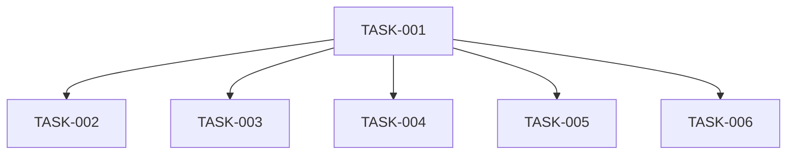
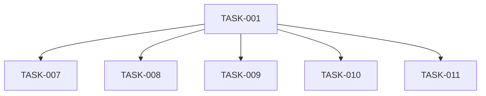
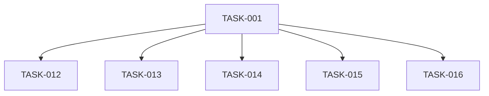
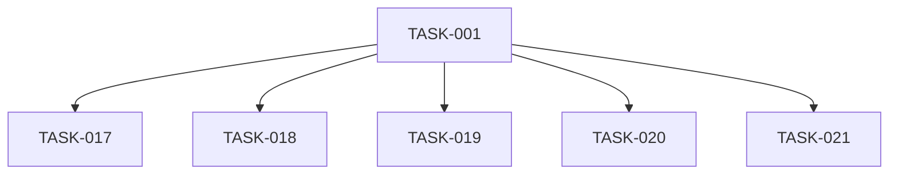

# Martian Pineapple — independent implementation and integration

This document guides the independent implementation and integration of the 21 UI tasks. The repository baseline has been audited against branch `dhani/ui-planning` at commit `7480107`. `OWNERS.md` and `INTERFACE.md` govern team ownership and contracts. The UI role (Dhani) is restricted to `src/ui/**`.

## 1. Dependency graph and permitted order

TASK-001 has no prerequisites. Its working, frozen UI foundation within `src/ui/**` is the sole prerequisite for each TASK-002–021. After foundation acceptance, all 20 leaves can be developed and reviewed concurrently and merged in any order. There is no late integration or end-to-end-test task masquerading as an independent leaf.

The four panels below show the same foundation node and all 20 explicit edges. They are separate visual panels only, not sequential phases or four foundation tasks.









Adjacency rule: `prerequisites(TASK-001) = {}`; for each integer n from 2 through 21, `prerequisites(TASK-n) = {TASK-001}`. Total: 21 nodes, 20 edges. Runtime inputs shared across features are provided by TASK-001, not generated by a sibling leaf.

## 2. Established team baseline and boundaries

The application repository is established and functional:
- **Repository baseline:** React 19.3.1, TypeScript 6.0.3, Vite 8.3.8, Vitest 5.1.0, ESLint 10.15.0 on Node >= 20.19.
- **Ownership (OWNERS.md):**
  - **Role C (Integration):** owns `src/contracts/**`, `src/state/**`, `src/data/**`, `src/app/**`, `src/export/**`, `src/worker/**`, `tests/**`, `scripts/**`, and root configs (`package.json`, `vite.config.ts`, `tsconfig*.json`).
  - **Ayush:** owns `src/routing/**`.
  - **Role B:** owns `src/terrain3d/**`.
  - **Role A:** owns `public/bundles/**`.
  - **Dhani (UI):** owns `src/ui/**`.
- **Contracts (INTERFACE.md):** Planar local meters (`LocalPoint { east_m, north_m }`, `CellRef`, `Extent`). North-up, row-major grid. Quality codes (0..3) and exclusion codes (0..4). Discriminated union `RouteResponse`.
- **2D Map:** HTML5 Canvas implementation in `src/ui/MapCanvas.tsx` using `src/contracts/grid.ts` coordinate helpers (`cellCenter`, `pointToCell`). No Leaflet or external map package is used.
- **Protected root configuration:** Neither TASK-001 nor any leaf may modify root configuration, dependencies, or files owned by other contributors.

## 3. Foundation acceptance gate (TASK-001)

The foundation owner must demonstrate all of these before the coordinator marks TASK-001 DONE:

| Gate | Required evidence |
| --- | --- |
| UI Scope compliance | All changes are strictly contained within `src/ui/**` and `handoffs/TASK-001.md`. No modifications to protected shared files. |
| Frozen UI contracts | UI types, shared component props, and slot interfaces established under `src/ui/shared/`. |
| Working baseline shell | `src/ui/App.tsx` refactored into a modular slot-based shell that boots cleanly with zero or any subset of leaves. |
| Existing integration compliance | All smoke-test hooks (`data-testid`, ARIA labels) expected by `tests/app.smoke.test.tsx`, `tests/selectionSync.test.tsx`, and `scripts/smoke-preview.mjs` pass. |
| Canvas map host | `MapCanvas.tsx` refactored to support modular layer extensions while preserving local meter projection and hover sync. |
| Individual feature harness | Disposable test harness in `src/ui/` capable of mounting any single leaf module with all other 19 leaves absent. |
| State/lifecycle integration | Seamless integration with `useAppState()`, `useRouteRunner()`, `selectSelection()`, and `TerrainSlot`. |
| Commands and compilation | Clean execution of `npm run typecheck`, `npm run lint`, `npm test`, and `npm run build`. |

Then freeze/tag `ui-foundation-v1`, record its actual full commit in TASK_STATUS.md, and let leaf agents branch from it. Foundation changes after this point are versioned amendments.

> [!NOTE]
> **User-approved demo acceptance:** On 2026-11-14, TASK-001 was formally accepted by the user as the baseline for local demo development with known verification limitations (automated disposable-tree isolation runners and physical screen-reader/device checks deferred). Where automated isolation tooling is incomplete, reviewers must perform explicit Git diff and import reviews rather than claiming automation alone has passed.

## 4. Leaf branches, entry points and merge process

After implementation authorization and foundation completion, create one branch/worktree per leaf from the frozen commit. Branch form: `task/TASK-XXX-<slug>`. Each leaf owner edits only its exclusive path under `src/ui/features/<slug>/**` and writes its own handoff.

Example entry shape:

```tsx
import type { FeatureModule } from '../../shared/types';
import { Feature } from './Feature';

export default {
  id: '<assigned-slug>',
  slot: '<assigned-slot>',
  Component: Feature,
} satisfies FeatureModule;
```

Foundation discovery finds `src/ui/features/*/entry.tsx` via `import.meta.glob`. Each slot has one fixed owner. There is no shared entry list to edit. Hooks and state are consumed from `useAppState()` or `src/ui/shared/`.

Review each submission separately:

1. Confirm the branch's base equals the frozen foundation commit and the handoff lists all changes.
2. Run `npm run typecheck`, `npm run lint`, and `npm test -- src/ui/features/<slug>`. No sibling implementation may be required to pass the leaf's acceptance criteria.
3. Verify isolation using the UI-owned isolation check script.
4. Review actual behavior against task criteria, narrow/desktop evidence, accessibility and scientific labels.
5. If accepted, integrate the branch into the integration branch. Verify that discovery places its entry into the correct slot; run full test suite and build. Record reviewed commit in TASK_STATUS.md.

## 5. Independence checks the foundation must implement

TASK-001 must implement the following checks in UI-owned scripts/tests under `src/ui/` (without modifying root `package.json`):

| Check | Rule / expected failure |
| --- | --- |
| Task dependency validation | Exactly 21 known IDs; TASK-001 has no prerequisite; every leaf has exactly TASK-001. Reject extra or implicit task prerequisites. |
| Ownership diff check | Compare a leaf diff to the frozen foundation. Permit its exact feature root `src/ui/features/<slug>/**` and handoff only; reject all other writes. |
| Import restriction | A leaf may import only its own files, `src/ui/shared/**`, Role C public exports (`src/contracts/**`, `src/state/**`), and pinned dependencies (`react`). Never import another leaf. |
| Registry check | Reject duplicate/missing public entries for included features, duplicate IDs/slots and ID-slot mismatch. |
| Isolation check | In a disposable tree or mock harness, retain the foundation plus one leaf. Run typecheck, unit tests, and build; all other leaf code must be absent. |
| Foundation immutability | Confirm frozen foundation files are unchanged by leaf commits. |

> [!IMPORTANT]
> **Verification standard during demo phase:** Automated static rules are implemented in `src/ui/scripts/check-isolation.mjs`. However, full disposable-tree execution is deferred. Reviewers must explicitly verify every leaf branch using:
> 1. `git diff --stat ui-foundation-v1...HEAD` to prove changes are strictly confined to `src/ui/features/<slug>/**` and `handoffs/TASK-XXX.md`.
> 2. Source code inspection to confirm zero imports from sibling features or unapproved external packages.
> 3. Clean execution of `npm run typecheck`, `npm run lint`, and `npm test -- src/ui/features/<slug>`.

## 6. Interaction contracts during assembly

| Trigger | Sole state owner / handler | What all consumers observe |
| --- | --- | --- |
| Choose preset | `mission/setStart` / `mission/setDestination` with preset `LocalPoint` and `poiId` | Start and/or destination update in `state.currentMission`; route marked stale. |
| Canvas background click | `MapCanvas.tsx` click dispatch | Dispatches `mission/setStart` or `mission/setDestination` with clicked `LocalPoint`. |
| Submit endpoint form | Validator -> `mission/setStart` / `mission/setDestination` | Center feedback; invalid attempt preserves current endpoints/result. |
| Change policies/quality/round trip | `mission/setPolicies`, `mission/setStrictQuality`, `mission/setRoundTrip`, `mission/setWeights` | Old result marked stale (`isStale = true`), next calculation uses new inputs. |
| Change layer visibility/opacity | `view/setLayer` | Raster, marker, or route visibility updates; request revision/result validity untouched. |
| Calculate/cancel/retry | `useRouteRunner` (`requestRoute`, `cancelRoute`) | Dispatches `route/requested`, worker runs solver, responses update `routeRun` and `routeCandidates`. |
| Select candidate | `route/select` | Map, comparison, profile, evidence, briefing, and 3D terrain receive single synchronized selection. |
| Inspect profile/sample | `view/hover` with `HoverSample { candidateId, pathIndex }` | Selected candidate's matching sample receives hover highlight across map, profile, 3D, and briefing. |
| 2D / 3D toggle | `view/setMode` (`'2d' | '3d'`) | View mode switches; `TerrainSlot` handles 3D loading/fallback while 2D canvas remains mounted. |
| Download JSON | `serializeRouteExport` | Serializes current mission result to deterministic JSON format `mars-pathfinder/route-export@1`. |

## 7. Verification commands and gates

Existing repository package scripts are used directly:

Foundation gate:

```sh
npm ci
npm run typecheck
npm run lint
npm test
npm run build
npm run smoke
```

Each leaf substitutes its actual task ID and slug:

```sh
npm run typecheck
npm run lint
npm test -- src/ui/features/<slug>
node src/ui/scripts/check-isolation.mjs --task=TASK-XXX
npm run build
```

After all accepted leaves are assembled, the coordinator runs:

```sh
npm ci
npm run typecheck
npm run lint
npm test
npm run build
npm run audit
npm run smoke
```

## 8. Assembled product acceptance

These coordinator checks run through the actual application:

| Scenario | Expected behavior |
| --- | --- |
| Initial region load | Project/region title, simulation disclaimer, synthetic warning banner (if synthetic) rendered; no invented route metrics. |
| Keyboard-only mission | Choose preset, toggle supported policy, calculate, select route and inspect evidence without pointer precision. |
| Real registered bundle | Raster canvas, grid landmarks, markers, route polylines, and meter scale agree. |
| Overlay toggles | Opacity, visibility, and quality distinctions update without recalculating routes. |
| Rapid mission change | Latest response wins; stale flag displayed while recalculation runs. |
| Invalid endpoint | Immediate actionable feedback; previous valid mission preserved. |
| Policy equivalence | Grouped candidate geometry labeled with all producing policies; no artificial line offsets. |
| Shared route selection | Canvas map, comparison, profile, evidence, 3D slot, briefing, and JSON export all reference the same candidate. |
| Profile hover | Pointer/range slider selects sample index; canvas map, 3D, and briefing display matching point coordinates/elevation. |
| No path / strict exclusion | Truthful explanation; no automatic constraint relaxation. |
| Timeout / error | Distinguished from unreachable terrain; retry preserves inputs. |
| Incomplete return | Clearly labeled as `round-trip-incomplete`; no misleading full-round-trip totals. |
| 3D fallback | When WebGL is unavailable or render throws, gracefully degrades to 2D canvas with error message and retry button. |
| Print and download | Print stylesheet produces clean light briefing; JSON export preserves exact coordinates and versions. |
| Desktop/narrow/contrast | Verified at 1440×900 and 390×844 without overlapping controls or clipped text. |

## 9. External inputs and identified blockers

TASK-001 maintains records of external owner inputs:
- **Region Manifest & Rasters:** Produced by Role A; currently served from `public/bundles/synthetic-v0/`.
- **Solver Engine:** Owned by Ayush in `src/routing/`; currently using `placeholderEngine.ts`.
- **3D View:** Owned by Role B in `src/terrain3d/`; loaded via `TerrainSlot.tsx`.
- **Identified Blockers / Schema Limitations:**
  - *TASK-017 (Media):* `RegionManifest.displayAssets` currently lacks rover telemetry and camera orientation schemas. Rich panorama/viewpoint features are blocked until Role A / Role C supply schema and assets.
  - *TASK-018 (Provenance):* `SourceRecord` schema currently lacks explicit native resolution and processing step arrays. Detailed provenance reporting is limited to fields provided in `src/contracts/manifest.ts`.

## 10. Final integration record

The coordinator records accepted feature commits, tests and any actual external blockers in TASK_STATUS.md and foundation documentation. All task DONE statuses require review.
