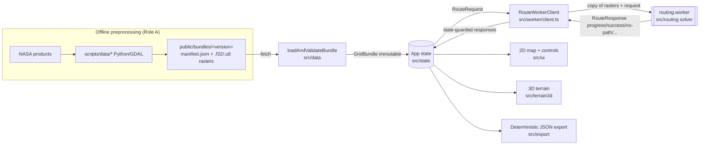

# MARS PATHFINDER

Static, offline-capable Mars route planner (NASA Space Apps 2026 hackathon prototype).
React + TypeScript + Vite. No backend, no API keys, no accounts. Routes are computed by a
deterministic solver in a Web Worker over a versioned, pre-processed terrain bundle.

> **Status:** integration foundation (Role C, Phases 1–2). Default data is the **SYNTHETIC** fixture
> `public/bundles/synthetic-v0`. The routing engine, map UI and 3D view are clearly-marked
> placeholders for their owners. Educational simulation, not a safety assessment.

## Setup

Requires **Node ≥ 20.19** (tested with Node 24.22, npm 11).

```bash
npm install
npm run dev          # (or npm start) dev server, http://localhost:5173
npm run typecheck    # tsc -b, strict
npm run lint         # eslint
npm test             # vitest (unit + jsdom app smoke)
npm run build        # -> dist/
npm run preview      # serve dist/ at http://localhost:4173
npm run smoke        # headless Chrome journey against a running preview (needs local Chrome)
npm run smoke:no-webgl  # same, with WebGL disabled (3D must degrade to 2D)
npm run audit        # after build: gzip budgets + console/secret/local-path scan of dist/
npm run audit:release   # same, but FAILS while production still serves the synthetic bundle
npm run fixture      # regenerate the synthetic bundle (deterministic)
npm run validate-bundle -- public/bundles/<bundle-dir>
```

**Offline / local demo:** `dist/` is fully static with relative paths (`base: './'`), so it works under
any sub-path. Don't open `index.html` via `file://` (module workers are blocked); serve it instead:
`npx vite preview` or `cd dist && python3 -m http.server 8080`.

## Testing

| Command | What |
|---|---|
| `npm test` | Vitest unit/integration tests (node + jsdom). |
| `npm run build && npm run build:e2e && npm run e2e` | Playwright browser e2e against the **built** app served under `/marspineapple/` (synthetic fixture). |
| `npm run e2e:update-golden` | Rewrite `e2e/golden/export-outpost-eastbench-c2.json` after an intentional export change (review the diff!). |

The e2e suite uses the installed Google Chrome (`channel: 'chrome'`, override with `PW_CHANNEL`), which is
preinstalled on GitHub's ubuntu runners — no browser download. Two builds are served by `scripts/serve-static.mjs`:

* **`release`** project → `dist/` (exactly what Pages deploys) on :4280 — `e2e/journey.spec.ts`: happy journey
  (preset → calculate → select c0/c1/c2 → map/profile/briefing/3D sync → hover → print preview → JSON export
  byte-identical to the golden file, no local paths/URLs), no-path (sealed basin), rapid destination switching
  (stale responses discarded), release id / synthetic badge / no external requests.
* **`variant`** project → `dist-e2e/` (`VITE_TILES=trek VITE_ROUTE_TIMEOUT_MS=1500`, public env only) on :4281 —
  `e2e/failures.spec.ts`: invalid manifest (schema + version), raster byte-length mismatch, missing raster,
  worker timeout, worker crash, missing optional texture, 3D chunk load failure, no WebGL, tile probe ok / offline / hanging.

**No test hooks ship in the app.** Failures are injected from the outside with Playwright `page.route`
(mutated manifest, 404/short rasters, a replacement or delayed worker script, aborted 3D chunk, offline/hanging
tiles) and `addInitScript` (WebGL disabled). Every test fails on any console error not explicitly allow-listed
for that test (`consoleGuard.allow(...)` in `e2e/fixtures.ts`) and asserts user-visible text.

### `data-testid` contract (Dhani, Role B: please keep these when restyling)

| testid | Element / meaning |
|---|---|
| `release-id`, `synthetic-badge`, `synthetic-production-warning` | Header release id, synthetic data badge/warning |
| `bundle-error` | Region load failure message (stage + detail) |
| `start-preset`, `destination-preset` | Start / destination `<select>`s (values = preset ids) |
| `calculate`, `cancel-route`, `stale` | Run controls; stale-result notice |
| `route-status` (+ `data-status`: idle/running/success/no-path/timeout/data-error/…), `route-message` | Route state + user message |
| `candidate-<id>` | Candidate selector buttons (`candidate-c0`…) |
| `map-canvas`, `profile`, `briefing`, `briefing-hover` | 2D map, elevation profile (hover slider), briefing, hover readout |
| `view-2d`, `view-3d`, `terrain-view` (+ `data-selected-candidate`, `data-hover-index`), `terrain-fallback` | 3D toggle, 3D view, 2D fallback |
| `export-json` | JSON export button |
| `imagery-status`, `optional-assets-status` (+ `data-status`) | Context tiles status, optional display assets status |

## Simulation suite

Deterministic, seeded synthetic terrains that exercise the whole pipeline
(bundle validation → worker/route engine → state → export). Code lives in `src/sim/` (generators,
oracles, invariants; dev/test only, never imported by the app; `npm run audit` fails if it ever ships),
tests in `tests/sim/`, the CLI in `scripts/sim/`.

| Command | What |
|---|---|
| `npm run sim` | Runs every scenario case through the engine and prints a summary table (status, candidates, distances, unknown-quality metres, solve time, invariant check). Exit 1 on any invariant violation. `-- --json out.json` writes details. |
| `npm run sim:test` | Only the simulation tests (they also run in `npm test`/CI). |
| `SIM_FUZZ_TERRAINS=1500 npm run sim:test` | Bigger fuzz run (default 30 terrains × 7 requests = 210). A failure prints `FAILING SEED n`; reproduce with `SIM_FUZZ_SEED=n`. |
| `SIM_ENGINE=path/to/engine.ts npm run sim:test` | Run the same invariants against another solver module (exports `solveRoute(grid, request, hooks?)` + `MODEL_VERSION`). |
| `npm run sim:update-golden` | Rewrite `tests/sim/golden/` after an intentional solver/export change (review the diff). |
| `npm run examples` | Regenerate `docs/examples/*.json` from the fixture with the current engine. |

**Scenarios** (`src/sim/scenarios.ts`): `flat-plain` (64², octile-distance check), `slope-plane` (analytic 12° plane),
`ridge-gap` (wall with one gap), `maze` (serpentine corridors), `crater-basin` (unreachable floor → no-path),
`noisy-rough` (seeded fractal noise), `quality-patchwork` / `quality-wall` (good vs unknown quality, strict mode),
`missing-holes` (NaN holes + derivative halos), `excluded-cells` (28 % random manual exclusions),
`large-512` (262k cells, perf budget), `strip-row` / `strip-column` (1×N, N×1, anisotropic cells),
`degenerate-endpoints` (start == goal, every border, outside, NaN, excluded, strict-unknown, no policies),
`no-quality-classes` (strict refused). Plus three random-terrain families for fuzzing.

**What is checked** (`src/sim/invariants.ts`, `tests/sim/expectations.ts`, solver-independent):
8-neighbour continuity, no revisits, only valid cells (never excluded/missing/NaN-derivative), no corner cutting past
invalid cells, endpoints = containing cell's centre, path points = cell centres + raster elevation, metrics recomputed
from the path (distance, ascent/descent, exposure, intervals, profile), weighted cost ≥ straight line, strict mode never
uses unknown quality, round-trip legs reversed, no duplicate candidates, correct invalid-input reasons/fields, and
reference oracles: on flat terrain success ⇔ connected and shortest-feasible = the 8-neighbour optimum; on any terrain
data-level disconnected ⇒ never success; uncertainty-aware never crosses more unknown metres than shortest-feasible
(flat good/unknown terrain); identical output across 20 runs. Worker sims: bursts, cancel, timeout (client and
solver-side), crash, region switch, random interleavings — only the last request reaches state.
Golden exports (`tests/sim/golden/`) pin the placeholder; they are skipped when `SIM_ENGINE` is set.

## CI and deployment

`.github/workflows/deploy.yml`: every push/PR runs typecheck, lint, test, build, `npm run audit`, the
headless smoke, the simulation summary (`npm run sim`) and the Playwright e2e suite against `dist/` served under `/marspineapple/` (only `dist/` is deployed). Pushes to `main` (and manual
`workflow_dispatch`) then deploy `dist/` to GitHub Pages: https://hritvikarora.github.io/marspineapple/
(requires Pages enabled with source "GitHub Actions"). The relative `base: './'` build works under that sub-path.

## Architecture



* One source of truth: `src/state/store.ts` (pure reducer, tested) exposed via `useAppState()`.
  The same `GridBundle` and `RouteCandidate` objects feed map, 3D and export.
* Invalidation rules, worker lifecycle, buffer ownership, coordinate conventions and JSON examples:
  **[INTERFACE.md](INTERFACE.md)**. Folder owners: **[OWNERS.md](OWNERS.md)**.
* Release identifier `app · bundle · model` is shown in the header and embedded in exports.
* Config that changes data/model behaviour lives in `src/config.ts`. All `VITE_*` values are public
  (baked into the static build); the app uses no secrets.
* **Selection sync:** `selectedCandidateId` and the hovered profile sample (`display.hover`) live in
  the store. Map, elevation profile, 3D props, briefing and export all read the single
  `selectSelection(state)` view-model, so they cannot disagree (tested in `tests/selectionSync.test.tsx`
  and in the browser smoke).
* **3D isolation:** `src/app/TerrainSlot.tsx` probes WebGL, lazy-loads `src/terrain3d` behind
  `Suspense`, and wraps it in an error boundary. No WebGL, a chunk-load failure, a render throw or a
  reported context loss (`onError`) records `display.terrain3d` and falls back to the 2D map with an
  accurate message (+ Retry when WebGL exists). Profile and briefing are always visible.
* **Optional context imagery:** `src/app/tiles.ts` (NASA Trek WMTS, CORS-enabled) is **off by
  default** (`VITE_TILES=trek` to enable). Every fetch settles within 4 s (timeout/offline/http-error)
  and nothing in bundle loading or routing waits for it.

### Swapping in the real bundle (Role A)

1. Put the bundle in `public/bundles/<bundleId>/` (manifest + rasters, INTERFACE.md §2) and run
   `npm run validate-bundle -- public/bundles/<bundleId>`.
2. Edit `public/bundles/index.json`: set `"release": "<bundleId>"` and add an entry to `bundles`.
   Keep `"dev": "synthetic-v0"` so the dev server and tests stay on the fixture.
3. `npm run build && npm run audit:release` — passes only when production no longer serves a
   `synthetic: true` manifest. Until then every production build shows a red
   "serving the SYNTHETIC fixture" banner.
4. Ad-hoc overrides without editing files (public build-time env vars):
   `VITE_BUNDLE=<bundleId> npm run build` or `VITE_BUNDLE_MANIFEST=<url> npm run dev`
   (precedence: `VITE_BUNDLE_MANIFEST` > `VITE_BUNDLE` > `index.json`).

### Asset budget (gzip, enforced by `npm run audit`)

| Item | Budget | Current |
|---|---|---|
| Entry JS (initial load) | 150 KB | ~79 KB |
| All JS incl. lazy chunks + worker | 450 KB | ~84 KB |
| Routing worker | 50 KB | ~4 KB |
| CSS | 30 KB | ~0.5 KB |
| Each region bundle | 15 MB | synthetic 3.5 KB |
| Total `dist/` raw | 60 MB | ~0.3 MB |

three.js and Role B code must stay in the lazy `src/terrain3d` chunk; large textures/panoramas should be
`displayAssets` loaded on demand.

```
src/
  contracts/   canonical types + shared coordinate adapter      (Role C)
  data/        loadAndValidateBundle + BundleLoadError           (Role C)
  state/       store, context, useRouteRunner                    (Role C)
  worker/      client (typed wrapper), handler, worker entry     (Role C protocol)
  routing/     solver — placeholderEngine.ts is a STUB           (Ayush)
  app/         composition: bundle selection, 3D slot, tiles     (Role C)
  ui/          App shell, MapCanvas, ElevationProfile, Briefing — minimal STUBS (Dhani)
  terrain3d/   TerrainView — STUB with agreed props              (Role B)
  export/      deterministic serializer                          (Role C)
public/bundles/synthetic-v0/   synthetic fixture + INSPECT.txt   (generated)
scripts/       make-fixture, validate-bundle, smoke-preview
tests/         integration tests (loader, store, worker client, export, engine sanity, app smoke)
docs/examples/ request/response JSON examples
```

## The synthetic fixture

20×12 cells, 10 m, **not Mars data**. A ridge (col 10) with a north gap through an *unknown-quality*
corridor and a south gap through good terrain, a rough patch, a low-quality strip, a NaN hole, a manual
exclusion and a sealed basin (guaranteed no-path). Recognisable corners: NW −2600.0 m, NE −2581.0 m,
SW −2605.5 m. `INSPECT.txt` prints every layer as a table. Presets: outpost → east bench gives a
shortest route (≈175 m, ≈82 m unknown quality) vs an uncertainty-aware route (≈207 m, 0 m unknown).

## How to plug in your part

**Ayush (routing).** Replace `src/routing/placeholderEngine.ts`; keep the export
`solveRoute(grid: RoutingGrid, req: RouteRequest, hooks) => RouteFinalResponse` and `MODEL_VERSION` in
`src/routing/index.ts`. Echo `requestId`/`bundleVersion`/`modelVersion`; call `hooks.shouldStop()`
periodically (timeouts) and `hooks.onProgress(n)` sparingly. Use `cellCenter`/`pointToCell` from
`src/contracts/grid.ts`. Put your tests in `src/routing/*.test.ts` (vitest picks them up). Bump
`MODEL_VERSION` whenever weights/limits change. Don't edit state or UI files — ask Role C.

**Dhani (UI).** Own `src/ui/`. `ElevationProfile` and `Briefing` are minimal stubs; derive everything from
`selectSelection(state)` and write hover with the `view/hover` action. Read state with `useAppState()` and dispatch actions from
`src/state/store.ts`; run routes with `useRouteRunner()` (`requestRoute`, `cancelRoute`). Never touch
the worker. Use the `isStale` flag, `routeRun` state and `selectedCandidateId` (single selection for
map/profile/3D/briefing). Keep the `data-testid`s / accessible labels used by `tests/app.smoke.test.tsx`
and `scripts/smoke-preview.mjs` (or update them with Role C). Export JSON via `serializeRouteExport`.

**Role A (data).** Produce `public/bundles/<bundleId>/manifest.json` + raw little-endian rasters exactly
as in INTERFACE.md §2 (look at `scripts/make-fixture.mjs` for a reference writer and the synthetic manifest
as a template). Validate with `npm run validate-bundle -- public/bundles/<dir>`. Any change to analytical
bytes ⇒ new `bundleVersion`. Keep raw archives outside the repo (`/raw` is git-ignored). Then tell Role C
to point `BUNDLE_MANIFEST_URL` in `src/config.ts` at it.

**Role B (3D).** Own `src/terrain3d/`. Implement the default export with `TerrainViewProps`
(`src/terrain3d/TerrainView.tsx`). `TerrainSlot` already lazy-loads it, probes WebGL first and catches
render errors; keep three.js imports inside this folder so they stay out of the initial bundle. Use
`toSceneXYZ` (X=east, Y=elev, Z=−north). Never mutate bundle arrays. Highlight
`highlightPathIndex` (shared hover) and `selectedCandidateId`; call `onSelectCandidate`/`onCameraChange`
instead of keeping your own copies. On `webglcontextlost`, a missing texture or bad terrain call
`onError({ kind, message })` — the app degrades to 2D. Keep `data-testid="terrain-view"` with
`data-selected-candidate` / `data-hover-index` (used by tests and smoke).

**Role C (integration).** Remaining: point `release` at Role A's bundle, integrate Dhani's and Role B's
real components, full e2e journey incl. failure modes, release checklist, deploy, demo, submission.

## Limitations (current)

* Synthetic data only; no NASA products are integrated yet, so no source credits are claimed.
* Placeholder solver limits (max slope 25°, max edge grade 20°) and weights are unvalidated demo values.
* Tested in headless Chrome only.
