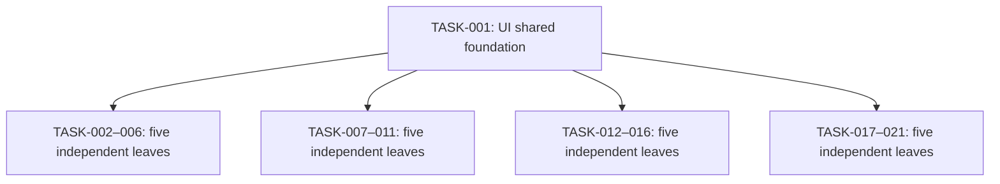

# Martian Pineapple — executable UI implementation plan

Planning date: 14 November 2026. Scope: Mars mission-planning UI within `src/ui/**`.
Baseline: Audited against branch `dhani/ui-planning` at commit `7480107`.
`OWNERS.md` and `INTERFACE.md` establish team boundaries and shared contracts.

## 1. Evidence and limits of the analysis

The team repository is an active React/TypeScript/Vite application. The existing baseline implements:
- Role C infrastructure: shared contracts (`src/contracts/`), application state store and invalidation rules (`src/state/`), bundle loading and validation (`src/data/`), typed worker protocol and client (`src/worker/`), 3D slot with WebGL detection and graceful 2D degradation (`src/app/TerrainSlot.tsx`), deterministic export serialization (`src/export/`), and comprehensive integration test suites (`tests/`).
- Ayush's solver engine in `src/routing/` (`placeholderEngine.ts`).
- Role B's 3D terrain component in `src/terrain3d/` (`TerrainView.tsx`).
- Role A's synthetic raster bundle in `public/bundles/synthetic-v0/`.
- Dhani's UI role: exclusively owns `src/ui/**`, which currently contains functional stubs (`App.tsx`, `MapCanvas.tsx`, `ElevationProfile.tsx`, `Briefing.tsx`, `app.css`).

### Supported stack and responsibilities

| Item | Evidence / architectural consequence |
| --- | --- |
| React 19, TypeScript, Vite | Pinned in `package.json`. Strictly strictly typed (strict mode, ES2022/ESNext). |
| HTML5 Canvas 2D Map | Implemented in `src/ui/MapCanvas.tsx`. Uses planar meter frame (`east_m`, `north_m`) and `src/contracts/grid.ts` helpers. **No Leaflet or other external map dependencies.** |
| Route computation / worker | Managed by Role C's `RouteWorkerClient` and `src/state/useRouteRunner.ts`. UI dispatches actions and consumes typed results; no direct worker messaging or invented REST API. |
| Scientific region bundle / rasters | Managed by Role C's `loadAndValidateBundle`. Stored as little-endian binary Float32Array/Uint8Array rasters in `GridBundle`. |
| 3D Terrain renderer | Owned by Role B (`src/terrain3d/`). Hosted via Role C's `src/app/TerrainSlot.tsx`. UI supplies props and receives camera/selection/error callbacks. |
| Testing & Verification | Vitest, Testing Library, and Playwright are configured in `package.json`. Existing package scripts are used directly. |

### Feature coverage and boundaries

| Requirement family | Owner(s) |
| --- | --- |
| UI foundation, modular slot registry, Canvas map host/adapter, UI primitives, test harness | TASK-001 (`src/ui/**`) |
| Mission context, educational simulation, fictional outpost explanation, useful initial state | TASK-002 (`src/ui/features/mission-context`) |
| Accessible preset science destinations and purpose | TASK-003 (`src/ui/features/destinations`) |
| Endpoint forms, selection modes, requested versus accepted cell, rejected-click feedback | TASK-004 (`src/ui/features/endpoints`) |
| Policy selection, preference versus strict quality, round-trip controls | TASK-005 (`src/ui/features/assumptions`) |
| Calculate/update/cancel/retry control and concise progress/stale feedback | TASK-006 (`src/ui/features/request-controls`) |
| Usable boundary, orientation, meter scale, fit-region control | TASK-007 (`src/ui/features/map-chrome`) |
| Imagery, elevation shading, slope and quality raster overlays on Canvas | TASK-008 (`src/ui/features/map-rasters`) |
| Layer controls, opacity, legends and resolution explanation | TASK-009 (`src/ui/features/layer-controls`) |
| Outpost, endpoint, science-point markers on Canvas | TASK-010 (`src/ui/features/map-markers`) |
| Route lines, equivalence, selection and focused-position marker on Canvas | TASK-011 (`src/ui/features/map-routes`) |
| Candidate comparison and common physical/evidence metrics | TASK-012 (`src/ui/features/comparison`) |
| Distance/elevation profile and linked keyboard/pointer inspection | TASK-013 (`src/ui/features/profile`) |
| Selected mission evidence, return completeness and optional time | TASK-014 (`src/ui/features/mission-evidence`) |
| No-path, timeout, partial-policy and data-error explanations | TASK-015 (`src/ui/features/result-state`) |
| External 3D host, lazy loading, retry, capability fallback | TASK-016 (`src/ui/features/terrain-host`) |
| Fixed-viewpoint and panorama media panel | TASK-017 (`src/ui/features/media`) |
| Provenance and source drawer and attribution | TASK-018 (`src/ui/features/sources`) |
| Printable mission briefing | TASK-019 (`src/ui/features/briefing`) |
| Reproducibility JSON download | TASK-020 (`src/ui/features/json-export`) |
| Point-level terrain inspection and distinct quality categories | TASK-021 (`src/ui/features/point-inspector`) |

All UI development is restricted to `src/ui/**`. No authentication, databases, oxygen/survival models, or VR locomotion are permitted.

## 2. Independence, honestly defined

There are **21 tasks: one foundation (TASK-001) and 20 leaves (TASK-002–021)**. TASK-001 has no dependencies within the UI scope. Every leaf task's complete prerequisite set is `{TASK-001}`. Leaf agents create and modify only their assigned `src/ui/features/<slug>/**` directory and `handoffs/TASK-XXX.md`. Leaf modules must not import, edit, wait for, or require another leaf's code.



## 3. Binding contracts to establish in TASK-001

The contracts below are grounded in the team's frozen baseline (`src/contracts/` and `INTERFACE.md`).

### C1 — Region, coordinates and raster data

From `src/contracts/geometry.ts`, `src/contracts/manifest.ts`, and `src/contracts/bundle.ts`:

```ts
interface LocalPoint {
  east_m: number;
  north_m: number;
}

interface LocalPoint3 extends LocalPoint {
  elevation_m: number;
}

interface CellRef {
  row: number;
  col: number;
  index: number; // row * width + col
}

interface Extent {
  west_m: number;
  east_m: number;
  south_m: number;
  north_m: number;
}

type RasterLayerId = 'elevation' | 'slope' | 'roughness' | 'quality' | 'exclusion';

const QUALITY = {
  NO_ELEVATION: 0,
  GOOD: 1,
  LOW: 2,
  UNKNOWN: 3,
} as const;

const EXCLUSION = {
  NONE: 0,
  MISSING_ELEVATION: 1,
  UNSUPPORTED_DERIVATIVE: 2,
  OUTSIDE_EXTENT: 3,
  MANUAL: 4,
} as const;

interface PointOfInterest {
  id: string;
  name: string;
  kind: 'outpost' | 'science-stop' | 'context' | 'test';
  position: LocalPoint;
  purpose: string;
  officialName: boolean;
  positionalUncertainty_m: number | null;
  sourceIds: string[];
  synthetic: boolean;
}

interface GridBundle {
  manifest: RegionManifest;
  elevation: Float32Array;
  slope: Float32Array;
  roughness: Float32Array;
  quality: Uint8Array;
  exclusion: Uint8Array;
}
```

* Coordinate conventions: Planar meters: `east_m` increases east; `north_m` increases north. Row 0 is north, column 0 is west. No `x`/`y`/`lat`/`lng`.
* Grid conversions: use `cellCenter(grid, cell)`, `pointToCell(grid, point)` from `src/contracts/grid.ts`.
* Canvas Map: renders `GridBundle` rasters and vector overlays directly on an HTML5 `<canvas>`. No Leaflet.

### C2 — Routing request, response, and metrics

From `src/contracts/route.ts`:

```ts
const ROUTE_POLICIES = ['shortest-feasible', 'terrain-aware', 'uncertainty-aware'] as const;
type RoutePolicyId = (typeof ROUTE_POLICIES)[number];

interface RouteRequest {
  requestId: string;
  bundleVersion: string;
  modelVersion: string;
  start: LocalPoint;
  destination: LocalPoint;
  policies: RoutePolicyId[];
  weightOverrides?: Partial<Record<RoutePolicyId, { slope: number; roughness: number; quality: number }>>;
  strictQuality: boolean;
  roundTrip: boolean;
  timeoutMs?: number;
}

interface RouteMetrics {
  horizontalDistance_m: number;
  surfaceDistance_m: number;
  ascent_m: number;
  descent_m: number;
  maxTerrainSlope_deg: number;
  maxAbsEdgeGrade_deg: number;
  lowQualityLength_m: number;
  lowQualityPct: number;
  unknownQualityLength_m: number;
  unknownQualityPct: number;
  cellCount: number;
}

interface RouteCandidate {
  candidateId: string;
  policies: RoutePolicyId[];
  outbound: RouteLeg;
  returnLeg: RouteLeg | null;
  missionStatus: 'one-way' | 'round-trip-complete' | 'round-trip-incomplete';
  explanation: string[];
}

type RouteResponse =
  | RouteProgress
  | RouteSuccess
  | RouteNoPath
  | RouteInvalidInput
  | RouteCancelled
  | RouteTimeout
  | RouteDataError;
```

* Worker lifecycle: handled by `useRouteRunner` (`src/state/useRouteRunner.ts`) via `RouteWorkerClient`. UI calls `requestRoute()` and `cancelRoute()`.

### C3 — State store and actions

From `src/state/store.ts`:

```ts
type ViewMode = '2d' | '3d';
type LayerKey = 'elevation' | 'slope' | 'roughness' | 'quality' | 'exclusion' | 'route' | 'poi';

interface AppState {
  loadedRegion: RegionState;
  currentMission: MissionInputs;
  activeRequestId: string | null;
  routeRun: RouteRunState;
  routeCandidates: RouteCandidate[];
  selectedCandidateId: string | null;
  viewMode: ViewMode;
  isStale: boolean;
  display: DisplayState;
}

type Action =
  | { type: 'mission/setStart'; endpoint: MissionEndpoint | null }
  | { type: 'mission/setDestination'; endpoint: MissionEndpoint | null }
  | { type: 'mission/setPolicies'; policies: RoutePolicyId[] }
  | { type: 'mission/setWeights'; policy: RoutePolicyId; weights: PolicyWeights | null }
  | { type: 'mission/setStrictQuality'; value: boolean }
  | { type: 'mission/setRoundTrip'; value: boolean }
  | { type: 'route/requested'; requestId: string }
  | { type: 'route/update'; response: RouteResponse }
  | { type: 'route/select'; candidateId: string | null }
  | { type: 'view/setMode'; mode: ViewMode }
  | { type: 'view/setLayer'; layer: LayerKey; visible?: boolean; opacity?: number }
  | { type: 'view/hover'; sample: HoverSample | null }
  | { type: 'view/set3dStatus'; status: Terrain3dStatus };
```

* Selection & hover sync: derived through `selectSelection(state)`. Hover index updates via `dispatch({ type: 'view/hover', sample })`.

### C4 — Modular feature slots and UI primitives

Feature slot architecture in `src/ui/`:

```ts
type FeatureSlot =
  | 'mission-context' | 'destinations' | 'endpoints' | 'assumptions'
  | 'request-controls' | 'map-chrome' | 'map-rasters' | 'layer-controls'
  | 'map-markers' | 'map-routes' | 'comparison' | 'profile' | 'mission-evidence'
  | 'result-state' | 'terrain-host' | 'media' | 'sources' | 'briefing'
  | 'json-export' | 'point-inspector';

interface FeatureModule {
  id: string;
  slot: FeatureSlot;
  Component: React.ComponentType;
}
```

* Slot discovery: `src/ui/features/*/entry.tsx` via `import.meta.glob`.
* UI primitives: reusable components placed in `src/ui/shared/primitives/` (Button, Panel, Field, InlineNotice, ModalDrawer, VisuallyHidden).
* **Smoke test hooks to preserve**:
  - `data-testid="release-id"`
  - `data-testid="synthetic-badge"`
  - `data-testid="synthetic-production-warning"`
  - `data-testid="bundle-error"`
  - `data-testid="calculate"`
  - `data-testid="route-status"`
  - `data-testid="stale"`
  - `data-testid="map-canvas"` with `data-selected-candidate` and `data-hover-index`
  - `data-testid="profile"` with `data-candidate-id` and `data-hover-index`
  - `data-testid="briefing"` with `data-candidate-id` and `data-hover-index`
  - `data-testid="terrain-view"` with `data-selected-candidate` and `data-hover-index`

### C5 — 3D terrain host, media, export, and briefing

* 3D component: hosted in `src/app/TerrainSlot.tsx` passing `TerrainViewProps` to Role B's `TerrainView.tsx`.
* JSON export: serialized via `serializeRouteExport` and named via `exportFileName` from `src/export/serialize.ts`.
* Media assets: sourced from `manifest.displayAssets`.

### C6 — Fixtures and verification commands

Existing package commands in `package.json`:
- `npm run typecheck`
- `npm run lint`
- `npm test`
- `npm run build`
- `npm run smoke`
- `npm run audit`
- Feature-isolated tests: `npm test -- src/ui/features/<slug>`
- Isolation check: `node src/ui/scripts/check-isolation.mjs --task=TASK-XXX` (UI-owned script without root package modifications).

## 4. Task summary

| Task | Title | Depends on | Difficulty | Estimate | Slot / location |
| --- | --- | --- | --- | --- | --- |
| TASK-001 | Reconcile and deliver working UI foundation in `src/ui/**` | None | 5/5 | 12–18 h | `src/ui/**` shared foundation |
| TASK-002 | Mission context and initial guidance | TASK-001 only | 2/5 | 2–3 h | `src/ui/features/mission-context` |
| TASK-003 | Science destination selector | TASK-001 only | 2/5 | 2–3 h | `src/ui/features/destinations` |
| TASK-004 | Endpoint forms and selection modes | TASK-001 only | 3/5 | 3–5 h | `src/ui/features/endpoints` |
| TASK-005 | Supported mission assumptions | TASK-001 only | 3/5 | 3–4 h | `src/ui/features/assumptions` |
| TASK-006 | Calculate, cancel and request feedback | TASK-001 only | 3/5 | 3–4 h | `src/ui/features/request-controls` |
| TASK-007 | Map boundary, orientation and meter scale | TASK-001 only | 4/5 | 4–6 h | `src/ui/features/map-chrome` |
| TASK-008 | Registered terrain raster layers | TASK-001 only | 4/5 | 4–6 h | `src/ui/features/map-rasters` |
| TASK-009 | Layer controls and legends | TASK-001 only | 2/5 | 2–3 h | `src/ui/features/layer-controls` |
| TASK-010 | Mission and science map markers | TASK-001 only | 3/5 | 3–4 h | `src/ui/features/map-markers` |
| TASK-011 | Candidate route map overlays | TASK-001 only | 4/5 | 4–6 h | `src/ui/features/map-routes` |
| TASK-012 | Route comparison and selection | TASK-001 only | 3/5 | 3–5 h | `src/ui/features/comparison` |
| TASK-013 | Linked elevation profile | TASK-001 only | 4/5 | 4–6 h | `src/ui/features/profile` |
| TASK-014 | Selected mission evidence and completeness | TASK-001 only | 3/5 | 3–4 h | `src/ui/features/mission-evidence` |
| TASK-015 | Planning failures and recovery guidance | TASK-001 only | 3/5 | 3–4 h | `src/ui/features/result-state` |
| TASK-016 | External 3D view host and fallback | TASK-001 only | 4/5 | 4–6 h | `src/ui/features/terrain-host` |
| TASK-017 | Fixed-viewpoint and panorama media panel | TASK-001 only | 3/5 | 3–4 h | `src/ui/features/media` |
| TASK-018 | Provenance and source drawer | TASK-001 only | 3/5 | 3–4 h | `src/ui/features/sources` |
| TASK-019 | Printable mission briefing | TASK-001 only | 4/5 | 4–6 h | `src/ui/features/briefing` |
| TASK-020 | Reproducibility JSON download | TASK-001 only | 3/5 | 3–4 h | `src/ui/features/json-export` |
| TASK-021 | Point terrain evidence inspector | TASK-001 only | 3/5 | 3–4 h | `src/ui/features/point-inspector` |

## 5. Detailed task specifications

### TASK-001 — Reconcile and deliver working UI foundation in `src/ui/**`

**Objective:** establish the modular UI slot shell, Canvas map extension architecture, shared UI primitives, and test harness strictly inside `src/ui/**`, preserving all existing smoke test hooks and connecting cleanly to Role C's state and services.
**Dependency:** none. **Difficulty:** 5/5. **Estimate:** 12–18 h.
**Allowed paths:** `src/ui/**` (outside `src/ui/features/**`) and `handoffs/TASK-001.md`.
**Inputs:** `src/contracts/**`, `src/state/**`, `src/app/**`, `src/data/**`, `src/export/**`, `public/bundles/synthetic-v0/`.
**Outputs:** modular slot shell in `src/ui/App.tsx`, layer-composable `src/ui/MapCanvas.tsx`, `src/ui/shared/**`, UI test harness, and `handoffs/TASK-001.md`.

**Implementation instructions:**
1. Refactor `src/ui/App.tsx` into a responsive shell with 20 named feature slots discovered via `src/ui/features/*/entry.tsx`.
2. Refactor `src/ui/MapCanvas.tsx` to support modular Canvas layer callbacks (rasters, markers, routes, chrome, inspector) using `src/contracts/grid.ts` helpers.
3. Build shared UI primitives and design tokens in `src/ui/shared/`.
4. Provide a single-feature harness allowing any single leaf module to mount and be verified in isolation with the other 19 leaves absent.
5. Create UI isolation validation script `src/ui/scripts/check-isolation.mjs`.
6. **Preserve all existing integration test hooks**: maintain exact `data-testid` and ARIA attributes used by `tests/app.smoke.test.tsx`, `tests/selectionSync.test.tsx`, `tests/terrain3d.test.tsx`, and `scripts/smoke-preview.mjs`.

**Acceptance criteria:**
- App boots with 0 or any subset of leaves.
- All existing tests in `tests/` pass with zero regressions.
- Smoke tests and build checks pass (`npm run typecheck`, `npm run lint`, `npm test`, `npm run build`, `npm run smoke`).
- No modifications outside `src/ui/**` and `handoffs/TASK-001.md`.

---

### TASK-002 — Mission context and initial guidance

**Objective:** make region, purpose, simulation disclaimer, and next action understandable immediately.
**Dependency:** TASK-001 only. **Difficulty:** 2/5. **Estimate:** 2–3 h.
**Allowed paths:** `src/ui/features/mission-context/**`, `handoffs/TASK-002.md`. Entry: `src/ui/features/mission-context/entry.tsx` (`slot: 'mission-context'`).
**Inputs:** `state.loadedRegion`, `bundle.manifest`.
**Outputs:** Mission context component displaying title, synthetic warning, educational simulation disclaimer, and initial guidance.
**Acceptance criteria:** Clear next action visible; synthetic and fictional outpost labels clear; long text wraps cleanly; passes isolated tests.
**Verification:** `npm test -- src/ui/features/mission-context`, `node src/ui/scripts/check-isolation.mjs --task=TASK-002`.

---

### TASK-003 — Science destination selector

**Objective:** select a science destination preset without requiring map precision.
**Dependency:** TASK-001 only. **Difficulty:** 2/5. **Estimate:** 2–3 h.
**Allowed paths:** `src/ui/features/destinations/**`, `handoffs/TASK-003.md`. Entry: `src/ui/features/destinations/entry.tsx` (`slot: 'destinations'`).
**Inputs:** `bundle.manifest.pointsOfInterest` (filtered to `kind: 'science-stop'`).
**Outputs:** Accessible selector dispatching `mission/setDestination` with preset `LocalPoint` and `poiId`.
**Acceptance criteria:** Selecting preset updates destination; keyboard accessible; does not clear start point; preserves prior route if invalid.
**Verification:** `npm test -- src/ui/features/destinations`, isolation check.

---

### TASK-004 — Endpoint forms and selection modes

**Objective:** provide accessible start/destination coordinate inputs with honest cell-resolution feedback.
**Dependency:** TASK-001 only. **Difficulty:** 3/5. **Estimate:** 3–5 h.
**Allowed paths:** `src/ui/features/endpoints/**`, `handoffs/TASK-004.md`. Entry: `src/ui/features/endpoints/entry.tsx` (`slot: 'endpoints'`).
**Inputs:** `state.currentMission`, `bundle.manifest.grid`.
**Outputs:** Coordinate forms for start and destination in local meters (`east_m`, `north_m`), mode toggle for map clicking.
**Acceptance criteria:** Coordinates validated against grid extent; displays snapped cell center; keyboard accessible; invalid inputs rejected gracefully.
**Verification:** `npm test -- src/ui/features/endpoints`, isolation check.

---

### TASK-005 — Supported mission assumptions

**Objective:** expose supported routing policies and assumptions without unsupported scientific controls.
**Dependency:** TASK-001 only. **Difficulty:** 3/5. **Estimate:** 3–4 h.
**Allowed paths:** `src/ui/features/assumptions/**`, `handoffs/TASK-005.md`. Entry: `src/ui/features/assumptions/entry.tsx` (`slot: 'assumptions'`).
**Inputs:** `state.currentMission`, `bundle.manifest.strictQualitySupported`.
**Outputs:** Policy checkboxes (`shortest-feasible`, `terrain-aware`, `uncertainty-aware`), `strictQuality` toggle, and `roundTrip` toggle.
**Acceptance criteria:** Changing policies/strict/round-trip dispatches corresponding `mission/*` actions and marks routes stale; disabled when strict mode unsupported.
**Verification:** `npm test -- src/ui/features/assumptions`, isolation check.

---

### TASK-006 — Calculate, cancel and request feedback

**Objective:** render primary calculation controls with unambiguous state and progress feedback.
**Dependency:** TASK-001 only. **Difficulty:** 3/5. **Estimate:** 3–4 h.
**Allowed paths:** `src/ui/features/request-controls/**`, `handoffs/TASK-006.md`. Entry: `src/ui/features/request-controls/entry.tsx` (`slot: 'request-controls'`).
**Inputs:** `state.routeRun`, `selectCanRequestRoute(state)`, `state.isStale`.
**Outputs:** Primary Calculate/Recalculate button (`data-testid="calculate"`), cancel button, and route status (`data-testid="route-status"`).
**Acceptance criteria:** Calculates routes via `useRouteRunner`; disables when endpoints missing; shows running progress; displays `data-testid="stale"` when stale.
**Verification:** `npm test -- src/ui/features/request-controls`, isolation check.

---

### TASK-007 — Map boundary, orientation and meter scale

**Objective:** render boundary, north arrow, and local meter scale bar on the Canvas map.
**Dependency:** TASK-001 only. **Difficulty:** 4/5. **Estimate:** 4–6 h.
**Allowed paths:** `src/ui/features/map-chrome/**`, `handoffs/TASK-007.md`. Entry: `src/ui/features/map-chrome/entry.tsx` (`slot: 'map-chrome'`).
**Inputs:** `bundle.manifest.grid`, `bundle.manifest.crs`.
**Outputs:** Canvas layer rendering region extent boundary, north indicator ('N ↑'), and 50 m scale bar in local planar meters.
**Acceptance criteria:** Scale accurately reflects `cellSizeEast_m`; north arrow points up; no Earth geodesic calculations.
**Verification:** `npm test -- src/ui/features/map-chrome`, isolation check.

---

### TASK-008 — Registered terrain raster layers

**Objective:** render elevation shading, slope, and quality overlays onto the 2D Canvas.
**Dependency:** TASK-001 only. **Difficulty:** 4/5. **Estimate:** 4–6 h.
**Allowed paths:** `src/ui/features/map-rasters/**`, `handoffs/TASK-008.md`. Entry: `src/ui/features/map-rasters/entry.tsx` (`slot: 'map-rasters'`).
**Inputs:** `bundle.elevation`, `bundle.slope`, `bundle.quality`, `bundle.exclusion`, `state.display.layers`.
**Outputs:** Canvas raster drawing functions respecting visibility and opacity from `state.display.layers`.
**Acceptance criteria:** Elevation mapped to gradient; quality codes (good, low, unknown, no-elevation) and exclusions (codes 1..4) rendered distinctly; no GeoTIFF parsing.
**Verification:** `npm test -- src/ui/features/map-rasters`, isolation check.

---

### TASK-009 — Layer controls and legends

**Objective:** manage visibility and opacity for raster overlays and markers.
**Dependency:** TASK-001 only. **Difficulty:** 2/5. **Estimate:** 2–3 h.
**Allowed paths:** `src/ui/features/layer-controls/**`, `handoffs/TASK-009.md`. Entry: `src/ui/features/layer-controls/entry.tsx` (`slot: 'layer-controls'`).
**Inputs:** `state.display.layers`.
**Outputs:** Layer toggle controls and opacity sliders for `elevation`, `slope`, `roughness`, `quality`, `exclusion`, `route`, `poi`.
**Acceptance criteria:** Dispatches `view/setLayer`; layer changes do not invalidate routes or reset mission state; legends explain color codes.
**Verification:** `npm test -- src/ui/features/layer-controls`, isolation check.

---

### TASK-010 — Mission and science map markers

**Objective:** render outpost, science POIs, and start/destination markers on the Canvas map.
**Dependency:** TASK-001 only. **Difficulty:** 3/5. **Estimate:** 3–4 h.
**Allowed paths:** `src/ui/features/map-markers/**`, `handoffs/TASK-010.md`. Entry: `src/ui/features/map-markers/entry.tsx` (`slot: 'map-markers'`).
**Inputs:** `bundle.manifest.pointsOfInterest`, `state.currentMission.start`, `state.currentMission.destination`.
**Outputs:** Canvas markers for Start ('S'), Destination ('D'), Outpost, and Science POIs.
**Acceptance criteria:** Positioned at cell centers via `pointToCell`; click-to-pick updates endpoints; markers update when state changes.
**Verification:** `npm test -- src/ui/features/map-markers`, isolation check.

---

### TASK-011 — Candidate route map overlays

**Objective:** render candidate route polylines and hover indicator on the Canvas map.
**Dependency:** TASK-001 only. **Difficulty:** 4/5. **Estimate:** 4–6 h.
**Allowed paths:** `src/ui/features/map-routes/**`, `handoffs/TASK-011.md`. Entry: `src/ui/features/map-routes/entry.tsx` (`slot: 'map-routes'`).
**Inputs:** `state.routeCandidates`, `selection.candidateId`, `selection.hover`, `state.isStale`.
**Outputs:** Polyline rendering on Canvas; selected route highlighted; dashed when stale; yellow ring on hovered sample.
**Acceptance criteria:** Matches coordinates in `RouteLeg.path`; identical paths grouped; selected candidate highlighted; hover sample synchronizes.
**Verification:** `npm test -- src/ui/features/map-routes`, isolation check.

---

### TASK-012 — Route comparison and selection

**Objective:** present candidate comparison table and allow route selection.
**Dependency:** TASK-001 only. **Difficulty:** 3/5. **Estimate:** 3–5 h.
**Allowed paths:** `src/ui/features/comparison/**`, `handoffs/TASK-012.md`. Entry: `src/ui/features/comparison/entry.tsx` (`slot: 'comparison'`).
**Inputs:** `state.routeCandidates`, `selection.candidateId`.
**Outputs:** Radio list / table comparing candidate metrics (horizontal distance, surface distance, ascent, max slope, low/unknown quality exposure).
**Acceptance criteria:** Dispatches `route/select`; displays combined policies for deduplicated candidates; incomplete return labeled honestly.
**Verification:** `npm test -- src/ui/features/comparison`, isolation check.

---

### TASK-013 — Linked elevation profile

**Objective:** render SVG elevation profile linked to shared route hover position.
**Dependency:** TASK-001 only. **Difficulty:** 4/5. **Estimate:** 4–6 h.
**Allowed paths:** `src/ui/features/profile/**`, `handoffs/TASK-013.md`. Entry: `src/ui/features/profile/entry.tsx` (`slot: 'profile'`).
**Inputs:** `selection.candidate`, `selection.hover`.
**Outputs:** SVG elevation profile (`data-testid="profile"`), mousemove hover tracker, and range slider.
**Acceptance criteria:** Plots distance vs elevation; dispatches `view/hover`; syncs bidirectionally with map and 3D; handles null candidate gracefully.
**Verification:** `npm test -- src/ui/features/profile`, isolation check.

---

### TASK-014 — Selected mission evidence and completeness

**Objective:** provide detailed breakdown of the selected route's metrics, quality intervals, and return completeness.
**Dependency:** TASK-001 only. **Difficulty:** 3/5. **Estimate:** 3–4 h.
**Allowed paths:** `src/ui/features/mission-evidence/**`, `handoffs/TASK-014.md`. Entry: `src/ui/features/mission-evidence/entry.tsx` (`slot: 'mission-evidence'`).
**Inputs:** `selection.candidate`.
**Outputs:** Evidence panel displaying ascent/descent, max slope/grade, low/unknown quality distances and percentages, and return status (`one-way` vs `round-trip-complete` vs `round-trip-incomplete`).
**Acceptance criteria:** Never shows outbound metrics as complete round-trip total if return failed; formats numbers with units; traces to `RouteMetrics`.
**Verification:** `npm test -- src/ui/features/mission-evidence`, isolation check.

---

### TASK-015 — Planning failures and recovery guidance

**Objective:** display clear, actionable explanations for planning outcomes and errors.
**Dependency:** TASK-001 only. **Difficulty:** 3/5. **Estimate:** 3–4 h.
**Allowed paths:** `src/ui/features/result-state/**`, `handoffs/TASK-015.md`. Entry: `src/ui/features/result-state/entry.tsx` (`slot: 'result-state'`).
**Inputs:** `state.routeRun`, `state.loadedRegion`.
**Outputs:** Informative status panels for `no-path`, `timeout`, `invalid-input`, `data-error`, and region load failures.
**Acceptance criteria:** Timeout distinguished from unreachable terrain; displays solver message; offers retry without constraint relaxation.
**Verification:** `npm test -- src/ui/features/result-state`, isolation check.

---

### TASK-016 — External 3D view host and fallback

**Objective:** host the 3D terrain component and provide graceful 2D fallback.
**Dependency:** TASK-001 only. **Difficulty:** 4/5. **Estimate:** 4–6 h.
**Allowed paths:** `src/ui/features/terrain-host/**`, `handoffs/TASK-016.md`. Entry: `src/ui/features/terrain-host/entry.tsx` (`slot: 'terrain-host'`).
**Inputs:** `state.viewMode`, `bundle`, `state.routeCandidates`, `selection`.
**Outputs:** 2D/3D mode switch, integration with `TerrainSlot.tsx`, camera and hover prop forwarding.
**Acceptance criteria:** Preserves 2D map when 3D is active or fails; degrades gracefully if WebGL is unavailable; updates hover and candidate selection.
**Verification:** `npm test -- src/ui/features/terrain-host`, isolation check.

---

### TASK-017 — Fixed-viewpoint and panorama media panel

**Objective:** display available visual media assets from the region bundle.
**Dependency:** TASK-001 only. **Difficulty:** 3/5. **Estimate:** 3–4 h.
**Allowed paths:** `src/ui/features/media/**`, `handoffs/TASK-017.md`. Entry: `src/ui/features/media/entry.tsx` (`slot: 'media'`).
**Inputs:** `bundle.manifest.displayAssets`.
**Outputs:** Media panel displaying images or panoramas referenced in the bundle.
**Acceptance criteria:** Labeled as educational simulation; broken assets handle errors gracefully without crashing the app.
**Identified External Blocker:** `RegionManifest.displayAssets` currently lacks rover telemetry and camera orientation metadata. Advanced panorama viewer remains blocked until Role A/Role C provide schemas and assets.
**Verification:** `npm test -- src/ui/features/media`, isolation check.

---

### TASK-018 — Provenance and source drawer

**Objective:** display data source attribution, licenses, and limitations.
**Dependency:** TASK-001 only. **Difficulty:** 3/5. **Estimate:** 3–4 h.
**Allowed paths:** `src/ui/features/sources/**`, `handoffs/TASK-018.md`. Entry: `src/ui/features/sources/entry.tsx` (`slot: 'sources'`).
**Inputs:** `bundle.manifest.sources`, `bundle.manifest.limitations`.
**Outputs:** Accessible drawer/modal displaying source records (`mission`, `instrument`, `creator`, `url`, `rights`, `usedFor`).
**Acceptance criteria:** Displays all sources accurately; accessible keyboard focus trap and Escape key dismissal; links open safely with `rel="noreferrer"`.
**Identified External Limitation:** `SourceRecord` schema lacks explicit native resolution and processing step arrays; displays all available fields faithfully.
**Verification:** `npm test -- src/ui/features/sources`, isolation check.

---

### TASK-019 — Printable mission briefing

**Objective:** provide an accessible preview and clean printable stylesheet for the mission briefing.
**Dependency:** TASK-001 only. **Difficulty:** 4/5. **Estimate:** 4–6 h.
**Allowed paths:** `src/ui/features/briefing/**`, `handoffs/TASK-019.md`. Entry: `src/ui/features/briefing/entry.tsx` (`slot: 'briefing'`).
**Inputs:** `selection`, `release`, `bundle.manifest`, `state.currentMission`.
**Outputs:** Mission briefing preview (`data-testid="briefing"`) and `@media print` styles for clean Letter/A4 printing.
**Acceptance criteria:** Displays release ID, endpoints, metrics, hover coordinates, limitations; prints on light background without clipped text.
**Verification:** `npm test -- src/ui/features/briefing`, isolation check.

---

### TASK-020 — Reproducibility JSON download

**Objective:** trigger deterministic JSON download of the current mission calculation.
**Dependency:** TASK-001 only. **Difficulty:** 3/5. **Estimate:** 3–4 h.
**Allowed paths:** `src/ui/features/json-export/**`, `handoffs/TASK-020.md`. Entry: `src/ui/features/json-export/entry.tsx` (`slot: 'json-export'`).
**Inputs:** `bundle.manifest`, `state.currentMission`, `state.routeRun`, `selection.candidateId`.
**Outputs:** Export JSON button and download trigger calling `serializeRouteExport` from `src/export/serialize.ts`.
**Acceptance criteria:** Disabled when no successful route calculated; downloads formatted JSON with `mars-pathfinder/route-export@1` schema; names file via `exportFileName`.
**Verification:** `npm test -- src/ui/features/json-export`, isolation check.

---

### TASK-021 — Point terrain evidence inspector

**Objective:** inspect elevation, slope, and quality at specific local coordinates.
**Dependency:** TASK-001 only. **Difficulty:** 3/5. **Estimate:** 3–4 h.
**Allowed paths:** `src/ui/features/point-inspector/**`, `handoffs/TASK-021.md`. Entry: `src/ui/features/point-inspector/entry.tsx` (`slot: 'point-inspector'`).
**Inputs:** `bundle`, clicked or entered coordinates.
**Outputs:** Point inspector readout displaying cell index, elevation, slope, roughness, quality code, and exclusion code.
**Acceptance criteria:** Does not accidentally change mission start/destination; coordinates mapped via `pointToCell`; distinguishes valid zero from nodata.
**Verification:** `npm test -- src/ui/features/point-inspector`, isolation check.

---

## 6. File-ownership matrix

| Owner | Exclusive writable paths | Public entry / deliverable |
| --- | --- | --- |
| **Role C (Integration)** | `src/contracts/**`, `src/state/**`, `src/data/**`, `src/app/**`, `src/export/**`, `src/worker/**`, `tests/**`, `scripts/**`, `package.json`, root configs | Team contracts, shared store, integration test suite |
| **Ayush** | `src/routing/**` | Routing solver algorithm |
| **Role B** | `src/terrain3d/**` | 3D Terrain view component |
| **Role A** | `public/bundles/**` | Region rasters and manifests |
| **TASK-001 (Dhani foundation)** | `src/ui/**` (outside `src/ui/features/**`), `handoffs/TASK-001.md` | Modular slot shell, Canvas map host, shared UI primitives |
| **TASK-002** | `src/ui/features/mission-context/**`, `handoffs/TASK-002.md` | `mission-context/entry.tsx` |
| **TASK-003** | `src/ui/features/destinations/**`, `handoffs/TASK-003.md` | `destinations/entry.tsx` |
| **TASK-004** | `src/ui/features/endpoints/**`, `handoffs/TASK-004.md` | `endpoints/entry.tsx` |
| **TASK-005** | `src/ui/features/assumptions/**`, `handoffs/TASK-005.md` | `assumptions/entry.tsx` |
| **TASK-006** | `src/ui/features/request-controls/**`, `handoffs/TASK-006.md` | `request-controls/entry.tsx` |
| **TASK-007** | `src/ui/features/map-chrome/**`, `handoffs/TASK-007.md` | `map-chrome/entry.tsx` |
| **TASK-008** | `src/ui/features/map-rasters/**`, `handoffs/TASK-008.md` | `map-rasters/entry.tsx` |
| **TASK-009** | `src/ui/features/layer-controls/**`, `handoffs/TASK-009.md` | `layer-controls/entry.tsx` |
| **TASK-010** | `src/ui/features/map-markers/**`, `handoffs/TASK-010.md` | `map-markers/entry.tsx` |
| **TASK-011** | `src/ui/features/map-routes/**`, `handoffs/TASK-011.md` | `map-routes/entry.tsx` |
| **TASK-012** | `src/ui/features/comparison/**`, `handoffs/TASK-012.md` | `comparison/entry.tsx` |
| **TASK-013** | `src/ui/features/profile/**`, `handoffs/TASK-013.md` | `profile/entry.tsx` |
| **TASK-014** | `src/ui/features/mission-evidence/**`, `handoffs/TASK-014.md` | `mission-evidence/entry.tsx` |
| **TASK-015** | `src/ui/features/result-state/**`, `handoffs/TASK-015.md` | `result-state/entry.tsx` |
| **TASK-016** | `src/ui/features/terrain-host/**`, `handoffs/TASK-016.md` | `terrain-host/entry.tsx` |
| **TASK-017** | `src/ui/features/media/**`, `handoffs/TASK-017.md` | `media/entry.tsx` |
| **TASK-018** | `src/ui/features/sources/**`, `handoffs/TASK-018.md` | `sources/entry.tsx` |
| **TASK-019** | `src/ui/features/briefing/**`, `handoffs/TASK-019.md` | `briefing/entry.tsx` |
| **TASK-020** | `src/ui/features/json-export/**`, `handoffs/TASK-020.md` | `json-export/entry.tsx` |
| **TASK-021** | `src/ui/features/point-inspector/**`, `handoffs/TASK-021.md` | `point-inspector/entry.tsx` |
| **Coordinator** | `TASKS.md`, `AGENTS.md`, `TASK_STATUS.md`, `INTEGRATION.md` | Plan tracking and status updates |

## 7. Integration risks and mitigations

| Risk | Mitigation |
| --- | --- |
| Modifying protected shared files outside `src/ui/**` | Strictly restrict all changes to `src/ui/**`. Reuse existing contracts and store without patching. |
| Breaking existing integration smoke tests | Preserve exact `data-testid` and ARIA attributes used in `tests/app.smoke.test.tsx` and `scripts/smoke-preview.mjs`. |
| Adding unapproved dependencies (e.g. Leaflet) | Keep the existing HTML5 Canvas 2D map in `src/ui/MapCanvas.tsx`. No external map packages. |
| Sibling leaf dependencies | Leaf modules import only their own code, `src/ui/shared/**`, and Role C public exports. Tested in isolation. |
| State invalidation discrepancies | Use `src/state/store.ts` action types directly. Mission changes mark routes stale; layer/view toggles do not. |
| External schema limitations (media, sources) | Documented as external blockers; tasks deliver working UI for available schema without inventing mock backends. |

## 8. Independence validation record

All 20 leaf tasks depend exclusively on TASK-001. All tasks remain TODO until TASK-001 is implemented, reviewed, and accepted.
