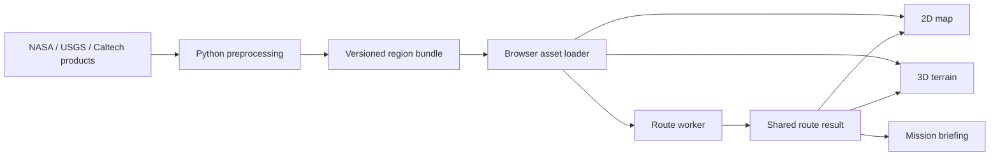

# MARS PATHFINDER — Project Plan

Planning baseline: 14 November 2026, Europe/Berlin.
Challenge: NASA Space Apps 2026, Interplanetary Survival Guide: Martian Map.
Team: five people. Ayush owns algorithms; Dhani owns UI. The other three people choose from the remaining roles in [team-tasks.md](team-tasks.md).
Status: researched implementation specification, not a claim that software or datasets have already been built or validated.

## 1. The product we are building

MARS PATHFINDER is a browser application for planning a simulated astronaut expedition through a small, real region of Mars. A user chooses a science destination, compares routes through measured terrain, examines where the evidence is weak, and views the selected route on a reconstruction made from the same elevation data.

The central question is: **How does the preferred route change when we account for terrain and incomplete observations instead of distance alone?**

The application should answer that question visibly. It should show the tradeoff in meters, slopes, observation-quality exposure, and assumptions. A judge should be able to change a destination and obtain a newly calculated answer, rather than watch an animation of a predetermined route.

Our primary use case is a human Marswalk planning simulation. A fictional outpost provides a clear starting point and mission-control framing. We are not building a colony economy, an autonomous rover controller, or a physically validated spacesuit simulator. A small rover or astronaut marker can illustrate progress along a calculated route, but it represents playback, not actual navigation telemetry.

The application combines four things into one journey: a layered map, an explainable route engine, a geographically consistent 3D terrain view, and a source-backed mission briefing. The uncertainty view is the distinctive feature. We can call it **Blindspot mode** in the presentation, while the interface uses the clearer label **Observation quality**.

The project name is provisional branding. Explain that this is a student project using NASA data; it is not the historical NASA Mars Pathfinder mission and is not endorsed or operationally certified by NASA.

## 2. How the supplied ideas become one coherent scope

The team discussion proposes a colony simulator, mission control, rover movement, multiple routes, terrain layers, an algorithm without generative AI, and a few immersive viewpoints. These ideas are compatible once we establish an order.

Mission control becomes the application shell. The colony becomes one fictional base marker. The route algorithm becomes the technical core. NASA terrain layers provide evidence. The desktop 3D reconstruction explains the route spatially. Fixed viewpoints preserve the Oculus idea without requiring a complete VR game.

We will calculate a small number of useful route alternatives. We will not enumerate every possible path. We will derive terrain geometry from elevation values rather than manually model the hills. We will not infer accurate elevations from the colors of a satellite image or claim that upscaling creates new measurements.

The distinction between imagery and elevation is fundamental. Imagery supplies surface appearance; a DEM or DTM supplies sampled heights. A confidence raster, when documented, supplies information about reconstruction quality. These products are related, but none is interchangeable with another.

The structure takes inspiration from `re_changer/docs/project-plan.md`: explicit product behavior, architecture, contracts, validation, delivery conditions, and ownership. Its task-by-task breakdown and unrelated application rules are not copied. The companion task file deliberately contains five broad assignments that teammates can later subdivide themselves.

## 3. Research status and what is actually confirmed

Research used the supplied notes, the official Space Apps site where accessible, NASA/JPL science resources, USGS product metadata, Caltech product documentation, and official software documentation. Direct access to several challenge and resource pages returned errors. Indexed official pages and official discussion responses provided some information, but the complete 2026 challenge Resources tab was not successfully inspected.

The official 2026 overview lists a maximum of six team members and project submission closing on **15 November 2026 at 23:59 local time**. Five people fit that limit. For the Milan event, use Europe/Rome; it has the same CET offset as Europe/Berlin on these dates. The local event may have an earlier presentation or judging cutoff, which remains to be checked with organizers. [S01]

Politecnico di Milano confirms the local event on 14–15 November 2026 at its Bovisa Campus. That establishes the event dates, not the precise local judging schedule. [S02]

A response in the official NASA Space Apps discussion repository describes a demonstration of no more than 30 seconds or a presentation of at most seven slides, including title and closing slides. Treat this as current corroborating guidance; the submission form and organizer instructions remain the final check. Prepare a 25–28 second video to leave editing margin. [S03]

The user-supplied challenge description emphasizes integrated NASA data for a human Marswalk with scientific objectives. That interpretation also appears in local-event challenge listings. The official challenge URL is retained in the source register, with its access limitation recorded rather than claiming the entire page was read. [S04]

We verified candidate data products and their published descriptions. We have not downloaded their scientific rasters, checked their actual file headers, inspected confidence codes, or established the final crop. Those are implementation gate G1, not completed research results.

## 4. Mandatory outcome and scope boundaries

| Feature | Release commitment | What completion means |
| --- | --- | --- |
| One real Mars region | Core | Processed elevation, imagery, masks, provenance |
| Science mission | Core | One objective and at least two selectable destinations |
| Layered 2D map | Core | Imagery, elevation/slope, validity/quality, POIs, routes |
| Route calculation | Core | Browser A* with explicit constraints and three policies |
| Explainable comparison | Core | Common metrics and honest handling of identical paths |
| Observation-quality handling | Core | Measured quality or clearly labeled proxy/unknown state |
| Desktop 3D | Core | Same terrain extent and same selected route |
| Mission briefing | Core | Printable view and reproducible JSON export |
| Public demo and local fallback | Core | Tested build and packaged essential assets |
| Fixed terrain viewpoint | Conditional | Add after the complete core journey works |
| Real rover panorama | Conditional | Add only with provenance and location context |
| Quest/WebXR | Stretch | One stationary viewpoint on an actual tested headset |
| Six viewpoints | Stretch | Expand only after one is reliable |
| 3D-print export | Future | Not part of the hackathon completion gate |
| Full colony or vehicle physics | Excluded | No habitat economy, collisions, or control simulation |
| Live weather/radiation/suit prediction | Excluded | No unsupported numerical survival claims |
| LLM route decisions | Excluded | Deterministic routing and explanation templates |

Core features remain the intended release. If time or data blocks them, publish a clearly described reduced prototype and record the omission. Do not silently redefine completion by displaying mock results as real calculations.

## 5. The exact user journey

The landing state opens directly into the selected region. A compact introduction explains the mission and displays a persistent educational-simulation label. The user sees the fictional outpost, available science destinations, the dataset version, and the useful extent of the map.

The user selects a preset destination or chooses a valid point inside the region. Presets are the reliable presentation path; free selection demonstrates that the algorithm works beyond the prepared scenario. Unsupported coordinates receive an explanation rather than silent movement to a distant valid point.

The layer control exposes imagery, elevation shading, modeled slope, observation quality, and science locations. Each layer has units, a legend, resolution, source, and an explanation of what it cannot establish. Turning a layer off changes visibility, not routing rules.

The user requests routes and receives up to three distinct geometries: shortest feasible, terrain-aware, and uncertainty-aware. If several policies produce the same path, the interface explicitly groups them. It never manufactures differences to make the demonstration more dramatic.

Selecting a route reveals distance, sampled elevation profile, ascent/descent, maximum terrain slope, maximum along-route grade, low-quality exposure, unknown-quality exposure, and the active modeling assumptions. These are separate quantities rather than a mysterious overall safety percentage.

The user can prefer better-observed terrain or require documented quality. Preference changes costs; strict exclusion changes admissibility. The distinction must be visible because strict exclusion can make a destination unreachable.

The selected path appears in the desktop 3D view using the same coordinates and dataset version. Orbit, zoom, reset, and optional route playback help users understand why a detour occurs. A route is not recalculated by the renderer.

The final briefing includes the chosen science objective, endpoints, policy, result metrics, assumptions, source IDs, unavailable analyses, and version identifiers. The user can print it or download JSON. If a round trip was requested, both outbound and return legs must be evaluated explicitly.

## 6. Region decision: western Jezero, conditional on evidence

Use western Jezero as the first search area. NASA describes the delta as a record of an ancient lake and a place of interest for investigating past habitability. Our science framing is to compare sedimentary landforms and understand the terrain around a delta, without claiming to discover life or confirm a mineral at an unverified coordinate. [S05]

Begin with an approximately **1 km × 1 km** region, with a nominal 5 m routing grid only if supported by the source elevation product. This gives roughly 200 × 200 cells. The rectangle is a computational target, not a scientific fact about the final site.

Do not lock a fabricated bounding box in this document. Member 3 must choose and publish the actual boundary after checking overlapping elevation, imagery, validity, science context, and processing feasibility. A famous destination outside the usable crop remains contextual information, not a selectable route endpoint.

Prefer a crop with moderate relief, at least two connected destinations, one meaningful terrain tradeoff, and adequate valid coverage. Include a processing halo outside the displayed region so neighborhood derivatives are not corrupted at its edges. Crop to the final extent only after derivative calculation.

If the fine-resolution acquisition fails, use the CTX fallback at its honest resolution. A 20 m source supports a 20 m or coarser routing grid, not a genuine 5 m analysis. Increase the region to a few kilometers if necessary to preserve a useful number of cells and communicate that this is regional planning rather than footstep-scale navigation.

Do not automatically include the Perseverance landing site, western rim, delta, and all panoramas in one tiny crop. Their geographic separation may make that impossible. Choose overlap first and adjust the story around verified destinations.

## 7. Dataset acquisition decision

| Candidate | Verified published information | Intended decision |
| --- | --- | --- |
| USGS science CTX DEM | 20 m pixels; listed 87 MB; matched 5 m orthomosaic | Acquire as the dependable fallback early |
| Caltech channel/fan DEM | 1 m pixels; listed 582 MB archive | First fine-detail candidate if transfer is practical |
| USGS MSR HiRISE mosaics | 1 m DTM; elevation, orthoimage, confidence package; listed 5.3 GB | Prefer for documented quality if accessible within time |
| Mars Trek WMTS | Image tile services described by capabilities | Discovery/context, not the elevation computation input |
| Perseverance location resource | NASA rover-location reference | Scientific and geographic context |
| Rover panorama | Individual NASA image product, selected later | Optional point-of-interest media |

The CTX metadata describes planetocentric, positive-east coordinates and an equirectangular projection. The published radius differs from the radius in the newer HiRISE product metadata. Both products being labeled Mars does not make their coordinates automatically interchangeable. Read the actual raster CRS and transform before combining them. [S06, S07]

The Caltech page explicitly cautions that its working-group products are registered but not quantitatively controlled in the same way as mission mapping products. Its stated pixel spacing must not be presented as absolute positional accuracy. [S08]

The USGS HiRISE package provides a real opportunity to use confidence information, but its codes must be read from its documentation. A confidence value is not automatically a probability of successful walking. Its larger package can also consume the entire preparation window on poor Wi-Fi. [S07]

Acquire the smallest useful product first. Inspect headers and footprint before processing. Test whether a host supports byte ranges and whether the file layout supports useful windowed access; a windowed API does not guarantee that a remote ZIP or ordinary TIFF avoids a large transfer. Rasterio documents windowed reading, but archive access still depends on the actual source. [S09]

Spend at most the initial data gate on high-resolution acquisition. If the transfer estimate exceeds the gate, begin the CTX implementation immediately and let a fine-resolution download continue only if it does not block the team. Never require all five people to download full archives.

## 8. Required NASA mission integration

The challenge calls for multiple missions, not merely multiple layers from one instrument. HiRISE and CTX are both aboard Mars Reconnaissance Orbiter; using both alone should not be described as two missions.

Plan to combine MRO-derived terrain/imagery with Mars 2020 Perseverance science context or verified surface imagery. If a Mars Global Surveyor MOLA context layer is actually included, credit it separately and preserve its coarser scale. Do not list a mission as integrated just because it appears in a reference article.

The source manifest must map each asset to mission, instrument, product creator, distributor, citation, acquisition/publication date where available, and the place it is used in the application. The presentation should show this chain in one concise diagram or table.

At least one Perseverance contribution must be visible and meaningful: a sourced science stop, historical rover context, or correctly contextualized surface image. A photograph from elsewhere in Jezero cannot be passed off as the exact view from the selected base.

## 9. Scientific meaning of each layer

Elevation is sampled height in meters relative to the product's stated vertical reference. Negative elevations are legitimate. Missing values are not sea level, flat terrain, or a large negative canyon.

Slope is a derivative over a specified neighborhood and baseline. It depends on cell size and preprocessing. Label it modeled terrain slope rather than the measured angle under an astronaut's boot.

Roughness is a defined topographic proxy, such as residual variation from a local plane. It is not rock count, soil strength, slip probability, or the ability of a suit to traverse loose sand. Record the window size in meters.

Quality may include valid elevation coverage, documented reconstruction confidence, and known product boundaries. If only resolution or source availability is known, call the result an observation-quality proxy. Keep unknown quality distinct from measured low quality.

Coverage is not traversability. A place outside an image footprint is not necessarily physically impassable; a place with clear imagery is not necessarily safe. Missing essential elevation blocks computation because the model cannot assess it.

Science points represent source-backed interpretations or clearly labeled proposed stops. Large-scale geologic maps can support context but cannot establish meter-scale material boundaries in the route grid.

Do not synthesize spatial radiation, weather, oxygen, thermal, or communications risk maps without a defensible model and relevant observations. These can appear as explicitly unmodeled mission considerations in the briefing, without fabricated scores.

## 10. Architecture decision

Use a **static React + TypeScript application built with Vite**, a **TypeScript route engine inside a Web Worker**, **Leaflet in a local coordinate system** for the bounded 2D map, and **Three.js** for terrain rendering. Use **Python, Rasterio, NumPy, and GDAL** offline for scientific preprocessing.

This is a selected architecture, not an unresolved menu of frameworks. A fixed region with tens of thousands of cells does not require a hosted database, accounts, paid API, or routing server. Ayush may use Python for exploratory validation, but the delivered route engine is TypeScript so the public application can run without a Python service.

If the team already has a working Python engine and cannot port it within the first integration gate, record a deliberate architecture change and supply one tested API contract. Do not maintain competing production engines with subtly different results. The default remains browser routing.



The important architectural rule is **one region definition, one route result, multiple views**. UI components do not recalculate distances. The renderer does not invent a path. The route engine does not depend on map pixels or camera position.

Workers provide a separate execution context for computation and communicate by messages. Design cancellation and stale-result handling explicitly; merely moving a synchronous loop into a worker does not make that loop responsive to queued cancel messages. [S10]

## 11. Repository and ownership boundaries

```text
docs/project-plan.md              this specification
docs/team-tasks.md                five ownership briefs
src/contracts/                   shared schemas and type definitions
src/coordinates/                 shared spatial conversion utilities
src/data/                        bundle loader and runtime validation
src/routing/                     Ayush: search, costs, metrics, worker
src/features/mission/            Dhani: mission setup and comparison
src/features/map/                Dhani: map, controls, overlays
src/features/briefing/           Dhani: report presentation
src/features/terrain/            Open role: Three.js and viewpoints
src/app/                         Integration owner: composition/state
scripts/preprocess/              Data owner: reproducible GIS processing
public/regions/<region-version>/ Data owner: approved browser assets
tests/fixtures/                  shared explicit synthetic examples
tests/e2e/                       Integration owner: complete journeys
```

The integration owner maintains package configuration, build scripts, shared contracts, and application composition. Domain owners propose contract changes with examples. They do not independently change coordinate ordering or units.

Each person owns implementation and focused verification in their area. Integration is not a sixth person hidden inside Ayush's or Dhani's assignment. Science is shared deliberately: the data owner verifies spatial evidence, the 3D owner verifies media provenance, and the integration owner assembles the submission narrative.

## 12. Canonical coordinate and grid contract

The routing grid uses a single projected Mars coordinate system in meters selected from the accepted source workflow. Store the full CRS definition, body radii, longitude convention, latitude type, vertical reference, and all transformation steps in the region manifest.

Runtime positions use local east/north coordinates relative to a declared projected origin. A coordinate is `{ eastM, northM }`, never an ambiguous two-element array. Optional longitude/latitude values are explicitly Mars values and never passed into Earth geodesic helpers.

For the normalized north-up grid, `row=0` is the northernmost row and `col=0` the westernmost column. Samples are cell centers. With cell sizes `dx` and `dy`, the center is `eastM=(col+0.5)*dx` and `northM=heightM-(row+0.5)*dy` relative to the southwest outer corner.

The raster's projected upper-left outer corner and full affine transform remain in metadata so local positions can be converted back to source coordinates. Rotated or sheared source rasters must be normalized during preprocessing rather than silently treated as north-up.

Store a flat array index as `index=row*width+col`. The manifest states dimensions, byte order, numeric types, units, NoData representation, and checksums. The half-cell convention applies to imagery, elevation sampling, route endpoints, and mesh vertices.

Leaflet's simple CRS permits non-Earth maps, but its coordinate-order conventions require an adapter. Use local meters as map units and an explicit meter scale; do not rely on default geographic distance behavior. [S11]

Three.js receives local coordinates through a single adapter: scene X is east, scene Y is elevation relative to a declared display origin, and scene Z is negative north. A vertical display exaggeration affects rendering only. All route calculations use original meters.

Avoid ordinary GeoJSON as the authoritative interchange for projected Mars geometry. Its normal consumers assume Earth geographic coordinates. Use the explicit local-coordinate schema; any GeoJSON-like export must clearly identify its planetary/local semantics and interoperability limitation.

## 13. Region bundle contract

The runtime manifest has `schemaVersion`, `regionId`, `datasetVersion`, `title`, `body`, `crs`, `verticalReference`, `grid`, `bounds`, `origin`, `sources`, `assets`, `qualityModel`, `processing`, and `validation` fields.

Each asset record has a relative path, media type, expected byte length, checksum, dimensions where applicable, units, and source IDs. Paths are relative to the immutable bundle directory. A changed raster produces a changed dataset version, not an overwrite behind an unchanged cache key.

The minimal grid contains elevation, slope, roughness proxy, validity, quality class, and exclusion reasons. Use Float32 for numeric fields and compact integer masks where appropriate. Store uncertainty penalties separately from source confidence codes so the modeling choice remains inspectable.

For the initial 200 × 200 grid, four Float32 arrays occupy approximately 640 KB before other arrays and metadata. This is a planning estimate, not the complete download size. A separately compressed image or texture will usually dominate the bundle.

The POI collection contains stable IDs, titles, local positions, science purpose, source references, position-confidence notes, optional media records, and whether each point is selectable. A proposed observation stop and an official named landmark are different record types.

The validation record reports finite-value checks, valid-cell fraction, alignment inspection, cell-size checks, and representative reference points. It also records known limitations. A manifest that parses successfully is not sufficient evidence of geospatial correctness.

## 14. Routing request and response contract

```ts
type Policy = 'shortest' | 'terrain' | 'uncertainty';
type QualityMode = 'prefer' | 'strict';
type LocalPoint = { eastM: number; northM: number };

type RouteRequest = {
  schemaVersion: 1;
  requestId: string;
  regionId: string;
  datasetVersion: string;
  start: LocalPoint;
  destination: LocalPoint;
  policies: Policy[];
  qualityMode: QualityMode;
  profileId: string;
  returnToStart: boolean;
};
```

The response is a discriminated union with `success`, `no_path`, `invalid_input`, `cancelled`, `timeout`, or `data_error`. Every response echoes request and dataset identifiers. A route policy can fail while another succeeds; do not collapse the entire comparison into one generic failure.

A successful candidate includes its policy IDs, cell-index path, local coordinates, optional separately computed return leg, metric definitions, metric values, per-segment quality flags, warnings, elapsed computation time, and the exact model configuration version.

Store both the requested endpoints and accepted cell-center endpoints. If a click falls inside a valid cell, selecting its center is disclosed through this mapping. Do not search arbitrarily far for a replacement when a clicked cell is invalid.

The integration owner validates incoming requests and responses. The UI discards results whose request ID or dataset version no longer matches the current state. Export uses the accepted result object rather than rebuilding information from rounded display text.

## 15. Traversability and cost model

Start with an eight-neighbor grid. Cardinal edge length is the actual cell spacing; diagonal length follows the two-dimensional Euclidean distance. Reject diagonals that cut across blocked orthogonal neighbors. A route must remain inside the accepted valid mask.

Hard exclusions apply before cost calculation: missing essential elevation, outside-region cells, explicit exclusions, unavailable derivative support, and configured slope/grade limits. A poor-quality observation is not automatically the same thing as missing elevation.

Define a prototype profile named `educational-eva-v1`. Its initial limits are engineering assumptions, not human-performance facts: maximum terrain slope 20 degrees and maximum absolute along-edge grade 20 degrees. Make those values versioned and visible. Evaluate sensitivity at 15 and 25 degrees; do not tune a threshold solely to force a desired story.

Let `d` be horizontal edge length in meters. Let `S` be the maximum endpoint terrain slope divided by the configured slope limit, clipped to [0,1]. Let `R` be a fixed-scale roughness penalty in [0,1]. Let `U` be a documented quality penalty in [0,1]. Use endpoint maxima for conservative edge penalties.

```text
edgeCost = d * (1 + alpha*S + beta*R + gamma*U)
shortest:    alpha=0, beta=0, gamma=0
terrain:     alpha=2, beta=1, gamma=0
uncertainty: alpha=2, beta=1, gamma=2
```

These are initial simulator weights. They do not estimate accident probability, energy expenditure, or a clinically meaningful risk level. The three policies share the same base exclusions; strict quality mode adds documented quality exclusions to each requested policy.

Define roughness as a detrended local elevation residual over a stated physical window. Start with a 15 m window on the fine grid and a larger explicitly recorded window on the coarse profile. Normalize using fixed profile parameters rather than min/max values that change with every request. If the proxy cannot be derived reliably, disable its contribution and report that limitation.

For quality, preserve four conceptual states: documented acceptable, documented low, unknown, and invalid. An initial proxy mapping may use penalties 0, 1, and 0.75 for the first three, with invalid blocked. This mapping is a team assumption. If source documentation supports different semantics, adapt the mapping and version it.

Strict mode requires an agreed set of documented acceptable quality classes. If the dataset has no documented classes, strict mode may correctly yield no assessable route or be disabled with an explanation. It must not pretend that all finite elevations have verified high confidence.

## 16. Search correctness and comparison behavior

Use A* with a binary heap and arrays indexed by cell. A straight-line horizontal-distance heuristic is admissible because every accepted edge costs at least its horizontal length. Preserve nonnegative penalties. Dijkstra with a zero heuristic is the reference check on small fixtures.

Stop only when the goal is removed from the priority queue under the valid best-score condition. Ignore stale heap entries. Keep deterministic neighbor order and tie breaking so the same versioned input produces the same route.

Avoid negative science rewards in the edge cost. Science chooses destinations; it does not create negative cycles or compromise the heuristic. Multi-stop optimization is outside the core release.

Calculate horizontal distance as the sum of edge lengths and sampled surface distance as the sum of `sqrt(d*d + dz*dz)`. Label them separately. Terrain slope comes from the raster neighborhood; along-route grade comes from each edge's elevation change over horizontal length.

Ascent and descent sum positive and negative elevation differences separately. They depend on resolution and preprocessing, so report the sampling scale. An elevation profile should use distance along the path, not point index, on its horizontal axis.

Quality exposure is length weighted. Report meters and percentage in low and unknown classes separately, using an explicitly stated edge classification rule. A count of uncertain vertices is misleading when diagonal and cardinal segments have different lengths.

Do not compare raw optimization costs across policies as though they were a common score. Compare shared physical and evidence metrics. A terrain-aware route can trade distance for smoother modeled terrain without being certified safer.

Deduplicate identical cell paths and attach all contributing policy names. If the uncertainty input is uniform, explain why the corresponding policy cannot distinguish routes. A visibly labeled synthetic fixture may demonstrate the concept separately, but it must never replace the real-data scenario invisibly.

Any path simplification is display-only unless every shortcut is rechecked against the original grid. The authoritative cell path and its metrics remain unchanged. Decorative curves must not visually cut across excluded terrain.

## 17. Mission timing and return journeys

Timing is optional supporting context, not a route feasibility guarantee. If included, use a user-visible assumed speed and planned science-stop duration. A default example may use 0.5 m/s, explicitly labeled as a simulator assumption without claiming astronaut validation.

Travel time equals chosen distance divided by assumed speed, plus declared stop durations. Do not display oxygen remaining, battery survival, thermal tolerance, or a probability of return. The prototype lacks those models.

A user can request return to the starting point. Compute a return route under the same declared profile and include it as a separate leg. Although the initial symmetric cost model may return the reverse path, keep the two-leg representation so later directional costs do not silently break round-trip estimates.

If either leg fails, the mission briefing identifies the failure. A one-way route is never presented as a complete return-capable expedition. Hard travel-time constraints are deferred unless the team implements and tests their actual effect on route selection.

## 18. UI specification

Use a map-centered workspace with a compact mission panel, layer controls, route comparison, and a collapsible evidence panel. Avoid a large marketing landing page that delays the demonstration. The region and mission should be understandable within the first screen.

Dhani owns the visual system: typography, spacing, colors, route styles, focus treatment, loading feedback, and responsive layout. Terrain imagery supplies the visual character. Route colors must remain distinguishable against it and must have text labels and line patterns.

Show model state explicitly: loading dataset, choosing endpoints, calculating, result ready, stale result, no path, unavailable layer, and failed asset. An old route can remain as a labeled previous result while recalculating, but cannot be mistaken for the current request.

Map interactions need alternatives. Preset destinations, coordinate entry or accessible endpoint controls, a route list, and textual metrics allow users to operate without precise pointer clicks. Do not require a headset, hover, color perception, or animation to understand the result.

The mobile layout prioritizes map, mission selection, and result summary. A bottom sheet or stacked panels are acceptable. The desktop layout is the presentation target; the small-screen version must remain usable rather than compress all panels into unreadable columns.

Keep scientific caveats next to the relevant result. A small persistent simulation label plus specific notes is more useful than one long disclaimer page. Use phrases such as “lower modeled terrain cost” and “quality unknown,” not “guaranteed safest.”

## 19. Desktop 3D and optional immersion

Generate an indexed terrain mesh from the prepared elevation grid. Three.js BufferGeometry supports positions, indices, normals, UVs, and other buffer attributes suitable for this approach. The renderer consumes accepted data rather than reading scientific archives itself. [S12]

The mesh must preserve holes or explicitly mask invalid cells. Do not connect triangles across missing elevation. Align imagery using the same affine/bounds convention as the map and test orientation with identifiable landmarks and synthetic corner markers.

Use true scale by default. If vertical exaggeration is offered, label it persistently and reset to 1× easily. A route display offset prevents z-fighting but does not change its scientific elevation or measured length.

Overlay the authoritative route, endpoints, selected POI, and optional inspection cursor. Clicking a profile location can highlight the corresponding 3D point. The 2D and 3D views share selection state, not camera state.

A ground-level viewpoint is a reconstruction at a declared location. Generic rocks, buildings, or astronauts are illustrative props. Do not place invented rocks where users might interpret them as measured hazards.

A real panorama is separate media with its own capture location, mission, camera, date or sol where known, and credit. Check whether it is a full spherical panorama before wrapping it around a viewer. A partial panorama must not be stretched into an invented 360-degree scene.

Quest support starts only after desktop acceptance. Use WebXR capability detection, explicit entry, HTTPS deployment, and a stationary viewpoint. The Three.js VRButton is an available entry helper, but compatibility must be tested on the actual headset/browser. [S13]

## 20. Preprocessing and reproducibility

The data owner creates a repeatable pipeline: inspect metadata, choose overlap, normalize CRS, crop with halo, resample appropriately, derive terrain attributes, propagate validity, map documented quality, generate visual assets, validate alignment, and publish an immutable bundle.

Use continuous interpolation only for continuous quantities where justified. Use nearest-neighbor or conservative category aggregation for masks and classes. Do not average categorical confidence codes into meaningless intermediate labels. Downsampling must not erase all evidence of a small excluded area.

Record derivative algorithms and parameters. GDAL provides terrain-analysis operations, but their scale, units, edge behavior, and NoData treatment must be explicitly selected. Reprojection and resampling can change derivatives; validate the final grid used by routing. [S14, S15]

Keep raw downloads outside tracked application assets. Store the compact approved crop and its metadata in a way the build can access without private credentials. Respect actual redistribution terms and preserve author/instrument credits; NASA media guidance does not make every third-party asset unrestricted. [S16]

For every published bundle, record source file hashes, processing command/configuration, software versions, output hashes, QA observations, and any manual intervention. This lets the team explain how a numerical route relates to the original observations.

## 21. Verification and acceptance matrix

| Check | Evidence required | Primary owner |
| --- | --- | --- |
| Real data | Source manifest and inspected raster metadata | Data |
| Coordinate alignment | Corner, center, landmark, and round-trip conversion checks | Data + integration |
| Search correctness | A* cost equals Dijkstra on small nonnegative fixtures | Ayush |
| Exclusions | No returned edge crosses blocked/invalid cells or forbidden corners | Ayush |
| Quality policy | Known fixture responds correctly; uniform quality remains honest | Ayush |
| Numerical metrics | Hand-computable path distances, slopes, and exposure totals | Ayush |
| UI behavior | User can select, compare, inspect, and export | Dhani |
| 3D registration | Shared points coincide within declared display tolerance | 3D |
| Invalid input | Outside crop, NoData, bad schema, and same-cell endpoints handled | Domain owners |
| Asynchronous behavior | Rapid changes and cancellation cannot show stale results | Integration |
| Deployment | Fresh browser loads all essential assets and workers | Integration |
| Provenance | Every scientific/media claim has a supporting reference | Data + 3D |
| Presentation | Recorded flow matches released application | Integration + all |

Synthetic tests should include a flat grid, a barrier with one gap, a disconnected goal, a diagonal corner trap, a low-quality shortcut, uniform quality, a steep ridge, a NoData island, and a rectangular cell grid. Synthetic fixtures are labeled and kept separate from production data.

On real data, use at least three endpoint pairs: an uncomplicated route, a terrain tradeoff, and an unreachable or unassessable case. Preserve the selected dataset version and model parameters with test evidence.

Avoid brittle tests that require arbitrary routes to differ. A valid acceptance criterion is that the algorithm responds correctly to controlled costs and reports actual results honestly. It is not that the three colored lines always separate.

## 22. Performance budgets and failure behavior

Initial targets, to be measured on a named ordinary laptop: core region download at most 15 MB compressed, typical three-policy solve below one second, bounded solve timeout at five seconds, and a usable desktop 3D view near 30 frames per second. These are engineering budgets, not measured results.

Load essential map assets first and lazy-load 3D textures and optional media. Cap texture sizes and device pixel ratio. Use compact typed arrays and avoid retaining multiple unnecessary copies of the same grid in application state.

If a worker fails, offer retry and retain mission inputs. If a quality layer fails, do not silently claim uncertainty-aware routing still uses it. If the terrain renderer fails, the 2D map and briefing should remain usable, with the missing core feature explicitly reported.

Bundle essential assets locally for the demonstration. “Offline fallback” means a packaged static build served locally with its required files, not opening an HTML file directly and assuming workers will work. A service worker is optional and should be omitted if cache invalidation cannot be tested.

The public demo must not require live Mars Trek availability to calculate a route. Trek is valuable for discovery and context, but WMTS imagery is not the route engine's height source. Its documentation requires reading capabilities for tile matrix, styles, format, and coverage. [S17]

## 23. Five-person workload and equal ownership

| Person | Broad assignment | Equal core effort envelope |
| --- | --- | --- |
| Ayush | Algorithms, route metrics, explanations, algorithm verification | 16 focused person-hours |
| Dhani | Map-centered UI, mission workflow, comparison, briefing presentation | 16 focused person-hours |
| Open role A | Data/GIS, preprocessing, quality model, scientific destination evidence | 16 focused person-hours |
| Open role B | 3D terrain, route registration, POI inspection, media provenance | 16 focused person-hours |
| Open role C | Shared contracts, application integration, QA, deployment, submission assembly | 16 focused person-hours |

Each envelope allocates about 10 hours to core construction, 3 hours to integration, 2 hours to verification, and 1 hour to handoff/presentation. This is an equal planning budget rather than a promise of identical difficulty. Optional VR, extra layers, and advanced algorithms do not silently expand someone's mandatory assignment.

The other three teammates can choose their roles later. The transcript mentions a name, but it does not establish final team membership or that person's preference, so no assignment is inferred from it.

If the integration owner is overloaded, remove optional export styling, extra browser coverage, or presentation effects before transferring their entire workload to Ayush or Dhani. Every owner supplies their own evidence and demo explanation; the integration owner assembles, rather than authors all domain work.

## 24. Delivery sequence and gates

Use relative working windows from the team's actual start. Do not interpret the plan as 24 hours of continuous work without rest. Recalculate the remaining schedule against the earliest verified local deadline.

| Gate | Suggested window | Exit evidence |
| --- | --- | --- |
| G0: contract freeze | First 45 minutes | Shared coordinate, bundle, route, and ownership agreement |
| G1: data viability | By hour 2 | Real raster inspected; crop chosen; fine/coarse decision recorded |
| G2: walking skeleton | By hour 5 | UI request reaches worker and returns a path on accepted data |
| G3: complete journey | By hour 10 | Map, comparison, 3D, and briefing share one route |
| G4: scientific review | By hour 13 | Quality semantics, citations, limitations, and metrics reviewed |
| G5: release candidate | By hour 16 | Public build, local package, regression checks, recorded demo |
| G6: submission | Before local/global cutoff | Public links verified and submission confirmation retained |

All owners work from a small explicitly synthetic fixture while the real crop is being prepared. Switch the application to the accepted real bundle at G2. Keeping a fixture for tests is useful; presenting it as NASA terrain is unacceptable.

At G1, choose the fallback decisively if fine-resolution preparation is not viable. At G3, stop adding optional features until all core interfaces work. At G5, freeze features and allow only fixes that preserve a working demonstration.

As a planning target, aim for a releasable build by 15 November at 18:00 CET and submission by 21:00 CET, leaving margin before the confirmed global deadline. If Milan requires an earlier presentation, move these targets earlier immediately. The local cutoff is an explicit open item, not an assumed 23:59 presentation slot.

## 25. Collaboration and integration procedure

Use one repository and one agreed integration branch. Each contributor uses a focused branch such as `codex/routing`, `codex/mission-ui`, or `codex/terrain`. Merge working slices at the gates; do not wait until five isolated demos are complete.

The integration owner lands the shared contract and fixture first. The data owner publishes the first bundle manifest early, even if the real crop is still processing. Dhani and the 3D owner build against the same fixture and shared coordinate adapter.

Changes to contracts include an example payload and migration note. Changes to data invalidate dependent routes. Changes to routing assumptions update both model version and briefing text. Changes to source attribution update the source manifest and displayed credits together.

Expected implementation commands are `npm run dev`, `npm run build`, `npm run typecheck`, `npm run lint`, `npm test`, and `npm run test:e2e`, plus the documented preprocessing command. These are planned scripts to create, not commands verified in the currently empty repository.

Keep checks proportionate: domain unit tests for numerical behavior, data validation for scientific assets, component interaction checks for UI behavior, and a small end-to-end suite for the complete journey. Do not create hundreds of tests that merely duplicate markup.

## 26. Risk register and concrete fallback decisions

| Risk | Trigger | Response |
| --- | --- | --- |
| Fine DEM unavailable | G1 acquisition/processing gate missed | Use CTX at native/coarser grid; revise scope labels |
| Confidence semantics absent | No authoritative code explanation | Preserve unknown/proxy state; disable false precision |
| Uniform quality | Real crop has no variation | Explain identical policies; use separate labeled concept fixture |
| No useful connected route | Valid mask/thresholds disconnect endpoints | Choose different valid science stops; do not erase exclusions |
| CRS mismatch | Landmark or scale checks fail | Stop integration; reconcile source transforms |
| Huge texture | Browser memory or loading budget exceeded | Downsample display imagery; keep analytical resolution metadata |
| Missing panorama | No suitable geolocated media in crop | Use labeled terrain viewpoint; keep external media contextual |
| WebXR failure | Headset/session test fails | Ship desktop experience; report VR as unimplemented |
| Three identical policies | Same optimum under all costs | Group policy labels honestly |
| Late UI/engine mismatch | Payload/version mismatch | Freeze schemas; adapt at one boundary |
| External service outage | Trek or image server unavailable | Use prepared local assets and offline package |
| Deadline uncertainty | Local schedule unconfirmed | Integration owner verifies early and shortens feature window |

## 27. Demonstration and submission package

The short demo should show an actual input change, real calculated alternatives or honest equivalence, a visible terrain/quality explanation, and the matching 3D route. Finish on the mission briefing with data credits visible. Do not spend the whole duration on a logo or cinematic flight.

A suggested 28-second sequence is: mission and location in 4 seconds; destination and route calculation in 6 seconds; terrain/quality tradeoff in 8 seconds; 3D inspection in 6 seconds; source-backed briefing in 4 seconds. Adjust to the actual released behavior.

The optional seven-slide alternative covers problem, science location, data provenance, routing model, working UI/3D, limitations/validation, and team/results. Confirm the final submission form before choosing the format. A longer walkthrough may be supplementary, not a replacement for the requested short artifact.

The package includes a public application link, source repository link, concise project description, NASA data usage, source credits, disclosed AI/tool assistance where required, demo artifact, setup instructions, known limitations, and the five contributors' actual names once provided.

Check links in a fresh browser without the team's logged-in sessions. Keep a local copy of the release build and demo recording. Submission is complete only after the team sees confirmation in the event system; a prepared page or an uploaded video alone is not submission.

## 28. Definition of done

The full intended release is done when a new user can choose a valid mission destination, calculate routes from a documented real Mars dataset, understand the terrain and quality tradeoff, inspect the same selected route in 3D, and export a reproducible briefing.

The team must be able to explain where every important number comes from, what assumptions affect it, and what the application does not model. Invalid terrain, unavailable quality, and unreachable endpoints must produce understandable outcomes rather than attractive but false results.

All five owners deliver code/assets, focused evidence, interface notes, and a short explanation of their contribution. The final deployed version, local package, demo, and submission description must agree about what was actually built.

## 29. Open decisions with owners and deadlines

| Decision | Owner | Latest useful point |
| --- | --- | --- |
| Remaining people choose open roles | Team | Before implementation starts |
| Exact crop and source product | Data owner | G1 |
| Quality code interpretation | Data owner + Ayush | Before real uncertainty results |
| Numeric normalization constants | Ayush + data owner | Before G3 |
| Destination coordinates and science captions | Data owner | Before G3 |
| Actual local presentation cutoff | Integration owner | First working hour |
| Measured performance and supported browsers | Integration + 3D | G5 |
| Whether Quest is attempted | 3D owner + team | Only after G3 passes |
| Final public release/submission links | Integration owner | G6 |

These are bounded implementation decisions, not reasons to postpone all work. Shared fixtures, contracts, UI structure, and algorithm tests can proceed while data acquisition and local schedule checks happen.

## 30. Source register

All sources below were checked or attempted on 14 November 2026. Published product descriptions are evidence of availability, not evidence that our crop has been downloaded or validated. URLs with access problems are explicitly marked.

- **S01 — [NASA Space Apps 2026 overview](https://www.spaceappschallenge.org/2026/).** Official indexed content confirms event dates, team limit, and submission window; direct page fetch was unreliable.
- **S02 — [Politecnico di Milano event announcement](https://www.aero.polimi.it/en/magazine/nasa-space-apps-challenge-2026-the-space-hackathon-returns-to-polimi).** Local host confirms 14–15 November and Bovisa location.
- **S03 — [Official Space Apps discussion on demonstration rules](https://github.com/nasa/spaceapps/discussions/1947).** Current repository response supports 30-second/seven-slide limits; verify final form and local rules.
- **S04 — [Interplanetary Survival Guide: Martian Map](https://www.spaceappschallenge.org/2026/challenges/interplanetary-survival-guide-martian-map/).** User's challenge link; full page and Resources tab inaccessible during direct research. The supplied transcript and [local challenge listing](https://nasaspaceapps.ae/challenges) corroborate the integrated Marswalk framing.
- **S05 — [NASA: Perseverance explores the Jezero delta](https://science.nasa.gov/resource/perseverance-explores-the-jezero-crater-delta/).** Supports the science motivation, not exact candidate stop coordinates.
- **S06 — [USGS science investigation CTX DEM mosaic](https://astrogeology.usgs.gov/search/map/mars_2020_science_investigation_ctx_dem_mosaic).** Indexed primary metadata supplies resolution, file size, CRS details, and matched imagery information; direct access returned 403.
- **S07 — [USGS MSR HiRISE DTM and orthoimage mosaics](https://astrogeology.usgs.gov/search/map/mars-sample-return-terrain-relative-navigation-hirise-dtm-mosaic).** Indexed primary metadata supplies package contents, resolution, size, coverage, and accuracy limitations. [USGS release landing page](https://www.usgs.gov/data/mars-sample-return-hirise-mosaics-terrain-relative-navigation) supplies alternate access and rights information.
- **S08 — [Caltech Murray Lab Mars 2020 products](https://murray-lab.caltech.edu/Mars2020/index.html).** Indexed primary text supplies channel/fan DEM resolution, archive size, and registration caveat; direct retrieval was unreliable.
- **S09 — [Rasterio windowed reading](https://rasterio.readthedocs.io/en/stable/topics/windowed-rw.html).** Processing reference for bounded raster access.
- **S10 — [MDN: Using Web Workers](https://developer.mozilla.org/en-US/docs/Web/API/Web_Workers_API/Using_web_workers).** Browser execution/message reference.
- **S11 — [Leaflet non-geographical maps](https://leafletjs.com/examples/crs-simple/).** Supports local-map approach and coordinate-order caution; pin and verify the installed API version.
- **S12 — [Three.js BufferGeometry](https://threejs.org/docs/pages/BufferGeometry.html).** Terrain buffer representation reference.
- **S13 — [Three.js VRButton](https://threejs.org/docs/pages/VRButton.html).** Optional WebXR entry helper reference; not proof of headset compatibility.
- **S14 — [GDAL terrain analysis](https://gdal.org/en/stable/programs/gdaldem.html).** Slope and terrain-derivative processing reference.
- **S15 — [Rasterio reprojection](https://rasterio.readthedocs.io/en/stable/topics/reproject.html) and [NoData masks](https://rasterio.readthedocs.io/en/stable/topics/masks.html).** References for explicit transforms and valid-data handling.
- **S16 — [NASA images and media guidance](https://www.nasa.gov/nasa-brand-center/images-and-media/).** Attribution and reuse reference; inspect each selected asset's credits and exceptions.
- **S17 — [NASA Trek WMTS documentation](https://trek.nasa.gov/tiles/apidoc/trekAPI.html?body=mars).** Confirms capabilities-driven image tile access and coverage semantics.
- **S18 — [NASA Perseverance location map resource](https://science.nasa.gov/resource/where-is-perseverance-location-map/).** Geographic/science context; do not treat a static reference as current telemetry.
- **S19 — [Bland et al., LPSC 2025 abstract](https://www.hou.usra.edu/meetings/lpsc2025/pdf/1627.pdf).** Primary technical description of the newer Jezero topographic work; use for further accuracy review.
- **S20 — [Space Apps submission guide](https://www.spaceappschallenge.org/resources/project-submission-guide/) and [judging guide](https://www.spaceappschallenge.org/resources/judging-awards-guide/).** Required final checks; direct fetches failed. Do not silently substitute earlier-year PDFs as current rules.
- **S21 — [Milan local event](https://www.spaceappschallenge.org/2026/local-events/milano/).** User-supplied event link; direct fetch failed. Local timetable remains an owner action.
- **S22 — [Official submission deadline discussion](https://github.com/nasa/spaceapps/discussions/1916).** Corroborates the 15 November 23:59 local deadline.

The original user-supplied [Mars Trek view](https://trek.nasa.gov/mars/#v=0.1&x=0&y=0&z=2&p=urn%3Aogc%3Adef%3Acrs%3AEPSG%3A%3A104905&d=&locale=&b=mars&e=-192.9199182763554%2C-93.69140450232112%2C192.9199182763554%2C93.69140450232112&sfz=&w=) is a discovery starting point, not a chosen crop or downloadable elevation dataset.
