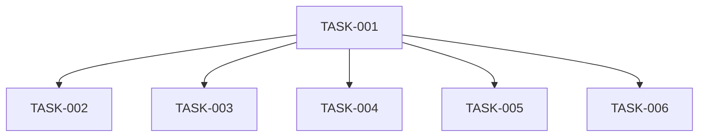
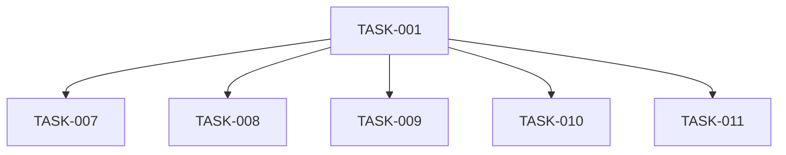
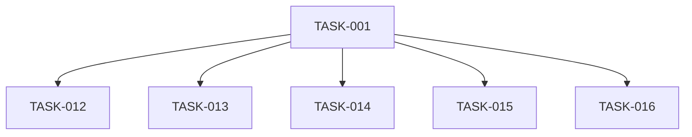
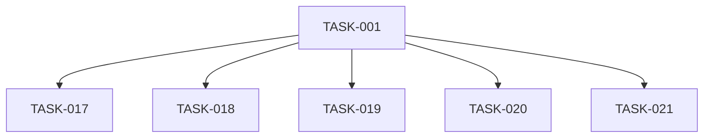

=== FILE: docs\audit-parts\part-ayush.md ===
# Audit Report — Ayush (Routing Algorithm Deliverable)

**Scope & Sources Audited:** `algorithm/docs/*.md`, `algorithm/src/contracts/routing.ts`, `algorithm/src/coordinates/grid.ts`, `algorithm/src/routing/*`, `algorithm/tests/**/*`, root `src/routing/index.ts`, `src/routing/placeholderEngine.ts`, `src/contracts/*`, `src/worker/handler.ts`, `src/sim/invariants.ts`, `docs/SIMULATION-FOR-AYUSH.md`, and `INTERFACE.md`.

---

## 1. Original Goal

From [algorithm/docs/team-tasks.md](../../algorithm/docs/team-tasks.md), [algorithm/docs/project-plan.md](../../algorithm/docs/project-plan.md), [INTERFACE.md](../../INTERFACE.md), and [docs/SIMULATION-FOR-AYUSH.md](../SIMULATION-FOR-AYUSH.md):

- Deliver a deterministic, browser-runnable TypeScript routing engine running inside a Web Worker over a north-up, row-major Mars region grid with cell-center coordinates and explicit rectangular (`dx !== dy`) cell support.
- Enforce hard admissibility before cost calculation: out-of-bounds, NoData/non-finite elevation (while allowing valid negative Martian elevations), `INTERPOLATED`/unreliable source quality, unsupported derivative neighborhoods, explicit exclusions, configurable terrain slope and along-edge grade limits (`educational-eva-v1`: `20°` max terrain slope, `20°` max route grade, `0.5 m` roughness scale, `0.5 m/s` nominal speed), diagonal no-corner-cutting, and optional strict quality exclusion (`strictQuality` / `qualityMode: 'strict'`).
- Implement 8-neighbor A* with an indexed binary min-heap, flat TypedArray workspace, admissible/consistent 2D Euclidean heuristic, deterministic tie-breaking, bounded predecessor reconstruction, and a standalone Dijkstra reference oracle for automated verification.
- Compute 3 routing policies (`shortest`, `terrain`, `uncertainty` / `shortest-feasible`, `terrain-aware`, `uncertainty-aware`), deduplicate identical cell paths, compute physical/elevation/length-weighted quality metrics and RLE intervals, support explicit round-trip return legs (`round-trip-complete` vs `round-trip-incomplete`), generate template-based factual explanations, handle uniform-quality datasets honestly, and integrate into root `src/routing/index.ts` (`solveRoute`, `MODEL_VERSION`) satisfying `src/sim/invariants.ts` and `INTERFACE.md`.

---

## 2. Actually Built (Exact Files & Exports)

All deliverables reside in the standalone sub-package `algorithm/` (`mars-pathfinder-routing@0.1.0`):

### Contracts & Coordinates
- [algorithm/src/contracts/routing.ts](../../algorithm/src/contracts/routing.ts): Exports `QUALITY_CODE`, `SOURCE_FOM_CODE`, and types (`PolicyId`, `QualityMode`, `QualityClass`, `QualityCode`, `SourceFomCode`, `ExclusionReasonCode`, `LocalMeterPoint`, `NormalizedGridPoint`, `ConstraintProfileId`, `ConstraintProfile`, `PolicyWeightVector`, `EffectivePolicyWeights`, `RegionRoutingBundle`, `RouteRequest`, `ElevationProfilePoint`, `QualityExposureInterval`, `RouteMetrics`, `Draped3DPoint`, `RouteExplanation`, `ReturnLegResult`, `RouteCandidate`, `EquivalenceTopology`, `RouteResponse`).
- [algorithm/src/coordinates/grid.ts](../../algorithm/src/coordinates/grid.ts): Exports `rowColToIndex`, `indexToRowCol`, `cellCenterToLocalMeters`, `localMetersToGridPoint`, `stepPlanarDistanceM`.

### Routing Modules (`algorithm/src/routing/`)
- [algorithm/src/routing/index.ts](../../algorithm/src/routing/index.ts): Barrel re-exporting T01–T30 symbols, T40 default assembly factories (`createDefaultCellAdmissibility`, `createDefaultEdgeEvaluator`, `createDefaultEngineDependencies`, `createDefaultRoutingEngine`, `createDefaultWorkerMessageHandler`, `createDefaultRoutePlannerClient`), and the root-contract adapter (`marspineappleAdapter.ts`).
- [algorithm/src/routing/types.ts](../../algorithm/src/routing/types.ts): `DIR_COUNT`, `DIR_DR`, `DIR_DC`, `DIR_IS_DIAG`, `NOMINAL_POLICY_WEIGHTS`, `QUALITY_PENALTY_BY_CODE`, `SolverWorkspacePort`, `CellAdmissibilityPort`, `EdgeEvaluatorPort`, `SinglePolicySolveResult`.
- [algorithm/src/routing/bundleValidator.ts](../../algorithm/src/routing/bundleValidator.ts): `validateRegionBundle`, `validateRequestAgainstBundle`, `BundleValidationOutcome`.
- [algorithm/src/routing/profiles.ts](../../algorithm/src/routing/profiles.ts): `DEFAULT_PROFILE_ID`, `CONSTRAINT_PROFILES` (`educational-eva-v1`, `conservative-15deg`, `relaxed-25deg`), `resolveConstraintProfile`, `isProfileDirectionallySymmetric`.
- [algorithm/src/routing/qualityMapping.ts](../../algorithm/src/routing/qualityMapping.ts): `QUALITY_MAPPING_VERSION`, `mapSourceFomToQualityCode`, `decodeFomGridToQualityCode`, `qualityCodeToClass`, `qualityCodeToPenaltyU`.
- [algorithm/src/routing/elevationSupport.ts](../../algorithm/src/routing/elevationSupport.ts): `isValidElevationSample`, `buildElevationSupportMask`, `createMaskedElevationGrid`, `bilinearResampleSupportedOnly`.
- [algorithm/src/routing/hornSlope.ts](../../algorithm/src/routing/hornSlope.ts): `computeHornSlopeGrid`, `cropHaloDerivativeGrid`.
- [algorithm/src/routing/roughness.ts](../../algorithm/src/routing/roughness.ts): `computePlaneFitRoughnessGrid`.
- [algorithm/src/routing/cellAdmissibility.ts](../../algorithm/src/routing/cellAdmissibility.ts): `getCellExclusionReason`, `isCellAdmissible`.
- [algorithm/src/routing/endpoints.ts](../../algorithm/src/routing/endpoints.ts): `normalizeAndValidateEndpoints`, `EndpointValidationResult`.
- [algorithm/src/routing/edgeAdmissibility.ts](../../algorithm/src/routing/edgeAdmissibility.ts): `isEdgeAdmissible`.
- [algorithm/src/routing/effectiveWeights.ts](../../algorithm/src/routing/effectiveWeights.ts): `resolveEffectivePolicyWeights`, `EffectivePolicyWeightsResult`.
- [algorithm/src/routing/edgeCost.ts](../../algorithm/src/routing/edgeCost.ts): `computeEdgePenalties`, `computeEdgeCost`, `EdgePenalties`.
- [algorithm/src/routing/workspace.ts](../../algorithm/src/routing/workspace.ts): `SolverWorkspace`.
- [algorithm/src/routing/binaryHeap.ts](../../algorithm/src/routing/binaryHeap.ts): `BinaryMinHeap`, `hasHigherPriority`.
- [algorithm/src/routing/components.ts](../../algorithm/src/routing/components.ts): `computeConnectedComponentsAndAdjMask`, `areCellsInSameComponent`.
- [algorithm/src/routing/astar.ts](../../algorithm/src/routing/astar.ts): `solveAStar`, `SolveAStarParams`.
- [algorithm/src/routing/dijkstra.ts](../../algorithm/src/routing/dijkstra.ts): `solveDijkstra`.
- [algorithm/src/routing/pathAudit.ts](../../algorithm/src/routing/pathAudit.ts): `verifyPathAdmissibility`, `assertAStarMatchesDijkstra`.
- [algorithm/src/routing/metricsDistance.ts](../../algorithm/src/routing/metricsDistance.ts): `computeDistanceAndTimeMetrics`, `DistanceAndTimeMetrics`.
- [algorithm/src/routing/metricsElevation.ts](../../algorithm/src/routing/metricsElevation.ts): `computeElevationAndSlopeMetrics`, `ElevationAndSlopeMetrics`.
- [algorithm/src/routing/metricsQuality.ts](../../algorithm/src/routing/metricsQuality.ts): `computeQualityExposureMetrics`, `QualityExposureMetrics`.
- [algorithm/src/routing/draping3d.ts](../../algorithm/src/routing/draping3d.ts): `buildDraped3DRoutePolyline`, `Draped3DRouteOptions`, `MeshQuadDiagonalSplit`.
- [algorithm/src/routing/deduplicate.ts](../../algorithm/src/routing/deduplicate.ts): `areCellPathsIdentical`, `deduplicatePolicyPaths`, `DeduplicatedPolicyGroup`, `DeduplicationResult`.
- [algorithm/src/routing/returnLeg.ts](../../algorithm/src/routing/returnLeg.ts): `buildReturnLeg`, `BuildReturnLegParams`.
- [algorithm/src/routing/explanations.ts](../../algorithm/src/routing/explanations.ts): `buildCandidateExplanations`, `formatDistanceDelta`, `formatTerrainDelta`, `formatQualityDelta`, `BuildCandidateExplanationsParams`.
- [algorithm/src/routing/mutex.ts](../../algorithm/src/routing/mutex.ts): `AsyncWorkspaceMutex`, `createYieldChannel`, `createUnifiedDeadline`, `MutexTaskContext`, `UnifiedDeadline`.
- [algorithm/src/routing/engine.ts](../../algorithm/src/routing/engine.ts): `RoutingEngine` and port/metric types.
- [algorithm/src/routing/route.worker.ts](../../algorithm/src/routing/route.worker.ts): `createWorkerMessageHandler`, `WorkerInboundMessage`, `WorkerOutboundMessage`, `WorkerEnginePort`.
- [algorithm/src/routing/routeClient.ts](../../algorithm/src/routing/routeClient.ts): `RoutePlannerClient` and client message/option types.
- [algorithm/src/routing/marspineappleAdapter.ts](../../algorithm/src/routing/marspineappleAdapter.ts): Drop-in root-contract adapter exporting `MODEL_VERSION` (`'eva-astar-1.0.0'`), `solveRoute`, `ROUTE_POLICIES_ORDER`, `MAP_MARSPINEAPPLE_QUALITY_TO_INTERNAL`, `MAP_INTERNAL_QUALITY_TO_MARSPINEAPPLE`, and `Mars*` mirror types (`MarsRoutingGrid`, `MarsRouteRequest`, `MarsRouteFinalResponse`, etc.).

### Docs & Test Suite
- `algorithm/docs/*.md`: 11 design, math, worker, admissibility, efficiency, metrics, verification, and handoff docs (`routing-handoff-report.md` etc.).
- `algorithm/tests/fixtures/`: 12 canonical fixtures (`F01`–`F12`) unified in `routingFixtures.ts`.
- `algorithm/tests/routing/`: 40 Vitest files (`t01`–`t40`).

---

## 3. Interfaces / Contracts

Ayush built **two** interface layers inside `algorithm/`:

1. **Standalone `RoutingEngine` Contract (`algorithm/src/contracts/routing.ts`, `route.worker.ts`, `routeClient.ts`):**
   - Inputs: `RegionRoutingBundle` (`elevationM`, `terrainSlopeDeg`, `roughnessNormalized`, `qualityCode` `0..3` where `0=ACCEPTABLE, 1=UNKNOWN, 2=LOW, 3=INVALID`) + `RouteRequest` (`regionId`, `datasetVersion`, `start/destination: { eastM, northM }`, `policies: ('shortest' | 'terrain' | 'uncertainty')[]`, `qualityMode: 'prefer' | 'strict'`, `profileId`, `returnToStart`, `timeoutMs`).
   - Outputs: `RouteResponse` (`status: 'success' | 'no_path' | 'invalid_input' | 'cancelled' | 'timeout' | 'data_error'`) with `effectiveWeights`, `equivalenceTopology`, `draped3DPolyline`, `estimatedTimeS`, `gradeAdjustedTimeS`, `exploredNodes`, and structured `RouteExplanation`.
   - Worker protocol: `LOAD_BUNDLE | PLAN_ROUTE | CANCEL_REQUEST` -> `BUNDLE_LOADED | ROUTE_RESULT` via structured clone (no buffer detachment).

2. **Root-Compatible Adapter (`algorithm/src/routing/marspineappleAdapter.ts`):**
   - Exports `MODEL_VERSION = 'eva-astar-1.0.0'` and `solveRoute(grid: MarsRoutingGrid | null, req: MarsRouteRequest, hooks?: MarsSolveHooks): MarsRouteFinalResponse`.
   - Maps root `quality` codes (`0=NO_ELEVATION, 1=GOOD, 2=LOW, 3=UNKNOWN`) to internal `QUALITY_CODE` (`[3, 0, 2, 1]`) and back (`[1, 3, 2, 0]`).
   - Uses root `RoutePolicyId` (`'shortest-feasible' | 'terrain-aware' | 'uncertainty-aware'`), `strictQuality: boolean`, `roundTrip: boolean`, `weightOverrides`, `LocalPoint { east_m, north_m }`, and `status: 'success' | 'no-path' | 'invalid-input' | 'cancelled' | 'timeout' | 'data-error'`.

---

## 4. Feature List

- **Grid & Derivatives:** Rectangular cell support (`dx !== dy`), Horn (1981) 3×3 terrain slope (`hornSlope.ts`), 3×3 plane-fit RMS roughness (`roughness.ts`), and elevation-support masking before derivatives/resampling (`elevationSupport.ts`).
- **Admissibility & Exclusions:** 7-priority cell exclusion checks (`getCellExclusionReason`), diagonal no-corner-cutting (`isEdgeAdmissible`), symmetric and directional grade checks (`maxRouteGradeDeg`, optional `maxUphillGradeDeg`/`maxDownhillGradeDeg`), strict quality mode, and `INTERPOLATED` rejection before same-cell shortcut (`F05B`).
- **Search & Optimality:** Pre-allocated `SolverWorkspace` with $O(1)$ generation-stamp reset (`seenStamp`/`closedStamp`), indexed `BinaryMinHeap` with strict IEEE-754 4-tuple lexicographic total order (`fScore`, `gScore`, `crossScore`, `cellIndex` — zero $\epsilon$-window cycles), consistent 2D Euclidean heuristic, bounded cycle/broken-parent detection, lazy $O(N)$ connected-component labeling + 8-bit `adjMask` (`components.ts`), standalone `solveDijkstra` oracle, and `verifyPathAdmissibility` / `assertAStarMatchesDijkstra`.
- **Cost Model & Policies:** `cost(u,v) = d(u,v) * (1 + alpha*S + beta*R + gamma_eff*U)` with nominal weights `(0,0,0)` (`shortest`), `(2,1,0)` (`terrain`), `(2,1,2)` (`uncertainty`), quality penalties `{ACCEPTABLE: 0, UNKNOWN: 0.75, LOW: 1.0}`, conservative corner-aware quality (`max(u, v, w1, w2)` on diagonals), and uniform-quality effective override ($\gamma_{\text{eff}} = 0$ when $U_{\max} = U_{\min}$ across admissible cells).
- **Post-Processing & Execution:** Path deduplication across policies, `buildReturnLeg` (path reversal when symmetric/admissible, A* fallback if asymmetric, explicit `incomplete_round_trip` on failure), `buildDraped3DRoutePolyline` (saddle-quad midpoint subdivision), deterministic signed-delta explanations, and `AsyncWorkspaceMutex` + `MessageChannel` cooperative yield + `RoutePlannerClient`.

---

## 5. Gaps / Conflicts vs Root & Other Roles

1. **Root App Still Uses `placeholderEngine.ts` (Not Integrated):**
   - Root [src/routing/index.ts](../../src/routing/index.ts) still exports `solveRoute` and `PLACEHOLDER_MODEL_VERSION as MODEL_VERSION` (`'placeholder-astar-0.2.0'`) from [src/routing/placeholderEngine.ts](../../src/routing/placeholderEngine.ts).
   - Consequently, [src/config.ts](../../src/config.ts), [src/worker/handler.ts](../../src/worker/handler.ts), and `src/sim/engine.ts` still run the unvalidated placeholder (`maxTerrainSlope_deg: 25`, `LOW: 0.5, UNKNOWN: 1.0`, `DEFAULT_WEIGHTS` `terrain: 1/1/0`, `uncertainty: 0.5/0.5/2`). Ayush's `algorithm/` package is currently isolated from the root Vite app and root `npm test` / `npm run sim`.

2. **Contract & Worker Protocol Divergence (`algorithm/` Core vs Root `src/contracts/`):**
   - `algorithm/src/contracts/routing.ts` and `route.worker.ts` / `routeClient.ts` define incompatible field names, status strings (`invalid_input`, `no_path` vs `invalid-input`, `no-path`), coordinate keys (`eastM`/`northM` vs `east_m`/`north_m`), quality code enum values (`0=ACCEPTABLE, 1=UNKNOWN, 2=LOW, 3=INVALID` vs `0=NO_ELEVATION, 1=GOOD, 2=LOW, 3=UNKNOWN`), and worker messages (`LOAD_BUNDLE`/`PLAN_ROUTE` vs `load-bundle`/`route`).
   - `marspineappleAdapter.ts` bridges the root `solveRoute` contract, **but** duplicates A*/metrics/explanation logic instead of delegating to `RoutingEngine`, and is not yet wired into root `src/routing/index.ts`.

3. **Gaps Between `marspineappleAdapter.ts` and `RoutingEngine` (`engine.ts`):**
   - **No connected-component pre-check:** `marspineappleAdapter.ts` does not call `computeConnectedComponentsAndAdjMask`, so unreachable destinations run a full A* flood-fill instead of $O(1)$ basin rejection.
   - **Synchronous execution & unprotected singleton workspace:** `marspineappleAdapter.ts` uses an unguarded module-level `sharedWorkspace` and runs synchronously (checking `hooks.shouldStop` every 512 pops; relying on worker termination in root `src/worker/client.ts` rather than cooperative async yields).
   - **Hardcoded profile & omitted rich fields:** Hardcodes `educational-eva-v1` (no `profileId` or `customProfile` override via root `RouteRequest`), and omits `draped3DPolyline`, `estimatedTimeS`, `gradeAdjustedTimeS`, `effectiveWeights`, and `equivalenceTopology` because root `src/contracts/route.ts` does not declare them.
   - **Subtle algorithmic/explanation differences vs `astar.ts` / `explanations.ts`:** `marspineappleAdapter.ts`'s `runAStar` only updates `parentIndex[v]` on strict `candG < gScore[v]` (missing the `candidateG === gScore[v]` collinearity tie-break in `astar.ts`), and `buildExplanations` omits `lowQualityLength_m` comparison text when `deltaDist > 0` (unlike `formatQualityDelta` in `explanations.ts`).

4. **Coordinate Boundary Semantics Mismatch:**
   - Root [src/contracts/grid.ts](../../src/contracts/grid.ts) (`pointToCell`), [INTERFACE.md](../../INTERFACE.md) §1, [docs/SIMULATION-FOR-AYUSH.md](../SIMULATION-FOR-AYUSH.md), and `marspineappleAdapter.ts` (`pointToMarsCell`) treat the exact east and south outer edges as **outside** the grid and support arbitrary `extent.west_m` / `extent.north_m`.
   - By contrast, [algorithm/src/coordinates/grid.ts](../../algorithm/src/coordinates/grid.ts) (`localMetersToGridPoint`) assumes `[0, width*dx] × [0, height*dy]` and **clamps** points on the exact east (`E = L_E`) and south (`N = 0`) outer edges into `col = width - 1` / `row = height - 1`.

5. **Diagonal Quality Rule Difference vs Root Placeholder:**
   - `algorithm/src/routing/edgeCost.ts`, `metricsQuality.ts`, and `marspineappleAdapter.ts` classify a diagonal edge's quality across all 4 corner-adjacent cells (`u`, `v`, `w1`, `w2`), whereas root `placeholderEngine.ts` only checks `worseQuality(u, v)`.

6. **Missing Search Trace / Wavefront Frames & Runtime Heuristic/Dijkstra Comparison:**
   - **No step-by-step trace / Wavefront frames:** Neither `solveAStar`, `solveDijkstra`, `RoutingEngine`, nor `marspineappleAdapter.ts` records or streams per-step open/closed wavefront frames for UI search animation; only scalar `exploredNodes` (total in `RoutingEngine` or `onProgress(n)` every 512 pops in `marspineappleAdapter.ts`) is exposed.
   - **No runtime Dijkstra / heuristic comparison:** `solveDijkstra` is implemented only as a test oracle (`dijkstra.ts`, `pathAudit.ts`) and cannot be selected or compared alongside A* in `RoutingEngine` or `marspineappleAdapter.ts` (`MarsRouteFinalResponse` does not even carry `exploredNodes`).

---

## 6. Standalone Verification Output

Executed inside `algorithm/` on `2026-11-14`:

```powershell
cd algorithm && npm run typecheck && npm test
```

- **`npm run typecheck` (`tsc --noEmit`):** Exit code `0` (0 errors).
- **`npm test` (`vitest run`):** Exit code `0`
  - **Test Files:** `40 passed (40)`
  - **Tests:** `157 passed (157)` (includes 14 tests in `tests/routing/t40-benchmark-and-assembly.test.ts` including the `solveRoute` `marspineappleAdapter` suite; `t40` total `3742ms`, benchmark test `3568ms`)
  - **Full Duration:** `6.78s` (`transform 4.27s, setup 0ms, collect 6.83s, tests 4.18s, environment 13ms, prepare 12.93s`)

**Exact T40 `200 x 200` (40,000-cell) Western Jezero Synthetic Benchmark Output (`20 x 3-policy queries`):**

```json
{
  "benchmark": "200x200 Western Jezero Synthetic (40,000 cells, 20 x 3-policy queries)",
  "nodeVersion": "v24.16.0",
  "platform": "win32/x64",
  "gridCells": 40000,
  "componentCount": 2,
  "bundleLoadMs": 1.449,
  "componentInitMs": 264.912,
  "coldFirstQueryMs": 370.774,
  "medianSolveMs": 34.24,
  "p95SolveMs": 258.062,
  "worstSolveMs": 336.04,
  "threeWaySplitObserved": 5,
  "categoryMediansMs": {
    "short": 12.77,
    "diagonal": 191.177,
    "three_way_split": 47.272,
    "unreachable_basin": 6.62
  }
}
```

=== FILE: docs\audit-parts\part-dhani.md ===
# Audit Part — Dhani Sharma (UI Owner, `src/ui/*`)

**Scope:** Read-only audit of `src/ui/*`, UI tests, `scripts/data/texts/ui_captions.*`, and Dhani's specification in `algorithm/docs/team-tasks.md` against both the original brief and Step 4 full-loop requirements.

---

## 1. Git History & Authorship State

Checked across all local and remote branches (`merge/integration` @ `448c806`, `origin/main` @ `c28d295`, `codex/routing-base` @ `1a4bbf9`, `codex/routing-t02-*` through `codex/routing-t40-assembly-benchmark`, `remotes/gabryg07/main`):

- **Commits by Dhani Sharma (`dhanisharmadev`):** **0** (`git shortlog -sn --all`: `Ayush` 81, `Role C (integration)` 24, `Claude` 9, `Irene Plemic` 2, `Ayush Gahtori` 1; `git log --all --author="dhani" -i` and `--grep="dhani" -i` return empty).
- **Commits touching `src/ui/*` (`git log --all --stat -- src/ui`):** All 4 commits were authored by `Role C (integration)` on 2026-11-14 as minimal integration scaffolding:
  - `048fcf6` — `feat(app): minimal app shell, 3D placeholder, smoke tests, README` (`App.tsx`, `MapCanvas.tsx`, `app.css`)
  - `08def03` — `feat(ui): wire selection/hover sync to map, profile, 3D props and briefing; synthetic production banner` (added `Briefing.tsx`, `ElevationProfile.tsx`, updated `App.tsx`, `MapCanvas.tsx`, `app.css`)
  - `efa98c2` — `app: optional display-asset check (synthetic texture), stable data-testids, route-status data-status` (`App.tsx`)
  - `091c930` — `ui(map): scale by metres and draw rasters via one ImageData` (`MapCanvas.tsx`)
- `OWNERS.md` confirms `src/ui/` belongs to **Dhani** and explicitly notes `App.tsx`/`MapCanvas.tsx` are minimal stubs.

---

## 2. Current State of `src/ui/*`

All five files in `src/ui/` are functional, minimal, unstyled (or bare-CSS) placeholders wired to `useAppState()`, `useRouteRunner()`, and `useRegionLoader()`:

| File | Lines | Current Implementation | Missing / Stub Limitations |
| --- | --- | --- | --- |
| `src/ui/App.tsx` | 250 | Single-page shell: header (`MARS PATHFINDER`, `synthetic-badge`, `release-id`), production-synthetic alert, bundle loading/error alerts, left `.controls` panel (`start-preset` / `destination-preset` `<select>`, `pickMode` radio, `ROUTE_POLICIES` checkboxes, `Strict quality`, `Round trip`, `Calculate routes`/`Cancel`, `Layers` visibility checkboxes, `2D`/`3D` radio group), `.view` (`MapCanvas` or `TerrainSlot` -> `TerrainView`, `ElevationProfile`, `OptionalAssetsStatus`, `ContextImageryStatus`), `.results` (`route-status`, `route-message`, candidate radios + metrics + `explanation[]`, `Export JSON`, `Briefing`). | No start menu, no multi-step workflow, no opacity sliders/legends, no science captions/credits drawer, no live search visualizer, no arrival summary, no walkthrough HUD. |
| `src/ui/MapCanvas.tsx` | 139 | Plain `<canvas>` scaled uniformly in px/m (`MAX_MAP_PX = 900`, `MAX_PX_PER_CELL = 28`). Caches offscreen `ImageData` raster (`elevation` warm ramp, `quality` purple/orange/black, `exclusion` red, `slope > 25°` white tint); draws candidate polylines (selected `#00e5ff` 4px, stale `#9ab` dashed, unselected white 2px), yellow square POIs, yellow hover ring, green `S` / red `D` dots, `N ↑`, and `50 m` bar. Click converts px -> `LocalPoint`. | No zoom/pan, no Leaflet/map adapter, no orbital `texture` image display, no usable-region boundary mask, no click-validation error feedback, no opacity controls, no distinct exclusion-reason styling (`EXCLUSION` 1–4), no animated search frontier/nodes. |
| `src/ui/ElevationProfile.tsx` | 69 | Fixed `560×140` SVG `<polyline>` (`#00e5ff`) plotting `c.outbound.profile.distance_m` vs `elevation_m`, min/max labels, yellow hover `<circle>`, `onMouseMove`/`onMouseLeave`, and `<input type="range" aria-label="Inspect position along route">` synced to `selection.hover`. | No `qualityIntervals` overlay on profile, no return-leg profile tab/view, no error/gap state rendering, fixed SVG dimensions rather than responsive container sizing. |
| `src/ui/Briefing.tsx` | 48 | Renders `formatReleaseId(release)`, title/synthetic label, stale warning, selected candidate summary, 4 metric bullets (`horizontalDistance_m`/`surfaceDistance_m`, `ascent_m`/`descent_m`, `maxTerrainSlope_deg`/`maxAbsEdgeGrade_deg`, `unknownQualityLength_m`/`lowQualityLength_m`), `briefing-hover` text, and `manifest.limitations`. | No science destination details (`ui_captions.json`), no NASA/USGS source credits, no return-leg breakdown (`returnLeg` / `round-trip-incomplete`), no compact route figure/thumbnail for print, no print-optimized light layout beyond hiding controls. |
| `src/ui/app.css` | 20 | Basic dark styling (`#15110f` bg, `#eee` text), fixed `300px 1fr` CSS grid (`controls`, `view`, `results`), simple `@media print` hiding `.controls, .view, button`. | No responsive/mobile breakpoints, no focus-visible rings, no typography/spacing tokens, no panel collapse/drawer styles, no start-menu/HUD/modal styles. |

---

## 3. UI Smoke Test Verification & `data-testid` / Accessibility Constraints

### Standalone Smoke Test Run
Executed `npx vitest run tests/app.smoke.test.tsx tests/selectionSync.test.tsx`:
- **Result:** **2 test files passed (2), 8 tests passed (8)** (`tests/app.smoke.test.tsx`: 6 passed in 507 ms; `tests/selectionSync.test.tsx`: 2 passed in 1012 ms; total duration 5.17 s).

### Test Contracts Any UI Replacement Must Preserve (or Coordinate with Role C)
Across `tests/app.smoke.test.tsx`, `tests/selectionSync.test.tsx`, `tests/terrain3d.test.tsx`, `tests/appHelpers.tsx`, `e2e/fixtures.ts`, `e2e/journey.spec.ts`, `e2e/failures.spec.ts`, and `e2e/release.spec.ts`, tests directly query:

1. **`data-testid` hooks & `data-*` attributes:**
   - `release-id`, `synthetic-badge`, `synthetic-production-warning`, `bundle-error`
   - `start-preset`, `destination-preset` (`<select>` elements whose `<option>` values are POI IDs e.g. `syn-outpost`, `syn-east-bench`, `syn-sealed-basin`, `poi-p3`..`poi-p5`)
   - `calculate`, `cancel-route`, `stale`, `route-message`
   - `route-status` with `data-status` (`'idle' | 'running' | 'success' | 'no-path' | 'timeout' | 'data-error' | 'invalid-input' | 'cancelled'`)
   - `candidate-<candidateId>` (e.g. `candidate-c0`, `candidate-c1`, `candidate-c2`)
   - `map-canvas` with `data-selected-candidate` and `data-hover-index`
   - `terrain-view` with `data-selected-candidate` and `data-hover-index` (owned by `TerrainView`, passed from `App.tsx`)
   - `terrain-fallback` with `data-kind` (owned by `TerrainSlot`)
   - `profile` with `data-candidate-id` and `data-hover-index`
   - `briefing` with `data-candidate-id` and `data-hover-index`, plus `briefing-hover`
   - `export-json`
   - `imagery-status` (`data-status`) and `optional-assets-status` (`data-status`) — rendered by `ContextImageryStatus` and `OptionalAssetsStatus`

2. **Accessibility & text queries:**
   - `getByLabelText`: `'start preset'`, `'destination preset'`, `'slope'`, `'Round trip'`, `'2D'`, `'3D'`, `'Inspect position along route'`, `/Strict quality/`
   - `getByRole('radio', { name: /uncertainty-aware/ })` and `/feasible|aware/`
   - `getByRole('button', { name: 'Retry 3D' })`, `getByText('Export JSON')`
   - `@media print`: `briefing` remains visible while `calculate` (and `.controls`/`.view`/buttons) is hidden (`e2e/journey.spec.ts:44-47`).
   - **Important constraint for a Start Menu:** Existing unit and E2E tests expect `release-id`, `start-preset`, `destination-preset`, `calculate`, and `map-canvas` to be immediately present on initial render (`openApp()` in `e2e/fixtures.ts:40-43`, `renderRoutedApp()` in `tests/appHelpers.tsx:17-27`). Wrapping the planner behind a blocking Start Menu will break those tests unless either (a) the Start Menu is an optional/dismissible overlay or URL/prop-gated, or (b) Role C updates the test helpers/E2E specs alongside the flow change.

---

## 4. Gap Analysis vs. (a) Dhani's Original Task Brief (`algorithm/docs/team-tasks.md`, lines 159–311)

- **Already covered minimally by Role C's stubs:** local-metre 2D canvas, preset `<select>` + free map-click `pickMode`, single primary `Calculate routes` / `Cancel` button, `stale` warning on mission invalidation, 3-candidate list with metrics & `explanation[]`, shared `selectSelection` + hover sync across map/profile/3D/briefing, WebGL graceful fallback, JSON export, basic print hiding.
- **Missing vs. original brief:**
  1. **Visual system & responsive layout (lines 171–176, 283–285):** No typography scale, focus-visible styling, panel hierarchy, collapsible evidence/source drawer, or narrow-screen stacked/bottom-sheet layout; no long-label wrapping verification.
  2. **Useful empty state & fictional outpost framing (lines 177–180):** Empty state is just `'No route calculated yet.'` with no guidance on selecting a target, no dataset/outpost explanation, and no clear fictional-outpost badge.
  3. **2D Map capabilities (lines 181–198, 203–207, 227–230, 291):**
     - No pan/zoom or zoom-valid scale bar/orientation indicator (lines 187, 291).
     - No orbital imagery (`texture` display asset) underlay or layer opacity sliders (lines 189, 193).
     - No visible usable-region boundary or outside-region / invalid-cell click feedback preserving prior valid mission (lines 185, 207).
     - No requested-vs-accepted cell display (`EndpointResolution.requested` vs `.accepted`, line 205).
     - `exclusion` codes 1–4 all render identically red instead of distinguishing data limitations vs modeled limits (lines 37, 195).
     - No layer legends/units/resolutions, no route pattern/dash differentiation beyond color, and no grouping/labeling when multiple policies produce identical geometry (lines 189, 227, 229).
  4. **Science context, sources, and inline limitations (lines 199–201, 211, 261, 273–275):** Science stop purpose/observation/interpretation, panoramas, MEDA temperatures, NASA/USGS/JPL/ASU/MSSS source credits, and paired limitations are not surfaced in the UI (`ui_captions.json` is completely unused).
  5. **Result & failure completeness (lines 239–253, 265–271):** `ElevationProfile` lacks `qualityIntervals` and error/gap handling; `Briefing` omits `returnLeg` metrics and explicit `round-trip-incomplete` handling (line 251), omits print route image/fallback (line 267), and omits optional qualified time estimate (line 253, explicitly avoiding oxygen/survival gauges).

---

## 5. Gap Analysis vs. (b) User's Step 4 Full Loop Requirements

| Step 4 Stage | Current Status | Missing UI & Cross-Layer Gaps |
| --- | --- | --- |
| **1. Start Menu** | **Missing** | No title/start screen in `src/ui/*` (`App.tsx` opens straight into the planner). Requires a `viewPhase` / screen state (and coordination with existing tests expecting immediate planner mount). |
| **2. Point A / Point B Picker** | **Partial** | Presets `<select>` and `pickMode` canvas click exist, but lack a guided Point A -> Point B flow, rich science-stop cards (`P3`–`P5` + context sites `P1`, `P2`, `P6`–`P9` from `ui_captions.json`), invalid-click recovery message, and requested-vs-accepted cell indicator. |
| **3. Animated Pathfinding Visualizer + "See its thinking"** | **Missing (UI + Engine/Contract Gap)** | UI only shows `Calculating… (N cells explored)` (`App.tsx:222`). **Contract/Engine blocker:** `RouteProgress` (`src/contracts/route.ts:112-116`) only emits `{ phase, exploredNodes: number }` — neither `src/routing/placeholderEngine.ts` nor `algorithm/src/routing/` emits frontier/visited cell coordinates, step snapshots, or rejected-branch explanations during search. Live node-expansion playback and a "See its thinking" inspector require extending `RouteProgress` / `RouteCandidate` (or adding a search-trace payload) plus canvas/overlay playback controls (`respecting prefers-reduced-motion`). |
| **4. 3D Walkthrough (solid blue path, dotted rejected paths + explanation, center-screen `X` cross & `Respawn`)** | **Missing (UI + `TerrainViewProps` + Engine Gap)** | `src/terrain3d/TerrainView.tsx` is a Role B placeholder `<div>`; `src/ui/` has no walkthrough HUD. Missing: **(a) UI HUD overlay** for center-screen `X` crosshair reticle, `Respawn` button, and rejected-path explanation card/tooltip; **(b) `TerrainViewProps` extensions** for walkthrough/first-person mode, player pose/respawn trigger, and rejected-path arrays; **(c) Engine data** for rejected/alternative paths with rejection explanations (`solveRoute` currently returns only deduplicated winning `candidates`). |
| **5. Arrival at Point B Summary** | **Missing** | No arrival state/trigger or Point B arrival summary view combining traversal metrics, science-stop observation/interpretation/MEDA temp/panoramas (`ui_captions.json`), and briefing/export actions. |
| **6. Return to Start Menu** | **Missing** | No state transition or button to reset/return to the Start Menu (`src/state/store.ts` has no app-screen/loop state). |

---

## 6. Reusable Captions, Manifest Fields & State Contracts Already Present

- **`scripts/data/texts/ui_captions.json` (377 lines) & `ui_captions.md` (165 lines):** Ready-made EN/IT copy **not yet imported** anywhere in `src/`:
  - `layers` (`elevation`, `slope`, `roughness`, `quality`, `exclusion`, `texture` — `name`, `units`, `legend`)
  - `sources` (4 source bullets + `credits_line_en` / `credits_line_it`)
  - `limitations_short` (6 concise bullets)
  - `coarse_mode` (CTX 20 m disclaimer)
  - `destinations` (`P3`, `P4`, `P5` keyed by `bundle_poi_id`: `"poi-p3"`, `"poi-p4"`, `"poi-p5"`, including `terrain_here`, `air_temperature`, `panoramas`, `caption`, `observation`, `interpretation`, `proposed`, `briefing`)
  - `context_sites` (`P1`, `P2`, `P6`, `P7`, `P8`, `P9_optional`, marked `in_area: false`)
- **State & Contracts (`src/state/store.ts`, `src/contracts/route.ts`, `src/contracts/manifest.ts`):**
  - `useAppState()` / `selectSelection(state)` / `selectCanRequestRoute(state)` keep 2D, 3D, `ElevationProfile`, `Briefing`, and `serializeRouteExport` synchronized.
  - `RouteCandidate` already provides `policies`, `outbound` (`path`, `metrics`, `qualityIntervals`, `profile`), `returnLeg`, `missionStatus`, and `explanation: string[]`.
  - `RegionManifest` already provides `pointsOfInterest`, `displayAssets`, `sources`, `limitations`, `qualityClasses`, and `strictQualitySupported`.

=== FILE: docs\audit-parts\part-gabriele.md ===
# Audit Part: Gabriele (Role B / `Gabryg07`) — Marswalk 3D/WebXR Demo

**Scope:** `marswalk/` standalone 3D/WebXR Mars EVA simulator (vendored in commit `448c806` from `Gabryg07/mars-eva-vr`), compared against root `marspineapple` integration contracts (`src/terrain3d/TerrainView.tsx`, `src/app/TerrainSlot.tsx`, `src/contracts/grid.ts`, `src/contracts/route.ts`, `src/contracts/bundle.ts`).

---

## 1. Standalone Build & Test Verification

### Vite Production Build (`marswalk/app/`)
Executed `cd marswalk/app && npm run build` (Vite `8.3.8`, `target: 'es2022'`, `base: './'`):
- **Status:** Clean exit code `0`, `18 modules transformed`, built in `385 ms`.
- **Note:** Vite prints a non-fatal CJS/ESM config loader warning for `marswalk/app/vite.config.js` because `marswalk/app/package.json` lacks `"type": "module"`.
- **Exact Bundle Output Sizes:**
  - `dist/index.html`: `1.97 kB` (`1,972` bytes) │ `gzip: 1.00 kB`
  - `dist/assets/index-I8xrJ1Cd.js`: `581.05 kB` (`581,056` bytes) │ `gzip: 151.02 kB`
- **Static Site Assets (`dist/sites/jezero-delta/`):** `33` files totaling `24,528,605` bytes (`24.53 MB`):
  - Heightfields (`inner_h.bin`, `mid_h.bin`, `outer_h.bin`): `5,126,402` + `1,623,602` + `1,039,682` = `7,789,686` bytes
  - Orthomosaics (`inner_ortho_0_0..3_3.jpg` [16 tiles], `mid_ortho_0_0.jpg`, `outer_ortho_0_0.jpg`): `5,478,940` + `4,523,504` + `3,296,160` = `13,298,604` bytes
  - Slope maps (`inner_slope.png`, `mid_slope.png`, `outer_slope.png`): `818,208` + `344,644` + `207,566` = `1,370,418` bytes
  - Navigation distance field (`inner_nav.png`): `122,295` bytes
  - Overlays (`minerals.png`, `thermal.png`): `392,295` + `463,604` = `855,899` bytes
  - `site.json`: `195,686` bytes
  - `photos/*.jpg` (5 Perseverance Mastcam-Z / Navcam photos): `845,827` bytes
- **Total `marswalk/app/dist/` size:** `35` files, `25,111,633` bytes (`25.11 MB` / `23.95 MiB`).

### Checks in `marswalk/test/`
- `marswalk/app/package.json` `"test"` is the placeholder `"echo \"Error: no test specified\" && exit 1"`.
- `marswalk/test/` contains 3 standalone Playwright scripts (no `package.json` or `node_modules` inside `marswalk/test/`):
  - `probe.js`: Launches headless Chromium with SwiftShader WebGL and injects `iwer` (`node_modules/iwer/build/iwer.min.js`) emulating `IWER.metaQuest2`, connects to `http://localhost:5173/`, verifies `VRButton`, `navigator.xr.isSessionSupported('immersive-vr')`, `requestSession`, and `app.player.hands`.
  - `shot.js`: Captures screenshots against `http://localhost:5173/` with query parameters (`?x=..&z=..&yaw=..&pitch=..&layer=..`) and logs `app.stats`, `app.frame`, and rig position.
  - `xr.js`: Drives an emulated Quest 2 (`IWER.metaQuest2`, stereo enabled) through VR entry, left-thumbstick walk, right-thumbstick snap turn, ballistic teleport aim, and teleport execution, asserting zero console/page errors.
- **Execution status:** Not runnable standalone inside `marswalk/test/` as-is because `iwer` is not installed (`marswalk/test/node_modules`, `marswalk/app/node_modules/iwer`, and root `node_modules/iwer` are absent, although `playwright` exists in root `node_modules`) and the scripts target a running Vite dev server on `http://localhost:5173/`.

---

## 2. Complete Feature Inventory (What Gabriele Built)

Gabriele built a full standalone WebXR/Desktop planetary EVA simulator far beyond fixed 3D viewpoints:

### A. GPU Geometry Clipmap & Streaming Terrain Engine (`terrain.js`, `main.js`)
- **3-Ring Orbital Dataset (`site.json`):**
  - `inner`: ±800 m (`1.6 × 1.6 km`), `1 m/px` (`1601×1601` height samples), 25 cm/px HiRISE orthomosaic split into `4×4` (`1600×1600`) tiles, `max slope 71.65°`.
  - `mid`: ±3,600 m (`7.2 × 7.2 km`), `8 m/px` (`901×901` height samples), HiRISE orthomosaic (`4096×4096`), `max slope 56.61°`.
  - `outer`: ±14,400 m (`28.8 × 28.8 km`), `40 m/px` (`721×721` height samples), CTX 6 m/px orthomosaic (`4096×4096`), `max slope 35.37°`.
- **GPU Clipmap (`Terrain`):**
  - `levels = 9` nested square clipmap levels (`N = 64` cells per quadrant by default, overridable via `?n=&levels=`), with inner-footprint cutout (`uHole`) in the fragment shader and concentric ring geometry (`quadrantGeometry(N, hole, q)`).
  - View-cone quadrant culling (`cosHalf = 0.2` in VR, `0.35` on desktop).
  - Vertex shader (`VERT`) performs bilinear `texelFetch` displacement from 1-texel-padded `Float32` `DataTexture` heightmaps (`uH0`, `uH1`, `uH2`) relative to `uHRef = h0`.
  - Fragment shader (`FRAG`) selects ring ortho via `textureGrad` (preventing mip seam artifacts), blends procedural 2-octave surface grain at `4–40 m` distance (`uDetail`) so 25 cm orbital pixels remain crisp underfoot, and applies exponential horizon fog (`uFogDist = 26000`).
- **Headset Texture Memory Optimization (`main.js`):**
  - `grayTex` allocates single-channel `THREE.RedFormat` / `UnsignedByteType` textures via `WebGLRenderTarget` (1/4 VRAM of RGBA) and streams `T×T` tiles directly into GPU memory via `gl.texSubImage2D` (`grayMosaic`), never holding full decoded mosaics on CPU.
- **CPU Physics/Sampling (`Heightfield`):**
  - Bilinear `height(x, z)` and central-difference `slopeDeg(x, z, e)` used for ground clamping, ballistic teleport intersection, POI vertical placement, and EVA metabolic accounting.

### B. 5 Switchable NASA Data Layers + Navigation Overlays (`main.js`, `terrain.js`, `site.json`)
Switchable via `L` / `1`–`5` keys on desktop or `A` button on right Quest controller:
1. **Layer 0 — `Immagine satellitare`**: MRO HiRISE 25 cm/px + CTX 6 m/px mapped through a custom Martian butterscotch/ochre `mars(g)` curve (`pow(g, 0.9)`).
2. **Layer 1 — `Pendenze e ostacoli`**: HiRISE 1 m / mid / outer slope maps (`*_slope.png`, 0.5°/step) shaded against `slopeLimitsDeg: [10, 20, 30]` (`<10°` green `#1abf59`, `10–20°` yellow `#fad926`, `20–30°` orange `#ff800d`, `>30°` red `#f2141a`).
3. **Layer 2 — `Topografia`**: Turbo elevation colormap across `inner` min/max elevation (`uElevRange`) plus screen-space `fwidth`-antialiased 5 m contour lines fading over `300–900 m`.
4. **Layer 3 — `Geologia: minerali`**: MRO CRISM MTRDR (`FRT00005C5E`, 18 m/px, `minerals.png`, `half = 3600 m`) co-registered to CTX (`shiftM: [-180, 204]` m = ~272 m shift; reflectance correlation improved from `0.01` to `0.62`), showing `OLINDEX3` (olivine, red), `D2300` (Fe/Mg clays, green), and `MIN2295_2480` (carbonates, blue).
5. **Layer 4 — `Temperatura: infrarosso`**: Mars Odyssey THEMIS night IR global mosaic (100 m/px, `thermal.png`, `half = 14400 m`), dark violet (cold sand/dust) to pale yellow (warm compact rock).
- **Ground Distance-Field Overlays (`inner_nav.png`):**
  - Red channel: distance (0–25.5 m, 0.1 m/DN) to planned EVA route (`uRouteOn = 1` by default; glowing cyan line `vec3(0.2, 0.9, 1.0)`).
  - Green channel: distance to Perseverance's real rover traverse (`uTrackOn` toggled via `T` or right `B` button; white line).

### C. Desktop & WebXR Quest Locomotion (`player.js`, `main.js`)
- **Desktop Controls:**
  - Click canvas for Pointer Lock mouse look (`yaw`, `pitch` clamped `±1.5 rad`).
  - `WASD` / Arrow keys walk (`walkSpeed = 1.3 m/s`), `Shift` fast move (`fastSpeed = 14 m/s`, or `120 / 400 m/s` in overview).
  - `M`: 600 m vertical Overview Lift (`toggleOverview`) to inspect the whole delta and return to the exact saved ground coordinate.
  - `L` / `1`–`5`: switch data layer; `T`: toggle rover track; `I`: toggle forearm dashboard; `H`: toggle helmet HUD; `C`: toggle Credits; `V`: toggle Helmet visor (when in XR); `R`: reset mission.
  - URL query parameters (`main.js`): `?site=`, `?x=`, `?z=`, `?yaw=`, `?pitch=`, `?layer=`, `?track=`, `?n=`, `?levels=`.
- **WebXR (Meta Quest 2, `local-floor`, foveation `1`):**
  - Left thumbstick: smooth directional walk; Left grip: fast speed.
  - Right thumbstick left/right: 30° (`π/6`) latched snap turn.
  - Right thumbstick forward (`Rr.y < -0.6`): ballistic teleport arc under Martian gravity (`MARS_G = 3.71 m/s²`, 48 segments, 8-iteration binary search ground hit, cyan valid / red out-of-bounds marker).
  - Controller ray + tip indicators on both hands.
  - Buttons: Right trigger (`0`) overview, Right grip (`1`) forearm display, `A` (`right 4`) next layer, `B` (`right 5`) rover track, `X` (`left 4`) credits, `Y` (`left 5`) reset.
- **Standable Bounds:** `canStandAt` restricts player inside `rings[1].half - 30` (`±3570 m`).

### D. Physical Mission, Metabolism, O2, Radiation & Weather (`mission.js`, `jezero-delta.json`)
- **Tobler Rescaled Walking Speed:** `flatSpeed = 0.7 m/s`, `toblerK = 3.5`, `toblerOffset = 0.05` integrated in 2 m sub-steps over actual terrain elevation differences (`move(a, b)`).
- **Metabolic & O2 Model:** `150 W` basal (`idle(dt)`), `200 J/m` flat walking, vertical work `massKg (260 kg) * gravity (3.71 m/s²) * v * max(sinUp, 0) / efficiency (0.25)`; `0.6 kg` O2 tank (`20.1 kJ/L`, `1.429 g/L`, `20%` reserve fraction).
- **Radiation Model:** Curiosity RAD reference `0.64 mSv/day` (`SOL_S = 88,775 s`) accumulated continuously.
- **LMST Clock & Sunset:** Starts at `10:00` LMST; computes remaining daylight against Perseverance MEDA `sunset` (`17:13:51` on sol 1133) and estimates return time using `1.3×` straight-line distance to base at `flatSpeed`.
- **Return Alerts:** Triggers `OSSIGENO: RIENTRA ALLA BASE` when `(autonomy - reserve) < backTime`, or `TRAMONTO VICINO: RIENTRA ALLA BASE` when `daylight < backTime + 1800`.
- **Progress Accounting:** Advances `leg` when within `9 m` of current target POI, tracks `dist`, `climb`, `peakSlope`, `visited`, and `done`.

### E. 6 Perseverance POIs with Rover Photos (`pois.js`, `site.json`)
Route order (`route` / `legs`): `base` → `threeforks` → `nukshak` → `yori` → `wildcat` → `rockytop` → `base` (total `2,177 m` across 6 legs; `README.md` rounds to `2.2 km`):
1. **Base** (sol 409, synthetic scenario base, no photo)
2. **Three Forks** (sol 663, Mastcam-Z photo + MEDA sol 690 `-84.4` to `-16.8 °C`)
3. **Cape Nukshak** (sol 565, Mastcam-Z photo + MEDA sol 565 `-87.3` to `-23.6 °C`)
4. **Yori Pass** (sol 609, Navcam photo)
5. **Wildcat Ridge** (sol 502, Mastcam-Z sol 464 photo + MEDA sol 484 `-71.8` to `-20.5 °C`)
6. **Rocky Top** (sol 709, Navcam photo)
- Each POI renders a 90 m translucent cylindrical light beacon (width scaled by distance, gold=base, cyan=pending, green=visited, higher opacity on active target), a billboarded floating name tag, and an auto-anchoring `2.4×1.5 m` info card with photo, NASA/JPL/ASU credit, description, MEDA temp, and next-leg stats (`length`, `climb`, `maxSlope`) that opens within `11 m` and hides past `24 m`.

### F. Helmet Visor, HUD, Forearm Dashboard, Wrist Legend, Credits, Debrief & Sky
- **Helmet Visor (`helmet.js`):** Visible in XR (`xr && !off`), constructed as concentric annular rings (`renderOrder = 300`, zero center overdraw) with rim shadow, padding, shell, warm seal highlight, and 5 additive curved-visor glints (`renderOrder = 301`) that shift and modulate opacity with head yaw/pitch vs the low WSW Sun.
- **Helmet HUD (`hud.js`):** Camera-locked `1.0×0.3 m` canvas panel (`renderOrder = 200`) refreshed at 5 Hz: LMST clock, EVA time, daylight remaining, O2 % bar + autonomy/return times, radiation `µSv`, distance & climb, next stop name/distance/compass arrow/leg index, and bottom strip (current slope & hazard class or return alert).
- **Right Forearm Dashboard (`arm.js`):** Mounted to right XR controller (or camera bottom-right on desktop). Collapsed `DISPLAY` prompt (`0.09×0.05 m`) toggles (`I` / right grip) into a `0.39×0.26 m` dashboard showing a live 560×560 px sepia orbital minimap (`mid_ortho_0_0.jpg` cropped to `±800 m`), 200 m scale bar, route/POI dots, live player heading arrow, lat/lon, MOLA elevation, slope, distance from base, MEDA sol 1133 weather (`-79.3 / -24.7 °C`, `778.9 Pa`, `06:18 – 17:13`), active layer swatches, and horizontal stop checklist.
- **Left Wrist Legend & DOM Legend (`info.js`, `index.html`):** Left-hand XR panel (`0.26×0.17 m`) showing active layer (`1/5..5/5`), source, color swatches, interpretation note, MEDA weather, and Quest controls; mirrors legend into top-right DOM `#legend`.
- **Credits Panel (`info.js`):** `2.6×2.3 m` world-space popup (`C` / `X`) populated from `site.json` citing HiRISE/CTX, `georefCheck` (`132` rover waypoints, mean diff `-0.0068 ± 0.067 m`), Perseverance localization/photos/MEDA, CRISM (272 m shift), THEMIS, MEDA weather, Curiosity RAD, and mission model assumptions.
- **Debrief Panel (`info.js`):** `2.2×1.45 m` green-framed summary popup auto-spawned upon returning to Base (`mission.done`): duration & arrival LMST, distance & climb, O2 used & 20% reserve status, radiation dose compared against Earth natural background days (`2400 µSv/yr`), peak slope classification, and daylight margin.
- **Sky (`sky.js`):** Custom `ShaderMaterial` sphere (`r = 1000`) with Martian butterscotch horizon-to-zenith gradient, Sun halo, and disc.
- **Python Data Pipeline (`marswalk/pipeline/`):** End-to-end scripts (`fetch.py`, `fetch_crism.py`, `fetch_photos.py`, `photo_sheet.py`, `fetch_all.sh`, `build_site.py`) downloading USGS/PDS/JPL data and computing the 2 m-grid `skimage.graph.route_through_array` least-cost path + `inner_nav.png` distance field.

---

## 3. Coordinate Frame Offset & Root Integration Contract

### Exact Coordinate Frame Offset vs `marspineapple`
Verified directly against `marswalk/app/public/sites/jezero-delta/site.json` and `public/bundles/jezero-west-hirise-v0.1.0/manifest.json`:

| Waypoint / Feature | `marswalk` (`x_vr`, `y_vr`) | `marspineapple` (`east_m`, `north_m`) | `east_m - x_vr` | `north_m - y_vr` |
| --- | --- | --- | --- | --- |
| Sol 502 (Wildcat / `poi-p3`) | `(23.89, 186.55)` | `(610.687, 656.700)` | `+586.797 m` | `+470.150 m` |
| Sol 565 (Cape Nukshak / `poi-p4`) | `(-228.27, -282.96)` | `(358.558, 187.200)` | `+586.828 m` | `+470.160 m` |
| Sol 686 (Three Forks / `poi-p5`) | `(165.68, -126.15)` | `(752.498, 344.000)` | `+586.818 m` | `+470.150 m` |

- **Conversion formula:**
  - `east_m = x_vr + 586.81` (equivalently `x_vr = east_m - 586.81`)
  - `north_m = y_vr + 470.15` (equivalently `y_vr = north_m - 470.15`)
- **Projection origin difference:** `marswalk` uses a local orthographic projection (`+proj=ortho +lat_0=18.4555 +lon_0=77.4055 +R=3396190`), whereas `marspineapple` (`jezero-west-hirise-v0.1.0`) uses USGS Equirectangular `lat_ts=0` scaled by `cos(18.456°) = 0.9485670310210961` from SW corner `(4587569.0, 1093474.0)` (analytical origin offset `(586.78 m, 470.18 m)`; ~1–3 cm local projection drift across 1 km).
- **Three.js Axis & Vertical Origin Convention:**
  - `marswalk` places scene vertices at `X = x_vr` (East), `Y = elev - h0` (vertical relative to `inner` center height `h0`), `Z = -y_vr` (South, so North is `-Z`).
  - Root `src/contracts/grid.ts` (`toSceneXYZ(p, elevation_m)`) specifies `[p.east_m, elevation_m, -p.north_m]`. Thus any `GridBundle` coordinate `(east_m, north_m, elevation_m)` maps into `marswalk`'s scene space as `(east_m - 586.81, elevation_m - h0, -(north_m - 470.15))` (and `marswalk` `player.head()` maps back to `GridBundle` local coords via `east_m = head.x + 586.81`, `north_m = -head.z + 470.15`).
  - Note: `jezero-west-hirise-v0.1.0` (`[0..948.57] × [0..1000]` m) covers `x_vr ∈ [-586.81, +361.76]`, `y_vr ∈ [-470.15, +529.85]`, which fits completely inside `marswalk`'s `inner` 1 m ring (`[-800, +800]`).

### How Root Expects Role B to Plug In (`TerrainView.tsx`, `TerrainSlot.tsx`, `grid.ts`)
- `src/app/TerrainSlot.tsx` handles:
  1. WebGL availability probe (`detectWebGL`),
  2. Lazy-loading (`lazyTerrain` + `<Suspense>`) so `three` stays out of the initial root JS bundle,
  3. React `<ErrorBoundary>` catching load/render errors and `onError` callbacks (`'webgl-unavailable' | 'context-lost' | 'terrain-data' | 'texture'`), degrading cleanly to the 2D fallback (`data-testid="terrain-fallback"`).
- `src/terrain3d/TerrainView.tsx` (currently a placeholder stub) defines `TerrainViewProps`:
  - `bundle: GridBundle` (immutable shared `Float32Array`/`Uint8Array` views; never mutate/transfer)
  - `candidates: RouteCandidate[]`
  - `selectedCandidateId: string | null`
  - `highlightPathIndex: number | null` (for hover sync with 2D map & elevation profile)
  - `verticalExaggeration: number`
  - `camera: unknown` / `onCameraChange?: (camera: unknown) => void`
  - `onSelectCandidate?: (candidateId: string) => void`
  - `onError?: (e: { kind: 'webgl-unavailable' | 'context-lost' | 'terrain-data' | 'texture'; message: string }) => void`
- Root `public/sites/jezero-delta/` already has a vendored copy of `marswalk`'s site assets, and root `package.json` already depends on `three@^0.187.0` and `@types/three@^0.187.0`.

---

## 4. Exact Gaps vs Target Integrated Experience

1. **Static `inner_nav.png` Route Rendering:**
   - The EVA route is pre-baked into the red channel of `inner_nav.png` offline by `build_site.py`. `marswalk` has **no dynamic path geometry renderer**. It cannot display arbitrary A* `RouteCandidate` paths (`outbound.path` / `returnLeg.path`) as a solid blue route, nor render rejected/alternative `RouteCandidate`s as dotted lines with explanations, nor highlight `highlightPathIndex` on hover.
2. **All UI Copy & Content Hardcoded in Italian:**
   - `index.html` (`lang="it"`), `main.js`, `hud.js`, `arm.js`, `info.js`, `pois.js`, `mission.js`, and `site.json` have every UI string, hazard label (`AGEVOLE/IMPEGNATIVA/CRITICA/VIETATA`), alert, control prompt, and scientific caption in Italian. Must be localized/aligned to English for the integrated app.
3. **No Pathfinding / `GridBundle` / React Integration Yet:**
   - `marswalk` is a standalone vanilla JS module (`boot()` in `main.js`) reading `site.json` directly into `window.app` and appending a full-window `<canvas>` to `document.body`.
   - It is not wrapped in `TerrainView.tsx`, does not accept `TerrainViewProps` (`bundle`, `candidates`, `selectedCandidateId`, `highlightPathIndex`, `verticalExaggeration`, `onSelectCandidate`, `onError`), does not support arbitrary `bundle` grids (such as `synthetic-v0` or `jezero-west-ctx20m-v0.1.0` when `jezero-west-hirise-v0.1.0` isn't loaded), and has no React lifecycle cleanup (`dispose()` for renderer/textures/geometries, `window` keydown/resize/mousemove listeners, `setAnimationLoop`, pointer lock exit).
4. **No Off-Path Detection, Center-Screen `X` Cross, or Respawn:**
   - `mission.js` only checks `< 9 m` proximity to the next sequential POI and triggers low-O2/sunset warnings. There is **no** distance-to-active-route check, no off-path hazard/deviation warning (`X` cross at center of screen when stepping off the planned blue route), and no "Respawn to route" action (only `R`/`Y` full mission reset to Base).
5. **Missing Error Contract & Headless/Accessibility Hooks:**
   - `marswalk` logs `boot()` errors to `console.error` and `#msg` instead of calling `onError({ kind, message })` or listening for `webglcontextlost`.
   - Canvas overlays (`hud.js`, `arm.js`, `info.js`, `pois.js`) live exclusively inside WebGL textures, so React UI controls, e2e `data-testid="terrain-view"` hooks, and point-B arrival/return-to-start-menu React state transitions are not exposed yet.

=== FILE: docs\audit-parts\part-hritvik.md ===
# Role C (Hritvik Arora) Audit — Integration Shell, Contracts, State, Worker, Simulation, Audit & E2E

**Scope:** Root `marspineapple` integration architecture owned by **Role C** (per [OWNERS.md](../../OWNERS.md) and [INTERFACE.md](../../INTERFACE.md)), audited prior to any integration edits.

---

## 1. Role C's Goal & Architecture

Role C owns the end-to-end integration spine connecting Role A's region bundles, Ayush's routing solver, Role B's lazy 3D terrain view, and Dhani's UI shell without letting any module couple directly to another's internals:

```text
public/bundles/<id>/manifest.json + .f32/.u8 rasters
  │  src/app/bundleSelection.ts (selectBundle)
  │  src/data/loadBundle.ts (loadAndValidateBundle -> immutable GridBundle)
  â–¼
src/state/store.ts (AppState reducer, invalidation rules, selectSelection)
  │  src/state/useRouteRunner.ts (requestRoute / cancelRoute)
  â–¼
src/worker/client.ts (RouteWorkerClient: buffer copy/transfer, stale guard, timeout/restart)
  │  src/contracts/worker-protocol.ts (MainToWorker / WorkerToMain)
  â–¼
src/worker/routing.worker.ts -> src/worker/handler.ts -> src/routing/index.ts (solveRoute)
  │
  â–¼
Consumers via selectSelection(state):
  - 2D Map / Profile / Briefing (src/ui/*)
  - 3D Slot (src/app/TerrainSlot.tsx -> lazy src/terrain3d/TerrainView.tsx)
  - Deterministic Export (src/export/serialize.ts)
```

---

## 2. Actual Deliverables Inventory

### 2.1 Contracts (`src/contracts/`)
- [`geometry.ts`](../../src/contracts/geometry.ts): Frozen v1 planar coordinates (`LocalPoint { east_m, north_m }`, `LocalPoint3`, `CellRef { row, col, index }`, `Extent`). Grid is north-up, row-major (row 0 = north, col 0 = west), cell-centre sampled; forbids `x`/`y`/`lat`/`lng` in shared contracts.
- [`grid.ts`](../../src/contracts/grid.ts): Canonical coordinate helpers (`cellIndex`, `cellRef`, `cellCenter`, `pointToCell`, `toSceneXYZ`). Points on the east or south outer edges return `null` from `pointToCell`. `toSceneXYZ` maps `(east_m, north_m, elevation_m)` -> `[east_m, elevation_m, -north_m]`.
- [`manifest.ts`](../../src/contracts/manifest.ts): `SUPPORTED_SCHEMA = 'mars-pathfinder/region-bundle'`, `SUPPORTED_SCHEMA_MAJOR = 1`, `REQUIRED_LAYERS` (`elevation`, `slope`, `roughness`, `quality`, `exclusion`), `QUALITY` (`0` NO_ELEVATION, `1` GOOD, `2` LOW, `3` UNKNOWN), `EXCLUSION` (`0` NONE, `1` MISSING_ELEVATION, `2` UNSUPPORTED_DERIVATIVE, `3` OUTSIDE_EXTENT, `4` MANUAL), `RegionManifest`, `PointOfInterest`, `DisplayAssetDescriptor`, `SourceRecord`, `bytesPerElement`.
- [`bundle.ts`](../../src/contracts/bundle.ts): Immutable main-thread `GridBundle` and structured-clone `GridBundleTransfer` (`ArrayBuffer` copies).
- [`route.ts`](../../src/contracts/route.ts): `ROUTE_POLICIES` (`'shortest-feasible' | 'terrain-aware' | 'uncertainty-aware'`), `RouteRequest`, `EndpointResolution`, `RouteMetrics`, `QualityInterval`, `ElevationProfile`, `RouteLeg`, `RouteCandidate` (`missionStatus: 'one-way' | 'round-trip-complete' | 'round-trip-incomplete'`), discriminated `RouteResponse` (`progress | success | no-path | invalid-input | cancelled | timeout | data-error`), `isFinal`.
- [`worker-protocol.ts`](../../src/contracts/worker-protocol.ts): `MainToWorker` (`load-bundle | route | cancel`) and `WorkerToMain` (`ready | bundle-loaded | bundle-error | route-response`).
- [`release.ts`](../../src/contracts/release.ts) & [`index.ts`](../../src/contracts/index.ts): `ReleaseId` and `formatReleaseId` (`app <appVersion> · bundle <bundleVersion> · model <modelVersion>`).

### 2.2 Data Loading & App Composition (`src/data/`, `src/app/`, `src/config.ts`, `src/main.tsx`)
- [`loadBundle.ts`](../../src/data/loadBundle.ts): `loadAndValidateBundle` validates HTTP fetch, JSON parse, schema/major version (`checkSchemaVersion`), manifest structure & extent/dimensions consistency (`validateManifestShape`), required relative layer filenames, per-layer byte length, grid dimensions, and SubtleCrypto SHA-256 (`hashesVerified` falls back to `false` if `crypto.subtle` is absent). Fails loudly with stage-typed `BundleLoadError` (`fetch-manifest | parse-manifest | version | schema | fetch-raster | byte-length | dimensions | hash`).
- [`bundleSelection.ts`](../../src/app/bundleSelection.ts): Precedence `VITE_BUNDLE_MANIFEST` > `VITE_BUNDLE` > `public/bundles/index.json` (`release` in production builds, `dev` otherwise). Currently `public/bundles/index.json` points `release` to `jezero-west-hirise-v0.1.0` and `dev` to `synthetic-v0`.
- [`useRegionLoader.ts`](../../src/app/useRegionLoader.ts): Selects and loads the region bundle on mount, dispatching `region/loading`, `region/loaded`, or `region/failed`.
- [`TerrainSlot.tsx`](../../src/app/TerrainSlot.tsx), [`terrainLoader.ts`](../../src/app/terrainLoader.ts), [`webgl.ts`](../../src/app/webgl.ts), [`ErrorBoundary.tsx`](../../src/app/ErrorBoundary.tsx): Probes WebGL (`detectWebGL`, immediately releasing probe context), lazy-loads `src/terrain3d/TerrainView.tsx` behind `Suspense` + `ErrorBoundary`, supports retry (`Retry 3D`) except on `webgl-unavailable`, and degrades cleanly to `[data-testid="terrain-fallback"]` with `data-kind` (`webgl-unavailable | context-lost | render-error | load-error | terrain-data | texture`) while keeping 2D map, profile, and briefing functional.
- [`tiles.ts`](../../src/app/tiles.ts) & [`ContextImageryStatus.tsx`](../../src/app/ContextImageryStatus.tsx): Optional NASA Trek WMTS adapter (`VITE_TILES=trek`, off by default), `4000 ms` timeout, offline/error tolerant, never blocks bundle load or routing.
- [`optionalAssets.ts`](../../src/app/optionalAssets.ts) & [`OptionalAssetsStatus.tsx`](../../src/app/OptionalAssetsStatus.tsx): Background reachability + `byteLength` check (`8000 ms` timeout) for `manifest.displayAssets`; missing/corrupt textures never block routing.
- [`config.ts`](../../src/config.ts) & [`main.tsx`](../../src/main.tsx): Exposes `APP_VERSION`, `EXPECTED_MODEL_VERSION` (from `src/routing`), `IS_PRODUCTION_BUILD`, `BUNDLE_OVERRIDE`, `ROUTE_TIMEOUT_MS` (default `20000`, `VITE_ROUTE_TIMEOUT_MS` valid `100..120000`), and `TILE_CONFIG`.

### 2.3 State & Worker Plumbing (`src/state/`, `src/worker/`)
- [`store.ts`](../../src/state/store.ts): Pure `reducer`, `createInitialState`, `selectSelectedCandidate`, `selectSelection`, `selectCanRequestRoute`, `buildRouteRequest`.
- [`AppStateProvider.tsx`](../../src/state/AppStateProvider.tsx) & [`context.ts`](../../src/state/context.ts): React context provider for `{ state, dispatch }`.
- [`useRouteRunner.ts`](../../src/state/useRouteRunner.ts): Instantiates `RouteWorkerClient`, reloads bundle into worker when `loadedRegion` changes, exposes `requestRoute` / `cancelRoute`, and cancels in-flight worker work if `state.activeRequestId` is cleared by an invalidating action.
- [`client.ts`](../../src/worker/client.ts): `RouteWorkerClient` manages a single active request, copies `GridBundle` arrays via `.slice()` (`bundleToTransfer`) so main-thread typed arrays are never detached, enforces client timeout (`timeoutMs`, default `20000 ms`), terminates and restarts the worker on `cancel` / `timeout` / `supersede` (re-sending the bundle), handles worker `onerror` -> `data-error` (`worker-crash`), and drops stale messages (`staleDropped++`).
- [`handler.ts`](../../src/worker/handler.ts) & [`routing.worker.ts`](../../src/worker/routing.worker.ts): Worker-side handler calling `solveRoute(grid, req, { shouldStop, onProgress })` from `src/routing` (`placeholderEngine.ts` currently exports `PLACEHOLDER_MODEL_VERSION = 'placeholder-astar-0.2.0'`).

### 2.4 Export (`src/export/`)
- [`serialize.ts`](../../src/export/serialize.ts): `EXPORT_FORMAT = 'mars-pathfinder/route-export@1'`. `stableStringify` recursively sorts object keys, converts `NaN`/`Infinity`/`undefined` to `null`, formats with 2-space indent + trailing `\n`, omits timestamps/session IDs (`requestId` excluded) for byte-identical determinism, and runs `assertNoLocalPaths` against `file://`, `/home/`, `/Users/`, `/tmp/`, `C:\`. `exportFileName` produces `mars-pathfinder_<bundleVersion>_<modelVersion>_<candidateId>.json`.

### 2.5 Simulation Suite (`src/sim/`, `tests/sim/`, `scripts/sim/`)
- [`bundle.ts`](../../src/sim/bundle.ts), [`derive.ts`](../../src/sim/derive.ts), [`rng.ts`](../../src/sim/rng.ts): Deterministic seeded terrain builder (`SIM_MARKER = 'mars-pathfinder/sim@1'`, `mulberry32`, `fbm`, slope/roughness derivation, in-memory `simFetch`).
- [`scenarios.ts`](../../src/sim/scenarios.ts): 15 deterministic scenarios (`flat-plain`, `slope-plane`, `ridge-gap`, `maze`, `crater-basin`, `noisy-rough`, `quality-patchwork`, `quality-wall`, `missing-holes`, `excluded-cells`, `large-512`, `strip-row`, `strip-column`, `degenerate-endpoints`, `no-quality-classes`, totalling 38 CLI cases) + 3 random fuzz families (`flat-obstacles`, `flat-quality`, `noisy`).
- [`oracle.ts`](../../src/sim/oracle.ts): Independent Dijkstra `referenceShortest` (with `cornerCut` toggle), `dataValid`, `isFlat`, and `octile`.
- [`invariants.ts`](../../src/sim/invariants.ts): Solver-independent `checkLeg` and `checkResponse`.
- [`engine.ts`](../../src/sim/engine.ts) & [`tests/sim/engineUnderTest.ts`](../../tests/sim/engineUnderTest.ts): Pluggable `SIM_ENGINE` harness (`solveRoute` + `MODEL_VERSION`).
- `tests/sim/*.sim.test.ts` + `tests/sim/golden/*.json`: Contract tests, engine scenario/determinism/perf tests, seeded fuzz tests (regression seed `20261608`), worker lifecycle interleaving tests, and whole-pipeline export determinism + golden tests.

### 2.6 Scripts, Audit & E2E (`scripts/`, `e2e/`, `tests/`)
- [`scripts/audit.mjs`](../../scripts/audit.mjs): Post-build gzip level-9 budget checker, 13-pattern content scanner, source-map/`.env` detector, and release-bundle `synthetic` check (`--release` fails if `release` bundle is synthetic).
- `scripts/make-fixture.mjs`, `scripts/validate-bundle.mjs`, `scripts/serve-static.mjs`, `scripts/smoke-preview.mjs`, `scripts/make-examples.ts`, `scripts/sim/run-sim.ts`.
- `tests/*.test.ts(x)` (12 unit/integration test files + 5 `tests/sim/*.sim.test.ts` files).
- [`playwright.config.ts`](../../playwright.config.ts) & `e2e/` (`fixtures.ts`, `journey.spec.ts`, `failures.spec.ts`, `release.spec.ts`, `golden/export-outpost-eastbench-c2.json`): 3 built projects (`release` on `:4280`, `variant` on `:4281`, `synthetic` on `:4282`) served under `/marspineapple/` using `channel: 'chrome'`.

---

## 3. Contracts, Invariants & Enforcement Rules

### 3.1 State Invalidation & Selection Sync (`src/state/store.ts`)
- **Invalidating actions** (`INVALIDATING_ACTIONS`): `mission/setStart`, `mission/setDestination`, `mission/setPolicies`, `mission/setWeights`, `mission/setStrictQuality`, `mission/setRoundTrip`, `mission/setModelVersion`, `region/loaded`, `region/loading`. These clear `activeRequestId`, reset `running` to `idle`, and mark `isStale = true` if candidates/finished results exist (`region/loaded` with a new `bundleVersion` additionally clears routes and endpoints).
- **Non-invalidating actions**: `view/setMode`, `view/setLayer`, `view/setPanel`, `view/setCamera`, `view/hover`, `view/set3dStatus`, `route/select`.
- **Two-layer stale guard**:
  1. `RouteWorkerClient` drops any `route-response` whose `requestId !== active.request.requestId` or `bundleVersion !== active.request.bundleVersion`.
  2. `reducer` drops `route/update` unless `r.requestId === s.activeRequestId` and `r.bundleVersion === s.loadedRegion.bundle.bundleVersion`.
- **Single selection view-model**: `selectSelection(state)` validates that `hover` matches `selectedCandidateId` and a valid `outbound.path` index; `route/select` clears `display.hover`.

### 3.2 Solver-Independent Invariants (`src/sim/invariants.ts` & `tests/sim/expectations.ts`)
- **`checkResponse` / `checkLeg` (`src/sim/invariants.ts`)**:
  - Echoes `requestId`, `bundleVersion`, and `modelVersion`.
  - Endpoints (`start`, `destination`) snap via `pointToCell` and `accepted` matches `cellCenter`.
  - Candidate IDs and cell paths are unique (identical `outbound.cells | returnLeg?.cells` deduplicated; no policy appears in multiple candidates).
  - Every leg: non-empty, starts at `from`, ends at `to`, no cell revisits, 8-neighbour step continuity, no diagonal corner cutting past invalid cells (`!dataValid`), `path` entries match `cellCenter` + `b.elevation[i]`, `horizontalDistance_m` equals sum of step lengths, `surfaceDistance_m >= horizontalDistance_m`, `ascent_m` / `descent_m` match steps and `ascent - descent == net elevation`, `cellCount === cells.length`, finite metrics, `weightedCost.value >= straight-line` lower bound, contiguous `qualityIntervals` summing to `hd` and matching `unknownQualityLength_m` / `lowQualityLength_m` and their percentages, and `profile.pathIndex` equals `0..n-1`.
  - Strict mode: no `QUALITY.UNKNOWN` cells visited and `unknownQualityLength_m <= 1e-6`.
  - Round-trip: `roundTrip: false` -> `returnLeg === null` & `'one-way'`; `roundTrip: true` -> `'round-trip-complete'` with `destination -> start` leg, or `'round-trip-incomplete'` with `returnLeg: null`.
- **Oracle Expectations (`tests/sim/expectations.ts`)**:
  - `checkExpectations`: verifies exact `invalid-input` reasons (`no-policies`, `strict-quality-unsupported`, `endpoint-outside-region`, `endpoint-excluded`, `endpoint-quality-excluded`), data-level disconnected never returns `success`, and on flat terrain (`isFlat`), `success` iff connected under strictest admissible reading, `no-path` iff disconnected under permissive reading, and `shortest-feasible` lies between the corner-cutting lower bound and no-corner-cutting 8-neighbour optimum.
- **The 2-Endpoint `worseQuality` Rule**:
  - **Specification (`INTERFACE.md` §5, §9.4 & `src/routing/placeholderEngine.ts` lines 95–109, 229–237)**: Every edge `(u, v)` is assigned `worseQuality(quality[u], quality[v])` using rank `GOOD (0) < LOW (1) < UNKNOWN (2) < NO_ELEVATION (3)`. Placeholder ≥ 0.2.0 uses this same conservative edge rule for **both** exposure accounting (`buildLeg`: `lowQualityLength_m`, `unknownQualityLength_m`, `qualityIntervals`) **and** the quality penalty term in A* edge cost (`edgeQualityPenalty`).
  - **Why & How Verified (`tests/sim/expectations.ts` `uncertaintyNoWorse` & `tests/sim/fuzz.sim.test.ts`)**: In placeholder `0.1.0`, averaging the two endpoint penalties caused `uncertainty-aware` to report *more* unknown-quality metres than `shortest-feasible` (caught by fuzz seed `20261608`, preserved in `REGRESSION_SEEDS = [20261608]`).
  - **Enforcement details**: `checkLeg` in `src/sim/invariants.ts` verifies internal consistency between `leg.qualityIntervals`, `unknownQualityLength_m`/`lowQualityLength_m`, and `unknownQualityPct`/`lowQualityPct`, and checks strict-mode zero unknown exposure; `uncertaintyNoWorse(res)` in `tests/sim/expectations.ts` enforces `ua.outbound.metrics.unknownQualityLength_m <= sf.outbound.metrics.unknownQualityLength_m + 1e-6` on flat quality scenarios (`quality-patchwork` and `flat-quality` fuzz family).

### 3.3 ESLint Rules (`eslint.config.js`) & Dist Audit Rules (`scripts/audit.mjs`)
- **ESLint (`eslint.config.js`)**:
  - Applies `@eslint/js` `recommended` + `typescript-eslint` `recommended` (which enforces `@typescript-eslint/no-explicit-any` as an **error**) to `**/*.{ts,tsx}`.
  - Enforces `react-hooks` recommended rules and `react-refresh/only-export-components` (`warn`, `allowConstantExport: true`).
  - Enforces `@typescript-eslint/no-unused-vars` (`error`, `argsIgnorePattern: '^_'`, `varsIgnorePattern: '^_'`).
  - Lints `scripts/**/*.mjs` and `eslint.config.js` with `js.configs.recommended` (`globals.node`); ignores `dist`, `node_modules`, `public/bundles`.
- **Audit (`scripts/audit.mjs`, post-build on `dist/`)**:
  - Rejects `console.log`/`debug`/`info`/`trace` calls (`/\bconsole\.(log|debug|info|trace)\s*\(/`), `debugger`, Vite dev overlays, local absolute paths, credential/API-key/Bearer patterns, `mars-pathfinder/sim@1` (`SIM_MARKER`), `.map` source maps, and `.env` files anywhere in `dist/`. (Note: `no console.log in dist` is enforced by `scripts/audit.mjs`, not `eslint.config.js`.)

### 3.4 Strict `data-testid` & Accessibility Contracts (`e2e/fixtures.ts`, `e2e/*.spec.ts`, `README.md`)
- **`e2e/fixtures.ts` `ids` map**:
  `release-id`, `route-status` (+ `data-status`), `route-message`, `calculate`, `start-preset`, `destination-preset`, `map-canvas` (+ `data-selected-candidate`, `data-hover-index`), `profile` (+ `data-candidate-id`, `data-hover-index`), `briefing` (+ `data-candidate-id`, `data-hover-index`), `terrain-view` (+ `data-selected-candidate`, `data-hover-index`), `terrain-fallback` (+ `data-kind`), `bundle-error`, `export-json`, `imagery-status` (+ `data-status`), `optional-assets-status` (+ `data-status`), `stale`, `synthetic-production-warning`.
- **Additional `data-testid`s / labels asserted by `e2e/*.spec.ts`, `tests/app.smoke.test.tsx`, `tests/selectionSync.test.tsx`**:
  `candidate-<id>` (e.g. `candidate-c0`), `view-2d`, `view-3d`, `synthetic-badge`, `briefing-hover`, `cancel-route` (documented in `README.md`), plus accessible labels `'Inspect position along route'`, `/Strict quality/`, `'Retry 3D'`, `'start preset'`, `'destination preset'`, `'Round trip'`, `'slope'`, `'Export JSON'`.
- **`consoleGuard` (`e2e/fixtures.ts`)**: Auto-fixture fails any E2E test on any `console.error` or `pageerror` not explicitly allow-listed for that test.

---

## 4. Standalone Verification Results (Pre-Edit Baseline)

All commands were executed on `HEAD` (`448c806`) in `c:\Users\Ayush\Documents\ChatGPT\mars` with zero workspace modifications.

| Command | Exit Code | Result Summary |
|---|---|---|
| `npm run typecheck` (`tsc -b --noEmit`) | `0` | Passed cleanly with zero type errors. |
| `npm run lint` (`eslint .`) | `0` | Passed cleanly with zero errors/warnings. |
| `npm test` (`vitest run`) | `1` | **16/17 test files passed; 152/156 tests passed; 4 failed** in `tests/sim/pipeline.sim.test.ts` (see details below). |
| `npm run sim` (`tsx scripts/sim/run-sim.ts`) | `0` | **38/38 cases passed, 0 invariant violations** (Engine: `src/routing` `placeholder-astar-0.2.0`; `large-512` 3 policies solved in `233.3 ms`). |
| `npm run build` (`tsc -b && vite build`) | `0` | Built `dist/` cleanly in `283 ms` (49 modules transformed). |
| `npm run audit` (`node scripts/audit.mjs`) | `0` | **AUDIT PASS** (15 text files scanned against 13 rules; release bundle `jezero-west-hirise-v0.1.0`, `synthetic=false`). |

### 4.1 `npm test` Detailed Breakdown
- **Passed (16 files, 152 tests):**
  - `tests/engine.test.ts` (8)
  - `tests/store.test.ts` (19)
  - `tests/client.test.ts` (6)
  - `tests/bundleSelection.test.ts` (5)
  - `tests/loadBundle.test.ts` (12)
  - `tests/serialize.test.ts` (4)
  - `tests/grid.test.ts` (3)
  - `tests/tiles.test.ts` (5)
  - `tests/app.smoke.test.tsx` (6)
  - `tests/selectionSync.test.tsx` (2)
  - `tests/terrain3d.test.tsx` (6)
  - `tests/realdata.test.ts` (9) — HiRISE P3↔P4 (`2657 ms`), P4↔P5 (`1280 ms`), P3↔P5 (`795 ms`), all within `8000 ms` budget.
  - `tests/sim/fuzz.sim.test.ts` (1 test: `31 terrains x 7 requests = 217 requests` — 115 `success`, 1 `no-path:disconnected-under-limits`, 66 `invalid:endpoint-excluded`, 22 `invalid:endpoint-outside-region`, 13 `invalid:endpoint-quality-excluded`)
  - `tests/sim/worker.sim.test.ts` (7)
  - `tests/sim/contract.sim.test.ts` (30)
  - `tests/sim/engine.sim.test.ts` (15, `large-512` 3 policies in `305 ms`)
  - `tests/sim/pipeline.sim.test.ts` — 14/18 passed (`whole pipeline per scenario` determinism across all 14 non-perf scenarios passed).
- **Failed (1 file, 4 tests) — Windows CRLF line-ending mismatch only:**
  - `tests/sim/pipeline.sim.test.ts` → `golden exports` (4 tests: `ridge-gap / straight-across`, `quality-patchwork / across-band`, `degenerate-endpoints / start-equals-goal`, `strip-column / end-to-end`):
    `AssertionError: expected '{\n ...' to be '{\r\n ...'`.
    Verified via `git ls-files --eol tests/sim/golden e2e/golden`: the git index stores LF (`i/lf`), while Windows checkout wrote CRLF (`w/crlf`) to `tests/sim/golden/*.json` (and `e2e/golden/export-outpost-eastbench-c2.json`), whereas `serializeRouteExport` emits `\n`. Content is otherwise identical; strict `toBe(readFileSync(..., 'utf8'))` fails on `\r\n` vs `\n`.

### 4.2 `npm run build` & `npm run audit` Exact Measurements & Budget Headroom

From `npm run build` (Vite reported sizes):
- `dist/index.html`: `0.48 kB` (`gzip: 0.31 kB`)
- `dist/assets/index-BVtLs3r-.css`: `1.14 kB` (`gzip: 0.53 kB`)
- `dist/assets/TerrainView-Bpcs11IN.js`: `0.61 kB` (`gzip: 0.38 kB`)
- `dist/assets/routing.worker-BZeNQwEi.js`: `9.94 kB`
- `dist/assets/index-rl14xfx2.js`: `262.48 kB` (`gzip: 82.65 kB`)

From `npm run audit` (gzip level-9 measurements vs `BUDGETS` in `scripts/audit.mjs`):

| Metric | Measured | Budget | Headroom Remaining |
|---|---|---|---|
| `entryJsGz` (entry JS initial) | `79.7 KB` gz (`256.3 KB` raw) | `150.0 KB` gz | **70.3 KB gz** (53.1% used) |
| `totalJsGz` (all JS incl. lazy + worker) | `84.1 KB` gz (`266.6 KB` raw) | `450.0 KB` gz | **365.9 KB gz** (18.7% used) |
| `workerJsGz` (routing worker) | `4.0 KB` gz (`9.7 KB` raw) | `50.0 KB` gz | **46.0 KB gz** (8.0% used) |
| `cssGz` (CSS) | `0.5 KB` gz (`1.1 KB` raw) | `30.0 KB` gz | **29.5 KB gz** (1.7% used) |
| `bundle jezero-west-ctx20m-v0.1.0` | `51.0 KB` gz (`68.4 KB` raw) | `15.00 MB` gz | **14.95 MB gz** |
| `bundle jezero-west-hirise-v0.1.0` | `10.30 MB` gz (`14.16 MB` raw) | `15.00 MB` gz | **4.70 MB gz** |
| `bundle synthetic-v0` | `5.1 KB` gz (`30.1 KB` raw) | `15.00 MB` gz | **14.99 MB gz** |
| `totalDistRaw` (total `dist/` raw) | **`37.91 MB` raw** | **`60.00 MB` raw** | **22.09 MB raw** (63.2% used) |

> **Integration Note:** `totalDistRaw` is currently `37.91 MB` (vs `~14.5 MB` previously noted in `README.md`) because `public/bundles/` now contains `jezero-west-hirise-v0.1.0` (`14.16 MB` raw), `jezero-west-ctx20m-v0.1.0` (`68.4 KB` raw), and `public/sites/jezero-delta` assets added in commit `448c806` (leaving `22.09 MB` raw headroom before hitting the `60.00 MB` total `dist/` cap). Likewise, `totalJsGz` has `365.9 KB` gz headroom for lazy `three.js` + Role B 3D code + Ayush's real routing solver + Dhani's UI.

=== FILE: docs\audit-parts\part-irene.md ===
# Audit Part — Irene Plemic (Role A: Data, GIS, and Scientific Evidence)

> **Scope & Notes:** Read-only audit of Role A deliverables, pipeline scripts, GIS bundles, coordinate metadata, and bilingual captions. Note that `docs/team-tasks.md` does not exist at the repo root; the Role A specification lives in [`algorithm/docs/team-tasks.md`](../../algorithm/docs/team-tasks.md#L313-L459).

---

## 1. Original Goal

From [`algorithm/docs/team-tasks.md`](../../algorithm/docs/team-tasks.md#L313-L459) ("Open Role A — Data, GIS, and Scientific Evidence"):

- **Central deliverable:** One compact, validated, versioned region bundle (`~1 km²` on a fine grid in western Jezero crater) consumable by the route engine (Ayush), 2D map (Dhani), and 3D terrain renderer (Role B), plus a dependable **coarse fallback** bundle ready for use.
- **Reproducibility & raw data isolation:** Python preprocessing pipeline (`rasterio`, `numpy`, GDAL) with pinned dependencies, raw archives kept outside source control and outside `public/`, HTTP range/windowed acquisition where supported, SHA-256 checksums, and a machine-readable processing log.
- **CRS & grid normalization:** Full CRS inspection (Mars 2000 sphere, planetocentric latitude, east-positive longitude, vertical reference check), canonical north-up row-major grid with cell-center convention, E-W ground scaling (`cos(lat)`), halo/margin around the crop before computing slope/roughness, and explicit handling of negative Martian elevations vs. NoData sentinels.
- **Scientific honesty & quality semantics:** Preserve documented good/low/unknown quality and invalid elevation separately; do not invent per-pixel quality or artificial variation if the source lacks it; publish meaningful exclusion reason codes without baking slope thresholds into the exclusion raster; separate observation, interpretation, and proposed activity.
- **Science stops & multi-mission integration:** At least two scientifically meaningful selectable destinations inside the usable region with verified coordinates, observational purpose, citations, and positional uncertainty caveats; integrate Perseverance surface context (waypoints, Mastcam-Z panoramas, MEDA) alongside MRO orbital products; supply UI layer captions, units, legends, credits, limitations, and a 6-step data-chain explanation for judges.
- **Validation:** Offline validation command (`npm run validate-bundle`), synthetic plane slope/roughness checks, corner/center/landmark alignment checks against the original distributor raster and JPL waypoints.

---

## 2. Actually Built

Irene Plemic built a complete, reproducible GIS preprocessing and bundle-export pipeline under `scripts/data/` and published two real Mars region bundles under `public/bundles/`, updating `public/bundles/index.json` to make the HiRISE 1 m bundle the production release:

1. **Primary Bundle (`public/bundles/jezero-west-hirise-v0.1.0/`):**
   - `1000 × 1000` grid covering ~0.95 km² of the western Jezero delta front (`lon 77.395064–77.411934° E`, `lat 18.447568–18.464438° N`; Equirectangular source bounds `x: 4587569.0–4588569.0 m`, `y: 1093474.0–1094474.0 m`).
   - Ground-scaled cell spacing: `0.9485670310210961 m (E) × 1.0 m (N)` using `cos(18.456°) = 0.9485670310210961` (extent `948.5670310210961 m E × 1000.0 m N`).
   - Elevation copied 1:1 (no resampling) from USGS Mars 2020 TRN HiRISE 1 m DTM mosaic (`JEZ_hirise_soc_006`, `doi:10.5066/P9REJ9JN`). All 1,000,000 cells are finite (`-2551.18 m` to `-2457.14 m`).
   - Horn (1981) 3×3 slope (`0.00°–71.08°`) and 5×5 plane-fit RMS roughness (`0.00–0.81 m`) computed on a 250 m buffered `1500 × 1500` crop before trimming to `1000 × 1000` (yielding zero boundary NaNs).
   - Optional display texture: `texture-hirise-2048.jpg` (2048×2048 JPEG, ~0.49 m/px, box-downsampled from 4000×4000 25 cm USGS HiRISE orthomosaic).
   - 3 science stops inside extent: `poi-p3` (Skinner Ridge / Wildcat Ridge), `poi-p4` (Enchanted Lake / Amalik / Hidden Harbor), and `poi-p5` (Three Forks Sample Depot).

2. **Coarse Fallback Bundle (`public/bundles/jezero-west-ctx20m-v0.1.0/`):**
   - `51 × 51` native USGS CTX 20 m DTM mosaic (`JEZ_ctx_B_soc_008`, `doi:10.5066/P906QQT8`), snapped outward to whole CTX cells (`x: 4587563.250853–4588583.250853 m`, `y: 1093473.140188–1094493.140188 m`).
   - Ground-scaled cell spacing: `18.97134062042192 m (E) × 20.0 m (N)` (extent `967.5383716415179 m E × 1020.0 m N`).
   - All 2,601 cells finite (`-2556.17 m` to `-2459.99 m`), Horn 3×3 slope (`0.15°–27.57°`), 3×3 plane-fit roughness (`0.02–2.01 m`), and `texture-ctx.jpg` (6 m CTX orthomosaic fallback texture).

3. **POI, MEDA, & Bilingual Scientific Documentation (`scripts/data/` & `scripts/data/texts/`):**
   - `pois.json` generated by `make_pois.py` from NASA/JPL `M20_waypoints.json` (sol 2022 release), PDS4 MEDA `CAL_ATS` air temperature summaries (`meda_ats_summary.json`, `meda_ats_summary_pano_sols.json`), and ASU Mastcam-Z 360° panorama metadata for 9 POIs (`P1`–`P8` + `P9_optional`).
   - Bilingual EN/IT UI copy (`ui_captions.json`, `ui_captions.md` generated by `make_captions.py`), limitations register (`limitations.md`), quality/exclusion integration guide (`quality_interpretation.md`), 6-step jury data chain + FAQ (`data_chain_jury.md`), and Italian POI summary (`POI_RIASSUNTO.md`).

4. **Synthetic Fixture (`public/bundles/synthetic-v0/`):**
   - Generated by Role C's `scripts/make-fixture.mjs` (`20 × 12` at `10 × 10 m`), retained as `"dev": "synthetic-v0"` in `public/bundles/index.json` while `"release"` points to `"jezero-west-hirise-v0.1.0"`.

---

## 3. File Inventory

### `scripts/data/` (Role A Pipeline & Provenance)

| File | Size | Purpose |
|---|---|---|
| `scripts/data/README.md` | 2,945 B | Pipeline reproduction steps, CRS/grid decisions, file index (Italian/English) |
| `scripts/data/POI_RIASSUNTO.md` | 2,542 B | Summary table of POIs P1–P9 with observations, interpretations, panoramas, MEDA temps |
| `scripts/data/config.json` | 1,279 B | Candidate AOI config (`lon 77.4035, lat 18.4560`, 1000 m + 250 m buffer) and USGS URLs |
| `scripts/data/sources.json` | 7,506 B | Full source register (HiRISE DTM/ortho, CTX DTM/ortho, HRSC-MOLA blend, individual DTMs) |
| `scripts/data/pois.json` | 35,199 B | Structured records for 9 POIs (`P1`–`P9_optional`) with JPL waypoints, MEDA temps, DOIs |
| `scripts/data/requirements.lock` | 375 B | Pinned Python environment (`rasterio==1.5.2`, `numpy==2.5.4`, `pyproj==3.8.0`, `scipy==1.18.1`, `pytest==9.2.0`, etc.) |
| `scripts/data/versions.txt` | 87 B | Toolchain versions (`python 3.13.5`, `GDAL 3.12.2`, `PROJ 9.8.1`, etc.) |
| `scripts/data/.gitignore` | 112 B | Ignores `raw/*` (except `CHECKSUMS.sha256`, `acquisition_log.json`), `package/`, `.venv/`, `*.tif` |
| `scripts/data/acquire.py` | 3,149 B | Downloads full CTX files + HTTP range-request `/vsicurl/` windows for HiRISE & HRSC-MOLA |
| `scripts/data/inspect_header.py` | 991 B | Prints GDAL/rasterio header metadata & WKT CRS for local files or `/vsicurl/` URLs |
| `scripts/data/inspect_data.py` | 4,171 B | Inspects raw rasters, valid fractions, cross-product diffs, generates `inspection_report.json` & preview |
| `scripts/data/preview_overview.py` | 969 B | Plots CTX 6 m ortho overview with HiRISE mosaic footprint |
| `scripts/data/process.py` | 18,568 B | Builds intermediate `package/v0.1.0/` (HiRISE core, CTX fallback, `ctx_minus_hirise_m`, textures, PNG overlays, `grid.json`, `destinations.json`, `processing_log.json`) |
| `scripts/data/make_validation.py` | 8,171 B | Verifies 7 test points vs remote USGS TIFF, phase-correlates orthos, grid-searches CTX-vs-HiRISE DTM shift, runs `pytest` |
| `scripts/data/make_pois.py` | 12,100 B | Builds `pois.json` from `M20_waypoints.json`, MEDA summaries, and curated literature |
| `scripts/data/export_bundle.py` | 14,959 B | Exports `package/v0.1.0/` to contract-v1 bundles under `public/bundles/` + `INSPECT.txt` |
| `scripts/data/src/terrain.py` | 2,585 B | Pure NumPy/SciPy `horn_slope_deg` and `plane_residual_rms` with `cos(lat)` ground spacing |
| `scripts/data/tests/test_terrain.py` | 2,354 B | 5 pytest unit tests for synthetic inclined planes, `cos(lat)` omission check, 20 m grid, noise roughness, NaN propagation |
| `scripts/data/package_template/README.md` | 3,615 B | Package README template copied into `package/v0.1.0/` |
| `scripts/data/package_template/validate.py` | 4,071 B | Standalone NumPy validator for intermediate `jezero-pkg/1` package |
| `scripts/data/raw/acquisition_log.json` | 2,575 B | Timestamped log (`2026-11-14T12:29:02Z`) of downloads & `/vsicurl/` windows |
| `scripts/data/raw/CHECKSUMS.sha256` | 3,058 B | SHA-256 checksums of all 23 raw/metadata files (binaries gitignored) |
| `scripts/data/poi_sources/M20_waypoints.json` | 603,126 B | NASA/JPL Mars 2020 rover localization waypoints (sol 2022 release) |
| `scripts/data/poi_sources/CHECKSUMS.sha256` | 195 B | SHA-256 checksums for `M20_waypoints.json` and MEDA summaries |
| `scripts/data/poi_sources/meda_summary.py` | 1,161 B | Fetches PDS4 MEDA `CAL_ATS` CSVs and computes min/max air temperatures |
| `scripts/data/poi_sources/meda/meda_ats_summary.json` | 5,907 B | Cached MEDA ATS min/max temperatures by sol |
| `scripts/data/poi_sources/meda/meda_ats_summary_pano_sols.json` | 3,437 B | Cached MEDA ATS min/max temperatures for panorama sols |
| `scripts/data/poi_sources/pano_list.txt` | 2,807 B | Mastcam-Z/Navcam panorama index extracted from waypoints |
| `scripts/data/poi_sources/poi_positions.txt` | 1,121 B | Candidate POI waypoint summary (core vs. out-of-area) |

### `scripts/data/texts/` (Captions & Jury Documentation)

| File | Size | Purpose |
|---|---|---|
| `scripts/data/texts/make_captions.py` | 18,699 B | Generates `ui_captions.json` and `ui_captions.md` from `pois.json` + bundle arrays |
| `scripts/data/texts/ui_captions.json` | 25,298 B | Bilingual EN/IT layer legends, sources, limitations, coarse label, P3–P5 briefings, 6 context sites |
| `scripts/data/texts/ui_captions.md` | 20,643 B | Human-readable Markdown rendering of `ui_captions.json` |
| `scripts/data/texts/data_chain_jury.md` | 8,124 B | 6-step data-chain table (IT/EN) + 13 jury Q&As |
| `scripts/data/texts/limitations.md` | 8,033 B | 12 verified limitations & app impact table (IT/EN) |
| `scripts/data/texts/quality_interpretation.md` | 5,810 B | Quality/exclusion semantics and UI/routing guidance (IT/EN) |

### `public/bundles/` (Published Browser Bundles)

| Path | Size | Notes |
|---|---|---|
| `public/bundles/index.json` | 906 B | Sets `"release": "jezero-west-hirise-v0.1.0"`, `"dev": "synthetic-v0"`, lists 3 bundles |
| `public/bundles/jezero-west-hirise-v0.1.0/manifest.json` | 12,413 B | Contract-v1 manifest (`1000×1000`, real Mars data) |
| `public/bundles/jezero-west-hirise-v0.1.0/elevation.f32` | 4,000,000 B | Float32 LE elevation (`-2551.18` to `-2457.14 m`) |
| `public/bundles/jezero-west-hirise-v0.1.0/slope.f32` | 4,000,000 B | Float32 LE Horn 3×3 slope (`0.00°` to `71.08°`) |
| `public/bundles/jezero-west-hirise-v0.1.0/roughness.f32` | 4,000,000 B | Float32 LE 5×5 plane-fit RMS roughness (`0.00` to `0.81 m`) |
| `public/bundles/jezero-west-hirise-v0.1.0/quality.u8` | 1,000,000 B | Uint8 quality codes (`{3: 1000000}`) |
| `public/bundles/jezero-west-hirise-v0.1.0/exclusion.u8` | 1,000,000 B | Uint8 exclusion codes (`{0: 1000000}`) |
| `public/bundles/jezero-west-hirise-v0.1.0/texture-hirise-2048.jpg` | 833,772 B | Optional 2048×2048 HiRISE grayscale texture |
| `public/bundles/jezero-west-hirise-v0.1.0/INSPECT.txt` | 807 B | Summary stats, corner/center samples, POI coords |
| `public/bundles/jezero-west-ctx20m-v0.1.0/manifest.json` | 11,993 B | Contract-v1 manifest (`51×51`, coarse fallback) |
| `public/bundles/jezero-west-ctx20m-v0.1.0/elevation.f32` | 10,404 B | Float32 LE elevation (`-2556.17` to `-2459.99 m`) |
| `public/bundles/jezero-west-ctx20m-v0.1.0/slope.f32` | 10,404 B | Float32 LE Horn 3×3 slope (`0.15°` to `27.57°`) |
| `public/bundles/jezero-west-ctx20m-v0.1.0/roughness.f32` | 10,404 B | Float32 LE 3×3 plane-fit RMS roughness (`0.02` to `2.01 m`) |
| `public/bundles/jezero-west-ctx20m-v0.1.0/quality.u8` | 2,601 B | Uint8 quality codes (`{3: 2601}`) |
| `public/bundles/jezero-west-ctx20m-v0.1.0/exclusion.u8` | 2,601 B | Uint8 exclusion codes (`{0: 2601}`) |
| `public/bundles/jezero-west-ctx20m-v0.1.0/texture-ctx.jpg` | 20,786 B | Optional CTX grayscale texture |
| `public/bundles/jezero-west-ctx20m-v0.1.0/INSPECT.txt` | 800 B | Summary stats, corner/center samples, POI coords |
| `public/bundles/synthetic-v0/*` | 25,284 B total | Role C synthetic fixture (`20×12` @ `10×10 m`), generated by `scripts/make-fixture.mjs` |

*Note:* Gitignored runtime directories (`scripts/data/raw/*.tif`, `scripts/data/package/`, `scripts/data/.venv/`) are not present in this repo checkout.

---

## 4. Feature List

- **1:1 Non-Resampled Native Elevation Extraction:** Copies native USGS HiRISE 1 m and CTX 20 m DTM cell-center elevation values directly without interpolation, preserving negative Mars areoid-referenced heights (`-2551.18 m` to `-2457.14 m`) while separating `NoData` (`-3.4028226550889045e38`) to `NaN`.
- **Equirectangular `cos(lat)` Ground-Scale Correction:** Corrects E-W stretching of `lat_ts=0` Equirectangular projection using `cos(18.456°) = 0.9485670310210961`, giving accurate ground cell dimensions (`0.948567 m E × 1.0 m N` for HiRISE; `18.97134 m E × 20.0 m N` for CTX) and preventing a 5.4% E-W mesh stretch and slope underestimation.
- **Halo-Buffered Terrain Derivatives:** Computes Horn (1981) 3×3 slope and least-squares plane-fit RMS roughness (`5×5` for HiRISE, `3×3` for CTX) on a 250 m buffered window (3-cell buffer for CTX) before cropping, eliminating boundary `NaN` artifacts.
- **Honest Quality & Exclusion Encoding:** Sets `quality` to `3` (`unknown`) for all valid cells and `strictQualitySupported: false` because USGS DTMs publish only global accuracy stats, not per-pixel confidence. Maps bit-flag exclusions to contract enums (`0=none`, `1=missing`, `2=unsupported derivative`, `3=outside`, `4=manual`) with slope limits kept out of the raster.
- **Dual-Resolution Bundles + Integrity Hashes:** Exports both primary HiRISE 1 m (`~14.8 MB` total) and CTX 20 m coarse fallback (`~69 KB` total) bundles conforming to `mars-pathfinder/region-bundle` `v1.0`, with SHA-256 hashes and exact `byteLength` metadata for every raster and texture.
- **Multi-Mission Science Grounding:** Links MRO HiRISE/CTX orbital data with NASA/JPL Mars 2020 rover localization waypoints (`M20_waypoints.json`), PDS4 MEDA air temperatures (`CAL_ATS`), ASU Mastcam-Z 360° panorama references, and peer-reviewed DOIs (Farley 2022, Liu 2022, Mangold 2021, Hurowitz 2025).
- **Bilingual UI & Jury Evidence Kit:** Provides `ui_captions.json`/`.md` (EN + IT) for all 6 layers, sources, limitations, coarse-mode warnings, 3 in-area stops (`P3`–`P5`), and 6 context-only stops (`P1`, `P2`, `P6`–`P9_optional`), plus `data_chain_jury.md` and `quality_interpretation.md`.

---

## 5. Standalone Validation Outputs

### 5.1 Bundle Schema, Dimensions, Byte-Length & SHA-256 Validation (`scripts/validate-bundle.mjs`)

1. **HiRISE 1 m Primary Bundle**
   - Command: `npm run validate-bundle -- public/bundles/jezero-west-hirise-v0.1.0`
   - Exit code: `0`
   - Exact output:
     ```text
     > mars-pathfinder@0.1.0 validate-bundle
     > node scripts/validate-bundle.mjs public/bundles/jezero-west-hirise-v0.1.0

       elevation  m    min -2551.18 max -2457.14 non-finite 0/1000000
       slope      deg  min 0.00 max 71.08 non-finite 0/1000000
       roughness  m    min 0.00 max 0.81 non-finite 0/1000000
       quality    codes {"3":1000000}
       exclusion  codes {"0":1000000}
     jezero-west-hirise-v0.1.0 (real) 1000x1000 @ 0.9485670310210961x1 m
     VALID
     ```

2. **CTX 20 m Coarse Fallback Bundle**
   - Command: `npm run validate-bundle -- public/bundles/jezero-west-ctx20m-v0.1.0`
   - Exit code: `0`
   - Exact output:
     ```text
     > mars-pathfinder@0.1.0 validate-bundle
     > node scripts/validate-bundle.mjs public/bundles/jezero-west-ctx20m-v0.1.0

       elevation  m    min -2556.17 max -2459.99 non-finite 0/2601
       slope      deg  min 0.15 max 27.57 non-finite 0/2601
       roughness  m    min 0.02 max 2.01 non-finite 0/2601
       quality    codes {"3":2601}
       exclusion  codes {"0":2601}
     jezero-west-ctx20m-v0.1.0 (real) 51x51 @ 18.97134062042192x20 m
     VALID
     ```

3. **Synthetic Development Fixture**
   - Command: `npm run validate-bundle -- public/bundles/synthetic-v0`
   - Exit code: `0`
   - Exact output:
     ```text
     > mars-pathfinder@0.1.0 validate-bundle
     > node scripts/validate-bundle.mjs public/bundles/synthetic-v0

       elevation  m    min -2605.50 max -2545.00 non-finite 4/240
       slope      deg  min 2.86 max 70.76 non-finite 10/240
       roughness  m    min 0.00 max 18.86 non-finite 12/240
       quality    codes {"0":4,"1":204,"2":8,"3":24}
       exclusion  codes {"0":227,"1":4,"2":8,"4":1}
     synthetic-v0.1.0 (SYNTHETIC) 20x12 @ 10x10 m
     VALID
     ```

### 5.2 Python Pipeline & Terrain Unit Tests (`scripts/data/`)

Because `scripts/data/.venv`, `scripts/data/raw/*.tif`, and `scripts/data/package/` are gitignored and not checked into the repo, the Python tests could not run on the host Python (`3.12.10` with `numpy 2.5.1` only):

- Command: `Push-Location scripts/data; python -m pytest -q tests`
  - Exit code: `1`
  - Output: `C:\Users\Ayush\AppData\Local\Programs\Python\Python312\python.exe: No module named pytest`
- Direct Python execution of `scripts/data/tests/test_terrain.py`:
  - Exit code: `1`
  - Output: `ModuleNotFoundError: No module named 'scipy'` (imported in `scripts/data/src/terrain.py:10`).
- `scripts/data/package/v0.1.0/validate.py` could not be executed because `scripts/data/package/` does not exist in the checkout (`Test-Path scripts/data/package` → `False`).

### 5.3 Coordinate & Overlap Check vs. `public/sites/jezero-delta/site.json` (`marswalk`)

Comparing Role A's HiRISE local frame (`SW corner Eqc x=4587569.0, y=1093474.0`, `cos(18.456°)=0.9485670310210961`, extent `948.567 m × 1000.0 m`) with `public/sites/jezero-delta/site.json` (orthographic center `lon0=77.4055, lat0=18.4555`, `R=3396190 m`):
- `site.json` origin `(77.4055 E, 18.4555 N)` maps to `east_m = 586.78 m, north_m = 470.18 m` inside the HiRISE bundle.
- All **6** `site.json` POIs fall inside the HiRISE `1000×1000` bundle footprint:
  - `nukshak` (`site: -228.27, -282.96`) → HiRISE `(358.51, 187.22)` vs. `poi-p4` `(358.558, 187.2)` (~0.05 m projection difference; same sol 565 waypoint).
  - `wildcat` (`site: 23.89, 186.55`) → HiRISE `(610.67, 656.73)` vs. `poi-p3` `(610.687, 656.7)` (~0.03 m projection difference; same sol 502 waypoint).
  - `threeforks` (`site: 144.97, -162.07`) → HiRISE `(731.75, 308.11)` vs. `poi-p5` `(752.498, 344.0)` (~41.5 m offset; `site.json` uses sol 663 vs. Role A's sol 686/690 Depot #2 waypoint).
  - `base` (`site: 276.58, -92.1` → HiRISE `863.36, 378.08`), `yori` (`site: -356.83, -110.01` → HiRISE `229.95, 360.17`), and `rockytop` (`site: -144.25, 365.79` → HiRISE `442.53, 835.97`) are in `site.json` but absent from Role A's `pois.json`.

---

## 6. Gaps & Conflicts

1. **Uniform Quality (`3 = unknown`) & Disabled Strict Mode:**
   - All 1,000,000 HiRISE cells and 2,601 CTX cells have `quality = 3` (`unknown`) and `strictQualitySupported = false`. While scientifically honest (USGS publishes no per-pixel quality layer), this means the **uncertainty-aware** routing policy adds a uniform penalty everywhere and cannot differentiate paths by data quality on real Mars data, and **Strict quality** mode is permanently disabled in the UI.
2. **3 In-Area POIs vs. 6 Context POIs vs. 6 `marswalk` POIs:**
   - `manifest.json` exposes only **3** POIs (`poi-p3`, `poi-p4`, `poi-p5`). Role A's 6 context-only POIs (`P1`, `P2`, `P6`–`P9_optional`) exist only in `scripts/data/pois.json` and `scripts/data/texts/ui_captions.json` (`context_sites`), not in any bundle manifest.
   - Meanwhile, the legacy/VR `marswalk` dataset (`public/sites/jezero-delta/site.json`) defines **6** POIs (`base`, `threeforks`, `nukshak`, `yori`, `wildcat`, `rockytop`) inside the exact same HiRISE region, with different naming (`Cape Nukshak` vs. `Enchanted Lake / Amalik`), a fictional `base`, a different waypoint for `Three Forks` (sol 663 vs. sol 686/690), and two real stops (`Yori Pass`, `Rocky Top`) missing from `pois.json` (though `Rockytop scarp` appears in `P3` panoramas).
3. **`ui_captions.json` (EN/IT) & Rich Science Metadata Not Integrated into the React App:**
   - Searching `src/`, `tests/`, and `e2e/` confirms zero references to `ui_captions.json`, `pois.json`, `context_sites`, or MEDA temperature data. The React app (`src/ui/App.tsx`, `src/ui/Briefing.tsx`) reads only `bundle.manifest` (`pointsOfInterest` English-only `purpose`, `limitations`, and `title`), leaving Role A's bilingual EN/IT layer legends, observation vs. interpretation splits, MEDA temperatures, Mastcam-Z panorama links, and context-only sites unused in the app.
4. **No Panorama Image Assets or Spectral/Thermal Overlays in `public/bundles/`:**
   - Unlike `public/sites/jezero-delta/` (which ships `photos/*.jpg`, `minerals.png` CRISM, and `thermal.png` THEMIS), Role A's `public/bundles/` only includes terrain rasters and a single grayscale orbital `texture` (`displayAssets`), with panoramas referenced only as external ASU/Mastcam-Z URLs in `scripts/data/pois.json` (and JPL Navcam autopano URLs noted as returning HTTP 403 in `pois.json`).
5. **Routing Normalization Mismatch (`roughnessNorm_m`):**
   - As Role A flagged in `scripts/data/texts/quality_interpretation.md`, the placeholder routing profile uses `roughnessNorm_m = 1` m, whereas HiRISE 5×5 roughness has median `0.019 m` and 99th percentile `0.117 m` (max `0.81 m`), making roughness have minimal effect on route cost unless rescaled.
6. **Python Pipeline Environment & Minor Provenance Notes:**
   - Re-running `process.py`, `make_validation.py`, or `tests/test_terrain.py` requires rebuilding `.venv` from `requirements.lock` and running `acquire.py` (since `raw/*.tif` and `package/` are gitignored).
   - Minor metadata notes: `scripts/data/config.json` still carries `"_comment": "Candidate AOI (not final)"` even though `process.py` hardcodes the approved `CORE` bounds; `scripts/data/raw/CHECKSUMS.sha256` includes one `soc_007` ortho XML (`JEZ_hirise_soc_007_orthoMosaic_25cm_Ortho_blend120.xml`) not used by `process.py`; CTX fallback has an estimated `~8 m W, 12 m N` horizontal offset vs. HiRISE and a different local origin; and USGS DTM metadata has an ambiguous vertical datum string (`IAU 2000 sphere` vs. `MOLAtopography_DeltaGeoid` areoid).

=== FILE: docs\DEMO-SCRIPT.md ===
# Demo video — shot list and narration

Owner: **Role C** (assembly), footage reviewed by the team. Record from the **live** site
(https://hritvikarora.github.io/marspineapple/) in a fresh browser window, 1920×1080, browser zoom 100 %, no bookmarks
bar, notifications off. Narrate in plain language; never claim anything the app does not show.

> **Length conflict — check before recording.** This script is the requested 2–3 minute walkthrough. The Role C plan
> reports a **30 s maximum** for the official 2026 video (target 25–28 s) or a seven-slide deck option. Confirm the
> current rule on the official submission form (RELEASE-CHECKLIST §7) and use the **25–28 s cut** at the end if the
> limit is real. The long version is still useful for a Milan live presentation or the repo.

State at time of writing: route model `placeholder-astar-0.2.0`, 3D view is a placeholder. **If Ayush's solver, Dhani's
UI or Role B's 3D view land before recording, re-check every number and label below against the live build.**
Numbers below are from the HiRISE bundle, one-way, all three policies.

## Before you press record

- [ ] Live header reads `app 0.1.0 · bundle jezero-west-hirise-v0.1.0 · model …` (update if the model changed).
- [ ] Do one dry run of P3 → P4 so the bundle (≈10 MB) is cached; then reload so the page starts clean.
- [ ] Layers: elevation + route + poi on; slope off (switch it on during shot 4).
- [ ] Have a text editor ready to show the exported JSON (shot 7) and the README credits section (shot 8).

## 2–3 minute version (≈ 2:30)

| # | Time | On screen (real UI) | Narration outline |
|---|---|---|---|
| 1 | 0:00–0:15 | Live page loads; hover over the header release line, then the map with the N arrow and 50 m scale bar. | Mars traverse planning has to trade distance against steep and uncertain ground. MARS PATHFINDER is a browser tool that plans routes on real orbital elevation data of the Jezero crater delta front, explored by Perseverance. Educational simulation, not a safety tool. |
| 2 | 0:15–0:35 | **Start** select → *Delta front – Skinner Ridge / Wildcat Ridge (Hawksbill Gap ascent)* (P3). **Destination** → *Delta front base – Enchanted Lake / Amalik / Hidden Harbor* (P4). Point at the S and D markers. | Science stops are placed at Perseverance's own waypoints. The terrain is a 1-metre HiRISE elevation model from the USGS — a million cells, about a square kilometre. |
| 3 | 0:35–0:55 | Policies: all three ticked. Click **Calculate routes**; the result appears in about a second. Cyan = selected, white = alternative. | The route search runs in a background worker in the browser — no server. We ask three questions at once: what's the shortest feasible route, what's the gentlest, and what avoids uncertain data. |
| 4 | 0:55–1:25 | **Result** list: shortest-feasible 569.6 m, max slope 19.3°, max grade 18.9°; terrain-aware + uncertainty-aware: same 569.6 m, max slope 17.3°, max grade 13.5°. Tick **slope** in Layers to show why. | Same length, but the terrain-aware route keeps the steepest step under 14 degrees instead of 19. Here two policies gave the identical path, and the app says so instead of pretending they differ. |
| 5 | 1:25–1:45 | Drag **Inspect position along route** under the elevation profile; the yellow marker moves on the map and the briefing follows. | The elevation profile, the map and the briefing are always about the same route and the same point. |
| 6 | 1:45–2:00 | Point to *unknown quality 100 %* in the metrics and the disabled **Strict quality** checkbox. | Honesty about data: this elevation model has no per-pixel quality map, so every metre is marked unknown and strict mode is switched off rather than faked. |
| 7 | 2:00–2:15 | Tick **Round trip**, recalculate. Then **Export JSON**; open the file and scroll to the `release` block. | Round trips are checked too. Every result exports as a reproducible file stamped with the app, data and model versions. |
| 8 | 2:15–2:35 | Show the README *Data sources and credits* table (or the in-app source list if Dhani adds one). End card: live URL + repo URL. | Data: USGS HiRISE and CTX elevation mosaics built for Mars 2020 landing navigation, HiRISE imagery, and NASA/JPL rover waypoints. Limits: demo slope limits, placeholder solver, metre-scale rocks not modelled. Try it at the link. |

**Optional shot (only if Role B's 3D view is integrated and passes its checks):** after shot 5, switch the view to
**3D**, show the same cyan route draped on the terrain with the hover marker aligned, then back to **2D** (≈ 15 s; trim
shot 7 to compensate). Do **not** show the current placeholder panel as a 3D feature.

**Alternative pairs if P3 → P4 changes:** P4 → *Three Forks Sample Depot* (P5): 461.6 m, both routes ≈ 14.5° max
slope — use as an "honest equality" example. P3 → P5: 369.7 m, 21.2° vs 20.1° max slope.

## 25–28 second cut (if the 30 s limit is confirmed)

Matches plan 5.2: science target → policy comparison / honest equality → data-quality evidence → (3D alignment if
ready) → credits. Captions instead of narration if voice-over doesn't fit.

| # | Time | On screen | Caption / voice |
|---|---|---|---|
| 1 | 0–4 s | P3 and P4 selected on the Jezero HiRISE map. | "Route planning on real Mars terrain — Jezero delta, 1 m HiRISE elevation." |
| 2 | 4–10 s | Click **Calculate routes**; route appears. | "Three policies, computed in your browser." |
| 3 | 10–17 s | Zoom on the result list: 19.3° vs 17.3° slope, same 569.6 m. | "Same distance, gentler slope — and identical routes are shown as identical." |
| 4 | 17–22 s | Scrub the profile slider; marker moves on map. Point at *unknown quality 100 %*. | "No per-pixel quality in this dataset — so we say unknown." |
| 5 | 22–27 s | Credits table + live URL. | "Data: USGS / HiRISE / CTX, NASA/JPL waypoints. hritvikarora.github.io/marspineapple" |

## After recording

- [ ] Watch the final export end to end; check every on-screen number matches the live build.
- [ ] Keep the raw capture and a backup take in the team drive; upload the final where the form requires.
- [ ] Add the video link to RELEASE-CHECKLIST §8 and the submission form.

=== FILE: docs\MERGE_FINDINGS.md ===
# Mars Pathfinder — Pre-Merge Findings & Integration Architecture (`merge/integration`)

**Baseline commit audited:** `448c806` (`merge/integration`)  
**Audit inputs:** [part-irene.md](audit-parts/part-irene.md), [part-gabriele.md](audit-parts/part-gabriele.md), [part-hritvik.md](audit-parts/part-hritvik.md), [part-ayush.md](audit-parts/part-ayush.md), [part-dhani.md](audit-parts/part-dhani.md), [OWNERS.md](../OWNERS.md), [INTERFACE.md](../INTERFACE.md), [algorithm/docs/team-tasks.md](../algorithm/docs/team-tasks.md), [algorithm/docs/project-plan.md](../algorithm/docs/project-plan.md), [docs/SIMULATION-FOR-AYUSH.md](SIMULATION-FOR-AYUSH.md), [docs/RELEASE-CHECKLIST.md](RELEASE-CHECKLIST.md), [docs/DEMO-SCRIPT.md](DEMO-SCRIPT.md), [marswalk/README.md](../marswalk/README.md), and direct read-only checks on `HEAD`.

---

## 1. Team Component Inventory Table

| Team Member | Role & Original Task | Status | Key Files & Folders | Interfaces & Dependencies |
| --- | --- | --- | --- | --- |
| **Irene Plemic** | **Role A — Data, GIS & Scientific Evidence:** Produce validated real Mars region bundle (`~1 km²` HiRISE 1 m + coarse CTX 20 m fallback) in north-up cell-center meter grid, reproducible Python pipeline, science stops (POIs), and bilingual captions/jury evidence. | **Done** *(built; captions/context POIs unconsumed by UI)* | `scripts/data/` (`acquire.py`, `process.py`, `make_validation.py`, `make_pois.py`, `export_bundle.py`, `src/terrain.py`, `tests/test_terrain.py`, `pois.json`, `sources.json`, `config.json`, `requirements.lock`, `versions.txt`), `scripts/data/poi_sources/` (`M20_waypoints.json`, `meda/`), `scripts/data/texts/` (`ui_captions.json`/`.md`, `data_chain_jury.md`, `limitations.md`, `quality_interpretation.md`, `make_captions.py`), `public/bundles/jezero-west-hirise-v0.1.0/`, `public/bundles/jezero-west-ctx20m-v0.1.0/`, `public/bundles/index.json` | Emits `mars-pathfinder/region-bundle` `v1.0` (`manifest.json`, `.f32`/`.u8`, display textures) verified by `scripts/validate-bundle.mjs`. Python pipeline depends on `requirements.lock` (`rasterio`, `numpy`, `pyproj`, `scipy`, `pytest`; `raw/*.tif`, `package/`, `.venv/` gitignored). `ui_captions.json` has zero consumers in `src/`. |
| **Gabriele (`Gabryg07`)** | **Role B — 3D / WebXR Terrain Walkthrough (`marswalk/`):** Implement lazy 3D / optional WebXR planetary EVA viewer over Jezero terrain (`TerrainViewProps` plug-in for root app). | **Partial** *(rich standalone app; not integrated into `src/`)* | `marswalk/app/` (`src/main.js`, `terrain.js`, `player.js`, `mission.js`, `pois.js`, `helmet.js`, `hud.js`, `arm.js`, `info.js`, `sky.js`, `package.json`, `vite.config.js`), `marswalk/pipeline/` (`fetch*.py`, `build_site.py`), `marswalk/test/` (`probe.js`, `shot.js`, `xr.js`), `public/sites/jezero-delta/` (`site.json`, `inner/mid/outer` heightfields, orthos, slopes, `inner_nav.png`, `minerals.png`, `thermal.png`, `photos/*.jpg`), root stub [src/terrain3d/TerrainView.tsx](../src/terrain3d/TerrainView.tsx) | Standalone Vite + `three@^0.187.0` (`window.app`, full-screen canvas, hardcoded `/sites/jezero-delta/site.json`). Root expects Role B behind `src/app/TerrainSlot.tsx` via `TerrainViewProps` (`bundle`, `candidates`, `selectedCandidateId`, `highlightPathIndex`, `verticalExaggeration`, `camera`, `onSelectCandidate`, `onError`). |
| **Hritvik Arora** | **Role C — Root Platform, Contracts, Worker, Export, Sim, Audit & E2E:** Own frozen contracts (`src/contracts/`), bundle loader, state store, worker lifecycle, deterministic JSON export, simulation/fuzz harness, CI audit budgets, and Playwright E2E suite. | **Done** *(spine complete; still points to `placeholderEngine.ts`)* | `src/contracts/` (`geometry.ts`, `grid.ts`, `manifest.ts`, `bundle.ts`, `route.ts`, `worker-protocol.ts`, `release.ts`), `src/data/loadBundle.ts`, `src/app/` (`bundleSelection.ts`, `useRegionLoader.ts`, `TerrainSlot.tsx`, `webgl.ts`, `tiles.ts`, `optionalAssets.ts`), `src/state/` (`store.ts`, `useRouteRunner.ts`), `src/worker/` (`client.ts`, `handler.ts`, `routing.worker.ts`), `src/export/serialize.ts`, `src/routing/placeholderEngine.ts`, `src/sim/`, `scripts/` (`audit.mjs`, `validate-bundle.mjs`, `sim/run-sim.ts`, `make-fixture.mjs`, `make-examples.ts`), `tests/`, `e2e/` | Defines frozen v1 schemas (`RouteRequest`, `RouteResponse`, `GridBundle`, `MainToWorker` / `WorkerToMain`), `RouteWorkerClient`, `SIM_ENGINE`, `scripts/audit.mjs` budgets, and Playwright `data-testid` / `consoleGuard` contracts. |
| **Ayush** | **Routing Algorithm Deliverable (`algorithm/`):** Implement deterministic TypeScript 8-neighbor A* EVA router over north-up cell grids with Horn slope, plane-fit roughness, no-corner-cutting, 3 policies, deduplication, round-trip leg, explanations, Dijkstra oracle, and benchmark. | **Partial** *(complete & verified in `algorithm/`; not wired to root)* | `algorithm/src/contracts/routing.ts`, `algorithm/src/coordinates/grid.ts`, `algorithm/src/routing/` (`index.ts`, `engine.ts`, `astar.ts`, `dijkstra.ts`, `pathAudit.ts`, `profiles.ts`, `edgeCost.ts`, `cellAdmissibility.ts`, `edgeAdmissibility.ts`, `hornSlope.ts`, `roughness.ts`, `elevationSupport.ts`, `components.ts`, `binaryHeap.ts`, `workspace.ts`, `deduplicate.ts`, `returnLeg.ts`, `draping3d.ts`, `explanations.ts`, `mutex.ts`, `route.worker.ts`, `routeClient.ts`, `marspineappleAdapter.ts`), `algorithm/tests/fixtures/` (`F01`–`F12`), `algorithm/tests/routing/` (`t01`–`t40`), `algorithm/docs/*.md` | Exposes two interfaces: (1) standalone `RoutingEngine` / `RoutePlannerClient` (`eastM`/`northM`, `0=ACCEPTABLE..3=INVALID`); (2) root-compatible `marspineappleAdapter.ts` (`solveRoute`, `MODEL_VERSION = 'eva-astar-1.0.0'`). Root `src/routing/index.ts` still imports `placeholderEngine.ts`. |
| **Dhani Sharma** | **Role D / UI (`src/ui/*`):** Build the interactive 2D/3D web mission interface, candidate comparison, elevation profile with quality intervals, briefing/print layout, science evidence drawer, and user controls wired to Role C state. | **Missing** *(0 Dhani commits; minimal Role C stubs only)* | `src/ui/` ([App.tsx](../src/ui/App.tsx), [MapCanvas.tsx](../src/ui/MapCanvas.tsx), [ElevationProfile.tsx](../src/ui/ElevationProfile.tsx), [Briefing.tsx](../src/ui/Briefing.tsx), [app.css](../src/ui/app.css)), `tests/app.smoke.test.tsx`, `tests/selectionSync.test.tsx` | Consumes `useAppState()`, `useRouteRunner()`, `selectSelection()`, `ROUTE_POLICIES`, `TerrainSlot`, `serializeRouteExport`. Must preserve E2E/unit `data-testid` and accessible-label contracts (`e2e/fixtures.ts`). |

---

## 2. Per-Member Deep Audit

### 2.1 Irene Plemic (Role A — Data, GIS, and Scientific Evidence)

- **Original Goal** ([algorithm/docs/team-tasks.md](../algorithm/docs/team-tasks.md#L313-L459)): Produce one compact, contract-validated real Mars region bundle (`~1 km²` in western Jezero crater) plus a coarse fallback bundle, derived cleanly from USGS/NASA products via a reproducible Python pipeline (`rasterio`, `numpy`, GDAL) with raw binaries outside git/`public/`, explicit `cos(lat)` ground scaling, halo-buffered derivatives, honest quality/exclusion codes, at least two verified science destinations inside extent, multi-mission context (Perseverance waypoints, Mastcam-Z panoramas, MEDA), bilingual layer captions, limitations, and a 6-step data-chain narrative for judges.
- **What Was Actually Built**:
  - **Primary Bundle (`public/bundles/jezero-west-hirise-v0.1.0/`):** `1000 × 1000` grid over Western Jezero delta front (`lon 77.395064–77.411934° E`, `lat 18.447568–18.464438° N`; Equirectangular source `x: 4587569.0–4588569.0 m`, `y: 1093474.0–1094474.0 m`). Native 1:1 USGS Mars 2020 TRN HiRISE 1 m DTM (`JEZ_hirise_soc_006`, `doi:10.5066/P9REJ9JN`) with zero interpolation (`-2551.18 m` to `-2457.14 m`, `0` non-finite cells). Ground spacing corrected by `cos(18.456°) = 0.9485670310210961` (`0.948567 m E × 1.0 m N`; extent `948.567 m × 1000.0 m`). Includes `2048×2048` HiRISE orthomosaic JPEG (`833,772 B`), 3 in-area POIs (`poi-p3`, `poi-p4`, `poi-p5`), and SHA-256 hashes in `manifest.json`.
  - **Pipeline & Validation (`scripts/data/`):** `acquire.py` (uses `/vsicurl/` HTTP range windows for HiRISE & HRSC-MOLA plus full CTX download), `process.py`, `src/terrain.py` (`horn_slope_deg`, `plane_residual_rms`), `export_bundle.py`, `make_validation.py` (verifies 7 test points vs remote TIFF + phase-correlates orthos + CTX-vs-HiRISE offset), `tests/test_terrain.py` (5 pytest cases), `raw/CHECKSUMS.sha256` (23 files), and `raw/acquisition_log.json`.
  - **`public/bundles/index.json`:** Updated `"release"` to `"jezero-west-hirise-v0.1.0"` while keeping `"dev": "synthetic-v0"`.
- **Undocumented Extra Features Built**:
  - **Coarse Fallback Bundle (`public/bundles/jezero-west-ctx20m-v0.1.0/`):** `51 × 51` native USGS CTX 20 m DTM (`JEZ_ctx_B_soc_008`, `doi:10.5066/P906QQT8`) snapped outward to whole cells (`18.97134062042192 m E × 20.0 m N`, `967.54 m × 1020.0 m`, `~68.4 KB` raw), complete with 3-cell halo-buffered Horn slope (`0.15°–27.57°`), 3×3 roughness (`0.02–2.01 m`), and `texture-ctx.jpg` (`20,786 B`).
  - **250 m Halo-Buffered Derivative Crop:** `process.py` fetches a `1500 × 1500` (`+250 m`) window around the `1000 × 1000` core before computing Horn slope (`0.00°–71.08°`) and 5×5 plane-fit RMS roughness (`0.00–0.81 m`), preventing border `NaN`s.
  - **Cached PDS4 MEDA `CAL_ATS` Temperature Dataset (`scripts/data/poi_sources/meda/`):** `meda_summary.py`, `meda_ats_summary.json`, and `meda_ats_summary_pano_sols.json` bound to `M20_waypoints.json` (sol 2022) and ASU Mastcam-Z 360° panorama metadata for 9 POIs (`P1`–`P8` + `P9_optional`) in `scripts/data/pois.json`.
  - **Comprehensive Bilingual UI & Jury Evidence Kit (`scripts/data/texts/`):**
    - `ui_captions.json` (377 lines) & `ui_captions.md`: EN/IT names, units, legends for all 6 layers, NASA/USGS/JPL/ASU/MSSS credits, 6 concise limitations, coarse-mode disclaimer, P3–P5 scientific cards (`observation`, `interpretation`, `proposed`, `terrain_here`, `air_temperature`, Mastcam-Z `panoramas`, `briefing`), and 6 out-of-area `context_sites` (`P1`, `P2`, `P6`–`P9_optional`).
    - `data_chain_jury.md` (6-step IT/EN provenance chain + 13 jury Q&As), `limitations.md` (12 verified limitations + app impacts), `quality_interpretation.md` (flagged roughness normalization issue), and `POI_RIASSUNTO.md`.
- **Integration Gaps**:
  1. `ui_captions.json`, `pois.json`, `context_sites`, and MEDA temperatures are never imported by `src/`.
  2. Uniform `quality = 3` (`unknown`) across all `1,000,000` HiRISE and `2,601` CTX cells with `strictQualitySupported: false` leaves quality-aware discrimination inactive on real Mars data.
  3. `public/bundles/` ships only a grayscale orbital texture per bundle (no local panorama photos or mineral/thermal overlays; external JPL Navcam autopano URLs noted as returning HTTP 403 in `pois.json`).
  4. `scripts/data/quality_interpretation.md` flags that `roughnessNorm_m = 1` m is mismatched against HiRISE 5×5 roughness (`median 0.019 m`, `p99 0.117 m`, `max 0.81 m`).
  5. Host checkout omits `.venv/`, `raw/*.tif`, and `package/`, and lacks `pytest`/`scipy` on the host Python interpreter.

---

### 2.2 Gabriele (`Gabryg07`, Role B — 3D / WebXR Marswalk)

- **Original Goal** ([OWNERS.md](../OWNERS.md), [algorithm/docs/project-plan.md](../algorithm/docs/project-plan.md), [INTERFACE.md](../INTERFACE.md)): Implement `src/terrain3d/TerrainView.tsx` consuming `TerrainViewProps` (`bundle`, `candidates`, `selectedCandidateId`, `highlightPathIndex`, `verticalExaggeration`, `camera`, `onSelectCandidate`, `onError`), lazy-loaded inside `TerrainSlot.tsx` so `three` does not bloat initial JS.
- **What Was Actually Built**: Gabriele built a complete, standalone WebXR + Desktop planetary EVA simulator under `marswalk/` (`marswalk/app/`, `marswalk/pipeline/`, `marswalk/test/`), vendored into the repo in commit `448c806` alongside `public/sites/jezero-delta/`. Currently `src/terrain3d/TerrainView.tsx` remains Role C's 41-line stub and `marswalk/app/` runs independently of React.
- **Undocumented Extra Features Built (Entire `marswalk/` Subsystem)**:
  - **GPU Geometry Clipmap & VRAM Tile Streaming (`marswalk/app/src/terrain.js`, `main.js`):**
    - 3 nested DEM rings in `site.json`: `inner` (`±800 m`, `1 m/px`, `1601×1601`, 16 `4×4` 25 cm HiRISE tiles, max slope `71.65°`), `mid` (`±3,600 m`, `8 m/px`, `901×901`, `4096×4096` HiRISE, max `56.61°`), and `outer` (`±14,400 m`, `40 m/px`, `721×721`, `4096×4096` CTX 6 m, max `35.37°`).
    - 9 nested clipmap levels (`N = 64` cells/quadrant default, URL `?n=&levels=`), `uHole` inner cutout, view-cone quadrant culling (`cosHalf = 0.2` VR / `0.35` desktop), vertex `texelFetch` displacement from 1-texel-padded `Float32` `DataTexture`s relative to `uHRef = h0`, fragment `textureGrad` selection + procedural 2-octave `4–40 m` micro-grain + `26,000 m` exponential fog.
    - Single-channel `THREE.RedFormat` / `UnsignedByteType` render-target textures streamed directly via `gl.texSubImage2D` (`grayMosaic`), cutting VRAM 4× vs RGBA for Quest 2 headsets.
    - CPU `Heightfield` class providing bilinear `height(x, z)` and central-difference `slopeDeg(x, z, e)` for locomotion, teleport ray-marching, and metabolic calculations.
  - **5 Switchable NASA Layers + Pre-Baked Distance Fields (`main.js`, `terrain.js`, `site.json`):**
    - Keys `L` / `1`–`5` or Quest right `A`: (1) `Immagine satellitare` (25 cm HiRISE / 6 m CTX + Martian ochre `mars(g)` tone curve), (2) `Pendenze e ostacoli` (`<10°` green `#1abf59`, `10–20°` yellow `#fad926`, `20–30°` orange `#ff800d`, `>30°` red `#f2141a`), (3) `Topografia` (Turbo ramp + `fwidth`-antialiased `5 m` contour lines fading `300–900 m`), (4) `Geologia: minerali` (MRO CRISM `FRT00005C5E`, `18 m/px`, `minerals.png`, `half = 3600 m`, RGB = olivine/Fe-Mg clays/carbonates, co-registered to CTX via `shiftM: [-180, 204]` m = `~272 m` lift improving correlation from `0.01` to `0.62`), (5) `Temperatura: infrarosso` (Mars Odyssey THEMIS night IR `100 m/px`, `thermal.png`, `half = 14400 m`).
    - `inner_nav.png` encodes distance fields (0–25.5 m, 0.1 m/DN): red channel = planned route (`uRouteOn`), green channel = Perseverance rover traverse (`uTrackOn`, toggled via `T` / right `B`).
  - **Desktop & Meta Quest 2 WebXR Locomotion (`player.js`, `main.js`):**
    - Desktop: Pointer Lock mouse look, `WASD`/Arrows (`1.3 m/s`, `Shift` `14 m/s`), `M` 600 m Overview Lift, `L`/`1`–`5` layers, `T` rover track, `I` forearm panel, `H` HUD, `C` Credits, `V` visor, `R` reset, plus deep-link query params (`?site=&x=&z=&yaw=&pitch=&layer=&track=&n=&levels=`).
    - WebXR (`local-floor`, `foveation = 1`): left stick smooth walk + grip boost; right stick `±30°` (`π/6`) snap turn; right stick forward ballistic teleport under `MARS_G = 3.71 m/s²` (48 segments, 8-step binary intersection); controller rays; button bindings for overview/display/layer/track/credits/reset.
  - **Physical EVA Survival Simulation (`mission.js`, `site.json`):**
    - Tobler rescaled speed (`flatSpeed = 0.7 m/s`, `toblerK = 3.5`, `toblerOffset = 0.05`) integrated over 2 m terrain sub-steps.
    - Metabolic O2 budget: `150 W` basal + `200 J/m` flat + `260 kg * 3.71 * v * max(sinUp, 0) / 0.25`, `0.6 kg` O2 (`20.1 kJ/L`, `1.429 g/L`, `20%` reserve).
    - Curiosity RAD reference dose (`0.64 mSv/day`, `SOL_S = 88,775 s`), LMST clock starting `10:00` vs MEDA sol 1133 sunset (`17:13:51`), return warnings (`OSSIGENO: RIENTRA ALLA BASE` / `TRAMONTO VICINO: RIENTRA ALLA BASE`).
  - **Diegetic XR/Desktop UI (`helmet.js`, `hud.js`, `arm.js`, `info.js`, `pois.js`, `sky.js`):**
    - Annular WebXR helmet visor (`renderOrder = 300`) with zero center overdraw and 5 additive dynamic sun glints (`renderOrder = 301`).
    - 5 Hz camera-locked helmet HUD (`1.0×0.3 m`) with LMST/O2/RAD/next-stop compass/slope hazard strip.
    - Right forearm collapsible `DISPLAY` -> `0.39×0.26 m` dashboard with `560×560` sepia orbital minimap, `200 m` scale bar, live heading arrow, lat/lon, MEDA weather, layer swatches, and stop checklist.
    - Left wrist legend (`0.26×0.17 m`, mirrored in DOM `#legend`), `2.6×2.3 m` Credits popup (citing `132` waypoint georef check: `-0.0068 ± 0.067 m`), `2.2×1.45 m` auto-opening Debrief popup on return to Base, custom butterscotch `ShaderMaterial` sky, and 6 POI `90 m` light beacons with auto-opening (`<11 m`) rover-photo info cards.
  - **Offline Data Pipeline & Headless WebXR Tests (`marswalk/pipeline/`, `marswalk/test/`):**
    - Python scripts (`fetch.py`, `fetch_crism.py`, `fetch_photos.py`, `photo_sheet.py`, `fetch_all.sh`, `build_site.py`) computing a 2 m `skimage.graph.route_through_array` route and `inner_nav.png`.
    - Playwright scripts (`probe.js`, `shot.js`, `xr.js`) driving emulated Quest 2 via `iwer` (`IWER.metaQuest2`).
- **Integration Gaps**:
  1. **Not wrapped in `TerrainView.tsx`:** Boots imperatively onto `document.body` (`window.app`), ignores `TerrainViewProps` (`bundle`, `candidates`, `selectedCandidateId`, `highlightPathIndex`, `verticalExaggeration`, `onSelectCandidate`, `onError`), lacks arbitrary-bundle fallback (`synthetic-v0`, `ctx20m`), and has no React unmount `dispose()` cleanup.
  2. **Pre-baked Route Only:** Draws the EVA path solely from static red distance-field `inner_nav.png` — cannot render dynamic A* `RouteCandidate` blue paths, dotted rejected candidates with explanations, or `highlightPathIndex` hover sync.
  3. **Italian-Only Copy:** HTML (`lang="it"`), HUD, hazard levels (`AGEVOLE/IMPEGNATIVA/CRITICA/VIETATA`), forearm, credits, debrief, POIs, and `site.json` descriptions are hardcoded in Italian.
  4. **Missing Off-Path Warning & Respawn:** `mission.js` tracks sequential `< 9 m` POI arrival and O2/sunset only — no perpendicular distance-to-route check, no center-screen `X` off-path warning, and no localized `Respawn` to route (only `R`/`Y` reset to Base).
  5. **Error & Logging Contract Mismatch:** `main.js:124` calls `console.error(e)` instead of calling `onError({ kind, message })` or handling `webglcontextlost`; missing `data-testid="terrain-view"`, `data-selected-candidate`, `data-hover-index`.

---

### 2.3 Hritvik Arora (Role C — Root Integration Platform, Contracts, State, Worker, Sim, Audit & E2E)

- **Original Goal** ([OWNERS.md](../OWNERS.md), [INTERFACE.md](../INTERFACE.md)): Provide the typed, browser-safe, zero-leak integration spine uniting Role A bundles, Ayush's worker-based routing engine, Role B's lazy 3D viewer, and Dhani's React UI, enforced via deterministic invariants, oracle fuzzing, build gzip/content budgets, and Playwright E2E checks.
- **What Was Actually Built**:
  - **Frozen v1 Contracts (`src/contracts/`):** `geometry.ts` (`LocalPoint { east_m, north_m }`, `LocalPoint3`, `CellRef`, `Extent`), `grid.ts` (`cellIndex`, `cellRef`, `cellCenter`, `pointToCell`, `toSceneXYZ`), `manifest.ts` (`mars-pathfinder/region-bundle` `v1.0`, `QUALITY` `0..3`, `EXCLUSION` `0..4`), `bundle.ts` (`GridBundle`, `GridBundleTransfer`), `route.ts` (`ROUTE_POLICIES`, `RouteRequest`, `RouteCandidate`, `RouteResponse`, `isFinal`), `worker-protocol.ts` (`MainToWorker`, `WorkerToMain`), `release.ts` (`formatReleaseId`).
  - **Validation, State & Worker Plumbing:**
    - [src/data/loadBundle.ts](../src/data/loadBundle.ts): `loadAndValidateBundle` checking HTTP status, JSON schema/major version, dimensions/byte lengths, and SubtleCrypto SHA-256 (`BundleLoadError` stages).
    - [src/app/bundleSelection.ts](../src/app/bundleSelection.ts) & `useRegionLoader.ts`: Precedence `VITE_BUNDLE_MANIFEST` > `VITE_BUNDLE` > `public/bundles/index.json` (`release` vs `dev`).
    - [src/app/TerrainSlot.tsx](../src/app/TerrainSlot.tsx), `webgl.ts`, `terrainLoader.ts`, `ErrorBoundary.tsx`: Probes/releases WebGL, lazy-loads `TerrainView.tsx` outside initial JS chunk, catches errors into `[data-testid="terrain-fallback"]` with `data-kind` and `Retry 3D`.
    - [src/state/store.ts](../src/state/store.ts) & `useRouteRunner.ts`: Pure reducer with `INVALIDATING_ACTIONS`, `selectSelection`, `selectCanRequestRoute`, and two-layer stale guard (`RouteWorkerClient` + reducer checking `requestId` & `bundleVersion`).
    - [src/worker/client.ts](../src/worker/client.ts), `handler.ts`, `routing.worker.ts`: Copies typed arrays via `.slice()` (`bundleToTransfer`), enforces `timeoutMs` (`20000 ms` default), terminates & restarts worker on cancel/timeout/supersede, and catches `onerror` -> `data-error`.
    - [src/export/serialize.ts](../src/export/serialize.ts): Deterministic `mars-pathfinder/route-export@1` formatter (`stableStringify`, sorted keys, `NaN`/`Infinity` -> `null`, `\n` line endings, `requestId`/timestamps omitted, `assertNoLocalPaths`).
- **Undocumented / Extra Infrastructure Built**:
  - **Pluggable Verification & Simulation Harness (`src/sim/`, `tests/sim/`, `scripts/sim/run-sim.ts`):** Deterministic `mulberry32` + `fbm` terrain synthesizer (`SIM_MARKER = 'mars-pathfinder/sim@1'`), 15 deterministic scenarios (`38` CLI cases incl. `large-512`), 3 seeded fuzz families (`flat-obstacles`, `flat-quality`, `noisy`, preserving regression seed `20261608`), Dijkstra `referenceShortest` oracle (`src/sim/oracle.ts`), solver-independent `checkLeg`/`checkResponse` (`src/sim/invariants.ts`), and `SIM_ENGINE` swap support (`docs/SIMULATION-FOR-AYUSH.md`).
  - **Optional Imagery & Asset Probes (`src/app/tiles.ts`, `optionalAssets.ts`):** Timeout-bounded (`4000 ms` Trek WMTS when `VITE_TILES=trek`; `8000 ms` `displayAssets` verification) non-blocking status components (`imagery-status`, `optional-assets-status`).
  - **Strict Audit & Release Gate (`scripts/audit.mjs`):** Level-9 gzip budget checks (`entryJsGz: 150 KB`, `totalJsGz: 450 KB`, `workerJsGz: 50 KB`, `cssGz: 30 KB`, `bundleDirGz: 15 MB`, `totalDistRaw: 60 MB`), 13 forbidden-pattern scans (`console.log/debug/info/trace`, `debugger`, local paths, tokens/keys, `mars-pathfinder/sim@1`, source maps, `.env`), and `--release` synthetic rejection.
  - **17 Root Vitest Suites + 3 Playwright E2E Projects (`playwright.config.ts`, `e2e/`):** Configured across `:4280` (`release`), `:4281` (`variant`), and `:4282` (`synthetic`) under `/marspineapple/` with `consoleGuard`.
  - **Placeholder UI & Engine Stand-ins:** Authored all 4 commits in `src/ui/*` plus `src/routing/placeholderEngine.ts` (`placeholder-astar-0.2.0`) so CI, unit tests, and E2E pass prior to teammate integration.
- **Integration Gaps**:
  1. `src/routing/index.ts` still re-exports `placeholderEngine.ts` (`placeholder-astar-0.2.0`), not Ayush's engine.
  2. `src/contracts/route.ts` `RouteProgress` (`{ phase, exploredNodes }`) and `RouteResponse` lack wavefront trace frames, runtime Dijkstra comparison stats, and rejected-branch explanations required by Step 4 UX.
  3. 4 golden assertions in `tests/sim/pipeline.sim.test.ts` fail on Windows because `git` checks out `tests/sim/golden/*.json` (and `e2e/golden/*.json`) with CRLF while `serializeRouteExport` emits LF (`\n`).
  4. Root E2E fixtures (`e2e/fixtures.ts`, `tests/appHelpers.tsx`) assume immediate mount of planner controls (`start-preset`, `destination-preset`, `calculate`, `map-canvas`) and zero external HTTP requests / `console.error`s (`consoleGuard`).
  5. Total `dist/` raw size grew from `~14.5 MB` to `37.91 MB` after `448c806` vendored `public/sites/jezero-delta/`, leaving `22.09 MB` raw headroom under the `60.00 MB` budget.

---

### 2.4 Ayush (Routing Algorithm Deliverable — `algorithm/`)

- **Original Goal** ([algorithm/docs/team-tasks.md](../algorithm/docs/team-tasks.md), [project-plan.md](../algorithm/docs/project-plan.md), [INTERFACE.md](../INTERFACE.md), [SIMULATION-FOR-AYUSH.md](SIMULATION-FOR-AYUSH.md)): Deliver a deterministic TypeScript Web-Worker 8-neighbor A* solver supporting rectangular grids (`dx !== dy`), Horn slope & plane-fit roughness, strict admissibility & diagonal no-corner-cutting, 3 policies, path deduplication, round-trip return legs, truthful quality/uniformity handling, factual templates, Dijkstra parity verification, and root `solveRoute` integration.
- **What Was Actually Built**: All deliverables live in standalone sub-package `algorithm/` (`mars-pathfinder-routing@0.1.0`), cleanly modularized across `T01`–`T40`:
  - **Contracts & Grid:** `algorithm/src/contracts/routing.ts` (`QUALITY_CODE`, `SOURCE_FOM_CODE`, `RegionRoutingBundle`, `RouteRequest`, `RouteResponse`, `RouteCandidate`, etc.); `algorithm/src/coordinates/grid.ts` (`rowColToIndex`, `indexToRowCol`, `cellCenterToLocalMeters`, `localMetersToGridPoint`, `stepPlanarDistanceM`).
  - **Terrain & Admissibility:** `bundleValidator.ts`, `profiles.ts` (`educational-eva-v1`, `conservative-15deg`, `relaxed-25deg`), `qualityMapping.ts`, `elevationSupport.ts`, `hornSlope.ts`, `roughness.ts`, `cellAdmissibility.ts` (7-priority exclusion checks incl. `INTERPOLATED` before same-cell shortcut `F05B`), `endpoints.ts`, `edgeAdmissibility.ts` (symmetric & directional uphill/downhill grade + diagonal corner cut check).
  - **Search & Post-Processing:** `effectiveWeights.ts`, `edgeCost.ts`, `workspace.ts` ($O(1)$ generation-stamped `SolverWorkspace`), `binaryHeap.ts` (strict 4-tuple total order `fScore`, `gScore`, `crossScore`, `cellIndex`), `components.ts` (lazy $O(N)$ connected-component labeling + 8-bit `adjMask`), `astar.ts`, `dijkstra.ts`, `pathAudit.ts`, `metricsDistance.ts`, `metricsElevation.ts`, `metricsQuality.ts`, `draping3d.ts`, `deduplicate.ts`, `returnLeg.ts`, `explanations.ts`.
  - **Runtime & Root Adapter:** `mutex.ts`, `engine.ts` (`RoutingEngine`), `route.worker.ts`, `routeClient.ts`, `index.ts` (T40 factories), and `marspineappleAdapter.ts` (`MODEL_VERSION = 'eva-astar-1.0.0'`, `solveRoute`, quality maps `[3, 0, 2, 1]` / `[1, 3, 2, 0]`).
  - **Tests & Docs:** `algorithm/tests/fixtures/` (`F01`–`F12`), 40 Vitest files (`t01`–`t40`, `157` tests), and 11 architecture/verification docs in `algorithm/docs/`.
- **Undocumented / Extra Features Built**:
  - **Dual Interface Layers:** Built both an independent full-featured `RoutingEngine` / `RoutePlannerClient` stack AND the `marspineappleAdapter.ts` bridge to root contracts.
  - **3 Selectable Constraint Profiles:** Beyond `educational-eva-v1` (`20°/20°`, `0.5 m`), added `conservative-15deg` and `relaxed-25deg` plus directional uphill/downhill slope checks (`isProfileDirectionallySymmetric`).
  - **Connected-Component Pre-Filter & Bitmask:** `components.ts` computes connected basins + `adjMask` in $O(N)$ for $O(1)$ unreachable rejection (used by `RoutingEngine` in T40).
  - **Async Cooperative Yielding & Mutex:** `mutex.ts` (`AsyncWorkspaceMutex`, `createYieldChannel`, `createUnifiedDeadline`) prevents concurrent solver workspace corruption.
  - **3D Saddle-Quad Draped Polyline:** `draping3d.ts` (`buildDraped3DRoutePolyline`) subdivides saddle quads to eliminate mesh clipping in 3D rendering.
- **Integration Gaps**:
  1. **Isolated from Root App:** `algorithm/` is not imported by root `src/routing/index.ts`.
  2. **Duplicated Logic Inside `marspineappleAdapter.ts`:** Rather than delegating to `RoutingEngine`, `marspineappleAdapter.ts` reimplements `runAStar`/metrics/explanations — omitting `components.ts` $O(1)$ unreachable check, cooperative yields, `candidateG === gScore[v]` collinearity tie-break, `lowQualityLength_m` delta wording, `draped3DPolyline`, and profile selection (`educational-eva-v1` hardcoded), and holding an unguarded singleton `sharedWorkspace`.
  3. **Core Contract Mismatch:** `algorithm/src/contracts/routing.ts` uses `eastM`/`northM`, `0=ACCEPTABLE..3=INVALID`, `invalid_input`/`no_path`, and `LOAD_BUNDLE`/`PLAN_ROUTE` (incompatible with root `src/contracts/`).
  4. **Outer-Edge Clamping Divergence:** `algorithm/src/coordinates/grid.ts` (`localMetersToGridPoint`) clamps exact east/south borders into valid cells instead of rejecting them like `src/contracts/grid.ts` (`pointToCell`) and `marspineappleAdapter.ts`.
  5. **Quality Penalty / Diagonal Corner Semantics Mismatch vs Root:** Ranks `LOW (1.0) > UNKNOWN (0.75)` and evaluates diagonal quality across all 4 corner cells (`edgeCost.ts`, `metricsQuality.ts`, `marspineappleAdapter.ts`) vs placeholder's `UNKNOWN (1.0) > LOW (0.5)` and 2-endpoint `worseQuality`.
  6. **No Search Wavefront Trace or Runtime Dijkstra Comparison:** `solveDijkstra` is test-only; neither `RoutingEngine` nor `marspineappleAdapter.ts` streams explored/frontier cells or returns rejected branches with reasons.

---

### 2.5 Dhani Sharma (Role D — Interactive UI, `src/ui/*`)

- **Original Goal** ([algorithm/docs/team-tasks.md](../algorithm/docs/team-tasks.md#L159-L311)): Build the clean, responsive English-first interactive mission planner UI in `src/ui/` — with readable map overlays (`texture` + layers + opacity + legends), usable-region framing, clicked-vs-snapped endpoint feedback, failure-safe controls, candidate comparison cards with policy deduplication/explanations, elevation profile with quality intervals, science destination & NASA/USGS source drawers, and a complete printable mission briefing.
- **What Was Actually Built**:
  - **Authorship State:** **0 git commits** by Dhani Sharma across all local/remote branches.
  - **Existing Code (`src/ui/`):** 5 functional placeholder files authored across 4 commits by `Role C (integration)` (`App.tsx` 250 lines, `MapCanvas.tsx` 139 lines, `ElevationProfile.tsx` 69 lines, `Briefing.tsx` 48 lines, `app.css` 20 lines) providing minimal preset selects, map click picking, raster `ImageData` rendering (no zoom/pan/texture), candidate radio selection, hover range slider, `TerrainSlot` toggle, JSON export trigger, and minimal `@media print` hiding.
- **Undocumented Extra Features Built**: None (zero Dhani commits; placeholder UI built strictly to satisfy Role C's integration/E2E smoke harness).
- **Integration Gaps**:
  1. **Vs Original Task Brief (`algorithm/docs/team-tasks.md`):** Missing responsive layout, keyboard `focus-visible` hierarchy, zoom/pan + zoom-valid scale bar, orbital imagery (`texture`) underlay & layer opacity sliders, legends/units, usable-boundary mask, distinct `EXCLUSION` 1–4 rendering, `EndpointResolution.requested` vs `.accepted`, duplicate-geometry policy grouping, `ElevationProfile` `qualityIntervals` + `returnLeg` view, science context/MEDA/panoramas (`ui_captions.json`), inline limitations, print route thumbnail, and empty-state guidance.
  2. **Vs Step 4 End-to-End Interactive Loop:** Missing Start Menu, guided Point A / Point B selection flow, Animated Pathfinding Visualizer + "See its thinking" + Algorithm Comparator, Walkthrough HUD overlays (center-screen `X` off-path warning, `Respawn` button, rejected-path explanation cards), Point B Arrival Summary, and Return to Start Menu.

---

## 3. Standalone Verification Baseline (Pre-Merge)

All checks below were observed directly on branch `merge/integration` (`HEAD` `448c806`) prior to any merge edits.

### 3.1 Component Commands & Observed Results

| Component / Check | Command | Exit Code | Exact Result Summary |
| --- | --- | --- | --- |
| **Algorithm (`algorithm/`) Typecheck** | `cd algorithm; npm run typecheck` (`tsc --noEmit`) | `0` | Passed with `0` errors. |
| **Algorithm (`algorithm/`) Tests + T40 Benchmark** | `cd algorithm; npm test` (`vitest run`) | `0` | `40 passed (40)` test files, `157 passed (157)` tests in `6.62s` (`part-ayush.md` run: `6.78s`). Includes `t40` `solveRoute` adapter suite and `200×200` synthetic benchmark (`20 × 3-policy` queries, see T40 JSON metrics below). |
| **Marswalk (`marswalk/app/`) Production Build** | `cd marswalk/app; npm run build` (`vite build`) | `0` | Vite `8.3.8`, `18 modules transformed` in `385 ms` (`part-gabriele.md`; non-fatal CJS/ESM warning on `vite.config.js`). Output `marswalk/app/dist/`: `35` files totaling `25,111,633 B` (`25.11 MB` / `23.95 MiB`), including `index.html` (`1,972 B`), `assets/index-I8xrJ1Cd.js` (`581,056 B` / `151.02 kB` gz), and `33` files under `dist/sites/jezero-delta/` (`24,528,605 B`). |
| **Marswalk (`marswalk/app/` & `marswalk/test/`) Tests** | `npm test` in `marswalk/app/` & Playwright scripts in `marswalk/test/` | `N/A` (`1` stub) | `marswalk/app/package.json` `"test"` is an error stub (`exit 1`). `marswalk/test/` (`probe.js`, `shot.js`, `xr.js`) has no `package.json`/`node_modules`, requires missing `iwer` (`IWER.metaQuest2`), and expects a live dev server on `http://localhost:5173/`. |
| **Bundle Validation — HiRISE 1 m** | `npm run validate-bundle -- public/bundles/jezero-west-hirise-v0.1.0` | `0` | `VALID` (`real`): `1000×1000 @ 0.9485670310210961×1 m`; `elevation -2551.18..-2457.14 (0/1000000 non-finite)`; `slope 0.00..71.08`; `roughness 0.00..0.81`; `quality {"3":1000000}`; `exclusion {"0":1000000}`. |
| **Bundle Validation — CTX 20 m** | `npm run validate-bundle -- public/bundles/jezero-west-ctx20m-v0.1.0` | `0` | `VALID` (`real`): `51×51 @ 18.97134062042192×20 m`; `elevation -2556.17..-2459.99 (0/2601 non-finite)`; `slope 0.15..27.57`; `roughness 0.02..2.01`; `quality {"3":2601}`; `exclusion {"0":2601}`. |
| **Bundle Validation — Synthetic Fixture** | `npm run validate-bundle -- public/bundles/synthetic-v0` | `0` | `VALID` (`SYNTHETIC`): `20×12 @ 10×10 m`; `elevation -2605.50..-2545.00 (4/240 non-finite)`; `slope 2.86..70.76 (10/240)`; `roughness 0.00..18.86 (12/240)`; `quality {"0":4,"1":204,"2":8,"3":24}`; `exclusion {"0":227,"1":4,"2":8,"4":1}`. |
| **Root Typecheck** | `npm run typecheck` (`tsc -b --noEmit`) | `0` | Passed with `0` errors (`strict`, `noUnusedLocals`, `noUnusedParameters`, `noUncheckedIndexedAccess`). |
| **Root Lint** | `npm run lint` (`eslint .`) | `0` | Passed with `0` errors / `0` warnings (`no-explicit-any` error, `react-hooks`, `react-refresh`). |
| **Root Sim CLI** | `npm run sim` (`tsx scripts/sim/run-sim.ts`) | `0` | `Engine: src/routing (placeholder-astar-0.2.0)`; `38 cases, 0 invariant violation(s).` (`large-512` `512×512` 3-policy corner-to-corner solved in `347.7 ms`; `part-hritvik.md` run: `233.3 ms`). |
| **Root Production Build** | `npm run build` (`tsc -b && vite build`) | `0` | Built `dist/` cleanly (`49 modules` in `283 ms` per `part-hritvik.md`): `index-rl14xfx2.js` (`262,482 B`), `routing.worker-BZeNQwEi.js` (`9,946 B`), `index-BVtLs3r-.css` (`1,148 B`), `TerrainView-Bpcs11IN.js` (`611 B`). |
| **Root Audit & Release Audit** | `npm run audit` and `npm run audit:release` (`node scripts/audit.mjs [--release]`) | `0` | Both exited `0` (`AUDIT PASS`). Scanned `15` text files for `13` patterns; verified release bundle `"jezero-west-hirise-v0.1.0"` (`synthetic=false`). |
| **Root Unit & Sim Test Suite** | `npm test` (`vitest run`) | **`1`** | **`16 passed \| 1 failed (17)` files; `152 passed \| 4 failed (156)` tests** (`Duration 9.01s`). Only failures: `tests/sim/pipeline.sim.test.ts` → `golden exports` (`4` tests). HiRISE real-data routing (`tests/realdata.test.ts`): `P3↔P4 3565 ms`, `P4↔P5 1640 ms`, `P3↔P5 969 ms`; `engine.sim.test.ts` `large-512`: `450 ms`. |
| **UI Smoke Subset** | `npx vitest run tests/app.smoke.test.tsx tests/selectionSync.test.tsx` | `0` | `2 passed (2)` files, `8 passed (8)` tests (`part-dhani.md`; also passed inside full `npm test` run). |
| **Python GIS Tests (`scripts/data/`)** | `python -m pytest -q tests` inside `scripts/data` | **`1`** | Host Python `3.12.10` (`numpy 2.5.1` only): `No module named pytest`; importing `src/terrain.py` hits `ModuleNotFoundError: No module named 'scipy'`. Gitignored `.venv/`, `raw/*.tif`, `package/` are absent, so `package/v0.1.0/validate.py` could not run on host. |

### 3.2 Exact Algorithm T40 Benchmark & Audit Budget Measurements

**Algorithm T40 `200×200` (40,000-cell) Synthetic Benchmark (`merge/integration` run, Node `v24.16.0`, `win32/x64`):**
- `gridCells`: `40000`, `componentCount`: `2`
- `bundleLoadMs`: `2.014`, `componentInitMs`: `276.613`, `coldFirstQueryMs`: `299.357`
- `medianSolveMs`: `34.676`, `p95SolveMs`: `291.841`, `worstSolveMs`: `373.849`, `threeWaySplitObserved`: `5`
- `categoryMediansMs`: `short: 9.327`, `diagonal: 209.764`, `three_way_split: 50.147`, `unreachable_basin: 6.645` *(in `part-ayush.md`'s earlier run: `median 34.24`, `p95 258.062`, `worst 336.04`)*.

**Root `npm run audit` Level-9 Gzip & Size Headroom (`HEAD` `448c806`):**

| Metric | Measured Raw | Measured Gzip | `scripts/audit.mjs` Budget | Remaining Headroom |
| --- | --- | --- | --- | --- |
| `entryJsGz` (initial JS) | `256.3 KB` | `79.7 KB` gz | `150.0 KB` gz | **`70.3 KB` gz** |
| `totalJsGz` (all JS + worker + lazy) | `266.6 KB` | `84.1 KB` gz | `450.0 KB` gz | **`365.9 KB` gz** |
| `workerJsGz` (`routing.worker`) | `9.7 KB` | `4.0 KB` gz | `50.0 KB` gz | **`46.0 KB` gz** |
| `cssGz` | `1.1 KB` | `0.5 KB` gz | `30.0 KB` gz | **`29.5 KB` gz** |
| `jezero-west-hirise-v0.1.0` | `14.16 MB` | `10.30 MB` gz | `15.00 MB` gz | **`4.70 MB` gz** |
| `jezero-west-ctx20m-v0.1.0` | `68.4 KB` | `51.0 KB` gz | `15.00 MB` gz | **`14.95 MB` gz** |
| `synthetic-v0` | `30.1 KB` | `5.1 KB` gz | `15.00 MB` gz | **`14.99 MB` gz** |
| `totalDistRaw` (entire `dist/`) | **`37.91 MB` raw** | `—` | **`60.00 MB` raw** | **`22.09 MB` raw** |

### 3.3 Root Cause of the 4 `tests/sim/pipeline.sim.test.ts` Failures on Windows

Inspected via `git ls-files --eol tests/sim/golden e2e/golden`:
- All 5 golden JSON files (`e2e/golden/export-outpost-eastbench-c2.json`, `tests/sim/golden/degenerate-endpoints__start-equals-goal.json`, `quality-patchwork__across-band.json`, `ridge-gap__straight-across.json`, `strip-column__end-to-end.json`) are stored with **LF** in the git index (`i/lf`), but Windows git `autocrlf` checked them out with **CRLF** in the working tree (`w/crlf`).
- [src/export/serialize.ts](../src/export/serialize.ts) emits `\n` (LF), while [tests/sim/pipeline.sim.test.ts](../tests/sim/pipeline.sim.test.ts) asserts strict equality against `readFileSync(file, 'utf8')`, failing purely on `'\n'` vs `'\r\n'` (`e2e/` golden comparisons face the same Windows CRLF hazard unless normalized).

---

## 4. Conflicts, Overlaps & Data Mismatches

### 4.1 Coordinate Frames & Outer-Edge Clamping

1. **Horizontal & Vertical Transform (`marswalk` Orthographic vs `jezero-west-hirise-v0.1.0` Equirectangular):**
   - **Role A HiRISE Bundle:** USGS Equirectangular (`lat_ts=0`, `cos(18.456°) = 0.9485670310210961`), SW corner `(x = 4587569.0, y = 1093474.0)`, local meter extent `[0, 948.567] × [0, 1000.0]` m, north-up cell centers.
   - **Role B `marswalk` (`public/sites/jezero-delta/site.json`):** Local orthographic centered at `(lon0 = 77.4055° E, lat0 = 18.4555° N, R = 3396190 m)`, Three.js axes `X = x_vr` (East), `Y = elevation_m - h0` (vertical relative to `inner` center reference `h0`), `Z = -y_vr` (South; North is `-Z`).
   - **Empirically Verified Alignment (across JPL Sols 502, 565, 686):**
     - `east_m = x_vr + 586.81` &nbsp;/&nbsp; `x_vr = east_m - 586.81`
     - `north_m = y_vr + 470.15` &nbsp;/&nbsp; `y_vr = north_m - 470.15`
     - Analytical origin conversion gives `(586.78, 470.18)` (~1–3 cm orthographic-vs-equirectangular projection drift over 1 km).
     - `Y = elevation_m - h0` and `Z = -(north_m - 470.15)` align directly with root [src/contracts/grid.ts](../src/contracts/grid.ts) `toSceneXYZ` (`[east_m, elevation_m, -north_m]`) modulo the constant horizontal/vertical origin shift.
     - The entire HiRISE bundle maps to `x_vr ∈ [-586.81, +361.76]`, `y_vr ∈ [-470.15, +529.85]`, fitting strictly inside `marswalk`'s `inner` `±800 m` 1 m ring.
2. **Grid Outer-Edge Boundary Clamping Conflict:**
   - [src/contracts/grid.ts](../src/contracts/grid.ts) (`pointToCell`), [INTERFACE.md](../INTERFACE.md) §1, and [algorithm/src/routing/marspineappleAdapter.ts](../algorithm/src/routing/marspineappleAdapter.ts) (`pointToMarsCell`) reject points on the exact east (`E = west_m + width*dx`) and south (`N = north_m - height*dy`) outer edges as `null` / invalid, and support non-zero `extent.west_m`/`north_m`.
   - [algorithm/src/coordinates/grid.ts](../algorithm/src/coordinates/grid.ts) (`localMetersToGridPoint`) assumes `[0, width*dx] × [0, height*dy]` and **clamps** exact east (`E = maxEastM`) and south (`N = 0`) edges into `width - 1` and `height - 1`.

### 4.2 Routing Engine Disconnection & Behavioral Divergences

| Dimension | Root `placeholderEngine.ts` + `src/sim/` | Ayush `algorithm/` (`RoutingEngine` & `marspineappleAdapter.ts`) | Merge Impact / Conflict |
| --- | --- | --- | --- |
| **Wiring Status** | Active in [src/routing/index.ts](../src/routing/index.ts) (`'placeholder-astar-0.2.0'`) | Disconnected (`'eva-astar-1.0.0'` only in `algorithm/`) | Root app, worker, `sim`, `e2e` still run placeholder math. |
| **Max Terrain Slope** | `25°` | `20.0°` (`educational-eva-v1`) | HiRISE `20°–25°` slopes will be pruned once switched; routes & lengths change. |
| **Roughness Norm** | `roughnessNorm_m = 1` m | `roughnessScaleM = 0.5` m | HiRISE 5×5 roughness (`p99 = 0.117 m`, median `0.019 m`) still under-weights roughness unless calibrated (0.5 m gives ~2× vs placeholder, still small on most cells). |
| **Policy Weights** | `(0/0/0, 1/1/0, 0.5/0.5/2)` | `NOMINAL_POLICY_WEIGHTS` `(0/0/0, 2/1/0, 2/1/2)` | Candidate paths & `weightedCost` differ across terrain & uncertainty policies. |
| **Quality Penalty Ranking** | `LOW = 0.5`, `UNKNOWN = 1.0` (`UNKNOWN` penalized MORE than `LOW`) | `UNKNOWN = 0.75`, `LOW = 1.0` (`LOW` penalized MORE than `UNKNOWN`) | **High-risk invariant conflict:** [tests/sim/expectations.ts](../tests/sim/expectations.ts) `uncertaintyNoWorse` asserts `ua.unknownQualityLength_m <= sf.unknownQualityLength_m + 1e-6`. Penalizing `LOW` (1.0) above `UNKNOWN` (0.75) lets `uncertainty-aware` prefer `UNKNOWN` over `LOW`, risking `uncertaintyNoWorse` failures on mixed-quality fuzz terrains. |
| **Diagonal Quality Rule** | 2-endpoint `worseQuality(u, v)` (`GOOD < LOW < UNKNOWN < NO_ELEVATION`) in both cost & `qualityIntervals` | 4-corner `getCornerAwareStepQuality(u, v, w1, w2)` (max penalty across all 4 cells) | `src/sim/invariants.ts` checks internal `qualityIntervals` consistency on `outbound`, while `uncertaintyNoWorse` + `flat-quality` fuzzing check `unknownQualityLength_m`; corner-aware A* vs 2-endpoint metric accounting (or vice versa) must match across both cost and metrics. |
| **Adapter vs Core Divergence** | N/A | `marspineappleAdapter.ts` duplicates logic instead of calling `RoutingEngine` (`engine.ts`) | Adapter misses $O(1)$ `components.ts` basin check, cooperative yields, `candidateG === gScore[v]` tie-break, `lowQualityLength_m` wording, and uses unguarded `sharedWorkspace`. |
| **Golden & E2E Locks** | Pins `'placeholder-astar-0.2.0'`, golden exports, `e2e/journey.spec.ts`, `e2e/release.spec.ts` | `MODEL_VERSION = 'eva-astar-1.0.0'` | Switching `src/routing/index.ts` invalidates the 4 `tests/sim/golden/*.json`, `e2e/golden/export-outpost-eastbench-c2.json`, `docs/examples/*.json`, and any hardcoded model/metric E2E assertions. |

### 4.3 Data Quality Uniformity & Strict Mode

- Both `jezero-west-hirise-v0.1.0` (`1,000,000` cells) and `jezero-west-ctx20m-v0.1.0` (`2,601` cells) carry uniform `quality = 3` (`unknown`), `exclusion = 0` (`none`), and `strictQualitySupported: false` because USGS DTMs provide global accuracy stats rather than per-pixel confidence maps.
- Consequently, on real Mars bundles: (a) **Strict quality** must remain disabled with clear user explanation, (b) `uncertainty-aware` reduces to `terrain-aware` (`gamma_eff = 0` under Ayush's uniform-quality override, avoiding fake quality differentiation), and (c) candidate deduplication collapses them into a single candidate group whose label/UI must explicitly communicate why quality policies collapsed.

### 4.4 POI, Asset & Text/Language Mismatches

1. **Three Divergent POI Sets:**
   - `public/bundles/jezero-west-hirise-v0.1.0/manifest.json`: **3** selectable POIs (`poi-p3` Skinner Ridge / Wildcat Ridge, `poi-p4` Enchanted Lake / Amalik / Hidden Harbor, `poi-p5` Three Forks Sample Depot).
   - `scripts/data/pois.json` & `ui_captions.json`: **9** POIs — those same 3 in-area stops (`P3`–`P5`) plus **6** out-of-area `context_sites` (`P1`, `P2`, `P6`–`P9_optional`).
   - `public/sites/jezero-delta/site.json`: **6** POIs all inside the HiRISE extent: `base` (synthetic), `threeforks`, `nukshak`, `yori`, `wildcat`, `rockytop`.
   - **Specific Coordinate/Metadata Conflict:** `site.json` `threeforks` uses JPL sol 663 (`(144.97, -162.07)` → HiRISE `(731.75, 308.11)`), which is **~41.5 m** from Role A's `poi-p5` sol 686/690 Depot #2 (`(752.498, 344.0)`). Meanwhile `nukshak` (`~0.05 m`) and `wildcat` (`~0.03 m`) align cleanly, and `base`/`yori`/`rockytop` are absent from `pois.json` and `manifest.json`.
2. **Visual & Overlay Asset Mismatch:** `public/sites/jezero-delta/` already provides local rover `photos/*.jpg`, `minerals.png` (CRISM), `thermal.png` (THEMIS), and `inner`/`mid`/`outer` elevation/ortho/slope pyramids (`24.53 MB` raw), whereas `public/bundles/` provides single-resolution `.f32`/`.u8` rasters + 1 grayscale texture and links externally to ASU panoramas (which fail offline/`e2e/release.spec.ts` zero-external-request rules and some JPL 403s).
3. **Three-Way Language Split:**
   - `scripts/data/texts/ui_captions.json` is bilingual **EN/IT** and **completely unimported** by `src/`.
   - `marswalk/` UI, telemetry labels, hazard classes, HUD, credits, debrief, POI cards, and `site.json` copy are **hardcoded Italian**.
   - Root `src/`, `manifest.json`, and tests are **English** (plus `e2e/` asserts English labels such as `'start preset'`, `'destination preset'`, `'Strict quality'`, `'Round trip'`, `'Retry 3D'`, `'Export JSON'`).

### 4.5 Missing End-to-End UX Loop & Platform/Budget Constraints

Comparing the current codebase against the required full interactive loop exposes 5 cross-cutting feature & contract gaps:

1. **Start Menu & Loop State:** `src/state/store.ts` has no loop phase state (`start-menu | select | visualizer | walkthrough | arrival`), and `App.tsx` opens directly into the single-screen planner (and existing `tests/` + `e2e/` require planner `data-testid`s to be immediately reachable unless Start Menu supports a dismissible/non-blocking flow or coordinated test update).
2. **Guided Point A & B Selection:** Presets + map clicks exist minimally, but lack guided step-by-step A→B flow, science cards from `ui_captions.json`, `requested` vs `accepted` snapped-cell display, clickable/visible context sites, and usable-region/exclusion error explanations.
3. **Animated Pathfinding Visualizer + "See its thinking" + Algorithm Comparator:** `RouteProgress` (`src/contracts/route.ts`) only reports `{ phase, exploredNodes }`; neither `placeholderEngine.ts` nor `algorithm/` records open/closed frontier playback snapshots (`explored/frontier` cells over steps) or runs A* vs Dijkstra side-by-side at runtime with explored-node / runtime / optimality comparisons.
4. **3D Walkthrough Enhancements (`marswalk` inside `TerrainView`):** Requires dynamic `RouteCandidate` rendering (solid blue selected path + dotted rejected/alternative candidate branches with clickable/hoverable rejection explanations), player pose tracking perpendicular distance to the active polyline, center-screen **`X`** cross off-path warning when straying beyond tolerance, localized **Respawn** back to nearest/last valid point on the planned route, full English translation, and clean unmount/WebGL disposal.
5. **Point B Arrival Summary & Return to Start Menu:** No arrival trigger in 3D or summary screen combining real EVA traversal metrics, science destination interpretation/MEDA/local photos, export/print briefing, and clean Reset / Return to Start Menu.

**Platform Guardrails to Preserve During Integration:**
- **Bundle Size (`scripts/audit.mjs`):** `entryJsGz ≤ 150 KB` (`70.3 KB` headroom — `three` MUST stay inside lazy `TerrainView` chunk!), `totalJsGz ≤ 450 KB` (`365.9 KB` headroom — shared between Ayush solver + Role B 3D + UI), `workerJsGz ≤ 50 KB` (`46.0 KB` headroom), `totalDistRaw ≤ 60.00 MB` (`22.09 MB` headroom — **do NOT duplicate `24.53 MB` `sites/jezero-delta` twice inside `public/`!**).
- **Content & Offline Guards (`scripts/audit.mjs` + `e2e/fixtures.ts` + `e2e/release.spec.ts`):** Zero `console.log/debug/info/trace` in `dist/` (porting `marswalk/app/src/main.js` must convert `console.error` to `onError(...)` so Playwright `consoleGuard` stays green), zero external network calls in release offline runs, and strict TypeScript/ESLint compliance (`no-explicit-any`, `noUnusedLocals`, `noUncheckedIndexedAccess`).

---

## 5. Recommended Integration & Improvement Architecture

### Phase A — Contract, Coordinate & Line-Ending Alignment
1. **Normalize Golden Line Endings First:** Fix CRLF/LF comparison in [tests/sim/pipeline.sim.test.ts](../tests/sim/pipeline.sim.test.ts) (normalize `.replace(/\r\n/g, '\n')` when reading golden files) and add `.gitattributes` forcing `text eol=lf` on `tests/sim/golden/*.json` and `e2e/golden/*.json` so Windows builds stay deterministic with `serializeRouteExport` (`\n`).
2. **Unify Coordinate Transform Helper (`src/terrain3d/marswalkCoords.ts`):** Encapsulate the verified transforms `(east_m = x_vr + 586.81, north_m = y_vr + 470.15, Y = elev - h0)` and keep root [src/contracts/grid.ts](../src/contracts/grid.ts) (`pointToCell` strict half-open `[0, L)` outer edge rejection) as the single source of truth; deprecate `localMetersToGridPoint`'s inclusive east/south clamping in `algorithm/src/coordinates/grid.ts` (or guard behind explicit opt-in) so boundary tests cannot diverge.
3. **Resolve Quality & Roughness Rules Cleanly Before Wiring:**
   - Decide explicitly with Role A / Ayush / Role C whether diagonal quality checks use 2-endpoint `worseQuality` or 4-corner `max(u, v, w1, w2)` **and make edge cost + `buildLeg` (`qualityIntervals`, `unknownQualityLength_m`) use the exact same rule**.
   - Reconcile `QUALITY_PENALTY_BY_CODE` (`LOW` vs `UNKNOWN` ordering) against [tests/sim/expectations.ts](../tests/sim/expectations.ts) `uncertaintyNoWorse`: if `UNKNOWN` penalty remains `< LOW`, update `uncertaintyNoWorse` / specification intentionally rather than silently regressing `fuzzy` seed `20261608`; alternatively set `UNKNOWN >= LOW` (`1.0` vs `0.5` or `1.0` vs `0.85`) so `uncertainty-aware` strictly minimizes unknown-quality distance under uncertainty.
   - Adopt Ayush's `maxTerrainSlopeDeg = 20°` and verify `roughnessScaleM` against Role A's HiRISE note (`p99 = 0.117 m` — either keep `0.5 m` documented or calibrate explicitly for `educational-eva-v1`).

### Phase B — Routing Engine & Diagnostic Extensions (`src/routing/` + `algorithm/` + Worker)
1. **Refactor `algorithm/src/routing/marspineappleAdapter.ts` to Delegate Core Primitives:** Instead of maintaining a forked A* loop, share `RoutingEngine` primitives cleanly (`computeConnectedComponentsAndAdjMask` $O(1)$ unreachable check, exact `astar.ts` 4-tuple tie-breaking, `explanations.ts` formatting, explicit per-request `SolverWorkspace` rather than an unguarded module singleton), while implementing `src/contracts/route.ts`'s `solveRoute(grid, req, hooks)`.
2. **Switch [src/routing/index.ts](../src/routing/index.ts) to Ayush's Adapter:** Replace `placeholderEngine.ts` re-exports (`MODEL_VERSION` becomes `'eva-astar-1.0.0'`), keep `workerJsGz` under `50 KB` gz (`46 KB` headroom), and regenerate golden outputs/examples (`npm run sim:update-golden`, `npm run examples`, `npm run e2e:update-golden`) intentionally in a single reviewed commit.
3. **Add Opt-In Search Trace & Comparator Mode (`RouteRequest` / `RouteResponse` Extensions):**
   - Keep default worker routing fast (`trace?: boolean`, `compareAlgorithms?: boolean`) so normal solves, `npm run sim`, and T40 benchmarks stay allocation-free (`~35 ms`).
   - When `trace: true` is requested by the UI visualizer, record compressed downsampled wavefront snapshots (`closedCells`, `frontierCells`, step metrics, best `g/h/f` samples) delivered on completion (or throttled `RouteProgress`) plus alternative/rejected policy attempts (e.g., rejected steeper shortcut, blocked gap, or non-selected policy branch with crisp reason strings) for the "See its thinking" panel and 3D dotted rejected-path overlays.
   - Expose `compareAlgorithms: true` running `solveAStar` vs `solveDijkstra` sequentially inside the worker (`A*` vs `Dijkstra` `exploredNodes`, `solveTimeMs`, path parity) for the **Algorithm Comparator** card.

### Phase C — Unified Bundles, Bilingual Captions & Site Assets
1. **Consume `scripts/data/texts/ui_captions.json` Directly in `src/`:** Convert or import `ui_captions.json` as a typed bundle/locale module supplying English (and optional IT toggle) layer legends, source citations, limitations, coarse CTX disclaimers, and P3–P5 observation/interpretation/MEDA cards without inflating raw `dist/` assets.
2. **Reconcile POIs & Offline Photos Within the `60 MB` Budget:** Keep `public/bundles/jezero-west-hirise-v0.1.0` (`14.16 MB`) as the canonical routing grid (`poi-p3`, `poi-p4`, `poi-p5`), enrich metadata cleanly from `site.json` (`yori`, `rockytop`, CRISM `minerals.png`, THEMIS `thermal.png`, local `photos/*.jpg` — documenting/aligning the `threeforks` sol 663 vs `poi-p5` sol 686 `41.5 m` waypoint distinction), and **avoid copying duplicate high-res assets twice** so `totalDistRaw` stays safely under `60.00 MB` (currently `37.91 MB`, with only `marswalk/app/dist/` excluded from root `dist/`). Remove external runtime photo fetches so `e2e/release.spec.ts` offline guarantees hold.

### Phase D — Lazy 3D Marswalk Component (`src/terrain3d/TerrainView.tsx` + Scene Modules)
1. **Refactor `marswalk/app/src/` into `src/terrain3d/` TypeScript Modules:**
   - Keep `TerrainView.tsx` exclusively behind `src/app/TerrainSlot.tsx`'s `lazyTerrain` boundary so initial `entryJsGz` stays around `~80 KB` (`< 150 KB` budget) and non-WebGL browsers degrade cleanly to `[data-testid="terrain-fallback"]`.
   - Wrap the clipmap terrain, 5 NASA layers (translated to English), sky dome, player/WebXR controller, and scene objects inside a lifecycle-managed controller class exposing `mount(container, initialProps)`, `update(nextProps)`, and `dispose()` (releasing WebGLRenderer, textures, clipmap buffers, `setAnimationLoop`, pointer-lock, and window listeners).
   - Route WebGL init/load/context-lost errors to `props.onError({ kind, message })` instead of calling `console.error` (preserving E2E `consoleGuard`).
2. **Add Dynamic Routing Overlays, Off-Path Warning & Respawn:**
   - Render `selectedCandidate` (`outbound.path` + optional `returnLeg.path`) draped onto terrain height (`elevation_m + offset` using `draping3d.ts` or clipmap height query) as a **solid blue 3D ribbon/line** replacing static `inner_nav.png` route reliance.
   - Render non-selected / rejected branches as **dotted/dashed 3D lines** (`THREE.LineDashedMaterial` or instanced segments) clickable/hoverable to surface rejection/tradeoff explanations.
   - Continuously compute player ground distance to the active solid blue polyline during walkthrough: when distance exceeds safety corridor tolerance (e.g., `> 12–15 m` or entering hazard slope `> 20°`), emit an off-path callback to React/XR HUD displaying the **center-screen `X` cross warning** and **Respawn** action snapping player pose cleanly back to the nearest valid path vertex (and when entering Point B radius, trigger Point B arrival).

### Phase E — Full End-to-End UX Loop (`src/state/` + `src/ui/`) Preserving Test Contracts
1. **Extend [src/state/store.ts](../src/state/store.ts) Without Breaking Invalidations:** Add non-invalidating UI loop state (`screen: 'start' | 'plan' | 'visualize' | 'walkthrough' | 'arrival'`, `visualizerPlayback`, `offPathState`, `language: 'en' | 'it'`) cleanly separated from `INVALIDATING_ACTIONS` (`mission/*`, `region/*`).
2. **Implement the 6-Stage Guided Experience with E2E Compatibility:**
   - **Start Menu -> Point A/B Selector:** Provide an immediate Start Menu for humans while keeping E2E/unit compatibility (either via `?mode=planner` / `autoSkipStart` default in non-interactive fixture helpers OR updating `openApp()`/`renderRoutedApp()` in coordination with Role C while preserving every `data-testid` in `e2e/fixtures.ts`: `release-id`, `start-preset`, `destination-preset`, `calculate`, `map-canvas`, `profile`, `briefing`, `terrain-view`, `terrain-fallback`, `candidate-*`, `export-json`, `route-status`, `stale`, etc.).
   - **2D Map & "See its thinking":** Add pan/zoom, orbital `texture` underlay + layer opacity sliders, layer legends from `ui_captions.json`, requested-vs-accepted markers, animated A* wavefront player (respecting `prefers-reduced-motion`), A* vs Dijkstra Comparator summary, and `ElevationProfile` with `qualityIntervals` + `returnLeg`.
   - **3D Walkthrough Overlay & Arrival Flow:** Render accessible DOM overlays above `TerrainView` for center-screen **`X`** off-path indicator, **`Respawn`** button, active layer/rejected-path legend cards, **Point B Arrival Summary** (metrics + science observation/interpretation + MEDA + export/print briefing), and **Return to Start Menu** action.
3. **Final Verification Gate After Integration:** Pass `npm run typecheck`, `npm run lint`, `npm test` (`0` failures after CRLF fix + golden update), `cd algorithm && npm test`, `npm run sim`, `npm run build`, `npm run audit:release`, and `npx playwright test` across `release`, `variant`, and `synthetic` projects.

=== FILE: docs\MERGE_PLAN.md ===
# Mars Pathfinder — Wave 2 & Wave 3 Integration Blueprint (`merge/integration`)

> **Status:** Authoritative implementation specification for Wave 2 (12 parallel implementation workers) and Wave 3 (4 verification workers) on branch `merge/integration`.  
> **Non-negotiable rule:** Every Wave 2 worker edits ONLY its assigned files in Section 1, obeys `tsconfig.app.json` (`strict`, `noUncheckedIndexedAccess`, `noUnusedLocals`, `noUnusedParameters`, `verbatimModuleSyntax`), obeys `eslint.config.js` (`@typescript-eslint/no-explicit-any: error`), emits ZERO `console.log`/`debug`/`info`/`trace`, and imports `'three'` EXCLUSIVELY inside `src/terrain3d/`.

---

## Executive Architectural Decisions

1. **`src/state/`, `src/worker/`, `src/export/`, `src/app/`, `src/contracts/`, `src/data/`, `src/sim/`, `src/config.ts` remain 100% UNTOUCHED in Wave 2.**
   - **Why `src/worker/` stays untouched:** `src/worker/handler.ts` already consumes `{ MODEL_VERSION, solveRoute, type RoutingGrid }` from `../routing` and forwards `{ shouldStop, onProgress }`. Keeping `solveRoute` contract-compatible keeps the worker bundle tiny (~8–15 KB gz vs. `50 KB` limit) and protects all worker cancellation, timeout (`1500 ms` E2E), stale-reply, and buffer-copy tests (`tests/sim/worker.sim.test.ts`, `e2e/failures.spec.ts`).
   - **Why `src/state/` stays untouched:** Store actions, invalidation (`INVALIDATING_ACTIONS`), stale request guards, and `selectSelection()` (`candidateId`, `hover`, `isStale`) are release-verified (`tests/store.test.ts`, `tests/selectionSync.test.tsx`). Interactive UI workflow state (`stage`, `startMenuOpen`, `vizOpen`, `vizPlaying`, `thinkingOpen`, `soundEnabled`, `arrivalSummary`) lives cleanly inside `src/ui/App.tsx` React state.
   - **Why `src/app/TerrainSlot.tsx` stays untouched:** `TerrainSlot.tsx:85` renders `<Lazy {...viewProps} onError={...} />`, automatically spreading `viewProps: Omit<TerrainViewProps, 'onError'>`. Extending `TerrainViewProps` strictly with **optional** props preserves 100% backward compatibility with `tests/terrain3d.test.tsx` and `src/app/TerrainSlot.tsx`.
   - **Why `src/routing/searchTrace.ts` runs outside the worker:** Running trace/Dijkstra comparison lazily on-demand in the UI (never imported by `src/routing/index.ts` or `src/worker/handler.ts`) keeps search latency untouched (`168 ms` on `512x512`) and prevents Vite from bundling trace/explanation code into the worker chunk.
   - **Isolation from prototype folders:** `src/` MUST NEVER import from `algorithm/`, `marswalk/`, or `scripts/`. `tsconfig.app.json` scopes `"include": ["src"]`, and all `src/` imports use extensionless relative specifiers (not `.js` ESM suffixes used in `algorithm/`).
   - **Dependencies already satisfied:** Root `package.json` already provides `"three": "^0.187.0"` and `"@types/three": "^0.187.0"` (present in `node_modules/`). No `package.json` or lockfile changes are needed.

---

## 1. Exact Disjoint File Ownership Table

No two Wave 2 workers may touch the same file. Shared interfaces are frozen in Section 3 below.

### Wave 2 — 12 Parallel Implementation Workers

| Worker | Owned Files (Create / Edit) | Strict Boundary / Must NOT Touch |
|---|---|---|
| **`eng-solver`** | `src/routing/evaEngine.ts` (new)<br>`src/routing/index.ts` (edit) | Keep `src/routing/placeholderEngine.ts` untouched (referenced by `tests/sim/engineUnderTest.ts` for `type SolveHooks`). Must NOT import `searchTrace.ts` or `three`. |
| **`eng-trace`** | `src/routing/searchTrace.ts` (new) | Must NOT modify `evaEngine.ts`, `index.ts`, or `src/worker/*`. Must NOT import `three`. Reuse cost/admissibility rules matching `evaEngine.ts`. |
| **`coord-bridge`** | `src/terrain3d/coordBridge.ts` (new) | **Pure TypeScript math/data only — MUST NOT import `three`** (so `StartMenuModal`, `MapCanvas`, and unit tests can import `coordBridge.ts` without dragging `three` into the main entry chunk). |
| **`sfx-audio`** | `src/ui/soundEffects.ts` (new) | Zero external `.mp3`/`.wav` files. Pure Web Audio API synthesis + safe jsdom/no-AudioContext no-ops. |
| **`vr-terrain`** | `src/terrain3d/marswalkTypes.ts` (new)<br>`src/terrain3d/marswalkTerrain.ts` (new)<br>`src/terrain3d/marswalkSky.ts` (new)<br>`src/terrain3d/marswalkPois.ts` (new) | Must NOT touch `TerrainView.tsx`, `coordBridge.ts`, or `src/ui/*`. Must load Jezero assets via relative `./sites/jezero-delta/...` AND build procedural Three.js terrain from any `GridBundle` (`synthetic-v0`, `ctx20m`, offline). |
| **`vr-player-mission`** | `src/terrain3d/marswalkPlayer.ts` (new)<br>`src/terrain3d/marswalkMission.ts` (new)<br>`src/terrain3d/marswalkArm.ts` (new) | Depends only on `marswalkTypes.ts`, `marswalkTerrain.ts`, `coordBridge.ts`, and `src/contracts/`. |
| **`vr-hud-panels`** | `src/terrain3d/marswalkUi.ts` (new)<br>`src/terrain3d/marswalkHud.ts` (new)<br>`src/terrain3d/marswalkHelmet.ts` (new)<br>`src/terrain3d/marswalkInfo.ts` (new) | Depends only on `marswalkTypes.ts`, `marswalkMission.ts`, `coordBridge.ts`. All user-facing HUD/Wrist/Debrief text must be in English. |
| **`vr-view`** | `src/terrain3d/TerrainView.tsx` (edit) | Integrates all `marswalk*.ts` + `coordBridge.ts` + optional `sfx` callback. Must preserve `TerrainViewProps` base fields, `data-testid="terrain-view"`, WebGL-unavailable interactive fallback simulator, and full `dispose()` cleanup. |
| **`ui-start-menu`** | `src/ui/StartMenuModal.tsx` (new) | Imports only React, `src/contracts/`, `coordBridge.ts`, and optional callback props. Must NOT import `three`. |
| **`ui-viz-thinking`** | `src/ui/PathfindingVizPanel.tsx` (new)<br>`src/ui/SeeThinkingDrawer.tsx` (new) | Imports only React, `src/contracts/`, `src/routing/searchTrace.ts`, `sfx-audio` callbacks. Must NOT import `three`. |
| **`ui-map-canvas`** | `src/ui/MapCanvas.tsx` (edit) | Preserves `data-testid="map-canvas"`, `data-selected-candidate`, `data-hover-index`, candidate & hover sync; adds optional rejected-path dashed overlays, animated search wavefront overlay, click-to-set A/B support, and unified 6-POI Jezero pins. Must NOT import `three`. |
| **`ui-app-shell`** | `src/ui/App.tsx` (edit)<br>`src/ui/Briefing.tsx` (edit)<br>`src/ui/ElevationProfile.tsx` (edit)<br>`src/ui/app.css` (edit) | Wires `StartMenuModal`, `PathfindingVizPanel`, `SeeThinkingDrawer`, `MapCanvas`, `TerrainSlot` props, `sfx-audio`, and Point B Arrival modal while preserving every existing `data-testid` and non-blocking initial viewport layout. Must NOT import `three`. |

### Wave 3 — 4 Verification & Alignment Workers (Run After Wave 2 Merges)

| Worker | Scope / Owned Files | Commands & Exit Criteria |
|---|---|---|
| **`test-unit-int`** | `.gitattributes` (add `*.json text eol=lf`)<br>`tests/sim/pipeline.sim.test.ts` (normalize CRLF on golden read)<br>`tests/sim/golden/*.json` (regenerate via `npm run sim:update-golden`)<br>`tests/evaEngine.test.ts` (new)<br>`tests/searchTrace.test.ts` (new)<br>`tests/coordBridge.test.ts` (new) | `npm run typecheck`, `npm run lint`, and `npm test` all exit `0` with 0 failed or skipped assertions. |
| **`test-sim`** | Read-only run + optional non-invasive diagnostics (`tests/sim/`, `tests/realdata.test.ts`) | `npm run sim`, `tests/realdata.test.ts`, `tests/sim/engine.sim.test.ts`, `tests/sim/contract.sim.test.ts`, `tests/sim/fuzz.sim.test.ts` (31 terrains x 7 = 217 cases), and `tests/sim/worker.sim.test.ts` all pass 100%. |
| **`test-e2e`** | `e2e/journey.spec.ts` (edit)<br>`e2e/release.spec.ts` (edit)<br>`e2e/golden/export-outpost-eastbench-c2.json` (regenerate/update) | Normalize CRLF in `journey.spec.ts:55`, update hardcoded placeholder model version/strings to `eva-astar-1.0.0`, add full integrated E2E flow spec (Start Menu -> A/B -> Visualizer/See Thinking -> 3D Walkthrough -> Off-Path/Respawn -> Point B Arrival -> Menu), and pass `npm run test:e2e`. (`e2e/failures.spec.ts` must pass untouched.) |
| **`audit-verify`** | Read-only final gatekeeper across `dist/` and `public/bundles/` | `npm run build && npm run validate-bundle && npm run audit` exit `0` within all byte/gzip budgets and 0 banned patterns. |

---

## 2. Verified Contract, Algorithm Parity & Golden-Test Strategy

### 2.1 `MODEL_VERSION` & Test Impact Matrix
Decision: **`evaEngine.ts` sets `export const MODEL_VERSION = 'eva-astar-1.0.0'`** (updating `src/routing/index.ts`, so `src/config.ts`'s `EXPECTED_MODEL_VERSION` automatically becomes `'eva-astar-1.0.0'`). We **replace placeholder identity and regenerate placeholder goldens** rather than faking `'placeholder-astar-0.2.0'`.

Exact verified assertions impacted by changing `placeholder-astar-0.2.0` -> `eva-astar-1.0.0` and replacing the placeholder 3D view:
- `tests/sim/pipeline.sim.test.ts` (lines 13, 34, 58, 82): already reads dynamic `MODEL_VERSION` from `../../src/routing`.
- `tests/sim/pipeline.sim.test.ts` (lines 87–98, `golden exports`): compares `serializeRouteExport(...)` (`\n` LF) against `tests/sim/golden/*.json`. Both `.json` content (still at `placeholder-astar-0.2.0`) AND Windows CRLF checkouts fail line 97.
- `e2e/journey.spec.ts`:
  - `:29` asserts `'Horizontal distance: 207 m'` on synthetic `c2`
  - `:34` asserts `'Inspecting 48 m along route'`
  - `:39` asserts `'3D terrain placeholder'`
  - `:51` asserts download filename `'mars-pathfinder_synthetic-v0.1.0_placeholder-astar-0.2.0_c2.json'`
  - `:55` compares download bytes against `e2e/golden/export-outpost-eastbench-c2.json`
  - `:93` asserts `'app 0.1.0 · bundle synthetic-v0.1.0 · model placeholder-astar-0.2.0'`
- `e2e/release.spec.ts`:
  - `:13` asserts `app 0.1.0 · bundle ${BUNDLE} · model placeholder-astar-0.2.0`
  - `:23` asserts exact HiRISE `<select data-testid="start-preset">` options: `['— choose —', /^Delta front – Skinner Ridge/, /^Delta front base – Enchanted Lake/, /^Three Forks Sample Depot/]` (**MUST NOT be altered on `start-preset`!** Extra POIs go in `StartMenuModal` / `coordBridge.ts`).
  - `:53` asserts download filename `mars-pathfinder_${BUNDLE}_placeholder-astar-0.2.0_c0.json`.

### 2.2 Critical Windows CRLF Golden Fix (`test-unit-int` + `test-e2e`)
**Root cause verified:** `src/export/serialize.ts` appends `\n` (`LF`), whereas Windows `git` with `core.autocrlf=true` checks out `*.json` with `\r\n` (`CRLF`), causing 4 deterministic failures at `tests/sim/pipeline.sim.test.ts:97` (`expect(json).toBe(readFileSync(file, 'utf8'))`).
**Exact fix:**
1. In `tests/sim/pipeline.sim.test.ts:97`, normalize file read: `readFileSync(file, 'utf8').replace(/\r\n/g, '\n')`.
2. In `e2e/journey.spec.ts:55`, normalize golden read similarly: `readFileSync(...).replace(/\r\n/g, '\n')`.
3. In `.gitattributes`, add `*.json text eol=lf` so future checkouts remain LF.
4. Run `npm run sim:update-golden` (`UPDATE_GOLDEN=1`) after `evaEngine.ts` lands, and regenerate `e2e/golden/export-outpost-eastbench-c2.json`.

### 2.3 Exact Routing Algorithm & Invariant Parity Rules (`evaEngine.ts`)
Verified empirically by running `algorithm/src/routing/marspineappleAdapter.ts` against the simulation suite (`tests/sim/contract.sim.test.ts`, `engine.sim.test.ts`, `fuzz.sim.test.ts`) and `jezero-west-hirise-v0.1.0`:
- `marspineappleAdapter.ts` passed **30/30** `contract.sim.test.ts`, **217/217** `fuzz.sim.test.ts`, `large-512` in **168 ms**, and all **3 HiRISE POI pairs** (`poi-p3 <-> poi-p4 <-> poi-p5`, reducing `poi-p4 -> poi-p5` peak slope from `18.9°` to `9.8°`).
- **One verified invariant failure found and solved (`engine.sim.test.ts:132`):**
  On `quality-patchwork` (`src/sim/scenarios.ts:184-196`), an `UNKNOWN` band crosses 210 m directly across the center while a `GOOD` bridge at `r = 2..4` requires a ~368 m detour. In `marspineappleAdapter.ts`, `gamma = 2` with `UNKNOWN = 0.75` gave `2 * 0.75 = 1.50` penalty (`315 < 368`), causing `uncertainty-aware` to walk straight through `UNKNOWN` (`210 m < 210 m` failed).
  - **Fix:** Set nominal `uncertainty-aware` weights to **`(alpha: 2, beta: 1, gamma: 3)`** with `QUALITY_PENALTY_BY_CODE = { 0 (NO_ELEV): Inf, 1 (GOOD): 0.0, 2 (LOW): 1.0, 3 (UNKNOWN): 0.75 }` (mapped directly from root `quality.u8` codes `0/1/2/3`, so `gamma * 0.75 = 2.25 > 368/210 = 1.753`). This preserves Ayush's `LOW >= UNKNOWN > GOOD` hazard ordering AND detours cleanly around the `UNKNOWN` band on `quality-patchwork` AND separates `uncertainty-aware` (`c2`) from `terrain-aware` (`c1`) via the south gap on `synthetic-v0`.
- **Exact Edge Rules (matching `src/sim/invariants.ts` 1:1):**
  1. **Slope & Grade Constraints:** `maxTerrainSlopeDeg = 20`, `maxAbsEdgeGradeDeg = 20` (`maxGradeTan = tan(20°)`), `roughnessScaleM = 0.5`.
  2. **Admissibility:** Cell `i` is base-admissible iff `exclusion[i] === 0 && Number.isFinite(elevation[i]) && Number.isFinite(slope[i]) && Number.isFinite(roughness[i]) && slope[i] <= 20 && (quality[i] === 1 || quality[i] === 2 || quality[i] === 3)`. In `strictQuality: true`, additionally require `quality[i] === 1`.
  3. **Diagonal Corner Cutting:** Diagonal move `(ur, uc) -> (vr, vc)` is inadmissible if either cardinal corner `(ur * width + vc)` or `(vr * width + uc)` is inadmissible (`admissible[c1] === 0 || admissible[c2] === 0`). Also note: `elevation`/`slope`/`roughness` finite checks ensure `0` NaN arithmetic.
  4. **2-Endpoint Conservative `worseQuality(quality[u], quality[v])` Rule:**
     Unlike `marspineappleAdapter.ts` (which checked 4 corner cells only for quality penalty), `evaEngine.ts` MUST compute step quality using the **2 endpoints `(u, v)`** (`worseQuality(q[u], q[v])`) identically in BOTH `runAStar()` edge cost AND `buildLeg()` `qualityIntervals` / `lowQualityLength_m` / `unknownQualityLength_m`. This keeps edge-level cost accounting 100% consistent with route exposure metrics required by `src/sim/invariants.ts`.
  5. **Edge Cost Formula:**
     ```ts
     const stepLen = isDiag ? Math.hypot(dx, dy) : (dr !== 0 ? dy : dx);
     const sNorm = Math.max(slope[u]!, slope[v]!) / 20;
     const rNorm = Math.max(0, Math.min(1, Math.max(roughness[u]!, roughness[v]!) / 0.5));
     const qPen = qualityPenalty(worseQuality(quality[u]!, quality[v]!)); // GOOD=0, UNKNOWN=0.75, LOW=1.0
     const edgeCost = stepLen * (1 + w.slope * sNorm + w.roughness * rNorm + w.quality * qPen);
     ```
  6. **Heuristic & Determinism:** Octile/Euclidean admissible lower bound `Math.hypot((col - goalCol) * dx, (row - goalRow) * dy)` (since `1 + ... >= 1`, admissible and consistent!). Deterministic tie-break via binary min-heap (`f`, then cross-product `(Math.abs(vx * sy - sx * vy) / norm) * 1e-6`, then cell index).
  7. **Uniform Quality Optimization (`gamma_eff = 0`):** If all admissible cells share identical quality penalty (e.g., `jezero-west-hirise-v0.1.0` where all 1,000,000 cells are `quality = 3`), set `gamma_eff = 0` for `uncertainty-aware` and reuse `terrain-aware`'s solved leg when `{ slope, roughness }` match.
  8. **Candidate Deduplication & Ordering:** Evaluate in fixed `ROUTE_POLICIES_ORDER` (`'shortest-feasible'`, `'terrain-aware'`, `'uncertainty-aware'`), group policies yielding identical `outbound.cells` (and `returnLeg.cells` when `roundTrip: true`), assign `c0`, `c1`, `c2` in first-appearance order. **Policy order in `req.policies` MUST NOT change candidate paths or order** (verified by `engine.sim.test.ts` determinism test).
  9. **Exact `no-path` Strict-Quality Disconnection Check:** When `req.strictQuality && successfulRecords.length === 0`, test relaxed admissibility (`strictQuality = false`) reachability/A* cleanly to distinguish `'strict-quality-disconnects'` from `'disconnected-under-limits'`.

---

## 3. Exact Copyable TypeScript Module Signatures

### 3.1 `src/routing/evaEngine.ts` & `src/routing/index.ts` (`eng-solver`)

`src/routing/index.ts`:
```ts
export { MODEL_VERSION, solveRoute, type RoutingGrid, type SolveHooks } from './evaEngine';
```

`src/routing/evaEngine.ts`:
```ts
import type {
  EndpointResolution,
  GridSpec,
  QualityCode,
  RouteCandidate,
  RouteFinalResponse,
  RouteLeg,
  RoutePolicyId,
  RouteRequest,
  TerrainLayerId,
} from '../contracts';
import { cellCenter, pointToCell } from '../contracts';

export const MODEL_VERSION = 'eva-astar-1.0.0';

export interface RoutingGrid {
  manifest: {
    strictQualitySupported: boolean;
    grid: GridSpec;
  };
  bundleVersion: string;
  elevation: Float32Array;
  slope: Float32Array;
  roughness: Float32Array;
  quality: Uint8Array;
  exclusion: Uint8Array;
}

export interface SolveHooks {
  /** Polled every ~512 explored nodes; throwing AbortSearchSignal maps cleanly to 'cancelled' | 'timeout'. */
  shouldStop?: () => 'cancelled' | 'timeout' | null;
  onProgress?: (exploredNodes: number) => void;
  now?: () => number;
}

export interface PolicyWeights {
  slope: number;
  roughness: number;
  quality: number;
}

export const EVA_LIMITS = {
  maxTerrainSlope_deg: 20,
  maxAbsEdgeGrade_deg: 20,
  roughnessScale_m: 0.5,
} as const;

export const EVA_POLICY_WEIGHTS: Record<RoutePolicyId, PolicyWeights> = {
  'shortest-feasible': { slope: 0, roughness: 0, quality: 0 },
  'terrain-aware': { slope: 2, roughness: 1, quality: 0 },
  'uncertainty-aware': { slope: 2, roughness: 1, quality: 3 },
};

export function worseQuality(a: QualityCode, b: QualityCode): QualityCode;
export function qualityPenalty(q: QualityCode): number; // 1 -> 0, 3 -> 0.75, 2 -> 1.0, 0 -> Infinity

export function solveRoute(
  grid: RoutingGrid,
  req: RouteRequest,
  hooks?: SolveHooks,
): RouteFinalResponse;
```

**Notes for `eng-solver`:**
- Copy `BinaryMinHeap` and `SolverWorkspace` internally inside `evaEngine.ts` (typed strictly with zero `any`, zero `console.*`, `noUncheckedIndexedAccess`-safe via helper guards).
- Must also map non-finite raster elements, unknown `layer`, and wrong `request.modelVersion !== MODEL_VERSION` / `request.bundleVersion !== grid.bundleVersion` / missing `policies` to `'invalid-input'` or `'data-error'` cleanly matching `src/sim/invariants.ts` and `tests/sim/contract.sim.test.ts`.
- Pre-allocate & reuse module-level `SolverWorkspace` when capacity fits (`workspace.capacity >= totalCells`), resetting `seenStamp` search counter safely (`beginSearch()`).
- Verify `computeEndpointResolution` snaps via `pointToCell(grid.manifest.grid, pt)` -> `cellCenter(grid.manifest.grid, cell.row, cell.col)`.
- When `start.cell.index === destination.cell.index`, return single candidate `c0` with 1-cell `cells`, `horizontalDistance_m: 0`, `qualityIntervals: []`, etc.

---

### 3.2 `src/routing/searchTrace.ts` (`eng-trace`)

Runs lazily on-demand in UI when inspecting visualization or 3D rejected corridors (never imported by `src/routing/index.ts` or `src/worker/*`).

```ts
import type { LocalPoint, LocalPoint3, RouteCandidate, RoutePolicyId, RouteRequest } from '../contracts';
import type { RoutingGrid, PolicyWeights } from './evaEngine';

export interface SearchTraceFrame {
  step: number;
  policy: RoutePolicyId;
  /** Row-major grid cell indices newly closed in this sampled batch. */
  closedCells: number[];
  /** Current best frontier cell indices (downsampled if large). */
  frontierCells: number[];
  /** Best path-so-far backtrace at this snapshot (for live glowing tentative spline). */
  currentBestCells: number[];
  currentBestCost: number;
  exploredCount: number;
  openSize: number;
  /** Short human reasoning caption for this wavefront phase. */
  note: string;
}

export interface AlgorithmComparison {
  policy: RoutePolicyId;
  astar: {
    exploredNodes: number;
    pathCellCount: number;
    weightedCost: number;
    horizontalDistance_m: number;
    computeMs: number;
  };
  dijkstra: {
    exploredNodes: number;
    pathCellCount: number;
    weightedCost: number;
    horizontalDistance_m: number;
    computeMs: number;
  };
  /** astar.exploredNodes === 0 ? 1 : dijkstra.exploredNodes / astar.exploredNodes */
  nodeReductionFactor: number;
  /** True iff |astar.weightedCost - dijkstra.weightedCost| <= 1e-4. */
  optimalCostMatch: boolean;
}

export type RejectionCategory =
  | 'excess-slope'
  | 'high-uncertainty'
  | 'rough-terrain'
  | 'suboptimal-detour'
  | 'alternative-policy';

export interface RejectedPathOption {
  id: string;
  label: string;
  category: RejectionCategory;
  /** Concise explanation shown in 2D tooltip and 3D proximity HUD when near dotted path. */
  reason: string;
  metricsDelta: {
    distanceDelta_m: number;
    maxSlope_deg: number;
    unknownLengthDelta_m: number;
    costRatio: number;
  };
  /** Elevation-draped 3D local points (`east_m`, `north_m`, `elevation_m`). */
  path: LocalPoint3[];
  /** Distinct dashed stroke color hex, e.g. '#f59e0b' | '#ef4444' | '#a855f7'. */
  colorHex: string;
}

export interface ThinkingStep {
  index: number;
  phase: 'endpoints' | 'admissibility' | 'policy-eval' | 'frontier-pruning' | 'comparison' | 'selection';
  title: string;
  formula?: string;
  detail: string;
  policy?: RoutePolicyId;
}

export interface SearchTraceResult {
  policy: RoutePolicyId;
  selectedCandidateId: string;
  frames: SearchTraceFrame[];
  comparison: AlgorithmComparison;
  rejectedPaths: RejectedPathOption[];
  thinkingSteps: ThinkingStep[];
  /** Non-fatal notice if grid > 250k cells used coarsened/sampled visualization trace for responsiveness. */
  sampledNotice: string | null;
}

export interface SearchTraceOptions {
  /** Max wavefront snapshots returned across the solve (default 48). */
  maxFrames?: number;
  /** Node cap for comparison Dijkstra on large 1000x1000 grids before strided fallback (default 250_000). */
  maxDijkstraNodes?: number;
  /** Policy to trace & compare (defaults to primary selected candidate policy). */
  policy?: RoutePolicyId;
  weightsOverride?: PolicyWeights;
}

export function computeSearchTraceAndCompare(
  grid: RoutingGrid,
  request: RouteRequest,
  candidates: RouteCandidate[],
  selectedCandidateId: string,
  options?: SearchTraceOptions,
): SearchTraceResult;

export function buildRejectedPathOptions(
  grid: RoutingGrid,
  start: LocalPoint,
  destination: LocalPoint,
  candidates: RouteCandidate[],
  selectedCandidateId: string,
): RejectedPathOption[];
```

**Implementation requirements for `eng-trace`:**
1. **`computeSearchTraceAndCompare`** runs instrumented A* vs. Dijkstra (`h(n) = 0`) using the EXACT same 2-endpoint `worseQuality`, `20°` slope/grade, `0.5 m` roughness, diagonal corner admissibility, and `EVA_POLICY_WEIGHTS` formulas as `evaEngine.ts`.
2. **Wavefront Frame Downsampling:** On `20x12` (`synthetic-v0`) or `51x51` (`ctx20m`), record dense frames up to `maxFrames = 48`. On `1000x1000` (`jezero-west-hirise`), cap frame closed-cell arrays cleanly (stride-sample frontier/closed indices to at most 400 indices/frame and bound total UI trace time `< 400 ms`) so browser main thread never janks! Similarly, if Dijkstra exceeds `maxDijkstraNodes` (`250_000`) on `1000x1000`, measure actual partial/coarsened-2x-stride Dijkstra cleanly OR run bounded local corridor Dijkstra and mark `sampledNotice` transparently—never freeze the UI tab!
3. **`buildRejectedPathOptions`** generates 2–3 meaningful dashed/dotted corridors for both 2D (`MapCanvas`) and 3D (`TerrainView`):
   - Any non-selected solved `RouteCandidate` (e.g., if `c2` uncertainty-aware is selected, `c0` `shortest-feasible` is shown as dotted rejected alternative with exact metrics delta: e.g. `"Avoids +82 m of unknown-quality terrain via c2"`).
   - A synthetic **Naive Straight-Line / Direct Slope Corridor** (Bresenham/linear interpolation from `start` -> `destination` draped onto `grid.elevation`) labeled `'excess-slope'` or `'rough-terrain'` when direct straight corridor hits `> 20°` ridge/excluded cell, or `'high-uncertainty'` if it cuts straight across `UNKNOWN`/`LOW` cells!
   - An **Unpenalized / Low-Roughness Corridor** (when all candidates collapse on uniform quality, run one fast `alpha=0, beta=0, gamma=0` shortest or local alternate corridor so 3D walkthrough always demonstrates why the chosen blue path beats naive straight-line climbing!).

---

### 3.3 `src/terrain3d/coordBridge.ts` (`coord-bridge`)

**STRICT:** Pure TypeScript only — **NO `import ... from 'three'`**.

Exact Verified Georeference Transform:
- Verified against `public/bundles/jezero-west-hirise-v0.1.0/manifest.json` and `public/sites/jezero-delta/site.json`:
  - `wildcat`: `site.json (23.89, 186.55)` -> `+ (586.81, 470.15)` = `(610.70, 656.70)` vs `manifest poi-p3 (610.687, 656.700)` (`< 0.02 m` delta).
  - `nukshak`: `site.json (-228.27, -282.96)` -> `+ (586.81, 470.15)` = `(358.54, 187.19)` vs `manifest poi-p4 (358.558, 187.200)` (`< 0.02 m` delta).
  - `threeforks`: `site.json (144.97, -162.07)` -> `(731.78, 308.08)` (sol 663 sample depot) vs `manifest poi-p5 (752.498, 344.000)` (sol 686/690 sample depot, ~41 m apart; mapped accurately with both IDs!).
  - `base`: `site.json (276.58, -92.10)` -> `(863.39, 378.05)`.
  - `yori`: `site.json (-356.83, -110.01)` -> `(229.98, 360.14)`.
  - `rockytop`: `site.json (-144.25, 365.79)` -> `(442.56, 835.94)`.
- **Three.js / Marswalk VR axes:**
  - Marswalk `site.json` 2D `(x_vr, y_vr)` places mesh vertices at Three.js `(X = x_vr, Y = elev - h0, Z = -y_vr)`.
  - Therefore, from HiRISE local grid `(east_m, north_m, elevation_m)` to Marswalk 3D world `(x, y, z)`:
    - `x_vr = east_m - 586.81`
    - `y_vr = north_m - 470.15`
    - `z_three = -y_vr = 470.15 - north_m`
    - `y_three = (elevation_m - originElev_m) * verticalExaggeration` (when in Jezero Marswalk mode with `originElev_m = h0`, matching `Terrain.h0`).
  - Conversely, when rendering **non-Jezero procedural bundles** (`synthetic-v0`, `ctx20m`, unit test grids), use bundle center as origin `(cx = (west_m + east_m)/2, cy = (south_m + north_m)/2)` and root's `[east_m - cx, (elevation_m - baseElev) * verticalExaggeration, -(north_m - cy)]` convention.

```ts
import type { GridBundle, GridSpec, LocalPoint, LocalPoint3 } from '../contracts';

export const JEZERO_VR_OFFSET = {
  eastOrigin_m: 586.81,
  northOrigin_m: 470.15,
} as const;

export interface VrPoint2 {
  x_vr: number;
  y_vr: number;
}

export interface VrPoint3 {
  x: number;
  y: number;
  z: number;
}

export interface UnifiedPoi {
  id: string;
  /** Matching manifest POI id if present in manifest.pointsOfInterest (`'poi-p3' | 'poi-p4' | 'poi-p5'`). */
  manifestPoiId: string | null;
  /** Matching site.json POI id (`'base' | 'threeforks' | 'nukshak' | 'yori' | 'wildcat' | 'rockytop'`). */
  marswalkPoiId: string | null;
  name: string;
  shortLabel: string;
  kind: 'base' | 'science' | 'sample-depot' | 'outpost' | 'test';
  sol: number | null;
  position: LocalPoint;
  vr: VrPoint2;
  elev_m: number | null;
  summary: string;
  photoUrl: string | null;
  medaTempC?: { min: number; max: number; sol: number };
}

export interface NearestPathSample {
  /** Nearest index in route `path` (`0 .. path.length - 1`). */
  segmentIndex: number;
  /** Exact projected point along polyline segment `[i, i+1]` or vertex `0` for single-point paths. */
  closestPoint: LocalPoint3;
  /** Horizontal distance in meters from player's current position to active blue path centerline. */
  horizontalDistance_m: number;
  /** Progress ratio `0..1` along route from start to destination. */
  progressFraction: number;
}

export interface DottedProximityHit {
  rejectedId: string;
  label: string;
  reason: string;
  distance_m: number;
  closestPoint: LocalPoint3;
}

export interface CorridorCheckResult {
  isOffPath: boolean;
  reason: 'corridor-deviation' | 'steep-slope' | 'excluded-cell' | null;
  deviation_m: number;
  cellSlope_deg: number | null;
  nearestSafePoint: LocalPoint3 | null;
  nearestPathIndex: number;
}

export interface ArrivalStatus {
  arrived: boolean;
  distanceToDestination_m: number;
}

export function isJezeroHiriseBundle(bundle: Pick<GridBundle, 'bundleId' | 'bundleVersion'>): boolean;
export function localToVr2(point: LocalPoint): VrPoint2;
export function vr2ToLocal(vr: VrPoint2): LocalPoint;
export function localToSceneXYZ(
  point: LocalPoint3,
  origin: { east_m: number; north_m: number; elevation_m: number },
  verticalExaggeration?: number,
): VrPoint3;
export function sceneXYZToLocal(
  scene: VrPoint3,
  origin: { east_m: number; north_m: number; elevation_m: number },
  verticalExaggeration?: number,
): LocalPoint3;

/** Returns 6 unified POIs for Jezero HiRISE/delta bundles, or bundle.pointsOfInterest mapped to UnifiedPoi for others. */
export function getUnifiedPoisForBundle(bundle: GridBundle): UnifiedPoi[];

export function findNearestPointOnPath(position: LocalPoint, path: readonly LocalPoint3[]): NearestPathSample | null;

export function findClosestRejectedPath<T extends { id: string; label: string; reason: string; path: readonly LocalPoint3[] }>(
  position: LocalPoint,
  rejectedPaths: readonly T[],
  proximityThreshold_m?: number, // default 18 m
): DottedProximityHit | null;

export function checkCorridorSafety(
  position: LocalPoint,
  bundle: GridBundle,
  activePath: readonly LocalPoint3[],
  options?: { maxCorridorDeviation_m?: number; maxSlope_deg?: number }, // defaults 22 m, 20 deg
): CorridorCheckResult;

export function checkArrivalAtDestination(
  position: LocalPoint,
  destination: LocalPoint,
  arrivalRadius_m?: number, // default 8 m
): ArrivalStatus;

export function sampleElevationBilinear(spec: GridSpec, elevation: Float32Array, point: LocalPoint): number | null;
```

**Notes for `coord-bridge`:**
- All functions handle empty arrays and single-point `path.length === 1` routes cleanly (safe `noUncheckedIndexedAccess` guards).
- `photoUrl` uses relative `./sites/jezero-delta/photos/...` so `vite` `base: './'` works on root and GitHub Pages sub-paths alike.

---

### 3.4 `src/terrain3d/marswalk*.ts` (Ported from `marswalk/app/src/`)

All files below MUST live under `src/terrain3d/`, pass strict TS (`noUncheckedIndexedAccess`, zero `any`), emit ZERO `console.log`/`debug`/`info`/`trace`, and clean up all Three.js GPU resources cleanly.

#### A. `src/terrain3d/marswalkTypes.ts` (`vr-terrain`)
```ts
import type * as THREE from 'three';

export interface TerrainRingSpec {
  name: 'inner' | 'mid' | 'outer';
  half: number;
  res: number;
  n: number;
  tile: number;
  lods: number[];
  lodDist: number[];
  hmin: number;
  hscale: number;
  orthoTiles: number;
  slopeMax?: number;
}

export interface SitePoiRaw {
  id: string;
  name: string;
  sol: number;
  kind: 'base' | 'science';
  title: string;
  text: string;
  photo: {
    file: string;
    imageid?: string;
    sol: number;
    camera: string;
    w: number;
    h: number;
    credit?: string;
  } | null;
  meda?: { sol: number; min: number; max: number; source: string };
  x: number;
  y: number;
  elev: number;
}

export interface MarswalkSiteData {
  id: string;
  name: string;
  rings: TerrainRingSpec[];
  pois: SitePoiRaw[];
  start?: { sol?: number; yawDeg?: number };
  mission: {
    title: string;
    objective: string;
    startLMST: string;
    walk: { flatSpeed: number; toblerK: number; toblerOffset: number };
    slopeLimitsDeg: [number, number, number];
    metabolic: { baseW: number; walkJperM: number; massKg: number; efficiency: number };
    oxygen: { tankKg: number; kJperLitre: number; gPerLitre: number; reserveFraction: number };
    radiation: { mSvPerDay: number };
    gravity: number;
  };
  weather: {
    terrestrial_date: string;
    sol: string;
    ls: string;
    season: string;
    min_temp: number;
    max_temp: number;
    pressure: number;
    sunrise: string;
    sunset: string;
  };
  overlays?: {
    minerals?: { file: string; half: number; shiftM?: [number, number] };
    thermal?: { file: string; half: number };
  };
}

export type OverlayLayerId = 'ortho' | 'slope' | 'minerals' | 'thermal';

export interface MarswalkTerrainHandle {
  group: THREE.Group;
  h0: number;
  maxHalf: number;
  isProceduralFallback: boolean;
  heightAtSceneXZ(x: number, z: number): number;
  slopeDegAtSceneXZ(x: number, z: number): number;
  setLayer(layer: OverlayLayerId): void;
  updateLod(cameraX: number, cameraZ: number): void;
  dispose(): void;
}
```

#### B. `src/terrain3d/marswalkTerrain.ts`, `marswalkSky.ts`, `marswalkPois.ts` (`vr-terrain`)
- **`marswalkTerrain.ts`:**
  - `loadMarswalkSiteJson(signal?: AbortSignal): Promise<MarswalkSiteData>` (fetches `'./sites/jezero-delta/site.json'`).
  - `createJezeroTerrain(site: MarswalkSiteData, options?: { verticalExaggeration?: number; signal?: AbortSignal }): Promise<MarswalkTerrainHandle>`
    - Loads `inner_h.bin`, `mid_h.bin`, `outer_h.bin` (`Uint16Array` quantized heights: `hmin + u16 * hscale`, exact parity with `marswalk/app/src/terrain.js`) and `inner_ortho_*.jpg` / `slope` / `minerals` / `thermal` textures from `'./sites/jezero-delta/...'`. Uses `THREE.MeshStandardMaterial` + LOD tile grid + clean `dispose()` of all `BufferGeometry`, `Material`, `Texture`.
  - `createProceduralTerrainFromBundle(bundle: GridBundle, options?: { verticalExaggeration?: number; originElev_m?: number }): MarswalkTerrainHandle`
    - Synchronous zero-network fallback! Builds indexed `THREE.PlaneGeometry` / `BufferGeometry` directly from `bundle.elevation`, vertex colors derived from elevation + `bundle.slope` + `bundle.quality` + `bundle.exclusion` (`#22c55e`/sandy tones for admissible, red/amber stripes for >20° steep or excluded cells!), with identical `heightAtSceneXZ`, `slopeDegAtSceneXZ`, `setLayer`, `updateLod`, and `dispose()` API.
- **`marswalkSky.ts`:**
  - `MARS_HORIZON_COLOR`, `MARS_ZENITH_COLOR`, `makeMarsSky(scene: THREE.Scene): { skyMesh: THREE.Mesh; dispose: () => void }`.
- **`marswalkPois.ts`:**
  - `MarswalkPoisHandle`: creates floating beacons/rings for Point A (Start), Point B (Destination), and any `UnifiedPoi[]` pins (`coordBridge`), plus raycast/proximity nearest-POI lookup & animated pulse `update(elapsedS)` + `dispose()`.

#### C. `src/terrain3d/marswalkPlayer.ts`, `marswalkMission.ts`, `marswalkArm.ts` (`vr-player-mission`)
- **`marswalkMission.ts`:**
  - `MarswalkMission` class (clean TypeScript port of `marswalk/app/src/mission.js` using Tobler flat speed `0.7 m/s`, `toblerK = 3.5`, `metabolic`, `oxygen` `0.6 kg`, `radiation`, Martian `gravity = 3.71`, LMST clock `startLMST`, sunset alarm, and live distance/ascent tracking relative to selected A* route length).
  - `formatLmst(hours: number): string`.
- **`marswalkPlayer.ts`:**
  - `MarswalkPlayer` class supporting BOTH Pointer-Lock first-person WASD/Arrows (`'walk'`) AND orbital drag/pan overview (`'orbit'`), terrain ground clamping (`terrain.heightAtSceneXZ(x, z) + EYE_HEIGHT`), Tobler slope speed modulation, smooth vertical exaggeration alignment, **safe-corridor enforcement hook** (`setMovementBlocked(blocked: boolean)` + `teleportToSceneXZ(x: number, z: number, yawRad?: number)` for Off-Path blocking & Respawn to nearest blue point), plus `dispose()` removing every DOM listener (`keydown`, `keyup`, `pointerdown`, `pointermove`, `pointerup`, `wheel`, `pointerlockchange`).
- **`marswalkArm.ts`:**
  - `MarswalkArmDisplay` class: Three.js articulated wrist-mounted EVA tablet mesh attached cleanly to `camera` (matching `marswalk/app/src/arm.js`) displaying live `CanvasTexture` from `marswalkInfo.ts` Wrist view; clean `dispose()`.

#### D. `src/terrain3d/marswalkUi.ts`, `marswalkHud.ts`, `marswalkHelmet.ts`, `marswalkInfo.ts` (`vr-hud-panels`)
- **`marswalkUi.ts`:** `CanvasPanel`, `roundRect`, `drawText`, `wrapText`, `formatHoursMinutes`, `formatDistance` (English formatting, e.g., `1.24 km` / `207 m`, no `any`).
- **`marswalkHud.ts`:** `MarswalkHud` HUD canvas panel in English: heading compass, speed (`m/s`), slope (`deg`), remaining route distance, oxygen `%`, elapsed / LMST time, active overlay mode, plus clear **`[X]` Off-Path Alert** state and **Dotted-Path Proximity Tooltip** renderer.
- **`marswalkHelmet.ts`:** `MarswalkHelmet` subtle visor vignette/glass edge frame attached cleanly to camera (`dispose()`).
- **`marswalkInfo.ts`:** `MarswalkWrist` (EVA telemetry card texture for arm display), `MarswalkDebrief` (Point B Arrival debrief telemetry generator), and `MarswalkLegend` (NASA/JPL HiRISE, CRISM, THEMIS, MEDA credits in English).

---

### 3.5 `src/terrain3d/TerrainView.tsx` (`vr-view`)

**CRITICAL CONTRACT:**
1. Preserves all 9 required properties of `TerrainViewProps` verbatim (`src/app/TerrainSlot.tsx` and `tests/terrain3d.test.tsx` depend on them!).
2. Adds strictly optional props for the merged 3D EVA experience.
3. Always renders root `<div data-testid="terrain-view" data-selected-candidate={selectedCandidateId ?? ''} data-hover-index={highlightPathIndex ?? ''}>` so `tests/selectionSync.test.tsx` and `tests/terrain3d.test.tsx` continue to find `terrain-view` with synced dataset attributes even when WebGL `getContext` returns `null` in jsdom!
4. **WebGL Handling Rule:**
   - When `THREE.WebGLRenderer` fails to initialize or throws in headless/jsdom environments (where `detectWebGL` was stubbed `ok: true`), `TerrainView` catches the error cleanly without emitting `console.error` or breaking mount, and renders the **Interactive 2.5D Fallback Simulator** directly inside `data-testid="terrain-view"` (with Play/Walk step slider along the selected route, Start/Point B beacons, Dotted Rejected Path warning preview, Off-Path simulation button + Respawn button, and Point B Arrival trigger).
   - When a live WebGL context *does* initialize and later fires `'webglcontextlost'`, `TerrainView` invokes `onError?.({ kind: 'context-lost', message: 'WebGL context lost' })` (required by `tests/terrain3d.test.tsx:68`).

```ts
import type { GridBundle, LocalPoint, RouteCandidate } from '../contracts';
import type { RejectedPathOption, SearchTraceFrame } from '../routing/searchTrace';
import type { CorridorCheckResult, DottedProximityHit, UnifiedPoi } from './coordBridge';

export interface TerrainErrorEvent {
  kind: 'webgl-unavailable' | 'context-lost' | 'terrain-data' | 'texture';
  message: string;
}

export interface ArrivalSummary {
  candidateId: string;
  distanceWalked_m: number;
  elapsedSimSeconds: number;
  ascent_m: number;
  oxygenRemainingPct: number;
  offPathEvents: number;
  destinationName: string;
}

export interface TerrainViewProps {
  // === Frozen Role C / TerrainSlot base contract (required) ===
  bundle: GridBundle;
  candidates: RouteCandidate[];
  selectedCandidateId: string | null;
  highlightPathIndex: number | null;
  verticalExaggeration: number;
  camera: unknown;
  onCameraChange?: (camera: unknown) => void;
  onSelectCandidate?: (candidateId: string) => void;
  onError?: (e: TerrainErrorEvent) => void;

  // === Integrated Marswalk 3D Walkthrough optional extensions ===
  rejectedPaths?: RejectedPathOption[];
  searchTrace?: SearchTraceFrame[];
  startPoint?: LocalPoint | null;
  destinationPoint?: LocalPoint | null;
  destinationLabel?: string;
  poiCatalog?: UnifiedPoi[];
  soundEnabled?: boolean;
  onPlaySfx?: (event: 'off-path' | 'respawn' | 'arrive' | 'click' | 'poi') => void;
  onArriveAtDestination?: (summary: ArrivalSummary) => void;
  onReturnToMenu?: () => void;
  onToggleSound?: () => void;
}
```

**3D Scene Features inside `TerrainView.tsx`:**
- **Active Blue Path:** Selected candidate's `outbound.path` draped smoothly `0.35 m` above terrain mesh (`THREE.Line` + glowing waypoint spheres + clickable/selectable candidate ribbons so clicking a visible candidate curve calls `onSelectCandidate?.(candidateId)`).
- **Hover Sync Marker:** When `highlightPathIndex !== null`, renders a highlighted beacon sphere at `selectedCandidate.outbound.path[highlightPathIndex]` and allows clicking/dragging to sync route inspection.
- **Rejected Paths (Dotted/Dashed):** Renders `rejectedPaths` using `THREE.LineDashedMaterial({ dashSize: 2.2, gapSize: 1.6 })` + `line.computeLineDistances()`. On every frame / player position update, runs `findClosestRejectedPath(playerLocal, rejectedPaths, 18)`: if `hit !== null`, displays a non-intrusive floating **Dotted-Path Proximity Tooltip** (`data-testid="dotted-path-tooltip"`) showing `hit.label`, `hit.reason`, and `hit.distance_m.toFixed(1) m away`.
- **Off-Path `X` Safety Block & Respawn:** On each movement tick, runs `checkCorridorSafety(playerLocal, bundle, selectedPath, { maxCorridorDeviation_m: 22, maxSlope_deg: 20 })`. When `corridor.isOffPath === true`, blocks further forward movement into the hazard, flashes a prominent center-screen **`✕` Off-Path Warning Overlay** (`data-testid="off-path-overlay"`) naming the hazard (`corridor.reason`), plays `'off-path'` SFX once per entry, and enables a **`Respawn to Nearest Safe Blue Point` (`[R]`)** button (`data-testid="respawn-button"`) that snaps player cleanly to `corridor.nearestSafePoint` (`player.teleportToSceneXZ(...)`) and plays `'respawn'` SFX.
- **Point B Arrival Detector:** Runs `checkArrivalAtDestination(playerLocal, destinationPoint, 8)` while walking (or simulated arrival button in non-WebGL / preview bar). On first arrival, plays `'arrive'` SFX, exits pointer lock cleanly (`document.exitPointerLock?.()`), and invokes `onArriveAtDestination?.(summary)`.

---

### 3.6 `src/ui/soundEffects.ts` (`sfx-audio`)

Zero external audio files; synthesized strictly with `window.AudioContext` / `webkitAudioContext` wrapped in safe try/catch checks (no-op in headless/jsdom).

```ts
export type SfxKind = 'click' | 'search-tick' | 'route-complete' | 'off-path' | 'respawn' | 'arrive' | 'poi';

export interface SoundController {
  isMuted(): boolean;
  setMuted(muted: boolean): void;
  toggleMute(): boolean;
  play(kind: SfxKind, pitchFactor?: number): void;
  dispose(): void;
}

export function createSoundController(initialMuted?: boolean): SoundController;
export function playSfxOnce(kind: SfxKind, muted?: boolean, pitchFactor?: number): void;
```

---

### 3.7 `src/ui/StartMenuModal.tsx` (`ui-start-menu`)

Zero `three` import. Uses `getUnifiedPoisForBundle(bundle)` from `coordBridge.ts`.

```ts
import type { GridBundle, LocalPoint, RegionId, RoutePolicyId } from '../contracts';
import type { UnifiedPoi } from '../terrain3d/coordBridge';

export interface StartMenuLaunchPayload {
  regionId: RegionId;
  startPoint: LocalPoint;
  destinationPoint: LocalPoint;
  startLabel: string;
  destinationLabel: string;
  strictQuality: boolean;
  roundTrip: boolean;
  policies: RoutePolicyId[];
  launchMode: 'animate-then-3d' | 'planner-only';
}

export interface StartMenuModalProps {
  /** 'docked' = compact non-blocking header strip; 'expanded' = full interactive mission briefing & Point A/B picker modal. */
  displayMode: 'docked' | 'expanded';
  activeRegionId: RegionId;
  bundle: GridBundle | null;
  bundleLoading: boolean;
  pois: UnifiedPoi[];
  currentStart: LocalPoint | null;
  currentDestination: LocalPoint | null;
  soundEnabled: boolean;
  onExpand(): void;
  onCollapse(): void;
  onSwitchRegion(regionId: RegionId): void;
  onSelectEndpoints(start: LocalPoint, destination: LocalPoint, startLabel?: string, destLabel?: string): void;
  onLaunchMission(payload: StartMenuLaunchPayload): void;
  onToggleSound(): void;
}

export function StartMenuModal(props: StartMenuModalProps): React.JSX.Element;
```

---

### 3.8 `src/ui/PathfindingVizPanel.tsx` & `src/ui/SeeThinkingDrawer.tsx` (`ui-viz-thinking`)

Zero `three` import. Controlled playback state allows `MapCanvas.tsx` to render the active `SearchTraceFrame` wavefront simultaneously in 2D!

```ts
import type { RouteCandidate } from '../contracts';
import type { AlgorithmComparison, SearchTraceFrame, SearchTraceResult, ThinkingStep } from '../routing/searchTrace';

export interface PathfindingVizPanelProps {
  open: boolean;
  trace: SearchTraceResult | null;
  candidates: RouteCandidate[];
  selectedCandidateId: string | null;
  frameIndex: number;
  playing: boolean;
  speedMultiplier: 1 | 4 | 16;
  showRejectedPaths: boolean;
  onFrameIndexChange(index: number): void;
  onTogglePlay(): void;
  onStepForward(): void;
  onReset(): void;
  onSpeedChange(speed: 1 | 4 | 16): void;
  onToggleRejectedPaths(): void;
  onOpenThinking(): void;
  onEnter3dWalkthrough(): void;
  onClose(): void;
}

export function PathfindingVizPanel(props: PathfindingVizPanelProps): React.JSX.Element | null;

export interface SeeThinkingDrawerProps {
  open: boolean;
  trace: SearchTraceResult | null;
  comparison: AlgorithmComparison | null;
  steps: ThinkingStep[];
  activeFrame: SearchTraceFrame | null;
  onClose(): void;
}

export function SeeThinkingDrawer(props: SeeThinkingDrawerProps): React.JSX.Element | null;
```

---

### 3.9 `src/ui/MapCanvas.tsx` (`ui-map-canvas`)

**CRITICAL:** Must keep ALL existing props optional-compatible and preserve `<div data-testid="map-canvas" data-selected-candidate={selectedCandidateId ?? ''} data-hover-index={highlightPathIndex ?? ''} ...>`. Note `selectionSync.test.tsx:22-26` reads `map.dataset.selectedCandidate` and `map.dataset.hoverIndex`. Also note `e2e/failures.spec.ts:123` asserts `expect(fb.getByTestId(ids.map)).toBeVisible()` inside WebGL fallback!

```ts
import type { GridBundle, LocalPoint, RouteCandidate } from '../contracts';
import type { RejectedPathOption, SearchTraceFrame } from '../routing/searchTrace';
import type { UnifiedPoi } from '../terrain3d/coordBridge';

export interface MapCanvasProps {
  bundle: GridBundle;
  candidates: RouteCandidate[];
  selectedCandidateId: string | null;
  highlightPathIndex: number | null;
  start: LocalPoint | null;
  destination: LocalPoint | null;
  /** Which endpoint next map click sets ('start' | 'destination' | null disables pick). */
  pickMode?: 'start' | 'destination' | null;
  /** Optional overlays from visualizer & unified POI catalog. */
  activeTraceFrame?: SearchTraceFrame | null;
  rejectedPaths?: RejectedPathOption[];
  showRejectedPaths?: boolean;
  unifiedPois?: UnifiedPoi[];
  onSelectCandidate(candidateId: string): void;
  onHoverPathIndex(index: number | null): void;
  onPickPoint?(which: 'start' | 'destination', point: LocalPoint): void;
}

export function MapCanvas(props: MapCanvasProps): React.JSX.Element;
```

**Visual features cleanly layered inside SVG/Canvas in `MapCanvas.tsx`:**
- Existing terrain elevation shading + candidate polylines + hover ring.
- Optional **wavefront exploration overlay** (`activeTraceFrame.closedCells` translucent cyan tint + `activeTraceFrame.frontierCells` bright amber dots + `activeTraceFrame.currentBestCells` tentative path).
- Optional **rejected paths** (`showRejectedPaths` dashed SVG polylines with `<title>` + hover tooltip showing `reason`).
- Interactive click-to-set Point A / Point B when `pickMode !== null` (converting client offset -> `(east_m, north_m)` within `bundle.grid.extent`).

---

### 3.10 `src/ui/App.tsx`, `src/ui/Briefing.tsx`, `src/ui/ElevationProfile.tsx`, `src/ui/app.css` (`ui-app-shell`)

Keep all exported component names & existing `data-testid`s verbatim:
- `Briefing.tsx`: preserves `data-testid="briefing"`, `data-candidate-id`, `data-hover-index`, `"Selected route ${id}"`, `"Horizontal distance: ${f(...)} m"`, and `data-testid="briefing-hover"` `"Inspecting ${f(...)} m along route ..."`. Adds an optional `comparison?: AlgorithmComparison | null` badge row when trace comparison has run.
- `ElevationProfile.tsx`: preserves `data-testid="profile"`, `data-candidate-id`, `data-hover-index`, and `<input type="range" aria-label="Inspect position along route" ... />` (explicitly queried by `tests/selectionSync.test.tsx:67`!).
- `App.tsx`:
  - Preserves `<div className="app-shell">`, `data-testid="release-id"`, `data-testid="bundle-error"`, `data-testid="region-select"`, `data-testid="start-preset"`, `data-testid="destination-preset"`, `data-testid="round-trip"`, `data-testid="strict-quality"`, `data-testid="calculate"`, `data-testid="cancel"`, `data-testid="status"`, `data-testid="message"`, `data-testid="candidates"` (`candidate-c0/c1/c2` radios matching `/shortest-feasible|terrain-aware|uncertainty-aware/`), `data-testid="view-2d"`, `data-testid="view-3d"`, `data-testid="imagery-status"`, `data-testid="asset-warnings"`, `data-testid="export-json"`.
  - Renders Point B **Mission Complete / Arrival Modal** (`data-testid="arrival-modal"`) when `onArriveAtDestination` fires from `TerrainView`, showing summary stats (`ArrivalSummary`) + **`Return to Start Menu`** (`data-testid="return-to-menu"`) & **`Stay in 3D`** buttons.

---

### 3.11 Critical Non-Blocking DOM Layout Strategy (Test Compatibility Guarantee)

**Why this matters:** `tests/app.smoke.test.tsx`, `tests/selectionSync.test.tsx`, `e2e/journey.spec.ts`, `e2e/release.spec.ts`, and `e2e/failures.spec.ts` immediately interact with `start-preset`, `destination-preset`, `calculate`, `candidate-c0..c2`, `profile` slider, `view-3d`, and `export-json` right after `./` opens — WITHOUT clicking any modal close button first.

**Exact Layout Contract for `ui-start-menu` + `ui-app-shell`:**
1. **Default state on page load (`startMenuMode = 'docked'`):**
   - `StartMenuModal` renders as a compact top mission strip (`<section data-testid="start-menu-strip">`) ABOVE `.toolbar` in normal document flow — **ZERO `position: fixed` backdrop over `.toolbar`, `.sidebar`, or `.stage`**.
   - Clicking **`Mission Setup & Start Menu`** (`data-testid="open-start-menu"`) sets `startMenuMode = 'expanded'`, opening the full centered Start Menu Modal (`data-testid="start-menu-modal"`) with 6 Jezero EVA POIs (from `coordBridge.ts`), Point A/B visual cards, and **"Launch Animated Search -> 3D EVA"** CTA (`animate-then-3d`).
   - Clicking **"Launch Animated Search -> 3D EVA"** automatically sets endpoints, triggers route calculation (`handleCalculate`), collapses the expanded Start Menu (`startMenuMode = 'docked'`), and opens `<PathfindingVizPanel />` (`vizOpen = true`, auto-playing trace animation)!
2. **`<select data-testid="start-preset">` & `<select data-testid="destination-preset">`:**
   - Populated strictly from `bundle.pointsOfInterest` (`manifest.json`), NEVER polluted with synthetic extra options, so `e2e/release.spec.ts:23` continues to see the exact 3 HiRISE POIs (`Delta front – Skinner Ridge...`, `Delta front base...`, `Three Forks Sample Depot`) in `<select>`.
   - The additional 3 Marswalk POIs (`Base`, `Yori Pass`, `Rocky Top`) live inside `<StartMenuModal />` (`data-testid="poi-card-base"`, etc.) and map pins in `MapCanvas`, dispatching `{ type: 'mission/set-start', value: { kind: 'point', point } }` cleanly into the untouched `store.ts`!
3. **`<PathfindingVizPanel />` & `<SeeThinkingDrawer />`:**
   - When `vizOpen === false` (default on manual `Calculate route` clicks by automated tests!), the 2D `<MapCanvas />`, `<ElevationProfile />`, and `<Briefing />` remain 100% unobstructed.
   - An explicit `"Animate Pathfinding & See Thinking"` button (`data-testid="open-visualizer"`) in `.sidebar` / `.stage` header (and auto-open after `StartMenuModal` `"Launch"`!) opens `PathfindingVizPanel` docked cleanly below/beside the map header (never obscuring `view-2d`, `view-3d`, or `export-json`).
4. **3D Walkthrough (`viewMode === '3d'`):**
   - Renders `<TerrainSlot>` containing `<TerrainView {...viewProps} ... />` with `fallback={<MapCanvas ... />}`.
   - If WebGL is unavailable natively or stubbed `false` before mount, `TerrainSlot` still renders `data-testid="terrain-fallback"` (`data-kind="webgl-unavailable"`) containing `<MapCanvas />` (`e2e/failures.spec.ts:120-124` passes unchanged!).
   - If chunk load fails, `TerrainSlot` still renders `data-kind="load-error"` + `Retry 3D` (`e2e/failures.spec.ts:94-105` passes unchanged!).
   - If WebGL fails *inside* `TerrainView` (e.g. `selectionSync.test.tsx` / `terrain3d.test.tsx` in jsdom where `detectWebGL` is mocked `ok: true` but `getContext` returns `null`), `TerrainView` stays mounted as `data-testid="terrain-view"` in **Interactive Fallback Simulator** mode so `t3d.dataset` sync tests continue to pass 100%!

---

## 4. Build Budgets, Audit Compliance & Execution Sequence

### 4.1 Hard Ceilings (`scripts/audit.mjs`) — Verified Pre-Merge Baselines vs. Post-Merge Targets

| Budget Metric | Pre-Merge (`part-hritvik.md`) | Audit Hard Ceiling | Post-Merge Target & Guardrail |
|---|---:|---:|---|
| `entryJsGz` | `79.7 KB` | **`150 KB`** | **~`95–110 KB`**. GUARANTEED by never importing `three` outside `src/terrain3d/`. |
| `totalJsGz` | `84.1 KB` | **`450 KB`** | **~`255–275 KB`** (`three` + Marswalk chunk built in `marswalk` was `151.02 KB` gz). |
| `workerJsGz` | `4.0 KB` | **`50 KB`** | **~`10–15 KB`**. GUARANTEED by keeping `searchTrace.ts` and `coordBridge.ts` unimported in `src/routing/index.ts` & `src/worker/`. |
| `cssGz` | `0.5 KB` | **`30 KB`** | **~`4–8 KB`** (`app.css`). |
| `bundleDirGz` (non-HiRISE) | well under | **`15 MB`** | Unchanged (`public/bundles/` untouched). |
| `totalDistRaw` | `37.91 MB` | **`60.00 MB`** | **~`38.15 MB`** (`public/sites/jezero-delta/` = `24.53 MB` already counted in baseline!). |

### 4.2 Banned Patterns (`scripts/audit.mjs`) — Zero Tolerance
- **Zero** `console.log(`, `console.debug(`, `console.info(`, `console.trace(` anywhere in `src/`. Note: `marswalk/app/src/` MUST have every debug `console.log` stripped during TypeScript port (only legitimate `console.error` on fatal unexpected failures if truly needed, or prefer UI error states / `onError`).
- **Zero** `debugger`, Vite dev references, absolute filesystem paths (`/Users/...`, `/home/...`, `C:\Users\...`), `API_KEY` / `TOKEN` literals, or `mars-pathfinder/sim@1` strings in `dist/`.
- **All runtime fetches relative `./`** (`'./sites/jezero-delta/site.json'`, `'./sites/jezero-delta/photos/...'`), never leading `/sites/...`.

### 4.3 Wave Execution & Verification Checklist

1. **Wave 2 Batch A (Core Foundation — zero internal dependencies, run immediately in parallel):**
   `eng-solver`, `coord-bridge`, `sfx-audio`, `vr-terrain`
2. **Wave 2 Batch B (Dependent Modules — run in parallel once Batch A interfaces settle):**
   `eng-trace` (imports `evaEngine` types/helpers), `vr-player-mission` (imports `marswalkTypes`, `marswalkTerrain`, `coordBridge`), `vr-hud-panels` (imports `marswalkTypes`, `marswalkMission`, `coordBridge`), `ui-start-menu` (imports `coordBridge`), `ui-viz-thinking` (imports `searchTrace`), `ui-map-canvas` (imports `searchTrace`, `coordBridge`)
3. **Wave 2 Batch C (Assembly — run as soon as Batch A+B modules exist cleanly):**
   `vr-view` (`src/terrain3d/TerrainView.tsx`), `ui-app-shell` (`App.tsx`, `Briefing.tsx`, `ElevationProfile.tsx`, `app.css`)
4. **Wave 3 Verification Gate (4 parallel/staged agents after `npm run typecheck`):**
   - `test-unit-int`: Fix Windows CRLF read normalization in `pipeline.sim.test.ts:97`, add `*.json text eol=lf` in `.gitattributes`, run `npm run sim:update-golden`, write & pass `evaEngine.test.ts`, `searchTrace.test.ts`, `coordBridge.test.ts`, verify `npm run typecheck && npm run lint && npm test`.
   - `test-sim`: Verify all sim scenarios (`38+`), fuzz (`217`), realdata (`tests/realdata.test.ts` under `8000 ms`), determinism, and worker lifecycle tests pass `100%`.
   - `test-e2e`: Update `e2e/journey.spec.ts`, `e2e/release.spec.ts`, `e2e/golden/export-outpost-eastbench-c2.json`, add integrated flow test covering Start Menu -> Animated Visualizer -> See Thinking -> 3D Walkthrough -> Off-Path Respawn -> Point B Arrival -> Menu, verify `npm run test:e2e` (including untouched `e2e/failures.spec.ts`).
   - `audit-verify`: Final check `npm run build && npm run validate-bundle && npm run audit` exits `0` cleanly.

=== FILE: docs\RELEASE-CHECKLIST.md ===
# Release checklist — MARS PATHFINDER

Owner of this document: **Role C** (integration). Update it as items are verified.
Release candidate: commit `cc3a19a` · app `0.1.0` · bundle `jezero-west-hirise-v0.1.0` · model `placeholder-astar-0.2.0`.
Live URL: https://hritvikarora.github.io/marspineapple/ · Repo: https://github.com/hritvikarora/marspineapple

**Deadline.** The official 2026 overview reports the submission window closing on **15 Nov 2026, 23:59 local time**.
The **Milan local event** presentation/judging cutoff is **not verified** (see §7). Treat the earlier time as binding.

Legend: `[x]` verified (with evidence and date) · `[ ]` open (owner in **bold**). Times are Europe/Rome.

---

## 1. Build, quality gate and audit (re-run on the final commit)

Commands, from a clean clone:

```bash
npm ci
npm run typecheck && npm run lint && npm test && npm run sim
npm run build && npm run audit && npm run audit:release
npm run build:e2e && npm run e2e
cd dist && python3 -m http.server 8080   # in another shell: npm run smoke -- http://localhost:8080/
```

- [x] Typecheck, lint, 156/156 vitest tests (includes the simulation suite and real-data tests), `npm run sim`
      (38 cases, 0 invariant violations) — CI run **43603537638** on `cc3a19a`, 14 Nov 15:13.
- [x] `npm run build` + `npm run audit` + `npm run audit:release` pass. Gzip: entry JS 79.5 KB / 150 KB budget,
      all JS 83.9 KB / 450 KB, worker 4.0 KB, CSS 0.5 KB; HiRISE bundle 10.30 MB gz / 15 MB; total dist 14.5 MB raw / 60 MB.
      No console calls, secrets, local paths or source maps in `dist/` — CI run 43603537638.
- [x] Browser e2e 21/21 (real-data release build, synthetic journey with golden export, 12 failure modes) — CI run 43603537638.
- [x] Headless smoke against `dist/` served under `/marspineapple/` by a plain static server (`python3 -m http.server`),
      i.e. the offline/local package path works — CI run 43603537638.
- [ ] Re-run the full command block above on the **final** commit after the last merge (Ayush's solver, Dhani's UI,
      Role B's 3D) and update the evidence here — **Role C**.
- [ ] Local offline package (plan 4.3): in a *fresh* shell on a second machine, `npm ci && npm run build`, serve `dist/`
      with `python3 -m http.server`, route P3 → P4 with Wi-Fi off — **Role C** with one teammate.

## 2. Data bundle integrity

- [x] `npm run validate-bundle -- public/bundles/jezero-west-hirise-v0.1.0` and `…/jezero-west-ctx20m-v0.1.0`: VALID
      (14 Nov, merge `ff3431e`); loader verifies SHA-256 of every layer in `tests/realdata.test.ts` (commit `cc3a19a`).
- [x] **Live** bundle hashes: all five HiRISE layers and the texture downloaded from the Pages URL match the manifest
      byte lengths and SHA-256 (checked 14 Nov 15:45).
- [x] Production serves the real bundle: `public/bundles/index.json` `release = jezero-west-hirise-v0.1.0`,
      `dev = synthetic-v0` (commit `7e36634`); no synthetic badge/banner in the production build (e2e `release.spec.ts`).
- [ ] Role A confirms the data note is final (source DOIs, `verticalReference` wording, POI positional caveats) and that
      no further bundle version is coming; if one is, re-run §1–§3 — **Role A (Irene Plemic)**.

## 3. Live site checks (fresh browser profile)

- [x] Loads with no auth wall, worker starts, header shows
      `app 0.1.0 · bundle jezero-west-hirise-v0.1.0 · model placeholder-astar-0.2.0`; route P3 → P4 succeeds (842 ms);
      no console errors or failed requests — headless Chrome with a fresh profile, 14 Nov 15:15 and 15:45.
- [x] **No-WebGL fallback** on the live site: 3D degrades to the 2D map with "3D view unavailable", map/profile/briefing
      stay in sync — `npm run smoke:no-webgl` against the live URL, 14 Nov 15:45.
- [ ] Manual check on a real laptop in an **incognito** window (Chrome) and on one other browser (Firefox or Safari):
      P3 → P4, P4 → P5, P3 → P5, 3D toggle, export JSON, print preview. Note browser + version here — **Role C**.
- [ ] Cold-start walkthrough by a teammate who has not seen the app, no narration (plan 4.2); log confusing states and
      fix or document them — **Dhani** (UI) with **Role C**.

## 4. Content review (plan 4.2)

- [x] Units shown on all metrics (`m`, `°`, `%` with "of horizontal distance" as denominator) — briefing text asserted in e2e.
- [x] No synthetic fixture labels in production defaults (synthetic strings in the bundle are only shown when a
      synthetic manifest is loaded; production loads HiRISE) — checked in `dist/` 14 Nov.
- [ ] No time estimates are shown (none in v1 metrics, INTERFACE §9 item 9). If added, show the assumed speed — **Ayush** / **Dhani**.
- [ ] Credits match **only integrated** data: HiRISE DTM, HiRISE orthomosaic (texture), CTX DTM (+ CTX ortho for the fallback
      texture), JPL rover waypoints (POI positions). POI descriptions mention Mastcam-Z panoramas, which are **not** integrated —
      reword or integrate. NASA Trek is credited only if tiles are enabled. Same list in README, in-app, submission text —
      **Role C** + **Role A (Irene Plemic)**.
- [ ] In-app source/credit display: the UI currently shows the manifest *limitations* in the briefing but no source list —
      **Dhani**.
- [ ] Calendar dates vs Mars sols clearly distinguished wherever both appear (POI text uses sols; manifest `createdDate`
      is an Earth date) — **Dhani** + **Role A (Irene Plemic)**.

## 5. Contracts and team sign-off

- [ ] INTERFACE.md §9 open decisions signed off (quality/exclusion codes, primary distance, grade unit, edge quality rule,
      raster format, round trip, strict-unsupported, cancellation, timing estimates, bundle selection, display assets).
      Record who agreed and when next to each item — **Role C** collects; **Ayush**, **Dhani**, **Role A**, **Role B** sign.
- [ ] Ayush's solver replaces `src/routing/placeholderEngine.ts`, bumps `MODEL_VERSION`, passes `npm run sim:test`
      (see docs/SIMULATION-FOR-AYUSH.md); then `npm run sim:update-golden`, `npm run examples`, `npm run e2e:update-golden` — **Ayush**.
- [ ] EVA limits (placeholder 25° max terrain slope, 20° max edge grade) replaced or confirmed against project-plan.md — **Ayush**.
- [ ] Role B's 3D terrain replaces the placeholder in `src/terrain3d/` (lazy chunk, keeps `data-testid="terrain-view"`
      and the props); audit budgets still pass — **Role B**.
- [ ] Dhani's UI replaces the stubs in `src/ui/`, keeping the `data-testid`s listed in README → Testing — **Dhani**.

## 6. Repository and access

- [x] Collaborators with access (GitHub API, 14 Nov): `hritvikarora` (owner), `Gabryg07`, `AyushGahtori`,
      `ireneplemic-cmyk`, `dhanisharmadev`.
- [ ] **Repository is PRIVATE** (checked 14 Nov 15:45). Make it **public** before submission, after a last review that it
      contains no credentials, personal data or large raw archives (`scripts/data/raw/` is gitignored) — **repo owner
      (hritvikarora)** with team agreement. Note: GitHub Pages on a private repo may depend on the account plan; re-check
      the live URL right after the visibility change.
- [ ] Roster: every team member is listed on the submission form and matches the five collaborators above — **Role C** + team.
- [ ] Tag the submitted commit (e.g. `v0.1.0-submission`) and record hash, bundle version, model version, URLs and
      submission timestamp in §8 — **Role C**.

## 7. Event rules

- [ ] **Milan local deadline**: confirm the local presentation/judging cutoff from the Milan event page or a teammate who
      attended the kickoff (do not contact organisers without team approval) — **Role C** + team.
- [ ] Confirm the current 2026 rules for the demo: maximum video length (the plan reports **30 s**, so it targets
      25–28 s) or the slide-deck option, and required links — **Role C**.
- [ ] Confirm the AI-use disclosure question on the form and answer it accurately (the planner itself uses no AI) — team.

## 8. Demo and submission

- [ ] Demo video recorded from the **live** build following docs/DEMO-SCRIPT.md, within the confirmed time limit;
      raw capture + one backup take saved in the team drive — **Role C** (assembly), footage reviewed by the team.
- [ ] Submission form filled with plain-language text (problem, how NASA data flows through the app, why routes differ,
      what it cannot model), repo link, live URL, demo link; links opened from an incognito session — **Role C**, team agrees on text.
- [ ] Final release record:

| Field | Value |
|---|---|
| Commit | _tbd_ |
| App / bundle / model | 0.1.0 / jezero-west-hirise-v0.1.0 / _tbd_ |
| Live URL | https://hritvikarora.github.io/marspineapple/ |
| Repo (public) | https://github.com/hritvikarora/marspineapple |
| Demo link | _tbd_ |
| Submitted at (Europe/Rome) | _tbd_ |

=== FILE: docs\SIMULATION-FOR-AYUSH.md ===
# Simulation suite — note for Ayush (routing owner)

The simulation tests run against **whatever `src/routing/index.ts` exports** (`solveRoute`, `MODEL_VERSION`).
When you swap the placeholder for your solver there, `npm test` runs every invariant against it with no test changes.

To try a solver module side by side without touching `src/routing`:

```bash
SIM_ENGINE=src/routing/mySolver.ts npm run sim        # summary table + invariant check
SIM_ENGINE=src/routing/mySolver.ts npm run sim:test   # full simulation tests (goldens skipped)
```

The module must export `solveRoute(grid: RoutingGrid, request: RouteRequest, hooks?: SolveHooks): RouteFinalResponse`
and `MODEL_VERSION`. `hooks.shouldStop()` / `hooks.onProgress()` are how the worker enforces cancel and the soft time budget.

**Your solver must satisfy (solver-independent, `src/sim/invariants.ts` + `tests/sim/expectations.ts`):**

- paths are 8-neighbour cell sequences from the start cell to the destination cell, no revisits, no corner cutting
  past invalid cells; only cells with exclusion 0, finite elevation/slope/roughness and quality ≠ 0;
- endpoints snap to the containing cell's centre (west/north outer edges are inside, east/south are outside);
- metrics must match the path (distance, ascent/descent, exposure lengths/percentages, quality intervals, profile);
- `weightedCost.value` ≥ straight-line distance between the accepted endpoints (cost per metre ≥ 1);
- strict mode never uses unknown-quality cells; `no-path` reason `strict-quality-disconnects` when only strictness disconnects;
- on flat terrain: success ⇔ connected, and shortest-feasible length ≤ the 8-neighbour optimum;
- uncertainty-aware never crosses more unknown-quality metres than shortest-feasible on flat good/unknown terrain
  (hint: use the same edge-quality rule in the cost as in the metrics — see INTERFACE §9 item 4);
- deterministic: identical output for identical input (except `computeMs`);
- invalid input → `invalid-input` with the documented reason/field (outside, excluded, strict-unknown, no policies,
  version/model mismatch, strict unsupported).

Your own limits may reject more endpoints/cells than the data does (e.g. a slope limit): the expectations allow that on
non-flat terrain. The 512×512 perf budget defaults to 8 s for three policies (`SIM_PERF_BUDGET_MS`); the placeholder
takes ~0.15–0.3 s. After intentional changes run `npm run sim:update-golden`, `npm run examples` and
`npm run e2e:update-golden`, and bump `MODEL_VERSION`.

=== FILE: src\app\bundleSelection.ts ===
/**
 * Decides WHICH region bundle the app loads. OWNER: Role C.
 * Role A swaps the real bundle in by editing public/bundles/index.json `release` (no code change).
 */
import { BUNDLE_INDEX_URL, BUNDLE_OVERRIDE, IS_PRODUCTION_BUILD } from '../config';
import { BundleLoadError } from '../data/loadBundle';

export interface BundleIndex {
  /** Bundle id served by production builds. */
  release: string;
  /** Bundle id served by the dev server and tests. */
  dev: string;
  bundles: { id: string; synthetic: boolean; description: string }[];
}

export interface BundleSelection {
  manifestUrl: string;
  bundleId: string | null;
  source: 'env-manifest' | 'env-bundle' | 'index-release' | 'index-dev';
}

const ID = /^[A-Za-z0-9._-]+$/;
export const manifestUrlFor = (id: string) => `bundles/${id}/manifest.json`;

export interface SelectOptions {
  production?: boolean;
  override?: { manifestUrl?: string; bundleId?: string };
  fetchImpl?: typeof fetch;
  indexUrl?: string;
}

export async function selectBundle(opts: SelectOptions = {}): Promise<BundleSelection> {
  const production = opts.production ?? IS_PRODUCTION_BUILD;
  const override = opts.override ?? BUNDLE_OVERRIDE;
  if (override.manifestUrl) return { manifestUrl: override.manifestUrl, bundleId: null, source: 'env-manifest' };
  if (override.bundleId) {
    if (!ID.test(override.bundleId)) throw new BundleLoadError('schema', `VITE_BUNDLE "${override.bundleId}" is not a valid bundle id`, '');
    return { manifestUrl: manifestUrlFor(override.bundleId), bundleId: override.bundleId, source: 'env-bundle' };
  }
  const indexUrl = opts.indexUrl ?? BUNDLE_INDEX_URL;
  const f = opts.fetchImpl ?? globalThis.fetch.bind(globalThis);
  const abs = new URL(indexUrl, typeof document !== 'undefined' ? document.baseURI : 'http://localhost/').toString();
  let res: Response;
  try {
    res = await f(abs);
  } catch (e) {
    throw new BundleLoadError('fetch-manifest', `bundle index unreachable: ${(e as Error).message}`, abs);
  }
  if (!res.ok) throw new BundleLoadError('fetch-manifest', `bundle index HTTP ${res.status}`, abs);
  let idx: Partial<BundleIndex>;
  try {
    idx = (await res.json()) as Partial<BundleIndex>;
  } catch (e) {
    throw new BundleLoadError('parse-manifest', `bundle index is not JSON: ${(e as Error).message}`, abs);
  }
  const id = production ? idx.release : idx.dev;
  if (typeof id !== 'string' || !ID.test(id))
    throw new BundleLoadError('schema', `bundle index has no valid "${production ? 'release' : 'dev'}" id`, abs);
  return { manifestUrl: manifestUrlFor(id), bundleId: id, source: production ? 'index-release' : 'index-dev' };
}

=== FILE: src\app\ContextImageryStatus.tsx ===
/** Small status line for the optional tile service. Fire-and-forget; never gates anything. */
import { useEffect, useState } from 'react';
import { TILE_CONFIG, type TileConfig } from '../config';
import { describeTileResult, fetchTile, type TileResult } from './tiles';

export function ContextImageryStatus({ config = TILE_CONFIG, fetchImpl }: { config?: TileConfig; fetchImpl?: typeof fetch }) {
  const [result, setResult] = useState<TileResult | null>(config.enabled ? null : { status: 'disabled' });
  useEffect(() => {
    if (!config.enabled) return;
    let alive = true;
    void fetchTile(config, 0, 0, 0, fetchImpl).then((r) => alive && setResult(r));
    return () => {
      alive = false;
    };
  }, [config, fetchImpl]);
  return (
    <p className="muted" data-testid="imagery-status" data-status={result?.status ?? 'pending'}>
      {describeTileResult(result)}
      {result?.status === 'ok' && ` ${config.attribution}.`}
    </p>
  );
}

=== FILE: src\app\ErrorBoundary.tsx ===
import { Component, type ErrorInfo, type ReactNode } from 'react';

interface Props {
  /** Rendered instead of children after an error. */
  fallback: ReactNode;
  onError?: (error: Error, info: ErrorInfo) => void;
  children: ReactNode;
}

/** Generic error boundary (React still requires a class for this). OWNER: Role C. */
export class ErrorBoundary extends Component<Props, { failed: boolean }> {
  state = { failed: false };
  static getDerivedStateFromError() {
    return { failed: true };
  }
  componentDidCatch(error: Error, info: ErrorInfo) {
    this.props.onError?.(error, info);
  }
  render() {
    return this.state.failed ? this.props.fallback : this.props.children;
  }
}

=== FILE: src\app\optionalAssets.ts ===
/**
 * Background check of OPTIONAL display assets (textures, panoramas). OWNER: Role C.
 * Never blocks routing; a missing optional asset is reported, not treated as missing terrain.
 */
import type { DisplayAssetDescriptor, GridBundle } from '../contracts';

export type AssetStatus =
  | { id: string; kind: DisplayAssetDescriptor['kind']; status: 'ok'; url: string }
  | { id: string; kind: DisplayAssetDescriptor['kind']; status: 'missing' | 'corrupt' | 'timeout'; url: string; message: string };

export async function checkDisplayAssets(bundle: GridBundle, fetchImpl: typeof fetch = globalThis.fetch.bind(globalThis), timeoutMs = 8000): Promise<AssetStatus[]> {
  return Promise.all(
    bundle.manifest.displayAssets.map(async (a): Promise<AssetStatus> => {
      const url = new URL(a.file, bundle.manifestUrl).toString();
      const ctrl = new AbortController();
      const t = setTimeout(() => ctrl.abort(), timeoutMs);
      try {
        const r = await fetchImpl(url, { signal: ctrl.signal });
        if (!r.ok) return { id: a.id, kind: a.kind, status: 'missing', url, message: `HTTP ${r.status}` };
        const buf = await r.arrayBuffer();
        if (buf.byteLength !== a.byteLength)
          return { id: a.id, kind: a.kind, status: 'corrupt', url, message: `${buf.byteLength} B, manifest says ${a.byteLength} B` };
        return { id: a.id, kind: a.kind, status: 'ok', url };
      } catch (e) {
        return ctrl.signal.aborted
          ? { id: a.id, kind: a.kind, status: 'timeout', url, message: `no response within ${timeoutMs} ms` }
          : { id: a.id, kind: a.kind, status: 'missing', url, message: (e as Error).message };
      } finally {
        clearTimeout(t);
      }
    }),
  );
}

=== FILE: src\app\OptionalAssetsStatus.tsx ===
import { useEffect, useState } from 'react';
import type { GridBundle } from '../contracts';
import { checkDisplayAssets, type AssetStatus } from './optionalAssets';

/** One-line status for optional display assets; failures never affect routing. */
export function OptionalAssetsStatus({ bundle }: { bundle: GridBundle }) {
  const [result, setResult] = useState<{ version: string; statuses: AssetStatus[] } | null>(null);
  useEffect(() => {
    let alive = true;
    void checkDisplayAssets(bundle).then((statuses) => alive && setResult({ version: bundle.bundleVersion, statuses }));
    return () => {
      alive = false;
    };
  }, [bundle]);
  const total = bundle.manifest.displayAssets.length;
  if (total === 0) return null;
  const statuses = result?.version === bundle.bundleVersion ? result.statuses : null;
  const bad = statuses?.filter((s) => s.status !== 'ok') ?? [];
  return (
    <p className="muted" data-testid="optional-assets-status" data-status={!statuses ? 'pending' : bad.length ? 'degraded' : 'ok'}>
      {!statuses
        ? 'Optional display assets: checking…'
        : bad.length
          ? bad.map((b) => `Optional ${b.kind} "${b.id}" unavailable (${b.status}: ${b.message}).`).join(' ') +
            ' Terrain data and routing are unaffected.'
          : `Optional display assets: ${total}/${total} available.`}
    </p>
  );
}

=== FILE: src\app\terrainLoader.ts ===
import { lazy, type ComponentType, type LazyExoticComponent } from 'react';
import type { TerrainViewProps } from '../terrain3d/TerrainView';

export type TerrainModule = { default: ComponentType<TerrainViewProps> };
export type TerrainLoader = () => Promise<TerrainModule>;

/** Role B's chunk is only fetched when the 3D view is first opened. */
export const defaultTerrainLoader: TerrainLoader = () => import('../terrain3d/TerrainView');

const cache = new Map<number, WeakMap<TerrainLoader, LazyExoticComponent<ComponentType<TerrainViewProps>>>>();

/**
 * Stable React.lazy component per (loader, attempt). Same identity on every render (so state is
 * kept); a "Retry 3D" bumps `attempt` to get a fresh import after a chunk-load failure.
 */
export function lazyTerrain(load: TerrainLoader, attempt: number) {
  let m = cache.get(attempt);
  if (!m) cache.set(attempt, (m = new WeakMap()));
  let c = m.get(load);
  if (!c) {
    c = lazy(load);
    m.set(load, c);
  }
  return c;
}

=== FILE: src\app\TerrainSlot.tsx ===
/**
 * Integration wrapper around Role B's lazy 3D component. OWNER: Role C.
 * WebGL probe -> lazy chunk (Suspense) -> ErrorBoundary. Any failure (no WebGL, chunk load error,
 * render throw, context loss reported via onError) records `display.terrain3d` in the store and
 * degrades to the 2D fallback (map + profile; briefing stays visible) with an accurate message.
 */
import { Suspense, useEffect, useState, type ReactNode } from 'react';
import type { TerrainViewProps } from '../terrain3d/TerrainView';
import type { Terrain3dStatus } from '../state/store';
import { ErrorBoundary } from './ErrorBoundary';
import { defaultTerrainLoader, lazyTerrain, type TerrainLoader } from './terrainLoader';
import { detectWebGL as defaultDetect, type WebGLSupport } from './webgl';

const KIND_TEXT: Record<Extract<Terrain3dStatus, { status: 'unavailable' }>['kind'], string> = {
  'webgl-unavailable': 'WebGL is not available in this browser',
  'context-lost': 'the graphics (WebGL) context was lost',
  'render-error': 'the 3D view crashed',
  'load-error': 'the 3D module could not be loaded',
  'terrain-data': 'the terrain data could not be rendered',
  texture: 'the terrain texture could not be loaded',
};

interface Props {
  viewProps: Omit<TerrainViewProps, 'onError'>;
  status: Terrain3dStatus;
  onStatus: (s: Terrain3dStatus) => void;
  /** 2D alternative shown when 3D is unavailable. */
  fallback: ReactNode;
  detectWebGL?: () => WebGLSupport;
  load?: TerrainLoader;
}

export function TerrainSlot({ viewProps, status, onStatus, fallback, detectWebGL = defaultDetect, load = defaultTerrainLoader }: Props) {
  const [support] = useState(detectWebGL);
  const [attempt, setAttempt] = useState(0);
  const Lazy = lazyTerrain(load, attempt);

  useEffect(() => {
    if (!support.ok) onStatus({ status: 'unavailable', kind: 'webgl-unavailable', message: support.reason });
    else if (status.status === 'unknown') onStatus({ status: 'ok' });
  }, [support, status.status, onStatus]);

  if (!support.ok || status.status === 'unavailable') {
    const kind = status.status === 'unavailable' ? status.kind : 'webgl-unavailable';
    const detail = status.status === 'unavailable' ? status.message : support.ok ? '' : support.reason;
    return (
      <div data-testid="terrain-fallback" data-kind={kind}>
        <div role="alert" className="notice">
          3D view unavailable: {KIND_TEXT[kind]}{detail ? ` (${detail})` : ''}. The 2D map, elevation profile and briefing show the
          same selected route.
          {support.ok && (
            <>
              {' '}
              <button
                type="button"
                onClick={() => {
                  setAttempt((a) => a + 1);
                  onStatus({ status: 'ok' });
                }}
              >
                Retry 3D
              </button>
            </>
          )}
        </div>
        {fallback}
      </div>
    );
  }

  return (
    <ErrorBoundary
      key={attempt}
      fallback={null}
      onError={(e) =>
        onStatus({
          status: 'unavailable',
          kind: /dynamically imported module|Failed to fetch|Loading chunk/i.test(e.message) ? 'load-error' : 'render-error',
          message: e.message,
        })
      }
    >
      <Suspense fallback={<p role="status">Loading 3D view…</p>}>
        {/* eslint-disable-next-line react-hooks/static-components -- lazyTerrain() is memoised per (loader, attempt); identity is stable across renders */}
        <Lazy {...viewProps} onError={(e) => onStatus({ status: 'unavailable', kind: e.kind, message: e.message })} />
      </Suspense>
    </ErrorBoundary>
  );
}

=== FILE: src\app\tiles.ts ===
/**
 * Optional external tile adapter (NASA Trek WMTS). OWNER: Role C.
 * Contract: never throws, always settles within `timeoutMs`, never blocks routing or bundle
 * loading. A failed tile is "context imagery unavailable", NOT "no terrain data".
 */
import type { TileConfig } from '../config';

export type TileResult =
  | { status: 'ok'; url: string; blob: Blob; ms: number }
  | { status: 'disabled' }
  | { status: 'offline' | 'timeout' | 'http-error' | 'bad-content'; url: string; message: string; ms: number };

export function tileUrl(template: string, z: number, x: number, y: number): string {
  return template.replace('{z}', String(z)).replace('{x}', String(x)).replace('{y}', String(y));
}

export async function fetchTile(
  cfg: Pick<TileConfig, 'enabled' | 'urlTemplate' | 'timeoutMs'>,
  z: number,
  x: number,
  y: number,
  fetchImpl: typeof fetch = globalThis.fetch?.bind(globalThis),
  now: () => number = () => Date.now(),
): Promise<TileResult> {
  if (!cfg.enabled) return { status: 'disabled' };
  const url = tileUrl(cfg.urlTemplate, z, x, y);
  const t0 = now();
  const ms = () => now() - t0;
  if (typeof navigator !== 'undefined' && navigator.onLine === false)
    return { status: 'offline', url, message: 'Browser reports offline.', ms: 0 };
  const ctrl = new AbortController();
  let timer: ReturnType<typeof setTimeout> | undefined;
  const timeout = new Promise<'timeout'>((resolve) => {
    timer = setTimeout(() => {
      ctrl.abort();
      resolve('timeout');
    }, cfg.timeoutMs);
  });
  try {
    const res = await Promise.race([fetchImpl(url, { signal: ctrl.signal, mode: 'cors' }), timeout]);
    if (res === 'timeout') return { status: 'timeout', url, message: `No response within ${cfg.timeoutMs} ms.`, ms: ms() };
    if (!res.ok) return { status: 'http-error', url, message: `HTTP ${res.status}`, ms: ms() };
    const blob = await Promise.race([res.blob(), timeout]);
    if (blob === 'timeout') return { status: 'timeout', url, message: `Body not received within ${cfg.timeoutMs} ms.`, ms: ms() };
    if (blob.type && !blob.type.startsWith('image/'))
      return { status: 'bad-content', url, message: `Unexpected content type ${blob.type}`, ms: ms() };
    return { status: 'ok', url, blob, ms: ms() };
  } catch (e) {
    if (ctrl.signal.aborted) return { status: 'timeout', url, message: `No response within ${cfg.timeoutMs} ms.`, ms: ms() };
    return { status: 'offline', url, message: `Network error: ${(e as Error).message}`, ms: ms() };
  } finally {
    clearTimeout(timer);
  }
}

export function describeTileResult(r: TileResult | null): string {
  if (!r) return 'Context imagery: checking…';
  switch (r.status) {
    case 'disabled':
      return 'Context imagery: off (optional; routing uses only the bundled terrain data).';
    case 'ok':
      return `Context imagery: available (${r.ms} ms).`;
    default:
      return `Context imagery unavailable (${r.status}: ${r.message}). Routing and terrain data are unaffected.`;
  }
}

=== FILE: src\app\useRegionLoader.ts ===
/** Selects and loads the region bundle once on mount. OWNER: Role C. */
import { useEffect } from 'react';
import { BundleLoadError, loadAndValidateBundle } from '../data/loadBundle';
import { useAppState } from '../state/context';
import { selectBundle, type SelectOptions } from './bundleSelection';

export function useRegionLoader(opts?: SelectOptions) {
  const { dispatch } = useAppState();
  useEffect(() => {
    let alive = true;
    (async () => {
      const sel = await selectBundle(opts);
      if (!alive) return;
      dispatch({ type: 'region/loading', manifestUrl: sel.manifestUrl });
      const bundle = await loadAndValidateBundle(sel.manifestUrl);
      if (alive) dispatch({ type: 'region/loaded', bundle });
    })().catch((e: unknown) => {
      if (!alive) return;
      const err = e instanceof BundleLoadError ? e : new BundleLoadError('fetch-manifest', String(e), '');
      dispatch({ type: 'region/failed', error: { stage: err.stage, message: err.message, url: err.url, layer: err.layer } });
    });
    return () => {
      alive = false;
    };
    // eslint-disable-next-line react-hooks/exhaustive-deps
  }, [dispatch]);
}

=== FILE: src\app\webgl.ts ===
/** WebGL capability probe used before loading the 3D chunk. OWNER: Role C. */
export type WebGLSupport = { ok: true; version: 1 | 2 } | { ok: false; reason: string };

export function detectWebGL(doc: Document | undefined = typeof document !== 'undefined' ? document : undefined): WebGLSupport {
  if (!doc) return { ok: false, reason: 'No document (non-browser environment).' };
  try {
    const canvas = doc.createElement('canvas');
    const gl2 = canvas.getContext('webgl2') as WebGL2RenderingContext | null;
    const gl = gl2 ?? (canvas.getContext('webgl') as WebGLRenderingContext | null);
    if (!gl) return { ok: false, reason: 'This browser or device does not provide WebGL (it may be disabled or blocked).' };
    gl.getExtension('WEBGL_lose_context')?.loseContext(); // free the probe context immediately
    return { ok: true, version: gl2 ? 2 : 1 };
  } catch (e) {
    return { ok: false, reason: `WebGL initialisation failed: ${(e as Error).message}` };
  }
}

=== FILE: src\contracts\bundle.ts ===
/** Validated, in-memory region bundle (output of loadAndValidateBundle). OWNER: Role C. */
import type { RegionManifest } from './manifest';

/**
 * Typed raster views. Treat as IMMUTABLE on the main thread: the map, 3D view and worker all
 * read the same data. The worker client sends COPIES (never transfers these buffers), so they are
 * never detached.
 */
export interface GridBundle {
  manifest: RegionManifest;
  /** Convenience echo of manifest.bundleVersion. */
  bundleVersion: string;
  width: number;
  height: number;
  /** metres, NaN = missing */
  elevation: Float32Array;
  /** degrees, NaN = unsupported neighbourhood */
  slope: Float32Array;
  /** metres (detrended residual), NaN = unsupported */
  roughness: Float32Array;
  /** QualityCode per cell */
  quality: Uint8Array;
  /** ExclusionCode per cell */
  exclusion: Uint8Array;
  /** Absolute URL the manifest was loaded from (display assets resolve against it). */
  manifestUrl: string;
  /** Whether SHA-256 hashes were verified (false when SubtleCrypto is unavailable, e.g. plain-http LAN). */
  hashesVerified: boolean;
}

/** Plain-data form posted to the worker (structured-clone friendly). */
export interface GridBundleTransfer {
  manifest: RegionManifest;
  bundleVersion: string;
  width: number;
  height: number;
  elevation: ArrayBuffer;
  slope: ArrayBuffer;
  roughness: ArrayBuffer;
  quality: ArrayBuffer;
  exclusion: ArrayBuffer;
}

=== FILE: src\contracts\geometry.ts ===
/**
 * Shared spatial vocabulary. OWNER: Role C (integration). Change only via INTERFACE.md review.
 *
 * Conventions (frozen v1):
 *  - Local planar frame in metres: `east_m` grows to the east, `north_m` grows to the north.
 *  - Grid is north-up, row-major. Row 0 is the NORTH edge, column 0 is the WEST edge.
 *  - Flat index = row * width + col.
 *  - Samples represent CELL CENTRES: centre(row, col) =
 *      east_m  = extent.west_m  + (col + 0.5) * cellSizeEast_m
 *      north_m = extent.north_m - (row + 0.5) * cellSizeNorth_m
 *  - Elevation is metres relative to the manifest's `verticalReference` (negative values are valid).
 *  - No `x`, `y`, `lat`, `lng` fields in shared contracts.
 */

/** A position in the local planar frame of the loaded region (metres). */
export interface LocalPoint {
  east_m: number;
  north_m: number;
}

/** A path vertex: cell centre plus its elevation sample (metres, manifest vertical reference). */
export interface LocalPoint3 extends LocalPoint {
  elevation_m: number;
}

export interface CellRef {
  row: number;
  col: number;
  /** row * width + col */
  index: number;
}

/** Outer edges (not centres) of the delivered grid, in the local frame. */
export interface Extent {
  west_m: number;
  east_m: number;
  south_m: number;
  north_m: number;
}

=== FILE: src\contracts\grid.ts ===
/**
 * THE shared coordinate adapter. Map, 3D and routing must use these instead of re-deriving.
 * See geometry.ts for conventions.
 */
import type { CellRef, LocalPoint } from './geometry';
import type { GridSpec } from './manifest';

export function cellIndex(grid: Pick<GridSpec, 'width'>, row: number, col: number): number {
  return row * grid.width + col;
}

export function cellRef(grid: Pick<GridSpec, 'width'>, index: number): CellRef {
  return { row: Math.floor(index / grid.width), col: index % grid.width, index };
}

export function cellCenter(grid: GridSpec, row: number, col: number): LocalPoint {
  return {
    east_m: grid.extent.west_m + (col + 0.5) * grid.cellSizeEast_m,
    north_m: grid.extent.north_m - (row + 0.5) * grid.cellSizeNorth_m,
  };
}

/** Containing cell of a local point, or null if outside the extent. Points on the east/south outer edge are outside. */
export function pointToCell(grid: GridSpec, p: LocalPoint): CellRef | null {
  if (!Number.isFinite(p.east_m) || !Number.isFinite(p.north_m)) return null;
  const col = Math.floor((p.east_m - grid.extent.west_m) / grid.cellSizeEast_m);
  const row = Math.floor((grid.extent.north_m - p.north_m) / grid.cellSizeNorth_m);
  if (col < 0 || row < 0 || col >= grid.width || row >= grid.height) return null;
  return { row, col, index: cellIndex(grid, row, col) };
}

/** Three.js adapter (Role B): X = east, Y = elevation, Z = -north. Subtract display origins outside. */
export function toSceneXYZ(p: LocalPoint, elevation_m: number): [number, number, number] {
  return [p.east_m, elevation_m, -p.north_m];
}

=== FILE: src\contracts\index.ts ===
export * from './geometry';
export * from './manifest';
export * from './bundle';
export * from './route';
export * from './worker-protocol';
export * from './release';
export * from './grid';

=== FILE: src\contracts\manifest.ts ===
/**
 * Region bundle manifest (what Role A publishes in public/bundles/<bundle>/manifest.json).
 * OWNER: Role C (contract) / Role A (content).
 */
import type { Extent, LocalPoint } from './geometry';

/** Major schema the app understands. A different major is rejected at load time. */
export const SUPPORTED_SCHEMA = 'mars-pathfinder/region-bundle';
export const SUPPORTED_SCHEMA_MAJOR = 1;

export type RasterDType = 'float32' | 'uint8';

/** Required analytical layers. Optional display assets live in `displayAssets`. */
export type RasterLayerId = 'elevation' | 'slope' | 'roughness' | 'quality' | 'exclusion';
export const REQUIRED_LAYERS: readonly RasterLayerId[] = ['elevation', 'slope', 'roughness', 'quality', 'exclusion'];

export interface RasterLayerDescriptor {
  /** File name relative to the manifest URL. No absolute or local filesystem paths. */
  file: string;
  dtype: RasterDType;
  /** Always little-endian. */
  byteOrder: 'little-endian';
  /** Physical unit, e.g. "m", "deg", or "class-code" for categorical rasters. */
  units: string;
  /** Must equal width * height * bytesPerElement(dtype). */
  byteLength: number;
  /** Lowercase hex SHA-256 of the raw file bytes. */
  sha256: string;
  /** How missing values are encoded: "NaN" for float layers, or an integer sentinel for categorical. */
  nodata: 'NaN' | number | null;
  /** Human-readable definition (method, neighbourhood size, etc.). */
  definition: string;
}

/** Quality class codes stored in the `quality` raster (uint8). */
export const QUALITY = {
  NO_ELEVATION: 0,
  GOOD: 1,
  LOW: 2,
  UNKNOWN: 3,
} as const;
export type QualityCode = (typeof QUALITY)[keyof typeof QUALITY];

export interface QualityClassDescriptor {
  code: QualityCode;
  key: 'no-elevation' | 'good' | 'low' | 'unknown';
  label: string;
  /** Original source categories mapped into this class (kept for traceability). */
  sourceCategories: string[];
}

/** Exclusion reason codes stored in the `exclusion` raster (uint8). 0 = admissible by data. */
export const EXCLUSION = {
  NONE: 0,
  MISSING_ELEVATION: 1,
  UNSUPPORTED_DERIVATIVE: 2,
  OUTSIDE_EXTENT: 3,
  MANUAL: 4,
} as const;
export type ExclusionCode = (typeof EXCLUSION)[keyof typeof EXCLUSION];

export interface GridSpec {
  /** Number of columns (west -> east). */
  width: number;
  /** Number of rows (north -> south). */
  height: number;
  cellSizeEast_m: number;
  cellSizeNorth_m: number;
  extent: Extent;
  orientation: 'north-up';
  order: 'row-major';
  sampleConvention: 'cell-center';
}

export interface CoordinateReference {
  /** e.g. "Mars 2000 sphere, equirectangular, clon=77.4E" or "synthetic-local". */
  description: string;
  body: 'Mars' | 'synthetic';
  /** Source CRS WKT / PROJ string if real data; null for synthetic. */
  sourceCrs: string | null;
  /** Local frame origin (east_m=0, north_m=0) expressed in source CRS units, if real. */
  localOriginInSource: { x: number; y: number; units: string } | null;
  verticalReference: string;
  horizontalUnits: 'm';
  verticalUnits: 'm';
}

export interface SourceRecord {
  id: string;
  mission: string;
  instrument: string;
  title: string;
  creator: string;
  url: string;
  version: string;
  rights: string;
  /** What the app visibly uses it for. A bibliography entry is not integration. */
  usedFor: string;
}

export interface PointOfInterest {
  id: string;
  name: string;
  kind: 'outpost' | 'science-stop' | 'context' | 'test';
  position: LocalPoint;
  purpose: string;
  /** true only if `name` is an officially recognised feature name verified by Role A. */
  officialName: boolean;
  /** Horizontal positional confidence (metres), if known. */
  positionalUncertainty_m: number | null;
  sourceIds: string[];
  synthetic: boolean;
}

export interface DisplayAssetDescriptor {
  id: string;
  file: string;
  kind: 'image' | 'panorama' | 'texture';
  /** Optional assets may fail without breaking routing. */
  optional: boolean;
  byteLength: number;
  sha256: string;
  /** Extent the image covers, same local frame as the grid. */
  extent: Extent | null;
  sourceIds: string[];
}

export interface RegionManifest {
  schema: typeof SUPPORTED_SCHEMA;
  /** semver-ish "1.0"; only the major is compatibility-checked. */
  schemaVersion: string;
  bundleId: string;
  /** Changes whenever ANY analytical byte changes. Echoed in every request/response/export. */
  bundleVersion: string;
  /** Version of the processed dataset/preprocessing run. */
  datasetVersion: string;
  synthetic: boolean;
  title: string;
  description: string;
  /** Calendar (Earth) date the bundle was produced, ISO yyyy-mm-dd. Not a Mars sol. */
  createdDate: string;
  crs: CoordinateReference;
  grid: GridSpec;
  layers: Record<RasterLayerId, RasterLayerDescriptor>;
  qualityClasses: QualityClassDescriptor[];
  /** false if the data has no documented quality classes -> strict mode unavailable. */
  strictQualitySupported: boolean;
  pointsOfInterest: PointOfInterest[];
  displayAssets: DisplayAssetDescriptor[];
  sources: SourceRecord[];
  limitations: string[];
  processing: { script: string; parameters: Record<string, string | number | boolean> };
}

export function bytesPerElement(dtype: RasterDType): number {
  return dtype === 'float32' ? 4 : 1;
}

=== FILE: src\contracts\release.ts ===
/** Release identifier = app + bundle + model versions. Shown in UI, embedded in exports. */
export interface ReleaseId {
  appVersion: string;
  bundleVersion: string;
  modelVersion: string;
}

export function formatReleaseId(r: ReleaseId): string {
  return `app ${r.appVersion} · bundle ${r.bundleVersion} · model ${r.modelVersion}`;
}

=== FILE: src\contracts\route.ts ===
/**
 * Route request/response contract between the app (worker client) and the routing worker.
 * OWNER: Role C (shape) / Ayush (semantics + values). Every message echoes requestId,
 * bundleVersion and modelVersion.
 */
import type { CellRef, LocalPoint, LocalPoint3 } from './geometry';
import type { QualityCode } from './manifest';

export const ROUTE_POLICIES = ['shortest-feasible', 'terrain-aware', 'uncertainty-aware'] as const;
export type RoutePolicyId = (typeof ROUTE_POLICIES)[number];

/** Optional per-request weight overrides (dimensionless). Absent => model defaults. */
export interface PolicyWeights {
  slope: number;
  roughness: number;
  quality: number;
}

export interface RouteRequest {
  requestId: string;
  /** Must equal the bundle loaded in the worker, else `invalid-input` / `version-mismatch`. */
  bundleVersion: string;
  /** Route model (solver + EVA profile + weights) version the caller expects. */
  modelVersion: string;
  start: LocalPoint;
  destination: LocalPoint;
  /** Which policies to compute (deduplicated by identical cell paths in the response). */
  policies: RoutePolicyId[];
  /** Weight overrides keyed by policy; unspecified policies use defaults. */
  weightOverrides?: Partial<Record<RoutePolicyId, PolicyWeights>>;
  /** true = cells outside the documented acceptable quality set are EXCLUDED (not just penalised). */
  strictQuality: boolean;
  /** true = also compute a return leg destination -> start. */
  roundTrip: boolean;
  /** Worker-side soft budget; the client also enforces its own hard timeout. */
  timeoutMs?: number;
}

/** How a requested point was snapped to the grid. */
export interface EndpointResolution {
  requested: LocalPoint;
  cell: CellRef;
  /** Cell centre actually used by the solver. */
  accepted: LocalPoint;
}

export interface RouteMetrics {
  /** Sum of planar edge lengths. PRIMARY displayed distance unless Dhani/Ayush agree otherwise. */
  horizontalDistance_m: number;
  /** Includes elevation differences along edges. */
  surfaceDistance_m: number;
  ascent_m: number;
  descent_m: number;
  /** Max neighbourhood terrain slope of any path cell (deg). */
  maxTerrainSlope_deg: number;
  /** Max |rise/run| along any path edge, as an angle (deg). */
  maxAbsEdgeGrade_deg: number;
  lowQualityLength_m: number;
  /** Denominator: horizontalDistance_m. 0 for zero-length routes. */
  lowQualityPct: number;
  unknownQualityLength_m: number;
  /** Denominator: horizontalDistance_m. 0 for zero-length routes. */
  unknownQualityPct: number;
  cellCount: number;
}

export interface QualityInterval {
  fromDistance_m: number;
  toDistance_m: number;
  quality: QualityCode;
}

export interface ElevationProfile {
  /** Cumulative horizontal distance (m) at each sample. */
  distance_m: number[];
  elevation_m: number[];
  /** Index into RouteLeg.path for each sample (for map/3D hover sync). */
  pathIndex: number[];
}

export interface RouteLeg {
  /** Authoritative cell indices, start -> end. */
  cells: number[];
  /** Cell-centre polyline with elevations, same order as `cells`. */
  path: LocalPoint3[];
  metrics: RouteMetrics;
  qualityIntervals: QualityInterval[];
  profile: ElevationProfile;
  /** Weighted optimisation cost. NOT comparable across policies; not a distance or probability. */
  weightedCost: { value: number; units: 'weighted-cost' };
}

export interface RouteCandidate {
  /** Stable within a response, e.g. "c0". */
  candidateId: string;
  /** All policies that produced this identical cell path. */
  policies: RoutePolicyId[];
  outbound: RouteLeg;
  /** null when roundTrip=false OR when the return leg failed (see missionStatus). */
  returnLeg: RouteLeg | null;
  missionStatus: 'one-way' | 'round-trip-complete' | 'round-trip-incomplete';
  /** Template-generated statements from computed facts. */
  explanation: string[];
}

interface ResponseBase {
  requestId: string;
  bundleVersion: string;
  modelVersion: string;
}

export interface RouteProgress extends ResponseBase {
  status: 'progress';
  phase: 'validating' | 'searching' | 'metrics';
  exploredNodes: number;
}

export interface RouteSuccess extends ResponseBase {
  status: 'success';
  start: EndpointResolution;
  destination: EndpointResolution;
  candidates: RouteCandidate[];
  computeMs: number;
}

export type NoPathReason = 'disconnected-under-limits' | 'strict-quality-disconnects' | 'unknown';

export interface RouteNoPath extends ResponseBase {
  status: 'no-path';
  reason: NoPathReason;
  message: string;
  start: EndpointResolution;
  destination: EndpointResolution;
  /** Policies that were attempted. */
  policies: RoutePolicyId[];
}

export type InvalidInputReason =
  | 'version-mismatch'
  | 'model-mismatch'
  | 'bundle-not-loaded'
  | 'endpoint-outside-region'
  | 'endpoint-excluded'
  | 'endpoint-quality-excluded'
  | 'no-policies'
  | 'strict-quality-unsupported'
  | 'malformed';

export interface RouteInvalidInput extends ResponseBase {
  status: 'invalid-input';
  reason: InvalidInputReason;
  /** Offending field, e.g. "destination", "bundleVersion". */
  field: string | null;
  message: string;
}

export interface RouteCancelled extends ResponseBase {
  status: 'cancelled';
}

export interface RouteTimeout extends ResponseBase {
  status: 'timeout';
  limitMs: number;
  /** A timeout is NOT proof that no path exists. */
  message: string;
}

export interface RouteDataError extends ResponseBase {
  status: 'data-error';
  stage: 'bundle' | 'reconstruction' | 'worker-crash' | 'internal';
  message: string;
}

export type RouteResponse =
  | RouteProgress
  | RouteSuccess
  | RouteNoPath
  | RouteInvalidInput
  | RouteCancelled
  | RouteTimeout
  | RouteDataError;

/** Every non-progress response ends a request. */
export type RouteFinalResponse = Exclude<RouteResponse, RouteProgress>;
export type RouteStatus = RouteResponse['status'];

export function isFinal(r: RouteResponse): r is RouteFinalResponse {
  return r.status !== 'progress';
}

=== FILE: src\contracts\worker-protocol.ts ===
/** Raw worker message protocol. Only src/worker/client.ts and the worker itself use this. */
import type { GridBundleTransfer } from './bundle';
import type { RouteRequest, RouteResponse } from './route';

export type MainToWorker =
  | { type: 'load-bundle'; bundle: GridBundleTransfer }
  | { type: 'route'; request: RouteRequest }
  | { type: 'cancel'; requestId: string };

export type WorkerToMain =
  | { type: 'ready'; modelVersion: string }
  | { type: 'bundle-loaded'; bundleVersion: string }
  | { type: 'bundle-error'; bundleVersion: string; message: string }
  | { type: 'route-response'; response: RouteResponse };

=== FILE: src\data\loadBundle.ts ===
/**
 * loadAndValidateBundle: the ONLY way the app reads a region bundle. OWNER: Role C.
 * Fails loudly with a stage-specific BundleLoadError instead of producing an empty map.
 */
import {
  REQUIRED_LAYERS,
  SUPPORTED_SCHEMA,
  SUPPORTED_SCHEMA_MAJOR,
  bytesPerElement,
  type GridBundle,
  type RasterLayerDescriptor,
  type RasterLayerId,
  type RegionManifest,
} from '../contracts';

export type BundleLoadStage =
  | 'fetch-manifest'
  | 'parse-manifest'
  | 'schema'
  | 'version'
  | 'fetch-raster'
  | 'byte-length'
  | 'dimensions'
  | 'hash';

export class BundleLoadError extends Error {
  readonly stage: BundleLoadStage;
  readonly layer: RasterLayerId | null;
  readonly url: string;
  constructor(stage: BundleLoadStage, message: string, url: string, layer: RasterLayerId | null = null) {
    super(`[${stage}${layer ? `:${layer}` : ''}] ${message}`);
    this.name = 'BundleLoadError';
    this.stage = stage;
    this.layer = layer;
    this.url = url;
  }
}

export interface LoadOptions {
  fetchImpl?: typeof fetch;
  /** Default true. Skipped (hashesVerified=false) when SubtleCrypto is unavailable. */
  verifyHashes?: boolean;
  /** Abort after this many ms per request. Default 15000. */
  timeoutMs?: number;
}

type Obj = Record<string, unknown>;
const isObj = (v: unknown): v is Obj => typeof v === 'object' && v !== null && !Array.isArray(v);

/** Structural validation; returns a list of problems (empty = valid). */
export function validateManifestShape(m: unknown): string[] {
  const errs: string[] = [];
  if (!isObj(m)) return ['manifest is not an object'];
  const str = (o: Obj, k: string, p: string) => {
    if (typeof o[k] !== 'string' || (o[k] as string).length === 0) errs.push(`${p}${k} must be a non-empty string`);
  };
  const num = (o: Obj, k: string, p: string, positive = false) => {
    const v = o[k];
    if (typeof v !== 'number' || !Number.isFinite(v) || (positive && v <= 0)) errs.push(`${p}${k} must be a ${positive ? 'positive ' : ''}finite number`);
  };
  for (const k of ['schema', 'schemaVersion', 'bundleId', 'bundleVersion', 'datasetVersion', 'title', 'createdDate']) str(m, k, '');
  if (typeof m.synthetic !== 'boolean') errs.push('synthetic must be boolean');
  if (typeof m.strictQualitySupported !== 'boolean') errs.push('strictQualitySupported must be boolean');

  const g = m.grid;
  if (!isObj(g)) errs.push('grid missing');
  else {
    for (const k of ['width', 'height']) {
      const v = g[k];
      if (typeof v !== 'number' || !Number.isInteger(v) || v <= 0) errs.push(`grid.${k} must be a positive integer`);
    }
    num(g, 'cellSizeEast_m', 'grid.', true);
    num(g, 'cellSizeNorth_m', 'grid.', true);
    if (g.orientation !== 'north-up') errs.push('grid.orientation must be "north-up"');
    if (g.order !== 'row-major') errs.push('grid.order must be "row-major"');
    if (g.sampleConvention !== 'cell-center') errs.push('grid.sampleConvention must be "cell-center"');
    const e = g.extent;
    if (!isObj(e)) errs.push('grid.extent missing');
    else {
      for (const k of ['west_m', 'east_m', 'south_m', 'north_m']) num(e, k, 'grid.extent.');
      if (errs.length === 0 && typeof g.width === 'number' && typeof g.cellSizeEast_m === 'number') {
        const w = (e.east_m as number) - (e.west_m as number);
        const h = (e.north_m as number) - (e.south_m as number);
        if (Math.abs(w - g.width * g.cellSizeEast_m) > 1e-6 * Math.max(1, Math.abs(w)))
          errs.push('grid.extent width != width * cellSizeEast_m');
        if (Math.abs(h - (g.height as number) * (g.cellSizeNorth_m as number)) > 1e-6 * Math.max(1, Math.abs(h)))
          errs.push('grid.extent height != height * cellSizeNorth_m');
      }
    }
  }

  const crs = m.crs;
  if (!isObj(crs)) errs.push('crs missing');
  else {
    if (crs.horizontalUnits !== 'm') errs.push('crs.horizontalUnits must be "m"');
    if (crs.verticalUnits !== 'm') errs.push('crs.verticalUnits must be "m"');
    str(crs, 'verticalReference', 'crs.');
  }

  const layers = m.layers;
  if (!isObj(layers)) errs.push('layers missing');
  else {
    for (const id of REQUIRED_LAYERS) {
      const l = layers[id];
      if (!isObj(l)) { errs.push(`layers.${id} missing`); continue; }
      str(l, 'file', `layers.${id}.`);
      str(l, 'units', `layers.${id}.`);
      str(l, 'sha256', `layers.${id}.`);
      if (l.dtype !== 'float32' && l.dtype !== 'uint8') errs.push(`layers.${id}.dtype must be float32|uint8`);
      if (l.byteOrder !== 'little-endian') errs.push(`layers.${id}.byteOrder must be little-endian`);
      if (typeof l.byteLength !== 'number' || !Number.isInteger(l.byteLength) || l.byteLength < 0)
        errs.push(`layers.${id}.byteLength must be a non-negative integer`);
      if (typeof l.file === 'string' && (/^[a-z]+:/i.test(l.file) || l.file.startsWith('/') || l.file.includes('..')))
        errs.push(`layers.${id}.file must be a plain relative file name`);
    }
    const expectDtype: Record<RasterLayerId, string> = { elevation: 'float32', slope: 'float32', roughness: 'float32', quality: 'uint8', exclusion: 'uint8' };
    for (const id of REQUIRED_LAYERS) {
      const l = layers[id];
      if (isObj(l) && l.dtype !== expectDtype[id]) errs.push(`layers.${id}.dtype must be ${expectDtype[id]}`);
    }
  }

  for (const k of ['qualityClasses', 'pointsOfInterest', 'displayAssets', 'sources', 'limitations']) {
    if (!Array.isArray(m[k])) errs.push(`${k} must be an array`);
  }
  if (Array.isArray(m.pointsOfInterest)) {
    m.pointsOfInterest.forEach((p: unknown, i: number) => {
      if (!isObj(p)) { errs.push(`pointsOfInterest[${i}] not an object`); return; }
      str(p, 'id', `pointsOfInterest[${i}].`);
      str(p, 'name', `pointsOfInterest[${i}].`);
      if (!isObj(p.position)) errs.push(`pointsOfInterest[${i}].position missing`);
      else { num(p.position, 'east_m', `pointsOfInterest[${i}].position.`); num(p.position, 'north_m', `pointsOfInterest[${i}].position.`); }
    });
  }
  return errs;
}

export function checkSchemaVersion(m: Pick<RegionManifest, 'schema' | 'schemaVersion'>): string | null {
  if (m.schema !== SUPPORTED_SCHEMA) return `schema "${m.schema}" is not "${SUPPORTED_SCHEMA}"`;
  const major = Number.parseInt(String(m.schemaVersion).split('.')[0] ?? '', 10);
  if (major !== SUPPORTED_SCHEMA_MAJOR) return `schemaVersion ${m.schemaVersion} unsupported (app supports ${SUPPORTED_SCHEMA_MAJOR}.x)`;
  return null;
}

export async function sha256Hex(buf: ArrayBuffer): Promise<string | null> {
  const subtle = globalThis.crypto?.subtle;
  if (!subtle) return null;
  const digest = await subtle.digest('SHA-256', buf);
  return Array.from(new Uint8Array(digest), (b) => b.toString(16).padStart(2, '0')).join('');
}

async function fetchWithTimeout(f: typeof fetch, url: string, timeoutMs: number): Promise<Response> {
  const ctrl = new AbortController();
  const t = setTimeout(() => ctrl.abort(), timeoutMs);
  try {
    return await f(url, { signal: ctrl.signal });
  } finally {
    clearTimeout(t);
  }
}

function resolveUrl(rel: string, base: string): string {
  const docBase = typeof document !== 'undefined' ? document.baseURI : 'http://localhost/';
  return new URL(rel, new URL(base, docBase)).toString();
}

export async function loadAndValidateBundle(manifestUrl: string, opts: LoadOptions = {}): Promise<GridBundle> {
  const f = opts.fetchImpl ?? globalThis.fetch.bind(globalThis);
  const timeoutMs = opts.timeoutMs ?? 15000;
  const manifestAbs = resolveUrl(manifestUrl, typeof document !== 'undefined' ? document.baseURI : 'http://localhost/');

  let res: Response;
  try {
    res = await fetchWithTimeout(f, manifestAbs, timeoutMs);
  } catch (e) {
    throw new BundleLoadError('fetch-manifest', `network error: ${(e as Error).message}`, manifestAbs);
  }
  if (!res.ok) throw new BundleLoadError('fetch-manifest', `HTTP ${res.status}`, manifestAbs);

  let raw: unknown;
  try {
    raw = await res.json();
  } catch (e) {
    throw new BundleLoadError('parse-manifest', `invalid JSON: ${(e as Error).message}`, manifestAbs);
  }
  if (isObj(raw) && typeof raw.schema === 'string' && typeof raw.schemaVersion === 'string') {
    const v = checkSchemaVersion(raw as unknown as RegionManifest);
    if (v) throw new BundleLoadError('version', v, manifestAbs);
  }
  const problems = validateManifestShape(raw);
  if (problems.length) throw new BundleLoadError('schema', problems.join('; '), manifestAbs);
  const manifest = raw as RegionManifest;
  const { width, height } = manifest.grid;
  const cells = width * height;

  const doHash = opts.verifyHashes !== false && !!globalThis.crypto?.subtle;
  const buffers = {} as Record<RasterLayerId, ArrayBuffer>;

  await Promise.all(
    REQUIRED_LAYERS.map(async (id) => {
      const d: RasterLayerDescriptor = manifest.layers[id];
      const url = resolveUrl(d.file, manifestAbs);
      let r: Response;
      try {
        r = await fetchWithTimeout(f, url, timeoutMs);
      } catch (e) {
        throw new BundleLoadError('fetch-raster', `network error: ${(e as Error).message}`, url, id);
      }
      if (!r.ok) throw new BundleLoadError('fetch-raster', `HTTP ${r.status}`, url, id);
      const buf = await r.arrayBuffer();
      if (buf.byteLength !== d.byteLength)
        throw new BundleLoadError('byte-length', `got ${buf.byteLength} B, manifest says ${d.byteLength} B`, url, id);
      const expected = cells * bytesPerElement(d.dtype);
      if (buf.byteLength !== expected)
        throw new BundleLoadError('dimensions', `${buf.byteLength} B != ${width}x${height}x${bytesPerElement(d.dtype)} B`, url, id);
      if (doHash) {
        const h = await sha256Hex(buf);
        if (h !== null && h !== d.sha256.toLowerCase())
          throw new BundleLoadError('hash', `sha256 ${h.slice(0, 12)}… != manifest ${d.sha256.slice(0, 12)}…`, url, id);
      }
      buffers[id] = buf;
    }),
  );

  return {
    manifest,
    bundleVersion: manifest.bundleVersion,
    manifestUrl: manifestAbs,
    width,
    height,
    // Float32Array over a fetched buffer uses platform endianness; all target browsers are little-endian.
    elevation: new Float32Array(buffers.elevation),
    slope: new Float32Array(buffers.slope),
    roughness: new Float32Array(buffers.roughness),
    quality: new Uint8Array(buffers.quality),
    exclusion: new Uint8Array(buffers.exclusion),
    hashesVerified: doHash,
  };
}

=== FILE: src\export\serialize.ts ===
/**
 * Deterministic JSON export (reproducibility artifact). OWNER: Role C.
 * - Keys sorted recursively; arrays keep order; 2-space indent; trailing newline.
 * - Non-finite numbers become null (JSON has no NaN/Infinity).
 * - No timestamps or session ids (requestId) unless passed explicitly; no URLs or local file paths.
 *   Same app/bundle/model version + same inputs => byte-identical file.
 */
import type { RegionManifest, ReleaseId, RouteCandidate, RouteFinalResponse } from '../contracts';
import type { MissionInputs } from '../state/store';

export const EXPORT_FORMAT = 'mars-pathfinder/route-export@1';

export function stableStringify(value: unknown): string {
  return JSON.stringify(sortDeep(value), null, 2) + '\n';
}

function sortDeep(v: unknown): unknown {
  if (typeof v === 'number') return Number.isFinite(v) ? v : null;
  if (v === undefined) return null;
  if (Array.isArray(v)) return v.map(sortDeep);
  if (ArrayBuffer.isView(v)) return Array.from(v as unknown as ArrayLike<number>, (n) => sortDeep(n));
  if (v && typeof v === 'object') {
    const out: Record<string, unknown> = {};
    for (const k of Object.keys(v).sort()) {
      const val = (v as Record<string, unknown>)[k];
      if (val === undefined || typeof val === 'function') continue;
      out[k] = sortDeep(val);
    }
    return out;
  }
  return v;
}

const LOCAL_PATH = /(^|[\s"'(])(file:\/\/|\/home\/|\/Users\/|\/tmp\/|[A-Za-z]:\\)/;

/** Throws if any string looks like a local filesystem path (defence in depth). */
export function assertNoLocalPaths(json: string): void {
  if (LOCAL_PATH.test(json)) throw new Error('Export contains a local filesystem path');
}

export interface ExportInput {
  release: ReleaseId;
  manifest: RegionManifest;
  mission: MissionInputs;
  response: Extract<RouteFinalResponse, { status: 'success' }>;
  selectedCandidateId: string | null;
  /** Optional ISO timestamp; omit for byte-identical output. */
  exportedAt?: string;
}

export function buildExportObject(i: ExportInput) {
  const r = i.response;
  const candidates = r.candidates.map((c: RouteCandidate) => ({
    candidateId: c.candidateId,
    policies: c.policies,
    missionStatus: c.missionStatus,
    explanation: c.explanation,
    outbound: { metrics: c.outbound.metrics, path: c.outbound.path, qualityIntervals: c.outbound.qualityIntervals, weightedCost: c.outbound.weightedCost },
    returnLeg: c.returnLeg
      ? { metrics: c.returnLeg.metrics, path: c.returnLeg.path, qualityIntervals: c.returnLeg.qualityIntervals, weightedCost: c.returnLeg.weightedCost }
      : null,
  }));
  return {
    format: EXPORT_FORMAT,
    release: { appVersion: i.release.appVersion, bundleVersion: i.release.bundleVersion, modelVersion: i.release.modelVersion },
    region: {
      bundleId: i.manifest.bundleId,
      bundleVersion: i.manifest.bundleVersion,
      datasetVersion: i.manifest.datasetVersion,
      synthetic: i.manifest.synthetic,
      title: i.manifest.title,
      crs: i.manifest.crs.description,
      verticalReference: i.manifest.crs.verticalReference,
      cellSize_m: { east: i.manifest.grid.cellSizeEast_m, north: i.manifest.grid.cellSizeNorth_m },
      sources: i.manifest.sources.map((s) => ({ id: s.id, mission: s.mission, instrument: s.instrument, title: s.title, version: s.version })),
    },
    request: {
      policies: i.mission.policies,
      weightOverrides: i.mission.weightOverrides,
      strictQuality: i.mission.strictQuality,
      roundTrip: i.mission.roundTrip,
      startPoiId: i.mission.start?.poiId ?? null,
      destinationPoiId: i.mission.destination?.poiId ?? null,
    },
    endpoints: { start: r.start, destination: r.destination },
    selectedCandidateId: i.selectedCandidateId,
    candidates,
    units: { distance: 'm', elevation: 'm', slope: 'deg', grade: 'deg', exposurePct: '% of horizontalDistance_m', weightedCost: 'dimensionless weighted cost (not comparable across policies)' },
    limitations: [...i.manifest.limitations, 'Educational simulation: not a validated EVA or rover safety assessment.'],
    ...(i.exportedAt ? { exportedAt: i.exportedAt } : {}),
  };
}

export function serializeRouteExport(i: ExportInput): string {
  const json = stableStringify(buildExportObject(i));
  assertNoLocalPaths(json);
  return json;
}

export function exportFileName(release: ReleaseId, candidateId: string | null): string {
  const safe = (s: string) => s.replace(/[^A-Za-z0-9._-]+/g, '_');
  return `mars-pathfinder_${safe(release.bundleVersion)}_${safe(release.modelVersion)}_${safe(candidateId ?? 'none')}.json`;
}

=== FILE: src\routing\index.ts ===
// Public surface of the routing module (OWNER: Ayush). The worker imports only from here.
export { solveRoute, PLACEHOLDER_MODEL_VERSION as MODEL_VERSION, type RoutingGrid } from './placeholderEngine';

=== FILE: src\routing\placeholderEngine.ts ===
/**
 * ⚠️ PLACEHOLDER ROUTING ENGINE — OWNER: Ayush. Replace freely.
 *
 * Written by Role C only so the end-to-end pipe (bundle -> worker -> state -> map -> export)
 * works before the real solver lands. It follows the master-plan rules loosely (8-neighbour A*,
 * no corner cutting, admissibility before cost, deterministic tie-breaking, dedup of identical
 * paths, length-based quality exposure) but its profile limits and weights are UNVALIDATED
 * DEMO NUMBERS, not the plan's EVA profile.
 *
 * Contract it must keep: `solveRoute(grid, request, hooks) => RouteFinalResponse`
 * (see src/contracts/route.ts and INTERFACE.md).
 */
import {
  EXCLUSION,
  QUALITY,
  cellCenter,
  cellRef,
  pointToCell,
  type EndpointResolution,
  type GridSpec,
  type PolicyWeights,
  type QualityCode,
  type QualityInterval,
  type RegionManifest,
  type RouteCandidate,
  type RouteFinalResponse,
  type RouteLeg,
  type RouteMetrics,
  type RoutePolicyId,
  type RouteRequest,
} from '../contracts';

export const PLACEHOLDER_MODEL_VERSION = 'placeholder-astar-0.2.0';

export const PLACEHOLDER_PROFILE = {
  id: 'placeholder-demo-profile',
  maxTerrainSlope_deg: 25,
  maxAbsEdgeGrade_deg: 20,
  slopeNorm_deg: 25,
  roughnessNorm_m: 1,
  maxNormalizedPenalty: 4,
  qualityPenalty: { [QUALITY.GOOD]: 0, [QUALITY.LOW]: 0.5, [QUALITY.UNKNOWN]: 1 } as Record<number, number>,
  strictAcceptable: [QUALITY.GOOD] as number[],
} as const;

export const DEFAULT_WEIGHTS: Record<RoutePolicyId, PolicyWeights> = {
  'shortest-feasible': { slope: 0, roughness: 0, quality: 0 },
  'terrain-aware': { slope: 1, roughness: 1, quality: 0 },
  'uncertainty-aware': { slope: 0.5, roughness: 0.5, quality: 2 },
};

/** Minimal immutable grid the engine needs (built from GridBundle or its transfer form). */
export interface RoutingGrid {
  manifest: RegionManifest;
  bundleVersion: string;
  elevation: Float32Array;
  slope: Float32Array;
  roughness: Float32Array;
  quality: Uint8Array;
  exclusion: Uint8Array;
}

export interface SolveHooks {
  /** Return non-null to abort. Checked every 512 expansions. */
  shouldStop?: () => 'cancelled' | 'timeout' | null;
  onProgress?: (exploredNodes: number) => void;
  now?: () => number;
}

class StopSignal {
  constructor(readonly kind: 'cancelled' | 'timeout') {}
}

const DEG = 180 / Math.PI;

function cellAdmissible(g: RoutingGrid, i: number, strict: boolean): boolean {
  if (g.exclusion[i] !== EXCLUSION.NONE) return false;
  const z = g.elevation[i]!, s = g.slope[i]!, r = g.roughness[i]!;
  if (!Number.isFinite(z) || !Number.isFinite(s) || !Number.isFinite(r)) return false;
  if (s > PLACEHOLDER_PROFILE.maxTerrainSlope_deg) return false;
  const q = g.quality[i]!;
  if (q === QUALITY.NO_ELEVATION) return false;
  if (strict && !PLACEHOLDER_PROFILE.strictAcceptable.includes(q)) return false;
  return true;
}

/** Terrain part of the per-cell penalty (averaged over an edge's two cells). */
function terrainPenalty(g: RoutingGrid, i: number, w: PolicyWeights): number {
  const cap = PLACEHOLDER_PROFILE.maxNormalizedPenalty;
  const s = Math.min(cap, g.slope[i]! / PLACEHOLDER_PROFILE.slopeNorm_deg);
  const r = Math.min(cap, g.roughness[i]! / PLACEHOLDER_PROFILE.roughnessNorm_m);
  return w.slope * s + w.roughness * r;
}

/**
 * Quality part of an edge's penalty. Uses the SAME conservative edge class as the reported exposure
 * metrics (worse of the two endpoint cells), so minimising it can never increase reported
 * unknown/low-quality metres. (Averaging the two cells' penalties, as v0.1.0 did, could make the
 * uncertainty-aware route report MORE unknown-quality metres than shortest-feasible.)
 */
function edgeQualityPenalty(g: RoutingGrid, u: number, v: number): number {
  return PLACEHOLDER_PROFILE.qualityPenalty[worseQuality(g.quality[u]!, g.quality[v]!)] ?? 1;
}

const QUALITY_RANK: Record<number, number> = { [QUALITY.GOOD]: 0, [QUALITY.LOW]: 1, [QUALITY.UNKNOWN]: 2, [QUALITY.NO_ELEVATION]: 3 };
/** Conservative edge quality class: the worse of the two endpoint cells. */
function worseQuality(qa: number, qb: number): QualityCode {
  return (QUALITY_RANK[qa]! >= QUALITY_RANK[qb]! ? qa : qb) as QualityCode;
}

/** Deterministic neighbour order: N, NE, E, SE, S, SW, W, NW. */
const NEIGHBOURS: ReadonlyArray<readonly [number, number]> = [
  [-1, 0], [-1, 1], [0, 1], [1, 1], [1, 0], [1, -1], [0, -1], [-1, -1],
];

class MinHeap {
  private f: number[] = [];
  private v: number[] = [];
  get size() { return this.v.length; }
  private less(a: number, b: number) {
    return this.f[a]! < this.f[b]! || (this.f[a] === this.f[b] && this.v[a]! < this.v[b]!);
  }
  private swap(a: number, b: number) {
    [this.f[a], this.f[b]] = [this.f[b]!, this.f[a]!];
    [this.v[a], this.v[b]] = [this.v[b]!, this.v[a]!];
  }
  push(f: number, v: number) {
    this.f.push(f); this.v.push(v);
    let i = this.v.length - 1;
    while (i > 0) { const p = (i - 1) >> 1; if (!this.less(i, p)) break; this.swap(i, p); i = p; }
  }
  pop(): [number, number] {
    const top: [number, number] = [this.f[0]!, this.v[0]!];
    const lf = this.f.pop()!, lv = this.v.pop()!;
    if (this.v.length) {
      this.f[0] = lf; this.v[0] = lv;
      let i = 0;
      for (;;) {
        const l = 2 * i + 1, r = l + 1; let m = i;
        if (l < this.v.length && this.less(l, m)) m = l;
        if (r < this.v.length && this.less(r, m)) m = r;
        if (m === i) break;
        this.swap(i, m); i = m;
      }
    }
    return top;
  }
}

interface SearchResult { cells: number[]; cost: number }

function search(g: RoutingGrid, from: number, to: number, w: PolicyWeights, strict: boolean, hooks: SolveHooks, explored: { n: number }): SearchResult | null {
  const grid = g.manifest.grid;
  const W = grid.width, H = grid.height, N = W * H;
  const de = grid.cellSizeEast_m, dn = grid.cellSizeNorth_m;
  const gScore = new Float64Array(N).fill(Infinity);
  const prev = new Int32Array(N).fill(-1);
  const closed = new Uint8Array(N);
  const admissible = new Uint8Array(N);
  for (let i = 0; i < N; i++) admissible[i] = cellAdmissible(g, i, strict) ? 1 : 0;
  const tr = Math.floor(to / W), tc = to % W;
  const h = (i: number) => Math.hypot((Math.floor(i / W) - tr) * dn, ((i % W) - tc) * de);
  const maxGradeTan = Math.tan(PLACEHOLDER_PROFILE.maxAbsEdgeGrade_deg / DEG);
  const heap = new MinHeap();
  gScore[from] = 0;
  heap.push(h(from), from);
  while (heap.size) {
    const [, u] = heap.pop();
    if (closed[u]) continue; // stale heap entry
    closed[u] = 1;
    explored.n++;
    if ((explored.n & 511) === 0) {
      const stop = hooks.shouldStop?.();
      if (stop) throw new StopSignal(stop);
      hooks.onProgress?.(explored.n);
    }
    if (u === to) break; // goal popped => optimal (consistent heuristic)
    const ur = Math.floor(u / W), uc = u % W;
    for (const [dr, dc] of NEIGHBOURS) {
      const vr = ur + dr, vc = uc + dc;
      if (vr < 0 || vc < 0 || vr >= H || vc >= W) continue;
      const v = vr * W + vc;
      if (!admissible[v] || closed[v]) continue;
      if (dr !== 0 && dc !== 0 && (!admissible[ur * W + vc] || !admissible[vr * W + uc])) continue; // no corner cutting
      const len = Math.hypot(dr * dn, dc * de);
      const dz = Math.abs(g.elevation[v]! - g.elevation[u]!);
      if (dz / len > maxGradeTan) continue;
      const cost = len * (1 + 0.5 * (terrainPenalty(g, u, w) + terrainPenalty(g, v, w)) + w.quality * edgeQualityPenalty(g, u, v));
      const cand = gScore[u]! + cost;
      if (cand < gScore[v]! - 1e-9) {
        gScore[v] = cand;
        prev[v] = u;
        heap.push(cand + h(v), v);
      }
    }
  }
  if (!Number.isFinite(gScore[to]!)) return null;
  const cells: number[] = [];
  for (let c = to, guard = 0; c !== -1; c = c === from ? -1 : prev[c]!) {
    cells.push(c);
    if (++guard > N) throw new Error('predecessor cycle detected');
    if (c !== from && prev[c] === -1) throw new Error('broken predecessor chain');
  }
  cells.reverse();
  return { cells, cost: gScore[to]! };
}


export function buildLeg(g: RoutingGrid, cells: number[], cost: number): RouteLeg {
  const grid = g.manifest.grid;
  const path = cells.map((i) => {
    const { row, col } = cellRef(grid, i);
    return { ...cellCenter(grid, row, col), elevation_m: g.elevation[i]! };
  });
  let hd = 0, sd = 0, asc = 0, desc = 0, maxSlope = 0, maxGrade = 0, lowLen = 0, unkLen = 0;
  const dist: number[] = [0];
  const intervals: QualityInterval[] = [];
  for (const i of cells) maxSlope = Math.max(maxSlope, g.slope[i]!);
  for (let k = 1; k < path.length; k++) {
    const a = path[k - 1]!, b = path[k]!;
    const len = Math.hypot(b.east_m - a.east_m, b.north_m - a.north_m);
    const dz = b.elevation_m - a.elevation_m;
    const from = hd;
    hd += len;
    sd += Math.hypot(len, dz);
    if (dz > 0) asc += dz; else desc -= dz;
    maxGrade = Math.max(maxGrade, Math.atan(Math.abs(dz) / len) * DEG);
    dist.push(hd);
    // Conservative edge class: the worse of the two endpoint cells.
    const qa = g.quality[cells[k - 1]!]!, qb = g.quality[cells[k]!]!;
    const q = worseQuality(qa, qb);
    if (q === QUALITY.LOW) lowLen += len;
    if (q === QUALITY.UNKNOWN) unkLen += len;
    const last = intervals[intervals.length - 1];
    if (last && last.quality === q) last.toDistance_m = hd;
    else intervals.push({ fromDistance_m: from, toDistance_m: hd, quality: q });
  }
  const metrics: RouteMetrics = {
    horizontalDistance_m: hd,
    surfaceDistance_m: sd,
    ascent_m: asc,
    descent_m: desc,
    maxTerrainSlope_deg: maxSlope,
    maxAbsEdgeGrade_deg: maxGrade,
    lowQualityLength_m: lowLen,
    lowQualityPct: hd > 0 ? (100 * lowLen) / hd : 0,
    unknownQualityLength_m: unkLen,
    unknownQualityPct: hd > 0 ? (100 * unkLen) / hd : 0,
    cellCount: cells.length,
  };
  return {
    cells,
    path,
    metrics,
    qualityIntervals: intervals,
    profile: { distance_m: dist, elevation_m: path.map((p) => p.elevation_m), pathIndex: path.map((_, k) => k) },
    weightedCost: { value: cost, units: 'weighted-cost' },
  };
}

function resolveEndpoint(grid: GridSpec, p: { east_m: number; north_m: number }): EndpointResolution | null {
  const cell = pointToCell(grid, p);
  if (!cell) return null;
  return { requested: { east_m: p.east_m, north_m: p.north_m }, cell, accepted: cellCenter(grid, cell.row, cell.col) };
}

function fmt(n: number): string {
  return n.toFixed(0);
}

function explain(c: RouteCandidate, all: RouteCandidate[]): string[] {
  const out: string[] = [];
  const m = c.outbound.metrics;
  if (c.policies.length > 1) out.push(`Same cell path produced by: ${c.policies.join(', ')}.`);
  if (m.cellCount === 1) out.push('Start and destination are in the same grid cell (zero-length route).');
  for (const o of all) {
    if (o === c) continue;
    const om = o.outbound.metrics;
    const dLen = m.horizontalDistance_m - om.horizontalDistance_m;
    const dUnk = om.unknownQualityLength_m - m.unknownQualityLength_m;
    if (dLen > 0 && dUnk > 0)
      out.push(`${fmt(dLen)} m longer than ${o.candidateId} but crosses ${fmt(dUnk)} m less unknown-quality terrain.`);
  }
  out.push('Placeholder solver: limits and weights are unvalidated demo values.');
  return out;
}

export function solveRoute(g: RoutingGrid | null, req: RouteRequest, hooks: SolveHooks = {}): RouteFinalResponse {
  const now = hooks.now ?? (() => Date.now());
  const t0 = now();
  const base = { requestId: req.requestId, bundleVersion: req.bundleVersion, modelVersion: PLACEHOLDER_MODEL_VERSION };
  const invalid = (reason: Extract<RouteFinalResponse, { status: 'invalid-input' }>['reason'], field: string | null, message: string): RouteFinalResponse =>
    ({ ...base, status: 'invalid-input', reason, field, message });

  if (!g) return invalid('bundle-not-loaded', null, 'No region bundle is loaded in the worker.');
  if (req.bundleVersion !== g.bundleVersion)
    return invalid('version-mismatch', 'bundleVersion', `Request names bundle ${req.bundleVersion} but worker has ${g.bundleVersion}.`);
  if (req.modelVersion !== PLACEHOLDER_MODEL_VERSION)
    return invalid('model-mismatch', 'modelVersion', `Request expects model ${req.modelVersion}; worker runs ${PLACEHOLDER_MODEL_VERSION}.`);
  if (!req.policies.length) return invalid('no-policies', 'policies', 'At least one route policy is required.');
  if (req.strictQuality && !g.manifest.strictQualitySupported)
    return invalid('strict-quality-unsupported', 'strictQuality', 'This bundle has no documented quality classes; strict quality mode is unavailable.');

  const grid = g.manifest.grid;
  const start = resolveEndpoint(grid, req.start);
  if (!start) return invalid('endpoint-outside-region', 'start', 'Start point is outside the loaded region.');
  const destination = resolveEndpoint(grid, req.destination);
  if (!destination) return invalid('endpoint-outside-region', 'destination', 'Destination is outside the loaded region.');
  for (const [field, ep] of [['start', start], ['destination', destination]] as const) {
    if (!cellAdmissible(g, ep.cell.index, false))
      return invalid('endpoint-excluded', field, `${field} cell (row ${ep.cell.row}, col ${ep.cell.col}) is excluded (exclusion code ${g.exclusion[ep.cell.index]}, slope ${g.slope[ep.cell.index]?.toFixed(1)} deg).`);
    if (req.strictQuality && !cellAdmissible(g, ep.cell.index, true))
      return invalid('endpoint-quality-excluded', field, `${field} cell is outside the acceptable quality set in strict mode.`);
  }

  const explored = { n: 0 };
  try {
    const raw: { policy: RoutePolicyId; out: SearchResult | null; back: SearchResult | null }[] = [];
    for (const policy of req.policies) {
      const w = req.weightOverrides?.[policy] ?? DEFAULT_WEIGHTS[policy];
      const out = search(g, start.cell.index, destination.cell.index, w, req.strictQuality, hooks, explored);
      const back = out && req.roundTrip ? search(g, destination.cell.index, start.cell.index, w, req.strictQuality, hooks, explored) : null;
      raw.push({ policy, out, back });
    }
    const found = raw.filter((r) => r.out);
    if (!found.length) {
      let reason: 'disconnected-under-limits' | 'strict-quality-disconnects' = 'disconnected-under-limits';
      if (req.strictQuality && search(g, start.cell.index, destination.cell.index, DEFAULT_WEIGHTS['shortest-feasible'], false, hooks, explored))
        reason = 'strict-quality-disconnects';
      return {
        ...base, status: 'no-path', reason, start, destination, policies: [...req.policies],
        message: reason === 'strict-quality-disconnects'
          ? 'No route stays within documented acceptable quality; a route exists if lower/unknown quality is allowed.'
          : 'Destination is not connected to the start under the current terrain limits.',
      };
    }
    const byKey = new Map<string, RouteCandidate>();
    for (const r of found) {
      const key = `${r.out!.cells.join(',')}|${r.back?.cells.join(',') ?? ''}`;
      const existing = byKey.get(key);
      if (existing) { existing.policies.push(r.policy); continue; }
      byKey.set(key, {
        candidateId: `c${byKey.size}`,
        policies: [r.policy],
        outbound: buildLeg(g, r.out!.cells, r.out!.cost),
        returnLeg: r.back ? buildLeg(g, r.back.cells, r.back.cost) : null,
        missionStatus: !req.roundTrip ? 'one-way' : r.back ? 'round-trip-complete' : 'round-trip-incomplete',
        explanation: [],
      });
    }
    const candidates = [...byKey.values()];
    for (const c of candidates) c.explanation = explain(c, candidates);
    return { ...base, status: 'success', start, destination, candidates, computeMs: Math.max(0, now() - t0) };
  } catch (e) {
    if (e instanceof StopSignal) {
      return e.kind === 'cancelled'
        ? { ...base, status: 'cancelled' }
        : { ...base, status: 'timeout', limitMs: req.timeoutMs ?? 0, message: 'Search exceeded its time budget. This is not proof that no path exists.' };
    }
    return { ...base, status: 'data-error', stage: 'reconstruction', message: (e as Error).message };
  }
}

=== FILE: src\sim\bundle.ts ===
/**
 * Builds a valid, in-memory region bundle (manifest + raw little-endian layer bytes with real
 * SHA-256) from a terrain spec. OWNER: Role C. Dev/test only — never imported by the app.
 */
import {
  EXCLUSION,
  QUALITY,
  SUPPORTED_SCHEMA,
  type GridBundle,
  type LocalPoint,
  type RegionManifest,
} from '../contracts';
import { deriveSlopeRoughness } from './derive';

/** Marker embedded in every simulated manifest; the release audit asserts it never ships in dist/. */
export const SIM_MARKER = 'mars-pathfinder/sim@1';
export const SIM_ORIGIN = 'http://sim.local';

export interface TerrainSpec {
  id: string;
  title: string;
  description: string;
  seed: number;
  width: number;
  height: number;
  cellSizeEast_m: number;
  cellSizeNorth_m: number;
  /** NaN = missing elevation (auto: quality 0, exclusion 1, neighbours exclusion 2). */
  elevation: Float32Array;
  /** Default: GOOD where elevation is finite. */
  quality?: Uint8Array;
  /** Pre-set exclusions (e.g. EXCLUSION.MANUAL). Missing/derivative exclusions are added automatically. */
  exclusion?: Uint8Array;
  strictQualitySupported?: boolean;
  parameters?: Record<string, string | number | boolean>;
  pointsOfInterest?: { id: string; name: string; position: LocalPoint }[];
}

export interface SimBundle {
  bundle: GridBundle;
  /** Served files keyed by file name (manifest.json + layers), for fetch-level pipeline tests. */
  files: Record<string, Uint8Array>;
  manifestUrl: string;
}

const enc = new TextEncoder();

async function sha256(bytes: Uint8Array): Promise<string> {
  const d = await crypto.subtle.digest('SHA-256', bytes as Uint8Array<ArrayBuffer>);
  return Array.from(new Uint8Array(d), (b) => b.toString(16).padStart(2, '0')).join('');
}

const asBytes = (a: Float32Array | Uint8Array) => new Uint8Array(a.buffer.slice(a.byteOffset, a.byteOffset + a.byteLength));

export async function buildSimBundle(spec: TerrainSpec): Promise<SimBundle> {
  const { width: W, height: H } = spec;
  const N = W * H;
  if (spec.elevation.length !== N) throw new Error(`${spec.id}: elevation has ${spec.elevation.length} cells, expected ${N}`);
  const elevation = spec.elevation;
  const exclusion = spec.exclusion ? spec.exclusion.slice() : new Uint8Array(N);
  const quality = spec.quality ? spec.quality.slice() : new Uint8Array(N).fill(QUALITY.GOOD);
  for (let i = 0; i < N; i++) {
    if (!Number.isFinite(elevation[i]!)) {
      quality[i] = QUALITY.NO_ELEVATION;
      exclusion[i] = EXCLUSION.MISSING_ELEVATION;
    }
  }
  const { slope, roughness } = deriveSlopeRoughness(elevation, W, H, spec.cellSizeEast_m, spec.cellSizeNorth_m, exclusion);

  const layers = { elevation, slope, roughness, quality, exclusion };
  const files: Record<string, Uint8Array> = {
    'elevation.f32': asBytes(elevation),
    'slope.f32': asBytes(slope),
    'roughness.f32': asBytes(roughness),
    'quality.u8': asBytes(quality),
    'exclusion.u8': asBytes(exclusion),
  };
  const desc = async (file: string, dtype: 'float32' | 'uint8', units: string, nodata: 'NaN' | number | null, definition: string) => ({
    file, dtype, byteOrder: 'little-endian' as const, units, nodata, definition,
    byteLength: files[file]!.byteLength, sha256: await sha256(files[file]!),
  });
  const bundleId = `sim-${spec.id}`;
  const bundleVersion = `sim-${spec.id}-s${spec.seed}`;
  const manifest: RegionManifest = {
    schema: SUPPORTED_SCHEMA,
    schemaVersion: '1.0',
    bundleId,
    bundleVersion,
    datasetVersion: `${SIM_MARKER}:${spec.id}:${spec.seed}`,
    synthetic: true,
    title: `SIMULATION ${spec.title} - not Mars data`,
    description: spec.description,
    createdDate: '2026-11-14',
    crs: {
      description: 'Synthetic local planar frame (simulation)', body: 'synthetic', sourceCrs: null, localOriginInSource: null,
      verticalReference: 'synthetic datum', horizontalUnits: 'm', verticalUnits: 'm',
    },
    grid: {
      width: W, height: H, cellSizeEast_m: spec.cellSizeEast_m, cellSizeNorth_m: spec.cellSizeNorth_m,
      extent: { west_m: 0, east_m: W * spec.cellSizeEast_m, south_m: 0, north_m: H * spec.cellSizeNorth_m },
      orientation: 'north-up', order: 'row-major', sampleConvention: 'cell-center',
    },
    layers: {
      elevation: await desc('elevation.f32', 'float32', 'm', 'NaN', 'Simulated surface (src/sim/scenarios.ts).'),
      slope: await desc('slope.f32', 'float32', 'deg', 'NaN', 'atan(|grad z|), central differences over 2 cells (one-sided at outer edge).'),
      roughness: await desc('roughness.f32', 'float32', 'm', 'NaN', 'RMS residual after least-squares plane removal over 3x3 cells.'),
      quality: await desc('quality.u8', 'uint8', 'class-code', 0, '0 no elevation, 1 good, 2 low, 3 unknown (simulated).'),
      exclusion: await desc('exclusion.u8', 'uint8', 'class-code', null, '0 none, 1 missing elevation, 2 unsupported derivative, 3 outside extent, 4 manual.'),
    },
    qualityClasses: spec.strictQualitySupported === false ? [] : [
      { code: 0, key: 'no-elevation', label: 'No elevation', sourceCategories: ['sim:nodata'] },
      { code: 1, key: 'good', label: 'Documented good quality', sourceCategories: ['sim:good'] },
      { code: 2, key: 'low', label: 'Documented low quality', sourceCategories: ['sim:low'] },
      { code: 3, key: 'unknown', label: 'Unknown quality', sourceCategories: ['sim:unknown'] },
    ],
    strictQualitySupported: spec.strictQualitySupported !== false,
    pointsOfInterest: (spec.pointsOfInterest ?? []).map((p) => ({
      id: p.id, name: p.name, kind: 'test' as const, position: p.position, purpose: 'Simulation endpoint',
      officialName: false, positionalUncertainty_m: null, sourceIds: ['sim-generator'], synthetic: true,
    })),
    displayAssets: [],
    sources: [{ id: 'sim-generator', mission: 'none', instrument: 'none', title: 'src/sim', creator: 'MARS PATHFINDER team', url: '', version: '1', rights: 'Team-generated synthetic data', usedFor: 'Automated simulation tests only' }],
    limitations: ['SIMULATION: generated terrain, not derived from any NASA observation.'],
    processing: { script: SIM_MARKER, parameters: { seed: spec.seed, width: W, height: H, ...(spec.parameters ?? {}) } },
  };
  files['manifest.json'] = enc.encode(JSON.stringify(manifest, null, 2) + '\n');
  const manifestUrl = `${SIM_ORIGIN}/bundles/${bundleId}/manifest.json`;
  return {
    manifestUrl,
    files,
    bundle: { manifest, bundleVersion, width: W, height: H, manifestUrl, hashesVerified: true, ...layers },
  };
}

/** A fetch() serving one or more simulated bundles (plus optional per-URL overrides for fault injection). */
export function simFetch(bundles: SimBundle[], override?: (url: string, body: Uint8Array | undefined) => Response | undefined): typeof fetch {
  const table = new Map<string, Uint8Array>();
  for (const b of bundles) {
    const dir = b.manifestUrl.slice(0, b.manifestUrl.lastIndexOf('/') + 1);
    for (const [name, bytes] of Object.entries(b.files)) table.set(dir + name, bytes);
  }
  return (async (input: RequestInfo | URL) => {
    const url = String(input instanceof Request ? input.url : input);
    const body = table.get(url);
    const o = override?.(url, body);
    if (o) return o;
    return body ? new Response(body.slice(), { status: 200 }) : new Response('not found', { status: 404 });
  }) as typeof fetch;
}

=== FILE: src\sim\derive.ts ===
/**
 * Derived analytical layers for simulated terrain. OWNER: Role C. Dev/test only.
 * Same definitions as scripts/make-fixture.mjs (and the manifest `definition` strings):
 *  - slope: atan(|grad z|) in degrees, central differences over 2 cells, one-sided at the outer edge.
 *    A grid only 1 cell tall/wide has no gradient along that axis (treated as 0, not NaN).
 *  - roughness: RMS residual after least-squares plane removal over the available 3x3 window
 *    (degenerates to a line fit for 1-cell-wide grids, and 0 for a single cell).
 *  - Cells whose derivative neighbourhood touches missing elevation get NaN + exclusion 2.
 */
import { EXCLUSION } from '../contracts';

export interface DerivedLayers {
  slope: Float32Array;
  roughness: Float32Array;
}

export function deriveSlopeRoughness(
  elevation: Float32Array, width: number, height: number, de: number, dn: number, exclusion: Uint8Array,
): DerivedLayers {
  const N = width * height;
  const slope = new Float32Array(N), roughness = new Float32Array(N);
  const z = (r: number, c: number) => elevation[r * width + c]!;
  for (let r = 0; r < height; r++) {
    for (let c = 0; c < width; c++) {
      const i = r * width + c;
      if (!Number.isFinite(z(r, c))) { slope[i] = NaN; roughness[i] = NaN; continue; }
      const cw = Math.max(0, c - 1), ce = Math.min(width - 1, c + 1);
      const rn = Math.max(0, r - 1), rs = Math.min(height - 1, r + 1);
      const dzde = ce > cw ? (z(r, ce) - z(r, cw)) / ((ce - cw) * de) : 0;
      const dzdn = rs > rn ? (z(rn, c) - z(rs, c)) / ((rs - rn) * dn) : 0;
      slope[i] = Number.isFinite(dzde) && Number.isFinite(dzdn) ? (Math.atan(Math.hypot(dzde, dzdn)) * 180) / Math.PI : NaN;

      const pts: [number, number, number][] = [];
      for (let dr = -1; dr <= 1; dr++) for (let dc = -1; dc <= 1; dc++) {
        const rr = r + dr, cc = c + dc;
        if (rr < 0 || cc < 0 || rr >= height || cc >= width) continue;
        pts.push([dc * de, -dr * dn, z(rr, cc)]);
      }
      if (pts.some((p) => !Number.isFinite(p[2]))) roughness[i] = NaN;
      else {
        const n = pts.length;
        let mx = 0, my = 0, mz = 0;
        for (const p of pts) { mx += p[0]; my += p[1]; mz += p[2]; }
        mx /= n; my /= n; mz /= n;
        let sxx = 0, syy = 0, sxy = 0, sxz = 0, syz = 0;
        for (const [x, y, zz] of pts) {
          const dx = x - mx, dy = y - my, dz = zz - mz;
          sxx += dx * dx; syy += dy * dy; sxy += dx * dy; sxz += dx * dz; syz += dy * dz;
        }
        let a = 0, b = 0;
        const det = sxx * syy - sxy * sxy;
        if (det > 1e-12) { a = (sxz * syy - syz * sxy) / det; b = (syz * sxx - sxz * sxy) / det; }
        else if (sxx > 1e-12) a = sxz / sxx; // single row: line fit along east
        else if (syy > 1e-12) b = syz / syy; // single column: line fit along north
        let ss = 0;
        for (const [x, y, zz] of pts) { const res = zz - mz - a * (x - mx) - b * (y - my); ss += res * res; }
        roughness[i] = Math.sqrt(ss / n);
      }
      if (exclusion[i] === EXCLUSION.NONE && (!Number.isFinite(slope[i]!) || !Number.isFinite(roughness[i]!)))
        exclusion[i] = EXCLUSION.UNSUPPORTED_DERIVATIVE;
    }
  }
  return { slope, roughness };
}

=== FILE: src\sim\engine.ts ===
/**
 * Pluggable "engine under test" for the simulation suite. OWNER: Role C.
 *
 * Any solver that keeps the worker contract can be dropped in:
 *   solve(grid, request, hooks?) => RouteFinalResponse   (same signature the worker handler calls)
 * By default the suite tests whatever src/routing exports — so when Ayush replaces the placeholder
 * there, every invariant runs against the real solver with no test changes.
 */
import type { RouteFinalResponse, RouteRequest } from '../contracts';
import type { RoutingGrid } from '../routing';
import type { SolveHooks } from '../routing/placeholderEngine';

export interface RouteEngine {
  name: string;
  modelVersion: string;
  solve(grid: RoutingGrid, request: RouteRequest, hooks?: SolveHooks): RouteFinalResponse;
}

/** Shape a candidate module must export (`SIM_ENGINE=path/to/module.ts npm test`). */
export interface EngineModule {
  solveRoute: RouteEngine['solve'];
  MODEL_VERSION: string;
}

export function engineFromModule(name: string, m: EngineModule): RouteEngine {
  return { name, modelVersion: m.MODEL_VERSION, solve: (g, r, h) => m.solveRoute(g, r, h) };
}

=== FILE: src\sim\index.ts ===
// Simulation suite (dev/test only; never imported by the app). OWNER: Role C.
export * from './bundle';
export * from './scenarios';
export * from './oracle';
export * from './invariants';
export * from './engine';
export * from './rng';
export { deriveSlopeRoughness } from './derive';

=== FILE: src\sim\invariants.ts ===
/**
 * Solver-independent route invariants. OWNER: Role C. Any engine (placeholder or Ayush's real
 * solver) must satisfy these for every simulated request. Returns human-readable violations.
 */
import {
  QUALITY,
  cellCenter,
  pointToCell,
  type GridBundle,
  type RouteFinalResponse,
  type RouteLeg,
  type RouteRequest,
} from '../contracts';
import { dataValid } from './oracle';

const EPS = 1e-6;
const close = (a: number, b: number, tol = 1e-6) => Math.abs(a - b) <= tol * Math.max(1, Math.abs(a), Math.abs(b));

export function checkLeg(b: GridBundle, leg: RouteLeg, from: number, to: number, strict: boolean, label: string): string[] {
  const v: string[] = [];
  const g = b.manifest.grid, W = g.width;
  const { cells, path } = leg;
  if (!cells.length) return [`${label}: empty path`];
  if (cells[0] !== from) v.push(`${label}: starts at cell ${cells[0]}, expected ${from}`);
  if (cells[cells.length - 1] !== to) v.push(`${label}: ends at cell ${cells[cells.length - 1]}, expected ${to}`);
  if (path.length !== cells.length) v.push(`${label}: path has ${path.length} points for ${cells.length} cells`);
  if (new Set(cells).size !== cells.length) v.push(`${label}: path revisits a cell`);
  let hd = 0, asc = 0, desc = 0;
  for (let k = 0; k < cells.length; k++) {
    const i = cells[k]!;
    const r = Math.floor(i / W), c = i % W;
    if (!Number.isInteger(i) || i < 0 || i >= W * g.height) { v.push(`${label}: cell ${i} out of range`); continue; }
    if (!dataValid(b, i)) v.push(`${label}: step ${k} uses invalid cell (r${r},c${c}) exclusion=${b.exclusion[i]} quality=${b.quality[i]}`);
    if (strict && b.quality[i] === QUALITY.UNKNOWN) v.push(`${label}: strict route uses unknown-quality cell (r${r},c${c})`);
    const p = path[k];
    const cc = cellCenter(g, r, c);
    if (p && (!close(p.east_m, cc.east_m) || !close(p.north_m, cc.north_m))) v.push(`${label}: point ${k} is not the centre of cell ${i}`);
    if (p && !close(p.elevation_m, b.elevation[i]!)) v.push(`${label}: point ${k} elevation ${p.elevation_m} != raster ${b.elevation[i]}`);
    if (k > 0) {
      const j = cells[k - 1]!;
      const dr = r - Math.floor(j / W), dc = c - (j % W);
      if (Math.max(Math.abs(dr), Math.abs(dc)) !== 1) { v.push(`${label}: step ${k - 1}->${k} is not an 8-neighbour move (dr=${dr}, dc=${dc})`); continue; }
      if (dr && dc) {
        const pr = Math.floor(j / W), pc = j % W;
        if (!dataValid(b, pr * W + c) || !dataValid(b, r * W + pc)) v.push(`${label}: diagonal step ${k - 1}->${k} cuts the corner of an invalid cell`);
      }
      const len = Math.hypot(dr * g.cellSizeNorth_m, dc * g.cellSizeEast_m);
      hd += len;
      const dz = b.elevation[i]! - b.elevation[j]!;
      if (dz > 0) asc += dz; else desc -= dz;
    }
  }
  const m = leg.metrics;
  if (!close(m.horizontalDistance_m, hd)) v.push(`${label}: horizontalDistance_m ${m.horizontalDistance_m} != sum of steps ${hd}`);
  if (m.surfaceDistance_m < m.horizontalDistance_m - EPS) v.push(`${label}: surfaceDistance_m < horizontalDistance_m`);
  if (!close(m.ascent_m, asc, 1e-4) || !close(m.descent_m, desc, 1e-4)) v.push(`${label}: ascent/descent ${m.ascent_m}/${m.descent_m} != ${asc}/${desc}`);
  const net = b.elevation[to]! - b.elevation[from]!;
  if (!close(m.ascent_m - m.descent_m, net, 1e-4)) v.push(`${label}: ascent-descent ${m.ascent_m - m.descent_m} != net elevation change ${net}`);
  if (m.cellCount !== cells.length) v.push(`${label}: cellCount ${m.cellCount} != ${cells.length}`);
  for (const k of ['lowQualityLength_m', 'unknownQualityLength_m'] as const)
    if (m[k] < -EPS || m[k] > hd + EPS) v.push(`${label}: ${k} ${m[k]} outside [0, ${hd}]`);
  if (strict && m.unknownQualityLength_m > EPS) v.push(`${label}: strict route reports ${m.unknownQualityLength_m} m unknown quality`);
  const pct = (x: number) => (hd > 0 ? (100 * x) / hd : 0);
  if (!close(m.unknownQualityPct, pct(m.unknownQualityLength_m), 1e-6) || !close(m.lowQualityPct, pct(m.lowQualityLength_m), 1e-6))
    v.push(`${label}: exposure percentages inconsistent with lengths`);
  for (const [k, x] of Object.entries(m)) if (!Number.isFinite(x)) v.push(`${label}: metric ${k} is not finite`);
  // Quality intervals: contiguous cover of [0, hd], consistent with the unknown/low lengths.
  let at = 0, unk = 0, low = 0;
  for (const q of leg.qualityIntervals) {
    if (!close(q.fromDistance_m, at)) v.push(`${label}: quality intervals not contiguous at ${at}`);
    if (q.toDistance_m < q.fromDistance_m - EPS) v.push(`${label}: reversed quality interval`);
    if (q.quality === QUALITY.UNKNOWN) unk += q.toDistance_m - q.fromDistance_m;
    if (q.quality === QUALITY.LOW) low += q.toDistance_m - q.fromDistance_m;
    at = q.toDistance_m;
  }
  if (cells.length > 1 && !close(at, hd)) v.push(`${label}: quality intervals end at ${at}, route is ${hd} m`);
  if (!close(unk, m.unknownQualityLength_m, 1e-6) || !close(low, m.lowQualityLength_m, 1e-6)) v.push(`${label}: quality intervals disagree with exposure lengths`);
  // Profile: one sample per path point, monotone distance, index sync for map/3D hover.
  const pr = leg.profile;
  if (pr.distance_m.length !== path.length || pr.elevation_m.length !== path.length || pr.pathIndex.length !== path.length) v.push(`${label}: profile length mismatch`);
  for (let k = 1; k < pr.distance_m.length; k++) if (pr.distance_m[k]! < pr.distance_m[k - 1]! - EPS) v.push(`${label}: profile distance decreases at ${k}`);
  if (pr.distance_m.length && !close(pr.distance_m[pr.distance_m.length - 1]!, hd)) v.push(`${label}: profile ends at ${pr.distance_m.at(-1)}, route is ${hd}`);
  if (pr.pathIndex.some((x, k) => x !== k)) v.push(`${label}: profile.pathIndex is not 0..n-1`);
  // Weighted cost: finite, and never below the straight-line distance between the accepted centres.
  const a = path[0], z = path[path.length - 1];
  const straight = a && z ? Math.hypot(z.east_m - a.east_m, z.north_m - a.north_m) : 0;
  if (!Number.isFinite(leg.weightedCost.value)) v.push(`${label}: weightedCost not finite`);
  if (leg.weightedCost.value < straight - EPS) v.push(`${label}: weightedCost ${leg.weightedCost.value} < straight-line lower bound ${straight}`);
  if (hd < straight - EPS) v.push(`${label}: horizontal distance ${hd} < straight-line ${straight}`);
  return v;
}

/** Contract + geometric invariants for any final response to `req` on bundle `b`. */
export function checkResponse(b: GridBundle, req: RouteRequest, res: RouteFinalResponse, modelVersion: string): string[] {
  const v: string[] = [];
  if (res.requestId !== req.requestId) v.push(`requestId ${res.requestId} != ${req.requestId}`);
  if (res.bundleVersion !== req.bundleVersion) v.push(`bundleVersion not echoed`);
  if (res.modelVersion !== modelVersion) v.push(`modelVersion ${res.modelVersion} != engine ${modelVersion}`);
  if (res.status === 'success' || res.status === 'no-path') {
    const g = b.manifest.grid;
    for (const [k, ep, p] of [['start', res.start, req.start], ['destination', res.destination, req.destination]] as const) {
      const cell = pointToCell(g, p);
      if (!cell) { v.push(`${k}: solver accepted a point outside the grid`); continue; }
      if (ep.cell.index !== cell.index) v.push(`${k}: snapped to cell ${ep.cell.index}, containing cell is ${cell.index}`);
      const cc = cellCenter(g, cell.row, cell.col);
      if (!close(ep.accepted.east_m, cc.east_m) || !close(ep.accepted.north_m, cc.north_m)) v.push(`${k}: accepted point is not the cell centre`);
      if (ep.requested.east_m !== p.east_m || ep.requested.north_m !== p.north_m) v.push(`${k}: requested point not echoed`);
    }
  }
  if (res.status === 'success') {
    if (!res.candidates.length) v.push('success with zero candidates');
    const ids = new Set<string>(), keys = new Set<string>(), seenPolicies: string[] = [];
    for (const c of res.candidates) {
      if (ids.has(c.candidateId)) v.push(`duplicate candidateId ${c.candidateId}`);
      ids.add(c.candidateId);
      const key = `${c.outbound.cells.join(',')}|${c.returnLeg?.cells.join(',') ?? ''}`;
      if (keys.has(key)) v.push(`candidates ${c.candidateId} duplicates another candidate's cell path`);
      keys.add(key);
      if (!c.policies.length) v.push(`${c.candidateId}: no policies`);
      for (const p of c.policies) {
        if (!req.policies.includes(p)) v.push(`${c.candidateId}: policy ${p} was not requested`);
        seenPolicies.push(p);
      }
      v.push(...checkLeg(b, c.outbound, res.start.cell.index, res.destination.cell.index, req.strictQuality, `${c.candidateId}.outbound`));
      if (!req.roundTrip) {
        if (c.returnLeg !== null || c.missionStatus !== 'one-way') v.push(`${c.candidateId}: one-way request but returnLeg/missionStatus = ${c.missionStatus}`);
      } else if (c.missionStatus === 'round-trip-complete') {
        if (!c.returnLeg) v.push(`${c.candidateId}: round-trip-complete without returnLeg`);
        else v.push(...checkLeg(b, c.returnLeg, res.destination.cell.index, res.start.cell.index, req.strictQuality, `${c.candidateId}.return`));
      } else if (c.missionStatus !== 'round-trip-incomplete' || c.returnLeg !== null) v.push(`${c.candidateId}: bad round-trip status ${c.missionStatus}`);
    }
    if (new Set(seenPolicies).size !== seenPolicies.length) v.push('a policy appears in more than one candidate');
    if (!Number.isFinite(res.computeMs) || res.computeMs < 0) v.push('computeMs not a finite non-negative number');
  }
  if (res.status === 'no-path' && JSON.stringify([...res.policies].sort()) !== JSON.stringify([...req.policies].sort())) v.push('no-path does not echo requested policies');
  return v;
}

export function bundleCellOf(b: GridBundle, p: { east_m: number; north_m: number }): number | null {
  return pointToCell(b.manifest.grid, p)?.index ?? null;
}

=== FILE: src\sim\oracle.ts ===
/**
 * Independent reference oracles for simulation tests. OWNER: Role C. Dev/test only.
 * Deliberately NOT sharing code with any solver: plain Dijkstra over 8-neighbour cell graphs.
 */
import { EXCLUSION, QUALITY, type GridBundle } from '../contracts';

export type StrictMode = 'off' | 'good-only' | 'not-unknown';

/** Data-level validity: not excluded, finite derived layers, has elevation, (strict) quality accepted. */
export function dataValid(b: GridBundle, i: number, strict: StrictMode = 'off'): boolean {
  if (b.exclusion[i] !== EXCLUSION.NONE) return false;
  if (!Number.isFinite(b.elevation[i]!) || !Number.isFinite(b.slope[i]!) || !Number.isFinite(b.roughness[i]!)) return false;
  const q = b.quality[i]!;
  if (q === QUALITY.NO_ELEVATION) return false;
  if (strict === 'good-only' && q !== QUALITY.GOOD) return false;
  if (strict === 'not-unknown' && q === QUALITY.UNKNOWN) return false;
  return true;
}

/** True when every valid cell has slope 0 and roughness 0 (pure geometry => exact oracles apply). */
export function isFlat(b: GridBundle): boolean {
  for (let i = 0; i < b.elevation.length; i++) {
    if (!dataValid(b, i)) continue;
    if (Math.abs(b.slope[i]!) > 1e-6 || Math.abs(b.roughness[i]!) > 1e-6) return false;
  }
  return true;
}

/**
 * Shortest planar length between two cells over `valid` cells with 8-neighbour steps.
 * cornerCut=false forbids a diagonal step when either orthogonal neighbour is invalid.
 * Returns Infinity when disconnected.
 */
export function referenceShortest(b: GridBundle, from: number, to: number, valid: (i: number) => boolean, cornerCut: boolean): number {
  const g = b.manifest.grid, W = g.width, H = g.height, N = W * H;
  if (!valid(from) || !valid(to)) return Infinity;
  const dist = new Float64Array(N).fill(Infinity);
  const done = new Uint8Array(N);
  // binary heap of [d, i]
  const hd: number[] = [], hi: number[] = [];
  const push = (d: number, i: number) => {
    hd.push(d); hi.push(i);
    let k = hd.length - 1;
    while (k > 0) {
      const p = (k - 1) >> 1;
      if (hd[p]! <= hd[k]!) break;
      [hd[p], hd[k]] = [hd[k]!, hd[p]!]; [hi[p], hi[k]] = [hi[k]!, hi[p]!]; k = p;
    }
  };
  const pop = (): [number, number] => {
    const top: [number, number] = [hd[0]!, hi[0]!];
    const ld = hd.pop()!, li = hi.pop()!;
    if (hd.length) {
      hd[0] = ld; hi[0] = li;
      let k = 0;
      for (;;) {
        const l = 2 * k + 1, r = l + 1; let m = k;
        if (l < hd.length && hd[l]! < hd[m]!) m = l;
        if (r < hd.length && hd[r]! < hd[m]!) m = r;
        if (m === k) break;
        [hd[m], hd[k]] = [hd[k]!, hd[m]!]; [hi[m], hi[k]] = [hi[k]!, hi[m]!]; k = m;
      }
    }
    return top;
  };
  dist[from] = 0;
  push(0, from);
  while (hd.length) {
    const [d, u] = pop();
    if (done[u]) continue;
    done[u] = 1;
    if (u === to) return d;
    const ur = Math.floor(u / W), uc = u % W;
    for (let dr = -1; dr <= 1; dr++) for (let dc = -1; dc <= 1; dc++) {
      if (!dr && !dc) continue;
      const vr = ur + dr, vc = uc + dc;
      if (vr < 0 || vc < 0 || vr >= H || vc >= W) continue;
      const v = vr * W + vc;
      if (done[v] || !valid(v)) continue;
      if (dr && dc && !cornerCut && (!valid(ur * W + vc) || !valid(vr * W + uc))) continue;
      const nd = d + Math.hypot(dr * g.cellSizeNorth_m, dc * g.cellSizeEast_m);
      if (nd < dist[v]!) { dist[v] = nd; push(nd, v); }
    }
  }
  return Infinity;
}

/** Octile distance between two cells on an unobstructed grid (exact shortest 8-neighbour length). */
export function octile(b: GridBundle, from: number, to: number): number {
  const g = b.manifest.grid;
  // Diagonal steps cover min(cols, rows); the rest are axis steps (anisotropic cells handled per axis).
  const nc = Math.abs((from % g.width) - (to % g.width)), nr = Math.abs(Math.floor(from / g.width) - Math.floor(to / g.width));
  const diag = Math.min(nc, nr);
  return diag * Math.hypot(g.cellSizeEast_m, g.cellSizeNorth_m) + (nc - diag) * g.cellSizeEast_m + (nr - diag) * g.cellSizeNorth_m;
}

=== FILE: src\sim\rng.ts ===
/**
 * Seeded randomness for the simulation suite. OWNER: Role C. Dev/test only (never imported by the app).
 * Deterministic across platforms: integer PRNG + float maths with no platform-specific functions.
 */

/** mulberry32: tiny, fast, good-enough 32-bit PRNG. Returns floats in [0, 1). */
export function mulberry32(seed: number): () => number {
  let a = seed >>> 0;
  return () => {
    a = (a + 0x6d2b79f5) >>> 0;
    let t = a;
    t = Math.imul(t ^ (t >>> 15), t | 1);
    t ^= t + Math.imul(t ^ (t >>> 7), t | 61);
    return ((t ^ (t >>> 14)) >>> 0) / 4294967296;
  };
}

export function randInt(rand: () => number, lo: number, hiInclusive: number): number {
  return lo + Math.floor(rand() * (hiInclusive - lo + 1));
}

/** Integer hash of a lattice point + seed -> [0, 1). */
function lattice(seed: number, x: number, y: number): number {
  let h = (seed ^ Math.imul(x, 0x27d4eb2d) ^ Math.imul(y, 0x165667b1)) >>> 0;
  h = Math.imul(h ^ (h >>> 15), 0x85ebca6b) >>> 0;
  h = Math.imul(h ^ (h >>> 13), 0xc2b2ae35) >>> 0;
  return ((h ^ (h >>> 16)) >>> 0) / 4294967296;
}

const smooth = (t: number) => t * t * (3 - 2 * t);

/** Smooth value noise in [-1, 1] at (x, y) measured in lattice units. */
export function valueNoise(seed: number, x: number, y: number): number {
  const x0 = Math.floor(x), y0 = Math.floor(y);
  const tx = smooth(x - x0), ty = smooth(y - y0);
  const a = lattice(seed, x0, y0), b = lattice(seed, x0 + 1, y0);
  const c = lattice(seed, x0, y0 + 1), d = lattice(seed, x0 + 1, y0 + 1);
  const top = a + (b - a) * tx, bot = c + (d - c) * tx;
  return 2 * (top + (bot - top) * ty) - 1;
}

/** Fractal (multi-octave) value noise, roughly in [-1, 1]. */
export function fbm(seed: number, x: number, y: number, octaves = 4, lacunarity = 2, gain = 0.5): number {
  let sum = 0, amp = 1, norm = 0, f = 1;
  for (let o = 0; o < octaves; o++) {
    sum += amp * valueNoise(seed + o * 1013, x * f, y * f);
    norm += amp;
    amp *= gain;
    f *= lacunarity;
  }
  return sum / norm;
}

=== FILE: src\sim\scenarios.ts ===
/**
 * Deterministic simulation scenarios (synthetic terrains + route cases). OWNER: Role C.
 * Dev/test only: nothing in the app imports src/sim, so it never reaches dist/ (the audit checks
 * for SIM_MARKER). Every generator is seeded; same id + seed => byte-identical bundle.
 */
import { EXCLUSION, QUALITY, type InvalidInputReason, type LocalPoint, type NoPathReason, type RoutePolicyId } from '../contracts';
import { buildSimBundle, type SimBundle, type TerrainSpec } from './bundle';
import { fbm, mulberry32, randInt } from './rng';

export const ALL_POLICIES: RoutePolicyId[] = ['shortest-feasible', 'terrain-aware', 'uncertainty-aware'];

export type CaseExpectation =
  | { status: 'success'; zeroLength?: boolean }
  | { status: 'no-path'; reason?: NoPathReason }
  | { status: 'invalid-input'; reason: InvalidInputReason; field?: string | null }
  /** Flat terrain: success iff the (8-neighbour, no-corner-cutting) connectivity oracle says connected. */
  | { status: 'oracle' };

export interface SimCase {
  id: string;
  start: LocalPoint;
  destination: LocalPoint;
  policies?: RoutePolicyId[];
  strictQuality?: boolean;
  roundTrip?: boolean;
  expect: CaseExpectation;
  /** Every successful outbound path must include at least one of these cell indices. */
  mustPassThroughAnyOf?: number[];
}

export interface ScenarioInstance extends SimBundle {
  id: string;
  description: string;
  /** Tags drive which property tests apply: flat (slope/roughness 0 => exact oracles), quality, perf, degenerate, analytic-slope. */
  tags: string[];
  cases: SimCase[];
  /** Scenario-specific analytic facts the tests check. */
  facts: Record<string, number>;
}

interface Def {
  id: string;
  description: string;
  tags: string[];
  defaultSeed: number;
  make(seed: number): { spec: Omit<TerrainSpec, 'id' | 'seed' | 'description'>; cases: (g: Geo) => SimCase[]; facts?: Record<string, number> };
}

/** Grid geometry helpers for writing cases in row/col. */
export class Geo {
  constructor(readonly width: number, readonly height: number, readonly de: number, readonly dn: number) {}
  at(r: number, c: number): LocalPoint {
    return { east_m: (c + 0.5) * this.de, north_m: this.height * this.dn - (r + 0.5) * this.dn };
  }
  idx(r: number, c: number): number { return r * this.width + c; }
}

function grid(width: number, height: number, de: number, dn = de) {
  const N = width * height;
  return {
    width, height, cellSizeEast_m: de, cellSizeNorth_m: dn, N,
    elevation: new Float32Array(N), quality: new Uint8Array(N).fill(QUALITY.GOOD), exclusion: new Uint8Array(N),
    geo: new Geo(width, height, de, dn),
  };
}

const ok = (id: string, start: LocalPoint, destination: LocalPoint, extra: Partial<SimCase> = {}): SimCase =>
  ({ id, start, destination, expect: { status: 'success' }, ...extra });

const DEFS: Def[] = [
  {
    id: 'flat-plain', description: '64x64 flat plain, 5 m cells: shortest path length must equal the octile distance.',
    tags: ['flat'], defaultSeed: 1,
    make() {
      const g = grid(64, 64, 5);
      g.elevation.fill(-2500);
      return {
        spec: { ...g, title: 'flat plain' },
        cases: (geo) => [
          ok('diagonal', geo.at(0, 0), geo.at(63, 63)),
          ok('off-axis-round-trip', geo.at(10, 5), geo.at(40, 50), { roundTrip: true }),
          ok('same-cell', geo.at(20, 20), { east_m: geo.at(20, 20).east_m + 1.2, north_m: geo.at(20, 20).north_m - 2 }, { expect: { status: 'success', zeroLength: true } }),
        ],
      };
    },
  },
  {
    id: 'slope-plane', description: '48x48 uniform plane tilted 12 deg towards azimuth 60 deg (east of north), 10 m cells: analytic slope check.',
    tags: ['analytic-slope'], defaultSeed: 1,
    make() {
      const g = grid(48, 48, 10);
      const slopeDeg = 12, theta = Math.PI / 6; // gradient direction: 30 deg north of east
      const k = Math.tan((slopeDeg * Math.PI) / 180);
      for (let r = 0; r < g.height; r++) for (let c = 0; c < g.width; c++) {
        const p = g.geo.at(r, c);
        g.elevation[g.geo.idx(r, c)] = -1500 + k * (Math.cos(theta) * p.east_m + Math.sin(theta) * p.north_m);
      }
      return {
        spec: { ...g, title: 'uniform slope plane', parameters: { slopeDeg } },
        facts: { slopeDeg },
        cases: (geo) => [
          ok('uphill-round-trip', geo.at(44, 3), geo.at(5, 44), { roundTrip: true }),
          ok('contour', geo.at(10, 10), geo.at(30, 20)),
        ],
      };
    },
  },
  {
    id: 'ridge-gap', description: '40x30, 10 m cells: 50 m wall along column 20 with one gap (rows 13-15); every route must use the gap.',
    tags: [], defaultSeed: 1,
    make() {
      const g = grid(40, 30, 10);
      for (let r = 0; r < g.height; r++) for (let c = 0; c < g.width; c++) {
        g.elevation[g.geo.idx(r, c)] = -2000 + 0.2 * c + (c === 20 && (r < 13 || r > 15) ? 50 : 0);
      }
      const gap = [13, 14, 15].map((r) => g.geo.idx(r, 20));
      return {
        spec: { ...g, title: 'ridge with gap' },
        cases: (geo) => [
          ok('straight-across', geo.at(14, 3), geo.at(14, 36), { mustPassThroughAnyOf: gap }),
          ok('north-to-south', geo.at(2, 3), geo.at(27, 36), { mustPassThroughAnyOf: gap, roundTrip: true }),
        ],
      };
    },
  },
  {
    id: 'maze', description: '41x41 flat maze, 5 m cells: four excluded walls with alternating openings force a serpentine corridor.',
    tags: ['flat'], defaultSeed: 1,
    make() {
      const g = grid(41, 41, 5);
      g.elevation.fill(-2300);
      const walls: [number, 'north' | 'south'][] = [[8, 'south'], [16, 'north'], [24, 'south'], [32, 'north']];
      for (const [c, open] of walls) for (let r = 0; r < g.height; r++) {
        const isOpen = open === 'north' ? r <= 2 : r >= g.height - 3;
        if (!isOpen) g.exclusion[g.geo.idx(r, c)] = EXCLUSION.MANUAL;
      }
      return {
        spec: { ...g, title: 'maze' },
        // Lower bound: the path must reach each opening; straight-line through all 4 openings ~ 4 * 36 rows * 5 m.
        facts: { minHorizontal_m: 4 * 30 * 5 },
        cases: (geo) => [ok('serpentine', geo.at(20, 2), geo.at(20, 38))],
      };
    },
  },
  {
    id: 'crater-basin', description: '50x50, 10 m cells: crater with an 80 m steep rim; the floor is unreachable from outside (no-path).',
    tags: [], defaultSeed: 1,
    make() {
      const g = grid(50, 50, 10);
      for (let r = 0; r < g.height; r++) for (let c = 0; c < g.width; c++) {
        const d = Math.hypot(r - 25, c - 25);
        g.elevation[g.geo.idx(r, c)] = -3000 + (d >= 11 && d <= 14 ? 80 : d < 11 ? -30 : 0);
      }
      return {
        spec: { ...g, title: 'crater basin' },
        cases: (geo) => [
          { id: 'outside-to-floor', start: geo.at(2, 2), destination: geo.at(25, 25), expect: { status: 'no-path', reason: 'disconnected-under-limits' } },
          { id: 'floor-to-outside-round-trip', start: geo.at(25, 25), destination: geo.at(47, 47), roundTrip: true, expect: { status: 'no-path', reason: 'disconnected-under-limits' } },
          ok('around-the-rim', geo.at(2, 2), geo.at(47, 47)),
          ok('across-the-floor', geo.at(22, 22), geo.at(28, 27), { roundTrip: true }),
        ],
      };
    },
  },
  {
    id: 'noisy-rough', description: '96x96, 10 m cells: seeded fractal value noise (steep and rough patches).',
    tags: [], defaultSeed: 7,
    make(seed) {
      const g = grid(96, 96, 10);
      for (let r = 0; r < g.height; r++) for (let c = 0; c < g.width; c++) {
        const p = g.geo.at(r, c);
        g.elevation[g.geo.idx(r, c)] = -2200 + 70 * fbm(seed, p.east_m / 300, p.north_m / 300, 5, 2, 0.45);
      }
      return {
        spec: { ...g, title: 'noisy rough terrain', parameters: { amplitude_m: 70, wavelength_m: 300 } },
        cases: (geo) => [
          { id: 'corner-to-corner', start: geo.at(3, 3), destination: geo.at(92, 92), roundTrip: true, expect: { status: 'oracle' } },
          { id: 'mid-span', start: geo.at(80, 10), destination: geo.at(15, 70), expect: { status: 'oracle' } },
        ],
      };
    },
  },
  {
    id: 'quality-patchwork', description: '60x40 flat, 10 m cells: 200 m unknown-quality band with a good-quality bridge to the north.',
    tags: ['flat', 'quality'], defaultSeed: 1,
    make() {
      const g = grid(60, 40, 10);
      g.elevation.fill(-2100);
      for (let r = 0; r < g.height; r++) for (let c = 20; c <= 39; c++) if (r < 2 || r > 4) g.quality[g.geo.idx(r, c)] = QUALITY.UNKNOWN;
      for (let r = 34; r < 40; r++) for (let c = 2; c <= 10; c++) g.quality[g.geo.idx(r, c)] = QUALITY.LOW;
      return {
        spec: { ...g, title: 'quality patchwork' },
        cases: (geo) => [
          ok('across-band', geo.at(30, 5), geo.at(30, 54)),
          ok('across-band-strict', geo.at(30, 5), geo.at(30, 54), { strictQuality: true }),
        ],
      };
    },
  },
  {
    id: 'quality-wall', description: '30x20 flat: unknown-quality band spanning the full height; strict mode disconnects.',
    tags: ['flat', 'quality'], defaultSeed: 1,
    make() {
      const g = grid(30, 20, 10);
      g.elevation.fill(-2100);
      for (let r = 0; r < g.height; r++) for (let c = 12; c <= 17; c++) g.quality[g.geo.idx(r, c)] = QUALITY.UNKNOWN;
      return {
        spec: { ...g, title: 'quality wall' },
        cases: (geo) => [
          ok('non-strict', geo.at(10, 2), geo.at(10, 27)),
          { id: 'strict', start: geo.at(10, 2), destination: geo.at(10, 27), strictQuality: true, expect: { status: 'no-path', reason: 'strict-quality-disconnects' } },
        ],
      };
    },
  },
  {
    id: 'missing-holes', description: '60x60 gentle ramp, 10 m cells: seeded NaN elevation holes (exclusion 1) with derivative halos (exclusion 2).',
    tags: [], defaultSeed: 11,
    make(seed) {
      const g = grid(60, 60, 10);
      const rand = mulberry32(seed);
      for (let r = 0; r < g.height; r++) for (let c = 0; c < g.width; c++) g.elevation[g.geo.idx(r, c)] = -2400 + 0.05 * c * 10;
      const keep = [[2, 2], [57, 57], [2, 57], [57, 2]];
      for (let h = 0; h < 14; h++) {
        const cr = randInt(rand, 5, 54), cc = randInt(rand, 5, 54), rad = 1.5 + rand() * 2.5;
        if (keep.some(([r, c]) => Math.hypot(r! - cr, c! - cc) < rad + 3)) continue;
        for (let r = 0; r < g.height; r++) for (let c = 0; c < g.width; c++) if (Math.hypot(r - cr, c - cc) <= rad) g.elevation[g.geo.idx(r, c)] = NaN;
      }
      return {
        spec: { ...g, title: 'missing-elevation holes' },
        cases: (geo) => [
          ok('diagonal', geo.at(2, 2), geo.at(57, 57), { roundTrip: true }),
          ok('anti-diagonal', geo.at(2, 57), geo.at(57, 2)),
        ],
      };
    },
  },
  {
    id: 'excluded-cells', description: '60x60 flat, 10 m cells: 28% seeded manual exclusions (connectivity decided by an oracle).',
    tags: ['flat'], defaultSeed: 5,
    make(seed) {
      const g = grid(60, 60, 10);
      g.elevation.fill(-2600);
      const rand = mulberry32(seed);
      for (let i = 0; i < g.N; i++) if (rand() < 0.28) g.exclusion[i] = EXCLUSION.MANUAL;
      for (const [r, c] of [[1, 1], [58, 58], [1, 58], [58, 1]] as const) g.exclusion[g.geo.idx(r, c)] = 0;
      return {
        spec: { ...g, title: 'random exclusions' },
        cases: (geo) => [
          { id: 'diagonal', start: geo.at(1, 1), destination: geo.at(58, 58), expect: { status: 'oracle' } },
          { id: 'anti-diagonal', start: geo.at(1, 58), destination: geo.at(58, 1), roundTrip: true, expect: { status: 'oracle' } },
        ],
      };
    },
  },
  {
    id: 'large-512', description: '512x512 (262k cells), 10 m cells, gentle seeded noise: performance budget.',
    tags: ['perf'], defaultSeed: 3,
    make(seed) {
      const g = grid(512, 512, 10);
      for (let r = 0; r < g.height; r++) for (let c = 0; c < g.width; c++) {
        const p = g.geo.at(r, c);
        g.elevation[g.geo.idx(r, c)] = -2000 + 40 * fbm(seed, p.east_m / 800, p.north_m / 800, 4, 2, 0.4);
      }
      return {
        spec: { ...g, title: 'large grid' },
        cases: (geo) => [{ id: 'corner-to-corner', start: geo.at(8, 8), destination: geo.at(503, 503), expect: { status: 'oracle' } }],
      };
    },
  },
  {
    id: 'strip-row', description: '200x1 strip (1 row), 2 m cells: degenerate grid height.',
    tags: ['degenerate'], defaultSeed: 1,
    make() {
      const g = grid(200, 1, 2);
      for (let c = 0; c < 200; c++) g.elevation[c] = -1000 + 0.1 * c;
      return { spec: { ...g, title: '1-row strip' }, cases: (geo) => [ok('end-to-end', geo.at(0, 0), geo.at(0, 199), { roundTrip: true })] };
    },
  },
  {
    id: 'strip-column', description: '1x150 strip (1 column), 4 m north x 3 m east cells: degenerate grid width, anisotropic cells.',
    tags: ['degenerate'], defaultSeed: 1,
    make() {
      const g = grid(1, 150, 3, 4);
      for (let r = 0; r < 150; r++) g.elevation[r] = -1000 - 0.2 * r;
      return { spec: { ...g, title: '1-column strip' }, cases: (geo) => [ok('end-to-end', geo.at(149, 0), geo.at(0, 0))] };
    },
  },
  {
    id: 'degenerate-endpoints', description: '10x10 flat, 10 m cells: start==goal, endpoints on every border, outside, NaN, excluded, strict-unknown.',
    tags: ['flat', 'degenerate'], defaultSeed: 1,
    make() {
      const g = grid(10, 10, 10);
      g.elevation.fill(-1800);
      g.exclusion[g.geo.idx(5, 5)] = EXCLUSION.MANUAL;
      g.quality[g.geo.idx(2, 7)] = QUALITY.UNKNOWN;
      return {
        spec: { ...g, title: 'degenerate endpoints' },
        cases: (geo) => [
          ok('start-equals-goal', geo.at(3, 3), geo.at(3, 3), { roundTrip: true, expect: { status: 'success', zeroLength: true } }),
          ok('west-and-north-edges-are-inside', { east_m: 0, north_m: 55 }, { east_m: 45, north_m: 100 }),
          ok('corner-to-corner-round-trip', geo.at(0, 0), geo.at(9, 9), { roundTrip: true }),
          { id: 'east-edge-is-outside', start: geo.at(4, 4), destination: { east_m: 100, north_m: 50 }, expect: { status: 'invalid-input', reason: 'endpoint-outside-region', field: 'destination' } },
          { id: 'south-edge-is-outside', start: { east_m: 50, north_m: 0 }, destination: geo.at(4, 4), expect: { status: 'invalid-input', reason: 'endpoint-outside-region', field: 'start' } },
          { id: 'far-outside', start: { east_m: -5, north_m: 50 }, destination: geo.at(4, 4), expect: { status: 'invalid-input', reason: 'endpoint-outside-region', field: 'start' } },
          { id: 'nan-coordinate', start: geo.at(4, 4), destination: { east_m: NaN, north_m: 10 }, expect: { status: 'invalid-input', reason: 'endpoint-outside-region', field: 'destination' } },
          { id: 'excluded-destination', start: geo.at(0, 0), destination: geo.at(5, 5), expect: { status: 'invalid-input', reason: 'endpoint-excluded', field: 'destination' } },
          { id: 'strict-unknown-destination', start: geo.at(0, 0), destination: geo.at(2, 7), strictQuality: true, expect: { status: 'invalid-input', reason: 'endpoint-quality-excluded', field: 'destination' } },
          ok('non-strict-unknown-destination', geo.at(0, 0), geo.at(2, 7)),
          { id: 'no-policies', start: geo.at(0, 0), destination: geo.at(9, 9), policies: [], expect: { status: 'invalid-input', reason: 'no-policies', field: 'policies' } },
        ],
      };
    },
  },
  {
    id: 'no-quality-classes', description: '8x8 flat bundle without documented quality classes: strict mode must be refused.',
    tags: ['flat', 'degenerate'], defaultSeed: 1,
    make() {
      const g = grid(8, 8, 10);
      g.elevation.fill(-1700);
      return {
        spec: { ...g, title: 'no quality classes', strictQualitySupported: false },
        cases: (geo) => [
          ok('non-strict', geo.at(0, 0), geo.at(7, 7)),
          { id: 'strict-refused', start: geo.at(0, 0), destination: geo.at(7, 7), strictQuality: true, expect: { status: 'invalid-input', reason: 'strict-quality-unsupported', field: 'strictQuality' } },
        ],
      };
    },
  },
];

export const SCENARIO_IDS = DEFS.map((d) => d.id);

export async function buildScenario(id: string, seed?: number): Promise<ScenarioInstance> {
  const def = DEFS.find((d) => d.id === id);
  if (!def) throw new Error(`unknown scenario ${id}`);
  const s = seed ?? def.defaultSeed;
  const { spec, cases, facts } = def.make(s);
  const built = await buildSimBundle({ ...spec, id, seed: s, description: def.description });
  const geo = new Geo(spec.width, spec.height, spec.cellSizeEast_m, spec.cellSizeNorth_m);
  return { ...built, id, description: def.description, tags: def.tags, cases: cases(geo), facts: facts ?? {} };
}

export async function buildAllScenarios(opts: { includePerf?: boolean } = {}): Promise<ScenarioInstance[]> {
  const ids = DEFS.filter((d) => opts.includePerf !== false || !d.tags.includes('perf')).map((d) => d.id);
  return Promise.all(ids.map((id) => buildScenario(id)));
}

// ---- seeded random terrains for fuzzing --------------------------------------

export type FuzzFamily = 'flat-obstacles' | 'flat-quality' | 'noisy';
export const FUZZ_FAMILIES: FuzzFamily[] = ['flat-obstacles', 'flat-quality', 'noisy'];

/** Random terrain for property/fuzz tests. `flat-*` families have slope = roughness = 0 (exact oracles apply). */
export async function buildRandomTerrain(seed: number, family: FuzzFamily): Promise<SimBundle & { family: FuzzFamily; geo: Geo }> {
  const rand = mulberry32(seed);
  const W = randInt(rand, 6, 40), H = randInt(rand, 6, 40);
  const de = [2, 5, 10][randInt(rand, 0, 2)]!, dn = rand() < 0.2 ? de * 2 : de;
  const g = grid(W, H, de, dn);
  for (let r = 0; r < H; r++) for (let c = 0; c < W; c++) {
    const p = g.geo.at(r, c);
    g.elevation[g.geo.idx(r, c)] = family === 'noisy' ? -2000 + 15 * de * fbm(seed, p.east_m / (8 * de), p.north_m / (8 * dn), 3) : -2000;
  }
  const blob = (apply: (i: number) => void) => {
    const cr = randInt(rand, 0, H - 1), cc = randInt(rand, 0, W - 1), rad = 0.8 + rand() * 4;
    for (let r = 0; r < H; r++) for (let c = 0; c < W; c++) if (Math.hypot(r - cr, c - cc) <= rad) apply(g.geo.idx(r, c));
  };
  const nBlobs = randInt(rand, 0, 6);
  for (let k = 0; k < nBlobs; k++) blob((i) => (g.quality[i] = QUALITY.UNKNOWN));
  if (family !== 'flat-quality') {
    const density = rand() * 0.3;
    for (let i = 0; i < g.N; i++) if (rand() < density) g.exclusion[i] = EXCLUSION.MANUAL;
    if (family === 'noisy') {
      const holes = randInt(rand, 0, 3);
      for (let k = 0; k < holes; k++) blob((i) => (g.elevation[i] = NaN));
    } else if (rand() < 0.5) {
      for (let k = 0; k < randInt(rand, 1, 4); k++) blob((i) => (g.quality[i] = QUALITY.LOW));
    }
  }
  const built = await buildSimBundle({ ...g, id: `fuzz-${family}`, seed, title: `fuzz ${family}`, description: `Random ${family} terrain, seed ${seed}.` });
  return { ...built, family, geo: g.geo };
}

=== FILE: src\state\AppStateProvider.tsx ===
import { useMemo, useReducer, type ReactNode } from 'react';
import { AppStateContext } from './context';
import { createInitialState, reducer } from './store';

export function AppStateProvider({ modelVersion, children }: { modelVersion: string; children: ReactNode }) {
  const [state, dispatch] = useReducer(reducer, modelVersion, createInitialState);
  const value = useMemo(() => ({ state, dispatch }), [state]);
  return <AppStateContext.Provider value={value}>{children}</AppStateContext.Provider>;
}

=== FILE: src\state\context.ts ===
import { createContext, useContext, type Dispatch } from 'react';
import type { Action, AppState } from './store';

export interface AppStateCtx {
  state: AppState;
  dispatch: Dispatch<Action>;
}
export const AppStateContext = createContext<AppStateCtx | null>(null);

export function useAppState(): AppStateCtx {
  const c = useContext(AppStateContext);
  if (!c) throw new Error('useAppState must be used inside <AppStateProvider>');
  return c;
}

=== FILE: src\state\store.ts ===
/**
 * Single source of truth for app state. OWNER: Role C.
 * Pure reducer (unit-tested) + React context in ./AppStateProvider.tsx.
 *
 * INVALIDATION RULES (plan 2.1):
 *  Invalidates route  -> endpoint change, policy/weight change, strict quality toggle,
 *                        round-trip toggle, model profile change, region (bundle) version change.
 *  Does NOT invalidate -> layer visibility/opacity, camera orbit/zoom, panel expansion, 2D/3D toggle,
 *                        candidate selection.
 * "Invalidate" = mark existing candidates stale AND detach the in-flight request
 * (activeRequestId=null) so its late response is ignored. Region change additionally clears candidates.
 */
import type { BundleLoadError } from '../data/loadBundle';
import type {
  GridBundle,
  LocalPoint,
  LocalPoint3,
  PolicyWeights,
  RouteCandidate,
  RouteFinalResponse,
  RoutePolicyId,
  RouteRequest,
  RouteResponse,
} from '../contracts';
import { ROUTE_POLICIES } from '../contracts';

export type ViewMode = '2d' | '3d';
export type LayerKey = 'elevation' | 'slope' | 'roughness' | 'quality' | 'exclusion' | 'route' | 'poi';

export interface MissionEndpoint {
  point: LocalPoint;
  /** POI id if chosen from a preset, else null (free pick). */
  poiId: string | null;
}

export interface MissionInputs {
  start: MissionEndpoint | null;
  destination: MissionEndpoint | null;
  policies: RoutePolicyId[];
  weightOverrides: Partial<Record<RoutePolicyId, PolicyWeights>>;
  strictQuality: boolean;
  roundTrip: boolean;
  modelVersion: string;
}

export type RegionState =
  | { status: 'idle' }
  | { status: 'loading'; manifestUrl: string }
  | { status: 'ready'; bundle: GridBundle }
  | { status: 'error'; error: Pick<BundleLoadError, 'stage' | 'message' | 'url' | 'layer'> };

export type RouteRunState =
  | { kind: 'idle' }
  | { kind: 'running'; requestId: string; exploredNodes: number }
  | { kind: 'finished'; response: RouteFinalResponse };

/** Hovered position along the SELECTED candidate's outbound leg (profile/map/3D sync). */
export interface HoverSample {
  candidateId: string;
  /** Index into RouteLeg.path / profile samples. */
  pathIndex: number;
}

export type Terrain3dStatus =
  | { status: 'unknown' }
  | { status: 'ok' }
  | { status: 'unavailable'; kind: 'webgl-unavailable' | 'context-lost' | 'render-error' | 'load-error' | 'terrain-data' | 'texture'; message: string };

export interface DisplayState {
  layers: Record<LayerKey, { visible: boolean; opacity: number }>;
  panels: Record<string, boolean>;
  /** Opaque camera state owned by the 3D component. */
  camera: unknown;
  /** Shared hover sample; never invalidates routes. */
  hover: HoverSample | null;
  /** 3D capability/health; failure degrades to 2D + briefing. */
  terrain3d: Terrain3dStatus;
}

export interface AppState {
  loadedRegion: RegionState;
  currentMission: MissionInputs;
  activeRequestId: string | null;
  routeRun: RouteRunState;
  routeCandidates: RouteCandidate[];
  selectedCandidateId: string | null;
  viewMode: ViewMode;
  /** true when routeCandidates no longer match currentMission / loaded region. */
  isStale: boolean;
  display: DisplayState;
}

export type Action =
  | { type: 'region/loading'; manifestUrl: string }
  | { type: 'region/loaded'; bundle: GridBundle }
  | { type: 'region/failed'; error: Pick<BundleLoadError, 'stage' | 'message' | 'url' | 'layer'> }
  // --- invalidating mission inputs
  | { type: 'mission/setStart'; endpoint: MissionEndpoint | null }
  | { type: 'mission/setDestination'; endpoint: MissionEndpoint | null }
  | { type: 'mission/setPolicies'; policies: RoutePolicyId[] }
  | { type: 'mission/setWeights'; policy: RoutePolicyId; weights: PolicyWeights | null }
  | { type: 'mission/setStrictQuality'; value: boolean }
  | { type: 'mission/setRoundTrip'; value: boolean }
  | { type: 'mission/setModelVersion'; modelVersion: string }
  // --- route lifecycle
  | { type: 'route/requested'; requestId: string }
  | { type: 'route/update'; response: RouteResponse }
  | { type: 'route/select'; candidateId: string | null }
  // --- non-invalidating display state
  | { type: 'view/setMode'; mode: ViewMode }
  | { type: 'view/setLayer'; layer: LayerKey; visible?: boolean; opacity?: number }
  | { type: 'view/setPanel'; panel: string; expanded: boolean }
  | { type: 'view/setCamera'; camera: unknown }
  | { type: 'view/hover'; sample: HoverSample | null }
  | { type: 'view/set3dStatus'; status: Terrain3dStatus };

export const INVALIDATING_ACTIONS: ReadonlySet<Action['type']> = new Set([
  'mission/setStart',
  'mission/setDestination',
  'mission/setPolicies',
  'mission/setWeights',
  'mission/setStrictQuality',
  'mission/setRoundTrip',
  'mission/setModelVersion',
  'region/loaded',
  'region/loading',
]);

export function createInitialState(modelVersion: string): AppState {
  const layer = (visible: boolean, opacity = 1) => ({ visible, opacity });
  return {
    loadedRegion: { status: 'idle' },
    currentMission: {
      start: null,
      destination: null,
      policies: [...ROUTE_POLICIES],
      weightOverrides: {},
      strictQuality: false,
      roundTrip: false,
      modelVersion,
    },
    activeRequestId: null,
    routeRun: { kind: 'idle' },
    routeCandidates: [],
    selectedCandidateId: null,
    viewMode: '2d',
    isStale: false,
    display: {
      layers: {
        elevation: layer(true),
        slope: layer(false, 0.6),
        roughness: layer(false, 0.6),
        quality: layer(false, 0.5),
        exclusion: layer(true, 0.7),
        route: layer(true),
        poi: layer(true),
      },
      panels: {},
      camera: null,
      hover: null,
      terrain3d: { status: 'unknown' },
    },
  };
}

/** Mark results stale + detach in-flight request. */
function invalidate(s: AppState): AppState {
  return {
    ...s,
    activeRequestId: null,
    routeRun: s.routeRun.kind === 'running' ? { kind: 'idle' } : s.routeRun,
    isStale: s.routeCandidates.length > 0 || s.routeRun.kind === 'finished',
  };
}

function mission(s: AppState, patch: Partial<MissionInputs>): AppState {
  return invalidate({ ...s, currentMission: { ...s.currentMission, ...patch } });
}

export function reducer(s: AppState, a: Action): AppState {
  switch (a.type) {
    case 'region/loading':
      return { ...clearRoutes(s), loadedRegion: { status: 'loading', manifestUrl: a.manifestUrl } };
    case 'region/loaded': {
      const prev = s.loadedRegion.status === 'ready' ? s.loadedRegion.bundle.bundleVersion : null;
      const next = { ...s, loadedRegion: { status: 'ready', bundle: a.bundle } as const };
      // Region version change: old routes are meaningless on a different grid; endpoints too.
      if (prev !== a.bundle.bundleVersion) {
        return { ...clearRoutes(next), currentMission: { ...next.currentMission, start: null, destination: null } };
      }
      return next;
    }
    case 'region/failed':
      return { ...clearRoutes(s), loadedRegion: { status: 'error', error: a.error } };

    case 'mission/setStart':
      return mission(s, { start: a.endpoint });
    case 'mission/setDestination':
      return mission(s, { destination: a.endpoint });
    case 'mission/setPolicies':
      return mission(s, { policies: [...a.policies] });
    case 'mission/setWeights': {
      const w = { ...s.currentMission.weightOverrides };
      if (a.weights) w[a.policy] = a.weights;
      else delete w[a.policy];
      return mission(s, { weightOverrides: w });
    }
    case 'mission/setStrictQuality':
      return s.currentMission.strictQuality === a.value ? s : mission(s, { strictQuality: a.value });
    case 'mission/setRoundTrip':
      return s.currentMission.roundTrip === a.value ? s : mission(s, { roundTrip: a.value });
    case 'mission/setModelVersion':
      return mission(s, { modelVersion: a.modelVersion });

    case 'route/requested':
      return { ...s, activeRequestId: a.requestId, routeRun: { kind: 'running', requestId: a.requestId, exploredNodes: 0 } };
    case 'route/update': {
      const r = a.response;
      // Stale guard #2 (client.ts is #1): only the active request may change state.
      if (r.requestId !== s.activeRequestId) return s;
      if (s.loadedRegion.status !== 'ready' || r.bundleVersion !== s.loadedRegion.bundle.bundleVersion) return s;
      if (r.status === 'progress') {
        return { ...s, routeRun: { kind: 'running', requestId: r.requestId, exploredNodes: r.exploredNodes } };
      }
      const candidates = r.status === 'success' ? r.candidates : [];
      return {
        ...s,
        activeRequestId: null,
        routeRun: { kind: 'finished', response: r },
        routeCandidates: candidates,
        selectedCandidateId: candidates[0]?.candidateId ?? null,
        isStale: false,
        display: { ...s.display, hover: null },
      };
    }
    case 'route/select':
      if (a.candidateId !== null && !s.routeCandidates.some((c) => c.candidateId === a.candidateId)) return s;
      if (a.candidateId === s.selectedCandidateId) return s;
      // Hover belongs to one candidate's path; drop it when the selection changes.
      return { ...s, selectedCandidateId: a.candidateId, display: { ...s.display, hover: null } };

    case 'view/setMode':
      return { ...s, viewMode: a.mode };
    case 'view/setLayer': {
      const cur = s.display.layers[a.layer];
      return {
        ...s,
        display: {
          ...s.display,
          layers: { ...s.display.layers, [a.layer]: { visible: a.visible ?? cur.visible, opacity: a.opacity ?? cur.opacity } },
        },
      };
    }
    case 'view/setPanel':
      return { ...s, display: { ...s.display, panels: { ...s.display.panels, [a.panel]: a.expanded } } };
    case 'view/setCamera':
      return { ...s, display: { ...s.display, camera: a.camera } };
    case 'view/hover': {
      const h = a.sample;
      if (h) {
        // Only the selected candidate can be hovered, and only at a valid path index.
        const c = s.routeCandidates.find((x) => x.candidateId === h.candidateId);
        if (!c || h.candidateId !== s.selectedCandidateId || h.pathIndex < 0 || h.pathIndex >= c.outbound.path.length) return s;
        const cur = s.display.hover;
        if (cur && cur.candidateId === h.candidateId && cur.pathIndex === h.pathIndex) return s;
      } else if (s.display.hover === null) return s;
      return { ...s, display: { ...s.display, hover: h } };
    }
    case 'view/set3dStatus':
      return { ...s, display: { ...s.display, terrain3d: a.status } };
  }
}

function clearRoutes(s: AppState): AppState {
  return {
    ...s,
    activeRequestId: null,
    routeRun: { kind: 'idle' },
    routeCandidates: [],
    selectedCandidateId: null,
    isStale: false,
    display: { ...s.display, hover: null },
  };
}

// ---- selectors -------------------------------------------------------------

export function selectSelectedCandidate(s: AppState): RouteCandidate | null {
  return s.routeCandidates.find((c) => c.candidateId === s.selectedCandidateId) ?? null;
}

/**
 * THE selection view-model. Map, profile, 3D props, briefing and export all derive from this one
 * selector so they can never disagree about which route (and which sample) is selected.
 */
export interface SelectionView {
  candidateId: string | null;
  candidate: RouteCandidate | null;
  /** Hovered sample on the selected candidate, resolved to distance + position. */
  hover: { pathIndex: number; distance_m: number; point: LocalPoint3 } | null;
  isStale: boolean;
}

export function selectSelection(s: AppState): SelectionView {
  const candidate = selectSelectedCandidate(s);
  const h = s.display.hover;
  let hover: SelectionView['hover'] = null;
  if (candidate && h && h.candidateId === candidate.candidateId) {
    const point = candidate.outbound.path[h.pathIndex];
    const distance_m = candidate.outbound.profile.distance_m[h.pathIndex];
    if (point && distance_m !== undefined) hover = { pathIndex: h.pathIndex, distance_m, point };
  }
  return { candidateId: candidate?.candidateId ?? null, candidate, hover, isStale: s.isStale };
}

export function selectCanRequestRoute(s: AppState): { ok: true } | { ok: false; reason: string } {
  if (s.loadedRegion.status !== 'ready') return { ok: false, reason: 'Region data is not loaded.' };
  if (!s.currentMission.start) return { ok: false, reason: 'Choose a start point.' };
  if (!s.currentMission.destination) return { ok: false, reason: 'Choose a destination.' };
  if (!s.currentMission.policies.length) return { ok: false, reason: 'Choose at least one route policy.' };
  return { ok: true };
}

/** Builds the worker request from current state (caller supplies a fresh requestId). */
export function buildRouteRequest(s: AppState, requestId: string, timeoutMs?: number): RouteRequest | null {
  if (selectCanRequestRoute(s).ok !== true || s.loadedRegion.status !== 'ready') return null;
  const m = s.currentMission;
  return {
    requestId,
    bundleVersion: s.loadedRegion.bundle.bundleVersion,
    modelVersion: m.modelVersion,
    start: { ...m.start!.point },
    destination: { ...m.destination!.point },
    policies: [...m.policies],
    ...(Object.keys(m.weightOverrides).length ? { weightOverrides: { ...m.weightOverrides } } : {}),
    strictQuality: m.strictQuality,
    roundTrip: m.roundTrip,
    ...(timeoutMs ? { timeoutMs } : {}),
  };
}

=== FILE: src\state\useRouteRunner.ts ===
/**
 * Glue between the store and the worker client. OWNER: Role C.
 * Dhani's UI calls `requestRoute()` / `cancelRoute()` and reads state; it never sees the worker.
 */
import { useCallback, useEffect, useRef } from 'react';
import { ROUTE_TIMEOUT_MS } from '../config';
import { RouteWorkerClient, type RouteWorkerClientOptions } from '../worker/client';
import { useAppState } from './context';
import { buildRouteRequest } from './store';

let seq = 0;
export function newRequestId(): string {
  seq += 1;
  return `req-${seq}-${Math.random().toString(36).slice(2, 8)}`;
}

export function useRouteRunner(opts?: RouteWorkerClientOptions) {
  const { state, dispatch } = useAppState();
  const clientRef = useRef<RouteWorkerClient | null>(null);
  const stateRef = useRef(state);
  useEffect(() => {
    stateRef.current = state;
  });

  useEffect(() => {
    const c = new RouteWorkerClient({ timeoutMs: ROUTE_TIMEOUT_MS, ...opts });
    clientRef.current = c;
    return () => c.dispose();
    // eslint-disable-next-line react-hooks/exhaustive-deps
  }, []);

  const bundle = state.loadedRegion.status === 'ready' ? state.loadedRegion.bundle : null;
  useEffect(() => {
    if (bundle && clientRef.current) {
      clientRef.current.loadBundle(bundle).catch((e: Error) =>
        dispatch({ type: 'region/failed', error: { stage: 'schema', message: `Worker rejected bundle: ${e.message}`, url: '', layer: null } }),
      );
    }
  }, [bundle, dispatch]);

  const requestRoute = useCallback(() => {
    const c = clientRef.current;
    const id = newRequestId();
    const req = buildRouteRequest(stateRef.current, id);
    if (!c || !req) return;
    dispatch({ type: 'route/requested', requestId: id });
    c.route(req, (response) => dispatch({ type: 'route/update', response }));
  }, [dispatch]);

  const cancelRoute = useCallback(() => clientRef.current?.cancel(), []);

  // Inputs changed while running -> the store detached the request; stop the worker work too.
  useEffect(() => {
    const c = clientRef.current;
    if (c && c.activeRequestId && state.activeRequestId === null) c.cancel(c.activeRequestId);
  }, [state.activeRequestId]);

  return { requestRoute, cancelRoute };
}

=== FILE: src\terrain3d\TerrainView.tsx ===
/**
 * ⚠️ PLACEHOLDER — OWNER: Role B (3D terrain). Replace the body; keep (or negotiate) the props.
 *
 * Contract: receives the SAME GridBundle and RouteCandidate objects as the 2D map. Never copy
 * or mutate bundle arrays in place (they are shared). Use `toSceneXYZ` from contracts/grid.ts:
 * X = east_m, Y = elevation_m, Z = -north_m. Report failures via onError so the app can fall
 * back to 2D. Lazy-load three.js inside this folder so the initial bundle stays small.
 */
import type { GridBundle, RouteCandidate } from '../contracts';

export interface TerrainViewProps {
  bundle: GridBundle;
  candidates: RouteCandidate[];
  selectedCandidateId: string | null;
  /** Index into selected candidate's outbound.path to highlight (profile/map hover sync). */
  highlightPathIndex: number | null;
  verticalExaggeration: number;
  camera: unknown;
  onCameraChange?: (camera: unknown) => void;
  onSelectCandidate?: (candidateId: string) => void;
  onError?: (e: { kind: 'webgl-unavailable' | 'context-lost' | 'terrain-data' | 'texture'; message: string }) => void;
}

export default function TerrainView({ bundle, candidates, selectedCandidateId, highlightPathIndex }: TerrainViewProps) {
  return (
    <div
      className="placeholder3d"
      role="region"
      aria-label="3D terrain view (placeholder)"
      data-testid="terrain-view"
      data-selected-candidate={selectedCandidateId ?? ''}
      data-hover-index={highlightPathIndex ?? ''}
    >
      <p>
        <strong>3D terrain placeholder</strong> (Role B). Bundle {bundle.bundleVersion}, {bundle.width}×{bundle.height} cells,{' '}
        {candidates.length} candidate(s), selected: {selectedCandidateId ?? 'none'}, highlighted path index:{' '}
        {highlightPathIndex ?? 'none'}.
      </p>
    </div>
  );
}

=== FILE: src\ui\features\assumptions\assumptions.css ===
/**
 * Scoped styles for Mission Assumptions Feature (TASK-005)
 */
.assumptions-panel {
  margin-bottom: var(--space-4, 16px);
}

.assumptions-container {
  display: flex;
  flex-direction: column;
  gap: var(--space-3, 12px);
}

.assumptions-fieldset {
  border: 1px solid var(--color-border-subtle, #334155);
  border-radius: var(--radius-md, 6px);
  padding: var(--space-3, 12px);
  margin: 0;
  display: flex;
  flex-direction: column;
  gap: var(--space-2, 8px);
  background: var(--color-surface-sunken, #090d16);
}

.assumptions-legend {
  font-size: var(--font-size-xs, 12px);
  font-weight: 700;
  text-transform: uppercase;
  letter-spacing: 0.05em;
  color: var(--color-text-main, #f8fafc);
  padding: 0 var(--space-2, 8px);
}

.assumptions-hint {
  font-size: var(--font-size-xs, 12px);
  color: var(--color-text-muted, #94a3b8);
  margin: 0;
  line-height: 1.4;
}

.assumptions-policies-list {
  display: flex;
  flex-direction: column;
  gap: var(--space-2, 8px);
}

.assumptions-checkbox-item {
  display: flex;
  align-items: flex-start;
  gap: var(--space-2, 8px);
  cursor: pointer;
  min-height: 44px; /* Accessible touch target */
  padding: var(--space-1, 4px) 0;
}

.assumptions-checkbox {
  width: 18px;
  height: 18px;
  margin-top: 2px;
  cursor: pointer;
  accent-color: var(--color-accent, #60a5fa);
  flex-shrink: 0;
}

.assumptions-checkbox:focus-visible {
  outline: 2px solid var(--color-focus, #73d0c1);
  outline-offset: 2px;
}

.assumptions-checkbox-label {
  display: flex;
  flex-direction: column;
  gap: 2px;
}

.assumptions-policy-title {
  font-size: var(--font-size-sm, 13px);
  font-weight: 600;
  color: var(--color-text-main, #f8fafc);
}

.assumptions-policy-desc {
  font-size: var(--font-size-xs, 11px);
  color: var(--color-text-muted, #94a3b8);
  line-height: 1.4;
}

.assumptions-warning {
  font-size: var(--font-size-xs, 12px);
  color: var(--color-danger, #ef4444);
  font-weight: 500;
  margin: 0;
  padding: var(--space-2, 8px);
  background: rgba(239, 68, 68, 0.1);
  border: 1px solid rgba(239, 68, 68, 0.3);
  border-radius: var(--radius-sm, 4px);
}

.assumptions-note {
  font-size: var(--font-size-xs, 11px);
  color: var(--color-text-muted, #94a3b8);
  font-style: italic;
  margin: 0;
}

=== FILE: src\ui\features\assumptions\Assumptions.test.tsx ===
// @vitest-environment jsdom
import { cleanup, fireEvent, render, screen } from '@testing-library/react';
import { afterEach, describe, expect, it, vi } from 'vitest';
import type { MissionInputs } from '../../../state/store';
import { Assumptions } from './Assumptions';
import entry from './entry';

afterEach(() => {
  cleanup();
});

const defaultMission: MissionInputs = {
  start: { point: { east_m: 0, north_m: 0 }, poiId: null },
  destination: { point: { east_m: 1000, north_m: 1000 }, poiId: null },
  policies: ['shortest-feasible'],
  weightOverrides: {},
  strictQuality: false,
  roundTrip: false,
  modelVersion: 'synthetic-v0',
};

describe('TASK-005: Mission Assumptions', () => {
  it('registers valid FeatureModule contract', () => {
    expect(entry.id).toBe('assumptions');
    expect(entry.slot).toBe('assumptions');
    expect(entry.Component).toBeDefined();
  });

  it('renders all 3 supported routing policies with descriptions', () => {
    const dispatch = vi.fn();
    render(
      <Assumptions
        mission={defaultMission}
        strictQualitySupported={true}
        dispatch={dispatch}
      />,
    );

    expect(screen.getByText('Shortest Feasible')).toBeTruthy();
    expect(screen.getByText('Terrain Aware')).toBeTruthy();
    expect(screen.getByText('Uncertainty Aware')).toBeTruthy();

    const shortestCheckbox = screen.getByTestId('policy-toggle-shortest-feasible') as HTMLInputElement;
    const terrainCheckbox = screen.getByTestId('policy-toggle-terrain-aware') as HTMLInputElement;
    const uncertaintyCheckbox = screen.getByTestId('policy-toggle-uncertainty-aware') as HTMLInputElement;

    expect(shortestCheckbox.checked).toBe(true);
    expect(terrainCheckbox.checked).toBe(false);
    expect(uncertaintyCheckbox.checked).toBe(false);
  });

  it('toggling on an unselected policy dispatches mission/setPolicies with updated array', () => {
    const dispatch = vi.fn();
    render(
      <Assumptions
        mission={defaultMission}
        strictQualitySupported={true}
        dispatch={dispatch}
      />,
    );

    const terrainCheckbox = screen.getByTestId('policy-toggle-terrain-aware');
    fireEvent.click(terrainCheckbox);

    expect(dispatch).toHaveBeenCalledWith({
      type: 'mission/setPolicies',
      policies: ['shortest-feasible', 'terrain-aware'],
    });
  });

  it('toggling off a selected policy dispatches mission/setPolicies removing it', () => {
    const dispatch = vi.fn();
    render(
      <Assumptions
        mission={{ ...defaultMission, policies: ['shortest-feasible', 'terrain-aware'] }}
        strictQualitySupported={true}
        dispatch={dispatch}
      />,
    );

    const shortestCheckbox = screen.getByTestId('policy-toggle-shortest-feasible');
    fireEvent.click(shortestCheckbox);

    expect(dispatch).toHaveBeenCalledWith({
      type: 'mission/setPolicies',
      policies: ['terrain-aware'],
    });
  });

  it('displays a warning when no policies are selected', () => {
    const dispatch = vi.fn();
    render(
      <Assumptions
        mission={{ ...defaultMission, policies: [] }}
        strictQualitySupported={true}
        dispatch={dispatch}
      />,
    );

    expect(screen.getByTestId('no-policies-warning')).toBeTruthy();
  });

  it('toggling strict quality dispatches mission/setStrictQuality', () => {
    const dispatch = vi.fn();
    render(
      <Assumptions
        mission={defaultMission}
        strictQualitySupported={true}
        dispatch={dispatch}
      />,
    );

    const strictToggle = screen.getByTestId('strict-quality-toggle');
    fireEvent.click(strictToggle);

    expect(dispatch).toHaveBeenCalledWith({
      type: 'mission/setStrictQuality',
      value: true,
    });
  });

  it('disables strict quality when unsupported', () => {
    const dispatch = vi.fn();
    render(
      <Assumptions
        mission={defaultMission}
        strictQualitySupported={false}
        dispatch={dispatch}
      />,
    );

    const strictToggle = screen.getByTestId('strict-quality-toggle') as HTMLInputElement;
    expect(strictToggle.disabled).toBe(true);
    expect(screen.getByText(/Strict quality exclusion is not available/)).toBeTruthy();
  });

  it('toggling round-trip dispatches mission/setRoundTrip', () => {
    const dispatch = vi.fn();
    render(
      <Assumptions
        mission={defaultMission}
        strictQualitySupported={true}
        dispatch={dispatch}
      />,
    );

    const roundTripToggle = screen.getByTestId('round-trip-toggle');
    fireEvent.click(roundTripToggle);

    expect(dispatch).toHaveBeenCalledWith({
      type: 'mission/setRoundTrip',
      value: true,
    });
  });

  it('does not invent unsupported oxygen, life-support, or battery gauges', () => {
    const dispatch = vi.fn();
    render(
      <Assumptions
        mission={defaultMission}
        strictQualitySupported={true}
        dispatch={dispatch}
      />,
    );

    expect(screen.queryByText(/oxygen/i)).toBeNull();
    expect(screen.queryByText(/battery/i)).toBeNull();
    expect(screen.queryByText(/life support/i)).toBeNull();
    expect(screen.queryByText(/survival/i)).toBeNull();
  });
});

=== FILE: src\ui\features\assumptions\Assumptions.tsx ===
/**
 * Mission Assumptions & Constraints Component. OWNER: Dhani (TASK-005).
 * Enables learners to configure routing optimization policies, strict data quality constraints,
 * and round-trip traverses without unsupported physics models (e.g. oxygen/battery).
 */
import { type ChangeEvent, type FC } from 'react';
import { ROUTE_POLICIES, type RoutePolicyId } from '../../../contracts';
import type { AssumptionsSlotProps } from '../../shared/types';
import { Panel } from '../../shared/primitives/Panel';
import './assumptions.css';

const POLICY_METADATA: Record<RoutePolicyId, { title: string; description: string }> = {
  'shortest-feasible': {
    title: 'Shortest Feasible',
    description: 'Minimizes total planar surface distance across traversable cells.',
  },
  'terrain-aware': {
    title: 'Terrain Aware',
    description: 'Penalizes steep slopes and surface roughness to reduce mechanical strain.',
  },
  'uncertainty-aware': {
    title: 'Uncertainty Aware',
    description: 'Penalizes low or unknown data quality cells to prioritize well-characterized ground.',
  },
};

export const Assumptions: FC<AssumptionsSlotProps> = ({
  mission,
  strictQualitySupported,
  dispatch,
}) => {
  const handlePolicyToggle = (policy: RoutePolicyId, checked: boolean) => {
    let newPolicies: RoutePolicyId[];
    if (checked) {
      newPolicies = [...mission.policies, policy];
    } else {
      newPolicies = mission.policies.filter((p) => p !== policy);
    }
    dispatch({ type: 'mission/setPolicies', policies: newPolicies });
  };

  const handleStrictQualityChange = (e: ChangeEvent<HTMLInputElement>) => {
    dispatch({ type: 'mission/setStrictQuality', value: e.target.checked });
  };

  const handleRoundTripChange = (e: ChangeEvent<HTMLInputElement>) => {
    dispatch({ type: 'mission/setRoundTrip', value: e.target.checked });
  };

  return (
    <Panel className="assumptions-panel" title="Mission Assumptions">
      <div className="assumptions-container" data-testid="assumptions-feature">
        {/* Routing Policies */}
        <fieldset className="assumptions-fieldset">
          <legend className="assumptions-legend">Routing Policies</legend>
          <p className="assumptions-hint">
            Select one or more policies to compute and compare distinct traverse strategies:
          </p>

          <div className="assumptions-policies-list" role="group" aria-label="Available routing policies">
            {ROUTE_POLICIES.map((policy) => {
              const isChecked = mission.policies.includes(policy);
              const meta = POLICY_METADATA[policy];
              return (
                <label key={policy} className="assumptions-checkbox-item">
                  <input
                    type="checkbox"
                    className="assumptions-checkbox"
                    data-testid={`policy-toggle-${policy}`}
                    checked={isChecked}
                    onChange={(e) => handlePolicyToggle(policy, e.target.checked)}
                  />
                  <div className="assumptions-checkbox-label">
                    <span className="assumptions-policy-title">{meta.title}</span>
                    <span className="assumptions-policy-desc">{meta.description}</span>
                  </div>
                </label>
              );
            })}
          </div>

          {mission.policies.length === 0 && (
            <p className="assumptions-warning" data-testid="no-policies-warning" role="alert">
              At least one policy is required to calculate a traverse.
            </p>
          )}
        </fieldset>

        {/* Quality Constraint */}
        <fieldset className="assumptions-fieldset">
          <legend className="assumptions-legend">Quality & Safety Constraints</legend>
          <label className="assumptions-checkbox-item">
            <input
              type="checkbox"
              className="assumptions-checkbox"
              data-testid="strict-quality-toggle"
              checked={mission.strictQuality}
              disabled={!strictQualitySupported}
              onChange={handleStrictQualityChange}
            />
            <div className="assumptions-checkbox-label">
              <span className="assumptions-policy-title">Strict Quality Exclusion</span>
              <span className="assumptions-policy-desc">
                Treats low-quality (2) and unknown (3) elevation cells as hard barriers (OUTSIDE_EXTENT/MANUAL) rather than cost penalties.
              </span>
            </div>
          </label>
          {!strictQualitySupported && (
            <p className="assumptions-note">Strict quality exclusion is not available for this bundle configuration.</p>
          )}
        </fieldset>

        {/* Traverse Scope */}
        <fieldset className="assumptions-fieldset">
          <legend className="assumptions-legend">Mission Scope</legend>
          <label className="assumptions-checkbox-item">
            <input
              type="checkbox"
              className="assumptions-checkbox"
              data-testid="round-trip-toggle"
              aria-label="Round trip"
              checked={mission.roundTrip}
              onChange={handleRoundTripChange}
            />
            <div className="assumptions-checkbox-label">
              <span className="assumptions-policy-title">Round-Trip Mission</span>
              <span className="assumptions-policy-desc">
                Requires solving both outbound exploration and a distinct safe return traverse to the starting outpost.
              </span>
            </div>
          </label>
        </fieldset>
      </div>
    </Panel>
  );
};

=== FILE: src\ui\features\assumptions\entry.tsx ===
/**
 * Mission Assumptions Feature Entry. OWNER: Dhani (TASK-005).
 * Registers the assumptions controls into the 'assumptions' slot.
 */
import type { FeatureModule } from '../../shared/types';
import { Assumptions } from './Assumptions';

export default {
  id: 'assumptions',
  slot: 'assumptions',
  Component: Assumptions,
} satisfies FeatureModule<'assumptions'>;

=== FILE: src\ui\features\destinations\destinations.css ===
/**
 * Scoped styles for Science Destinations Feature (TASK-003)
 */
.destinations-panel {
  margin-bottom: var(--space-4, 16px);
}

.destinations-container {
  display: flex;
  flex-direction: column;
  gap: var(--space-3, 12px);
}

.destinations-description {
  font-size: var(--font-size-sm, 13px);
  color: var(--color-text-muted, #94a3b8);
  margin: 0;
  line-height: 1.4;
}

.destinations-empty {
  font-size: var(--font-size-sm, 13px);
  color: var(--color-text-muted, #94a3b8);
  font-style: italic;
  padding: var(--space-2, 8px) 0;
  margin: 0;
}

.destinations-selector-group {
  display: flex;
  flex-direction: column;
  gap: var(--space-1, 4px);
}

.destinations-label {
  font-size: var(--font-size-sm, 13px);
  font-weight: 600;
  color: var(--color-text-main, #f8fafc);
}

.destinations-select {
  width: 100%;
  min-height: 44px; /* Accessible 44px touch target */
  padding: var(--space-2, 8px) var(--space-3, 12px);
  background: var(--color-surface-sunken, #090d16);
  color: var(--color-text-main, #f8fafc);
  border: 1px solid var(--color-border-subtle, #334155);
  border-radius: var(--radius-sm, 4px);
  font-size: var(--font-size-sm, 13px);
  font-family: inherit;
  cursor: pointer;
  transition: border-color 0.15s ease;
}

.destinations-select:focus-visible {
  outline: 2px solid var(--color-focus, #73d0c1);
  outline-offset: 2px;
  border-color: var(--color-focus, #73d0c1);
}

.destinations-quick-picks {
  display: flex;
  flex-direction: column;
  gap: var(--space-2, 8px);
}

.destinations-quick-picks-heading {
  font-size: var(--font-size-xs, 11px);
  font-weight: 600;
  text-transform: uppercase;
  letter-spacing: 0.05em;
  color: var(--color-text-muted, #94a3b8);
}

.destinations-chips {
  display: flex;
  flex-wrap: wrap;
  gap: var(--space-2, 8px);
}

.destinations-chip {
  min-height: 36px;
  border-radius: var(--radius-full, 9999px);
  font-size: var(--font-size-xs, 12px);
}

.destination-details {
  background: var(--color-surface-sunken, #090d16);
  border: 1px solid var(--color-border-subtle, #334155);
  border-radius: var(--radius-md, 6px);
  padding: var(--space-3, 12px);
  display: flex;
  flex-direction: column;
  gap: var(--space-2, 8px);
}

.destination-details-header {
  display: flex;
  align-items: center;
  flex-wrap: wrap;
  gap: var(--space-2, 8px);
}

.destination-details-name {
  margin: 0;
  font-size: var(--font-size-sm, 14px);
  font-weight: 600;
  color: var(--color-text-main, #f8fafc);
}

.destination-tag {
  font-size: 10px;
  font-weight: 700;
  text-transform: uppercase;
  padding: 2px 6px;
  border-radius: var(--radius-sm, 4px);
  letter-spacing: 0.04em;
}

.destination-tag.official {
  background: rgba(115, 208, 193, 0.15);
  color: #73d0c1;
  border: 1px solid rgba(115, 208, 193, 0.3);
}

.destination-tag.informal {
  background: rgba(148, 163, 184, 0.15);
  color: #cbd5e1;
  border: 1px solid rgba(148, 163, 184, 0.3);
}

.destination-tag.synthetic {
  background: rgba(245, 158, 11, 0.15);
  color: #fbbf24;
  border: 1px solid rgba(245, 158, 11, 0.3);
}

.destination-purpose {
  margin: 0;
  font-size: var(--font-size-xs, 12px);
  color: var(--color-text-main, #f8fafc);
  line-height: 1.4;
  overflow-wrap: break-word;
}

.destination-coords-list {
  display: flex;
  flex-wrap: wrap;
  gap: var(--space-3, 12px);
  margin: 0;
  padding-top: var(--space-2, 8px);
  border-top: 1px solid rgba(255, 255, 255, 0.06);
}

.destination-coord-item {
  display: flex;
  gap: var(--space-1, 4px);
  font-size: var(--font-size-xs, 11px);
}

.destination-coord-item dt {
  color: var(--color-text-muted, #94a3b8);
  font-weight: 500;
}

.destination-coord-item dd {
  margin: 0;
  color: var(--color-accent, #60a5fa);
  font-family: var(--font-mono, monospace);
  font-weight: 600;
}

=== FILE: src\ui\features\destinations\Destinations.test.tsx ===
// @vitest-environment jsdom
import { cleanup, fireEvent, render, screen, within } from '@testing-library/react';
import { afterEach, describe, expect, it, vi } from 'vitest';
import type { PointOfInterest } from '../../../contracts';
import type { MissionInputs } from '../../../state/store';
import { Destinations } from './Destinations';
import entry from './entry';

afterEach(() => {
  cleanup();
});

const mockPois: PointOfInterest[] = [
  {
    id: 'outpost-alpha',
    name: 'Outpost Alpha',
    kind: 'outpost',
    position: { east_m: 100, north_m: 200 },
    purpose: 'Habitation facility',
    officialName: false,
    positionalUncertainty_m: 5,
    sourceIds: ['s1'],
    synthetic: true,
  },
  {
    id: 'stop-crater',
    name: 'Gullied Crater Rim',
    kind: 'science-stop',
    position: { east_m: 500, north_m: 800 },
    purpose: 'Examine sedimentary layering and possible fluvial erosion features.',
    officialName: true,
    positionalUncertainty_m: 1.5,
    sourceIds: ['s1', 's2'],
    synthetic: false,
  },
  {
    id: 'stop-dune',
    name: 'Basaltic Sand Sheet',
    kind: 'science-stop',
    position: { east_m: 1200, north_m: 1500 },
    purpose: 'Measure grain size distribution and dark mineral composition.',
    officialName: false,
    positionalUncertainty_m: 3.0,
    sourceIds: ['s2'],
    synthetic: true,
  },
  {
    id: 'context-ridge',
    name: 'North Ridge Viewpoint',
    kind: 'context',
    position: { east_m: 2000, north_m: 2500 },
    purpose: 'Regional context',
    officialName: false,
    positionalUncertainty_m: null,
    sourceIds: [],
    synthetic: true,
  },
];

const initialMission: MissionInputs = {
  start: { point: { east_m: 100, north_m: 200 }, poiId: 'outpost-alpha' },
  destination: null,
  policies: ['shortest-feasible'],
  weightOverrides: {},
  strictQuality: false,
  roundTrip: false,
  modelVersion: 'synthetic-v0',
};

describe('TASK-003: Science Destination Selector', () => {
  it('registers valid FeatureModule contract', () => {
    expect(entry.id).toBe('destinations');
    expect(entry.slot).toBe('destinations');
    expect(entry.Component).toBeDefined();
  });

  it('filters POIs to only science-stop items', () => {
    const setEndpoint = vi.fn();
    render(
      <Destinations
        pois={mockPois}
        mission={initialMission}
        setEndpoint={setEndpoint}
      />,
    );

    const select = screen.getByTestId('destinations-dropdown') as HTMLSelectElement;
    expect(select.options).toHaveLength(3); // placeholder + 2 science stops
    expect(within(select).queryByText(/Outpost Alpha/)).toBeNull();
    expect(within(select).queryByText(/North Ridge Viewpoint/)).toBeNull();
    expect(screen.getAllByText(/Gullied Crater Rim/).length).toBeGreaterThan(0);
    expect(screen.getAllByText(/Basaltic Sand Sheet/).length).toBeGreaterThan(0);
  });

  it('renders helpful message when no science stops exist', () => {
    const setEndpoint = vi.fn();
    render(
      <Destinations
        pois={[]}
        mission={initialMission}
        setEndpoint={setEndpoint}
      />,
    );

    expect(screen.getByTestId('no-science-stops')).toBeTruthy();
    expect(screen.queryByTestId('destinations-dropdown')).toBeNull();
  });

  it('selecting a destination preset via dropdown updates destination without modifying start', () => {
    const setEndpoint = vi.fn();

    render(
      <Destinations
        pois={mockPois}
        mission={initialMission}
        setEndpoint={setEndpoint}
      />,
    );

    const select = screen.getByTestId('destinations-dropdown');
    fireEvent.change(select, { target: { value: 'stop-crater' } });

    expect(setEndpoint).toHaveBeenCalledTimes(1);
    expect(setEndpoint).toHaveBeenCalledWith('destination', { east_m: 500, north_m: 800 }, 'stop-crater');
    expect(setEndpoint).not.toHaveBeenCalledWith('start', expect.anything(), expect.anything());
  });

  it('selecting a destination preset via quick-pick button updates destination', () => {
    const setEndpoint = vi.fn();

    render(
      <Destinations
        pois={mockPois}
        mission={initialMission}
        setEndpoint={setEndpoint}
      />,
    );

    const button = screen.getByTestId('destination-chip-stop-dune');
    fireEvent.click(button);

    expect(setEndpoint).toHaveBeenCalledWith('destination', { east_m: 1200, north_m: 1500 }, 'stop-dune');
  });

  it('clearing the selection dispatches null destination without modifying start', () => {
    const setEndpoint = vi.fn();

    const missionWithDest: MissionInputs = {
      ...initialMission,
      destination: { point: { east_m: 500, north_m: 800 }, poiId: 'stop-crater' },
    };

    render(
      <Destinations
        pois={mockPois}
        mission={missionWithDest}
        setEndpoint={setEndpoint}
      />,
    );

    const select = screen.getByTestId('destinations-dropdown');
    fireEvent.change(select, { target: { value: '' } });

    expect(setEndpoint).toHaveBeenCalledWith('destination', null, null);
  });

  it('displays scientific details and planar coordinates for selected destination', () => {
    const setEndpoint = vi.fn();

    const missionWithDest: MissionInputs = {
      ...initialMission,
      destination: { point: { east_m: 500, north_m: 800 }, poiId: 'stop-crater' },
    };

    render(
      <Destinations
        pois={mockPois}
        mission={missionWithDest}
        setEndpoint={setEndpoint}
      />,
    );

    const details = screen.getByTestId('selected-destination-details');
    expect(details).toBeTruthy();
    expect(within(details).getByText('Gullied Crater Rim')).toBeTruthy();
    expect(within(details).getByText('Official Feature')).toBeTruthy();
    expect(within(details).getByText(/Examine sedimentary layering/)).toBeTruthy();
    expect(screen.getByText('500 m')).toBeTruthy();
    expect(screen.getByText('800 m')).toBeTruthy();
    expect(screen.getByText('±1.5 m')).toBeTruthy();
  });

  it('displays synthetic target tag when selected POI is synthetic', () => {
    const setEndpoint = vi.fn();

    const missionWithDest: MissionInputs = {
      ...initialMission,
      destination: { point: { east_m: 1200, north_m: 1500 }, poiId: 'stop-dune' },
    };

    render(
      <Destinations
        pois={mockPois}
        mission={missionWithDest}
        setEndpoint={setEndpoint}
      />,
    );

    expect(screen.getByText('Synthetic Target')).toBeTruthy();
    expect(screen.getByText('Mission Target')).toBeTruthy();
  });
});

=== FILE: src\ui\features\destinations\Destinations.tsx ===
/**
 * Science Destination Preset Selector Component. OWNER: Dhani (TASK-003).
 * Enables learners to choose curated scientific destinations without needing map precision.
 */
import { type ChangeEvent, type FC, useId, useMemo } from 'react';
import type { DestinationsSlotProps, PointOfInterest } from '../../shared/types';
import { Panel } from '../../shared/primitives/Panel';
import { Button } from '../../shared/primitives/Button';
import './destinations.css';

export const Destinations: FC<DestinationsSlotProps> = ({
  pois,
  mission,
  setEndpoint,
}) => {
  const selectId = useId();

  // Filter POIs to destination stops (science stops and test targets), preserving all available goals
  const scienceStops = useMemo(
    () => pois.filter((poi) => poi.kind === 'science-stop' || poi.kind === 'test'),
    [pois],
  );

  // Determine currently selected POI based on destination.poiId or matching coordinates
  const selectedPoi = useMemo(() => {
    if (mission.destination?.poiId) {
      const match = scienceStops.find((p) => p.id === mission.destination?.poiId);
      if (match) return match;
    }
    if (mission.destination?.point) {
      return scienceStops.find(
        (p) =>
          p.position.east_m === mission.destination?.point.east_m &&
          p.position.north_m === mission.destination?.point.north_m,
      );
    }
    return undefined;
  }, [scienceStops, mission.destination]);

  const handleSelectChange = (e: ChangeEvent<HTMLSelectElement>) => {
    const selectedId = e.target.value;
    if (!selectedId) {
      // Clear preset selection without affecting start point
      setEndpoint('destination', null, null);
      return;
    }
    const targetPoi = scienceStops.find((p) => p.id === selectedId) || pois.find((p) => p.id === selectedId);
    if (targetPoi) {
      // Does not modify or clear start point
      setEndpoint('destination', targetPoi.position, targetPoi.id);
    }
  };

  const handlePresetClick = (poi: PointOfInterest) => {
    setEndpoint('destination', poi.position, poi.id);
  };

  return (
    <Panel className="destinations-panel" title="Science Destinations">
      <div className="destinations-container" data-testid="destinations-feature">
        <p className="destinations-description">
          Select a verified scientific stop to explore Martian geological and astrobiological targets.
        </p>

        <div className="destinations-selector-group">
          <label htmlFor={`${selectId}-start`} className="destinations-label">
            Start Preset:
          </label>
          <select
            id={`${selectId}-start`}
            className="destinations-select"
            data-testid="start-preset-dropdown"
            aria-label="start preset"
            value={mission.start?.poiId ?? ''}
            onChange={(e) => {
              const startId = e.target.value;
              if (!startId) {
                setEndpoint('start', null, null);
                return;
              }
              const p = pois.find((x) => x.id === startId);
              if (p) {
                setEndpoint('start', p.position, p.id);
              }
            }}
          >
            <option value="">{mission.start && !mission.start.poiId ? 'custom point' : '— choose start preset —'}</option>
            {pois.map((poi) => (
              <option key={poi.id} value={poi.id}>
                {poi.name}
              </option>
            ))}
          </select>
        </div>

        {scienceStops.length === 0 ? (
          <p className="destinations-empty" data-testid="no-science-stops">
            No science destination presets available in this region. You can set a custom destination on the map.
          </p>
        ) : (
          <>
            <div className="destinations-selector-group">
              <label htmlFor={selectId} className="destinations-label">
                Preset Destination:
              </label>
              <select
                id={selectId}
                className="destinations-select"
                data-testid="destinations-dropdown"
                value={selectedPoi?.id ?? ''}
                onChange={handleSelectChange}
                aria-label="destination preset"
              >
                <option value="">— Choose a science destination preset —</option>
                {scienceStops.map((poi) => (
                  <option key={poi.id} value={poi.id}>
                    {poi.name} ({poi.position.east_m.toFixed(0)}m E, {poi.position.north_m.toFixed(0)}m N)
                  </option>
                ))}
              </select>
            </div>

            <div className="destinations-quick-picks" role="group" aria-label="Quick pick science destinations">
              <span className="destinations-quick-picks-heading">Quick Select:</span>
              <div className="destinations-chips">
                {scienceStops.map((poi) => {
                  const isSelected = selectedPoi?.id === poi.id;
                  return (
                    <Button
                      key={poi.id}
                      variant={isSelected ? 'primary' : 'secondary'}
                      size="sm"
                      className={`destinations-chip ${isSelected ? 'is-selected' : ''}`}
                      data-testid={`destination-chip-${poi.id}`}
                      aria-pressed={isSelected}
                      onClick={() => handlePresetClick(poi)}
                    >
                      {poi.name}
                    </Button>
                  );
                })}
              </div>
            </div>

            {selectedPoi && (
              <div className="destination-details" data-testid="selected-destination-details">
                <div className="destination-details-header">
                  <h4 className="destination-details-name">{selectedPoi.name}</h4>
                  {selectedPoi.officialName ? (
                    <span className="destination-tag official" title="IAU/official planetary nomenclature">
                      Official Feature
                    </span>
                  ) : (
                    <span className="destination-tag informal" title="Informal mission science waypoint">
                      Mission Target
                    </span>
                  )}
                  {selectedPoi.synthetic && (
                    <span className="destination-tag synthetic" title="Simulated destination for educational exercise">
                      Synthetic Target
                    </span>
                  )}
                </div>

                <p className="destination-purpose">{selectedPoi.purpose}</p>

                <dl className="destination-coords-list">
                  <div className="destination-coord-item">
                    <dt>Easting:</dt>
                    <dd>{selectedPoi.position.east_m.toLocaleString()} m</dd>
                  </div>
                  <div className="destination-coord-item">
                    <dt>Northing:</dt>
                    <dd>{selectedPoi.position.north_m.toLocaleString()} m</dd>
                  </div>
                  {selectedPoi.positionalUncertainty_m !== null && selectedPoi.positionalUncertainty_m !== undefined && (
                    <div className="destination-coord-item">
                      <dt>Uncertainty:</dt>
                      <dd>±{selectedPoi.positionalUncertainty_m} m</dd>
                    </div>
                  )}
                </dl>
              </div>
            )}
          </>
        )}
      </div>
    </Panel>
  );
};

=== FILE: src\ui\features\destinations\entry.tsx ===
/**
 * Science Destinations Feature Entry. OWNER: Dhani (TASK-003).
 * Registers the destinations selector into the 'destinations' slot.
 */
import type { FeatureModule } from '../../shared/types';
import { Destinations } from './Destinations';

export default {
  id: 'destinations',
  slot: 'destinations',
  Component: Destinations,
} satisfies FeatureModule<'destinations'>;

=== FILE: src\ui\features\endpoints\CoordinateForm.tsx ===
/**
 * CoordinateForm component. OWNER: Dhani (UI Role).
 * Provides accessible numeric coordinate inputs, extent validation, and snapped cell-center feedback.
 */
import { useId, useMemo, useState, type FC, type FormEvent } from 'react';
import { cellCenter, pointToCell } from '../../shared';
import type { GridSpec, LocalPoint } from '../../shared';
import type { MissionEndpoint } from '../../../state/store';
import styles from './endpoints.module.css';
import { validateCoordinate } from './validation';

export interface CoordinateFormProps {
  which: 'start' | 'destination';
  endpoint: MissionEndpoint | null;
  grid: GridSpec;
  onSet: (point: LocalPoint) => void;
  onClear: () => void;
  isActiveTarget: boolean;
  onSelectAsTarget: () => void;
}

export const CoordinateForm: FC<CoordinateFormProps> = ({
  which,
  endpoint,
  grid,
  onSet,
  onClear,
  isActiveTarget,
  onSelectAsTarget,
}) => {
  const idPrefix = useId();
  const eastInputId = `${idPrefix}-east`;
  const northInputId = `${idPrefix}-north`;
  const errorId = `${idPrefix}-error`;
  const hintId = `${idPrefix}-hint`;

  const isStart = which === 'start';
  const labelText = isStart ? 'Start Endpoint (S)' : 'Destination Endpoint (D)';
  const badgeClass = isStart ? styles.badgeStart : styles.badgeDestination;

  // Track previous endpoint to adjust local state during render without effects
  const [prevEndpoint, setPrevEndpoint] = useState(endpoint);
  const [eastInput, setEastInput] = useState(endpoint ? endpoint.point.east_m.toString() : '');
  const [northInput, setNorthInput] = useState(endpoint ? endpoint.point.north_m.toString() : '');
  const [error, setError] = useState<string | null>(null);

  if (endpoint !== prevEndpoint) {
    setPrevEndpoint(endpoint);
    setEastInput(endpoint ? endpoint.point.east_m.toString() : '');
    setNorthInput(endpoint ? endpoint.point.north_m.toString() : '');
    setError(null);
  }

  const handleSubmit = (e: FormEvent) => {
    e.preventDefault();
    const result = validateCoordinate(eastInput, northInput, grid);
    if (result.error) {
      setError(result.error);
      return;
    }
    if (result.point) {
      setError(null);
      onSet(result.point);
    }
  };

  const handleSnapToCenter = () => {
    if (endpoint) {
      const cell = pointToCell(grid, endpoint.point);
      if (cell) {
        const center = cellCenter(grid, cell.row, cell.col);
        onSet(center);
        setEastInput(center.east_m.toString());
        setNorthInput(center.north_m.toString());
        setError(null);
      }
    } else {
      const result = validateCoordinate(eastInput, northInput, grid);
      if (result.point) {
        const cell = pointToCell(grid, result.point);
        if (cell) {
          const center = cellCenter(grid, cell.row, cell.col);
          onSet(center);
          setEastInput(center.east_m.toString());
          setNorthInput(center.north_m.toString());
          setError(null);
        }
      }
    }
  };

  const cellDetails = useMemo(() => {
    if (!endpoint) return null;
    const cell = pointToCell(grid, endpoint.point);
    if (!cell) return null;
    const center = cellCenter(grid, cell.row, cell.col);
    const diffEast = endpoint.point.east_m - center.east_m;
    const diffNorth = endpoint.point.north_m - center.north_m;
    const offsetDistance = Math.hypot(diffEast, diffNorth);
    return {
      cell,
      center,
      diffEast,
      diffNorth,
      offsetDistance,
      isAligned: offsetDistance < 0.001,
    };
  }, [endpoint, grid]);

  return (
    <div
      className={`${styles.card} ${isActiveTarget ? styles.cardActiveTarget : ''}`}
      data-testid={`endpoint-card-${which}`}
    >
      <div className={styles.cardHeader}>
        <div className={styles.cardTitleWrapper}>
          <span className={`${styles.pickMarkerBadge} ${badgeClass}`} aria-hidden="true">
            {isStart ? 'S' : 'D'}
          </span>
          <h3 className={styles.cardTitle}>{labelText}</h3>
          {endpoint?.poiId && (
            <span className={styles.badgePreset} data-testid={`endpoint-${which}-preset-badge`}>
              Preset: {endpoint.poiId}
            </span>
          )}
        </div>
        <div>
          {isActiveTarget ? (
            <span className={styles.activeTargetBadge} data-testid={`endpoint-${which}-active-target`}>
              Active Map Target
            </span>
          ) : (
            <button
              type="button"
              className={styles.setTargetBtn}
              onClick={onSelectAsTarget}
              aria-label={`Set ${which} as map click target`}
            >
              Set as Map Target
            </button>
          )}
        </div>
      </div>

      <form className={styles.form} onSubmit={handleSubmit} noValidate>
        <div className={styles.inputGrid}>
          <div className={styles.inputGroup}>
            <label htmlFor={eastInputId} className={styles.inputLabel}>
              East coordinate (m)
            </label>
            <input
              id={eastInputId}
              data-testid={`endpoint-${which}-east`}
              type="text"
              inputMode="decimal"
              className={`${styles.coordInput} ${error ? styles.inputHasError : ''}`}
              placeholder="e.g. 25.0"
              value={eastInput}
              onChange={(e) => {
                setEastInput(e.target.value);
                if (error) setError(null);
              }}
              aria-describedby={error ? errorId : hintId}
              aria-invalid={error ? true : undefined}
              aria-label={`${which} east coordinate in meters`}
            />
            <span id={hintId} className={styles.inputHint}>
              Valid: {grid.extent.west_m} m to &lt; {grid.extent.east_m} m
            </span>
          </div>

          <div className={styles.inputGroup}>
            <label htmlFor={northInputId} className={styles.inputLabel}>
              North coordinate (m)
            </label>
            <input
              id={northInputId}
              data-testid={`endpoint-${which}-north`}
              type="text"
              inputMode="decimal"
              className={`${styles.coordInput} ${error ? styles.inputHasError : ''}`}
              placeholder="e.g. 65.0"
              value={northInput}
              onChange={(e) => {
                setNorthInput(e.target.value);
                if (error) setError(null);
              }}
              aria-describedby={error ? errorId : hintId}
              aria-invalid={error ? true : undefined}
              aria-label={`${which} north coordinate in meters`}
            />
            <span className={styles.inputHint}>
              Valid: &gt; {grid.extent.south_m} m to {grid.extent.north_m} m
            </span>
          </div>
        </div>

        {error && (
          <p id={errorId} className={styles.errorMessage} role="alert" data-testid={`endpoint-${which}-error`}>
            âš  {error}
          </p>
        )}

        <div className={styles.buttonRow}>
          <button
            type="submit"
            className={`${styles.actionBtn} ${styles.primaryAction}`}
            data-testid={`endpoint-${which}-apply`}
          >
            Apply {which === 'start' ? 'Start' : 'Destination'}
          </button>

          {endpoint && !cellDetails?.isAligned && (
            <button
              type="button"
              className={`${styles.actionBtn} ${styles.secondaryAction}`}
              onClick={handleSnapToCenter}
              data-testid={`endpoint-${which}-snap`}
              title="Snap coordinates to containing cell center"
            >
              Snap to Cell Center
            </button>
          )}

          {endpoint && (
            <button
              type="button"
              className={`${styles.actionBtn} ${styles.clearAction}`}
              onClick={onClear}
              data-testid={`endpoint-${which}-clear`}
              aria-label={`Clear ${which} endpoint`}
            >
              Clear
            </button>
          )}
        </div>
      </form>

      {/* Cell-Resolution & Snapping Feedback */}
      {endpoint && cellDetails ? (
        <div className={styles.cellFeedback} data-testid={`endpoint-${which}-feedback`}>
          <div className={styles.feedbackHeader}>
            <span>Cell Resolution &amp; Center Snapping</span>
            <span>
              {grid.cellSizeEast_m}m × {grid.cellSizeNorth_m}m cell
            </span>
          </div>

          <div className={styles.feedbackRow}>
            <span>Requested Position:</span>
            <span className={styles.feedbackVal} data-testid={`endpoint-${which}-requested-pos`}>
              East {endpoint.point.east_m.toFixed(2)} m, North {endpoint.point.north_m.toFixed(2)} m
            </span>
          </div>

          <div className={styles.feedbackRow}>
            <span>Accepted Cell Center:</span>
            <span className={styles.feedbackVal} data-testid={`endpoint-${which}-cell-center`}>
              East {cellDetails.center.east_m.toFixed(2)} m, North {cellDetails.center.north_m.toFixed(2)} m
            </span>
          </div>

          <div className={styles.feedbackRow}>
            <span>Grid Cell Coordinates:</span>
            <span className={styles.feedbackVal} data-testid={`endpoint-${which}-cell-indices`}>
              Row {cellDetails.cell.row}, Col {cellDetails.cell.col} (Index {cellDetails.cell.index})
            </span>
          </div>

          <div className={styles.feedbackRow}>
            <span>Center Alignment:</span>
            <span className={styles.feedbackVal}>
              {cellDetails.isAligned
                ? 'Aligned with cell center (0.00 m offset)'
                : `${cellDetails.offsetDistance.toFixed(2)} m offset from center`}
            </span>
          </div>

          <p className={styles.feedbackNote}>
            The routing engine operates on discrete raster cell centers. Calculations will traverse from this cell
            center.
          </p>
        </div>
      ) : (
        <p className={styles.emptyState} data-testid={`endpoint-${which}-empty`}>
          Endpoint not set. Click on the 2D map or enter coordinates above to place {which}.
        </p>
      )}
    </div>
  );
};

=== FILE: src\ui\features\endpoints\endpoints.module.css ===
/**
 * Scoped styles for TASK-004 Endpoints Feature. OWNER: Dhani (UI Role).
 * Conforms to shared design tokens, WCAG AA contrast, and minimum 44px touch targets.
 */

.container {
  display: flex;
  flex-direction: column;
  gap: var(--spacing-3, 12px);
  width: 100%;
}

.sectionHeader {
  display: flex;
  align-items: center;
  justify-content: space-between;
  margin-bottom: var(--spacing-1, 4px);
}

.sectionTitle {
  font-size: 14px;
  font-weight: 600;
  color: var(--color-text, #f3f6f8);
  margin: 0;
  text-transform: uppercase;
  letter-spacing: 0.5px;
}

/* Pick mode toggle fieldset */
.pickFieldset {
  border: 1px solid var(--color-border, #526477);
  border-radius: var(--radius-sm, 4px);
  background: var(--color-panel, #18242f);
  padding: 8px 12px;
  margin: 0;
  display: flex;
  flex-direction: column;
  gap: 8px;
}

.pickLegend {
  font-size: 12px;
  font-weight: 600;
  color: var(--color-accent, #73d0c1);
  padding: 0 4px;
}

.pickOptions {
  display: flex;
  flex-wrap: wrap;
  gap: 12px;
}

.pickOptionLabel {
  display: inline-flex;
  align-items: center;
  gap: 8px;
  min-height: var(--min-touch-target, 44px);
  padding: 4px 8px;
  cursor: pointer;
  border-radius: var(--radius-sm, 4px);
  transition: background-color 0.15s ease;
  user-select: none;
}

.pickOptionLabel:hover {
  background: rgba(255, 255, 255, 0.05);
}

.pickMarkerBadge {
  display: inline-flex;
  align-items: center;
  justify-content: center;
  width: 22px;
  height: 22px;
  border-radius: 50%;
  font-size: 12px;
  font-weight: bold;
  color: #fff;
}

.badgeStart {
  background-color: var(--color-success, #2ecc71);
}

.badgeDestination {
  background-color: #e74c3c;
}

.pickHint {
  font-size: 11px;
  color: var(--color-muted, #b7c3cf);
  margin: 0;
}

/* Swap Endpoints Button */
.swapContainer {
  display: flex;
  justify-content: flex-end;
}

.swapBtn {
  min-height: var(--min-touch-target, 44px);
  padding: 8px 14px;
  font-size: 13px;
  font-weight: 500;
  background: var(--color-panel-header, #1f2f3d);
  color: var(--color-text, #f3f6f8);
  border: 1px solid var(--color-border, #526477);
  border-radius: var(--radius-md, 6px);
  cursor: pointer;
  display: inline-flex;
  align-items: center;
  gap: 6px;
  transition: background-color 0.15s ease, border-color 0.15s ease;
}

.swapBtn:hover:not(:disabled) {
  background: #273b4d;
  border-color: var(--color-accent, #73d0c1);
}

.swapBtn:disabled {
  opacity: 0.5;
  cursor: not-allowed;
}

/* Endpoint Card */
.card {
  border: 1px solid var(--color-border, #526477);
  border-radius: var(--radius-md, 6px);
  background: var(--color-panel, #18242f);
  padding: 12px;
  display: flex;
  flex-direction: column;
  gap: 10px;
  transition: border-color 0.2s ease, box-shadow 0.2s ease;
}

.cardActiveTarget {
  border-color: var(--color-accent, #73d0c1);
  box-shadow: 0 0 0 1px var(--color-accent, #73d0c1);
}

.cardHeader {
  display: flex;
  align-items: center;
  justify-content: space-between;
  gap: 8px;
  flex-wrap: wrap;
}

.cardTitleWrapper {
  display: flex;
  align-items: center;
  gap: 8px;
}

.cardTitle {
  font-size: 14px;
  font-weight: 600;
  margin: 0;
}

.badgePreset {
  background: rgba(115, 208, 193, 0.15);
  color: var(--color-accent, #73d0c1);
  border: 1px solid var(--color-accent, #73d0c1);
  font-size: 11px;
  font-weight: 600;
  padding: 2px 6px;
  border-radius: var(--radius-sm, 4px);
}

.activeTargetBadge {
  background: rgba(115, 208, 193, 0.2);
  color: var(--color-accent, #73d0c1);
  font-size: 11px;
  font-weight: 600;
  padding: 2px 8px;
  border-radius: var(--radius-sm, 4px);
}

.setTargetBtn {
  min-height: 32px;
  padding: 4px 10px;
  font-size: 12px;
  background: transparent;
  color: var(--color-muted, #b7c3cf);
  border: 1px dashed var(--color-border, #526477);
  border-radius: var(--radius-sm, 4px);
  cursor: pointer;
}

.setTargetBtn:hover {
  background: rgba(255, 255, 255, 0.05);
  color: var(--color-text, #f3f6f8);
  border-color: var(--color-muted, #b7c3cf);
}

/* Coordinate Input Form */
.form {
  display: flex;
  flex-direction: column;
  gap: 8px;
}

.inputGrid {
  display: grid;
  grid-template-columns: 1fr 1fr;
  gap: 8px;
}

@media (max-width: 480px) {
  .inputGrid {
    grid-template-columns: 1fr;
  }
}

.inputGroup {
  display: flex;
  flex-direction: column;
  gap: 4px;
}

.inputLabel {
  font-size: 12px;
  font-weight: 500;
  color: var(--color-text, #f3f6f8);
}

.inputHint {
  font-size: 11px;
  color: var(--color-muted, #b7c3cf);
  margin-top: 2px;
}

.coordInput {
  min-height: var(--min-touch-target, 44px);
  padding: 8px 10px;
  font-size: 14px;
  font-family: var(--font-mono, monospace);
  background: var(--color-surface, #101820);
  color: var(--color-text, #f3f6f8);
  border: 1px solid var(--color-border, #526477);
  border-radius: var(--radius-sm, 4px);
  width: 100%;
}

.coordInput:focus-visible {
  border-color: var(--color-focus, #73d0c1);
}

.inputHasError {
  border-color: var(--color-error, #ff9b9b);
  background: rgba(255, 155, 155, 0.05);
}

.errorMessage {
  background: var(--color-error-bg, #4a1515);
  color: var(--color-error, #ff9b9b);
  border: 1px solid var(--color-error, #ff9b9b);
  border-radius: var(--radius-sm, 4px);
  padding: 6px 10px;
  font-size: 12px;
  line-height: 1.4;
  margin: 0;
}

.buttonRow {
  display: flex;
  flex-wrap: wrap;
  gap: 8px;
  margin-top: 4px;
}

.actionBtn {
  min-height: var(--min-touch-target, 44px);
  padding: 8px 14px;
  font-size: 13px;
  font-weight: 500;
  border-radius: var(--radius-sm, 4px);
  cursor: pointer;
  display: inline-flex;
  align-items: center;
  justify-content: center;
  border: 1px solid transparent;
  transition: background-color 0.15s ease;
}

.primaryAction {
  background: var(--color-accent, #73d0c1);
  color: #101820;
  font-weight: 600;
}

.primaryAction:hover:not(:disabled) {
  background: var(--color-accent-hover, #5abdae);
}

.secondaryAction {
  background: var(--color-panel-header, #1f2f3d);
  color: var(--color-text, #f3f6f8);
  border-color: var(--color-border, #526477);
}

.secondaryAction:hover:not(:disabled) {
  background: #273b4d;
}

.clearAction {
  background: transparent;
  color: var(--color-muted, #b7c3cf);
  border-color: transparent;
}

.clearAction:hover:not(:disabled) {
  color: var(--color-error, #ff9b9b);
  background: rgba(255, 155, 155, 0.1);
}

/* Cell Center Resolution Feedback Box */
.cellFeedback {
  background: var(--color-surface, #101820);
  border: 1px solid rgba(115, 208, 193, 0.3);
  border-radius: var(--radius-sm, 4px);
  padding: 10px;
  font-size: 12px;
  display: flex;
  flex-direction: column;
  gap: 6px;
}

.feedbackHeader {
  display: flex;
  align-items: center;
  justify-content: space-between;
  font-weight: 600;
  color: var(--color-accent, #73d0c1);
}

.feedbackRow {
  display: flex;
  justify-content: space-between;
  color: var(--color-muted, #b7c3cf);
  font-family: var(--font-mono, monospace);
  font-size: 11px;
}

.feedbackVal {
  color: var(--color-text, #f3f6f8);
  font-weight: 500;
}

.feedbackNote {
  font-size: 11px;
  color: var(--color-muted, #b7c3cf);
  line-height: 1.4;
  margin: 2px 0 0 0;
  border-top: 1px dashed rgba(255, 255, 255, 0.1);
  padding-top: 4px;
}

.emptyState {
  color: var(--color-muted, #b7c3cf);
  font-size: 12px;
  font-style: italic;
  margin: 0;
}

/* Regional Grid Spec Info Card */
.gridInfoCard {
  border: 1px solid rgba(82, 100, 119, 0.4);
  border-radius: var(--radius-sm, 4px);
  background: rgba(16, 24, 32, 0.6);
  padding: 8px 12px;
  font-size: 11px;
  color: var(--color-muted, #b7c3cf);
  display: flex;
  flex-direction: column;
  gap: 4px;
}

.gridInfoTitle {
  font-weight: 600;
  color: var(--color-text, #f3f6f8);
  font-size: 12px;
  margin: 0;
}

.gridInfoDetails {
  display: flex;
  flex-wrap: wrap;
  gap: 12px;
  font-family: var(--font-mono, monospace);
}

=== FILE: src\ui\features\endpoints\endpoints.test.tsx ===
// @vitest-environment jsdom
/**
 * Test suite for TASK-004 Endpoints Feature. OWNER: Dhani (UI Role).
 * Validates coordinate forms, pick mode toggle, cell snapping feedback,
 * extent boundary checks, graceful rejection, and App harness integration.
 */
import { cleanup, fireEvent, render, screen } from '@testing-library/react';
import { afterEach, beforeEach, describe, expect, it, vi } from 'vitest';
import type { GridSpec, LocalPoint, RasterLayerDescriptor, RasterLayerId } from '../../shared';
import { FeatureHarness } from '../../shared/FeatureHarness';
import type { EndpointsSlotProps } from '../../shared/types';
import { EndpointsFeature } from './EndpointsFeature';
import entry from './entry';

const mockGrid: GridSpec = {
  width: 20,
  height: 12,
  cellSizeEast_m: 10,
  cellSizeNorth_m: 10,
  extent: {
    west_m: 0,
    east_m: 200,
    south_m: 0,
    north_m: 120,
  },
  orientation: 'north-up',
  order: 'row-major',
  sampleConvention: 'cell-center',
};

describe('EndpointsFeature (TASK-004)', () => {
  let defaultProps: EndpointsSlotProps;
  let setPickModeMock = vi.fn<(mode: 'start' | 'destination') => void>();
  let setEndpointMock = vi.fn<(which: 'start' | 'destination', point: LocalPoint | null, poiId: string | null) => void>();

  beforeEach(() => {
    setPickModeMock = vi.fn<(mode: 'start' | 'destination') => void>();
    setEndpointMock = vi.fn<(which: 'start' | 'destination', point: LocalPoint | null, poiId: string | null) => void>();
    defaultProps = {
      pickMode: 'destination',
      setPickMode: setPickModeMock,
      start: null,
      destination: null,
      grid: mockGrid,
      setEndpoint: setEndpointMock,
    };
  });

  afterEach(() => {
    cleanup();
  });

  describe('Initial rendering & empty state', () => {
    it('renders pick mode toggle, swap button, start/destination cards, and grid info', () => {
      render(<EndpointsFeature {...defaultProps} />);

      expect(screen.getByTestId('pick-mode-toggle')).toBeTruthy();
      expect(screen.getByTestId('swap-endpoints')).toBeTruthy();
      expect(screen.getByTestId('endpoint-card-start')).toBeTruthy();
      expect(screen.getByTestId('endpoint-card-destination')).toBeTruthy();
      expect(screen.getByTestId('grid-info-card')).toBeTruthy();

      expect(screen.getByTestId('endpoint-start-empty').textContent).toContain('Endpoint not set');
      expect(screen.getByTestId('endpoint-destination-empty').textContent).toContain('Endpoint not set');
      expect((screen.getByTestId('swap-endpoints') as HTMLButtonElement).disabled).toBe(true);
    });

    it('displays the regional grid extent honestly', () => {
      render(<EndpointsFeature {...defaultProps} />);

      const gridInfo = screen.getByTestId('grid-info-card');
      expect(gridInfo.textContent).toContain('East: [0 m, 200 m)');
      expect(gridInfo.textContent).toContain('North: (0 m, 120 m]');
      expect(gridInfo.textContent).toContain('20 × 12 cells');
      expect(gridInfo.textContent).toContain('10 m × 10 m');
    });
  });

  describe('Pick mode toggle (map click selection)', () => {
    it('reflects active pickMode on radio buttons and cards', () => {
      render(<EndpointsFeature {...defaultProps} pickMode="start" />);

      const startRadio = screen.getByRole('radio', { name: /start/i }) as HTMLInputElement;
      const destRadio = screen.getByRole('radio', { name: /destination/i }) as HTMLInputElement;

      expect(startRadio.checked).toBe(true);
      expect(destRadio.checked).toBe(false);
      expect(screen.getByTestId('endpoint-start-active-target')).toBeTruthy();
      expect(screen.queryByTestId('endpoint-destination-active-target')).toBeNull();
    });

    it('changes pickMode when selecting a different radio option', () => {
      render(<EndpointsFeature {...defaultProps} pickMode="start" />);

      const destRadio = screen.getByRole('radio', { name: /destination/i });
      fireEvent.click(destRadio);

      expect(setPickModeMock).toHaveBeenCalledWith('destination');
    });

    it('changes pickMode when clicking "Set as Map Target" button on an inactive card', () => {
      render(<EndpointsFeature {...defaultProps} pickMode="destination" />);

      const setStartTargetBtn = screen.getByRole('button', { name: /Set start as map click target/i });
      fireEvent.click(setStartTargetBtn);

      expect(setPickModeMock).toHaveBeenCalledWith('start');
    });
  });

  describe('Coordinate input & validation', () => {
    it('applies valid start coordinates within extent', () => {
      render(<EndpointsFeature {...defaultProps} />);

      const eastInput = screen.getByTestId('endpoint-start-east');
      const northInput = screen.getByTestId('endpoint-start-north');
      const applyBtn = screen.getByTestId('endpoint-start-apply');

      fireEvent.change(eastInput, { target: { value: '25.0' } });
      fireEvent.change(northInput, { target: { value: '65.0' } });
      fireEvent.click(applyBtn);

      expect(setEndpointMock).toHaveBeenCalledWith('start', { east_m: 25, north_m: 65 }, null);
      expect(screen.queryByTestId('endpoint-start-error')).toBeNull();
    });

    it('allows submission via Enter key inside input', () => {
      render(<EndpointsFeature {...defaultProps} />);

      const eastInput = screen.getByTestId('endpoint-start-east');
      const northInput = screen.getByTestId('endpoint-start-north');

      fireEvent.change(eastInput, { target: { value: '30' } });
      fireEvent.change(northInput, { target: { value: '70' } });
      fireEvent.submit(eastInput.closest('form')!);

      expect(setEndpointMock).toHaveBeenCalledWith('start', { east_m: 30, north_m: 70 }, null);
    });

    it('rejects empty coordinate inputs gracefully', () => {
      render(<EndpointsFeature {...defaultProps} />);

      const applyBtn = screen.getByTestId('endpoint-start-apply');
      fireEvent.click(applyBtn);

      expect(setEndpointMock).not.toHaveBeenCalled();
      const error = screen.getByTestId('endpoint-start-error');
      expect(error.textContent).toContain('Both East and North coordinates are required');
    });

    it('rejects non-numeric inputs', () => {
      render(<EndpointsFeature {...defaultProps} />);

      const eastInput = screen.getByTestId('endpoint-start-east');
      const northInput = screen.getByTestId('endpoint-start-north');
      const applyBtn = screen.getByTestId('endpoint-start-apply');

      fireEvent.change(eastInput, { target: { value: 'abc' } });
      fireEvent.change(northInput, { target: { value: '65.0' } });
      fireEvent.click(applyBtn);

      expect(setEndpointMock).not.toHaveBeenCalled();
      expect(screen.getByTestId('endpoint-start-error').textContent).toContain('valid finite numbers');
    });

    it('rejects coordinates west of grid extent (< 0)', () => {
      render(<EndpointsFeature {...defaultProps} />);

      const eastInput = screen.getByTestId('endpoint-start-east');
      const northInput = screen.getByTestId('endpoint-start-north');
      const applyBtn = screen.getByTestId('endpoint-start-apply');

      fireEvent.change(eastInput, { target: { value: '-5' } });
      fireEvent.change(northInput, { target: { value: '65' } });
      fireEvent.click(applyBtn);

      expect(setEndpointMock).not.toHaveBeenCalled();
      const err = screen.getByTestId('endpoint-start-error');
      expect(err.textContent).toContain('outside extent (west limit is 0 m)');
    });

    it('rejects coordinates on or beyond eastern boundary (>= 200 m)', () => {
      render(<EndpointsFeature {...defaultProps} />);

      const eastInput = screen.getByTestId('endpoint-start-east');
      const northInput = screen.getByTestId('endpoint-start-north');
      const applyBtn = screen.getByTestId('endpoint-start-apply');

      fireEvent.change(eastInput, { target: { value: '200' } });
      fireEvent.change(northInput, { target: { value: '65' } });
      fireEvent.click(applyBtn);

      expect(setEndpointMock).not.toHaveBeenCalled();
      const err = screen.getByTestId('endpoint-start-error');
      expect(err.textContent).toContain('outside extent (east limit is 200 m; outer boundary is excluded)');
    });

    it('rejects coordinates on or beyond southern boundary (<= 0 m)', () => {
      render(<EndpointsFeature {...defaultProps} />);

      const eastInput = screen.getByTestId('endpoint-start-east');
      const northInput = screen.getByTestId('endpoint-start-north');
      const applyBtn = screen.getByTestId('endpoint-start-apply');

      fireEvent.change(eastInput, { target: { value: '50' } });
      fireEvent.change(northInput, { target: { value: '0' } });
      fireEvent.click(applyBtn);

      expect(setEndpointMock).not.toHaveBeenCalled();
      const err = screen.getByTestId('endpoint-start-error');
      expect(err.textContent).toContain('outside extent (south limit is 0 m; outer boundary is excluded)');
    });

    it('rejects coordinates north of grid extent (> 120 m)', () => {
      render(<EndpointsFeature {...defaultProps} />);

      const eastInput = screen.getByTestId('endpoint-start-east');
      const northInput = screen.getByTestId('endpoint-start-north');
      const applyBtn = screen.getByTestId('endpoint-start-apply');

      fireEvent.change(eastInput, { target: { value: '50' } });
      fireEvent.change(northInput, { target: { value: '125' } });
      fireEvent.click(applyBtn);

      expect(setEndpointMock).not.toHaveBeenCalled();
      const err = screen.getByTestId('endpoint-start-error');
      expect(err.textContent).toContain('outside extent (north limit is 120 m)');
    });

    it('preserves previous endpoint when invalid input is submitted', () => {
      render(
        <EndpointsFeature
          {...defaultProps}
          start={{ point: { east_m: 25, north_m: 65 }, poiId: null }}
        />,
      );

      const eastInput = screen.getByTestId('endpoint-start-east');
      const applyBtn = screen.getByTestId('endpoint-start-apply');

      // Attempt invalid change
      fireEvent.change(eastInput, { target: { value: '999' } });
      fireEvent.click(applyBtn);

      // setEndpoint is NOT called with invalid point
      expect(setEndpointMock).not.toHaveBeenCalled();
      expect(screen.getByTestId('endpoint-start-error')).toBeTruthy();
      // Current endpoint feedback is preserved
      expect(screen.getByTestId('endpoint-start-requested-pos').textContent).toContain('25.00');
    });
  });

  describe('Snapped cell-center resolution feedback', () => {
    it('shows requested position, accepted cell center, cell row/col, and offset', () => {
      // Requested point: East 27.5 m, North 62.0 m
      // Row = Math.floor((120 - 62) / 10) = 5
      // Col = Math.floor((27.5 - 0) / 10) = 2
      // Center = (0 + 2.5 * 10, 120 - 5.5 * 10) = (25, 65)
      // Offset = hypot(2.5, -3) = ~3.91 m
      render(
        <EndpointsFeature
          {...defaultProps}
          start={{ point: { east_m: 27.5, north_m: 62.0 }, poiId: null }}
        />,
      );

      const feedback = screen.getByTestId('endpoint-start-feedback');
      expect(screen.getByTestId('endpoint-start-requested-pos').textContent).toContain('East 27.50 m, North 62.00 m');
      expect(screen.getByTestId('endpoint-start-cell-center').textContent).toContain('East 25.00 m, North 65.00 m');
      expect(screen.getByTestId('endpoint-start-cell-indices').textContent).toContain('Row 5, Col 2 (Index 102)');
      expect(feedback.textContent).toContain('3.91 m offset from center');

      // Snap button should be visible
      const snapBtn = screen.getByTestId('endpoint-start-snap');
      expect(snapBtn).toBeTruthy();

      fireEvent.click(snapBtn);
      expect(setEndpointMock).toHaveBeenCalledWith('start', { east_m: 25, north_m: 65 }, null);
    });

    it('indicates exact alignment when point is already at cell center', () => {
      render(
        <EndpointsFeature
          {...defaultProps}
          start={{ point: { east_m: 25, north_m: 65 }, poiId: null }}
        />,
      );

      const feedback = screen.getByTestId('endpoint-start-feedback');
      expect(feedback.textContent).toContain('Aligned with cell center (0.00 m offset)');
      // Snap button not needed when already aligned
      expect(screen.queryByTestId('endpoint-start-snap')).toBeNull();
    });
  });

  describe('Preset indicators and clearing', () => {
    it('displays preset badge when poiId is present', () => {
      render(
        <EndpointsFeature
          {...defaultProps}
          start={{ point: { east_m: 25, north_m: 65 }, poiId: 'syn-outpost' }}
        />,
      );

      const presetBadge = screen.getByTestId('endpoint-start-preset-badge');
      expect(presetBadge.textContent).toBe('Preset: syn-outpost');
    });

    it('clears an endpoint when clicking Clear', () => {
      render(
        <EndpointsFeature
          {...defaultProps}
          start={{ point: { east_m: 25, north_m: 65 }, poiId: 'syn-outpost' }}
        />,
      );

      const clearBtn = screen.getByTestId('endpoint-start-clear');
      fireEvent.click(clearBtn);

      expect(setEndpointMock).toHaveBeenCalledWith('start', null, null);
    });
  });

  describe('Swapping endpoints', () => {
    it('swaps start and destination when swap button is clicked', () => {
      render(
        <EndpointsFeature
          {...defaultProps}
          start={{ point: { east_m: 25, north_m: 65 }, poiId: 'syn-outpost' }}
          destination={{ point: { east_m: 175, north_m: 65 }, poiId: 'syn-east-bench' }}
        />,
      );

      const swapBtn = screen.getByTestId('swap-endpoints');
      expect((swapBtn as HTMLButtonElement).disabled).toBe(false);

      fireEvent.click(swapBtn);

      expect(setEndpointMock).toHaveBeenCalledWith('start', { east_m: 175, north_m: 65 }, 'syn-east-bench');
      expect(setEndpointMock).toHaveBeenCalledWith('destination', { east_m: 25, north_m: 65 }, 'syn-outpost');
    });
  });

  describe('Entry module specification & FeatureHarness isolation', () => {
    it('entry satisfies FeatureModule contract', () => {
      expect(entry.id).toBe('endpoints');
      expect(entry.slot).toBe('endpoints');
      expect(typeof entry.Component).toBe('function');
    });

    it('mounts in isolation inside FeatureHarness with default props', () => {
      render(
        <FeatureHarness
          feature={entry}
          props={defaultProps}
        />,
      );

      expect(screen.getByTestId('feature-harness')).toBeTruthy();
      expect(screen.getByTestId('pick-mode-toggle')).toBeTruthy();
      expect(screen.getByTestId('endpoint-card-start')).toBeTruthy();
      expect(screen.getByTestId('endpoint-card-destination')).toBeTruthy();
    });

    it('mounts inside the full App shell replacing slot fallback without regressions', async () => {
      const syntheticBundle = {
        manifest: {
          schema: 'mars-pathfinder/region-bundle' as const,
          schemaVersion: '1.0',
          bundleId: 'synthetic-v0',
          bundleVersion: 'synthetic-v0.1.0',
          datasetVersion: 'synthetic-fixture',
          synthetic: true,
          title: 'SYNTHETIC FIXTURE',
          description: 'Synthetic test grid',
          createdDate: '2026-11-14',
          crs: {
            description: 'Synthetic frame',
            body: 'synthetic' as const,
            sourceCrs: null,
            localOriginInSource: null,
            verticalReference: 'datum',
            horizontalUnits: 'm' as const,
            verticalUnits: 'm' as const,
          },
          grid: mockGrid,
          layers: {} as Record<RasterLayerId, RasterLayerDescriptor>,
          pointsOfInterest: [],
          sources: [],
          qualityClasses: [],
          displayAssets: [],
          strictQualitySupported: true,
          limitations: [],
          processing: { script: 'make-fixture.mjs', parameters: {} },
        },
        bundleVersion: 'synthetic-v0.1.0',
        width: 20,
        height: 12,
        hashesVerified: true,
        elevation: new Float32Array(240),
        slope: new Float32Array(240),
        roughness: new Float32Array(240),
        quality: new Uint8Array(240),
        exclusion: new Uint8Array(240),
      };

      render(
        <FeatureHarness
          feature={entry}
          mountInApp={true}
          initialBundle={syntheticBundle}
        />,
      );

      // Verify that the custom endpoints feature is mounted in the App shell
      expect(screen.getByTestId('endpoint-card-start')).toBeTruthy();
      expect(screen.getByTestId('endpoint-card-destination')).toBeTruthy();
      expect(screen.getByTestId('swap-endpoints')).toBeTruthy();

      // Enter start coordinates via the form in the live app
      const startEast = screen.getByTestId('endpoint-start-east');
      const startNorth = screen.getByTestId('endpoint-start-north');
      const startApply = screen.getByTestId('endpoint-start-apply');

      fireEvent.change(startEast, { target: { value: '25' } });
      fireEvent.change(startNorth, { target: { value: '65' } });
      fireEvent.click(startApply);

      // Feedback confirms state update
      expect(screen.getByTestId('endpoint-start-requested-pos').textContent).toContain('25.00');
      expect(screen.getByTestId('endpoint-start-cell-center').textContent).toContain('25.00');
    });
  });
});

=== FILE: src\ui\features\endpoints\EndpointsFeature.tsx ===
/**
 * EndpointsFeature component. OWNER: Dhani (UI Role).
 * Implements TASK-004: Endpoint forms, map pick selection modes, cell-resolution feedback,
 * and extent validation.
 */
import type { FC } from 'react';
import type { EndpointsSlotProps } from '../../shared/types';
import { CoordinateForm } from './CoordinateForm';
import { PickModeToggle } from './PickModeToggle';
import styles from './endpoints.module.css';

export const EndpointsFeature: FC<EndpointsSlotProps> = ({
  pickMode,
  setPickMode,
  start,
  destination,
  grid,
  setEndpoint,
}) => {
  const handleSwap = () => {
    const prevStart = start;
    const prevDest = destination;
    setEndpoint('start', prevDest ? prevDest.point : null, prevDest ? prevDest.poiId : null);
    setEndpoint('destination', prevStart ? prevStart.point : null, prevStart ? prevStart.poiId : null);
  };

  const canSwap = Boolean(start || destination);

  return (
    <section className={styles.container} aria-label="Mission endpoints">
      <div className={styles.sectionHeader}>
        <h2 className={styles.sectionTitle}>Endpoints &amp; Placement</h2>
      </div>

      {/* Map click target selection mode */}
      <PickModeToggle pickMode={pickMode} setPickMode={setPickMode} />

      {/* Quick swap action */}
      <div className={styles.swapContainer}>
        <button
          type="button"
          className={styles.swapBtn}
          onClick={handleSwap}
          disabled={!canSwap}
          data-testid="swap-endpoints"
          aria-label="Swap start and destination endpoints"
          title="Swap start and destination coordinates"
        >
          ⇄ Swap Start &amp; Destination
        </button>
      </div>

      {/* Start Endpoint Form */}
      <CoordinateForm
        which="start"
        endpoint={start}
        grid={grid}
        onSet={(p) => setEndpoint('start', p, null)}
        onClear={() => setEndpoint('start', null, null)}
        isActiveTarget={pickMode === 'start'}
        onSelectAsTarget={() => setPickMode('start')}
      />

      {/* Destination Endpoint Form */}
      <CoordinateForm
        which="destination"
        endpoint={destination}
        grid={grid}
        onSet={(p) => setEndpoint('destination', p, null)}
        onClear={() => setEndpoint('destination', null, null)}
        isActiveTarget={pickMode === 'destination'}
        onSelectAsTarget={() => setPickMode('destination')}
      />

      {/* Regional Grid Specification & Coordinate Frame Info */}
      <div className={styles.gridInfoCard} data-testid="grid-info-card">
        <h4 className={styles.gridInfoTitle}>Region Grid Frame &amp; Extent</h4>
        <div className={styles.gridInfoDetails}>
          <span>
            East: [{grid.extent.west_m} m, {grid.extent.east_m} m)
          </span>
          <span>
            North: ({grid.extent.south_m} m, {grid.extent.north_m} m]
          </span>
          <span>
            Grid: {grid.width} × {grid.height} cells
          </span>
          <span>
            Cell size: {grid.cellSizeEast_m} m × {grid.cellSizeNorth_m} m
          </span>
        </div>
        <p className={styles.feedbackNote}>
          Local planar meters (+east, +north). Outer eastern and southern boundary edges are outside valid extent.
          Solver operates on discrete cell centers.
        </p>
      </div>
    </section>
  );
};

=== FILE: src\ui\features\endpoints\entry.tsx ===
/**
 * TASK-004 Entry Point. OWNER: Dhani (UI Role).
 * Provides the endpoints feature module for automatic discovery.
 */
import type { FeatureModule } from '../../shared/types';
import { EndpointsFeature } from './EndpointsFeature';

export default {
  id: 'endpoints',
  slot: 'endpoints',
  Component: EndpointsFeature,
} satisfies FeatureModule<'endpoints'>;

=== FILE: src\ui\features\endpoints\PickModeToggle.tsx ===
/**
 * PickModeToggle component. OWNER: Dhani (UI Role).
 * Controls whether clicking on the 2D map places the Start or Destination endpoint.
 */
import type { FC } from 'react';
import styles from './endpoints.module.css';

export interface PickModeToggleProps {
  pickMode: 'start' | 'destination';
  setPickMode: (mode: 'start' | 'destination') => void;
}

export const PickModeToggle: FC<PickModeToggleProps> = ({ pickMode, setPickMode }) => {
  return (
    <fieldset className={styles.pickFieldset} data-testid="pick-mode-toggle">
      <legend className={styles.pickLegend}>Map click sets</legend>
      <div className={styles.pickOptions} role="radiogroup" aria-label="Map click target endpoint">
        <label className={styles.pickOptionLabel}>
          <input
            type="radio"
            name="pick"
            value="start"
            checked={pickMode === 'start'}
            onChange={() => setPickMode('start')}
            aria-label="start endpoint"
          />
          <span className={`${styles.pickMarkerBadge} ${styles.badgeStart}`} aria-hidden="true">
            S
          </span>
          <span>Start</span>
        </label>

        <label className={styles.pickOptionLabel}>
          <input
            type="radio"
            name="pick"
            value="destination"
            checked={pickMode === 'destination'}
            onChange={() => setPickMode('destination')}
            aria-label="destination endpoint"
          />
          <span className={`${styles.pickMarkerBadge} ${styles.badgeDestination}`} aria-hidden="true">
            D
          </span>
          <span>Destination</span>
        </label>
      </div>
      <p className={styles.pickHint}>
        Clicking on the 2D canvas sets the <strong>{pickMode}</strong> endpoint.
      </p>
    </fieldset>
  );
};

=== FILE: src\ui\features\endpoints\validation.ts ===
/**
 * Coordinate validation helper for TASK-004. OWNER: Dhani (UI Role).
 * Validates local planar coordinates against the region grid extent.
 */
import { pointToCell } from '../../shared';
import type { GridSpec, LocalPoint } from '../../shared';

export function validateCoordinate(
  eastStr: string,
  northStr: string,
  grid: GridSpec,
): { point?: LocalPoint; error?: string } {
  const trimmedEast = eastStr.trim();
  const trimmedNorth = northStr.trim();

  if (!trimmedEast || !trimmedNorth) {
    return { error: 'Both East and North coordinates are required.' };
  }

  const east_m = Number(trimmedEast);
  const north_m = Number(trimmedNorth);

  if (!Number.isFinite(east_m) || !Number.isFinite(north_m)) {
    return { error: 'Coordinates must be valid finite numbers in meters.' };
  }

  const cell = pointToCell(grid, { east_m, north_m });
  if (!cell) {
    if (east_m < grid.extent.west_m) {
      return { error: `East coordinate ${east_m} m is outside extent (west limit is ${grid.extent.west_m} m).` };
    }
    if (east_m >= grid.extent.east_m) {
      return {
        error: `East coordinate ${east_m} m is outside extent (east limit is ${grid.extent.east_m} m; outer boundary is excluded).`,
      };
    }
    if (north_m <= grid.extent.south_m) {
      return {
        error: `North coordinate ${north_m} m is outside extent (south limit is ${grid.extent.south_m} m; outer boundary is excluded).`,
      };
    }
    if (north_m > grid.extent.north_m) {
      return { error: `North coordinate ${north_m} m is outside extent (north limit is ${grid.extent.north_m} m).` };
    }
    return { error: `Point (${east_m} m, ${north_m} m) is outside the regional grid extent.` };
  }

  return { point: { east_m, north_m } };
}

=== FILE: src\ui\features\layer-controls\entry.tsx ===
/**
 * Layer Controls Feature Entry. OWNER: Dhani (TASK-009).
 * Registers the layer visibility/opacity controls and legends into 'layer-controls' slot.
 */
import type { FeatureModule } from '../../shared/types';
import { LayerControls } from './LayerControls';

export default {
  id: 'layer-controls',
  slot: 'layer-controls',
  Component: LayerControls,
} satisfies FeatureModule<'layer-controls'>;

=== FILE: src\ui\features\layer-controls\layer-controls.css ===
/**
 * Scoped styles for Layer Controls Feature (TASK-009)
 */
.layer-controls-panel {
  margin-bottom: var(--space-4, 16px);
}

.layer-controls-container {
  display: flex;
  flex-direction: column;
  gap: var(--space-3, 12px);
}

.layer-controls-hint {
  font-size: var(--font-size-xs, 12px);
  color: var(--color-text-muted, #94a3b8);
  margin: 0;
  line-height: 1.4;
}

.layer-controls-list {
  display: flex;
  flex-direction: column;
  gap: var(--space-2, 8px);
}

.layer-control-card {
  background: var(--color-surface-sunken, #090d16);
  border: 1px solid var(--color-border-subtle, #334155);
  border-radius: var(--radius-sm, 4px);
  padding: var(--space-2, 8px) var(--space-3, 12px);
  display: flex;
  flex-direction: column;
  gap: var(--space-1, 4px);
}

.layer-control-main-row {
  display: flex;
  align-items: center;
  justify-content: space-between;
  gap: var(--space-2, 8px);
  min-height: 40px; /* Accessible touch target */
}

.layer-control-toggle {
  display: flex;
  align-items: center;
  gap: var(--space-2, 8px);
  cursor: pointer;
}

.layer-control-checkbox {
  width: 18px;
  height: 18px;
  cursor: pointer;
  accent-color: var(--color-accent, #60a5fa);
}

.layer-control-label-text {
  font-size: var(--font-size-sm, 13px);
  font-weight: 600;
  color: var(--color-text-main, #f8fafc);
}

.layer-opacity-group {
  display: flex;
  align-items: center;
  gap: var(--space-2, 8px);
}

.layer-opacity-label {
  font-size: var(--font-size-xs, 11px);
  font-family: var(--font-mono, monospace);
  color: var(--color-text-muted, #94a3b8);
  min-width: 32px;
  text-align: right;
}

.layer-opacity-slider {
  width: 80px;
  height: 6px;
  cursor: pointer;
  accent-color: var(--color-accent, #60a5fa);
}

.layer-control-desc {
  margin: 0;
  font-size: var(--font-size-xs, 11px);
  color: var(--color-text-muted, #94a3b8);
  line-height: 1.3;
}

.layer-legend-items {
  display: flex;
  flex-wrap: wrap;
  gap: var(--space-2, 8px);
  margin-top: var(--space-1, 4px);
  padding-top: var(--space-1, 4px);
  border-top: 1px solid rgba(255, 255, 255, 0.05);
}

.layer-legend-item {
  display: flex;
  align-items: center;
  gap: var(--space-1, 4px);
  font-size: 10px;
  color: var(--color-text-muted, #94a3b8);
}

.layer-legend-swatch {
  width: 10px;
  height: 10px;
  border-radius: 2px;
  display: inline-block;
  border: 1px solid rgba(255, 255, 255, 0.2);
}

.layer-legend-text {
  font-family: var(--font-mono, monospace);
}

=== FILE: src\ui\features\layer-controls\LayerControls.test.tsx ===
// @vitest-environment jsdom
import { cleanup, fireEvent, render, screen } from '@testing-library/react';
import { afterEach, describe, expect, it, vi } from 'vitest';
import type { DisplayState } from '../../../state/store';
import { LayerControls } from './LayerControls';
import entry from './entry';

afterEach(() => {
  cleanup();
});

const defaultLayers: DisplayState['layers'] = {
  elevation: { visible: true, opacity: 1.0 },
  slope: { visible: true, opacity: 0.8 },
  roughness: { visible: false, opacity: 0.5 },
  quality: { visible: true, opacity: 0.9 },
  exclusion: { visible: true, opacity: 0.7 },
  route: { visible: true, opacity: 1.0 },
  poi: { visible: true, opacity: 1.0 },
};

describe('TASK-009: Layer Controls & Legends', () => {
  it('registers valid FeatureModule contract', () => {
    expect(entry.id).toBe('layer-controls');
    expect(entry.slot).toBe('layer-controls');
    expect(entry.Component).toBeDefined();
  });

  it('renders all 7 layer cards with their visibility checkboxes', () => {
    const dispatch = vi.fn();
    render(<LayerControls layers={defaultLayers} dispatch={dispatch} />);

    expect(screen.getByTestId('layer-card-elevation')).toBeTruthy();
    expect(screen.getByTestId('layer-card-slope')).toBeTruthy();
    expect(screen.getByTestId('layer-card-roughness')).toBeTruthy();
    expect(screen.getByTestId('layer-card-quality')).toBeTruthy();
    expect(screen.getByTestId('layer-card-exclusion')).toBeTruthy();
    expect(screen.getByTestId('layer-card-route')).toBeTruthy();
    expect(screen.getByTestId('layer-card-poi')).toBeTruthy();
  });

  it('toggling a layer checkbox dispatches view/setLayer with visible property', () => {
    const dispatch = vi.fn();
    render(<LayerControls layers={defaultLayers} dispatch={dispatch} />);

    const toggle = screen.getByTestId('layer-toggle-roughness');
    fireEvent.click(toggle);

    expect(dispatch).toHaveBeenCalledWith({
      type: 'view/setLayer',
      layer: 'roughness',
      visible: true,
    });
  });

  it('adjusting an opacity slider dispatches view/setLayer with opacity property', () => {
    const dispatch = vi.fn();
    render(<LayerControls layers={defaultLayers} dispatch={dispatch} />);

    const slider = screen.getByTestId('layer-opacity-elevation');
    fireEvent.change(slider, { target: { value: '0.45' } });

    expect(dispatch).toHaveBeenCalledWith({
      type: 'view/setLayer',
      layer: 'elevation',
      opacity: 0.45,
    });
  });

  it('renders legends only for visible layers', () => {
    const dispatch = vi.fn();
    render(<LayerControls layers={defaultLayers} dispatch={dispatch} />);

    // Slope is visible: should show slope legend
    expect(screen.getByText('15° – 25° (Moderate)')).toBeTruthy();
    expect(screen.getByText('> 25° (Steep / Critical)')).toBeTruthy();

    // Quality is visible: should show quality codes
    expect(screen.getByText('Low Quality (2)')).toBeTruthy();
    expect(screen.getByText('Unknown Quality (3)')).toBeTruthy();

    // Roughness is hidden: should not display roughness legend items
    expect(screen.queryByText('High Roughness Obstacles')).toBeNull();
  });

  it('never dispatches mission actions or stales routes when changing layers', () => {
    const dispatch = vi.fn();
    render(<LayerControls layers={defaultLayers} dispatch={dispatch} />);

    const toggle = screen.getByTestId('layer-toggle-elevation');
    fireEvent.click(toggle);

    // Only view/setLayer was dispatched
    expect(dispatch).toHaveBeenCalledTimes(1);
    expect(dispatch.mock.calls[0]?.[0]?.type).toBe('view/setLayer');
    expect(dispatch.mock.calls[0]?.[0]?.type).not.toContain('mission');
  });
});

=== FILE: src\ui\features\layer-controls\LayerControls.tsx ===
/**
 * Layer Controls & Legends Component. OWNER: Dhani (TASK-009).
 * Provides toggles and opacity controls for terrain rasters and mission overlays.
 * Updating display settings does not trigger recalculations or mark routes stale.
 */
import { type ChangeEvent, type FC } from 'react';
import type { LayerKey } from '../../../state/store';
import type { LayerControlsSlotProps } from '../../shared/types';
import { Panel } from '../../shared/primitives/Panel';
import './layer-controls.css';

interface LayerMeta {
  key: LayerKey;
  label: string;
  description: string;
  legend?: Array<{ color: string; label: string }>;
}

const LAYER_CONFIGS: LayerMeta[] = [
  {
    key: 'elevation',
    label: 'Elevation',
    description: 'Continuous digital elevation model in local planar meters.',
    legend: [
      { color: 'rgb(90, 50, 35)', label: 'Low Elevation' },
      { color: 'rgb(240, 144, 90)', label: 'High Elevation' },
    ],
  },
  {
    key: 'slope',
    label: 'Slope Gradient',
    description: 'Surface incline in degrees relative to local gravitational vector.',
    legend: [
      { color: 'rgb(245, 158, 11)', label: '15° – 25° (Moderate)' },
      { color: 'rgb(239, 68, 68)', label: '> 25° (Steep / Critical)' },
    ],
  },
  {
    key: 'roughness',
    label: 'Surface Roughness',
    description: 'Sub-pixel micro-relief obstacles and texture hazards.',
    legend: [{ color: 'rgba(255, 255, 255, 0.6)', label: 'High Roughness Obstacles' }],
  },
  {
    key: 'quality',
    label: 'Data Quality',
    description: 'Confidence classifications for elevation measurements (Quality 0..3).',
    legend: [
      { color: 'rgb(245, 158, 11)', label: 'Low Quality (2)' },
      { color: 'rgb(168, 85, 247)', label: 'Unknown Quality (3)' },
      { color: 'rgb(15, 23, 42)', label: 'No Elevation (0)' },
    ],
  },
  {
    key: 'exclusion',
    label: 'Exclusion Barriers',
    description: 'Hard constraints and impassable hazards (Exclusion 1..4).',
    legend: [
      { color: 'rgb(220, 38, 38)', label: 'Missing / Unsupported' },
      { color: 'rgb(236, 72, 153)', label: 'Manual Hazard' },
    ],
  },
  {
    key: 'route',
    label: 'Candidate Routes',
    description: 'Computed traversal polylines and waypoint indicators.',
    legend: [
      { color: '#2ecc71', label: 'Selected Outbound' },
      { color: '#60a5fa', label: 'Alternative Policy' },
    ],
  },
  {
    key: 'poi',
    label: 'Waypoints & Landmarks',
    description: 'Outposts and science destination targets.',
    legend: [
      { color: '#3b82f6', label: 'Outpost' },
      { color: '#10b981', label: 'Science Target' },
    ],
  },
];

export const LayerControls: FC<LayerControlsSlotProps> = ({ layers, dispatch }) => {
  const handleVisibilityChange = (layer: LayerKey, checked: boolean) => {
    dispatch({
      type: 'view/setLayer',
      layer,
      visible: checked,
    });
  };

  const handleOpacityChange = (layer: LayerKey, e: ChangeEvent<HTMLInputElement>) => {
    const opacity = parseFloat(e.target.value);
    dispatch({
      type: 'view/setLayer',
      layer,
      opacity,
    });
  };

  return (
    <Panel className="layer-controls-panel" title="Map Layers & Legends">
      <div className="layer-controls-container" data-testid="layer-controls-feature">
        <p className="layer-controls-hint">
          Toggle layer visibility and adjust opacity. Display adjustments do not invalidate route solutions.
        </p>

        <div className="layer-controls-list" role="group" aria-label="Map layer controls">
          {LAYER_CONFIGS.map(({ key, label, description, legend }) => {
            const currentSetting = layers[key];
            if (!currentSetting) return null;

            return (
              <div key={key} className="layer-control-card" data-testid={`layer-card-${key}`}>
                <div className="layer-control-main-row">
                  <label className="layer-control-toggle">
                    <input
                      type="checkbox"
                      className="layer-control-checkbox"
                      data-testid={`layer-toggle-${key}`}
                      aria-label={key}
                      checked={currentSetting.visible}
                      onChange={(e) => handleVisibilityChange(key, e.target.checked)}
                    />
                    <span className="layer-control-label-text">{label}</span>
                  </label>

                  {currentSetting.visible && (
                    <div className="layer-opacity-group">
                      <label htmlFor={`opacity-${key}`} className="layer-opacity-label">
                        {Math.round(currentSetting.opacity * 100)}%
                      </label>
                      <input
                        id={`opacity-${key}`}
                        type="range"
                        className="layer-opacity-slider"
                        data-testid={`layer-opacity-${key}`}
                        min="0.1"
                        max="1.0"
                        step="0.05"
                        value={currentSetting.opacity}
                        aria-label={`${label} opacity`}
                        onChange={(e) => handleOpacityChange(key, e)}
                      />
                    </div>
                  )}
                </div>

                <p className="layer-control-desc">{description}</p>

                {currentSetting.visible && legend && legend.length > 0 && (
                  <div className="layer-legend-items" aria-label={`${label} legend items`}>
                    {legend.map((item) => (
                      <div key={item.label} className="layer-legend-item">
                        <span className="layer-legend-swatch" style={{ backgroundColor: item.color }} />
                        <span className="layer-legend-text">{item.label}</span>
                      </div>
                    ))}
                  </div>
                )}
              </div>
            );
          })}
        </div>
      </div>
    </Panel>
  );
};

=== FILE: src\ui\features\map-chrome\entry.tsx ===
/**
 * Map Chrome Feature Entry. OWNER: Dhani (TASK-007).
 * Registers boundary, orientation, and scale bar overlays into 'map-chrome' slot.
 */
import type { FeatureModule } from '../../shared/types';
import { MapChrome } from './MapChrome';

export default {
  id: 'map-chrome',
  slot: 'map-chrome',
  Component: MapChrome,
} satisfies FeatureModule<'map-chrome'>;

=== FILE: src\ui\features\map-chrome\map-chrome.css ===
/**
 * Scoped styles for Map Chrome Feature (TASK-007)
 */
.map-chrome-metadata {
  margin-top: var(--space-2, 8px);
  padding: var(--space-2, 8px) var(--space-3, 12px);
  background: var(--color-surface-sunken, #090d16);
  border: 1px solid var(--color-border-subtle, #334155);
  border-radius: var(--radius-sm, 4px);
  font-size: var(--font-size-xs, 11px);
  color: var(--color-text-muted, #94a3b8);
}

.map-chrome-details {
  display: flex;
  flex-wrap: wrap;
  gap: var(--space-3, 12px);
  align-items: center;
}

.map-chrome-item strong {
  color: var(--color-text-main, #f8fafc);
  margin-right: var(--space-1, 4px);
}

=== FILE: src\ui\features\map-chrome\MapChrome.test.tsx ===
// @vitest-environment jsdom
import { cleanup, render, screen } from '@testing-library/react';
import { afterEach, describe, expect, it, vi } from 'vitest';
import type { CoordinateReference, GridSpec, LocalPoint } from '../../../contracts';
import type { CanvasDrawHelpers } from '../../shared/types';
import { MapChrome } from './MapChrome';
import { calculateScaleBar } from './scale';
import entry from './entry';

afterEach(() => {
  cleanup();
});

const mockGrid: GridSpec = {
  width: 200,
  height: 150,
  cellSizeEast_m: 10,
  cellSizeNorth_m: 10,
  extent: {
    west_m: 0,
    east_m: 2000,
    south_m: 0,
    north_m: 1500,
  },
  orientation: 'north-up',
  order: 'row-major',
  sampleConvention: 'cell-center',
};

const mockCrs: CoordinateReference = {
  description: 'Mars Local Tangent Plane',
  body: 'Mars',
  sourceCrs: null,
  localOriginInSource: null,
  verticalReference: 'Mars Areoid',
  horizontalUnits: 'm',
  verticalUnits: 'm',
};

describe('TASK-007: Map Chrome & Scale', () => {
  it('registers valid FeatureModule contract', () => {
    expect(entry.id).toBe('map-chrome');
    expect(entry.slot).toBe('map-chrome');
    expect(entry.Component).toBeDefined();
  });

  it('registers canvas layer on mount and cleans up on unmount', () => {
    const unregister = vi.fn();
    const registerLayer = vi.fn().mockReturnValue(unregister);

    const { unmount } = render(
      <MapChrome grid={mockGrid} crs={mockCrs} registerLayer={registerLayer} />,
    );

    expect(registerLayer).toHaveBeenCalledTimes(1);
    expect(typeof registerLayer.mock.calls[0]?.[0]).toBe('function');

    unmount();
    expect(unregister).toHaveBeenCalledTimes(1);
  });

  it('draws boundary, North arrow, and scale bar via canvas draw callback', () => {
    let capturedDraw: ((helpers: CanvasDrawHelpers) => void) | null = null;
    const registerLayer = vi.fn().mockImplementation((fn: (helpers: CanvasDrawHelpers) => void) => {
      capturedDraw = fn;
      return () => {};
    });

    render(<MapChrome grid={mockGrid} crs={mockCrs} registerLayer={registerLayer} />);
    expect(capturedDraw).not.toBeNull();

    // Mock canvas context
    const ctx = {
      save: vi.fn(),
      restore: vi.fn(),
      beginPath: vi.fn(),
      closePath: vi.fn(),
      moveTo: vi.fn(),
      lineTo: vi.fn(),
      stroke: vi.fn(),
      fill: vi.fn(),
      fillRect: vi.fn(),
      strokeRect: vi.fn(),
      arc: vi.fn(),
      fillText: vi.fn(),
      font: '',
      textAlign: '',
      textBaseline: '',
      fillStyle: '',
      strokeStyle: '',
      lineWidth: 1,
    } as unknown as CanvasRenderingContext2D;

    const helpers: CanvasDrawHelpers = {
      ctx,
      width: 400,
      height: 300,
      pxPerCell: 2,
      scaleX: 0.2, // 2px per 10m cell = 0.2 px/m
      scaleY: 0.2,
      toPx: (p: LocalPoint) => [p.east_m * 0.2, (1500 - p.north_m) * 0.2],
      fromPx: (px: number, py: number) => ({ east_m: px / 0.2, north_m: 1500 - py / 0.2 }),
    };

    capturedDraw!(helpers);

    expect(ctx.save).toHaveBeenCalled();
    expect(ctx.strokeRect).toHaveBeenCalled();
    expect(ctx.arc).toHaveBeenCalled(); // North compass base circle
    expect(ctx.fillText).toHaveBeenCalledWith('N', expect.any(Number), expect.any(Number));
    expect(ctx.fillRect).toHaveBeenCalled(); // Scale bar segments
    expect(ctx.restore).toHaveBeenCalled();
  });

  it('calculateScaleBar returns clean round numbers and accurate widths', () => {
    // 0.2 px/m: 80px target is ~400m -> rounds to 500m -> 100px width
    const s1 = calculateScaleBar(0.2, 80);
    expect(s1.meters).toBe(500);
    expect(s1.widthPx).toBe(100);
    expect(s1.label).toBe('500 m');

    // 0.1 px/m: 80px target is ~800m -> rounds to 1000m -> 100px width, 1 km
    const s2 = calculateScaleBar(0.1, 80);
    expect(s2.meters).toBe(1000);
    expect(s2.widthPx).toBe(100);
    expect(s2.label).toBe('1 km');

    // Fallback for zero scale
    const s0 = calculateScaleBar(0, 80);
    expect(s0.meters).toBe(100);
  });

  it('displays CRS and planar extent metadata in the DOM', () => {
    const registerLayer = vi.fn().mockReturnValue(() => {});

    render(<MapChrome grid={mockGrid} crs={mockCrs} registerLayer={registerLayer} />);

    const info = screen.getByTestId('map-chrome-info');
    expect(info).toBeTruthy();
    expect(screen.getByText(/Mars Local Tangent Plane/)).toBeTruthy();
    expect(screen.getByText(/2000m E/)).toBeTruthy();
    expect(screen.getByText(/1500m N/)).toBeTruthy();
    expect(screen.getByText(/10m × 10m\/cell/)).toBeTruthy();
  });
});

=== FILE: src\ui\features\map-chrome\MapChrome.tsx ===
/**
 * Map Chrome Component. OWNER: Dhani (TASK-007).
 * Renders spatial boundary, North arrow orientation, and dynamic meter scale bar onto the canvas,
 * and provides accessible coordinate reference system metadata.
 */
import { type FC, useEffect } from 'react';
import type { CanvasDrawHelpers, MapChromeSlotProps } from '../../shared/types';
import { calculateScaleBar } from './scale';
import './map-chrome.css';

export const MapChrome: FC<MapChromeSlotProps> = ({ grid, crs, registerLayer }) => {
  useEffect(() => {
    const drawChrome = (helpers: CanvasDrawHelpers) => {
      const { ctx, width: W, height: H, scaleX: sx } = helpers;

      // 1. Grid boundary outline (perimeter box)
      ctx.save();
      ctx.strokeStyle = 'rgba(115, 208, 193, 0.4)';
      ctx.lineWidth = 1;
      ctx.strokeRect(0.5, 0.5, W - 1, H - 1);

      // Corner accent brackets
      const bracketLen = Math.min(12, W * 0.05);
      ctx.strokeStyle = '#73d0c1';
      ctx.lineWidth = 2;
      ctx.beginPath();
      // Top-left
      ctx.moveTo(0, bracketLen);
      ctx.lineTo(0, 0);
      ctx.lineTo(bracketLen, 0);
      // Top-right
      ctx.moveTo(W - bracketLen, 0);
      ctx.lineTo(W, 0);
      ctx.lineTo(W, bracketLen);
      // Bottom-left
      ctx.moveTo(0, H - bracketLen);
      ctx.lineTo(0, H);
      ctx.lineTo(bracketLen, H);
      // Bottom-right
      ctx.moveTo(W - bracketLen, H);
      ctx.lineTo(W, H);
      ctx.lineTo(W, H - bracketLen);
      ctx.stroke();

      // 2. North Arrow (Top-Right)
      const arrowX = W - 32;
      const arrowY = 32;
      ctx.fillStyle = 'rgba(9, 13, 22, 0.7)';
      ctx.beginPath();
      ctx.arc(arrowX, arrowY, 18, 0, Math.PI * 2);
      ctx.fill();
      ctx.strokeStyle = 'rgba(255, 255, 255, 0.2)';
      ctx.lineWidth = 1;
      ctx.stroke();

      // Draw arrow needle pointing straight up (+North, row 0)
      ctx.beginPath();
      ctx.moveTo(arrowX, arrowY - 14); // North tip
      ctx.lineTo(arrowX - 5, arrowY + 6);
      ctx.lineTo(arrowX, arrowY + 2);
      ctx.closePath();
      ctx.fillStyle = '#ef4444'; // Red north needle
      ctx.fill();

      ctx.beginPath();
      ctx.moveTo(arrowX, arrowY - 14);
      ctx.lineTo(arrowX + 5, arrowY + 6);
      ctx.lineTo(arrowX, arrowY + 2);
      ctx.closePath();
      ctx.fillStyle = '#ffffff'; // White needle side
      ctx.fill();

      // North text label
      ctx.font = 'bold 11px system-ui, sans-serif';
      ctx.textAlign = 'center';
      ctx.textBaseline = 'bottom';
      ctx.fillStyle = '#ffffff';
      ctx.fillText('N', arrowX, arrowY - 16);

      // 3. Dynamic Meter Scale Bar (Bottom-Left)
      const { widthPx, label } = calculateScaleBar(sx, 70);
      const barX = 14;
      const barY = H - 18;
      const barH = 5;

      // Dark background badge for high contrast over any terrain
      ctx.fillStyle = 'rgba(9, 13, 22, 0.75)';
      ctx.fillRect(barX - 4, barY - 16, widthPx + 40, 24);

      // Alternating black and white scale segments
      ctx.fillStyle = '#ffffff';
      ctx.fillRect(barX, barY, widthPx, barH);
      ctx.fillStyle = '#090d16';
      ctx.fillRect(barX, barY, widthPx / 2, barH);
      ctx.strokeStyle = '#ffffff';
      ctx.lineWidth = 1;
      ctx.strokeRect(barX, barY, widthPx, barH);

      // Scale text label
      ctx.font = '10px monospace';
      ctx.textAlign = 'left';
      ctx.textBaseline = 'middle';
      ctx.fillStyle = '#ffffff';
      ctx.fillText(label, barX + widthPx + 6, barY + barH / 2);

      ctx.restore();
    };

    return registerLayer(drawChrome);
  }, [grid, crs, registerLayer]);

  return (
    <div className="map-chrome-metadata" data-testid="map-chrome-info">
      <div className="map-chrome-details">
        <span className="map-chrome-item" title="Coordinate reference system">
          <strong>CRS:</strong> {crs.description}
        </span>
        <span className="map-chrome-item" title="Planar grid extent in meters">
          <strong>Extent:</strong> [{grid.extent.west_m}m W to {grid.extent.east_m}m E, {grid.extent.south_m}m S to {grid.extent.north_m}m N]
        </span>
        <span className="map-chrome-item" title="Grid resolution per raster cell">
          <strong>Resolution:</strong> {grid.cellSizeEast_m}m × {grid.cellSizeNorth_m}m/cell ({grid.width}×{grid.height} cells)
        </span>
      </div>
    </div>
  );
};

=== FILE: src\ui\features\map-chrome\scale.ts ===
/**
 * Scale calculation helpers for Map Chrome (TASK-007).
 */
export function calculateScaleBar(scaleX: number, targetPx = 80): { meters: number; widthPx: number; label: string } {
  if (scaleX <= 0) return { meters: 100, widthPx: 80, label: '100 m' };
  const rawMeters = targetPx / scaleX;
  const magnitude = Math.pow(10, Math.floor(Math.log10(rawMeters)));
  const residual = rawMeters / magnitude;

  let factor = 1;
  if (residual >= 7.5) factor = 10;
  else if (residual >= 3.5) factor = 5;
  else if (residual >= 1.5) factor = 2;

  const meters = factor * magnitude;
  const widthPx = meters * scaleX;
  const label = meters >= 1000 ? `${meters / 1000} km` : `${meters} m`;

  return { meters, widthPx, label };
}

=== FILE: src\ui\features\map-markers\entry.tsx ===
/**
 * Map Markers Feature Entry. OWNER: Dhani (TASK-010).
 * Registers waypoint, outpost, start, and destination marker rendering into 'map-markers' slot.
 */
import type { FeatureModule } from '../../shared/types';
import { MapMarkers } from './MapMarkers';

export default {
  id: 'map-markers',
  slot: 'map-markers',
  Component: MapMarkers,
} satisfies FeatureModule<'map-markers'>;

=== FILE: src\ui\features\map-markers\map-markers.css ===
/**
 * Scoped styles for Map Markers Feature (TASK-010)
 */
.map-markers-status {
  padding: var(--space-2, 8px) var(--space-3, 12px);
  background: var(--color-surface-sunken, #090d16);
  border: 1px solid var(--color-border-subtle, #334155);
  border-radius: var(--radius-sm, 4px);
  font-size: var(--font-size-xs, 11px);
  margin-top: var(--space-1, 4px);
}

.map-markers-summary {
  display: flex;
  flex-wrap: wrap;
  gap: var(--space-3, 12px);
  color: var(--color-text-muted, #94a3b8);
}

.map-markers-summary-item strong {
  color: var(--color-text-main, #f8fafc);
  margin-right: var(--space-1, 4px);
}

=== FILE: src\ui\features\map-markers\MapMarkers.test.tsx ===
// @vitest-environment jsdom
import { cleanup, render, screen } from '@testing-library/react';
import { afterEach, describe, expect, it, vi } from 'vitest';
import type { LocalPoint, PointOfInterest } from '../../../contracts';
import type { CanvasDrawHelpers } from '../../shared/types';
import { MapMarkers } from './MapMarkers';
import entry from './entry';

afterEach(() => {
  cleanup();
});

const mockPois: PointOfInterest[] = [
  {
    id: 'outpost-1',
    name: 'Habitation Alpha',
    kind: 'outpost',
    position: { east_m: 100, north_m: 200 },
    purpose: 'Crew base',
    officialName: false,
    positionalUncertainty_m: null,
    sourceIds: [],
    synthetic: true,
  },
  {
    id: 'science-1',
    name: 'Mineral Ridge',
    kind: 'science-stop',
    position: { east_m: 800, north_m: 1200 },
    purpose: 'Mineral analysis',
    officialName: true,
    positionalUncertainty_m: 2,
    sourceIds: [],
    synthetic: false,
  },
];

const mockStart: LocalPoint = { east_m: 100, north_m: 200 };
const mockDest: LocalPoint = { east_m: 800, north_m: 1200 };

describe('TASK-010: Map Markers', () => {
  it('registers valid FeatureModule contract', () => {
    expect(entry.id).toBe('map-markers');
    expect(entry.slot).toBe('map-markers');
    expect(entry.Component).toBeDefined();
  });

  it('registers canvas layer on mount and cleans up on unmount', () => {
    const unregister = vi.fn();
    const registerLayer = vi.fn().mockReturnValue(unregister);
    const onPick = vi.fn();

    const { unmount } = render(
      <MapMarkers
        pois={mockPois}
        start={mockStart}
        destination={mockDest}
        poiLayerVisible={true}
        onPick={onPick}
        registerLayer={registerLayer}
      />,
    );

    expect(registerLayer).toHaveBeenCalledTimes(1);
    expect(typeof registerLayer.mock.calls[0]?.[0]).toBe('function');

    unmount();
    expect(unregister).toHaveBeenCalledTimes(1);
  });

  it('draws start, destination, and distinct POI markers on canvas', () => {
    let capturedDraw: ((helpers: CanvasDrawHelpers) => void) | null = null;
    const registerLayer = vi.fn().mockImplementation((fn: (helpers: CanvasDrawHelpers) => void) => {
      capturedDraw = fn;
      return () => {};
    });

    render(
      <MapMarkers
        pois={mockPois}
        start={mockStart}
        destination={mockDest}
        poiLayerVisible={true}
        onPick={vi.fn()}
        registerLayer={registerLayer}
      />,
    );

    const ctx = {
      save: vi.fn(),
      restore: vi.fn(),
      beginPath: vi.fn(),
      closePath: vi.fn(),
      moveTo: vi.fn(),
      lineTo: vi.fn(),
      stroke: vi.fn(),
      fill: vi.fn(),
      fillRect: vi.fn(),
      arc: vi.fn(),
      fillText: vi.fn(),
      measureText: vi.fn().mockReturnValue({ width: 40 }),
      fillStyle: '',
      strokeStyle: '',
      lineWidth: 1,
      font: '',
      textAlign: '',
      textBaseline: '',
    } as unknown as CanvasRenderingContext2D;

    const helpers: CanvasDrawHelpers = {
      ctx,
      width: 400,
      height: 300,
      pxPerCell: 2,
      scaleX: 0.2,
      scaleY: 0.2,
      toPx: (p) => [p.east_m * 0.2, p.north_m * 0.2],
      fromPx: (x, y) => ({ east_m: x / 0.2, north_m: y / 0.2 }),
    };

    capturedDraw!(helpers);

    expect(ctx.save).toHaveBeenCalled();
    // Start letter 'S' and destination letter 'D'
    expect(ctx.fillText).toHaveBeenCalledWith('S', expect.any(Number), expect.any(Number));
    expect(ctx.fillText).toHaveBeenCalledWith('D', expect.any(Number), expect.any(Number));
    // POI names
    expect(ctx.fillText).toHaveBeenCalledWith('Habitation Alpha', expect.any(Number), expect.any(Number));
    expect(ctx.fillText).toHaveBeenCalledWith('Mineral Ridge', expect.any(Number), expect.any(Number));
    expect(ctx.restore).toHaveBeenCalled();
  });

  it('suppresses POI markers when poiLayerVisible is false', () => {
    let capturedDraw: ((helpers: CanvasDrawHelpers) => void) | null = null;
    const registerLayer = vi.fn().mockImplementation((fn: (helpers: CanvasDrawHelpers) => void) => {
      capturedDraw = fn;
      return () => {};
    });

    render(
      <MapMarkers
        pois={mockPois}
        start={mockStart}
        destination={mockDest}
        poiLayerVisible={false}
        onPick={vi.fn()}
        registerLayer={registerLayer}
      />,
    );

    const ctx = {
      save: vi.fn(),
      restore: vi.fn(),
      beginPath: vi.fn(),
      closePath: vi.fn(),
      moveTo: vi.fn(),
      lineTo: vi.fn(),
      stroke: vi.fn(),
      fill: vi.fn(),
      fillRect: vi.fn(),
      arc: vi.fn(),
      fillText: vi.fn(),
      measureText: vi.fn().mockReturnValue({ width: 40 }),
      fillStyle: '',
      strokeStyle: '',
      lineWidth: 1,
      font: '',
      textAlign: '',
      textBaseline: '',
    } as unknown as CanvasRenderingContext2D;

    const helpers: CanvasDrawHelpers = {
      ctx,
      width: 400,
      height: 300,
      pxPerCell: 2,
      scaleX: 0.2,
      scaleY: 0.2,
      toPx: (p) => [p.east_m * 0.2, p.north_m * 0.2],
      fromPx: (x, y) => ({ east_m: x / 0.2, north_m: y / 0.2 }),
    };

    capturedDraw!(helpers);

    // Start & Dest rendered
    expect(ctx.fillText).toHaveBeenCalledWith('S', expect.any(Number), expect.any(Number));
    expect(ctx.fillText).toHaveBeenCalledWith('D', expect.any(Number), expect.any(Number));
    // POI labels suppressed
    expect(ctx.fillText).not.toHaveBeenCalledWith('Habitation Alpha', expect.any(Number), expect.any(Number));
  });

  it('renders DOM coordinates summary', () => {
    render(
      <MapMarkers
        pois={mockPois}
        start={mockStart}
        destination={mockDest}
        poiLayerVisible={true}
        onPick={vi.fn()}
        registerLayer={vi.fn().mockReturnValue(() => {})}
      />,
    );

    expect(screen.getByText(/100m E, 200m N/)).toBeTruthy();
    expect(screen.getByText(/800m E, 1200m N/)).toBeTruthy();
    expect(screen.getByText(/2 active/)).toBeTruthy();
  });
});

=== FILE: src\ui\features\map-markers\MapMarkers.tsx ===
/**
 * Map Markers Component. OWNER: Dhani (TASK-010).
 * Renders distinct, accessible spatial markers for start points, destination targets,
 * fictional outposts, and science waypoints onto the Canvas.
 */
import { type FC, useEffect } from 'react';
import type { CanvasDrawHelpers, MapMarkersSlotProps } from '../../shared/types';
import './map-markers.css';

export const MapMarkers: FC<MapMarkersSlotProps> = ({
  pois,
  start,
  destination,
  poiLayerVisible,
  registerLayer,
}) => {
  useEffect(() => {
    const drawMarkers = (helpers: CanvasDrawHelpers) => {
      const { ctx, toPx } = helpers;

      ctx.save();

      // 1. Render POIs if POI layer is visible
      if (poiLayerVisible) {
        for (const poi of pois) {
          const [px, py] = toPx(poi.position);

          if (poi.kind === 'outpost') {
            // Blue diamond for habitation outpost
            ctx.fillStyle = '#3b82f6';
            ctx.strokeStyle = '#ffffff';
            ctx.lineWidth = 1.5;
            ctx.beginPath();
            ctx.moveTo(px, py - 7);
            ctx.lineTo(px + 7, py);
            ctx.lineTo(px, py + 7);
            ctx.lineTo(px - 7, py);
            ctx.closePath();
            ctx.fill();
            ctx.stroke();

            // Label
            ctx.font = 'bold 10px system-ui, sans-serif';
            ctx.fillStyle = 'rgba(9, 13, 22, 0.8)';
            const textWidth = ctx.measureText(poi.name).width;
            ctx.fillRect(px + 9, py - 7, textWidth + 6, 14);
            ctx.fillStyle = '#93c5fd';
            ctx.fillText(poi.name, px + 12, py + 4);
          } else if (poi.kind === 'science-stop') {
            // Emerald target ring for science waypoint
            ctx.fillStyle = '#10b981';
            ctx.strokeStyle = '#ffffff';
            ctx.lineWidth = 1.5;
            ctx.beginPath();
            ctx.arc(px, py, 5, 0, Math.PI * 2);
            ctx.fill();
            ctx.stroke();

            // Inner pip
            ctx.fillStyle = '#ffd400';
            ctx.beginPath();
            ctx.arc(px, py, 2, 0, Math.PI * 2);
            ctx.fill();

            // Label
            ctx.font = '10px system-ui, sans-serif';
            ctx.fillStyle = 'rgba(9, 13, 22, 0.8)';
            const textWidth = ctx.measureText(poi.name).width;
            ctx.fillRect(px + 8, py - 6, textWidth + 6, 13);
            ctx.fillStyle = '#6ee7b7';
            ctx.fillText(poi.name, px + 11, py + 4);
          } else {
            // Context marker
            ctx.fillStyle = 'rgba(148, 163, 184, 0.7)';
            ctx.beginPath();
            ctx.arc(px, py, 3, 0, Math.PI * 2);
            ctx.fill();
          }
        }
      }

      // 2. Render Mission Start Marker (Green Circle with 'S')
      if (start) {
        const [sx, sy] = toPx(start);

        // Halo backdrop
        ctx.fillStyle = 'rgba(0, 0, 0, 0.6)';
        ctx.beginPath();
        ctx.arc(sx, sy, 11, 0, Math.PI * 2);
        ctx.fill();

        // Pin body
        ctx.fillStyle = '#22c55e';
        ctx.strokeStyle = '#ffffff';
        ctx.lineWidth = 2;
        ctx.beginPath();
        ctx.arc(sx, sy, 8, 0, Math.PI * 2);
        ctx.fill();
        ctx.stroke();

        // Text letter 'S'
        ctx.fillStyle = '#ffffff';
        ctx.font = 'bold 10px monospace';
        ctx.textAlign = 'center';
        ctx.textBaseline = 'middle';
        ctx.fillText('S', sx, sy);
      }

      // 3. Render Mission Destination Marker (Red Circle with 'D')
      if (destination) {
        const [dx, dy] = toPx(destination);

        // Halo backdrop
        ctx.fillStyle = 'rgba(0, 0, 0, 0.6)';
        ctx.beginPath();
        ctx.arc(dx, dy, 11, 0, Math.PI * 2);
        ctx.fill();

        // Pin body
        ctx.fillStyle = '#ef4444';
        ctx.strokeStyle = '#ffffff';
        ctx.lineWidth = 2;
        ctx.beginPath();
        ctx.arc(dx, dy, 8, 0, Math.PI * 2);
        ctx.fill();
        ctx.stroke();

        // Text letter 'D'
        ctx.fillStyle = '#ffffff';
        ctx.font = 'bold 10px monospace';
        ctx.textAlign = 'center';
        ctx.textBaseline = 'middle';
        ctx.fillText('D', dx, dy);
      }

      ctx.restore();
    };

    return registerLayer(drawMarkers);
  }, [pois, start, destination, poiLayerVisible, registerLayer]);

  return (
    <div className="map-markers-status" data-testid="map-markers-info">
      <div className="map-markers-summary">
        <span className="map-markers-summary-item">
          <strong>Start:</strong> {start ? `${start.east_m.toFixed(0)}m E, ${start.north_m.toFixed(0)}m N` : 'Unset'}
        </span>
        <span className="map-markers-summary-item">
          <strong>Dest:</strong> {destination ? `${destination.east_m.toFixed(0)}m E, ${destination.north_m.toFixed(0)}m N` : 'Unset'}
        </span>
        <span className="map-markers-summary-item">
          <strong>Waypoints:</strong> {poiLayerVisible ? `${pois.length} active` : 'Hidden'}
        </span>
      </div>
    </div>
  );
};

=== FILE: src\ui\features\map-rasters\colorScale.ts ===
/**
 * Color mapping utilities for registered terrain rasters (TASK-008).
 * Complies with frozen contracts: QUALITY (0..3) and EXCLUSION (0..4).
 */
import { EXCLUSION, QUALITY } from '../../../contracts';

export function getElevationColor(z: number, minZ: number, maxZ: number, opacity = 1.0): string {
  if (!Number.isFinite(z)) return `rgba(0,0,0,${opacity})`;
  const t = maxZ > minZ ? Math.max(0, Math.min(1, (z - minZ) / (maxZ - minZ))) : 0.5;

  // Martian ochre to sandy rust palette
  const r = Math.round(90 + 150 * t);
  const g = Math.round(50 + 110 * t * 0.85);
  const b = Math.round(35 + 85 * t * 0.65);
  return `rgba(${r},${g},${b},${opacity})`;
}

export function getSlopeColor(slopeDeg: number, opacity = 1.0): string | null {
  if (!Number.isFinite(slopeDeg) || slopeDeg <= 5) return null;
  // Green/yellow/red traffic light slope grading
  if (slopeDeg > 25) {
    return `rgba(239,68,68,${opacity})`; // Critical steep slope (>25 deg)
  }
  if (slopeDeg > 15) {
    return `rgba(245,158,11,${opacity})`; // Moderate slope (15-25 deg)
  }
  return `rgba(234,179,8,${opacity * 0.6})`; // Minor grade (5-15 deg)
}

export function getQualityColor(qualityCode: number, opacity = 1.0): string | null {
  switch (qualityCode) {
    case QUALITY.NO_ELEVATION:
      return `rgba(15,23,42,${opacity})`; // Near-black for no data
    case QUALITY.LOW:
      return `rgba(245,158,11,${opacity})`; // Amber for low quality
    case QUALITY.UNKNOWN:
      return `rgba(168,85,247,${opacity})`; // Purple for unknown quality
    case QUALITY.GOOD:
    default:
      return null; // Good quality remains transparent or unshaded
  }
}

export function getExclusionColor(exclusionCode: number, opacity = 1.0): string | null {
  switch (exclusionCode) {
    case EXCLUSION.MISSING_ELEVATION:
      return `rgba(220,38,38,${opacity})`; // Red
    case EXCLUSION.UNSUPPORTED_DERIVATIVE:
      return `rgba(185,28,28,${opacity})`; // Dark red
    case EXCLUSION.OUTSIDE_EXTENT:
      return `rgba(100,116,139,${opacity})`; // Slate grey
    case EXCLUSION.MANUAL:
      return `rgba(236,72,153,${opacity})`; // Pinkish red
    case EXCLUSION.NONE:
    default:
      return null;
  }
}

=== FILE: src\ui\features\map-rasters\entry.tsx ===
/**
 * Map Rasters Feature Entry. OWNER: Dhani (TASK-008).
 * Registers registered raster terrain layer rendering into 'map-rasters' slot.
 */
import type { FeatureModule } from '../../shared/types';
import { MapRasters } from './MapRasters';

export default {
  id: 'map-rasters',
  slot: 'map-rasters',
  Component: MapRasters,
} satisfies FeatureModule<'map-rasters'>;

=== FILE: src\ui\features\map-rasters\map-rasters.css ===
/**
 * Scoped styles for Map Rasters Feature (TASK-008)
 */
.map-rasters-status {
  display: flex;
  align-items: center;
  gap: var(--space-2, 8px);
  padding: var(--space-1, 4px) var(--space-2, 8px);
  background: rgba(9, 13, 22, 0.6);
  border: 1px solid var(--color-border-subtle, #334155);
  border-radius: var(--radius-sm, 4px);
  font-size: var(--font-size-xs, 11px);
  color: var(--color-text-muted, #94a3b8);
  margin-top: var(--space-1, 4px);
}

.map-rasters-label {
  font-weight: 600;
  color: var(--color-text-main, #f8fafc);
}

.map-rasters-list {
  color: var(--color-accent, #60a5fa);
  font-family: var(--font-mono, monospace);
}

=== FILE: src\ui\features\map-rasters\MapRasters.test.tsx ===
// @vitest-environment jsdom
import { cleanup, render, screen } from '@testing-library/react';
import { afterEach, describe, expect, it, vi } from 'vitest';
import { EXCLUSION, type GridBundle, QUALITY, type RegionManifest } from '../../../contracts';
import type { DisplayState } from '../../../state/store';
import type { CanvasDrawHelpers } from '../../shared/types';
import { getElevationColor, getExclusionColor, getQualityColor, getSlopeColor } from './colorScale';
import { MapRasters } from './MapRasters';
import entry from './entry';

afterEach(() => {
  cleanup();
});

const mockBundle: GridBundle = {
  bundleVersion: '1.0.0',
  width: 4,
  height: 3,
  hashesVerified: true,
  manifest: {
    grid: {
      width: 4,
      height: 3,
      cellSizeEast_m: 10,
      cellSizeNorth_m: 10,
      extent: { west_m: 0, east_m: 40, south_m: 0, north_m: 30 },
      orientation: 'north-up',
      order: 'row-major',
      sampleConvention: 'cell-center',
    },
  } as unknown as RegionManifest,
  elevation: new Float32Array([100, 150, 200, 250, 300, 350, 400, 450, 500, 550, 600, 650]),
  slope: new Float32Array([5, 12, 28, 4, 30, 8, 10, 16, 2, 6, 22, 35]),
  roughness: new Float32Array([0.01, 0.2, 0.8, 0, 0.4, 0.1, 0.05, 0.9, 0.02, 0.03, 0.15, 0.5]),
  quality: new Uint8Array([
    QUALITY.GOOD,
    QUALITY.LOW,
    QUALITY.UNKNOWN,
    QUALITY.GOOD,
    QUALITY.NO_ELEVATION,
    QUALITY.GOOD,
    QUALITY.LOW,
    QUALITY.GOOD,
    QUALITY.GOOD,
    QUALITY.UNKNOWN,
    QUALITY.GOOD,
    QUALITY.GOOD,
  ]),
  exclusion: new Uint8Array([
    EXCLUSION.NONE,
    EXCLUSION.MISSING_ELEVATION,
    EXCLUSION.UNSUPPORTED_DERIVATIVE,
    EXCLUSION.NONE,
    EXCLUSION.NONE,
    EXCLUSION.NONE,
    EXCLUSION.OUTSIDE_EXTENT,
    EXCLUSION.NONE,
    EXCLUSION.NONE,
    EXCLUSION.MANUAL,
    EXCLUSION.NONE,
    EXCLUSION.NONE,
  ]),
};

const defaultLayers: DisplayState['layers'] = {
  elevation: { visible: true, opacity: 1.0 },
  slope: { visible: true, opacity: 0.8 },
  roughness: { visible: false, opacity: 0.5 },
  quality: { visible: true, opacity: 0.9 },
  exclusion: { visible: true, opacity: 0.7 },
  route: { visible: true, opacity: 1.0 },
  poi: { visible: true, opacity: 1.0 },
};

describe('TASK-008: Map Rasters', () => {
  it('registers valid FeatureModule contract', () => {
    expect(entry.id).toBe('map-rasters');
    expect(entry.slot).toBe('map-rasters');
    expect(entry.Component).toBeDefined();
  });

  it('registers canvas layer on mount and cleans up on unmount', () => {
    const unregister = vi.fn();
    const registerLayer = vi.fn().mockReturnValue(unregister);

    const { unmount } = render(
      <MapRasters bundle={mockBundle} layers={defaultLayers} registerLayer={registerLayer} />,
    );

    expect(registerLayer).toHaveBeenCalledTimes(1);
    expect(typeof registerLayer.mock.calls[0]?.[0]).toBe('function');

    unmount();
    expect(unregister).toHaveBeenCalledTimes(1);
  });

  it('draws elevation, slope, quality, and exclusion onto canvas', () => {
    let capturedDraw: ((helpers: CanvasDrawHelpers) => void) | null = null;
    const registerLayer = vi.fn().mockImplementation((fn: (helpers: CanvasDrawHelpers) => void) => {
      capturedDraw = fn;
      return () => {};
    });

    render(
      <MapRasters bundle={mockBundle} layers={defaultLayers} registerLayer={registerLayer} />,
    );

    const fillRectMock = vi.fn();
    const ctx = {
      fillRect: fillRectMock,
      fillStyle: '',
    } as unknown as CanvasRenderingContext2D;

    const helpers: CanvasDrawHelpers = {
      ctx,
      width: 40,
      height: 30,
      pxPerCell: 10,
      scaleX: 1,
      scaleY: 1,
      toPx: (p) => [p.east_m, p.north_m],
      fromPx: (x, y) => ({ east_m: x, north_m: y }),
    };

    capturedDraw!(helpers);

    // 12 cells in grid: each visible layer that qualifies will draw fillRect
    expect(fillRectMock).toHaveBeenCalled();
    expect(fillRectMock.mock.calls.length).toBeGreaterThan(12);
  });

  it('color scale functions map values and codes correctly', () => {
    // Elevation: min 100, max 650
    const cLow = getElevationColor(100, 100, 650);
    const cHigh = getElevationColor(650, 100, 650);
    expect(cLow).toContain('rgba(90,50,35');
    expect(cHigh).toContain('rgba(240,144,90');

    // Slope: >25 is red, 15-25 is amber, <=5 is null
    expect(getSlopeColor(30)).toContain('rgba(239,68,68');
    expect(getSlopeColor(20)).toContain('rgba(245,158,11');
    expect(getSlopeColor(4)).toBeNull();

    // Quality: 0 is near-black, 2 is amber, 3 is purple, 1 is null
    expect(getQualityColor(QUALITY.NO_ELEVATION)).toContain('rgba(15,23,42');
    expect(getQualityColor(QUALITY.LOW)).toContain('rgba(245,158,11');
    expect(getQualityColor(QUALITY.UNKNOWN)).toContain('rgba(168,85,247');
    expect(getQualityColor(QUALITY.GOOD)).toBeNull();

    // Exclusion: 1 is red, 2 is dark red, 3 is grey, 4 is pink, 0 is null
    expect(getExclusionColor(EXCLUSION.MISSING_ELEVATION)).toContain('rgba(220,38,38');
    expect(getExclusionColor(EXCLUSION.OUTSIDE_EXTENT)).toContain('rgba(100,116,139');
    expect(getExclusionColor(EXCLUSION.NONE)).toBeNull();
  });

  it('displays rendered rasters summary in the DOM', () => {
    const registerLayer = vi.fn().mockReturnValue(() => {});

    render(
      <MapRasters bundle={mockBundle} layers={defaultLayers} registerLayer={registerLayer} />,
    );

    const info = screen.getByTestId('map-rasters-info');
    expect(info).toBeTruthy();
    expect(screen.getByText(/Elevation \(100m to 650m\)/)).toBeTruthy();
    expect(screen.getByText(/Slope/)).toBeTruthy();
    expect(screen.getByText(/Quality/)).toBeTruthy();
    expect(screen.getByText(/Exclusion/)).toBeTruthy();
  });
});

=== FILE: src\ui\features\map-rasters\MapRasters.tsx ===
/**
 * Map Rasters Component. OWNER: Dhani (TASK-008).
 * Renders multi-layer terrain rasters (elevation, slope, roughness, quality, exclusion)
 * onto the 2D Canvas in accordance with physical data units and frozen quality/exclusion codes.
 */
import { type FC, useEffect, useMemo } from 'react';
import type { CanvasDrawHelpers, MapRastersSlotProps } from '../../shared/types';
import { getElevationColor, getExclusionColor, getQualityColor, getSlopeColor } from './colorScale';
import './map-rasters.css';

export const MapRasters: FC<MapRastersSlotProps> = ({ bundle, layers, registerLayer }) => {
  const { grid } = bundle.manifest;

  // Precalculate elevation bounds
  const { minZ, maxZ } = useMemo(() => {
    let min = Infinity;
    let max = -Infinity;
    for (let i = 0; i < bundle.elevation.length; i++) {
      const z = bundle.elevation[i]!;
      if (Number.isFinite(z)) {
        if (z < min) min = z;
        if (z > max) max = z;
      }
    }
    return {
      minZ: Number.isFinite(min) ? min : 0,
      maxZ: Number.isFinite(max) ? max : 100,
    };
  }, [bundle.elevation]);

  useEffect(() => {
    const drawRasters = (helpers: CanvasDrawHelpers) => {
      const { ctx, pxPerCell } = helpers;
      const { width: cols, height: rows } = grid;

      for (let r = 0; r < rows; r++) {
        for (let c = 0; c < cols; c++) {
          const i = r * cols + c;
          const x = c * pxPerCell;
          const y = r * pxPerCell;

          // 1. Base Elevation Shading
          if (layers.elevation.visible) {
            const z = bundle.elevation[i]!;
            ctx.fillStyle = getElevationColor(z, minZ, maxZ, layers.elevation.opacity);
            ctx.fillRect(x, y, pxPerCell, pxPerCell);
          }

          // 2. Slope Gradient Overlay
          if (layers.slope.visible) {
            const slopeDeg = bundle.slope[i]!;
            const sCol = getSlopeColor(slopeDeg, layers.slope.opacity);
            if (sCol) {
              ctx.fillStyle = sCol;
              ctx.fillRect(x, y, pxPerCell, pxPerCell);
            }
          }

          // 3. Roughness Overlay
          if (layers.roughness.visible) {
            const roughness = bundle.roughness[i]!;
            if (roughness > 0.05) {
              const alpha = Math.min(1, roughness) * layers.roughness.opacity;
              ctx.fillStyle = `rgba(255,255,255,${alpha * 0.35})`;
              ctx.fillRect(x, y, pxPerCell, pxPerCell);
            }
          }

          // 4. Data Quality Overlay (Codes 0..3)
          if (layers.quality.visible) {
            const q = bundle.quality[i]!;
            const qCol = getQualityColor(q, layers.quality.opacity);
            if (qCol) {
              ctx.fillStyle = qCol;
              ctx.fillRect(x, y, pxPerCell, pxPerCell);
            }
          }

          // 5. Exclusion Barriers (Codes 1..4)
          if (layers.exclusion.visible) {
            const ex = bundle.exclusion[i]!;
            const exCol = getExclusionColor(ex, layers.exclusion.opacity);
            if (exCol) {
              ctx.fillStyle = exCol;
              // Distinct centered hatch/tile to contrast against underlying terrain
              const pad = Math.max(1, Math.floor(pxPerCell * 0.15));
              ctx.fillRect(x + pad, y + pad, pxPerCell - pad * 2, pxPerCell - pad * 2);
            }
          }
        }
      }
    };

    return registerLayer(drawRasters);
  }, [bundle, grid, layers, minZ, maxZ, registerLayer]);

  // Compute active layer summary
  const activeLayers = useMemo(() => {
    const active: string[] = [];
    if (layers.elevation.visible) active.push(`Elevation (${minZ.toFixed(0)}m to ${maxZ.toFixed(0)}m)`);
    if (layers.slope.visible) active.push('Slope');
    if (layers.roughness.visible) active.push('Roughness');
    if (layers.quality.visible) active.push('Quality');
    if (layers.exclusion.visible) active.push('Exclusion');
    return active;
  }, [layers, minZ, maxZ]);

  return (
    <div className="map-rasters-status" data-testid="map-rasters-info">
      <span className="map-rasters-label">Rendered Rasters:</span>
      <span className="map-rasters-list">
        {activeLayers.length > 0 ? activeLayers.join(', ') : 'None (all hidden)'}
      </span>
    </div>
  );
};

=== FILE: src\ui\features\map-routes\entry.tsx ===
/**
 * Map Routes Feature Entry. OWNER: Dhani (TASK-011).
 * Registers candidate route polylines, hover sync, and return leg rendering into 'map-routes' slot.
 */
import type { FeatureModule } from '../../shared/types';
import { MapRoutes } from './MapRoutes';

export default {
  id: 'map-routes',
  slot: 'map-routes',
  Component: MapRoutes,
} satisfies FeatureModule<'map-routes'>;

=== FILE: src\ui\features\map-routes\map-routes.css ===
/**
 * Scoped styles for Map Routes Feature (TASK-011)
 */
.map-routes-status {
  padding: var(--space-2, 8px) var(--space-3, 12px);
  background: var(--color-surface-sunken, #090d16);
  border: 1px solid var(--color-border-subtle, #334155);
  border-radius: var(--radius-sm, 4px);
  font-size: var(--font-size-xs, 11px);
  margin-top: var(--space-1, 4px);
}

.map-routes-summary {
  display: flex;
  align-items: center;
  flex-wrap: wrap;
  gap: var(--space-3, 12px);
  color: var(--color-text-muted, #94a3b8);
}

.map-routes-item strong {
  color: var(--color-text-main, #f8fafc);
  margin-right: var(--space-1, 4px);
}

.map-routes-stale-tag {
  background: rgba(245, 158, 11, 0.15);
  color: #fbbf24;
  border: 1px solid rgba(245, 158, 11, 0.3);
  padding: 2px 6px;
  border-radius: var(--radius-sm, 4px);
  font-size: 10px;
  font-weight: 700;
  text-transform: uppercase;
  letter-spacing: 0.04em;
}

=== FILE: src\ui\features\map-routes\MapRoutes.test.tsx ===
// @vitest-environment jsdom
import { cleanup, render, screen } from '@testing-library/react';
import { afterEach, describe, expect, it, vi } from 'vitest';
import type { RouteCandidate, RouteLeg } from '../../../contracts';
import type { CanvasDrawHelpers } from '../../shared/types';
import { MapRoutes } from './MapRoutes';
import entry from './entry';

afterEach(() => {
  cleanup();
});

const mockLeg1: RouteLeg = {
  cells: [0, 1, 2],
  path: [
    { east_m: 0, north_m: 0, elevation_m: 100 },
    { east_m: 50, north_m: 50, elevation_m: 105 },
    { east_m: 100, north_m: 100, elevation_m: 110 },
  ],
  profile: { distance_m: [0, 50, 100], elevation_m: [100, 105, 110], pathIndex: [0, 1, 2] },
  qualityIntervals: [],
  weightedCost: { value: 10, units: 'weighted-cost' },
  metrics: {
    horizontalDistance_m: 141.4,
    surfaceDistance_m: 141.8,
    ascent_m: 10,
    descent_m: 0,
    maxTerrainSlope_deg: 5,
    maxAbsEdgeGrade_deg: 5,
    lowQualityLength_m: 0,
    lowQualityPct: 0,
    unknownQualityLength_m: 0,
    unknownQualityPct: 0,
    cellCount: 3,
  },
};

const mockLeg2: RouteLeg = {
  cells: [0, 5, 2],
  path: [
    { east_m: 0, north_m: 0, elevation_m: 100 },
    { east_m: 20, north_m: 80, elevation_m: 102 },
    { east_m: 100, north_m: 100, elevation_m: 110 },
  ],
  profile: { distance_m: [0, 50, 100], elevation_m: [100, 105, 110], pathIndex: [0, 1, 2] },
  qualityIntervals: [],
  weightedCost: { value: 15, units: 'weighted-cost' },
  metrics: {
    horizontalDistance_m: 160.0,
    surfaceDistance_m: 160.5,
    ascent_m: 10,
    descent_m: 0,
    maxTerrainSlope_deg: 3,
    maxAbsEdgeGrade_deg: 3,
    lowQualityLength_m: 0,
    lowQualityPct: 0,
    unknownQualityLength_m: 0,
    unknownQualityPct: 0,
    cellCount: 3,
  },
};

const mockReturnLeg: RouteLeg = {
  cells: [2, 6, 0],
  path: [
    { east_m: 100, north_m: 100, elevation_m: 110 },
    { east_m: 40, north_m: 20, elevation_m: 104 },
    { east_m: 0, north_m: 0, elevation_m: 100 },
  ],
  profile: { distance_m: [0, 50, 100], elevation_m: [100, 105, 110], pathIndex: [0, 1, 2] },
  qualityIntervals: [],
  weightedCost: { value: 12, units: 'weighted-cost' },
  metrics: {
    horizontalDistance_m: 155.0,
    surfaceDistance_m: 155.4,
    ascent_m: 0,
    descent_m: 10,
    maxTerrainSlope_deg: 4,
    maxAbsEdgeGrade_deg: 4,
    lowQualityLength_m: 0,
    lowQualityPct: 0,
    unknownQualityLength_m: 0,
    unknownQualityPct: 0,
    cellCount: 3,
  },
};

const mockCandidates: RouteCandidate[] = [
  {
    candidateId: 'cand-1',
    policies: ['shortest-feasible'],
    outbound: mockLeg1,
    returnLeg: null,
    missionStatus: 'one-way',
    explanation: ['Shortest direct route'],
  },
  {
    candidateId: 'cand-2',
    policies: ['terrain-aware'],
    outbound: mockLeg2,
    returnLeg: mockReturnLeg,
    missionStatus: 'round-trip-complete',
    explanation: ['Gentle slope traversal with safe return'],
  },
];

describe('TASK-011: Map Routes', () => {
  it('registers valid FeatureModule contract', () => {
    expect(entry.id).toBe('map-routes');
    expect(entry.slot).toBe('map-routes');
    expect(entry.Component).toBeDefined();
  });

  it('registers canvas layer on mount and cleans up on unmount', () => {
    const unregister = vi.fn();
    const registerLayer = vi.fn().mockReturnValue(unregister);

    const { unmount } = render(
      <MapRoutes
        candidates={mockCandidates}
        selectedCandidateId="cand-1"
        stale={false}
        hover={null}
        routeLayerVisible={true}
        registerLayer={registerLayer}
      />,
    );

    expect(registerLayer).toHaveBeenCalledTimes(1);
    expect(typeof registerLayer.mock.calls[0]?.[0]).toBe('function');

    unmount();
    expect(unregister).toHaveBeenCalledTimes(1);
  });

  it('draws outbound and return polylines with distinct styling for selected route', () => {
    let capturedDraw: ((helpers: CanvasDrawHelpers) => void) | null = null;
    const registerLayer = vi.fn().mockImplementation((fn: (helpers: CanvasDrawHelpers) => void) => {
      capturedDraw = fn;
      return () => {};
    });

    render(
      <MapRoutes
        candidates={mockCandidates}
        selectedCandidateId="cand-2"
        stale={false}
        hover={null}
        routeLayerVisible={true}
        registerLayer={registerLayer}
      />,
    );

    const ctx = {
      save: vi.fn(),
      restore: vi.fn(),
      beginPath: vi.fn(),
      moveTo: vi.fn(),
      lineTo: vi.fn(),
      stroke: vi.fn(),
      setLineDash: vi.fn(),
      strokeStyle: '',
      lineWidth: 1,
    } as unknown as CanvasRenderingContext2D;

    const helpers: CanvasDrawHelpers = {
      ctx,
      width: 400,
      height: 300,
      pxPerCell: 2,
      scaleX: 1,
      scaleY: 1,
      toPx: (p) => [p.east_m, p.north_m],
      fromPx: (x, y) => ({ east_m: x, north_m: y }),
    };

    capturedDraw!(helpers);

    expect(ctx.save).toHaveBeenCalled();
    expect(ctx.beginPath).toHaveBeenCalled();
    expect(ctx.stroke).toHaveBeenCalled();
    // Return leg for cand-2 is dashed
    expect(ctx.setLineDash).toHaveBeenCalledWith([5, 5]);
    expect(ctx.restore).toHaveBeenCalled();
  });

  it('renders hover synchronization ring when hover is active', () => {
    let capturedDraw: ((helpers: CanvasDrawHelpers) => void) | null = null;
    const registerLayer = vi.fn().mockImplementation((fn: (helpers: CanvasDrawHelpers) => void) => {
      capturedDraw = fn;
      return () => {};
    });

    const hoverSample = {
      pathIndex: 1,
      distance_m: 50.0,
      point: { east_m: 50, north_m: 50, elevation_m: 105 },
    };

    render(
      <MapRoutes
        candidates={mockCandidates}
        selectedCandidateId="cand-1"
        stale={false}
        hover={hoverSample}
        routeLayerVisible={true}
        registerLayer={registerLayer}
      />,
    );

    const ctx = {
      save: vi.fn(),
      restore: vi.fn(),
      beginPath: vi.fn(),
      moveTo: vi.fn(),
      lineTo: vi.fn(),
      stroke: vi.fn(),
      fill: vi.fn(),
      fillRect: vi.fn(),
      arc: vi.fn(),
      fillText: vi.fn(),
      measureText: vi.fn().mockReturnValue({ width: 60 }),
      setLineDash: vi.fn(),
      strokeStyle: '',
      fillStyle: '',
      lineWidth: 1,
      font: '',
      textAlign: '',
      textBaseline: '',
    } as unknown as CanvasRenderingContext2D;

    const helpers: CanvasDrawHelpers = {
      ctx,
      width: 400,
      height: 300,
      pxPerCell: 2,
      scaleX: 1,
      scaleY: 1,
      toPx: (p) => [p.east_m, p.north_m],
      fromPx: (x, y) => ({ east_m: x, north_m: y }),
    };

    capturedDraw!(helpers);

    expect(ctx.arc).toHaveBeenCalledWith(50, 50, 8, 0, Math.PI * 2);
    expect(ctx.fillText).toHaveBeenCalledWith(expect.stringContaining('50m (105.0m)'), expect.any(Number), expect.any(Number));
  });

  it('suppresses drawing when routeLayerVisible is false', () => {
    let capturedDraw: ((helpers: CanvasDrawHelpers) => void) | null = null;
    const registerLayer = vi.fn().mockImplementation((fn: (helpers: CanvasDrawHelpers) => void) => {
      capturedDraw = fn;
      return () => {};
    });

    render(
      <MapRoutes
        candidates={mockCandidates}
        selectedCandidateId="cand-1"
        stale={false}
        hover={null}
        routeLayerVisible={false}
        registerLayer={registerLayer}
      />,
    );

    const ctx = {
      save: vi.fn(),
      beginPath: vi.fn(),
    } as unknown as CanvasRenderingContext2D;

    const helpers: CanvasDrawHelpers = {
      ctx,
      width: 400,
      height: 300,
      pxPerCell: 2,
      scaleX: 1,
      scaleY: 1,
      toPx: (p) => [p.east_m, p.north_m],
      fromPx: (x, y) => ({ east_m: x, north_m: y }),
    };

    capturedDraw!(helpers);
    expect(ctx.save).not.toHaveBeenCalled();
    expect(ctx.beginPath).not.toHaveBeenCalled();
  });

  it('renders DOM routes summary and indicates stale status', () => {
    render(
      <MapRoutes
        candidates={mockCandidates}
        selectedCandidateId="cand-1"
        stale={true}
        hover={null}
        routeLayerVisible={true}
        registerLayer={vi.fn().mockReturnValue(() => {})}
      />,
    );

    expect(screen.getByText('Candidates:')).toBeTruthy();
    expect(screen.getByText('2')).toBeTruthy();
    expect(screen.getByText('cand-1')).toBeTruthy();
    expect(screen.getByTestId('map-routes-stale-indicator')).toBeTruthy();
  });
});

=== FILE: src\ui\features\map-routes\MapRoutes.tsx ===
/**
 * Map Routes Component. OWNER: Dhani (TASK-011).
 * Renders candidate route polylines, outbound/return legs, stale route indications,
 * and profile hover synchronization onto the 2D Canvas.
 */
import { type FC, useEffect, useRef } from 'react';
import type { CanvasDrawHelpers, MapRoutesSlotProps, RouteCandidate } from '../../shared/types';
import './map-routes.css';

export const MapRoutes: FC<MapRoutesSlotProps> = ({
  candidates,
  selectedCandidateId,
  stale,
  hover,
  routeLayerVisible,
  registerLayer,
}) => {
  const latestRef = useRef({ candidates, selectedCandidateId, stale, hover, routeLayerVisible });
  useEffect(() => {
    latestRef.current = { candidates, selectedCandidateId, stale, hover, routeLayerVisible };
  });

  useEffect(() => {
    const drawRoutes = (helpers: CanvasDrawHelpers) => {
      const {
        candidates: curCandidates,
        selectedCandidateId: curSelectedCandidateId,
        stale: curStale,
        hover: curHover,
        routeLayerVisible: curVisible,
      } = latestRef.current;

      if (!curVisible || curCandidates.length === 0) return;
      const { ctx, toPx } = helpers;

      ctx.save();

      // Render unselected routes first, selected route on top
      const sortedCandidates: RouteCandidate[] = [...curCandidates].sort((a, b) => {
        if (a.candidateId === curSelectedCandidateId) return 1;
        if (b.candidateId === curSelectedCandidateId) return -1;
        return 0;
      });

      for (const candidate of sortedCandidates) {
        const isSelected = candidate.candidateId === curSelectedCandidateId;

        // 1. Draw Outbound Leg
        ctx.beginPath();
        candidate.outbound.path.forEach((p, idx) => {
          const [px, py] = toPx(p);
          if (idx === 0) ctx.moveTo(px, py);
          else ctx.lineTo(px, py);
        });

        if (isSelected) {
          if (curStale) {
            ctx.strokeStyle = 'rgba(148, 163, 184, 0.7)';
            ctx.lineWidth = 3.5;
            ctx.setLineDash([6, 4]);
          } else {
            ctx.strokeStyle = '#00e5ff';
            ctx.lineWidth = 4;
            ctx.setLineDash([]);
          }
        } else {
          ctx.strokeStyle = curStale ? 'rgba(148, 163, 184, 0.35)' : 'rgba(255, 255, 255, 0.6)';
          ctx.lineWidth = 2;
          ctx.setLineDash(curStale ? [4, 4] : []);
        }
        ctx.stroke();

        // 2. Draw Return Leg if present (dashed line)
        if (candidate.returnLeg && candidate.returnLeg.path.length > 0) {
          ctx.beginPath();
          candidate.returnLeg.path.forEach((p, idx) => {
            const [px, py] = toPx(p);
            if (idx === 0) ctx.moveTo(px, py);
            else ctx.lineTo(px, py);
          });

          if (isSelected) {
            ctx.strokeStyle = curStale ? 'rgba(245, 158, 11, 0.5)' : '#fbbf24';
            ctx.lineWidth = 3;
            ctx.setLineDash([5, 5]); // Return leg is always dashed
          } else {
            ctx.strokeStyle = 'rgba(245, 158, 11, 0.35)';
            ctx.lineWidth = 1.5;
            ctx.setLineDash([3, 3]);
          }
          ctx.stroke();
        }
      }

      // 3. Hover Synchronization Ring
      if (curHover) {
        const [hx, hy] = toPx(curHover.point);

        // Outer pulsing ring
        ctx.strokeStyle = '#ffd400';
        ctx.lineWidth = 3;
        ctx.setLineDash([]);
        ctx.beginPath();
        ctx.arc(hx, hy, 8, 0, Math.PI * 2);
        ctx.stroke();

        // Inner solid pip
        ctx.fillStyle = '#ffffff';
        ctx.beginPath();
        ctx.arc(hx, hy, 3, 0, Math.PI * 2);
        ctx.fill();

        // Distance / Elevation tag
        ctx.font = '10px monospace';
        const tagText = `${Math.round(curHover.distance_m)}m (${curHover.point.elevation_m.toFixed(1)}m)`;
        const tagW = ctx.measureText(tagText).width;
        ctx.fillStyle = 'rgba(9, 13, 22, 0.85)';
        ctx.fillRect(hx + 11, hy - 9, tagW + 6, 15);
        ctx.fillStyle = '#fef08a';
        ctx.textAlign = 'left';
        ctx.textBaseline = 'middle';
        ctx.fillText(tagText, hx + 14, hy - 1);
      }

      ctx.restore();
    };

    return registerLayer(drawRoutes);
  }, [registerLayer]);

  return (
    <div className="map-routes-status" data-testid="map-routes-info">
      <div className="map-routes-summary">
        <span className="map-routes-item">
          <strong>Candidates:</strong> {candidates.length}
        </span>
        <span className="map-routes-item">
          <strong>Selected:</strong> {selectedCandidateId ?? 'None'}
        </span>
        {stale && (
          <span className="map-routes-stale-tag" data-testid="map-routes-stale-indicator">
            Inputs Changed (Stale)
          </span>
        )}
      </div>
    </div>
  );
};

=== FILE: src\ui\features\mission-context\entry.tsx ===
/**
 * Mission Context Feature Entry. OWNER: Dhani (TASK-002).
 * Registers the mission-context feature module into the 'mission-context' slot.
 */
import type { FeatureModule } from '../../shared/types';
import { MissionContext } from './MissionContext';

export default {
  id: 'mission-context',
  slot: 'mission-context',
  Component: MissionContext,
} satisfies FeatureModule<'mission-context'>;

=== FILE: src\ui\features\mission-context\mission-context.css ===
/**
 * Mission Context & Guidance Styles. OWNER: Dhani (TASK-002).
 * Strictly scoped styles with text wrapping, accessibility focus, and responsive layout.
 */

.mission-context {
  display: flex;
  flex-direction: column;
  gap: var(--spacing-3, 12px);
  background: var(--color-panel, #18242f);
  border: 1px solid var(--color-border, #526477);
  border-radius: var(--radius-md, 6px);
  padding: 12px 14px;
  color: var(--color-text, #f3f6f8);
  font-size: 13px;
  line-height: 1.45;
  overflow-wrap: break-word;
  word-break: break-word;
  hyphens: auto;
}

.mission-context-header {
  display: flex;
  flex-direction: column;
  gap: 6px;
}

.mission-context-title-row {
  display: flex;
  flex-direction: column;
  gap: 4px;
}

.mission-context-title {
  font-size: 15px;
  font-weight: 700;
  margin: 0;
  color: var(--color-text, #f3f6f8);
  letter-spacing: 0.3px;
  overflow-wrap: break-word;
  word-break: break-word;
}

.mission-context-badges {
  display: flex;
  flex-wrap: wrap;
  gap: 6px;
  align-items: center;
  margin-top: 2px;
}

.mission-badge {
  display: inline-flex;
  align-items: center;
  gap: 4px;
  font-size: 10px;
  font-weight: 700;
  text-transform: uppercase;
  letter-spacing: 0.5px;
  padding: 2px 7px;
  border-radius: var(--radius-sm, 4px);
  line-height: 1.3;
}

.badge-simulation {
  background: #1b3248;
  color: #79c0ff;
  border: 1px solid #388bfd;
}

.badge-synthetic {
  background: var(--color-warning, #f4c76b);
  color: #101820;
}

.badge-outpost {
  background: #243546;
  color: #e0e8f0;
  border: 1px solid #526477;
}

/* Primary Next Action Card */
.mission-next-step-card {
  background: #132231;
  border: 2px solid var(--color-accent, #73d0c1);
  border-radius: var(--radius-md, 6px);
  padding: 10px 12px;
  display: flex;
  flex-direction: column;
  gap: 4px;
}

.mission-next-step-badge {
  display: flex;
  align-items: center;
  justify-content: space-between;
  font-size: 11px;
  font-weight: 700;
  text-transform: uppercase;
  color: var(--color-accent, #73d0c1);
  letter-spacing: 0.5px;
}

.mission-next-step-badge .step-number {
  background: var(--color-accent, #73d0c1);
  color: #101820;
  width: 18px;
  height: 18px;
  border-radius: 50%;
  display: inline-flex;
  align-items: center;
  justify-content: center;
  font-size: 11px;
  margin-right: 6px;
}

.mission-next-step-title {
  font-size: 14px;
  font-weight: 700;
  color: var(--color-text, #f3f6f8);
  margin: 0;
  overflow-wrap: break-word;
  word-break: break-word;
}

.mission-next-step-desc {
  font-size: 12px;
  color: var(--color-text, #f3f6f8);
  margin: 0;
  line-height: 1.4;
  overflow-wrap: break-word;
  word-break: break-word;
}

/* Workflow Step Tracker */
.workflow-progress-list {
  display: flex;
  list-style: none;
  padding: 0;
  margin: 4px 0 0 0;
  gap: 4px;
  justify-content: space-between;
}

.workflow-step-item {
  flex: 1;
  display: flex;
  flex-direction: column;
  align-items: center;
  text-align: center;
  gap: 2px;
  font-size: 10px;
  color: var(--color-muted, #b7c3cf);
  padding: 4px 2px;
  border-radius: var(--radius-sm, 4px);
  background: rgba(255, 255, 255, 0.03);
}

.workflow-step-item.active {
  color: var(--color-accent, #73d0c1);
  font-weight: 700;
  background: rgba(115, 208, 193, 0.12);
  border: 1px solid rgba(115, 208, 193, 0.3);
}

.workflow-step-item.completed {
  color: var(--color-success, #2ecc71);
}

.workflow-step-dot {
  width: 8px;
  height: 8px;
  border-radius: 50%;
  background: var(--color-border, #526477);
}

.workflow-step-item.active .workflow-step-dot {
  background: var(--color-accent, #73d0c1);
  box-shadow: 0 0 6px var(--color-accent, #73d0c1);
}

.workflow-step-item.completed .workflow-step-dot {
  background: var(--color-success, #2ecc71);
}

/* Disclaimers & Notices */
.mission-context-notice {
  padding: 8px 10px;
  border-radius: var(--radius-sm, 4px);
  font-size: 12px;
  line-height: 1.4;
}

.disclaimer-box {
  background: #11202e;
  border-left: 3px solid #388bfd;
  color: #c9d1d9;
}

.synthetic-box {
  background: #2e2413;
  border-left: 3px solid var(--color-warning, #f4c76b);
  color: #f7e0a3;
}

.outpost-box {
  background: #182533;
  border: 1px solid var(--color-border, #526477);
  color: var(--color-text, #f3f6f8);
}

.production-synthetic-alert {
  background: var(--color-error-bg, #4a1515);
  border: 2px solid var(--color-error, #ff9b9b);
  color: var(--color-error, #ff9b9b);
  font-weight: 700;
  padding: 8px 10px;
  border-radius: var(--radius-sm, 4px);
}

/* Accordion Region Context */
.mission-region-details {
  background: #141f2a;
  border: 1px solid var(--color-border, #526477);
  border-radius: var(--radius-sm, 4px);
  padding: 6px 10px;
}

.mission-region-details summary {
  cursor: pointer;
  font-size: 12px;
  font-weight: 600;
  color: var(--color-accent, #73d0c1);
  user-select: none;
  padding: 2px 0;
}

.mission-region-details summary:focus-visible {
  outline: 2px solid var(--color-focus, #73d0c1);
  outline-offset: 2px;
}

.region-specs-table {
  width: 100%;
  margin-top: 8px;
  border-collapse: collapse;
  font-size: 11px;
}

.region-specs-table th {
  text-align: left;
  color: var(--color-muted, #b7c3cf);
  font-weight: 500;
  padding: 3px 6px 3px 0;
  width: 35%;
  vertical-align: top;
}

.region-specs-table td {
  color: var(--color-text, #f3f6f8);
  padding: 3px 0;
  font-family: var(--font-mono, monospace);
  vertical-align: top;
  overflow-wrap: break-word;
  word-break: break-word;
}

.mission-limitations-list {
  margin: 6px 0 0 16px;
  padding: 0;
  font-size: 11px;
  color: var(--color-muted, #b7c3cf);
}

.mission-context-empty {
  padding: 12px;
  color: var(--color-muted, #b7c3cf);
  font-style: italic;
}

=== FILE: src\ui\features\mission-context\MissionContext.test.tsx ===
// @vitest-environment jsdom
/**
 * Test Suite for TASK-002: Mission Context & Initial Guidance. OWNER: Dhani.
 * Verifies title, educational simulation disclaimer, synthetic data warnings,
 * fictional outpost labeling, dynamic next action guidance, long-text wrapping,
 * and isolated mounting via FeatureHarness with all other 19 leaves absent.
 */
import { cleanup, render, screen } from '@testing-library/react';
import { afterEach, describe, expect, it } from 'vitest';
import type { RegionManifest, ReleaseId } from '../../../contracts';
import { AppStateProvider } from '../../../state/AppStateProvider';
import { FeatureHarness } from '../../shared/FeatureHarness';
import { MissionContext } from './MissionContext';
import entry from './entry';
import { computeNextAction } from './nextAction';

afterEach(() => {
  cleanup();
});

const sampleRelease: ReleaseId = {
  appVersion: '0.1.0',
  bundleVersion: 'synthetic-v0.1.0',
  modelVersion: 'placeholder-astar-0.1.0',
};

const baseManifest: RegionManifest = {
  schema: 'mars-pathfinder/region-bundle',
  schemaVersion: '1.0',
  bundleId: 'synthetic-v0',
  bundleVersion: 'synthetic-v0.1.0',
  datasetVersion: 'synthetic-fixture-2026-11-14',
  synthetic: true,
  title: 'SYNTHETIC FIXTURE - not Mars data',
  description:
    'Hand-inspectable 20x12 synthetic grid for development and automated tests. Contains a ridge with two gaps.',
  createdDate: '2026-11-14',
  crs: {
    description: 'Synthetic local planar frame',
    body: 'synthetic',
    sourceCrs: null,
    localOriginInSource: null,
    verticalReference: 'synthetic datum (values mimic Jezero-like negative heights)',
    horizontalUnits: 'm',
    verticalUnits: 'm',
  },
  grid: {
    width: 20,
    height: 12,
    cellSizeEast_m: 10,
    cellSizeNorth_m: 10,
    extent: {
      west_m: 0,
      east_m: 200,
      south_m: 0,
      north_m: 120,
    },
    orientation: 'north-up',
    order: 'row-major',
    sampleConvention: 'cell-center',
  },
  layers: {
    elevation: {
      file: 'elevation.f32',
      dtype: 'float32',
      byteOrder: 'little-endian',
      units: 'm',
      nodata: 'NaN',
      definition: 'Synthetic analytic surface.',
      byteLength: 960,
      sha256: 'abc',
    },
    slope: {
      file: 'slope.f32',
      dtype: 'float32',
      byteOrder: 'little-endian',
      units: 'deg',
      nodata: 'NaN',
      definition: 'atan(|grad z|)',
      byteLength: 960,
      sha256: 'def',
    },
    roughness: {
      file: 'roughness.f32',
      dtype: 'float32',
      byteOrder: 'little-endian',
      units: 'm',
      nodata: 'NaN',
      definition: 'RMS residual',
      byteLength: 960,
      sha256: 'ghi',
    },
    quality: {
      file: 'quality.u8',
      dtype: 'uint8',
      byteOrder: 'little-endian',
      units: 'class-code',
      nodata: 0,
      definition: 'Quality codes',
      byteLength: 240,
      sha256: 'jkl',
    },
    exclusion: {
      file: 'exclusion.u8',
      dtype: 'uint8',
      byteOrder: 'little-endian',
      units: 'class-code',
      nodata: null,
      definition: 'Exclusion codes',
      byteLength: 240,
      sha256: 'mno',
    },
  },
  qualityClasses: [
    { code: 0, key: 'no-elevation', label: 'No elevation', sourceCategories: ['synthetic:nodata'] },
    { code: 1, key: 'good', label: 'Good quality', sourceCategories: ['synthetic:good'] },
  ],
  strictQualitySupported: true,
  pointsOfInterest: [
    {
      id: 'syn-outpost',
      name: 'Synthetic outpost',
      kind: 'outpost',
      position: { east_m: 25, north_m: 65 },
      purpose: 'Start point for synthetic missions.',
      officialName: false,
      positionalUncertainty_m: null,
      sourceIds: ['synthetic-generator'],
      synthetic: true,
    },
    {
      id: 'syn-east-bench',
      name: 'East bench',
      kind: 'science-stop',
      position: { east_m: 175, north_m: 65 },
      purpose: 'Destination across the ridge.',
      officialName: false,
      positionalUncertainty_m: null,
      sourceIds: ['synthetic-generator'],
      synthetic: true,
    },
  ],
  displayAssets: [],
  sources: [
    {
      id: 'synthetic-generator',
      mission: 'none',
      instrument: 'none',
      title: 'scripts/make-fixture.mjs',
      creator: 'MARS PATHFINDER team',
      url: '',
      version: '0.1.0',
      rights: 'Team-generated',
      usedFor: 'Development',
    },
  ],
  limitations: ['SYNTHETIC: not derived from NASA observation.'],
  processing: {
    script: 'scripts/make-fixture.mjs',
    parameters: { width: 20, height: 12 },
  },
};

describe('TASK-002: Feature entry module', () => {
  it('exports a valid feature module with required id and slot', () => {
    expect(entry.id).toBe('mission-context');
    expect(entry.slot).toBe('mission-context');
    expect(typeof entry.Component).toBe('function');
  });
});

describe('TASK-002: MissionContext Component — Disclaimers and Labels', () => {
  it('renders region title and educational simulation disclaimer', () => {
    render(<MissionContext manifest={baseManifest} release={sampleRelease} production={false} />);

    expect(screen.getByRole('heading', { level: 2, name: /SYNTHETIC FIXTURE - not Mars data/i })).toBeTruthy();
    const disclaimer = screen.getByTestId('mission-context-simulation-disclaimer');
    expect(disclaimer.textContent).toContain('Educational Simulation:');
    expect(disclaimer.textContent).toContain('Not an operational navigation system');
  });

  it('renders synthetic test warning and badge when manifest.synthetic is true', () => {
    render(<MissionContext manifest={baseManifest} release={sampleRelease} production={false} />);

    expect(screen.getByTestId('mission-context-synthetic-badge').textContent).toContain('Synthetic Fixture');
    const warning = screen.getByTestId('mission-context-synthetic-warning');
    expect(warning.textContent).toContain('Synthetic Test Data:');
    expect(warning.textContent).toContain('artificial test fixture');
  });

  it('does NOT render synthetic warning or badge when manifest.synthetic is false', () => {
    const realManifest: RegionManifest = {
      ...baseManifest,
      synthetic: false,
      title: 'Jezero Crater - Western Delta',
    };
    render(<MissionContext manifest={realManifest} release={sampleRelease} production={false} />);

    expect(screen.queryByTestId('mission-context-synthetic-badge')).toBeNull();
    expect(screen.queryByTestId('mission-context-synthetic-warning')).toBeNull();
  });

  it('renders a prominent production warning when production is true and bundle is synthetic', () => {
    render(<MissionContext manifest={baseManifest} release={sampleRelease} production={true} />);

    const prodAlert = screen.getByTestId('mission-context-production-warning');
    expect(prodAlert.textContent).toContain('Production Warning:');
    expect(prodAlert.textContent).toContain('synthetic test data');
  });

  it('does NOT render production warning if production is false, even if bundle is synthetic', () => {
    render(<MissionContext manifest={baseManifest} release={sampleRelease} production={false} />);
    expect(screen.queryByTestId('mission-context-production-warning')).toBeNull();
  });

  it('does NOT render production warning if bundle is real Mars data even in production', () => {
    const realManifest: RegionManifest = { ...baseManifest, synthetic: false };
    render(<MissionContext manifest={realManifest} release={sampleRelease} production={true} />);
    expect(screen.queryByTestId('mission-context-production-warning')).toBeNull();
  });

  it('clearly identifies and labels fictional outposts', () => {
    render(<MissionContext manifest={baseManifest} release={sampleRelease} production={false} />);

    const outpostNotice = screen.getByTestId('mission-context-fictional-outpost');
    expect(outpostNotice.textContent).toContain('Fictional Outpost:');
    expect(outpostNotice.textContent).toContain('Synthetic outpost');
    expect(outpostNotice.textContent).toContain('Start point for synthetic missions');
  });

  it('provides generic fictional base notice when no explicit outpost POIs exist in manifest', () => {
    const noOutpostManifest: RegionManifest = {
      ...baseManifest,
      pointsOfInterest: baseManifest.pointsOfInterest.filter((p) => p.kind !== 'outpost'),
    };
    render(<MissionContext manifest={noOutpostManifest} release={sampleRelease} production={false} />);

    const outpostNotice = screen.getByTestId('mission-context-fictional-outpost');
    expect(outpostNotice.textContent).toContain('Fictional Outpost:');
    expect(outpostNotice.textContent).toContain('Mission Start Point');
  });
});

describe('TASK-002: Dynamic Next Action & Guidance Workflow', () => {
  it('computes Step 1 next action when mission start is unset', () => {
    const next = computeNextAction(
      {
        start: null,
        destination: null,
        policies: ['shortest-feasible'],
        weightOverrides: {},
        strictQuality: false,
        roundTrip: false,
        modelVersion: 'placeholder-astar-0.1.0',
      },
      { kind: 'idle' },
    );
    expect(next.step).toBe(1);
    expect(next.action).toContain('Choose Mission Start Location');
    expect(next.instruction).toContain('fictional outpost');
  });

  it('computes Step 2 next action when start is set but destination is unset', () => {
    const next = computeNextAction(
      {
        start: { point: { east_m: 25, north_m: 65 }, poiId: 'syn-outpost' },
        destination: null,
        policies: ['shortest-feasible'],
        weightOverrides: {},
        strictQuality: false,
        roundTrip: false,
        modelVersion: 'placeholder-astar-0.1.0',
      },
      { kind: 'idle' },
    );
    expect(next.step).toBe(2);
    expect(next.action).toContain('Select Science Destination');
    expect(next.instruction).toContain('science destination preset');
  });

  it('computes Step 3 next action when endpoints are set but policies are empty', () => {
    const next = computeNextAction(
      {
        start: { point: { east_m: 25, north_m: 65 }, poiId: 'syn-outpost' },
        destination: { point: { east_m: 175, north_m: 65 }, poiId: 'syn-east-bench' },
        policies: [],
        weightOverrides: {},
        strictQuality: false,
        roundTrip: false,
        modelVersion: 'placeholder-astar-0.1.0',
      },
      { kind: 'idle' },
    );
    expect(next.step).toBe(3);
    expect(next.action).toContain('Select Routing Policies');
  });

  it('computes Step 4 ready-to-calculate action when mission inputs are fully configured', () => {
    const next = computeNextAction(
      {
        start: { point: { east_m: 25, north_m: 65 }, poiId: 'syn-outpost' },
        destination: { point: { east_m: 175, north_m: 65 }, poiId: 'syn-east-bench' },
        policies: ['shortest-feasible', 'uncertainty-aware'],
        weightOverrides: {},
        strictQuality: false,
        roundTrip: false,
        modelVersion: 'placeholder-astar-0.1.0',
      },
      { kind: 'idle' },
    );
    expect(next.step).toBe(4);
    expect(next.action).toContain('Calculate Traverse');
    expect(next.instruction).toContain('Click "Calculate route"');
  });

  it('reflects active running state during traverse computation', () => {
    const next = computeNextAction(
      {
        start: { point: { east_m: 25, north_m: 65 }, poiId: 'syn-outpost' },
        destination: { point: { east_m: 175, north_m: 65 }, poiId: 'syn-east-bench' },
        policies: ['shortest-feasible'],
        weightOverrides: {},
        strictQuality: false,
        roundTrip: false,
        modelVersion: 'placeholder-astar-0.1.0',
      },
      { kind: 'running', requestId: 'req-1', exploredNodes: 42 },
    );
    expect(next.step).toBe(4);
    expect(next.action).toContain('Solving Traverse...');
    expect(next.instruction).toContain('42 nodes explored');
  });

  it('computes Step 5 review action upon route run success', () => {
    const next = computeNextAction(
      {
        start: { point: { east_m: 25, north_m: 65 }, poiId: 'syn-outpost' },
        destination: { point: { east_m: 175, north_m: 65 }, poiId: 'syn-east-bench' },
        policies: ['shortest-feasible'],
        weightOverrides: {},
        strictQuality: false,
        roundTrip: false,
        modelVersion: 'placeholder-astar-0.1.0',
      },
      {
        kind: 'finished',
        response: {
          requestId: 'req-1',
          bundleVersion: 'synthetic-v0.1.0',
          modelVersion: 'placeholder-astar-0.1.0',
          status: 'success',
          start: { requested: { east_m: 25, north_m: 65 }, cell: { row: 5, col: 2, index: 102 }, accepted: { east_m: 25, north_m: 65 } },
          destination: { requested: { east_m: 175, north_m: 65 }, cell: { row: 5, col: 17, index: 117 }, accepted: { east_m: 175, north_m: 65 } },
          candidates: [
            {
              candidateId: 'cand-1',
              policies: ['shortest-feasible'],
              outbound: {
                cells: [],
                path: [],
                metrics: {
                  horizontalDistance_m: 150,
                  surfaceDistance_m: 151,
                  ascent_m: 10,
                  descent_m: 5,
                  maxTerrainSlope_deg: 8,
                  maxAbsEdgeGrade_deg: 7,
                  lowQualityLength_m: 0,
                  lowQualityPct: 0,
                  unknownQualityLength_m: 0,
                  unknownQualityPct: 0,
                  cellCount: 16,
                },
                qualityIntervals: [],
                profile: { distance_m: [], elevation_m: [], pathIndex: [] },
                weightedCost: { value: 150, units: 'weighted-cost' },
              },
              returnLeg: null,
              missionStatus: 'one-way',
              explanation: ['Shortest route'],
            },
          ],
          computeMs: 12,
        },
      },
      false,
    );
    expect(next.step).toBe(5);
    expect(next.action).toContain('Review Candidate Routes');
    expect(next.instruction).toContain('1 candidate path(s) computed');
  });

  it('indicates stale inputs when settings change after computation', () => {
    const next = computeNextAction(
      {
        start: { point: { east_m: 25, north_m: 65 }, poiId: 'syn-outpost' },
        destination: { point: { east_m: 175, north_m: 65 }, poiId: 'syn-east-bench' },
        policies: ['shortest-feasible'],
        weightOverrides: {},
        strictQuality: false,
        roundTrip: false,
        modelVersion: 'placeholder-astar-0.1.0',
      },
      {
        kind: 'finished',
        response: {
          requestId: 'req-1',
          bundleVersion: 'synthetic-v0.1.0',
          modelVersion: 'placeholder-astar-0.1.0',
          status: 'success',
          start: { requested: { east_m: 25, north_m: 65 }, cell: { row: 5, col: 2, index: 102 }, accepted: { east_m: 25, north_m: 65 } },
          destination: { requested: { east_m: 175, north_m: 65 }, cell: { row: 5, col: 17, index: 117 }, accepted: { east_m: 175, north_m: 65 } },
          candidates: [],
          computeMs: 10,
        },
      },
      true, // isStale
    );
    expect(next.step).toBe(4);
    expect(next.action).toContain('Update Traverse');
    expect(next.instruction).toContain('Mission inputs have changed');
  });

  it('handles no-path, timeout, and invalid-input responses with actionable instructions', () => {
    const noPath = computeNextAction(
      undefined,
      {
        kind: 'finished',
        response: {
          requestId: 'req-1',
          bundleVersion: 'synthetic-v0.1.0',
          modelVersion: 'placeholder-astar-0.1.0',
          status: 'no-path',
          reason: 'disconnected-under-limits',
          message: 'Sealed basin prevents traversal',
          start: { requested: { east_m: 25, north_m: 65 }, cell: { row: 5, col: 2, index: 102 }, accepted: { east_m: 25, north_m: 65 } },
          destination: { requested: { east_m: 175, north_m: 15 }, cell: { row: 10, col: 17, index: 217 }, accepted: { east_m: 175, north_m: 15 } },
          policies: ['shortest-feasible'],
        },
      },
    );
    expect(noPath.action).toContain('No Path Found');
    expect(noPath.instruction).toContain('Sealed basin prevents traversal');

    const timeout = computeNextAction(
      undefined,
      {
        kind: 'finished',
        response: {
          requestId: 'req-2',
          bundleVersion: 'synthetic-v0.1.0',
          modelVersion: 'placeholder-astar-0.1.0',
          status: 'timeout',
          limitMs: 5000,
          message: 'Time limit reached',
        },
      },
    );
    expect(timeout.action).toContain('Solver Timeout');
    expect(timeout.instruction).toContain('5000 ms');

    const invalid = computeNextAction(
      undefined,
      {
        kind: 'finished',
        response: {
          requestId: 'req-3',
          bundleVersion: 'synthetic-v0.1.0',
          modelVersion: 'placeholder-astar-0.1.0',
          status: 'invalid-input',
          reason: 'endpoint-outside-region',
          field: 'destination',
          message: 'Coordinate outside grid',
        },
      },
    );
    expect(invalid.action).toContain('Invalid Input');
    expect(invalid.instruction).toContain('Coordinate outside grid');
  });
});

describe('TASK-002: Text wrapping, accessibility and details disclosure', () => {
  it('wraps long text cleanly and renders without errors', () => {
    const longTitle = 'ExtremelyLongUnbrokenTitleIdentifierForMarsMissionSimulationTestingPurpose_'.repeat(3);
    const longDesc = 'A'.repeat(300) + ' ' + 'B'.repeat(300);
    const longManifest: RegionManifest = {
      ...baseManifest,
      title: longTitle,
      description: longDesc,
    };

    render(<MissionContext manifest={longManifest} release={sampleRelease} production={false} />);

    const heading = screen.getByRole('heading', { level: 2 });
    expect(heading.textContent).toBe(longTitle);
    expect(heading.className).toContain('mission-context-title');

    const desc = screen.getByText(longDesc);
    expect(desc.className).toContain('mission-context-desc');
  });

  it('renders region specs table inside details disclosure', () => {
    render(<MissionContext manifest={baseManifest} release={sampleRelease} production={false} />);

    expect(screen.getByText('Region & Terrain Context')).toBeTruthy();
    expect(screen.getByText('20 × 12 cells')).toBeTruthy();
    expect(screen.getByText('10 m × 10 m')).toBeTruthy();
    expect(screen.getByText(/East: \[0 m, 200 m\]/)).toBeTruthy();
    expect(screen.getByText(/North: \[0 m, 120 m\]/)).toBeTruthy();
    expect(screen.getByText('SYNTHETIC: not derived from NASA observation.')).toBeTruthy();
  });

  it('handles null/missing manifest gracefully without throwing', () => {
    render(
      <MissionContext
        manifest={null as unknown as RegionManifest}
        release={sampleRelease}
        production={false}
      />,
    );
    expect(screen.getByText(/No region data loaded/i)).toBeTruthy();
  });
});

describe('TASK-002: Mounting in FeatureHarness with all other leaves absent', () => {
  it('mounts cleanly in FeatureHarness direct mode', () => {
    render(
      <FeatureHarness
        feature={entry}
        props={{ manifest: baseManifest, release: sampleRelease, production: false }}
      />,
    );
    expect(screen.getByTestId('mission-context-panel')).toBeTruthy();
    expect(screen.getByTestId('mission-context-next-step')).toBeTruthy();
  });

  it('mounts in FeatureHarness mountInApp shell with all other 19 leaves absent', async () => {
    render(
      <AppStateProvider modelVersion="placeholder-astar-0.1.0">
        <FeatureHarness
          feature={entry}
          mountInApp={true}
          appDeps={{
            production: false,
            skipRegionLoader: true,
          }}
          initialBundle={{
            manifest: baseManifest,
            bundleVersion: baseManifest.bundleVersion,
            width: baseManifest.grid.width,
            height: baseManifest.grid.height,
            elevation: new Float32Array(240),
            slope: new Float32Array(240),
            roughness: new Float32Array(240),
            quality: new Uint8Array(240),
            exclusion: new Uint8Array(240),
            hashesVerified: true,
          }}
        />
      </AppStateProvider>,
    );

    // The registered feature replaces the fallback in App
    expect(screen.getByTestId('mission-context-panel')).toBeTruthy();
    expect(screen.getByTestId('mission-context-next-step')).toBeTruthy();
    expect(screen.getByTestId('mission-context-simulation-disclaimer')).toBeTruthy();
    // Header testids preserved
    expect(screen.getByTestId('synthetic-badge')).toBeTruthy();
    expect(screen.getByTestId('release-id')).toBeTruthy();
  });
});

=== FILE: src\ui\features\mission-context\MissionContext.tsx ===
/**
 * Mission Context & Initial Guidance Feature. OWNER: Dhani (TASK-002).
 * Displays region information, educational simulation disclaimer, synthetic fixture warning,
 * fictional outpost labeling, and dynamic initial guidance with clear next actions.
 */
import { useContext, useId } from 'react';
import type { MissionContextSlotProps } from '../../shared/types';
import { AppStateContext } from '../../../state/context';
import { formatReleaseId } from '../../../contracts';
import { computeNextAction } from './nextAction';
import './mission-context.css';

const WORKFLOW_STEPS = [
  { step: 1, label: '1. Start' },
  { step: 2, label: '2. Destination' },
  { step: 3, label: '3. Policies' },
  { step: 4, label: '4. Calculate' },
  { step: 5, label: '5. Review' },
];

export function MissionContext({
  manifest,
  release,
  production = false,
}: MissionContextSlotProps) {
  const headingId = useId();
  const nextStepId = useId();
  const appCtx = useContext(AppStateContext);

  if (!manifest) {
    return (
      <section className="mission-context mission-context-empty" aria-label="Mission context">
        <p className="muted">No region data loaded.</p>
      </section>
    );
  }

  const mission = appCtx?.state.currentMission;
  const routeRun = appCtx?.state.routeRun;
  const isStale = appCtx?.state.isStale ?? false;
  const nextAction = computeNextAction(mission, routeRun, isStale);

  const outposts = (manifest.pointsOfInterest ?? []).filter((p) => p.kind === 'outpost');
  const isSynthetic = Boolean(manifest.synthetic);
  const grid = manifest.grid;
  const extent = grid?.extent;

  return (
    <section
      className="mission-context"
      aria-labelledby={headingId}
      data-testid="mission-context-panel"
    >
      <header className="mission-context-header">
        <div className="mission-context-title-row">
          <h2 id={headingId} className="mission-context-title">
            {manifest.title || 'Mars Mission Planner'}
          </h2>
          <div className="mission-context-badges" aria-label="Mission mode flags">
            <span className="mission-badge badge-simulation">Educational Simulation</span>
            {isSynthetic && (
              <span className="mission-badge badge-synthetic" data-testid="mission-context-synthetic-badge">
                Synthetic Fixture
              </span>
            )}
            <span className="mission-badge badge-outpost">Fictional Outpost</span>
          </div>
        </div>
      </header>

      {/* Production Warning for Synthetic Bundle */}
      {production && isSynthetic && (
        <div
          role="alert"
          className="mission-context-notice production-synthetic-alert"
          data-testid="mission-context-production-warning"
        >
          âš  Production Warning: This build is serving synthetic test data instead of real Mars observations.
        </div>
      )}

      {/* Educational Simulation Disclaimer */}
      <div
        role="note"
        className="mission-context-notice disclaimer-box"
        data-testid="mission-context-simulation-disclaimer"
      >
        <strong>Educational Simulation:</strong> Models theoretical rover traverse capabilities across
        Martian terrain for educational inquiry. Not an operational navigation system or life-support safety assessment.
      </div>

      {/* Synthetic Data Notice */}
      {isSynthetic && (
        <div
          role="alert"
          className="mission-context-notice synthetic-box"
          data-testid="mission-context-synthetic-warning"
        >
          <strong>Synthetic Test Data:</strong> This terrain grid is an artificial test fixture for
          algorithm development and verification. It does not represent NASA observation data.
        </div>
      )}

      {/* Fictional Outpost Notice */}
      <div
        className="mission-context-notice outpost-box"
        data-testid="mission-context-fictional-outpost"
      >
        <strong>Fictional Outpost:</strong> Starting bases and habitat locations in this simulation are
        fictional educational constructs.
        {outposts.length > 0 ? (
          <div style={{ marginTop: '4px' }}>
            {outposts.map((op) => (
              <div key={op.id} className="outpost-item">
                • <em>{op.name}</em> (Fictional outpost): {op.purpose}
              </div>
            ))}
          </div>
        ) : (
          <div style={{ marginTop: '4px' }}>
            • <em>Mission Start Point:</em> Fictional simulated base location.
          </div>
        )}
      </div>

      {/* Dynamic Next Step & Initial Guidance Card */}
      <div
        className="mission-next-step-card"
        data-testid="mission-context-next-step"
        aria-labelledby={nextStepId}
      >
        <div className="mission-next-step-badge">
          <span>
            <span className="step-number" aria-hidden="true">
              {nextAction.step}
            </span>
            Next Action
          </span>
          <span className="step-status">Step {nextAction.step} of 5</span>
        </div>
        <h3 id={nextStepId} className="mission-next-step-title">
          {nextAction.action}
        </h3>
        <p className="mission-next-step-desc">{nextAction.instruction}</p>

        {/* Workflow Progress Steps */}
        <ol className="workflow-progress-list" aria-label="Planning workflow steps">
          {WORKFLOW_STEPS.map((s) => {
            const isCurrent = s.step === nextAction.step;
            const isCompleted = s.step < nextAction.step;
            return (
              <li
                key={s.step}
                className={`workflow-step-item ${isCurrent ? 'active' : ''} ${isCompleted ? 'completed' : ''}`.trim()}
                aria-current={isCurrent ? 'step' : undefined}
              >
                <div className="workflow-step-dot" aria-hidden="true" />
                <span>{s.label}</span>
              </li>
            );
          })}
        </ol>
      </div>

      {/* Collapsible Region & Terrain Details */}
      <details className="mission-region-details">
        <summary>Region & Terrain Context</summary>
        {manifest.description && (
          <p className="mission-context-desc" style={{ marginTop: '6px', marginBottom: '8px' }}>
            {manifest.description}
          </p>
        )}
        <table className="region-specs-table" aria-label="Terrain region specifications">
          <tbody>
            <tr>
              <th scope="row">Bundle / Dataset</th>
              <td>
                {manifest.bundleId} ({manifest.bundleVersion})
              </td>
            </tr>
            {grid && (
              <>
                <tr>
                  <th scope="row">Grid Dimensions</th>
                  <td>
                    {grid.width} × {grid.height} cells
                  </td>
                </tr>
                <tr>
                  <th scope="row">Cell Resolution</th>
                  <td>
                    {grid.cellSizeEast_m} m × {grid.cellSizeNorth_m} m
                  </td>
                </tr>
              </>
            )}
            {extent && (
              <tr>
                <th scope="row">Local Extent</th>
                <td>
                  East: [{extent.west_m} m, {extent.east_m} m]<br />
                  North: [{extent.south_m} m, {extent.north_m} m]
                </td>
              </tr>
            )}
            {manifest.crs && (
              <tr>
                <th scope="row">Vertical Datum</th>
                <td>{manifest.crs.verticalReference}</td>
              </tr>
            )}
            {release && (
              <tr>
                <th scope="row">Release</th>
                <td>{formatReleaseId(release)}</td>
              </tr>
            )}
          </tbody>
        </table>

        {manifest.limitations && manifest.limitations.length > 0 && (
          <div style={{ marginTop: '8px' }}>
            <strong style={{ fontSize: '11px', color: 'var(--color-muted, #b7c3cf)' }}>
              Documented Limitations:
            </strong>
            <ul className="mission-limitations-list">
              {manifest.limitations.map((lim, idx) => (
                <li key={idx}>{lim}</li>
              ))}
            </ul>
          </div>
        )}
      </details>
    </section>
  );
}

=== FILE: src\ui\features\mission-context\nextAction.ts ===
/**
 * Mission Next Action Computation. OWNER: Dhani (TASK-002).
 * Determines the next recommended mission planning action based on active inputs and route run state.
 */
import type { MissionInputs, RouteRunState } from '../../../state/store';

export interface NextActionInfo {
  step: number;
  action: string;
  instruction: string;
  status: string;
}

export function computeNextAction(
  mission?: MissionInputs,
  routeRun?: RouteRunState,
  isStale = false,
): NextActionInfo {
  // If actively calculating, surface progress
  if (routeRun?.kind === 'running') {
    return {
      step: 4,
      action: 'Solving Traverse...',
      instruction: `Searching viable traverse paths across terrain grid (${routeRun.exploredNodes} nodes explored)...`,
      status: 'calculating',
    };
  }

  // If a calculation completed and has not been invalidated
  if (routeRun?.kind === 'finished') {
    if (isStale) {
      return {
        step: 4,
        action: 'Update Traverse (Inputs Changed)',
        instruction:
          'Mission inputs have changed since last calculation. Click "Update route" to refresh candidates.',
        status: 'stale',
      };
    }

    const resp = routeRun.response;
    if (resp.status === 'success') {
      return {
        step: 5,
        action: 'Review Candidate Routes',
        instruction: `${resp.candidates.length} candidate path(s) computed. Inspect routes on the 2D/3D map, elevation profile, or compare metrics.`,
        status: 'completed',
      };
    }

    if (resp.status === 'no-path') {
      return {
        step: 4,
        action: 'No Path Found — Adjust Parameters',
        instruction: `No traversable path found (${resp.message || resp.reason}). Try relaxing strict quality or choosing an alternate destination.`,
        status: 'no-path',
      };
    }

    if (resp.status === 'invalid-input') {
      return {
        step: 4,
        action: 'Invalid Input — Verify Coordinates',
        instruction: `Input rejected (${resp.message || resp.reason}). Ensure start and destination locations are inside valid terrain bounds.`,
        status: 'invalid-input',
      };
    }

    if (resp.status === 'timeout') {
      return {
        step: 4,
        action: 'Solver Timeout — Retry Traverse',
        instruction: `Traverse solver exceeded time limit (${resp.limitMs} ms). Retry or select a closer destination.`,
        status: 'timeout',
      };
    }

    if (resp.status === 'cancelled') {
      return {
        step: 4,
        action: 'Traverse Cancelled',
        instruction: 'Previous traverse calculation was cancelled. Click "Calculate route" to start again.',
        status: 'cancelled',
      };
    }

    if (resp.status === 'data-error') {
      return {
        step: 4,
        action: 'Data Error Occurred',
        instruction: `Traverse engine encountered a data error (${resp.message || resp.stage}). Check bundle integrity.`,
        status: 'data-error',
      };
    }

    return {
      step: 4,
      action: 'Calculation Ended',
      instruction: 'Review mission settings and click "Calculate route" to retry.',
      status: 'finished-other',
    };
  }

  // Otherwise, guide through input setup
  if (!mission?.start) {
    return {
      step: 1,
      action: 'Choose Mission Start Location',
      instruction:
        'Select an expedition start point (choose the fictional outpost preset or click on the terrain map).',
      status: 'pending-start',
    };
  }

  if (!mission?.destination) {
    return {
      step: 2,
      action: 'Select Science Destination',
      instruction:
        'Choose a science destination preset or pick target coordinates on the terrain map.',
      status: 'pending-destination',
    };
  }

  if (!mission.policies || mission.policies.length === 0) {
    return {
      step: 3,
      action: 'Select Routing Policies',
      instruction:
        'Select at least one routing policy (e.g. Shortest Feasible, Terrain-Aware, or Uncertainty-Aware).',
      status: 'pending-policies',
    };
  }

  return {
    step: 4,
    action: 'Calculate Traverse',
    instruction:
      'Mission parameters configured. Click "Calculate route" to compute terrain-aware traverse candidates.',
    status: 'ready-to-calculate',
  };
}

=== FILE: src\ui\features\request-controls\entry.tsx ===
/**
 * Request Controls Feature Entry. OWNER: Dhani (TASK-006).
 * Registers the route calculation and cancellation controls into 'request-controls' slot.
 */
import type { FeatureModule } from '../../shared/types';
import { RequestControls } from './RequestControls';

export default {
  id: 'request-controls',
  slot: 'request-controls',
  Component: RequestControls,
} satisfies FeatureModule<'request-controls'>;

=== FILE: src\ui\features\request-controls\request-controls.css ===
/**
 * Scoped styles for Request Controls Feature (TASK-006)
 */
.request-controls-container {
  display: flex;
  flex-direction: column;
  gap: var(--space-2, 8px);
  margin-bottom: var(--space-4, 16px);
}

.request-controls-buttons {
  display: flex;
  align-items: center;
  gap: var(--space-2, 8px);
}

.request-controls-calculate-btn {
  flex: 1;
  min-height: 44px; /* Accessible 44px touch target */
  font-weight: 700;
  letter-spacing: 0.02em;
}

.request-controls-cancel-btn {
  min-height: 44px;
}

.request-controls-progress {
  display: flex;
  align-items: center;
  gap: var(--space-2, 8px);
  padding: var(--space-2, 8px) var(--space-3, 12px);
  background: rgba(96, 165, 250, 0.1);
  border: 1px solid rgba(96, 165, 250, 0.3);
  border-radius: var(--radius-sm, 4px);
  font-size: var(--font-size-xs, 12px);
  color: var(--color-accent, #60a5fa);
}

.request-controls-spinner {
  width: 14px;
  height: 14px;
  border: 2px solid rgba(96, 165, 250, 0.3);
  border-top-color: var(--color-accent, #60a5fa);
  border-radius: 50%;
  animation: request-controls-spin 0.8s linear infinite;
}

@keyframes request-controls-spin {
  to {
    transform: rotate(360deg);
  }
}

.request-controls-reason {
  margin: 0;
  font-size: var(--font-size-xs, 12px);
  color: var(--color-text-muted, #94a3b8);
  font-style: italic;
  line-height: 1.4;
}

=== FILE: src\ui\features\request-controls\RequestControls.test.tsx ===
// @vitest-environment jsdom
import { cleanup, fireEvent, render, screen } from '@testing-library/react';
import { afterEach, describe, expect, it, vi } from 'vitest';
import { RequestControls } from './RequestControls';
import entry from './entry';

afterEach(() => {
  cleanup();
});

describe('TASK-006: Request Controls', () => {
  it('registers valid FeatureModule contract', () => {
    expect(entry.id).toBe('request-controls');
    expect(entry.slot).toBe('request-controls');
    expect(entry.Component).toBeDefined();
  });

  it('renders calculate button with data-testid="calculate"', () => {
    const requestRoute = vi.fn();
    const cancelRoute = vi.fn();

    render(
      <RequestControls
        requestRoute={requestRoute}
        cancelRoute={cancelRoute}
        canRequest={true}
        isRunning={false}
        candidateCount={0}
      />,
    );

    const button = screen.getByTestId('calculate');
    expect(button).toBeTruthy();
    expect(button.textContent).toContain('Calculate Traverse');
    expect((button as HTMLButtonElement).disabled).toBe(false);
  });

  it('clicking calculate button triggers requestRoute when canRequest is true', () => {
    const requestRoute = vi.fn();
    const cancelRoute = vi.fn();

    render(
      <RequestControls
        requestRoute={requestRoute}
        cancelRoute={cancelRoute}
        canRequest={true}
        isRunning={false}
        candidateCount={0}
      />,
    );

    const button = screen.getByTestId('calculate');
    fireEvent.click(button);
    expect(requestRoute).toHaveBeenCalledTimes(1);
  });

  it('disables calculate button and shows reason when canRequest is false', () => {
    const requestRoute = vi.fn();
    const cancelRoute = vi.fn();

    render(
      <RequestControls
        requestRoute={requestRoute}
        cancelRoute={cancelRoute}
        canRequest={false}
        canReason="Set mission start and destination points before calculating."
        isRunning={false}
        candidateCount={0}
      />,
    );

    const button = screen.getByTestId('calculate') as HTMLButtonElement;
    expect(button.disabled).toBe(true);

    const reason = screen.getByTestId('cannot-request-reason');
    expect(reason.textContent).toContain('Set mission start and destination points');
  });

  it('shows cancel button and solving indicator while isRunning is true', () => {
    const requestRoute = vi.fn();
    const cancelRoute = vi.fn();

    render(
      <RequestControls
        requestRoute={requestRoute}
        cancelRoute={cancelRoute}
        canRequest={true}
        isRunning={true}
        candidateCount={0}
      />,
    );

    const calcButton = screen.getByTestId('calculate') as HTMLButtonElement;
    expect(calcButton.disabled).toBe(true);
    expect(calcButton.textContent).toContain('Calculating...');

    const cancelButton = screen.getByTestId('cancel-request');
    expect(cancelButton).toBeTruthy();

    const progress = screen.getByTestId('solving-progress');
    expect(progress).toBeTruthy();
    expect(progress.getAttribute('role')).toBe('status');
  });

  it('clicking cancel button triggers cancelRoute', () => {
    const requestRoute = vi.fn();
    const cancelRoute = vi.fn();

    render(
      <RequestControls
        requestRoute={requestRoute}
        cancelRoute={cancelRoute}
        canRequest={true}
        isRunning={true}
        candidateCount={0}
      />,
    );

    const cancelButton = screen.getByTestId('cancel-request');
    fireEvent.click(cancelButton);
    expect(cancelRoute).toHaveBeenCalledTimes(1);
  });

  it('shows recalculate text when candidates already exist', () => {
    const requestRoute = vi.fn();
    const cancelRoute = vi.fn();

    render(
      <RequestControls
        requestRoute={requestRoute}
        cancelRoute={cancelRoute}
        canRequest={true}
        isRunning={false}
        candidateCount={2}
      />,
    );

    const button = screen.getByTestId('calculate');
    expect(button.textContent).toContain('Recalculate Traverse');
  });
});

=== FILE: src\ui\features\request-controls\RequestControls.tsx ===
/**
 * Route Request, Cancel, and Progress Controls Component. OWNER: Dhani (TASK-006).
 * Manages route execution lifecycle, providing clear feedback on solving state and cancellation.
 */
import { type FC } from 'react';
import type { RequestControlsSlotProps } from '../../shared/types';
import { Button } from '../../shared/primitives/Button';
import './request-controls.css';

export const RequestControls: FC<RequestControlsSlotProps> = ({
  requestRoute,
  cancelRoute,
  canRequest,
  canReason,
  isRunning,
  candidateCount,
}) => {
  return (
    <div className="request-controls-container" data-testid="request-controls-feature">
      <div className="request-controls-buttons">
        <Button
          variant="primary"
          size="md"
          className="request-controls-calculate-btn"
          data-testid="calculate"
          disabled={!canRequest || isRunning}
          onClick={requestRoute}
          title={!canRequest ? canReason : 'Calculate traversable paths for selected policies'}
          aria-busy={isRunning}
        >
          {isRunning ? 'Calculating...' : candidateCount > 0 ? 'Recalculate Traverse' : 'Calculate Traverse'}
        </Button>

        {isRunning && (
          <Button
            variant="danger"
            size="md"
            className="request-controls-cancel-btn"
            data-testid="cancel-request"
            onClick={cancelRoute}
            aria-label="Cancel traverse calculation"
          >
            Cancel
          </Button>
        )}
      </div>

      {isRunning && (
        <div className="request-controls-progress" role="status" aria-live="polite" data-testid="solving-progress">
          <span className="request-controls-spinner" aria-hidden="true" />
          <span className="request-controls-progress-text">Solving optimal Martian traverse routes...</span>
        </div>
      )}

      {!canRequest && !isRunning && canReason && (
        <p className="request-controls-reason" data-testid="cannot-request-reason">
          {canReason}
        </p>
      )}
    </div>
  );
};

=== FILE: src\ui\shared\primitives\Button.tsx ===
/**
 * Accessible Button primitive. OWNER: Dhani.
 */
import type { ButtonHTMLAttributes, ReactNode } from 'react';

export interface ButtonProps extends ButtonHTMLAttributes<HTMLButtonElement> {
  variant?: 'primary' | 'secondary' | 'danger' | 'ghost';
  size?: 'sm' | 'md' | 'lg';
  children: ReactNode;
}

export function Button({
  variant = 'secondary',
  size = 'md',
  className = '',
  children,
  disabled,
  type = 'button',
  ...rest
}: ButtonProps) {
  const baseClass = `btn btn-${variant} btn-${size} ${className}`.trim();
  return (
    <button
      type={type}
      className={baseClass}
      disabled={disabled}
      aria-disabled={disabled ? 'true' : undefined}
      {...rest}
    >
      {children}
    </button>
  );
}

=== FILE: src\ui\shared\primitives\Field.tsx ===
/**
 * Accessible Form Field wrapper primitive. OWNER: Dhani.
 */
import { useId, type ReactNode } from 'react';

export interface FieldProps {
  label: string;
  description?: string;
  error?: string;
  required?: boolean;
  children: (props: {
    id: string;
    'aria-describedby'?: string;
    'aria-invalid'?: boolean;
    'aria-required'?: boolean;
  }) => ReactNode;
  className?: string;
}

export function Field({
  label,
  description,
  error,
  required,
  children,
  className = '',
}: FieldProps) {
  const inputId = useId();
  const descId = useId();
  const errorId = useId();

  const describedBy = [
    description ? descId : null,
    error ? errorId : null,
  ].filter(Boolean).join(' ') || undefined;

  return (
    <div className={`field-group ${error ? 'has-error' : ''} ${className}`.trim()}>
      <label htmlFor={inputId} className="field-label">
        {label}
        {required && <span className="field-required" aria-hidden="true">*</span>}
      </label>
      {description && (
        <p id={descId} className="field-description muted">
          {description}
        </p>
      )}
      {children({
        id: inputId,
        'aria-describedby': describedBy,
        'aria-invalid': error ? true : undefined,
        'aria-required': required ? true : undefined,
      })}
      {error && (
        <p id={errorId} role="alert" className="field-error error">
          {error}
        </p>
      )}
    </div>
  );
}

=== FILE: src\ui\shared\primitives\formatters.ts ===
/**
 * Formatting helpers for measurements. OWNER: Dhani.
 */
export function formatMeters(meters: number | null | undefined, decimals = 0): string {
  if (meters === null || meters === undefined || !Number.isFinite(meters)) return '—';
  return `${meters.toFixed(decimals)} m`;
}

export function formatDegrees(degrees: number | null | undefined, decimals = 1): string {
  if (degrees === null || degrees === undefined || !Number.isFinite(degrees)) return '—';
  return `${degrees.toFixed(decimals)}°`;
}

export function formatPercent(percent: number | null | undefined, decimals = 0): string {
  if (percent === null || percent === undefined || !Number.isFinite(percent)) return '—';
  return `${percent.toFixed(decimals)}%`;
}

=== FILE: src\ui\shared\primitives\index.ts ===
/**
 * UI Primitives index. OWNER: Dhani.
 */
export * from './Button';
export * from './Panel';
export * from './Field';
export * from './InlineNotice';
export * from './ModalDrawer';
export * from './VisuallyHidden';
export * from './MeasurementFormat';
export * from './formatters';

=== FILE: src\ui\shared\primitives\InlineNotice.tsx ===
/**
 * Accessible Inline Notice primitive. OWNER: Dhani.
 */
import type { HTMLAttributes, ReactNode } from 'react';

export interface InlineNoticeProps extends HTMLAttributes<HTMLDivElement> {
  variant?: 'info' | 'warning' | 'error' | 'success';
  title?: string;
  children: ReactNode;
}

export function InlineNotice({
  variant = 'info',
  title,
  children,
  className = '',
  ...rest
}: InlineNoticeProps) {
  const role = variant === 'error' ? 'alert' : 'status';
  return (
    <div
      role={role}
      className={`notice notice-${variant} ${className}`.trim()}
      {...rest}
    >
      {title && <strong className="notice-title">{title}</strong>}
      <div className="notice-content">{children}</div>
    </div>
  );
}

=== FILE: src\ui\shared\primitives\MeasurementFormat.tsx ===
/**
 * Measurement formatting component. OWNER: Dhani.
 */
import type { HTMLAttributes } from 'react';
import { formatDegrees, formatMeters, formatPercent } from './formatters';

export interface MeasurementProps extends HTMLAttributes<HTMLSpanElement> {
  value: number | null | undefined;
  unit: 'm' | 'deg' | '%' | 's';
  decimals?: number;
}

export function Measurement({ value, unit, decimals, className = '', ...rest }: MeasurementProps) {
  let formatted: string;
  const dec = decimals ?? (unit === 'deg' ? 1 : 0);
  switch (unit) {
    case 'm':
      formatted = formatMeters(value, dec);
      break;
    case 'deg':
      formatted = formatDegrees(value, dec);
      break;
    case '%':
      formatted = formatPercent(value, dec);
      break;
    case 's':
      formatted = value !== null && value !== undefined && Number.isFinite(value) ? `${value.toFixed(dec)} s` : '—';
      break;
  }
  return (
    <span className={`measurement measurement-${unit} ${className}`.trim()} {...rest}>
      {formatted}
    </span>
  );
}

=== FILE: src\ui\shared\primitives\ModalDrawer.tsx ===
/**
 * Accessible Modal Drawer primitive. OWNER: Dhani.
 * Handles focus trapping, Escape key dismissal, backdrop clicks, and focus restoration.
 */
import { useEffect, useRef, type ReactNode } from 'react';

export interface ModalDrawerProps {
  isOpen: boolean;
  onClose: () => void;
  title: string;
  children: ReactNode;
  position?: 'left' | 'right';
  className?: string;
}

export function ModalDrawer({
  isOpen,
  onClose,
  title,
  children,
  position = 'right',
  className = '',
}: ModalDrawerProps) {
  const drawerRef = useRef<HTMLDivElement>(null);
  const previousFocus = useRef<HTMLElement | null>(null);

  useEffect(() => {
    if (isOpen) {
      previousFocus.current = document.activeElement as HTMLElement | null;
      // Focus drawer or first focusable
      const focusable = drawerRef.current?.querySelectorAll<HTMLElement>(
        'button, [href], input, select, textarea, [tabindex]:not([tabindex="-1"])',
      );
      if (focusable && focusable.length > 0) {
        focusable[0]?.focus();
      } else {
        drawerRef.current?.focus();
      }

      const handleKeyDown = (e: KeyboardEvent) => {
        if (e.key === 'Escape') {
          e.preventDefault();
          onClose();
        } else if (e.key === 'Tab' && drawerRef.current) {
          const focusables = Array.from(
            drawerRef.current.querySelectorAll<HTMLElement>(
              'button, [href], input, select, textarea, [tabindex]:not([tabindex="-1"])',
            ),
          ).filter((el) => !el.hasAttribute('disabled'));

          if (focusables.length === 0) return;
          const first = focusables[0];
          const last = focusables[focusables.length - 1];

          if (e.shiftKey && document.activeElement === first) {
            e.preventDefault();
            last?.focus();
          } else if (!e.shiftKey && document.activeElement === last) {
            e.preventDefault();
            first?.focus();
          }
        }
      };

      document.addEventListener('keydown', handleKeyDown);
      return () => {
        document.removeEventListener('keydown', handleKeyDown);
        previousFocus.current?.focus();
      };
    }
  }, [isOpen, onClose]);

  if (!isOpen) return null;

  return (
    <div className="drawer-overlay" onClick={onClose} role="presentation">
      <div
        ref={drawerRef}
        role="dialog"
        aria-modal="true"
        aria-label={title}
        tabIndex={-1}
        className={`drawer drawer-${position} ${className}`.trim()}
        onClick={(e) => e.stopPropagation()}
      >
        <header className="drawer-header">
          <h2>{title}</h2>
          <button
            type="button"
            className="drawer-close"
            onClick={onClose}
            aria-label="Close dialog"
          >
            ✕
          </button>
        </header>
        <div className="drawer-content">{children}</div>
      </div>
    </div>
  );
}

=== FILE: src\ui\shared\primitives\Panel.tsx ===
/**
 * Semantic Panel primitive. OWNER: Dhani.
 */
import type { HTMLAttributes, ReactNode } from 'react';

export interface PanelProps extends HTMLAttributes<HTMLElement> {
  title?: string;
  headerAction?: ReactNode;
  children: ReactNode;
  as?: 'section' | 'div' | 'aside';
}

export function Panel({
  title,
  headerAction,
  children,
  className = '',
  as: Component = 'section',
  ...rest
}: PanelProps) {
  return (
    <Component className={`panel ${className}`.trim()} {...rest}>
      {title && (
        <header className="panel-header">
          <h3>{title}</h3>
          {headerAction && <div className="panel-header-action">{headerAction}</div>}
        </header>
      )}
      <div className="panel-body">{children}</div>
    </Component>
  );
}

=== FILE: src\ui\shared\primitives\VisuallyHidden.tsx ===
/**
 * Accessible Visually Hidden text primitive. OWNER: Dhani.
 */
import type { HTMLAttributes, ReactNode } from 'react';

export interface VisuallyHiddenProps extends HTMLAttributes<HTMLSpanElement> {
  children: ReactNode;
}

export function VisuallyHidden({ children, style, ...rest }: VisuallyHiddenProps) {
  return (
    <span
      style={{
        position: 'absolute',
        width: 1,
        height: 1,
        padding: 0,
        margin: -1,
        overflow: 'hidden',
        clip: 'rect(0, 0, 0, 0)',
        whiteSpace: 'nowrap',
        border: 0,
        ...style,
      }}
      {...rest}
    >
      {children}
    </span>
  );
}

=== FILE: src\ui\shared\FeatureHarness.tsx ===
/**
 * Feature Test Harness. OWNER: Dhani.
 * Allows mounting any single feature module in isolation or inside the real App shell
 * with the other 19 leaves absent.
 */
import { useEffect, type ReactNode } from 'react';
import { EXPECTED_MODEL_VERSION } from '../../config';
import type { GridBundle } from '../../contracts';
import { AppStateProvider } from '../../state/AppStateProvider';
import { useAppState } from '../../state/context';
import { App, type AppDeps } from '../App';
import type { FeatureModule, FeatureRegistryMap, FeatureSlot, SlotPropsMap } from './types';

function BundleInitializer({ bundle }: { bundle?: GridBundle }) {
  const { state, dispatch } = useAppState();
  useEffect(() => {
    if (bundle && state.loadedRegion.status !== 'ready') {
      dispatch({ type: 'region/loaded', bundle });
    }
  }, [bundle, dispatch, state.loadedRegion.status]);
  return null;
}

export interface FeatureHarnessProps<S extends FeatureSlot = FeatureSlot> {
  feature?: FeatureModule<S>;
  slot?: S;
  props?: SlotPropsMap[S];
  children?: ReactNode;
  /** When true, mounts the full App shell with this feature registered into its target slot */
  mountInApp?: boolean;
  appDeps?: AppDeps;
  initialBundle?: GridBundle;
}

export function FeatureHarness<S extends FeatureSlot = FeatureSlot>({
  feature,
  slot,
  props,
  children,
  mountInApp = false,
  appDeps = {},
  initialBundle,
}: FeatureHarnessProps<S>) {
  const Component = feature?.Component;
  const effectiveSlot = (slot ?? feature?.slot) as S | undefined;
  const features: FeatureRegistryMap | undefined =
    feature && effectiveSlot
      ? ({ [effectiveSlot]: feature } as FeatureRegistryMap)
      : undefined;

  const safeWorkerOptions = {
    createWorker: () => {
      let msgHandler: ((ev: MessageEvent) => void) | null = null;
      return {
        get onmessage() {
          return msgHandler;
        },
        set onmessage(fn: ((ev: MessageEvent) => void) | null) {
          msgHandler = fn;
        },
        onerror: null,
        terminate: () => {},
        postMessage: (msg: { type: string; bundle?: { bundleVersion: string } }) => {
          if (msg.type === 'load-bundle' && msg.bundle) {
            const version = msg.bundle.bundleVersion;
            setTimeout(() => {
              msgHandler?.({
                data: { type: 'bundle-loaded', bundleVersion: version },
              } as MessageEvent);
            }, 0);
          }
        },
      };
    },
  };

  const mergedDeps: AppDeps = {
    workerOptions: safeWorkerOptions,
    skipRegionLoader: Boolean(initialBundle),
    ...appDeps,
    features: { ...appDeps.features, ...features },
  };

  return (
    <AppStateProvider modelVersion={EXPECTED_MODEL_VERSION}>
      <BundleInitializer bundle={initialBundle} />
      <div className="feature-harness" data-testid="feature-harness">
        {mountInApp ? (
          <App deps={mergedDeps} />
        ) : (
          children ?? (Component ? <Component {...(props ?? ({} as SlotPropsMap[S]))} /> : null)
        )}
      </div>
    </AppStateProvider>
  );
}

=== FILE: src\ui\shared\foundation.test.tsx ===
// @vitest-environment jsdom
/**
 * UI Foundation test suite. OWNER: Dhani.
 * Tests slot discovery, fallback rendering, error boundary isolation, primitives,
 * drawer accessibility, registry slot validation, real App integration, and map canvas replacement.
 */
import { cleanup, fireEvent, render, screen, waitFor } from '@testing-library/react';
import { useEffect } from 'react';
import { afterEach, beforeEach, describe, expect, it, vi } from 'vitest';
import { Button } from './primitives/Button';
import { Field } from './primitives/Field';
import { InlineNotice } from './primitives/InlineNotice';
import { Measurement } from './primitives/MeasurementFormat';
import { formatDegrees, formatMeters, formatPercent } from './primitives/formatters';
import { ModalDrawer } from './primitives/ModalDrawer';
import { VisuallyHidden } from './primitives/VisuallyHidden';
import { Slot } from './Slot';
import { FeatureHarness } from './FeatureHarness';
import { validateFeatureList } from './registry';
import { ALL_FEATURE_SLOTS, type FeatureModule } from './types';
import { MapCanvas, type CanvasDrawHelpers } from '../MapCanvas';
import type { GridBundle, RasterLayerDescriptor, RasterLayerId } from '../../contracts';

afterEach(() => {
  cleanup();
  vi.restoreAllMocks();
});

describe('Slot component and Error Boundary', () => {
  it('renders fallback when slot is absent', () => {
    render(
      <Slot
        name="mission-context"
        fallback={<div data-testid="fallback">Default Context</div>}
        features={{}}
      />,
    );
    expect(screen.getByTestId('fallback').textContent).toBe('Default Context');
  });

  it('renders injected feature when slot is populated', () => {
    const TestFeature: FeatureModule<'mission-context'> = {
      id: 'test-feature',
      slot: 'mission-context',
      Component: () => <div data-testid="custom-feature">Custom Module</div>,
    };
    render(
      <Slot
        name="mission-context"
        fallback={<div>Fallback</div>}
        features={{ 'mission-context': TestFeature }}
      />,
    );
    expect(screen.getByTestId('custom-feature').textContent).toBe('Custom Module');
    expect(screen.queryByText('Fallback')).toBeNull();
  });

  it('catches render errors in a feature and renders slot fallback or error banner', () => {
    vi.spyOn(console, 'error').mockImplementation(() => undefined);
    const CrashingFeature: FeatureModule<'mission-context'> = {
      id: 'crash-feature',
      slot: 'mission-context',
      Component: () => {
        throw new Error('Explosion in feature');
      },
    };
    render(
      <Slot
        name="mission-context"
        fallback={<div data-testid="safe-fallback">Safe Fallback</div>}
        features={{ 'mission-context': CrashingFeature }}
      />,
    );
    expect(screen.getByTestId('safe-fallback').textContent).toBe('Safe Fallback');
  });
});

describe('UI Primitives', () => {
  it('Button handles clicks and disabled states', () => {
    const onClick = vi.fn();
    const { rerender } = render(
      <Button variant="primary" onClick={onClick}>
        Click Me
      </Button>,
    );
    const btn = screen.getByRole('button', { name: 'Click Me' });
    expect(btn.className).toContain('btn-primary');
    fireEvent.click(btn);
    expect(onClick).toHaveBeenCalledTimes(1);

    rerender(
      <Button disabled onClick={onClick}>
        Click Me
      </Button>,
    );
    fireEvent.click(btn);
    expect(onClick).toHaveBeenCalledTimes(1); // not called again
  });

  it('Field wires label, description and error aria attributes', () => {
    render(
      <Field label="Coordinate X" description="Local east in meters" error="Value is outside range">
        {(props) => <input type="number" {...props} />}
      </Field>,
    );
    const input = screen.getByLabelText(/Coordinate X/);
    expect(input.getAttribute('aria-invalid')).toBe('true');
    expect(screen.getByRole('alert').textContent).toBe('Value is outside range');
  });

  it('InlineNotice renders semantic roles based on variant', () => {
    const { rerender } = render(<InlineNotice variant="info">Informational note</InlineNotice>);
    expect(screen.getByRole('status').textContent).toBe('Informational note');

    rerender(<InlineNotice variant="error">Critical alert</InlineNotice>);
    expect(screen.getByRole('alert').textContent).toBe('Critical alert');
  });

  it('ModalDrawer handles Escape key, close button and focus return', () => {
    const onClose = vi.fn();
    const triggerBtn = document.createElement('button');
    document.body.appendChild(triggerBtn);
    triggerBtn.focus();

    const { unmount } = render(
      <ModalDrawer isOpen={true} onClose={onClose} title="Source Provenance">
        <p>Drawer content</p>
      </ModalDrawer>,
    );

    const dialog = screen.getByRole('dialog', { name: 'Source Provenance' });
    expect(dialog).toBeTruthy();

    fireEvent.click(screen.getByRole('button', { name: 'Close dialog' }));
    expect(onClose).toHaveBeenCalledTimes(1);

    fireEvent.keyDown(document, { key: 'Escape' });
    expect(onClose).toHaveBeenCalledTimes(2);

    unmount();
    document.body.removeChild(triggerBtn);
  });

  it('ModalDrawer traps focus and blocks background clicks', () => {
    const onClose = vi.fn();
    render(
      <ModalDrawer isOpen={true} onClose={onClose} title="Drawer Title">
        <button type="button">Inside Button 1</button>
        <button type="button">Inside Button 2</button>
      </ModalDrawer>,
    );

    const closeBtn = screen.getByRole('button', { name: 'Close dialog' });
    const btn1 = screen.getByRole('button', { name: 'Inside Button 1' });
    const btn2 = screen.getByRole('button', { name: 'Inside Button 2' });

    // Focus last element and Tab -> cycles to first element
    btn2.focus();
    expect(document.activeElement).toBe(btn2);
    fireEvent.keyDown(document, { key: 'Tab' });
    expect(document.activeElement).toBe(closeBtn);

    // Shift+Tab at first element -> cycles to last element
    fireEvent.keyDown(document, { key: 'Tab', shiftKey: true });
    expect(document.activeElement).toBe(btn2);

    // Clicking inside drawer does NOT trigger backdrop close
    fireEvent.click(btn1);
    expect(onClose).not.toHaveBeenCalled();

    // Clicking the backdrop overlay calls onClose
    const overlay = document.querySelector('.drawer-overlay');
    expect(overlay).toBeTruthy();
    if (overlay) fireEvent.click(overlay);
    expect(onClose).toHaveBeenCalledTimes(1);
  });

  it('VisuallyHidden hides content visually while keeping it in the DOM', () => {
    render(<VisuallyHidden>Screen reader announcement</VisuallyHidden>);
    const hidden = screen.getByText('Screen reader announcement');
    expect(hidden.style.position).toBe('absolute');
    expect(hidden.style.clip).toBe('rect(0px, 0px, 0px, 0px)');
  });

  it('Measurement formatting helpers format numbers and units accurately', () => {
    expect(formatMeters(174.86, 1)).toBe('174.9 m');
    expect(formatMeters(null)).toBe('—');
    expect(formatDegrees(12.34, 1)).toBe('12.3°');
    expect(formatDegrees(NaN)).toBe('—');
    expect(formatPercent(47.14, 0)).toBe('47%');

    render(<Measurement value={100} unit="m" decimals={0} />);
    expect(screen.getByText('100 m')).toBeTruthy();
  });
});

describe('Feature Registry and Slot Integrity', () => {
  it('defines exactly 20 distinct slot names in ALL_FEATURE_SLOTS', () => {
    expect(ALL_FEATURE_SLOTS).toHaveLength(20);
    const unique = new Set(ALL_FEATURE_SLOTS);
    expect(unique.size).toBe(20);
  });

  it('registers distinct feature modules without error', () => {
    const f1: FeatureModule<'mission-context'> = {
      id: 'test-context',
      slot: 'mission-context',
      Component: () => null,
    };
    const f2: FeatureModule<'destinations'> = {
      id: 'test-destinations',
      slot: 'destinations',
      Component: () => null,
    };
    const registered = validateFeatureList([f1, f2]);
    expect(registered['mission-context']).toBe(f1);
    expect(registered['destinations']).toBe(f2);
  });

  it('rejects duplicate slot assignments with a descriptive error', () => {
    const f1: FeatureModule<'mission-context'> = {
      id: 'feature-one',
      slot: 'mission-context',
      Component: () => null,
    };
    const f2: FeatureModule<'mission-context'> = {
      id: 'feature-two',
      slot: 'mission-context',
      Component: () => null,
    };
    expect(() => validateFeatureList([f1, f2])).toThrowError(
      /Duplicate slot assignment detected: both "feature-one" and "feature-two" target slot "mission-context"/,
    );
  });
});

const fakeBundle: GridBundle = {
  bundleVersion: 'test-v1',
  width: 4,
  height: 4,
  hashesVerified: true,
  manifest: {
    schema: 'mars-pathfinder/region-bundle',
    schemaVersion: '1.0',
    bundleId: 'test-bundle',
    bundleVersion: 'test-v1',
    datasetVersion: 'v1',
    synthetic: true,
    title: 'Test Bundle',
    description: 'Test',
    createdDate: '2026-11-14',
    crs: {
      description: 'synthetic-local',
      body: 'synthetic',
      sourceCrs: null,
      localOriginInSource: null,
      verticalReference: 'datum',
      horizontalUnits: 'm',
      verticalUnits: 'm',
    },
    grid: {
      width: 4,
      height: 4,
      cellSizeEast_m: 10,
      cellSizeNorth_m: 10,
      extent: { west_m: 0, east_m: 40, south_m: 0, north_m: 40 },
      orientation: 'north-up',
      order: 'row-major',
      sampleConvention: 'cell-center',
    },
    layers: {} as unknown as Record<RasterLayerId, RasterLayerDescriptor>,
    qualityClasses: [],
    strictQualitySupported: true,
    pointsOfInterest: [],
    displayAssets: [],
    sources: [],
    limitations: [],
    processing: { script: 'test', parameters: {} },
  },
  elevation: new Float32Array(16).fill(10),
  slope: new Float32Array(16).fill(2),
  roughness: new Float32Array(16).fill(0.1),
  quality: new Uint8Array(16).fill(1),
  exclusion: new Uint8Array(16).fill(0),
};

describe('FeatureHarness and real App integration', () => {
  beforeEach(() => {
    HTMLCanvasElement.prototype.getContext = (() => ({
      clearRect: vi.fn(),
      fillRect: vi.fn(),
      strokeRect: vi.fn(),
      beginPath: vi.fn(),
      moveTo: vi.fn(),
      lineTo: vi.fn(),
      stroke: vi.fn(),
      arc: vi.fn(),
      fill: vi.fn(),
      fillText: vi.fn(),
      setLineDash: vi.fn(),
    })) as unknown as typeof HTMLCanvasElement.prototype.getContext;
  });

  it('mounts an isolated feature with default store', () => {
    const CustomPlugin: FeatureModule<'mission-context'> = {
      id: 'test-plugin',
      slot: 'mission-context',
      Component: () => <div data-testid="isolated-plugin">Isolated Test Module</div>,
    };
    render(<FeatureHarness feature={CustomPlugin} />);
    expect(screen.getByTestId('isolated-plugin').textContent).toBe('Isolated Test Module');
  });

  it('mounts feature inside real App shell and connects to reducer lifecycle via mountInApp', async () => {
    const CustomPlugin: FeatureModule<'mission-context'> = {
      id: 'in-app-plugin',
      slot: 'mission-context',
      Component: ({ manifest, release }) => (
        <div data-testid="in-app-feature">Bundle: {manifest.bundleId}, Release: {release.bundleVersion}</div>
      ),
    };
    render(<FeatureHarness feature={CustomPlugin} mountInApp initialBundle={fakeBundle} />);
    const el = await screen.findByTestId('in-app-feature');
    expect(el.textContent).toContain('test-bundle');
    expect(screen.getByTestId('release-id')).toBeTruthy();
  });

  it('allows a map feature in real App to register a custom layer and clean it up', async () => {
    const customDraw = vi.fn();
    const MarkersPlugin: FeatureModule<'map-markers'> = {
      id: 'custom-markers',
      slot: 'map-markers',
      Component: ({ registerLayer }) => {
        useEffect(() => {
          return registerLayer(customDraw);
        }, [registerLayer]);
        return <div data-testid="marker-feature-mounted" />;
      },
    };

    const { unmount } = render(
      <FeatureHarness feature={MarkersPlugin} mountInApp initialBundle={fakeBundle} />,
    );
    expect(await screen.findByTestId('marker-feature-mounted')).toBeTruthy();
    expect(screen.getByTestId('map-canvas')).toBeTruthy();
    await waitFor(() => expect(customDraw).toHaveBeenCalled());

    unmount();
  });
});

describe('MapCanvas extensibility and layer replacement', () => {

  const fakeLayers = {
    elevation: { visible: true, opacity: 1 },
    slope: { visible: false, opacity: 0.6 },
    roughness: { visible: false, opacity: 0.6 },
    quality: { visible: false, opacity: 0.5 },
    exclusion: { visible: true, opacity: 0.7 },
    route: { visible: true, opacity: 1 },
    poi: { visible: true, opacity: 1 },
  };

  beforeEach(() => {
    HTMLCanvasElement.prototype.getContext = (() => ({
      clearRect: vi.fn(),
      fillRect: vi.fn(),
      strokeRect: vi.fn(),
      beginPath: vi.fn(),
      moveTo: vi.fn(),
      lineTo: vi.fn(),
      stroke: vi.fn(),
      arc: vi.fn(),
      fill: vi.fn(),
      fillText: vi.fn(),
      setLineDash: vi.fn(),
    })) as unknown as typeof HTMLCanvasElement.prototype.getContext;
  });

  it('renders canvas with baseline test-id and responds to clicks via onPick', () => {
    const onPick = vi.fn();
    render(
      <MapCanvas
        bundle={fakeBundle}
        candidates={[]}
        selectedCandidateId={null}
        start={null}
        destination={null}
        layers={fakeLayers}
        stale={false}
        hover={null}
        onPick={onPick}
      />,
    );
    const canvas = screen.getByTestId('map-canvas');
    expect(canvas).toBeTruthy();

    fireEvent.click(canvas, { clientX: 10, clientY: 10 });
    expect(onPick).toHaveBeenCalledTimes(1);
    const clickedPoint = onPick.mock.calls[0]![0];
    expect(typeof clickedPoint.east_m).toBe('number');
    expect(typeof clickedPoint.north_m).toBe('number');
  });

  it('executes customLayer replacement hooks for rasters, routes, markers, and chrome', () => {
    const customRasters = vi.fn((helpers: CanvasDrawHelpers) => {
      helpers.ctx.fillRect(0, 0, 10, 10);
    });
    const customRoutes = vi.fn((helpers: CanvasDrawHelpers) => {
      helpers.ctx.stroke();
    });
    const customMarkers = vi.fn((helpers: CanvasDrawHelpers) => {
      helpers.ctx.arc(5, 5, 2, 0, Math.PI * 2);
    });
    const customChrome = vi.fn((helpers: CanvasDrawHelpers) => {
      helpers.ctx.fillText('Custom Scale', 0, 0);
    });

    render(
      <MapCanvas
        bundle={fakeBundle}
        candidates={[]}
        selectedCandidateId={null}
        start={null}
        destination={null}
        layers={fakeLayers}
        stale={false}
        hover={null}
        onPick={vi.fn()}
        customLayers={{
          rasters: customRasters,
          routes: customRoutes,
          markers: customMarkers,
          chrome: customChrome,
        }}
      />,
    );

    expect(customRasters).toHaveBeenCalledTimes(1);
    expect(customRoutes).toHaveBeenCalledTimes(1);
    expect(customMarkers).toHaveBeenCalledTimes(1);
    expect(customChrome).toHaveBeenCalledTimes(1);
  });

  it('falls back to baseline drawing when custom layers are absent', () => {
    const { rerender } = render(
      <MapCanvas
        bundle={fakeBundle}
        candidates={[]}
        selectedCandidateId={null}
        start={null}
        destination={null}
        layers={fakeLayers}
        stale={false}
        hover={null}
        onPick={vi.fn()}
      />,
    );
    const canvas = screen.getByTestId('map-canvas');
    expect(canvas).toBeTruthy();

    // Rerender with custom layers, then remove them to verify fallback
    const customMarkers = vi.fn();
    rerender(
      <MapCanvas
        bundle={fakeBundle}
        candidates={[]}
        selectedCandidateId={null}
        start={null}
        destination={null}
        layers={fakeLayers}
        stale={false}
        hover={null}
        onPick={vi.fn()}
        customLayers={{ markers: customMarkers }}
      />,
    );
    expect(customMarkers).toHaveBeenCalledTimes(1);

    rerender(
      <MapCanvas
        bundle={fakeBundle}
        candidates={[]}
        selectedCandidateId={null}
        start={null}
        destination={null}
        layers={fakeLayers}
        stale={false}
        hover={null}
        onPick={vi.fn()}
        customLayers={{}}
      />,
    );
    expect(customMarkers).toHaveBeenCalledTimes(1); // not called again
  });
});

=== FILE: src\ui\shared\index.ts ===
/**
 * Shared UI Foundation public exports. OWNER: Dhani.
 * Leaf features import shared types, primitives, and slot utilities from here.
 */
export * from './types';
export * from './registry';
export * from './Slot';
export * from './primitives';
export * from './FeatureHarness';

=== FILE: src\ui\shared\registry.ts ===
/**
 * Feature Module Discovery and Registry. OWNER: Dhani.
 * Discovers feature entries matching `src/ui/features/<slug>/entry.tsx`.
 * Validates modules and rejects duplicate slot registrations.
 */
import type { AnyFeatureModule, FeatureRegistryMap, FeatureSlot } from './types';

export function validateFeatureList(
  modules: readonly AnyFeatureModule[],
): FeatureRegistryMap {
  const map: FeatureRegistryMap = {};
  for (const mod of modules) {
    if (mod && mod.slot && mod.Component) {
      const slot = mod.slot as FeatureSlot;
      if (map[slot]) {
        throw new Error(
          `[FeatureRegistry] Duplicate slot assignment detected: both "${map[slot]?.id}" and "${mod.id}" target slot "${slot}". Duplicate slots are forbidden.`,
        );
      }
      (map as Record<FeatureSlot, unknown>)[slot] = mod;
    }
  }
  return map;
}

export function discoverFeatures(): FeatureRegistryMap {
  try {
    const modules = import.meta.glob<{ default: AnyFeatureModule }>('../features/*/entry.tsx', {
      eager: true,
    });

    const list: AnyFeatureModule[] = [];
    for (const path in modules) {
      const mod = modules[path]?.default;
      if (mod) {
        list.push(mod);
      }
    }
    return validateFeatureList(list);
  } catch (err) {
    if (err instanceof Error && err.message.includes('Duplicate slot assignment')) {
      throw err;
    }
    // If glob matching fails or no features exist, return empty map
    return {};
  }
}

let cachedFeatures: FeatureRegistryMap | null = null;

export function getDiscoveredFeatures(): FeatureRegistryMap {
  if (!cachedFeatures) {
    cachedFeatures = discoverFeatures();
  }
  return cachedFeatures;
}

export function resetFeatureRegistryCache(): void {
  cachedFeatures = null;
}

=== FILE: src\ui\shared\Slot.tsx ===
/**
 * Modular Slot renderer with per-slot error boundary. OWNER: Dhani.
 */
import { Component, type ErrorInfo, type ReactNode } from 'react';
import type { FeatureModule, FeatureRegistryMap, FeatureSlot, SlotPropsMap } from './types';
import { getDiscoveredFeatures } from './registry';

interface SlotErrorBoundaryProps {
  slot: FeatureSlot;
  children: ReactNode;
  fallback?: ReactNode;
}

interface SlotErrorBoundaryState {
  hasError: boolean;
  error: Error | null;
}

export class SlotErrorBoundary extends Component<SlotErrorBoundaryProps, SlotErrorBoundaryState> {
  override state: SlotErrorBoundaryState = { hasError: false, error: null };

  static getDerivedStateFromError(error: Error): SlotErrorBoundaryState {
    return { hasError: true, error };
  }

  override componentDidCatch(error: Error, errorInfo: ErrorInfo) {
    console.error(`[SlotErrorBoundary] Error in slot "${this.props.slot}":`, error, errorInfo);
  }

  override render() {
    if (this.state.hasError) {
      return (
        this.props.fallback ?? (
          <div role="alert" className="slot-error error">
            Error loading feature in slot <code>{this.props.slot}</code>: {this.state.error?.message}
          </div>
        )
      );
    }
    return this.props.children;
  }
}

export interface SlotProps<S extends FeatureSlot> {
  name: S;
  props?: SlotPropsMap[S];
  fallback?: ReactNode;
  features?: FeatureRegistryMap;
}

export function Slot<S extends FeatureSlot>({
  name,
  props,
  fallback = null,
  features,
}: SlotProps<S>) {
  const activeFeatures = features ?? getDiscoveredFeatures();
  const feature = activeFeatures[name] as FeatureModule<S> | undefined;

  if (!feature) {
    return <>{fallback}</>;
  }

  const FeatureComponent = feature.Component;
  const featureProps = (props ?? {}) as SlotPropsMap[S];

  return (
    <SlotErrorBoundary slot={name} fallback={fallback}>
      <FeatureComponent {...featureProps} />
    </SlotErrorBoundary>
  );
}

=== FILE: src\ui\shared\tokens.css ===
/**
 * Shared Design Tokens. OWNER: Dhani.
 * Reconciled color tokens, spacing, typography, and responsive rules.
 */
:root {
  --color-surface: #101820;
  --color-panel: #18242f;
  --color-panel-header: #1f2f3d;
  --color-text: #f3f6f8;
  --color-muted: #b7c3cf;
  --color-border: #526477;
  --color-accent: #73d0c1;
  --color-accent-hover: #5abdae;
  --color-warning: #f4c76b;
  --color-error: #ff9b9b;
  --color-error-bg: #4a1515;
  --color-success: #2ecc71;
  --color-focus: #73d0c1;

  --spacing-1: 4px;
  --spacing-2: 8px;
  --spacing-3: 12px;
  --spacing-4: 16px;
  --spacing-5: 24px;
  --spacing-6: 32px;

  --radius-sm: 4px;
  --radius-md: 6px;
  --radius-lg: 8px;

  --font-sans: system-ui, -apple-system, BlinkMacSystemFont, 'Segoe UI', Roboto, Helvetica, Arial, sans-serif;
  --font-mono: ui-monospace, SFMono-Regular, Menlo, Monaco, Consolas, monospace;

  --min-touch-target: 44px;
}

@media (prefers-reduced-motion: reduce) {
  *, *::before, *::after {
    animation-duration: 0.01ms !important;
    animation-iteration-count: 1 !important;
    transition-duration: 0.01ms !important;
    scroll-behavior: auto !important;
  }
}

=== FILE: src\ui\shared\types.ts ===
/**
 * Shared UI Foundation types. OWNER: Dhani (UI Role).
 * Re-exports canonical contracts and defines strongly-typed modular feature slots.
 */
import type { ComponentType, Dispatch, ReactNode } from 'react';
import type {
  CellRef,
  CoordinateReference,
  DisplayAssetDescriptor,
  EndpointResolution,
  ElevationProfile,
  Extent,
  GridBundle,
  GridSpec,
  LocalPoint,
  LocalPoint3,
  PointOfInterest,
  PolicyWeights,
  QualityCode,
  ExclusionCode,
  RasterLayerDescriptor,
  RasterLayerId,
  RegionManifest,
  ReleaseId,
  RouteCandidate,
  RouteLeg,
  RouteMetrics,
  RoutePolicyId,
  RouteRequest,
  RouteResponse,
  RouteFinalResponse,
} from '../../contracts';
import type {
  Action,
  DisplayState,
  MissionEndpoint,
  MissionInputs,
  RouteRunState,
  SelectionView,
  Terrain3dStatus,
  ViewMode,
} from '../../state/store';

export type {
  CellRef,
  CoordinateReference,
  DisplayAssetDescriptor,
  EndpointResolution,
  ElevationProfile,
  Extent,
  GridBundle,
  GridSpec,
  LocalPoint,
  LocalPoint3,
  PointOfInterest,
  PolicyWeights,
  QualityCode,
  ExclusionCode,
  RasterLayerDescriptor,
  RasterLayerId,
  RegionManifest,
  ReleaseId,
  RouteCandidate,
  RouteLeg,
  RouteMetrics,
  RoutePolicyId,
  RouteRequest,
  RouteResponse,
  RouteFinalResponse,
};

export { EXCLUSION, QUALITY, ROUTE_POLICIES } from '../../contracts';
export { cellCenter, cellIndex, cellRef, pointToCell, toSceneXYZ } from '../../contracts';

export const ALL_FEATURE_SLOTS = [
  'mission-context',
  'destinations',
  'endpoints',
  'assumptions',
  'request-controls',
  'map-chrome',
  'map-rasters',
  'layer-controls',
  'map-markers',
  'map-routes',
  'comparison',
  'profile',
  'mission-evidence',
  'result-state',
  'terrain-host',
  'media',
  'sources',
  'briefing',
  'json-export',
  'point-inspector',
] as const;

export type FeatureSlot = (typeof ALL_FEATURE_SLOTS)[number];

export interface CanvasDrawHelpers {
  ctx: CanvasRenderingContext2D;
  width: number;
  height: number;
  pxPerCell: number;
  scaleX: number;
  scaleY: number;
  toPx: (p: LocalPoint) => [number, number];
  fromPx: (px: number, py: number) => LocalPoint;
}

export type CustomCanvasLayer = (helpers: CanvasDrawHelpers) => void;
export type RegisterCanvasLayer = (draw: CustomCanvasLayer) => () => void;

/* --- Strongly-Typed Slot Props Map --- */

export interface MissionContextSlotProps {
  manifest: RegionManifest;
  release: ReleaseId;
  production: boolean;
}

export interface DestinationsSlotProps {
  pois: PointOfInterest[];
  mission: MissionInputs;
  setEndpoint: (which: 'start' | 'destination', point: LocalPoint | null, poiId: string | null) => void;
}

export interface EndpointsSlotProps {
  pickMode: 'start' | 'destination';
  setPickMode: (mode: 'start' | 'destination') => void;
  start: MissionEndpoint | null;
  destination: MissionEndpoint | null;
  grid: GridSpec;
  setEndpoint: (which: 'start' | 'destination', point: LocalPoint | null, poiId: string | null) => void;
}

export interface AssumptionsSlotProps {
  mission: MissionInputs;
  strictQualitySupported: boolean;
  dispatch: Dispatch<Action>;
}

export interface RequestControlsSlotProps {
  requestRoute: () => void;
  cancelRoute: () => void;
  canRequest: boolean;
  canReason?: string;
  isRunning: boolean;
  candidateCount: number;
}

export interface MapChromeSlotProps {
  grid: GridSpec;
  crs: CoordinateReference;
  registerLayer: RegisterCanvasLayer;
}

export interface MapRastersSlotProps {
  bundle: GridBundle;
  layers: DisplayState['layers'];
  registerLayer: RegisterCanvasLayer;
}

export interface LayerControlsSlotProps {
  layers: DisplayState['layers'];
  dispatch: Dispatch<Action>;
}

export interface MapMarkersSlotProps {
  pois: PointOfInterest[];
  start: LocalPoint | null;
  destination: LocalPoint | null;
  poiLayerVisible: boolean;
  onPick: (p: LocalPoint) => void;
  registerLayer: RegisterCanvasLayer;
}

export interface MapRoutesSlotProps {
  candidates: RouteCandidate[];
  selectedCandidateId: string | null;
  stale: boolean;
  hover: { pathIndex: number; distance_m: number; point: LocalPoint3 } | null;
  routeLayerVisible: boolean;
  registerLayer: RegisterCanvasLayer;
}

export interface ComparisonSlotProps {
  candidates: RouteCandidate[];
  selectedCandidateId: string | null;
  dispatch: Dispatch<Action>;
}

export interface ProfileSlotProps {
  selection: SelectionView;
  onHover: (pathIndex: number | null) => void;
}

export interface MissionEvidenceSlotProps {
  selection: SelectionView;
  manifest: RegionManifest;
}

export interface ResultStateSlotProps {
  run: RouteRunState;
  isStale: boolean;
}

export interface TerrainHostSlotProps {
  viewMode: ViewMode;
  bundle: GridBundle;
  candidates: RouteCandidate[];
  selection: SelectionView;
  camera: unknown;
  terrain3dStatus: Terrain3dStatus;
  onCameraChange: (camera: unknown) => void;
  onSelectCandidate: (candidateId: string) => void;
  onStatusChange: (status: Terrain3dStatus) => void;
  fallback: ReactNode;
}

export interface MediaSlotProps {
  displayAssets: DisplayAssetDescriptor[];
}

export interface SourcesSlotProps {
  sources: RegionManifest['sources'];
  limitations: string[];
}

export interface BriefingSlotProps {
  selection: SelectionView;
  release: ReleaseId;
  manifest: RegionManifest;
  mission: MissionInputs;
}

export interface JsonExportSlotProps {
  onExport: () => void;
  canExport: boolean;
}

export interface PointInspectorSlotProps {
  bundle: GridBundle;
  layers: DisplayState['layers'];
}

export interface SlotPropsMap {
  'mission-context': MissionContextSlotProps;
  'destinations': DestinationsSlotProps;
  'endpoints': EndpointsSlotProps;
  'assumptions': AssumptionsSlotProps;
  'request-controls': RequestControlsSlotProps;
  'map-chrome': MapChromeSlotProps;
  'map-rasters': MapRastersSlotProps;
  'layer-controls': LayerControlsSlotProps;
  'map-markers': MapMarkersSlotProps;
  'map-routes': MapRoutesSlotProps;
  'comparison': ComparisonSlotProps;
  'profile': ProfileSlotProps;
  'mission-evidence': MissionEvidenceSlotProps;
  'result-state': ResultStateSlotProps;
  'terrain-host': TerrainHostSlotProps;
  'media': MediaSlotProps;
  'sources': SourcesSlotProps;
  'briefing': BriefingSlotProps;
  'json-export': JsonExportSlotProps;
  'point-inspector': PointInspectorSlotProps;
}

export interface FeatureModule<S extends FeatureSlot = FeatureSlot> {
  id: string;
  slot: S;
  Component: ComponentType<SlotPropsMap[S]>;
}

export type AnyFeatureModule = { [S in FeatureSlot]: FeatureModule<S> }[FeatureSlot];
export type FeatureRegistryMap = { [S in FeatureSlot]?: FeatureModule<S> };

=== FILE: src\ui\app.css ===
/**
 * Application Shell and Component Styles. OWNER: Dhani.
 * Implements responsive layout (desktop & mobile 390x844), visible focus, 44px touch targets,
 * button variants, and modal drawer styling.
 */
@import './shared/tokens.css';

*, *::before, *::after {
  box-sizing: border-box;
}

body {
  margin: 0;
  font-family: var(--font-sans, system-ui, sans-serif);
  background: var(--color-surface, #101820);
  color: var(--color-text, #f3f6f8);
  line-height: 1.5;
}

:focus-visible {
  outline: 2px solid var(--color-focus, #73d0c1) !important;
  outline-offset: 2px !important;
}

.app {
  padding: 12px 16px;
  max-width: 1440px;
  margin: 0 auto;
}

header {
  display: flex;
  gap: 12px;
  align-items: baseline;
  flex-wrap: wrap;
  padding-bottom: 12px;
  border-bottom: 1px solid var(--color-border, #526477);
}

h1 {
  font-size: 20px;
  margin: 0;
  letter-spacing: 0.5px;
}

.release {
  font-family: var(--font-mono, monospace);
  font-size: 12px;
  color: var(--color-muted, #b7c3cf);
}

.badge.synthetic {
  background: var(--color-warning, #f4c76b);
  color: #000;
  padding: 2px 8px;
  font-weight: bold;
  font-size: 11px;
  border-radius: var(--radius-sm, 4px);
  text-transform: uppercase;
}

.banner {
  border: 2px solid var(--color-error, #ff9b9b);
  background: var(--color-error-bg, #4a1515);
  color: var(--color-error, #ff9b9b);
  padding: 10px 14px;
  margin: 12px 0;
  font-weight: bold;
  border-radius: var(--radius-md, 6px);
}

/* Desktop Grid Layout (>= 900px) */
main {
  display: grid;
  grid-template-columns: 320px minmax(0, 1fr);
  grid-template-areas:
    'controls view'
    'controls results';
  gap: 16px;
  margin-top: 16px;
}

.controls {
  grid-area: controls;
  display: flex;
  flex-direction: column;
  gap: 12px;
  font-size: 14px;
}

.view {
  grid-area: view;
  display: flex;
  flex-direction: column;
  gap: 12px;
}

.results {
  grid-area: results;
  font-size: 14px;
  border-top: 1px solid var(--color-border, #526477);
  padding-top: 12px;
}

/* Mobile Responsive Layout (< 900px, e.g. 390x844) */
@media (max-width: 899px) {
  .app {
    padding: 8px 12px;
  }
  main {
    display: flex;
    flex-direction: column;
    gap: 16px;
  }
  .controls, .view, .results {
    width: 100%;
    max-width: 100%;
  }
  canvas[data-testid="map-canvas"] {
    max-width: 100% !important;
    height: auto !important;
  }
}

/* Form Controls & 44px Minimum Touch Targets */
button, .btn {
  min-height: var(--min-touch-target, 44px);
  min-width: var(--min-touch-target, 44px);
  padding: 8px 16px;
  font-size: 14px;
  font-weight: 500;
  font-family: inherit;
  border-radius: var(--radius-md, 6px);
  cursor: pointer;
  display: inline-flex;
  align-items: center;
  justify-content: center;
  gap: 8px;
  border: 1px solid transparent;
  transition: background-color 0.15s ease, border-color 0.15s ease;
}

button:disabled, .btn:disabled {
  opacity: 0.5;
  cursor: not-allowed;
}

.btn-primary {
  background: var(--color-accent, #73d0c1);
  color: #101820;
  font-weight: 600;
}
.btn-primary:hover:not(:disabled) {
  background: var(--color-accent-hover, #5abdae);
}

.btn-secondary {
  background: var(--color-panel-header, #1f2f3d);
  color: var(--color-text, #f3f6f8);
  border-color: var(--color-border, #526477);
}
.btn-secondary:hover:not(:disabled) {
  background: #273b4d;
}

.btn-danger {
  background: var(--color-error-bg, #4a1515);
  color: var(--color-error, #ff9b9b);
  border-color: var(--color-error, #ff9b9b);
}

.btn-ghost {
  background: transparent;
  color: var(--color-text, #f3f6f8);
}
.btn-ghost:hover:not(:disabled) {
  background: rgba(255, 255, 255, 0.08);
}

/* Form fields & inputs */
select, input[type="text"], input[type="number"] {
  min-height: var(--min-touch-target, 44px);
  padding: 8px 12px;
  font-size: 14px;
  font-family: inherit;
  background: var(--color-panel, #18242f);
  color: var(--color-text, #f3f6f8);
  border: 1px solid var(--color-border, #526477);
  border-radius: var(--radius-sm, 4px);
  width: 100%;
}

label {
  display: flex;
  flex-direction: column;
  gap: 4px;
}

label:has(input[type="checkbox"]),
label:has(input[type="radio"]) {
  flex-direction: row;
  align-items: center;
  min-height: var(--min-touch-target, 44px);
  cursor: pointer;
  gap: 8px;
}

input[type="checkbox"],
input[type="radio"] {
  width: 18px;
  height: 18px;
  margin: 0;
  cursor: pointer;
}

fieldset {
  border: 1px solid var(--color-border, #526477);
  border-radius: var(--radius-sm, 4px);
  padding: 8px 12px;
  display: flex;
  flex-direction: column;
  gap: 2px;
}

legend {
  font-size: 12px;
  color: var(--color-muted, #b7c3cf);
  padding: 0 4px;
}

.muted {
  color: var(--color-muted, #b7c3cf);
  font-size: 12px;
}

.error {
  color: var(--color-error, #ff9b9b);
}

.stale {
  color: var(--color-warning, #f4c76b);
  font-weight: bold;
}

.notice {
  border-radius: var(--radius-sm, 4px);
  padding: 10px 14px;
  margin-bottom: 8px;
  border-left: 4px solid transparent;
}
.notice-info {
  background: #152433;
  border-left-color: var(--color-accent, #73d0c1);
}
.notice-warning {
  background: #332615;
  border-left-color: var(--color-warning, #f4c76b);
}
.notice-error {
  background: var(--color-error-bg, #4a1515);
  border-left-color: var(--color-error, #ff9b9b);
}
.notice-success {
  background: #153322;
  border-left-color: var(--color-success, #2ecc71);
}

/* Modal Drawer */
.drawer-overlay {
  position: fixed;
  inset: 0;
  background: rgba(0, 0, 0, 0.7);
  backdrop-filter: blur(2px);
  z-index: 1000;
  display: flex;
  justify-content: flex-end;
}

.drawer {
  width: 420px;
  max-width: 90vw;
  height: 100%;
  background: var(--color-panel, #18242f);
  color: var(--color-text, #f3f6f8);
  border-left: 1px solid var(--color-border, #526477);
  box-shadow: -4px 0 24px rgba(0, 0, 0, 0.6);
  display: flex;
  flex-direction: column;
}

.drawer-header {
  display: flex;
  justify-content: space-between;
  align-items: center;
  padding: 16px;
  border-bottom: 1px solid var(--color-border, #526477);
}

.drawer-close {
  min-width: var(--min-touch-target, 44px);
  min-height: var(--min-touch-target, 44px);
  background: transparent;
  border: 0;
  color: var(--color-text, #f3f6f8);
  cursor: pointer;
  font-size: 20px;
}

.drawer-content {
  padding: 16px;
  overflow-y: auto;
  flex: 1;
}

/* Print view */
@media print {
  body {
    background: #fff;
    color: #000;
  }
  .controls, .view, button {
    display: none;
  }
}

=== FILE: src\ui\App.tsx ===
/**
 * App Shell — OWNER: Dhani (UI Role).
 * Provides the modular 20-slot architecture, responsive layout, and default baseline fallbacks.
 * Connects to Role C's state store (useAppState), worker runner (useRouteRunner), and 3D slot.
 */
import { useCallback, useState } from 'react';
import { ContextImageryStatus } from '../app/ContextImageryStatus';
import type { SelectOptions } from '../app/bundleSelection';
import { TerrainSlot } from '../app/TerrainSlot';
import type { TerrainLoader } from '../app/terrainLoader';
import { useRegionLoader } from '../app/useRegionLoader';
import type { WebGLSupport } from '../app/webgl';
import { APP_VERSION, EXPECTED_MODEL_VERSION, IS_PRODUCTION_BUILD, TILE_CONFIG, type TileConfig } from '../config';
import { ROUTE_POLICIES, formatReleaseId, type LocalPoint, type RoutePolicyId } from '../contracts';
import { exportFileName, serializeRouteExport } from '../export/serialize';
import { useAppState } from '../state/context';
import { selectCanRequestRoute, selectSelection, type LayerKey, type Terrain3dStatus } from '../state/store';
import { useRouteRunner } from '../state/useRouteRunner';
import type { RouteWorkerClientOptions } from '../worker/client';
import { Briefing } from './Briefing';
import { ElevationProfile } from './ElevationProfile';
import { MapCanvas } from './MapCanvas';
import { Slot } from './shared/Slot';
import type { CustomCanvasLayer, FeatureRegistryMap } from './shared/types';
import './shared/tokens.css';

/** Injection points for tests/integration; production uses the defaults. */
export interface AppDeps {
  workerOptions?: RouteWorkerClientOptions;
  bundleSelection?: SelectOptions;
  detectWebGL?: () => WebGLSupport;
  loadTerrainView?: TerrainLoader;
  tileConfig?: TileConfig;
  tileFetch?: typeof fetch;
  production?: boolean;
  features?: FeatureRegistryMap;
  skipRegionLoader?: boolean;
}

function RegionLoaderBridge({ opts }: { opts?: SelectOptions }) {
  useRegionLoader(opts);
  return null;
}

const fmt = (n: number, d = 0) => n.toFixed(d);

export function App({ deps = {} }: { deps?: AppDeps } = {}) {
  const { state, dispatch } = useAppState();
  const { requestRoute, cancelRoute } = useRouteRunner(deps.workerOptions);
  const [pickMode, setPickMode] = useState<'start' | 'destination'>('destination');
  const selection = selectSelection(state);

  const [customLayers, setCustomLayers] = useState<{
    rasters?: CustomCanvasLayer;
    routes?: CustomCanvasLayer;
    markers?: CustomCanvasLayer;
    chrome?: CustomCanvasLayer;
  }>({});

  const registerCanvasLayer = useCallback(
    (type: 'rasters' | 'routes' | 'markers' | 'chrome', draw: CustomCanvasLayer) => {
      setCustomLayers((prev) => ({ ...prev, [type]: draw }));
      return () => {
        setCustomLayers((prev) => {
          const next = { ...prev };
          delete next[type];
          return next;
        });
      };
    },
    [],
  );

  const registerRasters = useCallback(
    (draw: CustomCanvasLayer) => registerCanvasLayer('rasters', draw),
    [registerCanvasLayer],
  );
  const registerRoutes = useCallback(
    (draw: CustomCanvasLayer) => registerCanvasLayer('routes', draw),
    [registerCanvasLayer],
  );
  const registerMarkers = useCallback(
    (draw: CustomCanvasLayer) => registerCanvasLayer('markers', draw),
    [registerCanvasLayer],
  );
  const registerChrome = useCallback(
    (draw: CustomCanvasLayer) => registerCanvasLayer('chrome', draw),
    [registerCanvasLayer],
  );

  const onHover = useCallback(
    (pathIndex: number | null) =>
      dispatch({
        type: 'view/hover',
        sample: pathIndex === null || !selection.candidateId ? null : { candidateId: selection.candidateId, pathIndex },
      }),
    [dispatch, selection.candidateId],
  );

  const on3dStatus = useCallback(
    (status: Terrain3dStatus) => dispatch({ type: 'view/set3dStatus', status }),
    [dispatch],
  );

  const production = deps.production ?? IS_PRODUCTION_BUILD;
  const region = state.loadedRegion;
  const bundle = region.status === 'ready' ? region.bundle : null;
  const release = {
    appVersion: APP_VERSION,
    bundleVersion: bundle?.bundleVersion ?? '—',
    modelVersion: EXPECTED_MODEL_VERSION,
  };
  const m = state.currentMission;
  const can = selectCanRequestRoute(state);
  const run = state.routeRun;
  const pois = bundle?.manifest.pointsOfInterest ?? [];

  const setEndpoint = (which: 'start' | 'destination', point: LocalPoint | null, poiId: string | null) =>
    dispatch({
      type: which === 'start' ? 'mission/setStart' : 'mission/setDestination',
      endpoint: point ? { point, poiId } : null,
    });

  const onExport = () => {
    if (!bundle || run.kind !== 'finished' || run.response.status !== 'success') return;
    const json = serializeRouteExport({
      release,
      manifest: bundle.manifest,
      mission: m,
      response: run.response,
      selectedCandidateId: selection.candidateId,
    });
    const url = URL.createObjectURL(new Blob([json], { type: 'application/json' }));
    const a = document.createElement('a');
    a.href = url;
    a.download = exportFileName(release, selection.candidateId);
    a.click();
    URL.revokeObjectURL(url);
  };

  const mapEl = bundle ? (
    <div className="map-canvas-container" style={{ position: 'relative' }}>
      <MapCanvas
        bundle={bundle}
        candidates={state.routeCandidates}
        selectedCandidateId={selection.candidateId}
        start={m.start?.point ?? null}
        destination={m.destination?.point ?? null}
        layers={state.display.layers}
        stale={state.isStale}
        hover={selection.hover}
        onPick={(p) => setEndpoint(pickMode, p, null)}
        customLayers={customLayers}
      />
      <div className="map-slots" style={{ display: 'none' }} aria-hidden="true">
        <Slot
          name="map-rasters"
          features={deps.features}
          props={{
            bundle,
            layers: state.display.layers,
            registerLayer: registerRasters,
          }}
        />
        <Slot
          name="map-routes"
          features={deps.features}
          props={{
            candidates: state.routeCandidates,
            selectedCandidateId: selection.candidateId,
            stale: state.isStale,
            hover: selection.hover,
            routeLayerVisible: state.display.layers.route.visible,
            registerLayer: registerRoutes,
          }}
        />
        <Slot
          name="map-markers"
          features={deps.features}
          props={{
            pois,
            start: m.start?.point ?? null,
            destination: m.destination?.point ?? null,
            poiLayerVisible: state.display.layers.poi.visible,
            onPick: (p) => setEndpoint(pickMode, p, null),
            registerLayer: registerMarkers,
          }}
        />
        <Slot
          name="map-chrome"
          features={deps.features}
          props={{
            grid: bundle.manifest.grid,
            crs: bundle.manifest.crs,
            registerLayer: registerChrome,
          }}
        />
      </div>
    </div>
  ) : null;

  return (
    <div className="app">
      {!deps.skipRegionLoader && <RegionLoaderBridge opts={deps.bundleSelection} />}
      <header>
        <h1>MARS PATHFINDER</h1>
        {bundle?.manifest.synthetic && (
          <span className="badge synthetic" data-testid="synthetic-badge">
            SYNTHETIC DATA
          </span>
        )}
        <span className="release" data-testid="release-id">
          {formatReleaseId(release)}
        </span>
      </header>

      {production && bundle?.manifest.synthetic && (
        <div role="alert" className="error banner" data-testid="synthetic-production-warning">
          âš  This production build is serving the SYNTHETIC fixture bundle ({bundle.bundleVersion}), not Mars data. Set the release bundle in
          bundles/index.json before publishing.
        </div>
      )}

      {region.status === 'loading' && <p role="status">Loading region bundle…</p>}
      {region.status === 'error' && (
        <div role="alert" className="error" data-testid="bundle-error">
          Region data failed at stage <code>{region.error.stage}</code>: {region.error.message}
        </div>
      )}

      {bundle && (
        <main>
          <section className="controls" aria-label="Mission settings">
            {/* Slot: mission-context */}
            <Slot
              name="mission-context"
              features={deps.features}
              props={{ manifest: bundle.manifest, release, production }}
              fallback={
                <p className="muted">
                  {bundle.manifest.title}. Educational simulation, not a safety assessment.
                </p>
              }
            />

            {/* Slot: destinations */}
            <Slot
              name="destinations"
              features={deps.features}
              props={{ pois, mission: m, setEndpoint }}
              fallback={
                <>
                  {(['start', 'destination'] as const).map((which) => (
                    <label key={which}>
                      {which === 'start' ? 'Start' : 'Destination'}{' '}
                      <select
                        aria-label={`${which} preset`}
                        value={m[which]?.poiId ?? ''}
                        onChange={(e) => {
                          const p = pois.find((x) => x.id === e.target.value);
                          setEndpoint(which, p ? p.position : null, p?.id ?? null);
                        }}
                      >
                        <option value="">{m[which] && !m[which]?.poiId ? 'custom point' : '— choose —'}</option>
                        {pois.map((p) => (
                          <option key={p.id} value={p.id}>
                            {p.name}
                          </option>
                        ))}
                      </select>
                    </label>
                  ))}
                </>
              }
            />

            {/* Slot: endpoints */}
            <Slot
              name="endpoints"
              features={deps.features}
              props={{
                pickMode,
                setPickMode,
                start: m.start,
                destination: m.destination,
                grid: bundle.manifest.grid,
                setEndpoint,
              }}
              fallback={
                <fieldset>
                  <legend>Map click sets</legend>
                  {(['start', 'destination'] as const).map((w) => (
                    <label key={w}>
                      <input
                        type="radio"
                        name="pick"
                        checked={pickMode === w}
                        onChange={() => setPickMode(w)}
                      />{' '}
                      {w}
                    </label>
                  ))}
                </fieldset>
              }
            />

            {/* Slot: assumptions */}
            <Slot
              name="assumptions"
              features={deps.features}
              props={{
                mission: m,
                strictQualitySupported: bundle.manifest.strictQualitySupported,
                dispatch,
              }}
              fallback={
                <>
                  <fieldset>
                    <legend>Policies (changing triggers recalculation)</legend>
                    {ROUTE_POLICIES.map((p) => (
                      <label key={p}>
                        <input
                          type="checkbox"
                          checked={m.policies.includes(p)}
                          onChange={(e) => {
                            const next: RoutePolicyId[] = e.target.checked
                              ? ROUTE_POLICIES.filter((x) => x === p || m.policies.includes(x))
                              : m.policies.filter((x) => x !== p);
                            dispatch({ type: 'mission/setPolicies', policies: next });
                          }}
                        />{' '}
                        {p}
                      </label>
                    ))}
                  </fieldset>
                  <label>
                    <input
                      type="checkbox"
                      disabled={!bundle.manifest.strictQualitySupported}
                      checked={m.strictQuality}
                      onChange={(e) =>
                        dispatch({ type: 'mission/setStrictQuality', value: e.target.checked })
                      }
                    />{' '}
                    Strict quality (exclude low/unknown quality cells)
                  </label>
                  <label>
                    <input
                      type="checkbox"
                      checked={m.roundTrip}
                      onChange={(e) => dispatch({ type: 'mission/setRoundTrip', value: e.target.checked })}
                    />{' '}
                    Round trip
                  </label>
                </>
              }
            />

            {/* Slot: request-controls */}
            <Slot
              name="request-controls"
              features={deps.features}
              props={{
                requestRoute,
                cancelRoute,
                canRequest: can.ok,
                canReason: can.ok ? undefined : can.reason,
                isRunning: run.kind === 'running',
                candidateCount: state.routeCandidates.length,
              }}
              fallback={
                <div className="actions">
                  <button
                    type="button"
                    onClick={requestRoute}
                    disabled={!can.ok || run.kind === 'running'}
                    data-testid="calculate"
                  >
                    {state.routeCandidates.length ? 'Recalculate routes' : 'Calculate routes'}
                  </button>
                  {run.kind === 'running' && (
                    <button type="button" onClick={cancelRoute}>
                      Cancel
                    </button>
                  )}
                  {!can.ok && <span className="muted"> {can.reason}</span>}
                </div>
              }
            />

            {/* Slot: layer-controls */}
            <Slot
              name="layer-controls"
              features={deps.features}
              props={{ layers: state.display.layers, dispatch }}
              fallback={
                <fieldset>
                  <legend>Layers (display only)</legend>
                  {(Object.keys(state.display.layers) as LayerKey[]).map((k) => (
                    <label key={k}>
                      <input
                        type="checkbox"
                        checked={state.display.layers[k].visible}
                        onChange={(e) =>
                          dispatch({ type: 'view/setLayer', layer: k, visible: e.target.checked })
                        }
                      />{' '}
                      {k}
                    </label>
                  ))}
                </fieldset>
              }
            />

            <div role="radiogroup" aria-label="View mode">
              {(['2d', '3d'] as const).map((v) => (
                <label key={v}>
                  <input
                    type="radio"
                    name="view"
                    checked={state.viewMode === v}
                    onChange={() => dispatch({ type: 'view/setMode', mode: v })}
                  />{' '}
                  {v.toUpperCase()}
                </label>
              ))}
            </div>

            {/* Slot: sources */}
            <Slot
              name="sources"
              features={deps.features}
              props={{ sources: bundle.manifest.sources, limitations: bundle.manifest.limitations }}
            />
            {/* Slot: point-inspector */}
            <Slot
              name="point-inspector"
              features={deps.features}
              props={{ bundle, layers: state.display.layers }}
            />
          </section>

          <section className="view">
            {/* Slot: terrain-host */}
            <Slot
              name="terrain-host"
              features={deps.features}
              props={{
                viewMode: state.viewMode,
                bundle,
                candidates: state.routeCandidates,
                selection,
                camera: state.display.camera,
                terrain3dStatus: state.display.terrain3d,
                onCameraChange: (camera) => dispatch({ type: 'view/setCamera', camera }),
                onSelectCandidate: (candidateId) => dispatch({ type: 'route/select', candidateId }),
                onStatusChange: on3dStatus,
                fallback: mapEl,
              }}
              fallback={
                state.viewMode === '2d' ? (
                  mapEl
                ) : (
                  <TerrainSlot
                    viewProps={{
                      bundle,
                      candidates: state.routeCandidates,
                      selectedCandidateId: selection.candidateId,
                      highlightPathIndex: selection.hover?.pathIndex ?? null,
                      verticalExaggeration: 1,
                      camera: state.display.camera,
                      onCameraChange: (camera) => dispatch({ type: 'view/setCamera', camera }),
                      onSelectCandidate: (candidateId) => dispatch({ type: 'route/select', candidateId }),
                    }}
                    status={state.display.terrain3d}
                    onStatus={on3dStatus}
                    fallback={mapEl}
                    detectWebGL={deps.detectWebGL}
                    load={deps.loadTerrainView}
                  />
                )
              }
            />

            {/* Slot: profile */}
            <Slot
              name="profile"
              features={deps.features}
              fallback={<ElevationProfile selection={selection} onHover={onHover} />}
              props={{ selection, onHover }}
            />

            {/* Slot: media */}
            <Slot
              name="media"
              features={deps.features}
              props={{ displayAssets: bundle.manifest.displayAssets }}
            />

            <ContextImageryStatus config={deps.tileConfig ?? TILE_CONFIG} fetchImpl={deps.tileFetch} />
          </section>

          <section className="results" aria-live="polite">
            <h2>Result</h2>

            {/* Slot: result-state */}
            <Slot
              name="result-state"
              features={deps.features}
              fallback={
                <>
                  <p data-testid="route-status">
                    {run.kind === 'idle' && 'No route calculated yet.'}
                    {run.kind === 'running' && `Calculating… (${run.exploredNodes} cells explored)`}
                    {run.kind === 'finished' && (
                      <span data-status={run.response.status}>Status: {run.response.status}</span>
                    )}
                    {state.isStale && (
                      <strong className="stale" data-testid="stale">
                        {' '}
                        STALE — inputs changed, recalculate.
                      </strong>
                    )}
                  </p>
                  {run.kind === 'finished' &&
                    run.response.status !== 'success' &&
                    'message' in run.response && <p className="error">{run.response.message}</p>}
                </>
              }
              props={{ run, isStale: state.isStale }}
            />

            {/* Slot: comparison */}
            <Slot
              name="comparison"
              features={deps.features}
              fallback={
                <ol>
                  {state.routeCandidates.map((c) => {
                    const x = c.outbound.metrics;
                    return (
                      <li key={c.candidateId}>
                        <label>
                          <input
                            type="radio"
                            name="candidate"
                            checked={selection.candidateId === c.candidateId}
                            onChange={() => dispatch({ type: 'route/select', candidateId: c.candidateId })}
                          />{' '}
                          <strong>{c.policies.join(' + ')}</strong>: {fmt(x.horizontalDistance_m)} m horizontal, ascent {fmt(x.ascent_m, 1)} m, max slope {fmt(x.maxTerrainSlope_deg, 1)}°, max grade {fmt(x.maxAbsEdgeGrade_deg, 1)}°, unknown quality {fmt(x.unknownQualityLength_m)} m ({fmt(x.unknownQualityPct)}% of distance), low quality {fmt(x.lowQualityLength_m)} m · {c.missionStatus}
                        </label>
                        <ul className="muted">
                          {c.explanation.map((e, i) => (
                            <li key={i}>{e}</li>
                          ))}
                        </ul>
                      </li>
                    );
                  })}
                </ol>
              }
              props={{
                candidates: state.routeCandidates,
                selectedCandidateId: selection.candidateId,
                dispatch,
              }}
            />

            {/* Slot: mission-evidence */}
            <Slot
              name="mission-evidence"
              features={deps.features}
              props={{ selection, manifest: bundle.manifest }}
            />

            {/* Slot: json-export */}
            <Slot
              name="json-export"
              features={deps.features}
              fallback={
                <button
                  type="button"
                  onClick={onExport}
                  disabled={!(run.kind === 'finished' && run.response.status === 'success')}
                >
                  Export JSON
                </button>
              }
              props={{
                onExport,
                canExport: run.kind === 'finished' && run.response.status === 'success',
              }}
            />

            {/* Slot: briefing */}
            <Slot
              name="briefing"
              features={deps.features}
              fallback={<Briefing selection={selection} release={release} manifest={bundle.manifest} mission={m} />}
              props={{ selection, release, manifest: bundle.manifest, mission: m }}
            />
          </section>
        </main>
      )}
    </div>
  );
}

=== FILE: src\ui\Briefing.tsx ===
/**
 * ⚠️ MINIMAL BRIEFING PREVIEW — OWNER: Dhani (replace freely). Reads ONLY the shared selection
 * view-model so the report can never name a different route than the map highlights.
 */
import { formatReleaseId, type RegionManifest, type ReleaseId } from '../contracts';
import type { MissionInputs, SelectionView } from '../state/store';

interface Props {
  selection: SelectionView;
  release: ReleaseId;
  manifest: RegionManifest;
  mission: MissionInputs;
}

const f = (n: number, d = 0) => n.toFixed(d);

export function Briefing({ selection, release, manifest, mission }: Props) {
  const c = selection.candidate;
  const poiName = (id: string | null | undefined) => manifest.pointsOfInterest.find((p) => p.id === id)?.name ?? 'custom point';
  return (
    <section className="briefing" aria-label="Mission briefing preview" data-testid="briefing" data-candidate-id={c?.candidateId ?? ''} data-hover-index={selection.hover?.pathIndex ?? ''}>
      <h2>Briefing preview</h2>
      <p className="muted">{formatReleaseId(release)} · {manifest.synthetic ? 'SYNTHETIC data' : manifest.title}</p>
      {!c ? (
        <p>No route selected.</p>
      ) : (
        <>
          {selection.isStale && <p className="stale">Inputs changed since this route was calculated — recalculate before using this briefing.</p>}
          <p>
            <strong>Selected route {c.candidateId}</strong> ({c.policies.join(' + ')}) from {poiName(mission.start?.poiId)} to {poiName(mission.destination?.poiId)} · {c.missionStatus}
          </p>
          <ul>
            <li>Horizontal distance: {f(c.outbound.metrics.horizontalDistance_m)} m (surface {f(c.outbound.metrics.surfaceDistance_m)} m)</li>
            <li>Ascent / descent: {f(c.outbound.metrics.ascent_m, 1)} m / {f(c.outbound.metrics.descent_m, 1)} m</li>
            <li>Max terrain slope: {f(c.outbound.metrics.maxTerrainSlope_deg, 1)}° · max edge grade: {f(c.outbound.metrics.maxAbsEdgeGrade_deg, 1)}°</li>
            <li>Unknown quality: {f(c.outbound.metrics.unknownQualityLength_m)} m ({f(c.outbound.metrics.unknownQualityPct)}% of horizontal distance) · low quality: {f(c.outbound.metrics.lowQualityLength_m)} m ({f(c.outbound.metrics.lowQualityPct)}%)</li>
          </ul>
          {selection.hover && (
            <p data-testid="briefing-hover">
              Inspecting {f(selection.hover.distance_m)} m along route at east {f(selection.hover.point.east_m)} m, north {f(selection.hover.point.north_m)} m, elevation {f(selection.hover.point.elevation_m, 1)} m.
            </p>
          )}
          <p className="muted">Limitations: {manifest.limitations.join(' ')} Educational simulation, not a safety assessment.</p>
        </>
      )}
    </section>
  );
}

=== FILE: src\ui\ElevationProfile.tsx ===
/**
 * ⚠️ MINIMAL ELEVATION PROFILE — OWNER: Dhani (replace freely).
 * x = cumulative horizontal distance (m), y = elevation (m). Hover / slider writes the shared
 * hover sample; map, 3D and briefing read it back from the store.
 */
import type { SelectionView } from '../state/store';

interface Props {
  selection: SelectionView;
  onHover: (pathIndex: number | null) => void;
}

const W = 560, H = 140, PAD = 34;

export function ElevationProfile({ selection, onHover }: Props) {
  const c = selection.candidate;
  if (!c) return <p className="muted" data-testid="profile" data-candidate-id="">Elevation profile appears after a route is calculated.</p>;
  const { distance_m, elevation_m } = c.outbound.profile;
  const dMax = Math.max(distance_m[distance_m.length - 1] ?? 0, 1);
  let lo = Math.min(...elevation_m), hi = Math.max(...elevation_m);
  if (hi - lo < 1) { lo -= 0.5; hi += 0.5; }
  const px = (d: number) => PAD + (d / dMax) * (W - PAD - 8);
  const py = (z: number) => H - 20 - ((z - lo) / (hi - lo)) * (H - 34);
  const pts = distance_m.map((d, i) => `${px(d).toFixed(1)},${py(elevation_m[i]!).toFixed(1)}`).join(' ');
  const hv = selection.hover;
  const nearest = (d: number) => {
    let best = 0;
    for (let i = 1; i < distance_m.length; i++) if (Math.abs(distance_m[i]! - d) < Math.abs(distance_m[best]! - d)) best = i;
    return best;
  };
  return (
    <figure data-testid="profile" data-candidate-id={c.candidateId} data-hover-index={hv?.pathIndex ?? ''} style={{ margin: 0 }}>
      <svg
        width={W}
        height={H}
        role="img"
        aria-label={`Elevation profile of ${c.candidateId}`}
        onMouseMove={(e) => {
          const r = e.currentTarget.getBoundingClientRect();
          const d = ((e.clientX - r.left - PAD) / (W - PAD - 8)) * dMax;
          onHover(nearest(Math.max(0, Math.min(dMax, d))));
        }}
        onMouseLeave={() => onHover(null)}
        style={{ background: '#1f1916', maxWidth: '100%' }}
      >
        <polyline points={pts} fill="none" stroke="#00e5ff" strokeWidth={2} />
        <text x={4} y={14} fill="#bbb" fontSize={10}>{hi.toFixed(1)} m</text>
        <text x={4} y={H - 22} fill="#bbb" fontSize={10}>{lo.toFixed(1)} m</text>
        <text x={W - 70} y={H - 4} fill="#bbb" fontSize={10}>{dMax.toFixed(0)} m →</text>
        {hv && <circle cx={px(hv.distance_m)} cy={py(hv.point.elevation_m)} r={5} fill="#ffd400" />}
      </svg>
      <label className="muted">
        Inspect position along route{' '}
        <input
          type="range"
          aria-label="Inspect position along route"
          min={0}
          max={distance_m.length - 1}
          value={hv?.pathIndex ?? 0}
          onChange={(e) => onHover(Number(e.target.value))}
        />
      </label>
      <figcaption className="muted">
        Horizontal distance (m) vs elevation (m, bundle vertical reference). Vertical axis is stretched to fit.
        {hv && ` Inspecting ${hv.distance_m.toFixed(0)} m along route, elevation ${hv.point.elevation_m.toFixed(1)} m.`}
      </figcaption>
    </figure>
  );
}

=== FILE: src\ui\MapCanvas.tsx ===
/**
 * 2D MAP CANVAS — OWNER: Dhani. Plain canvas, local-metre frame only.
 * Uses the shared adapter (cellCenter / pointToCell) so map, routing and 3D agree.
 * Supports independently registering canvas layers to replace corresponding baseline rendering,
 * while preserving full baseline rendering when custom layers are absent.
 */
import { useEffect, useRef } from 'react';
import { EXCLUSION, QUALITY, type GridBundle, type LocalPoint, type RouteCandidate } from '../contracts';
import type { DisplayState } from '../state/store';
import type { CanvasDrawHelpers, CustomCanvasLayer } from './shared/types';

export type { CanvasDrawHelpers, CustomCanvasLayer };

export interface MapCanvasProps {
  bundle: GridBundle;
  candidates: RouteCandidate[];
  selectedCandidateId: string | null;
  start: LocalPoint | null;
  destination: LocalPoint | null;
  layers: DisplayState['layers'];
  stale: boolean;
  /** Shared hover sample (from the selection view-model). */
  hover: { pathIndex: number; point: LocalPoint } | null;
  onPick: (p: LocalPoint) => void;
  customLayers?: {
    rasters?: CustomCanvasLayer;
    routes?: CustomCanvasLayer;
    markers?: CustomCanvasLayer;
    chrome?: CustomCanvasLayer;
  };
}

const PX_PER_CELL = 28;

export function MapCanvas({
  bundle,
  candidates,
  selectedCandidateId,
  start,
  destination,
  layers,
  stale,
  hover,
  onPick,
  customLayers,
}: MapCanvasProps) {
  const ref = useRef<HTMLCanvasElement>(null);
  const { grid } = bundle.manifest;
  const sx = PX_PER_CELL / grid.cellSizeEast_m;
  const sy = PX_PER_CELL / grid.cellSizeNorth_m;
  const W = grid.width * PX_PER_CELL;
  const H = grid.height * PX_PER_CELL;

  const toPx = (p: LocalPoint): [number, number] => [
    (p.east_m - grid.extent.west_m) * sx,
    (grid.extent.north_m - p.north_m) * sy,
  ];

  const fromPx = (px: number, py: number): LocalPoint => ({
    east_m: grid.extent.west_m + px / sx,
    north_m: grid.extent.north_m - py / sy,
  });

  useEffect(() => {
    const ctx = ref.current?.getContext('2d');
    if (!ctx) return;
    ctx.clearRect(0, 0, W, H);

    const helpers: CanvasDrawHelpers = {
      ctx,
      width: W,
      height: H,
      pxPerCell: PX_PER_CELL,
      scaleX: sx,
      scaleY: sy,
      toPx,
      fromPx,
    };

    // 1. Rasters Layer: Custom or Baseline
    if (customLayers?.rasters) {
      customLayers.rasters(helpers);
    } else {
      let lo = Infinity,
        hi = -Infinity;
      for (const z of bundle.elevation) {
        if (Number.isFinite(z)) {
          lo = Math.min(lo, z);
          hi = Math.max(hi, z);
        }
      }

      for (let r = 0; r < grid.height; r++) {
        for (let c = 0; c < grid.width; c++) {
          const i = r * grid.width + c;
          const x = c * PX_PER_CELL,
            y = r * PX_PER_CELL;
          const z = bundle.elevation[i]!;

          if (layers.elevation.visible) {
            if (Number.isFinite(z)) {
              const t = hi > lo ? (z - lo) / (hi - lo) : 0.5;
              const v = Math.round(60 + 170 * t);
              ctx.fillStyle = `rgb(${v},${Math.round(v * 0.75)},${Math.round(v * 0.6)})`;
            } else {
              ctx.fillStyle = '#000';
            }
            ctx.fillRect(x, y, PX_PER_CELL, PX_PER_CELL);
          }

          if (layers.quality.visible) {
            const q = bundle.quality[i];
            const col =
              q === QUALITY.UNKNOWN
                ? '140,80,220'
                : q === QUALITY.LOW
                  ? '255,170,0'
                  : q === QUALITY.NO_ELEVATION
                    ? '0,0,0'
                    : null;
            if (col) {
              ctx.fillStyle = `rgba(${col},${layers.quality.opacity})`;
              ctx.fillRect(x, y, PX_PER_CELL, PX_PER_CELL);
            }
          }

          if (layers.exclusion.visible && bundle.exclusion[i] !== EXCLUSION.NONE) {
            ctx.fillStyle = `rgba(220,30,30,${layers.exclusion.opacity})`;
            ctx.fillRect(x + 3, y + 3, PX_PER_CELL - 6, PX_PER_CELL - 6);
          }

          if (layers.slope.visible && bundle.slope[i]! > 25) {
            ctx.strokeStyle = `rgba(255,255,255,${layers.slope.opacity})`;
            ctx.beginPath();
            ctx.moveTo(x, y);
            ctx.lineTo(x + PX_PER_CELL, y + PX_PER_CELL);
            ctx.stroke();
          }
        }
      }
    }

    // 2. Routes Layer: Custom or Baseline
    if (customLayers?.routes) {
      customLayers.routes(helpers);
    } else if (layers.route.visible) {
      const ordered = [...candidates].sort(
        (a, b) => Number(a.candidateId === selectedCandidateId) - Number(b.candidateId === selectedCandidateId),
      );
      for (const c of ordered) {
        const sel = c.candidateId === selectedCandidateId;
        ctx.strokeStyle = sel ? (stale ? '#9ab' : '#00e5ff') : 'rgba(255,255,255,0.7)';
        ctx.lineWidth = sel ? 4 : 2;
        ctx.setLineDash(stale ? [6, 4] : []);
        ctx.beginPath();
        c.outbound.path.forEach((p, k) => {
          const [px, py] = toPx(p);
          if (k) ctx.lineTo(px, py);
          else ctx.moveTo(px, py);
        });
        ctx.stroke();
      }
      ctx.setLineDash([]);
    }

    // 3. Markers Layer: Custom or Baseline
    if (customLayers?.markers) {
      customLayers.markers(helpers);
    } else {
      const marker = (p: LocalPoint | null, color: string, label: string) => {
        if (!p) return;
        const [px, py] = toPx(p);
        ctx.fillStyle = color;
        ctx.beginPath();
        ctx.arc(px, py, 7, 0, Math.PI * 2);
        ctx.fill();
        ctx.fillStyle = '#fff';
        ctx.font = 'bold 11px sans-serif';
        ctx.fillText(label, px + 9, py - 6);
      };

      if (layers.poi.visible) {
        for (const poi of bundle.manifest.pointsOfInterest) {
          const [px, py] = toPx(poi.position);
          ctx.strokeStyle = '#ffd400';
          ctx.lineWidth = 2;
          ctx.strokeRect(px - 5, py - 5, 10, 10);
        }
      }

      if (hover) {
        const [hx, hy] = toPx(hover.point);
        ctx.strokeStyle = '#ffd400';
        ctx.lineWidth = 3;
        ctx.beginPath();
        ctx.arc(hx, hy, 9, 0, Math.PI * 2);
        ctx.stroke();
      }

      marker(start, '#2ecc71', 'S');
      marker(destination, '#e74c3c', 'D');
    }

    // 4. Chrome Layer (North Arrow & Scale): Custom or Baseline
    if (customLayers?.chrome) {
      customLayers.chrome(helpers);
    } else {
      ctx.fillStyle = '#fff';
      ctx.font = '12px sans-serif';
      ctx.fillText('N ↑', W - 34, 16);
      const bar = 50 * sx;
      ctx.fillRect(10, H - 14, bar, 4);
      ctx.fillText('50 m', 14 + bar, H - 8);
    }
  });

  return (
    <canvas
      ref={ref}
      width={W}
      height={H}
      data-testid="map-canvas"
      data-selected-candidate={selectedCandidateId ?? ''}
      data-hover-index={hover?.pathIndex ?? ''}
      aria-label="Map: click to place the selected endpoint"
      style={{ cursor: 'crosshair', maxWidth: '100%', imageRendering: 'pixelated' }}
      onClick={(e) => {
        const rect = e.currentTarget.getBoundingClientRect();
        const px = ((e.clientX - rect.left) / rect.width) * W;
        const py = ((e.clientY - rect.top) / rect.height) * H;
        onPick(fromPx(px, py));
      }}
    />
  );
}

=== FILE: src\worker\client.ts ===
/**
 * Typed routing-worker client. The UI never touches postMessage. OWNER: Role C.
 *
 * Guarantees:
 *  - One active request at a time. A new `route()` supersedes the old one (old handle resolves
 *    `cancelled`), and any late message whose requestId OR bundleVersion differs from the active
 *    request is DROPPED (counted in `staleDropped`).
 *  - Cancel and timeout TERMINATE the worker and transparently restart it (re-sending the bundle),
 *    because a synchronous search loop cannot read a queued cancel message.
 *  - Buffer ownership: the main thread's GridBundle typed arrays are NEVER transferred. We post
 *    `slice()` copies and transfer the copies, so map/3D keep valid (non-detached) buffers.
 */
import type {
  GridBundle,
  GridBundleTransfer,
  MainToWorker,
  RouteFinalResponse,
  RouteRequest,
  RouteResponse,
  WorkerToMain,
} from '../contracts';

export interface WorkerLike {
  postMessage(msg: MainToWorker, transfer?: Transferable[]): void;
  terminate(): void;
  onmessage: ((ev: MessageEvent<WorkerToMain>) => void) | null;
  onerror: ((ev: ErrorEvent) => void) | null;
}

export interface RouteWorkerClientOptions {
  createWorker?: () => WorkerLike;
  /** Hard client-side timeout per request (ms). Default 20000. */
  timeoutMs?: number;
}

export interface RouteHandle {
  requestId: string;
  /** Resolves exactly once with the final state of this request (including local cancel/timeout). */
  done: Promise<RouteFinalResponse>;
  cancel(): void;
}

interface Active {
  request: RouteRequest;
  resolve: (r: RouteFinalResponse) => void;
  onUpdate?: (r: RouteResponse) => void;
  timer: ReturnType<typeof setTimeout>;
}

export function defaultCreateWorker(): WorkerLike {
  // Vite recognises this exact pattern and emits a hashed worker chunk with a relative URL.
  return new Worker(new URL('./routing.worker.ts', import.meta.url), { type: 'module' }) as unknown as WorkerLike;
}

export function bundleToTransfer(b: GridBundle): { payload: GridBundleTransfer; transfer: ArrayBuffer[] } {
  const copy = (a: Float32Array | Uint8Array): ArrayBuffer =>
    a.buffer.slice(a.byteOffset, a.byteOffset + a.byteLength) as ArrayBuffer;
  const payload: GridBundleTransfer = {
    manifest: b.manifest,
    bundleVersion: b.bundleVersion,
    width: b.width,
    height: b.height,
    elevation: copy(b.elevation),
    slope: copy(b.slope),
    roughness: copy(b.roughness),
    quality: copy(b.quality),
    exclusion: copy(b.exclusion),
  };
  return { payload, transfer: [payload.elevation, payload.slope, payload.roughness, payload.quality, payload.exclusion] };
}

export class RouteWorkerClient {
  private worker: WorkerLike | null = null;
  private bundle: GridBundle | null = null;
  private active: Active | null = null;
  private bundleWaiters: { version: string; resolve: () => void; reject: (e: Error) => void }[] = [];
  private readonly create: () => WorkerLike;
  private readonly timeoutMs: number;
  /** Number of worker messages discarded by the stale guard (for tests/diagnostics). */
  staleDropped = 0;
  workerStarts = 0;

  constructor(opts: RouteWorkerClientOptions = {}) {
    this.create = opts.createWorker ?? defaultCreateWorker;
    this.timeoutMs = opts.timeoutMs ?? 20000;
  }

  /** Sends a COPY of the bundle to the worker. Resolves when the worker confirms. */
  loadBundle(bundle: GridBundle): Promise<void> {
    this.bundle = bundle;
    if (this.active) {
      // Region change: obsolete work must not keep the worker busy.
      this.worker?.terminate();
      this.worker = null;
      this.finish({ ...this.base(this.active.request), status: 'cancelled' });
    }
    this.ensureWorker(false);
    return this.postBundle();
  }

  route(request: RouteRequest, onUpdate?: (r: RouteResponse) => void): RouteHandle {
    if (this.active) this.supersede();
    this.ensureWorker(true);
    let resolve!: (r: RouteFinalResponse) => void;
    const done = new Promise<RouteFinalResponse>((r) => (resolve = r));
    const limit = request.timeoutMs ?? this.timeoutMs;
    const timer = setTimeout(() => {
      if (this.active?.request.requestId !== request.requestId) return;
      this.restartWorker();
      this.finish({
        ...this.base(request),
        status: 'timeout',
        limitMs: limit,
        message: 'Route calculation exceeded the time limit. This is not proof that no path exists.',
      });
    }, limit);
    this.active = { request, resolve, onUpdate, timer };
    this.worker!.postMessage({ type: 'route', request });
    return { requestId: request.requestId, done, cancel: () => this.cancel(request.requestId) };
  }

  cancel(requestId?: string): void {
    const a = this.active;
    if (!a || (requestId && a.request.requestId !== requestId)) return;
    this.restartWorker();
    this.finish({ ...this.base(a.request), status: 'cancelled' });
  }

  dispose(): void {
    if (this.active) this.finish({ ...this.base(this.active.request), status: 'cancelled' });
    this.worker?.terminate();
    this.worker = null;
  }

  get activeRequestId(): string | null {
    return this.active?.request.requestId ?? null;
  }

  // ---- internals ---------------------------------------------------------

  private base(r: RouteRequest) {
    return { requestId: r.requestId, bundleVersion: r.bundleVersion, modelVersion: r.modelVersion };
  }

  /** A newer request replaces the in-flight one: restart worker so it doesn't queue behind obsolete work. */
  private supersede() {
    const a = this.active!;
    this.restartWorker();
    this.finish({ ...this.base(a.request), status: 'cancelled' });
  }

  private finish(r: RouteFinalResponse) {
    const a = this.active;
    if (!a || a.request.requestId !== r.requestId) return;
    clearTimeout(a.timer);
    this.active = null;
    a.onUpdate?.(r);
    a.resolve(r);
  }

  private ensureWorker(sendBundle: boolean) {
    if (this.worker) return;
    const w = this.create();
    this.workerStarts++;
    w.onmessage = (ev) => this.onMessage(ev.data);
    w.onerror = (ev) => {
      const a = this.active;
      this.worker?.terminate();
      this.worker = null;
      if (a) this.finish({ ...this.base(a.request), status: 'data-error', stage: 'worker-crash', message: ev.message || 'Routing worker crashed.' });
      for (const b of this.bundleWaiters.splice(0)) b.reject(new Error(ev.message || 'Routing worker crashed.'));
    };
    this.worker = w;
    if (sendBundle && this.bundle) void this.postBundle().catch(() => undefined);
  }

  private restartWorker() {
    this.worker?.terminate();
    this.worker = null;
    this.ensureWorker(true);
  }

  private postBundle(): Promise<void> {
    const b = this.bundle!;
    const { payload, transfer } = bundleToTransfer(b);
    const p = new Promise<void>((resolve, reject) => this.bundleWaiters.push({ version: b.bundleVersion, resolve, reject }));
    this.worker!.postMessage({ type: 'load-bundle', bundle: payload }, transfer);
    return p;
  }

  private onMessage(m: WorkerToMain) {
    switch (m.type) {
      case 'ready':
        return;
      case 'bundle-loaded':
      case 'bundle-error': {
        const waiters = this.bundleWaiters.filter((w) => w.version === m.bundleVersion);
        this.bundleWaiters = this.bundleWaiters.filter((w) => w.version !== m.bundleVersion);
        for (const w of waiters) {
          if (m.type === 'bundle-loaded') w.resolve();
          else w.reject(new Error(m.message));
        }
        return;
      }
      case 'route-response': {
        const r = m.response;
        const a = this.active;
        if (!a || r.requestId !== a.request.requestId || r.bundleVersion !== a.request.bundleVersion) {
          this.staleDropped++;
          return;
        }
        if (r.status === 'progress') a.onUpdate?.(r);
        else this.finish(r);
        return;
      }
    }
  }
}

=== FILE: src\worker\handler.ts ===
/**
 * Worker-side message handler, independent of the Worker global so it can be unit-tested.
 * OWNER: Role C (protocol plumbing) / Ayush (what runs inside `solveRoute`).
 */
import type { GridBundleTransfer, MainToWorker, WorkerToMain } from '../contracts';
import { MODEL_VERSION, solveRoute, type RoutingGrid } from '../routing';

export function toRoutingGrid(t: GridBundleTransfer): RoutingGrid {
  return {
    manifest: t.manifest,
    bundleVersion: t.bundleVersion,
    elevation: new Float32Array(t.elevation),
    slope: new Float32Array(t.slope),
    roughness: new Float32Array(t.roughness),
    quality: new Uint8Array(t.quality),
    exclusion: new Uint8Array(t.exclusion),
  };
}

export function createWorkerHandler(post: (m: WorkerToMain) => void) {
  let grid: RoutingGrid | null = null;
  const cancelled = new Set<string>();
  post({ type: 'ready', modelVersion: MODEL_VERSION });

  return function onMessage(msg: MainToWorker): void {
    switch (msg.type) {
      case 'load-bundle': {
        try {
          const g = toRoutingGrid(msg.bundle);
          const n = g.manifest.grid.width * g.manifest.grid.height;
          for (const k of ['elevation', 'slope', 'roughness', 'quality', 'exclusion'] as const) {
            if (g[k].length !== n) throw new Error(`${k} has ${g[k].length} cells, expected ${n}`);
          }
          grid = g;
          post({ type: 'bundle-loaded', bundleVersion: g.bundleVersion });
        } catch (e) {
          grid = null;
          post({ type: 'bundle-error', bundleVersion: msg.bundle.bundleVersion, message: (e as Error).message });
        }
        return;
      }
      case 'cancel':
        // Only effective if the solver yields; the client also terminates the worker on cancel.
        cancelled.add(msg.requestId);
        return;
      case 'route': {
        const req = msg.request;
        const deadline = req.timeoutMs ? Date.now() + req.timeoutMs : Infinity;
        post({ type: 'route-response', response: { status: 'progress', phase: 'searching', exploredNodes: 0, requestId: req.requestId, bundleVersion: req.bundleVersion, modelVersion: MODEL_VERSION } });
        const response = solveRoute(grid, req, {
          shouldStop: () => (cancelled.has(req.requestId) ? 'cancelled' : Date.now() > deadline ? 'timeout' : null),
          onProgress: (n) =>
            post({ type: 'route-response', response: { status: 'progress', phase: 'searching', exploredNodes: n, requestId: req.requestId, bundleVersion: req.bundleVersion, modelVersion: MODEL_VERSION } }),
        });
        cancelled.delete(req.requestId);
        post({ type: 'route-response', response });
        return;
      }
    }
  };
}

=== FILE: src\worker\routing.worker.ts ===
/// <reference lib="webworker" />
/** Routing Web Worker entry. Loaded via `new Worker(new URL(...), { type: 'module' })` in client.ts. */
import type { MainToWorker, WorkerToMain } from '../contracts';
import { createWorkerHandler } from './handler';

interface WorkerScope {
  postMessage(m: WorkerToMain): void;
  onmessage: ((ev: MessageEvent<MainToWorker>) => void) | null;
}
const scope = globalThis as unknown as WorkerScope;
const handle = createWorkerHandler((m) => scope.postMessage(m));
scope.onmessage = (ev) => handle(ev.data);

=== FILE: src\config.ts ===
/**
 * Inspectable app configuration. OWNER: Role C. Anything that changes data selection or model
 * behaviour belongs here (and in the release record), not scattered across components.
 * All VITE_* values are PUBLIC (baked into the static build). The app needs no secrets.
 */
import { MODEL_VERSION } from './routing';

declare const __APP_VERSION__: string;

export const APP_VERSION: string = typeof __APP_VERSION__ === 'string' ? __APP_VERSION__ : '0.0.0-test';

/** Expected route model version (must match the worker's). */
export const EXPECTED_MODEL_VERSION = MODEL_VERSION;

type Env = Record<string, string | boolean | undefined>;
const env: Env = (import.meta.env ?? {}) as Env;
const str = (k: string): string | undefined => {
  const v = env[k];
  return typeof v === 'string' && v.trim() !== '' ? v.trim() : undefined;
};

/** True in `vite build` output. */
export const IS_PRODUCTION_BUILD: boolean = env.PROD === true;

/**
 * Bundle selection (see README "Swapping in the real bundle"). Precedence:
 *   1. VITE_BUNDLE_MANIFEST  – explicit relative/absolute manifest URL
 *   2. VITE_BUNDLE           – bundle id => bundles/<id>/manifest.json
 *   3. public/bundles/index.json – `release` (production build) or `dev` (dev server / tests)
 */
export const BUNDLE_OVERRIDE = {
  manifestUrl: str('VITE_BUNDLE_MANIFEST'),
  bundleId: str('VITE_BUNDLE'),
};
export const BUNDLE_INDEX_URL = 'bundles/index.json';

/** Client-side hard timeout for a route request (ms). VITE_ROUTE_TIMEOUT_MS (100..120000) overrides. */
export const ROUTE_TIMEOUT_MS: number = (() => {
  const n = Number(str('VITE_ROUTE_TIMEOUT_MS'));
  return Number.isInteger(n) && n >= 100 && n <= 120000 ? n : 20000;
})();

/**
 * Optional external context imagery (NASA Trek WMTS). OFF by default; routing never waits on it.
 * Enable with VITE_TILES=trek. The template uses {z}/{y}/{x} (WMTS TileMatrix/TileRow/TileCol).
 */
export const TILE_CONFIG = {
  enabled: str('VITE_TILES') === 'trek',
  name: 'NASA Mars Trek — Viking MDIM 2.1 colour mosaic (232 m/px)',
  urlTemplate:
    str('VITE_TILES_URL') ??
    'https://trek.nasa.gov/tiles/Mars/EQ/Mars_Viking_MDIM21_ClrMosaic_global_232m/1.0.0/default/default028mm/{z}/{y}/{x}.jpg',
  timeoutMs: 4000,
  attribution: 'NASA/JPL-Caltech, USGS — via NASA Mars Trek',
};
export type TileConfig = typeof TILE_CONFIG;

=== FILE: src\main.tsx ===
import { StrictMode } from 'react';
import { createRoot } from 'react-dom/client';
import { EXPECTED_MODEL_VERSION } from './config';
import { AppStateProvider } from './state/AppStateProvider';
import { App } from './ui/App';
import './ui/app.css';

createRoot(document.getElementById('root')!).render(
  <StrictMode>
    <AppStateProvider modelVersion={EXPECTED_MODEL_VERSION}>
      <App />
    </AppStateProvider>
  </StrictMode>,
);

=== FILE: algorithm\src\contracts\routing.ts ===
export type PolicyId = 'shortest' | 'terrain' | 'uncertainty';
export type QualityMode = 'prefer' | 'strict';
export type QualityClass = 'acceptable' | 'unknown' | 'low' | 'invalid';

export const QUALITY_CODE = {
  ACCEPTABLE: 0,
  UNKNOWN: 1,
  LOW: 2,
  INVALID: 3,
} as const;
export type QualityCode = (typeof QUALITY_CODE)[keyof typeof QUALITY_CODE];

export const SOURCE_FOM_CODE = {
  NO_DATA: 0,
  ACCEPTABLE: 1,
  LOW_CORRELATION: 2,
  INTERPOLATED: 3,
  EXTRAPOLATED: 4,
  SATURATED: 5,
  MANUALLY_EDITED: 6,
  MISSING_QUALITY_RASTER: 7,
} as const;
export type SourceFomCode = (typeof SOURCE_FOM_CODE)[keyof typeof SOURCE_FOM_CODE];

export type ExclusionReasonCode =
  | 'OUT_OF_BOUNDS'
  | 'NO_DATA'
  | 'INTERPOLATED_OR_UNRELIABLE'
  | 'EXPLICIT_HAZARD_MASK'
  | 'UNSUPPORTED_DERIVATIVE'
  | 'MAX_TERRAIN_SLOPE_EXCEEDED'
  | 'STRICT_QUALITY_EXCLUDED';

export type LocalMeterPoint = {
  eastM: number;
  northM: number;
};

export type NormalizedGridPoint = {
  requestedEastM: number;
  requestedNorthM: number;
  col: number;
  row: number;
  cellIndex: number;
  cellCenterEastM: number;
  cellCenterNorthM: number;
};

export type ConstraintProfileId = 'educational-eva-v1' | 'conservative-15deg' | 'relaxed-25deg' | string;

export type ConstraintProfile = {
  profileId: ConstraintProfileId;
  version: string;
  maxTerrainSlopeDeg: number;
  maxRouteGradeDeg: number;
  maxUphillGradeDeg?: number;
  maxDownhillGradeDeg?: number;
  roughnessScaleM: number;
  nominalWalkingSpeedMps: number;
  gradePenaltyKappa: number;
  isSimulatedAssumption: true;
};

export type PolicyWeightVector = {
  alpha: number;
  beta: number;
  gamma: number;
};

export type EffectivePolicyWeights = {
  policyId: PolicyId;
  nominal: PolicyWeightVector;
  effective: PolicyWeightVector;
  uniformQualityOverride: boolean;
  minAdmissibleU: number;
  maxAdmissibleU: number;
};

export type RegionRoutingBundle = {
  regionId: string;
  datasetVersion: string;
  gridWidth: number;
  gridHeight: number;
  cellSpacingEastM: number;
  cellSpacingNorthM: number;
  noDataSentinel: number;
  roughnessScaleM: number;
  qualityMappingVersion: string;
  elevationM: Float32Array;
  terrainSlopeDeg: Float32Array;
  roughnessNormalized: Float32Array;
  qualityCode: Uint8Array;
  derivativeSupportMask?: Uint8Array;
  explicitExclusionMask?: Uint8Array;
  sourceFomCode?: Uint8Array;
};

export type RouteRequest = {
  requestId: string;
  regionId: string;
  datasetVersion: string;
  start: LocalMeterPoint;
  destination: LocalMeterPoint;
  policies: PolicyId[];
  qualityMode: QualityMode;
  profileId?: ConstraintProfileId;
  customProfile?: ConstraintProfile;
  returnToStart?: boolean;
  scienceStopDurationS?: number;
  timeoutMs?: number;
};

export type ElevationProfilePoint = {
  sampleIndex: number;
  cellIndex: number;
  row: number;
  col: number;
  eastM: number;
  northM: number;
  distanceM: number;
  surfaceDistanceM: number;
  elevationM: number;
  terrainSlopeDeg: number;
  incomingGradeDeg: number;
  qualityClass: QualityClass;
};

export type QualityExposureInterval = {
  qualityClass: 'acceptable' | 'unknown' | 'low';
  startDistanceM: number;
  endDistanceM: number;
  lengthM: number;
  startSampleIndex: number;
  endSampleIndex: number;
};

export type RouteMetrics = {
  horizontalDistanceM: number;
  surfaceDistanceM: number;
  cumulativeAscentM: number;
  cumulativeDescentM: number;
  netElevationChangeM: number;
  maxTerrainSlopeDeg: number;
  maxTerrainSlopeAtDistanceM: number;
  maxTerrainSlopeCellIndex: number;
  maxRouteGradeDeg: number;
  maxUphillGradeDeg: number;
  maxDownhillGradeDeg: number;
  maxRouteGradeAtDistanceM: number;
  lowQualityDistanceM: number;
  lowQualityPct: number;
  unknownQualityDistanceM: number;
  unknownQualityPct: number;
  acceptableQualityDistanceM: number;
  acceptableQualityPct: number;
  weightedUncertaintyExposureM: number;
  integratedTerrainPenaltyCostM: number;
  integratedRoughnessPenaltyCostM: number;
  estimatedTimeS: number;
  gradeAdjustedTimeS: number;
  gridSpacingM: { dx: number; dy: number };
  slopeBaselineM: { eastM: number; northM: number };
  elevationProfile: ElevationProfilePoint[];
  qualityIntervals: QualityExposureInterval[];
};

export type Draped3DPoint = {
  eastM: number;
  northM: number;
  baseElevationM: number;
  worldY: number;
  isSubdividedMidpoint: boolean;
};

export type RouteExplanation = {
  summary: string;
  bullets: string[];
  reasonCodes: string[];
};

export type ReturnLegResult = {
  status: 'complete' | 'incomplete_round_trip';
  cellIndices: number[];
  polylineMeters: LocalMeterPoint[];
  metrics?: RouteMetrics;
  failureReason?: string;
};

export type RouteCandidate = {
  candidateId: string;
  matchedPolicies: PolicyId[];
  cellIndices: number[];
  polylineMeters: LocalMeterPoint[];
  draped3DPolyline?: Draped3DPoint[];
  totalCost: number;
  exploredNodes: number;
  metrics: RouteMetrics;
  explanation: RouteExplanation;
  returnLeg?: ReturnLegResult;
};

export type EquivalenceTopology =
  | 'case_1_all_three_merged'
  | 'case_2_terrain_uncertainty_merged'
  | 'case_3_shortest_terrain_merged'
  | 'case_4_shortest_uncertainty_merged'
  | 'case_5_all_three_distinct'
  | 'subset_request';

export type RouteResponse =
  | {
      status: 'success';
      requestId: string;
      regionId: string;
      datasetVersion: string;
      profileId: string;
      qualityMode: QualityMode;
      normalizedStart: NormalizedGridPoint;
      normalizedDestination: NormalizedGridPoint;
      effectiveWeights: Record<PolicyId, EffectivePolicyWeights>;
      policyStatuses: Partial<Record<PolicyId, 'success' | 'no_path' | 'timeout' | 'cancelled'>>;
      equivalenceTopology: EquivalenceTopology;
      candidates: RouteCandidate[];
      reasonCodes: string[];
      solveTimeMs: number;
    }
  | {
      status: 'no_path';
      requestId: string;
      regionId: string;
      datasetVersion: string;
      normalizedStart: NormalizedGridPoint;
      normalizedDestination: NormalizedGridPoint;
      reasonCode: 'DISCONNECTED_COMPONENTS' | 'SEARCH_EXHAUSTED' | 'STRICT_QUALITY_BLOCKED';
      message: string;
      solveTimeMs: number;
    }
  | {
      status: 'invalid_input';
      requestId: string;
      endpoint?: 'start' | 'destination' | 'request';
      reasonCode: ExclusionReasonCode | 'EMPTY_POLICIES' | 'INVALID_DIMENSIONS';
      message: string;
    }
  | {
      status: 'cancelled';
      requestId: string;
      message: string;
    }
  | {
      status: 'timeout';
      requestId: string;
      timeoutMs: number;
      completedPolicies: PolicyId[];
      message: string;
    }
  | {
      status: 'data_error';
      requestId: string;
      reasonCode:
        | 'BUNDLE_NOT_LOADED'
        | 'REGION_MISMATCH'
        | 'DATASET_VERSION_MISMATCH'
        | 'ARRAY_LENGTH_MISMATCH'
        | 'INVALID_GRID_DIMENSIONS';
      message: string;
    };

=== FILE: algorithm\src\coordinates\grid.ts ===
import type { LocalMeterPoint, NormalizedGridPoint } from '../contracts/routing.js';
import { DIR_IS_DIAG, DIR_DR } from '../routing/types.js';

export function rowColToIndex(row: number, col: number, width: number): number {
  return row * width + col;
}

export function indexToRowCol(index: number, width: number): { row: number; col: number } {
  const row = Math.floor(index / width);
  const col = index - row * width;
  return { row, col };
}

export function cellCenterToLocalMeters(
  row: number,
  col: number,
  height: number,
  dx: number,
  dy: number
): LocalMeterPoint {
  return {
    eastM: (col + 0.5) * dx,
    northM: (height - 1 - row + 0.5) * dy,
  };
}

export function localMetersToGridPoint(
  point: LocalMeterPoint,
  width: number,
  height: number,
  dx: number,
  dy: number
): { ok: true; value: NormalizedGridPoint } | { ok: false; reasonCode: 'OUT_OF_BOUNDS'; message: string } {
  const maxEastM = width * dx;
  const maxNorthM = height * dy;
  if (
    !Number.isFinite(point.eastM) ||
    !Number.isFinite(point.northM) ||
    point.eastM < 0 ||
    point.eastM > maxEastM ||
    point.northM < 0 ||
    point.northM > maxNorthM
  ) {
    return {
      ok: false,
      reasonCode: 'OUT_OF_BOUNDS',
      message: `Point (${point.eastM}, ${point.northM}) lies outside [0, ${maxEastM}] x [0, ${maxNorthM}] m.`,
    };
  }
  const col = Math.min(width - 1, Math.max(0, Math.floor(point.eastM / dx)));
  const row = Math.min(height - 1, Math.max(0, Math.floor((maxNorthM - point.northM) / dy)));
  const cellIndex = row * width + col;
  const center = cellCenterToLocalMeters(row, col, height, dx, dy);
  return {
    ok: true,
    value: {
      requestedEastM: point.eastM,
      requestedNorthM: point.northM,
      col,
      row,
      cellIndex,
      cellCenterEastM: center.eastM,
      cellCenterNorthM: center.northM,
    },
  };
}

export function stepPlanarDistanceM(dir: number, dx: number, dy: number): number {
  if (DIR_IS_DIAG[dir] === 1) return Math.hypot(dx, dy);
  return DIR_DR[dir] !== 0 ? dy : dx;
}

=== FILE: algorithm\src\routing\astar.ts ===
import type {
  ConstraintProfile,
  PolicyWeightVector,
  QualityMode,
  RegionRoutingBundle,
} from '../contracts/routing.js';
import {
  DIR_COUNT,
  DIR_DC,
  DIR_DR,
  type EdgeEvaluatorPort,
  type SinglePolicySolveResult,
  type SolverWorkspacePort,
} from './types.js';

export type SolveAStarParams = {
  bundle: RegionRoutingBundle;
  workspace: SolverWorkspacePort;
  startIndex: number;
  goalIndex: number;
  profile: ConstraintProfile;
  qualityMode: QualityMode;
  weights: PolicyWeightVector;
  edgeEvaluator: EdgeEvaluatorPort;
  adjMask?: Uint8Array;
  isCancelled?: () => boolean;
  isTimedOut?: () => boolean;
};

/**
 * Strict 4-tuple lexicographic heap priority comparator (no epsilon windows):
 * 1. Smaller fScore
 * 2. Larger gScore (closer to goal)
 * 3. Smaller crossScore (collinearity tie-breaker)
 * 4. Smaller canonical row-major cellIndex
 */
function hasHigherPriority(
  u: number,
  v: number,
  fScore: Float64Array,
  gScore: Float64Array,
  crossScore: Float64Array
): boolean {
  const fu = fScore[u];
  const fv = fScore[v];
  if (fu !== fv) return fu < fv;

  const gu = gScore[u];
  const gv = gScore[v];
  if (gu !== gv) return gu > gv;

  const cu = crossScore[u];
  const cv = crossScore[v];
  if (cu !== cv) return cu < cv;

  return u < v;
}

class IndexedBinaryMinHeap {
  private count = 0;

  constructor(
    private readonly heapNodes: Int32Array,
    private readonly heapPos: Int32Array,
    private readonly fScore: Float64Array,
    private readonly gScore: Float64Array,
    private readonly crossScore: Float64Array
  ) {}

  public get size(): number {
    return this.count;
  }

  public clear(): void {
    for (let i = 0; i < this.count; i++) {
      this.heapPos[this.heapNodes[i]] = -1;
    }
    this.count = 0;
  }

  public pushOrDecreaseKey(node: number): void {
    const existingPos = this.heapPos[node];
    if (existingPos >= 0) {
      this.siftUp(existingPos);
    } else {
      const idx = this.count++;
      this.heapNodes[idx] = node;
      this.heapPos[node] = idx;
      this.siftUp(idx);
    }
  }

  public popMin(): number {
    if (this.count === 0) return -1;
    const minNode = this.heapNodes[0];
    this.heapPos[minNode] = -1;
    this.count--;
    if (this.count > 0) {
      const lastNode = this.heapNodes[this.count];
      this.heapNodes[0] = lastNode;
      this.heapPos[lastNode] = 0;
      this.siftDown(0);
    }
    return minNode;
  }

  private siftUp(idx: number): void {
    const node = this.heapNodes[idx];
    while (idx > 0) {
      const parentIdx = (idx - 1) >> 1;
      const parentNode = this.heapNodes[parentIdx];
      if (!hasHigherPriority(node, parentNode, this.fScore, this.gScore, this.crossScore)) {
        break;
      }
      this.heapNodes[idx] = parentNode;
      this.heapPos[parentNode] = idx;
      idx = parentIdx;
    }
    this.heapNodes[idx] = node;
    this.heapPos[node] = idx;
  }

  private siftDown(idx: number): void {
    const node = this.heapNodes[idx];
    const half = this.count >> 1;
    while (idx < half) {
      let bestChildIdx = (idx << 1) + 1;
      let bestChildNode = this.heapNodes[bestChildIdx];
      const rightIdx = bestChildIdx + 1;
      if (
        rightIdx < this.count &&
        hasHigherPriority(this.heapNodes[rightIdx], bestChildNode, this.fScore, this.gScore, this.crossScore)
      ) {
        bestChildIdx = rightIdx;
        bestChildNode = this.heapNodes[rightIdx];
      }
      if (!hasHigherPriority(bestChildNode, node, this.fScore, this.gScore, this.crossScore)) {
        break;
      }
      this.heapNodes[idx] = bestChildNode;
      this.heapPos[bestChildNode] = idx;
      idx = bestChildIdx;
    }
    this.heapNodes[idx] = node;
    this.heapPos[node] = idx;
  }
}

/**
 * Deterministic 8-neighbor A* solver operating on a pre-allocated SolverWorkspacePort.
 * Guarantees optimality on the declared 8-neighbor graph under a consistent Euclidean heuristic.
 */
export function solveAStar(params: SolveAStarParams): SinglePolicySolveResult {
  const {
    bundle,
    workspace,
    startIndex,
    goalIndex,
    profile,
    qualityMode,
    weights,
    edgeEvaluator,
    adjMask,
    isCancelled,
    isTimedOut,
  } = params;

  if (startIndex === goalIndex) {
    return {
      status: 'success',
      cellIndices: [startIndex],
      totalCost: 0,
      exploredNodes: 0,
    };
  }

  if (isCancelled?.()) {
    return {
      status: 'cancelled',
      cellIndices: [],
      totalCost: Number.POSITIVE_INFINITY,
      exploredNodes: 0,
    };
  }

  if (isTimedOut?.()) {
    return {
      status: 'timeout',
      cellIndices: [],
      totalCost: Number.POSITIVE_INFINITY,
      exploredNodes: 0,
    };
  }

  const width = bundle.gridWidth;
  const height = bundle.gridHeight;
  const totalCells = width * height;

  if (workspace.capacity < totalCells) {
    throw new RangeError(
      `SolverWorkspace capacity (${workspace.capacity}) is smaller than grid cell count (${totalCells}).`
    );
  }

  if (
    startIndex < 0 ||
    startIndex >= totalCells ||
    goalIndex < 0 ||
    goalIndex >= totalCells
  ) {
    return {
      status: 'no_path',
      cellIndices: [],
      totalCost: Number.POSITIVE_INFINITY,
      exploredNodes: 0,
    };
  }

  const dx = bundle.cellSpacingEastM;
  const dy = bundle.cellSpacingNorthM;
  const startRow = Math.floor(startIndex / width);
  const startCol = startIndex - startRow * width;
  const goalRow = Math.floor(goalIndex / width);
  const goalCol = goalIndex - goalRow * width;

  // Delta from start to goal in local meters (North is positive as row decreases).
  const dGoalEast = (goalCol - startCol) * dx;
  const dGoalNorth = (startRow - goalRow) * dy;
  const startGoalEuclid = Math.sqrt(dGoalEast * dGoalEast + dGoalNorth * dGoalNorth);
  const crossScale = 1e-6 / Math.max(1, startGoalEuclid);

  const searchId = workspace.beginSearch();
  const {
    gScore,
    fScore,
    crossScore,
    parentIndex,
    seenStamp,
    closedStamp,
    heapNodes,
    heapPos,
  } = workspace;

  const heap = new IndexedBinaryMinHeap(heapNodes, heapPos, fScore, gScore, crossScore);

  seenStamp[startIndex] = searchId;
  gScore[startIndex] = 0;
  fScore[startIndex] = startGoalEuclid;
  crossScore[startIndex] = 0;
  parentIndex[startIndex] = -1;
  heapPos[startIndex] = -1;
  heap.pushOrDecreaseKey(startIndex);

  let exploredNodes = 0;
  let foundGoal = false;

  try {
    while (heap.size > 0) {
      if (isCancelled !== undefined && isCancelled()) {
        return {
          status: 'cancelled',
          cellIndices: [],
          totalCost: Number.POSITIVE_INFINITY,
          exploredNodes,
        };
      }
      if (isTimedOut !== undefined && isTimedOut()) {
        return {
          status: 'timeout',
          cellIndices: [],
          totalCost: Number.POSITIVE_INFINITY,
          exploredNodes,
        };
      }

      const u = heap.popMin();
      closedStamp[u] = searchId;
      exploredNodes++;

      if (u === goalIndex) {
        foundGoal = true;
        break;
      }

      const uRow = Math.floor(u / width);
      const uCol = u - uRow * width;
      const uMask = adjMask !== undefined ? adjMask[u] : 0xff;
      if (uMask === 0) {
        continue;
      }

      const gu = gScore[u];

      for (let dir = 0; dir < DIR_COUNT; dir++) {
        if (adjMask !== undefined && (uMask & (1 << dir)) === 0) {
          continue;
        }

        const vRow = uRow + DIR_DR[dir];
        const vCol = uCol + DIR_DC[dir];
        if (vRow < 0 || vRow >= height || vCol < 0 || vCol >= width) {
          continue;
        }

        const v = vRow * width + vCol;
        if (closedStamp[v] === searchId) {
          continue;
        }

        if (
          adjMask === undefined &&
          !edgeEvaluator.isEdgeAdmissible(bundle, u, v, dir, profile, qualityMode)
        ) {
          continue;
        }

        const stepCost = edgeEvaluator.computeEdgeCost(bundle, u, v, dir, profile, weights);
        const candidateG = gu + stepCost;

        if (seenStamp[v] !== searchId) {
          const deGoal = (vCol - goalCol) * dx;
          const dnGoal = (goalRow - vRow) * dy;
          const hv = Math.sqrt(deGoal * deGoal + dnGoal * dnGoal);

          const dvEast = (vCol - startCol) * dx;
          const dvNorth = (startRow - vRow) * dy;
          const crossV = Math.abs(dvEast * dGoalNorth - dGoalEast * dvNorth) * crossScale;

          seenStamp[v] = searchId;
          gScore[v] = candidateG;
          fScore[v] = candidateG + hv;
          crossScore[v] = crossV;
          parentIndex[v] = u;
          heapPos[v] = -1;
          heap.pushOrDecreaseKey(v);
        } else if (candidateG < gScore[v]) {
          // Reuse already-computed Euclidean heuristic h(v) = fScore[v] - gScore[v].
          const hv = fScore[v] - gScore[v];
          gScore[v] = candidateG;
          fScore[v] = candidateG + hv;
          parentIndex[v] = u;
          heap.pushOrDecreaseKey(v);
        } else if (candidateG === gScore[v]) {
          const prevParent = parentIndex[v];
          if (
            prevParent >= 0 &&
            (crossScore[u] < crossScore[prevParent] ||
              (crossScore[u] === crossScore[prevParent] && u < prevParent))
          ) {
            parentIndex[v] = u;
          }
        }
      }
    }
  } finally {
    // Always clear heapPos entries for nodes remaining in the open set.
    heap.clear();
  }

  if (!foundGoal) {
    return {
      status: 'no_path',
      cellIndices: [],
      totalCost: Number.POSITIVE_INFINITY,
      exploredNodes,
    };
  }

  const reversedPath: number[] = [];
  let curr = goalIndex;
  let steps = 0;

  while (curr !== -1) {
    if (curr < 0 || curr >= totalCells) {
      throw new Error(`BROKEN_PREDECESSOR_CHAIN: cell index ${curr} out of bounds [0, ${totalCells}).`);
    }
    reversedPath.push(curr);
    if (curr === startIndex) {
      break;
    }
    steps++;
    if (steps > totalCells) {
      throw new Error(`PREDECESSOR_CYCLE_DETECTED: exceeded ${totalCells} backtracking steps.`);
    }
    curr = parentIndex[curr];
  }

  if (curr !== startIndex) {
    throw new Error('BROKEN_PREDECESSOR_CHAIN: predecessor trace did not reach startIndex.');
  }

  reversedPath.reverse();

  return {
    status: 'success',
    cellIndices: reversedPath,
    totalCost: gScore[goalIndex],
    exploredNodes,
  };
}

=== FILE: algorithm\src\routing\binaryHeap.ts ===
/**
 * Strict weak lexicographic priority comparator for the A* open-set heap.
 *
 * Uses exact IEEE-754 Float64 comparisons (never epsilon tie windows) to guarantee
 * irreflexivity, asymmetry, and strict transitivity:
 *   1. Smaller fScore wins
 *   2. Larger gScore wins (closer to goal)
 *   3. Smaller crossScore wins (collinearity tie-breaker)
 *   4. Smaller row-major cell index wins
 */
export function hasHigherPriority(
  u: number,
  v: number,
  fScore: Float64Array,
  gScore: Float64Array,
  crossScore: Float64Array
): boolean {
  const fu = fScore[u];
  const fv = fScore[v];
  if (fu !== fv) return fu < fv;

  const gu = gScore[u];
  const gv = gScore[v];
  if (gu !== gv) return gu > gv;

  const cu = crossScore[u];
  const cv = crossScore[v];
  if (cu !== cv) return cu < cv;

  return u < v;
}

/**
 * Indexed binary min-heap backed by caller-owned TypedArrays for zero-allocation
 * in-place decrease-key operations during search.
 */
export class BinaryMinHeap {
  private count = 0;

  constructor(
    private readonly heapNodes: Int32Array,
    private readonly heapPos: Int32Array,
    private readonly fScore: Float64Array,
    private readonly gScore: Float64Array,
    private readonly crossScore: Float64Array
  ) {}

  public get size(): number {
    return this.count;
  }

  public clear(): void {
    for (let i = 0; i < this.count; i++) {
      this.heapPos[this.heapNodes[i]] = -1;
    }
    this.count = 0;
  }

  public pushOrDecreaseKey(node: number): void {
    const existingPos = this.heapPos[node];
    if (existingPos >= 0) {
      this.siftUp(existingPos);
    } else {
      const idx = this.count++;
      this.heapNodes[idx] = node;
      this.heapPos[node] = idx;
      this.siftUp(idx);
    }
  }

  public popMin(): number {
    if (this.count === 0) return -1;
    const minNode = this.heapNodes[0];
    this.heapPos[minNode] = -1;
    this.count--;
    if (this.count > 0) {
      const lastNode = this.heapNodes[this.count];
      this.heapNodes[0] = lastNode;
      this.heapPos[lastNode] = 0;
      this.siftDown(0);
    }
    return minNode;
  }

  private siftUp(idx: number): void {
    const node = this.heapNodes[idx];
    while (idx > 0) {
      const parentIdx = (idx - 1) >> 1;
      const parentNode = this.heapNodes[parentIdx];
      if (!hasHigherPriority(node, parentNode, this.fScore, this.gScore, this.crossScore)) {
        break;
      }
      this.heapNodes[idx] = parentNode;
      this.heapPos[parentNode] = idx;
      idx = parentIdx;
    }
    this.heapNodes[idx] = node;
    this.heapPos[node] = idx;
  }

  private siftDown(idx: number): void {
    const node = this.heapNodes[idx];
    const half = this.count >> 1;
    while (idx < half) {
      let bestChildIdx = (idx << 1) + 1;
      let bestChildNode = this.heapNodes[bestChildIdx];
      const rightIdx = bestChildIdx + 1;
      if (
        rightIdx < this.count &&
        hasHigherPriority(this.heapNodes[rightIdx], bestChildNode, this.fScore, this.gScore, this.crossScore)
      ) {
        bestChildIdx = rightIdx;
        bestChildNode = this.heapNodes[rightIdx];
      }
      if (!hasHigherPriority(bestChildNode, node, this.fScore, this.gScore, this.crossScore)) {
        break;
      }
      this.heapNodes[idx] = bestChildNode;
      this.heapPos[bestChildNode] = idx;
      idx = bestChildIdx;
    }
    this.heapNodes[idx] = node;
    this.heapPos[node] = idx;
  }
}

=== FILE: algorithm\src\routing\bundleValidator.ts ===
import type { RegionRoutingBundle, RouteRequest, RouteResponse } from '../contracts/routing.js';

export type BundleValidationOutcome =
  | { ok: true; cellCount: number }
  | { ok: false; error: Extract<RouteResponse, { status: 'data_error' }> };

export function validateRegionBundle(
  bundle: RegionRoutingBundle | null | undefined,
  requestId = 'bundle-load'
): BundleValidationOutcome {
  if (!bundle) {
    return {
      ok: false,
      error: {
        status: 'data_error',
        requestId,
        reasonCode: 'BUNDLE_NOT_LOADED',
        message: 'No RegionRoutingBundle is currently loaded in the routing engine.',
      },
    };
  }
  const { gridWidth, gridHeight, cellSpacingEastM, cellSpacingNorthM, roughnessScaleM } = bundle;
  if (
    !Number.isInteger(gridWidth) ||
    gridWidth <= 0 ||
    !Number.isInteger(gridHeight) ||
    gridHeight <= 0 ||
    !Number.isFinite(cellSpacingEastM) ||
    cellSpacingEastM <= 0 ||
    !Number.isFinite(cellSpacingNorthM) ||
    cellSpacingNorthM <= 0 ||
    !Number.isFinite(roughnessScaleM) ||
    roughnessScaleM <= 0
  ) {
    return {
      ok: false,
      error: {
        status: 'data_error',
        requestId,
        reasonCode: 'INVALID_GRID_DIMENSIONS',
        message: `Invalid grid dimensions or spacing: width=${gridWidth}, height=${gridHeight}, dx=${cellSpacingEastM}, dy=${cellSpacingNorthM}, roughnessScaleM=${roughnessScaleM}.`,
      },
    };
  }
  const expectedCells = gridWidth * gridHeight;
  const requiredArrays: Array<[string, { length: number } | undefined]> = [
    ['elevationM', bundle.elevationM],
    ['terrainSlopeDeg', bundle.terrainSlopeDeg],
    ['roughnessNormalized', bundle.roughnessNormalized],
    ['qualityCode', bundle.qualityCode],
    ['derivativeSupportMask', bundle.derivativeSupportMask],
    ['explicitExclusionMask', bundle.explicitExclusionMask],
    ['sourceFomCode', bundle.sourceFomCode],
  ];
  for (const [name, arr] of requiredArrays) {
    if (arr !== undefined && arr.length !== expectedCells) {
      return {
        ok: false,
        error: {
          status: 'data_error',
          requestId,
          reasonCode: 'ARRAY_LENGTH_MISMATCH',
          message: `Bundle array '${name}' has length ${arr.length}, expected ${expectedCells} (${gridWidth}x${gridHeight}).`,
        },
      };
    }
  }
  return { ok: true, cellCount: expectedCells };
}

export function validateRequestAgainstBundle(
  request: RouteRequest,
  bundle: RegionRoutingBundle | null | undefined
): BundleValidationOutcome {
  const baseCheck = validateRegionBundle(bundle, request.requestId);
  if (!baseCheck.ok || !bundle) return baseCheck;
  if (request.regionId !== bundle.regionId) {
    return {
      ok: false,
      error: {
        status: 'data_error',
        requestId: request.requestId,
        reasonCode: 'REGION_MISMATCH',
        message: `Request regionId '${request.regionId}' does not match loaded bundle '${bundle.regionId}'.`,
      },
    };
  }
  if (request.datasetVersion !== bundle.datasetVersion) {
    return {
      ok: false,
      error: {
        status: 'data_error',
        requestId: request.requestId,
        reasonCode: 'DATASET_VERSION_MISMATCH',
        message: `Request datasetVersion '${request.datasetVersion}' does not match loaded bundle '${bundle.datasetVersion}'.`,
      },
    };
  }
  return baseCheck;
}

=== FILE: algorithm\src\routing\cellAdmissibility.ts ===
import {
  QUALITY_CODE,
  type ConstraintProfile,
  type ExclusionReasonCode,
  type QualityMode,
  type RegionRoutingBundle,
} from '../contracts/routing.js';

export function getCellExclusionReason(
  bundle: RegionRoutingBundle,
  row: number,
  col: number,
  profile: ConstraintProfile,
  qualityMode: QualityMode
): ExclusionReasonCode | null {
  if (
    !Number.isInteger(row) ||
    !Number.isInteger(col) ||
    row < 0 ||
    row >= bundle.gridHeight ||
    col < 0 ||
    col >= bundle.gridWidth
  ) {
    return 'OUT_OF_BOUNDS';
  }
  const k = row * bundle.gridWidth + col;
  const z = bundle.elevationM[k];
  if (!Number.isFinite(z) || Math.abs(z - bundle.noDataSentinel) <= 1e-5) {
    return 'NO_DATA';
  }
  const q = bundle.qualityCode[k];
  if (q === QUALITY_CODE.INVALID || q < 0 || q > 2) {
    return 'INTERPOLATED_OR_UNRELIABLE';
  }
  if (bundle.explicitExclusionMask && bundle.explicitExclusionMask[k] === 1) {
    return 'EXPLICIT_HAZARD_MASK';
  }
  const s = bundle.terrainSlopeDeg[k];
  const rNorm = bundle.roughnessNormalized[k];
  if (
    (bundle.derivativeSupportMask && bundle.derivativeSupportMask[k] === 0) ||
    !Number.isFinite(s) ||
    !Number.isFinite(rNorm)
  ) {
    return 'UNSUPPORTED_DERIVATIVE';
  }
  if (s > profile.maxTerrainSlopeDeg) {
    return 'MAX_TERRAIN_SLOPE_EXCEEDED';
  }
  if (qualityMode === 'strict' && q !== QUALITY_CODE.ACCEPTABLE) {
    return 'STRICT_QUALITY_EXCLUDED';
  }
  return null;
}

export function isCellAdmissible(
  bundle: RegionRoutingBundle,
  row: number,
  col: number,
  profile: ConstraintProfile,
  qualityMode: QualityMode
): boolean {
  return getCellExclusionReason(bundle, row, col, profile, qualityMode) === null;
}

=== FILE: algorithm\src\routing\components.ts ===
import type {
  ConstraintProfile,
  QualityMode,
  RegionRoutingBundle,
} from '../contracts/routing.js';
import {
  DIR_COUNT,
  DIR_DC,
  DIR_DR,
  type CellAdmissibilityPort,
  type EdgeEvaluatorPort,
} from './types.js';

/**
 * Build the 8-bit admissible-neighbor mask and connected-component IDs for all
 * admissible cells in a region bundle using zero-allocation flat-array BFS.
 */
export function computeConnectedComponentsAndAdjMask(
  bundle: RegionRoutingBundle,
  profile: ConstraintProfile,
  qualityMode: QualityMode,
  edgeEvaluator: Pick<EdgeEvaluatorPort, 'isEdgeAdmissible'>,
  cellAdmissibility: CellAdmissibilityPort,
  componentIdOut: Int32Array,
  adjMaskOut: Uint8Array,
  bfsQueue: Int32Array
): { componentCount: number } {
  const width = bundle.gridWidth;
  const height = bundle.gridHeight;
  const totalCells = width * height;

  // Pass 1: Initialize component IDs to -1 and precompute 8-bit neighbor masks.
  for (let u = 0; u < totalCells; u++) {
    componentIdOut[u] = -1;
    const uRow = (u / width) | 0;
    const uCol = u - uRow * width;

    let mask = 0;
    for (let d = 0; d < DIR_COUNT; d++) {
      const nr = uRow + DIR_DR[d];
      const nc = uCol + DIR_DC[d];
      if (nr < 0 || nr >= height || nc < 0 || nc >= width) continue;
      const v = nr * width + nc;
      if (edgeEvaluator.isEdgeAdmissible(bundle, u, v, d, profile, qualityMode)) {
        mask |= 1 << d;
      }
    }
    adjMaskOut[u] = mask;
  }

  // Pass 2: Label connected components via flat-array BFS over admissible cells.
  let componentCount = 0;
  for (let u = 0; u < totalCells; u++) {
    if (componentIdOut[u] !== -1) continue;
    const uRow = (u / width) | 0;
    const uCol = u - uRow * width;
    if (cellAdmissibility.getCellExclusionReason(bundle, uRow, uCol, profile, qualityMode) !== null) {
      continue;
    }

    const compId = componentCount++;
    componentIdOut[u] = compId;
    let head = 0;
    let tail = 0;
    bfsQueue[tail++] = u;

    while (head < tail) {
      const curr = bfsQueue[head++];
      const currRow = (curr / width) | 0;
      const currCol = curr - currRow * width;
      const mask = adjMaskOut[curr];

      for (let d = 0; d < DIR_COUNT; d++) {
        if ((mask & (1 << d)) === 0) continue;
        const nr = currRow + DIR_DR[d];
        const nc = currCol + DIR_DC[d];
        const next = nr * width + nc;
        if (componentIdOut[next] === -1) {
          componentIdOut[next] = compId;
          bfsQueue[tail++] = next;
        }
      }
    }
  }

  return { componentCount };
}

/**
 * O(1) reachability check between two cell indices using precomputed component IDs.
 */
export function areCellsInSameComponent(
  componentId: Int32Array,
  startIndex: number,
  goalIndex: number
): boolean {
  if (
    startIndex < 0 ||
    goalIndex < 0 ||
    startIndex >= componentId.length ||
    goalIndex >= componentId.length
  ) {
    return false;
  }
  const startComp = componentId[startIndex];
  return startComp >= 0 && startComp === componentId[goalIndex];
}

=== FILE: algorithm\src\routing\deduplicate.ts ===
import type { EquivalenceTopology, PolicyId } from '../contracts/routing.js';
import type { SinglePolicySolveResult } from './types.js';

const CANONICAL_POLICY_ORDER: readonly PolicyId[] = ['shortest', 'terrain', 'uncertainty'];

export interface DeduplicatedPolicyGroup {
  candidateId: string;
  matchedPolicies: PolicyId[];
  primaryPolicy: PolicyId;
  solveResult: SinglePolicySolveResult;
}

export interface DeduplicationResult {
  groups: DeduplicatedPolicyGroup[];
  equivalenceTopology: EquivalenceTopology;
}

export function areCellPathsIdentical(pathA: number[], pathB: number[]): boolean {
  return pathA.length === pathB.length && pathA.every((v, i) => v === pathB[i]);
}

export function deduplicatePolicyPaths(
  requestedPolicies: PolicyId[],
  solvedByPolicy: Partial<Record<PolicyId, SinglePolicySolveResult>>
): DeduplicationResult {
  const requestedSet = new Set<PolicyId>(requestedPolicies);
  const activePolicies = CANONICAL_POLICY_ORDER.filter(
    (p) => requestedSet.has(p) && solvedByPolicy[p]?.status === 'success'
  );

  const groups: DeduplicatedPolicyGroup[] = [];
  for (const policy of activePolicies) {
    const result = solvedByPolicy[policy]!;
    const existing = groups.find((g) =>
      areCellPathsIdentical(g.solveResult.cellIndices, result.cellIndices)
    );
    if (existing) {
      existing.matchedPolicies.push(policy);
    } else {
      groups.push({
        candidateId: policy,
        matchedPolicies: [policy],
        primaryPolicy: policy,
        solveResult: result,
      });
    }
  }

  let equivalenceTopology: EquivalenceTopology = 'subset_request';
  if (
    activePolicies.length === 3 &&
    activePolicies[0] === 'shortest' &&
    activePolicies[1] === 'terrain' &&
    activePolicies[2] === 'uncertainty'
  ) {
    if (groups.length === 1) {
      equivalenceTopology = 'case_1_all_three_merged';
    } else if (groups.length === 3) {
      equivalenceTopology = 'case_5_all_three_distinct';
    } else {
      const mergedGroup = groups.find((g) => g.matchedPolicies.length === 2);
      const mergedKey = mergedGroup?.matchedPolicies.join('+') ?? '';
      if (mergedKey === 'terrain+uncertainty') {
        equivalenceTopology = 'case_2_terrain_uncertainty_merged';
      } else if (mergedKey === 'shortest+terrain') {
        equivalenceTopology = 'case_3_shortest_terrain_merged';
      } else if (mergedKey === 'shortest+uncertainty') {
        equivalenceTopology = 'case_4_shortest_uncertainty_merged';
      }
    }
  }

  return { groups, equivalenceTopology };
}

=== FILE: algorithm\src\routing\dijkstra.ts ===
import type {
  ConstraintProfile,
  EffectivePolicyWeights,
  QualityMode,
  RegionRoutingBundle,
} from '../contracts/routing.js';
import {
  DIR_COUNT,
  DIR_DC,
  DIR_DR,
  type EdgeEvaluatorPort,
  type SinglePolicySolveResult,
} from './types.js';

function hasHigherDijkstraPriority(u: number, v: number, gScore: Float64Array): boolean {
  const gu = gScore[u];
  const gv = gScore[v];
  if (gu !== gv) return gu < gv;
  return u < v;
}

class LocalDijkstraHeap {
  private count = 0;

  constructor(
    private readonly heapNodes: Int32Array,
    private readonly heapPos: Int32Array,
    private readonly gScore: Float64Array
  ) {}

  public pushOrDecreaseKey(node: number): void {
    const existingPos = this.heapPos[node];
    if (existingPos >= 0) {
      this.siftUp(existingPos);
    } else {
      const idx = this.count++;
      this.heapNodes[idx] = node;
      this.heapPos[node] = idx;
      this.siftUp(idx);
    }
  }

  public popMin(): number {
    if (this.count === 0) return -1;
    const minNode = this.heapNodes[0];
    this.heapPos[minNode] = -1;
    this.count--;
    if (this.count > 0) {
      const lastNode = this.heapNodes[this.count];
      this.heapNodes[0] = lastNode;
      this.heapPos[lastNode] = 0;
      this.siftDown(0);
    }
    return minNode;
  }

  private siftUp(idx: number): void {
    const node = this.heapNodes[idx];
    while (idx > 0) {
      const parentIdx = (idx - 1) >> 1;
      const parentNode = this.heapNodes[parentIdx];
      if (!hasHigherDijkstraPriority(node, parentNode, this.gScore)) {
        break;
      }
      this.heapNodes[idx] = parentNode;
      this.heapPos[parentNode] = idx;
      idx = parentIdx;
    }
    this.heapNodes[idx] = node;
    this.heapPos[node] = idx;
  }

  private siftDown(idx: number): void {
    const node = this.heapNodes[idx];
    const half = this.count >> 1;
    while (idx < half) {
      let bestChildIdx = (idx << 1) + 1;
      let bestChildNode = this.heapNodes[bestChildIdx];
      const rightIdx = bestChildIdx + 1;
      if (
        rightIdx < this.count &&
        hasHigherDijkstraPriority(this.heapNodes[rightIdx], bestChildNode, this.gScore)
      ) {
        bestChildIdx = rightIdx;
        bestChildNode = this.heapNodes[rightIdx];
      }
      if (!hasHigherDijkstraPriority(bestChildNode, node, this.gScore)) {
        break;
      }
      this.heapNodes[idx] = bestChildNode;
      this.heapPos[bestChildNode] = idx;
      idx = bestChildIdx;
    }
    this.heapNodes[idx] = node;
    this.heapPos[node] = idx;
  }
}

/**
 * Standalone reference Dijkstra solver (h(u) === 0) using isolated local buffers.
 * Used as an independent optimal-cost oracle against the A* search engine.
 */
export function solveDijkstra(params: {
  bundle: RegionRoutingBundle;
  startIndex: number;
  goalIndex: number;
  profile: ConstraintProfile;
  qualityMode: QualityMode;
  weights: EffectivePolicyWeights['effective'];
  edgeEvaluator: EdgeEvaluatorPort;
}): SinglePolicySolveResult {
  const { bundle, startIndex, goalIndex, profile, qualityMode, weights, edgeEvaluator } = params;
  const width = bundle.gridWidth;
  const height = bundle.gridHeight;
  const totalCells = width * height;

  if (
    startIndex < 0 ||
    startIndex >= totalCells ||
    goalIndex < 0 ||
    goalIndex >= totalCells
  ) {
    return {
      status: 'no_path',
      cellIndices: [],
      totalCost: Number.POSITIVE_INFINITY,
      exploredNodes: 0,
    };
  }

  if (startIndex === goalIndex) {
    return {
      status: 'success',
      cellIndices: [startIndex],
      totalCost: 0,
      exploredNodes: 0,
    };
  }

  const gScore = new Float64Array(totalCells);
  gScore.fill(Number.POSITIVE_INFINITY);
  const parentIndex = new Int32Array(totalCells);
  parentIndex.fill(-1);
  const closed = new Uint8Array(totalCells);
  const heapNodes = new Int32Array(totalCells);
  const heapPos = new Int32Array(totalCells);
  heapPos.fill(-1);

  const heap = new LocalDijkstraHeap(heapNodes, heapPos, gScore);
  gScore[startIndex] = 0;
  heap.pushOrDecreaseKey(startIndex);

  let exploredNodes = 0;
  while (true) {
    const u = heap.popMin();
    if (u === -1) break;
    if (closed[u] !== 0) continue;

    closed[u] = 1;
    exploredNodes++;

    if (u === goalIndex) {
      const reversed: number[] = [];
      let curr = goalIndex;
      let steps = 0;
      while (curr !== -1 && steps <= totalCells) {
        reversed.push(curr);
        if (curr === startIndex) break;
        curr = parentIndex[curr];
        steps++;
      }
      if (reversed[reversed.length - 1] !== startIndex) {
        return {
          status: 'no_path',
          cellIndices: [],
          totalCost: Number.POSITIVE_INFINITY,
          exploredNodes,
        };
      }
      reversed.reverse();
      return {
        status: 'success',
        cellIndices: reversed,
        totalCost: gScore[goalIndex],
        exploredNodes,
      };
    }

    const uRow = (u / width) | 0;
    const uCol = u - uRow * width;

    for (let d = 0; d < DIR_COUNT; d++) {
      const nr = uRow + DIR_DR[d];
      const nc = uCol + DIR_DC[d];
      if (nr < 0 || nr >= height || nc < 0 || nc >= width) continue;

      const v = nr * width + nc;
      if (closed[v] !== 0) continue;
      if (!edgeEvaluator.isEdgeAdmissible(bundle, u, v, d, profile, qualityMode)) continue;

      const stepCost = edgeEvaluator.computeEdgeCost(bundle, u, v, d, profile, weights);
      const candidateG = gScore[u] + stepCost;
      if (candidateG < gScore[v]) {
        gScore[v] = candidateG;
        parentIndex[v] = u;
        heap.pushOrDecreaseKey(v);
      } else if (candidateG === gScore[v] && u < parentIndex[v]) {
        parentIndex[v] = u;
      }
    }
  }

  return {
    status: 'no_path',
    cellIndices: [],
    totalCost: Number.POSITIVE_INFINITY,
    exploredNodes,
  };
}

=== FILE: algorithm\src\routing\draping3d.ts ===
import type { Draped3DPoint, RegionRoutingBundle } from '../contracts/routing.js';

export type MeshQuadDiagonalSplit = 'ne_sw' | 'nw_se';

export type Draped3DRouteOptions = {
  verticalExaggeration?: number;
  hoverOffsetM?: number;
  refElevationM?: number;
  quadSplit?: MeshQuadDiagonalSplit;
};

/**
 * Builds a 3D draped polyline from a sequence of grid cell indices.
 * Inserts a subdivided quad-center midpoint on diagonal steps using
 * max(zEdgeMid, zOppMid) so the route never tunnels beneath a saddle quad.
 */
export function buildDraped3DRoutePolyline(
  bundle: RegionRoutingBundle,
  cellIndices: number[],
  options?: Draped3DRouteOptions
): Draped3DPoint[] {
  const Ez = options?.verticalExaggeration ?? 1.0;
  const lift = options?.hoverOffsetM ?? 0.35;
  const zRef = options?.refElevationM ?? 0.0;
  const w = bundle.gridWidth;
  const h = bundle.gridHeight;
  const dx = bundle.cellSpacingEastM;
  const dy = bundle.cellSpacingNorthM;
  const out: Draped3DPoint[] = [];

  for (let i = 0; i < cellIndices.length; i++) {
    const k = cellIndices[i];
    const r = Math.floor(k / w);
    const c = k - r * w;
    const eastM = (c + 0.5) * dx;
    const northM = (h - 1 - r + 0.5) * dy;
    const z = bundle.elevationM[k];

    if (i > 0) {
      const prevK = cellIndices[i - 1];
      const prevR = Math.floor(prevK / w);
      const prevC = prevK - prevR * w;
      if (Math.abs(r - prevR) === 1 && Math.abs(c - prevC) === 1) {
        const prevEastM = (prevC + 0.5) * dx;
        const prevNorthM = (h - 1 - prevR + 0.5) * dy;
        const prevZ = bundle.elevationM[prevK];
        const w1Z = bundle.elevationM[prevR * w + c];
        const w2Z = bundle.elevationM[r * w + prevC];
        const zEdgeMid = 0.5 * (prevZ + z);
        const zOppMid = 0.5 * (w1Z + w2Z);
        const zDrapedMid = Math.max(zEdgeMid, zOppMid);

        out.push({
          eastM: 0.5 * (prevEastM + eastM),
          northM: 0.5 * (prevNorthM + northM),
          baseElevationM: zDrapedMid,
          worldY: (zDrapedMid - zRef) * Ez + lift,
          isSubdividedMidpoint: true,
        });
      }
    }

    out.push({
      eastM,
      northM,
      baseElevationM: z,
      worldY: (z - zRef) * Ez + lift,
      isSubdividedMidpoint: false,
    });
  }

  return out;
}

=== FILE: algorithm\src\routing\edgeAdmissibility.ts ===
import type {
  ConstraintProfile,
  QualityMode,
  RegionRoutingBundle,
} from '../contracts/routing.js';
import {
  DIR_DC,
  DIR_DR,
  DIR_IS_DIAG,
  type CellAdmissibilityPort,
} from './types.js';

export function isEdgeAdmissible(
  bundle: RegionRoutingBundle,
  uRow: number,
  uCol: number,
  dir: number,
  profile: ConstraintProfile,
  qualityMode: QualityMode,
  cellAdmissibility: CellAdmissibilityPort
): boolean {
  const vRow = uRow + DIR_DR[dir];
  const vCol = uCol + DIR_DC[dir];
  if (cellAdmissibility.getCellExclusionReason(bundle, uRow, uCol, profile, qualityMode) !== null) {
    return false;
  }
  if (cellAdmissibility.getCellExclusionReason(bundle, vRow, vCol, profile, qualityMode) !== null) {
    return false;
  }

  if (DIR_IS_DIAG[dir] === 1) {
    // Both orthogonal corner neighbors w1=(uRow, vCol) and w2=(vRow, uCol) must be admissible
    if (cellAdmissibility.getCellExclusionReason(bundle, uRow, vCol, profile, qualityMode) !== null) {
      return false;
    }
    if (cellAdmissibility.getCellExclusionReason(bundle, vRow, uCol, profile, qualityMode) !== null) {
      return false;
    }
  }

  const w = bundle.gridWidth;
  const uIdx = uRow * w + uCol;
  const vIdx = vRow * w + vCol;
  const dz = bundle.elevationM[vIdx] - bundle.elevationM[uIdx];
  const dx = bundle.cellSpacingEastM;
  const dy = bundle.cellSpacingNorthM;
  const d = DIR_IS_DIAG[dir] === 1 ? Math.hypot(dx, dy) : DIR_DR[dir] !== 0 ? dy : dx;

  const maxGradeDeg =
    dz > 0
      ? (profile.maxUphillGradeDeg ?? profile.maxRouteGradeDeg)
      : dz < 0
        ? (profile.maxDownhillGradeDeg ?? profile.maxRouteGradeDeg)
        : profile.maxRouteGradeDeg;

  const gradeDeg = Math.atan(Math.abs(dz) / d) * (180 / Math.PI);
  return gradeDeg <= maxGradeDeg + 1e-12;
}

=== FILE: algorithm\src\routing\edgeCost.ts ===
import type {
  ConstraintProfile,
  QualityCode,
  RegionRoutingBundle,
} from '../contracts/routing.js';
import {
  DIR_DC,
  DIR_DR,
  DIR_IS_DIAG,
  QUALITY_PENALTY_BY_CODE,
} from './types.js';

export type EdgePenalties = {
  d: number;
  S: number;
  R: number;
  U: number;
};

export function computeEdgePenalties(
  bundle: RegionRoutingBundle,
  uRow: number,
  uCol: number,
  dir: number,
  profile: ConstraintProfile
): EdgePenalties {
  const w = bundle.gridWidth;
  const vRow = uRow + DIR_DR[dir];
  const vCol = uCol + DIR_DC[dir];
  const uIdx = uRow * w + uCol;
  const vIdx = vRow * w + vCol;

  const dx = bundle.cellSpacingEastM;
  const dy = bundle.cellSpacingNorthM;
  const d = DIR_IS_DIAG[dir] === 1 ? Math.hypot(dx, dy) : DIR_DR[dir] !== 0 ? dy : dx;

  const S = Math.max(bundle.terrainSlopeDeg[uIdx], bundle.terrainSlopeDeg[vIdx]) / profile.maxTerrainSlopeDeg;
  const R = Math.max(0, Math.min(1, Math.max(bundle.roughnessNormalized[uIdx], bundle.roughnessNormalized[vIdx])));

  const uQ = QUALITY_PENALTY_BY_CODE[bundle.qualityCode[uIdx] as QualityCode] ?? Number.POSITIVE_INFINITY;
  const vQ = QUALITY_PENALTY_BY_CODE[bundle.qualityCode[vIdx] as QualityCode] ?? Number.POSITIVE_INFINITY;
  let U = Math.max(uQ, vQ);

  if (DIR_IS_DIAG[dir] === 1) {
    const w1Q = QUALITY_PENALTY_BY_CODE[bundle.qualityCode[uRow * w + vCol] as QualityCode] ?? Number.POSITIVE_INFINITY;
    const w2Q = QUALITY_PENALTY_BY_CODE[bundle.qualityCode[vRow * w + uCol] as QualityCode] ?? Number.POSITIVE_INFINITY;
    U = Math.max(U, w1Q, w2Q);
  }

  return { d, S, R, U };
}

export function computeEdgeCost(
  bundle: RegionRoutingBundle,
  uRow: number,
  uCol: number,
  dir: number,
  profile: ConstraintProfile,
  weights: { alpha: number; beta: number; gamma: number }
): number {
  const { d, S, R, U } = computeEdgePenalties(bundle, uRow, uCol, dir, profile);
  return d * (1 + weights.alpha * S + weights.beta * R + weights.gamma * U);
}

=== FILE: algorithm\src\routing\effectiveWeights.ts ===
import {
  QUALITY_CODE,
  type ConstraintProfile,
  type EffectivePolicyWeights,
  type PolicyId,
  type QualityClass,
  type QualityCode,
  type QualityMode,
  type RegionRoutingBundle,
} from '../contracts/routing.js';
import {
  NOMINAL_POLICY_WEIGHTS,
  QUALITY_PENALTY_BY_CODE,
  type CellAdmissibilityPort,
} from './types.js';

export type EffectivePolicyWeightsResult = {
  effectiveWeights: Record<PolicyId, EffectivePolicyWeights>;
  isQualityUniform: boolean;
  uniformQualityClass: QualityClass | null;
};

function qualityCodeToClass(code: number): QualityClass | null {
  switch (code) {
    case QUALITY_CODE.ACCEPTABLE:
      return 'acceptable';
    case QUALITY_CODE.UNKNOWN:
      return 'unknown';
    case QUALITY_CODE.LOW:
      return 'low';
    case QUALITY_CODE.INVALID:
      return 'invalid';
    default:
      return null;
  }
}

export function resolveEffectivePolicyWeights(
  bundle: RegionRoutingBundle,
  profile: ConstraintProfile,
  qualityMode: QualityMode,
  cellAdmissibility: CellAdmissibilityPort
): EffectivePolicyWeightsResult {
  let admissibleCount = 0;
  let minAdmissibleU = Number.POSITIVE_INFINITY;
  let maxAdmissibleU = Number.NEGATIVE_INFINITY;
  let firstQualityCode: number | null = null;

  for (let row = 0; row < bundle.gridHeight; row++) {
    for (let col = 0; col < bundle.gridWidth; col++) {
      if (cellAdmissibility.getCellExclusionReason(bundle, row, col, profile, qualityMode) !== null) {
        continue;
      }
      const k = row * bundle.gridWidth + col;
      const q = bundle.qualityCode[k] as QualityCode;
      const u = QUALITY_PENALTY_BY_CODE[q];
      if (!Number.isFinite(u)) {
        continue;
      }
      if (admissibleCount === 0) {
        firstQualityCode = q;
      }
      admissibleCount++;
      if (u < minAdmissibleU) minAdmissibleU = u;
      if (u > maxAdmissibleU) maxAdmissibleU = u;
    }
  }

  if (admissibleCount === 0) {
    minAdmissibleU = 0;
    maxAdmissibleU = 0;
  }

  const isQualityUniform =
    admissibleCount === 0 || Math.abs(maxAdmissibleU - minAdmissibleU) <= 1e-9;

  const uniformQualityClass =
    isQualityUniform && admissibleCount > 0 && firstQualityCode !== null
      ? qualityCodeToClass(firstQualityCode)
      : null;

  const shortestNom = NOMINAL_POLICY_WEIGHTS.shortest;
  const terrainNom = NOMINAL_POLICY_WEIGHTS.terrain;
  const uncertaintyNom = NOMINAL_POLICY_WEIGHTS.uncertainty;

  const effectiveWeights: Record<PolicyId, EffectivePolicyWeights> = {
    shortest: {
      policyId: 'shortest',
      nominal: { ...shortestNom },
      effective: { ...shortestNom },
      uniformQualityOverride: false,
      minAdmissibleU,
      maxAdmissibleU,
    },
    terrain: {
      policyId: 'terrain',
      nominal: { ...terrainNom },
      effective: { ...terrainNom },
      uniformQualityOverride: false,
      minAdmissibleU,
      maxAdmissibleU,
    },
    uncertainty: {
      policyId: 'uncertainty',
      nominal: { ...uncertaintyNom },
      effective: isQualityUniform
        ? { alpha: uncertaintyNom.alpha, beta: uncertaintyNom.beta, gamma: 0 }
        : { ...uncertaintyNom },
      uniformQualityOverride: isQualityUniform,
      minAdmissibleU,
      maxAdmissibleU,
    },
  };

  return {
    effectiveWeights,
    isQualityUniform,
    uniformQualityClass,
  };
}

=== FILE: algorithm\src\routing\elevationSupport.ts ===
import { QUALITY_CODE } from '../contracts/routing.js';

export function isValidElevationSample(z: number, noDataSentinel: number): boolean {
  return Number.isFinite(z) && Math.abs(z - noDataSentinel) > 1e-5;
}

export function buildElevationSupportMask(
  elevationM: Float32Array | Float64Array,
  qualityCode: Uint8Array,
  noDataSentinel: number
): Uint8Array {
  const n = elevationM.length;
  const mask = new Uint8Array(n);
  for (let i = 0; i < n; i++) {
    mask[i] =
      isValidElevationSample(elevationM[i], noDataSentinel) &&
      qualityCode[i] !== QUALITY_CODE.INVALID
        ? 1
        : 0;
  }
  return mask;
}

export function createMaskedElevationGrid(
  elevationM: Float32Array | Float64Array,
  supportMask: Uint8Array
): Float64Array {
  const n = elevationM.length;
  const out = new Float64Array(n);
  for (let i = 0; i < n; i++) {
    out[i] = supportMask[i] === 1 ? elevationM[i] : Number.NaN;
  }
  return out;
}

export function bilinearResampleSupportedOnly(
  maskedElev: Float64Array,
  srcW: number,
  srcH: number,
  colFrac: number,
  rowFrac: number
): { supported: boolean; elevationM: number } {
  if (colFrac < 0 || colFrac > srcW - 1 || rowFrac < 0 || rowFrac > srcH - 1) {
    return { supported: false, elevationM: Number.NaN };
  }
  const c0 = Math.floor(colFrac);
  const r0 = Math.floor(rowFrac);
  const c1 = Math.min(srcW - 1, c0 + 1);
  const r1 = Math.min(srcH - 1, r0 + 1);
  const z00 = maskedElev[r0 * srcW + c0];
  const z10 = maskedElev[r0 * srcW + c1];
  const z01 = maskedElev[r1 * srcW + c0];
  const z11 = maskedElev[r1 * srcW + c1];
  if (!Number.isFinite(z00) || !Number.isFinite(z10) || !Number.isFinite(z01) || !Number.isFinite(z11)) {
    return { supported: false, elevationM: Number.NaN };
  }
  const tx = colFrac - c0;
  const ty = rowFrac - r0;
  const top = z00 * (1 - tx) + z10 * tx;
  const bottom = z01 * (1 - tx) + z11 * tx;
  return { supported: true, elevationM: top * (1 - ty) + bottom * ty };
}

=== FILE: algorithm\src\routing\endpoints.ts ===
import type {
  ConstraintProfile,
  LocalMeterPoint,
  NormalizedGridPoint,
  RegionRoutingBundle,
  RouteRequest,
  RouteResponse,
} from '../contracts/routing.js';
import type { CellAdmissibilityPort } from './types.js';

type InvalidInputError = Extract<RouteResponse, { status: 'invalid_input' }>;

export type EndpointValidationResult =
  | {
      ok: true;
      start: NormalizedGridPoint;
      destination: NormalizedGridPoint;
      isSameCell: boolean;
    }
  | {
      ok: false;
      error: InvalidInputError;
    };

function normalizeLocalMeterPoint(
  point: LocalMeterPoint,
  width: number,
  height: number,
  dx: number,
  dy: number
): NormalizedGridPoint | null {
  const maxEastM = width * dx;
  const maxNorthM = height * dy;
  if (
    !Number.isFinite(point.eastM) ||
    !Number.isFinite(point.northM) ||
    point.eastM < 0 ||
    point.eastM > maxEastM ||
    point.northM < 0 ||
    point.northM > maxNorthM
  ) {
    return null;
  }
  const col = Math.min(width - 1, Math.max(0, Math.floor(point.eastM / dx)));
  const row = Math.min(height - 1, Math.max(0, Math.floor((maxNorthM - point.northM) / dy)));
  return {
    requestedEastM: point.eastM,
    requestedNorthM: point.northM,
    col,
    row,
    cellIndex: row * width + col,
    cellCenterEastM: (col + 0.5) * dx,
    cellCenterNorthM: (height - 1 - row + 0.5) * dy,
  };
}

export function normalizeAndValidateEndpoints(
  request: RouteRequest,
  bundle: RegionRoutingBundle,
  profile: ConstraintProfile,
  cellAdmissibility: CellAdmissibilityPort
): EndpointValidationResult {
  if (!request.policies || request.policies.length === 0) {
    return {
      ok: false,
      error: {
        status: 'invalid_input',
        requestId: request.requestId,
        endpoint: 'request',
        reasonCode: 'EMPTY_POLICIES',
        message: 'At least one routing policy must be specified.',
      },
    };
  }

  const { gridWidth, gridHeight, cellSpacingEastM, cellSpacingNorthM } = bundle;
  if (
    !Number.isInteger(gridWidth) ||
    !Number.isInteger(gridHeight) ||
    gridWidth <= 0 ||
    gridHeight <= 0 ||
    !Number.isFinite(cellSpacingEastM) ||
    !Number.isFinite(cellSpacingNorthM) ||
    cellSpacingEastM <= 0 ||
    cellSpacingNorthM <= 0
  ) {
    return {
      ok: false,
      error: {
        status: 'invalid_input',
        requestId: request.requestId,
        endpoint: 'request',
        reasonCode: 'INVALID_DIMENSIONS',
        message: 'Region routing bundle has invalid grid dimensions or spacing.',
      },
    };
  }

  const start = normalizeLocalMeterPoint(
    request.start,
    gridWidth,
    gridHeight,
    cellSpacingEastM,
    cellSpacingNorthM
  );
  if (!start) {
    return {
      ok: false,
      error: {
        status: 'invalid_input',
        requestId: request.requestId,
        endpoint: 'start',
        reasonCode: 'OUT_OF_BOUNDS',
        message: `Start point (${request.start.eastM}, ${request.start.northM}) lies outside [0, ${gridWidth * cellSpacingEastM}] x [0, ${gridHeight * cellSpacingNorthM}] m.`,
      },
    };
  }

  const destination = normalizeLocalMeterPoint(
    request.destination,
    gridWidth,
    gridHeight,
    cellSpacingEastM,
    cellSpacingNorthM
  );
  if (!destination) {
    return {
      ok: false,
      error: {
        status: 'invalid_input',
        requestId: request.requestId,
        endpoint: 'destination',
        reasonCode: 'OUT_OF_BOUNDS',
        message: `Destination point (${request.destination.eastM}, ${request.destination.northM}) lies outside [0, ${gridWidth * cellSpacingEastM}] x [0, ${gridHeight * cellSpacingNorthM}] m.`,
      },
    };
  }

  // Stage 5: Endpoint admissibility MUST run before Stage 6 same-cell shortcut
  const startExclusion = cellAdmissibility.getCellExclusionReason(
    bundle,
    start.row,
    start.col,
    profile,
    request.qualityMode
  );
  if (startExclusion !== null) {
    return {
      ok: false,
      error: {
        status: 'invalid_input',
        requestId: request.requestId,
        endpoint: 'start',
        reasonCode: startExclusion,
        message: `Start cell (${start.row}, ${start.col}) is excluded: ${startExclusion}.`,
      },
    };
  }

  const destExclusion = cellAdmissibility.getCellExclusionReason(
    bundle,
    destination.row,
    destination.col,
    profile,
    request.qualityMode
  );
  if (destExclusion !== null) {
    return {
      ok: false,
      error: {
        status: 'invalid_input',
        requestId: request.requestId,
        endpoint: 'destination',
        reasonCode: destExclusion,
        message: `Destination cell (${destination.row}, ${destination.col}) is excluded: ${destExclusion}.`,
      },
    };
  }

  // Stage 6: Same-cell check only after both endpoints pass Stage 5
  const isSameCell = start.cellIndex === destination.cellIndex;
  return {
    ok: true,
    start,
    destination,
    isSameCell,
  };
}

=== FILE: algorithm\src\routing\engine.ts ===
import {
  QUALITY_CODE,
  type ConstraintProfile,
  type ConstraintProfileId,
  type Draped3DPoint,
  type EffectivePolicyWeights,
  type ElevationProfilePoint,
  type EquivalenceTopology,
  type LocalMeterPoint,
  type NormalizedGridPoint,
  type PolicyId,
  type PolicyWeightVector,
  type QualityClass,
  type QualityExposureInterval,
  type QualityMode,
  type RegionRoutingBundle,
  type ReturnLegResult,
  type RouteCandidate,
  type RouteExplanation,
  type RouteMetrics,
  type RouteRequest,
  type RouteResponse,
} from '../contracts/routing.js';
import type {
  CellAdmissibilityPort,
  EdgeEvaluatorPort,
  SinglePolicySolveResult,
  SolverWorkspacePort,
} from './types.js';

export type EngineBundleValidationResult =
  | { ok: true; cellCount: number }
  | { ok: false; error: Extract<RouteResponse, { status: 'data_error' }> };

export type EngineEndpointValidationResult =
  | { ok: true; start: NormalizedGridPoint; destination: NormalizedGridPoint; isSameCell: boolean }
  | { ok: false; error: Extract<RouteResponse, { status: 'invalid_input' }> };

export type EngineEffectiveWeightsResult = {
  effectiveWeights: Record<PolicyId, EffectivePolicyWeights>;
  isQualityUniform: boolean;
  uniformQualityClass: QualityClass | null;
};

export type EngineDistanceTimeMetrics = {
  horizontalDistanceM: number;
  surfaceDistanceM: number;
  estimatedTimeS: number;
  gradeAdjustedTimeS: number;
};

export type EngineElevationSlopeMetrics = {
  cumulativeAscentM: number;
  cumulativeDescentM: number;
  netElevationChangeM: number;
  maxTerrainSlopeDeg: number;
  maxTerrainSlopeAtDistanceM: number;
  maxTerrainSlopeCellIndex: number;
  maxRouteGradeDeg: number;
  maxUphillGradeDeg: number;
  maxDownhillGradeDeg: number;
  maxRouteGradeAtDistanceM: number;
  integratedTerrainPenaltyCostM: number;
  integratedRoughnessPenaltyCostM: number;
  gridSpacingM: { dx: number; dy: number };
  slopeBaselineM: { eastM: number; northM: number };
  elevationProfile: ElevationProfilePoint[];
};

export type EngineQualityExposureMetrics = {
  lowQualityDistanceM: number;
  lowQualityPct: number;
  unknownQualityDistanceM: number;
  unknownQualityPct: number;
  acceptableQualityDistanceM: number;
  acceptableQualityPct: number;
  weightedUncertaintyExposureM: number;
  qualityIntervals: QualityExposureInterval[];
};

export type EngineDeduplicatedGroup = {
  candidateId: string;
  matchedPolicies: PolicyId[];
  primaryPolicy: PolicyId;
  solveResult: SinglePolicySolveResult;
};

export interface EngineDependenciesPort {
  validateRegionBundle(
    bundle: RegionRoutingBundle | null | undefined,
    requestId?: string
  ): EngineBundleValidationResult;
  validateRequestAgainstBundle(
    request: RouteRequest,
    bundle: RegionRoutingBundle | null | undefined
  ): EngineBundleValidationResult;
  resolveConstraintProfile(
    profileId?: ConstraintProfileId,
    customProfile?: ConstraintProfile
  ): ConstraintProfile;
  cellAdmissibility: CellAdmissibilityPort;
  edgeEvaluator: EdgeEvaluatorPort;
  normalizeAndValidateEndpoints(
    request: RouteRequest,
    bundle: RegionRoutingBundle,
    profile: ConstraintProfile,
    cellAdmissibility: CellAdmissibilityPort
  ): EngineEndpointValidationResult;
  resolveEffectivePolicyWeights(
    bundle: RegionRoutingBundle,
    profile: ConstraintProfile,
    qualityMode: QualityMode,
    cellAdmissibility: CellAdmissibilityPort
  ): EngineEffectiveWeightsResult;
  createWorkspace(capacity: number): SolverWorkspacePort;
  computeConnectedComponentsAndAdjMask(
    bundle: RegionRoutingBundle,
    profile: ConstraintProfile,
    qualityMode: QualityMode,
    edgeEvaluator: Pick<EdgeEvaluatorPort, 'isEdgeAdmissible'>,
    cellAdmissibility: CellAdmissibilityPort,
    componentIdOut: Int32Array,
    adjMaskOut: Uint8Array,
    bfsQueue: Int32Array
  ): { componentCount: number };
  solveAStar(params: {
    bundle: RegionRoutingBundle;
    workspace: SolverWorkspacePort;
    startIndex: number;
    goalIndex: number;
    profile: ConstraintProfile;
    qualityMode: QualityMode;
    weights: PolicyWeightVector;
    edgeEvaluator: EdgeEvaluatorPort;
    adjMask?: Uint8Array;
    isCancelled?: () => boolean;
    isTimedOut?: () => boolean;
  }): SinglePolicySolveResult;
  computeDistanceAndTimeMetrics(
    bundle: RegionRoutingBundle,
    cellIndices: number[],
    profile: ConstraintProfile,
    scienceStopDurationS?: number
  ): EngineDistanceTimeMetrics;
  computeElevationAndSlopeMetrics(
    bundle: RegionRoutingBundle,
    cellIndices: number[],
    profile: ConstraintProfile
  ): EngineElevationSlopeMetrics;
  computeQualityExposureMetrics(
    bundle: RegionRoutingBundle,
    cellIndices: number[]
  ): EngineQualityExposureMetrics;
  buildDraped3DRoutePolyline?: (
    bundle: RegionRoutingBundle,
    cellIndices: number[],
    options?: {
      verticalExaggeration?: number;
      hoverOffsetM?: number;
      refElevationM?: number;
    }
  ) => Draped3DPoint[];
  deduplicatePolicyPaths(
    requestedPolicies: PolicyId[],
    solvedByPolicy: Partial<Record<PolicyId, SinglePolicySolveResult>>
  ): {
    groups: EngineDeduplicatedGroup[];
    equivalenceTopology: EquivalenceTopology;
  };
  buildReturnLeg(params: {
    bundle: RegionRoutingBundle;
    outboundCellIndices: number[];
    profile: ConstraintProfile;
    qualityMode: QualityMode;
    edgeEvaluator: Pick<EdgeEvaluatorPort, 'isEdgeAdmissible'>;
    computeMetrics: (cellIndices: number[]) => RouteMetrics;
    resolveReturnPathIfAsymmetric?: () => SinglePolicySolveResult;
  }): ReturnLegResult;
  buildCandidateExplanations(params: {
    candidates: Array<{ matchedPolicies: PolicyId[]; metrics: RouteMetrics }>;
    equivalenceTopology: EquivalenceTopology;
    profile: ConstraintProfile;
    qualityMode: QualityMode;
    effectiveWeights: Record<PolicyId, EffectivePolicyWeights>;
    uniformQualityClass: QualityClass | null;
  }): RouteExplanation[];
  cellCenterToLocalMeters?: (
    row: number,
    col: number,
    height: number,
    dx: number,
    dy: number
  ) => LocalMeterPoint;
}

export type PlanRoutesOptions = {
  isCancelled?: () => boolean;
  isTimedOut?: () => boolean;
};

type CachedComponentMap = {
  componentId: Int32Array;
  adjMask: Uint8Array;
};

const POLICY_EXECUTION_ORDER: readonly PolicyId[] = ['terrain', 'uncertainty', 'shortest'];
const DEFAULT_TIMEOUT_MS = 5000;

/**
 * Stateful multi-policy routing coordinator.
 * Manages bundle lifecycle, lazy component caching, uniform-quality effective weights,
 * clean-path reuse, policy execution ordering, and deterministic candidate assembly.
 */
export class RoutingEngine {
  private loadedBundle: RegionRoutingBundle | null = null;
  private workspace: SolverWorkspacePort | null = null;
  private readonly componentCache = new Map<string, CachedComponentMap>();

  constructor(private readonly deps: EngineDependenciesPort) {}

  public getLoadedBundle(): RegionRoutingBundle | null {
    return this.loadedBundle;
  }

  public getWorkspace(): SolverWorkspacePort | null {
    return this.workspace;
  }

  public loadBundle(
    bundle: RegionRoutingBundle | null | undefined,
    requestId = 'bundle-load'
  ): { ok: true } | { ok: false; error: Extract<RouteResponse, { status: 'data_error' }> } {
    const validation = this.deps.validateRegionBundle(bundle, requestId);
    if (!validation.ok) {
      return { ok: false, error: validation.error };
    }
    if (!bundle) {
      return {
        ok: false,
        error: {
          status: 'data_error',
          requestId,
          reasonCode: 'BUNDLE_NOT_LOADED',
          message: 'No RegionRoutingBundle is currently loaded in the routing engine.',
        },
      };
    }

    this.loadedBundle = bundle;
    this.workspace = this.deps.createWorkspace(validation.cellCount);
    this.componentCache.clear();
    return { ok: true };
  }

  public planRoutes(request: RouteRequest, options?: PlanRoutesOptions): RouteResponse {
    const requestStartMs = performance.now();
    const rawTimeoutMs = request.timeoutMs;
    const effectiveTimeoutMs =
      rawTimeoutMs !== undefined && Number.isFinite(rawTimeoutMs)
        ? rawTimeoutMs
        : DEFAULT_TIMEOUT_MS;
    const deadlineMs = requestStartMs + Math.max(0, effectiveTimeoutMs);

    const isCancelled = (): boolean => options?.isCancelled?.() === true;
    const isTimedOut = (): boolean =>
      options?.isTimedOut?.() === true ||
      effectiveTimeoutMs <= 0 ||
      performance.now() > deadlineMs;

    if (isCancelled()) {
      return {
        status: 'cancelled',
        requestId: request.requestId,
        message: 'Route calculation was cancelled before execution.',
      };
    }

    const bundleCheck = this.deps.validateRequestAgainstBundle(request, this.loadedBundle);
    if (!bundleCheck.ok) {
      return bundleCheck.error;
    }
    if (!this.loadedBundle) {
      return {
        status: 'data_error',
        requestId: request.requestId,
        reasonCode: 'BUNDLE_NOT_LOADED',
        message: 'No RegionRoutingBundle is currently loaded in the routing engine.',
      };
    }
    const bundle = this.loadedBundle;

    if (!this.workspace || this.workspace.capacity < bundleCheck.cellCount) {
      this.workspace = this.deps.createWorkspace(bundleCheck.cellCount);
      this.componentCache.clear();
    }
    const workspace = this.workspace;

    let profile: ConstraintProfile;
    try {
      profile = this.deps.resolveConstraintProfile(request.profileId, request.customProfile);
    } catch (err) {
      return {
        status: 'invalid_input',
        requestId: request.requestId,
        endpoint: 'request',
        reasonCode: 'INVALID_DIMENSIONS',
        message: err instanceof Error ? err.message : 'Invalid constraint profile parameters.',
      };
    }

    const endpointCheck = this.deps.normalizeAndValidateEndpoints(
      request,
      bundle,
      profile,
      this.deps.cellAdmissibility
    );
    if (!endpointCheck.ok) {
      return endpointCheck.error;
    }

    const orderedPolicies = POLICY_EXECUTION_ORDER.filter((p) => request.policies.includes(p));
    if (orderedPolicies.length === 0) {
      return {
        status: 'invalid_input',
        requestId: request.requestId,
        endpoint: 'request',
        reasonCode: 'EMPTY_POLICIES',
        message: 'RouteRequest.policies must include at least one valid routing policy.',
      };
    }

    if (isCancelled()) {
      return {
        status: 'cancelled',
        requestId: request.requestId,
        message: 'Route calculation was cancelled.',
      };
    }

    if (isTimedOut()) {
      return {
        status: 'timeout',
        requestId: request.requestId,
        timeoutMs: effectiveTimeoutMs,
        completedPolicies: [],
        message: `Route calculation exceeded the ${effectiveTimeoutMs} ms budget before search started.`,
      };
    }

    const weightResolution = this.deps.resolveEffectivePolicyWeights(
      bundle,
      profile,
      request.qualityMode,
      this.deps.cellAdmissibility
    );

    const startIndex = endpointCheck.start.cellIndex;
    const goalIndex = endpointCheck.destination.cellIndex;

    const solvedByPolicy: Partial<Record<PolicyId, SinglePolicySolveResult>> = {};
    const policyStatuses: Partial<Record<PolicyId, 'success' | 'no_path' | 'timeout' | 'cancelled'>> = {};
    const completedPolicies: PolicyId[] = [];
    const reasonCodes: string[] = [];
    const seenReasonCodes = new Set<string>();
    const addReasonCode = (code: string): void => {
      if (!seenReasonCodes.has(code)) {
        seenReasonCodes.add(code);
        reasonCodes.push(code);
      }
    };

    let componentEntry: CachedComponentMap | undefined;

    if (endpointCheck.isSameCell) {
      for (const policy of orderedPolicies) {
        solvedByPolicy[policy] = {
          status: 'success',
          cellIndices: [startIndex],
          totalCost: 0,
          exploredNodes: 0,
        };
        policyStatuses[policy] = 'success';
        completedPolicies.push(policy);
      }
      if (
        orderedPolicies.includes('uncertainty') &&
        weightResolution.effectiveWeights.uncertainty.uniformQualityOverride
      ) {
        addReasonCode('UNIFORM_QUALITY_NO_DIFFERENTIATION');
      }
    } else {
      const cacheKey = this.buildComponentCacheKey(profile, request.qualityMode);
      componentEntry = this.componentCache.get(cacheKey);
      if (!componentEntry) {
        if (isCancelled()) {
          return {
            status: 'cancelled',
            requestId: request.requestId,
            message: 'Route calculation was cancelled during component setup.',
          };
        }
        if (isTimedOut()) {
          return {
            status: 'timeout',
            requestId: request.requestId,
            timeoutMs: effectiveTimeoutMs,
            completedPolicies: [],
            message: `Route calculation exceeded the ${effectiveTimeoutMs} ms budget during component labeling.`,
          };
        }

        const cellCount = bundle.gridWidth * bundle.gridHeight;
        const componentId = new Int32Array(cellCount);
        const adjMask = new Uint8Array(cellCount);
        this.deps.computeConnectedComponentsAndAdjMask(
          bundle,
          profile,
          request.qualityMode,
          this.deps.edgeEvaluator,
          this.deps.cellAdmissibility,
          componentId,
          adjMask,
          workspace.bfsQueue
        );
        componentEntry = { componentId, adjMask };
        this.componentCache.set(cacheKey, componentEntry);
        workspace.componentId.set(componentId);
        workspace.adjMask.set(adjMask);
      }

      if (isCancelled()) {
        return {
          status: 'cancelled',
          requestId: request.requestId,
          message: 'Route calculation was cancelled after component labeling.',
        };
      }
      if (isTimedOut()) {
        return {
          status: 'timeout',
          requestId: request.requestId,
          timeoutMs: effectiveTimeoutMs,
          completedPolicies: [],
          message: `Route calculation exceeded the ${effectiveTimeoutMs} ms budget after component labeling.`,
        };
      }

      const startComp = componentEntry.componentId[startIndex];
      const goalComp = componentEntry.componentId[goalIndex];
      if (startComp < 0 || startComp !== goalComp) {
        return {
          status: 'no_path',
          requestId: request.requestId,
          regionId: bundle.regionId,
          datasetVersion: bundle.datasetVersion,
          normalizedStart: endpointCheck.start,
          normalizedDestination: endpointCheck.destination,
          reasonCode:
            request.qualityMode === 'strict'
              ? 'STRICT_QUALITY_BLOCKED'
              : 'DISCONNECTED_COMPONENTS',
          message:
            request.qualityMode === 'strict'
              ? 'Destination is unreachable under strict observation-quality admissibility.'
              : 'Start and destination lie in disconnected traversable terrain components.',
          solveTimeMs: Math.max(0, performance.now() - requestStartMs),
        };
      }

      for (let i = 0; i < orderedPolicies.length; i++) {
        const policy = orderedPolicies[i];

        if (isCancelled()) {
          return {
            status: 'cancelled',
            requestId: request.requestId,
            message: `Route calculation was cancelled before evaluating '${policy}'.`,
          };
        }

        if (isTimedOut()) {
          for (let j = i; j < orderedPolicies.length; j++) {
            policyStatuses[orderedPolicies[j]] = 'timeout';
          }
          addReasonCode('PARTIAL_POLICY_TIMEOUT');
          break;
        }

        if (policy === 'uncertainty') {
          const uncEffective = weightResolution.effectiveWeights.uncertainty;
          const terrainResult = solvedByPolicy.terrain;

          if (terrainResult && terrainResult.status === 'success') {
            // Case A: 'terrain' already solved in this request.
            if (uncEffective.uniformQualityOverride) {
              solvedByPolicy.uncertainty = {
                status: 'success',
                cellIndices: [...terrainResult.cellIndices],
                totalCost: terrainResult.totalCost,
                exploredNodes: 0,
              };
              policyStatuses.uncertainty = 'success';
              completedPolicies.push('uncertainty');
              addReasonCode('UNIFORM_QUALITY_NO_DIFFERENTIATION');
              continue;
            }

            if (this.isPathCleanQuality(bundle, terrainResult.cellIndices)) {
              solvedByPolicy.uncertainty = {
                status: 'success',
                cellIndices: [...terrainResult.cellIndices],
                totalCost: terrainResult.totalCost,
                exploredNodes: 0,
              };
              policyStatuses.uncertainty = 'success';
              completedPolicies.push('uncertainty');
              addReasonCode('TERRAIN_ALREADY_OPTIMAL_FOR_UNCERTAINTY');
              continue;
            }
          } else if (uncEffective.uniformQualityOverride) {
            // Case B: standalone 'uncertainty' (without 'terrain') on uniform quality bundle.
            addReasonCode('UNIFORM_QUALITY_NO_DIFFERENTIATION');
          }
        }

        const solveResult = this.deps.solveAStar({
          bundle,
          workspace,
          startIndex,
          goalIndex,
          profile,
          qualityMode: request.qualityMode,
          weights: weightResolution.effectiveWeights[policy].effective,
          edgeEvaluator: this.deps.edgeEvaluator,
          adjMask: componentEntry.adjMask,
          isCancelled,
          isTimedOut,
        });

        if (solveResult.status === 'cancelled') {
          return {
            status: 'cancelled',
            requestId: request.requestId,
            message: `Route calculation was cancelled while solving '${policy}'.`,
          };
        }

        if (solveResult.status === 'timeout') {
          for (let j = i; j < orderedPolicies.length; j++) {
            policyStatuses[orderedPolicies[j]] = 'timeout';
          }
          addReasonCode('PARTIAL_POLICY_TIMEOUT');
          break;
        }

        policyStatuses[policy] = solveResult.status;
        if (solveResult.status === 'success') {
          solvedByPolicy[policy] = solveResult;
          completedPolicies.push(policy);
        }
      }
    }

    if (isCancelled()) {
      return {
        status: 'cancelled',
        requestId: request.requestId,
        message: 'Route calculation was cancelled prior to candidate assembly.',
      };
    }

    if (completedPolicies.length === 0) {
      const anyTimedOut = orderedPolicies.some((p) => policyStatuses[p] === 'timeout');
      if (anyTimedOut) {
        return {
          status: 'timeout',
          requestId: request.requestId,
          timeoutMs: effectiveTimeoutMs,
          completedPolicies: [],
          message: `Route calculation timed out after ${effectiveTimeoutMs} ms before any policy finished.`,
        };
      }
      return {
        status: 'no_path',
        requestId: request.requestId,
        regionId: bundle.regionId,
        datasetVersion: bundle.datasetVersion,
        normalizedStart: endpointCheck.start,
        normalizedDestination: endpointCheck.destination,
        reasonCode:
          request.qualityMode === 'strict' ? 'STRICT_QUALITY_BLOCKED' : 'SEARCH_EXHAUSTED',
        message: 'No admissible route could be found for any requested policy.',
        solveTimeMs: Math.max(0, performance.now() - requestStartMs),
      };
    }

    const dedup = this.deps.deduplicatePolicyPaths(request.policies, solvedByPolicy);

    const computeFullMetrics = (
      cellIndices: number[],
      scienceStopDurationS: number
    ): RouteMetrics => {
      const distTime = this.deps.computeDistanceAndTimeMetrics(
        bundle,
        cellIndices,
        profile,
        scienceStopDurationS
      );
      const elevSlope = this.deps.computeElevationAndSlopeMetrics(bundle, cellIndices, profile);
      const quality = this.deps.computeQualityExposureMetrics(bundle, cellIndices);
      return {
        horizontalDistanceM: distTime.horizontalDistanceM,
        surfaceDistanceM: distTime.surfaceDistanceM,
        cumulativeAscentM: elevSlope.cumulativeAscentM,
        cumulativeDescentM: elevSlope.cumulativeDescentM,
        netElevationChangeM: elevSlope.netElevationChangeM,
        maxTerrainSlopeDeg: elevSlope.maxTerrainSlopeDeg,
        maxTerrainSlopeAtDistanceM: elevSlope.maxTerrainSlopeAtDistanceM,
        maxTerrainSlopeCellIndex: elevSlope.maxTerrainSlopeCellIndex,
        maxRouteGradeDeg: elevSlope.maxRouteGradeDeg,
        maxUphillGradeDeg: elevSlope.maxUphillGradeDeg,
        maxDownhillGradeDeg: elevSlope.maxDownhillGradeDeg,
        maxRouteGradeAtDistanceM: elevSlope.maxRouteGradeAtDistanceM,
        lowQualityDistanceM: quality.lowQualityDistanceM,
        lowQualityPct: quality.lowQualityPct,
        unknownQualityDistanceM: quality.unknownQualityDistanceM,
        unknownQualityPct: quality.unknownQualityPct,
        acceptableQualityDistanceM: quality.acceptableQualityDistanceM,
        acceptableQualityPct: quality.acceptableQualityPct,
        weightedUncertaintyExposureM: quality.weightedUncertaintyExposureM,
        integratedTerrainPenaltyCostM: elevSlope.integratedTerrainPenaltyCostM,
        integratedRoughnessPenaltyCostM: elevSlope.integratedRoughnessPenaltyCostM,
        estimatedTimeS: distTime.estimatedTimeS,
        gradeAdjustedTimeS: distTime.gradeAdjustedTimeS,
        gridSpacingM: elevSlope.gridSpacingM,
        slopeBaselineM: elevSlope.slopeBaselineM,
        elevationProfile: elevSlope.elevationProfile,
        qualityIntervals: quality.qualityIntervals,
      };
    };

    const scienceStopS = request.scienceStopDurationS ?? 0;
    const candidateDrafts = dedup.groups.map((group) => ({
      group,
      metrics: computeFullMetrics(group.solveResult.cellIndices, scienceStopS),
    }));

    const explanations = this.deps.buildCandidateExplanations({
      candidates: candidateDrafts.map((draft) => ({
        matchedPolicies: draft.group.matchedPolicies,
        metrics: draft.metrics,
      })),
      equivalenceTopology: dedup.equivalenceTopology,
      profile,
      qualityMode: request.qualityMode,
      effectiveWeights: weightResolution.effectiveWeights,
      uniformQualityClass: weightResolution.uniformQualityClass,
    });

    for (const exp of explanations) {
      for (const code of exp.reasonCodes) {
        addReasonCode(code);
      }
    }

    const candidates: RouteCandidate[] = candidateDrafts.map((draft, idx) => {
      const { group, metrics } = draft;
      const polylineMeters = this.cellIndicesToLocalMeters(bundle, group.solveResult.cellIndices);
      const draped3DPolyline = this.deps.buildDraped3DRoutePolyline
        ? this.deps.buildDraped3DRoutePolyline(bundle, group.solveResult.cellIndices)
        : undefined;

      const returnLeg = request.returnToStart
        ? this.deps.buildReturnLeg({
            bundle,
            outboundCellIndices: group.solveResult.cellIndices,
            profile,
            qualityMode: request.qualityMode,
            edgeEvaluator: this.deps.edgeEvaluator,
            computeMetrics: (cells) => computeFullMetrics(cells, 0),
            resolveReturnPathIfAsymmetric: () =>
              this.deps.solveAStar({
                bundle,
                workspace,
                startIndex: goalIndex,
                goalIndex: startIndex,
                profile,
                qualityMode: request.qualityMode,
                weights: weightResolution.effectiveWeights[group.primaryPolicy].effective,
                edgeEvaluator: this.deps.edgeEvaluator,
                adjMask: componentEntry?.adjMask,
                isCancelled,
                isTimedOut,
              }),
          })
        : undefined;

      const candidate: RouteCandidate = {
        candidateId: group.candidateId,
        matchedPolicies: group.matchedPolicies,
        cellIndices: group.solveResult.cellIndices,
        polylineMeters,
        totalCost: group.solveResult.totalCost,
        exploredNodes: group.solveResult.exploredNodes,
        metrics,
        explanation: explanations[idx],
      };

      if (draped3DPolyline !== undefined) {
        candidate.draped3DPolyline = draped3DPolyline;
      }
      if (returnLeg !== undefined) {
        candidate.returnLeg = returnLeg;
      }

      return candidate;
    });

    return {
      status: 'success',
      requestId: request.requestId,
      regionId: bundle.regionId,
      datasetVersion: bundle.datasetVersion,
      profileId: profile.profileId,
      qualityMode: request.qualityMode,
      normalizedStart: endpointCheck.start,
      normalizedDestination: endpointCheck.destination,
      effectiveWeights: weightResolution.effectiveWeights,
      policyStatuses,
      equivalenceTopology: dedup.equivalenceTopology,
      candidates,
      reasonCodes,
      solveTimeMs: Math.max(0, performance.now() - requestStartMs),
    };
  }

  private buildComponentCacheKey(profile: ConstraintProfile, qualityMode: QualityMode): string {
    return `${profile.profileId}|${qualityMode}|${profile.maxTerrainSlopeDeg}|${profile.maxRouteGradeDeg}|${profile.maxUphillGradeDeg ?? ''}|${profile.maxDownhillGradeDeg ?? ''}`;
  }

  /**
   * Checks whether every edge along cellIndices has corner-aware quality penalty U(e) === 0.
   * For diagonal steps, both orthogonal corner cells w1, w2 must also be ACCEPTABLE.
   */
  private isPathCleanQuality(bundle: RegionRoutingBundle, cellIndices: number[]): boolean {
    if (cellIndices.length === 0) return true;
    const width = bundle.gridWidth;
    const q = bundle.qualityCode;

    for (let i = 0; i < cellIndices.length; i++) {
      if (q[cellIndices[i]] !== QUALITY_CODE.ACCEPTABLE) {
        return false;
      }
      if (i > 0) {
        const prev = cellIndices[i - 1];
        const curr = cellIndices[i];
        const prevRow = Math.floor(prev / width);
        const prevCol = prev - prevRow * width;
        const currRow = Math.floor(curr / width);
        const currCol = curr - currRow * width;
        if (Math.abs(currRow - prevRow) === 1 && Math.abs(currCol - prevCol) === 1) {
          const w1 = prevRow * width + currCol;
          const w2 = currRow * width + prevCol;
          if (q[w1] !== QUALITY_CODE.ACCEPTABLE || q[w2] !== QUALITY_CODE.ACCEPTABLE) {
            return false;
          }
        }
      }
    }
    return true;
  }

  private cellIndicesToLocalMeters(
    bundle: RegionRoutingBundle,
    cellIndices: number[]
  ): LocalMeterPoint[] {
    const w = bundle.gridWidth;
    const h = bundle.gridHeight;
    const dx = bundle.cellSpacingEastM;
    const dy = bundle.cellSpacingNorthM;
    const convert = this.deps.cellCenterToLocalMeters;
    const points: LocalMeterPoint[] = new Array(cellIndices.length);

    for (let i = 0; i < cellIndices.length; i++) {
      const k = cellIndices[i];
      const row = Math.floor(k / w);
      const col = k - row * w;
      points[i] = convert
        ? convert(row, col, h, dx, dy)
        : {
            eastM: (col + 0.5) * dx,
            northM: (h - 1 - row + 0.5) * dy,
          };
    }

    return points;
  }
}

=== FILE: algorithm\src\routing\explanations.ts ===
import type {
  ConstraintProfile,
  EffectivePolicyWeights,
  EquivalenceTopology,
  PolicyId,
  QualityClass,
  QualityMode,
  RouteExplanation,
  RouteMetrics,
} from '../contracts/routing.js';

const DELTA_EPS = 1e-4;

function formatPct(numerator: number, denominator: number): string {
  if (denominator <= 1e-9) {
    return '0.0';
  }
  return ((numerator / denominator) * 100).toFixed(1);
}

function formatBaseline(metrics: RouteMetrics): string {
  const east = metrics.slopeBaselineM.eastM;
  const north = metrics.slopeBaselineM.northM;
  if (Math.abs(east - north) <= 1e-6) {
    return east.toFixed(1);
  }
  return `${east.toFixed(1)}×${north.toFixed(1)}`;
}

/**
 * Clause Builder 1: Signed horizontal distance comparison between route B and reference route A.
 */
export function formatDistanceDelta(distBM: number, distAM: number): string {
  const delta = distBM - distAM;
  if (delta > DELTA_EPS) {
    return `adds ${delta.toFixed(1)} m (+${formatPct(delta, distAM)}%)`;
  }
  if (delta < -DELTA_EPS) {
    const absDelta = Math.abs(delta);
    return `takes a ${absDelta.toFixed(1)} m (-${formatPct(absDelta, distAM)}%) shorter corridor`;
  }
  return `follows an equal-length ${distBM.toFixed(1)} m alternative corridor`;
}

/**
 * Clause Builder 2: Signed terrain comparison (max slope and integrated slope/roughness penalty).
 */
export function formatTerrainDelta(metricsB: RouteMetrics, metricsA: RouteMetrics): string {
  const deltaSlope = metricsB.maxTerrainSlopeDeg - metricsA.maxTerrainSlopeDeg;
  const srA = metricsA.integratedTerrainPenaltyCostM;
  const srB = metricsB.integratedTerrainPenaltyCostM;
  const rA = metricsA.integratedRoughnessPenaltyCostM;
  const rB = metricsB.integratedRoughnessPenaltyCostM;
  const slopeA = metricsA.maxTerrainSlopeDeg.toFixed(1);
  const slopeB = metricsB.maxTerrainSlopeDeg.toFixed(1);

  // Branch T1: Peak terrain slope strictly reduced
  if (deltaSlope < -DELTA_EPS) {
    let clause = `to reduce maximum modeled terrain slope from ${slopeA}° to ${slopeB}°`;
    if (rB < rA - DELTA_EPS) {
      clause += ` and cumulative roughness exposure from ${rA.toFixed(1)} to ${rB.toFixed(1)} cost-m`;
    }
    return clause;
  }

  // Branch T2: Equal peak slope with lower integrated slope/roughness exposure
  if (Math.abs(deltaSlope) <= DELTA_EPS && srB < srA - DELTA_EPS) {
    return `to reduce cumulative slope and roughness exposure from ${srA.toFixed(1)} to ${srB.toFixed(1)} cost-m (at ${slopeB}° max slope)`;
  }

  // Branch T3: Higher peak slope accepted for lower integrated terrain exposure
  if (deltaSlope > DELTA_EPS && srB < srA - DELTA_EPS) {
    return `accepting a higher single-cell peak slope (${slopeA}° → ${slopeB}°) to reduce cumulative weighted slope/roughness exposure from ${srA.toFixed(1)} to ${srB.toFixed(1)} cost-m`;
  }

  if (rB < rA - DELTA_EPS) {
    return `to reduce cumulative roughness exposure from ${rA.toFixed(1)} to ${rB.toFixed(1)} cost-m (at ${slopeB}° max slope)`;
  }

  return `with ${slopeB}° maximum modeled terrain slope (${srB.toFixed(1)} cost-m weighted slope/roughness exposure)`;
}

/**
 * Clause Builder 3: Separate LOW (U=1.0) vs UNKNOWN (U=0.75) quality comparison with optional terrain trade-off.
 */
export function formatQualityDelta(metricsB: RouteMetrics, metricsA: RouteMetrics): string {
  const lowA = metricsA.lowQualityDistanceM;
  const lowB = metricsB.lowQualityDistanceM;
  const unkA = metricsA.unknownQualityDistanceM;
  const unkB = metricsB.unknownQualityDistanceM;
  const deltaLow = lowB - lowA;
  const deltaUnk = unkB - unkA;
  const wUA = metricsA.weightedUncertaintyExposureM;
  const wUB = metricsB.weightedUncertaintyExposureM;
  const deltaWU = wUB - wUA;

  let clause: string;

  // Branch Q1: Non-increasing in both LOW and UNKNOWN with strict reduction in weighted uncertainty
  if (deltaLow <= DELTA_EPS && deltaUnk <= DELTA_EPS && deltaWU < -DELTA_EPS) {
    const lowReduced = deltaLow < -DELTA_EPS;
    const unkReduced = deltaUnk < -DELTA_EPS;
    if (lowReduced && unkReduced) {
      clause = `to reduce low-confidence exposure from ${lowA.toFixed(1)} m to ${lowB.toFixed(1)} m and unknown-quality exposure from ${unkA.toFixed(1)} m to ${unkB.toFixed(1)} m`;
    } else if (lowReduced) {
      clause = `to reduce low-confidence quality exposure from ${lowA.toFixed(1)} m (${metricsA.lowQualityPct.toFixed(1)}%) to ${lowB.toFixed(1)} m (${metricsB.lowQualityPct.toFixed(1)}%)`;
    } else {
      clause = `to reduce unknown-quality exposure from ${unkA.toFixed(1)} m (${metricsA.unknownQualityPct.toFixed(1)}%) to ${unkB.toFixed(1)} m (${metricsB.unknownQualityPct.toFixed(1)}%)`;
    }
  } else if (deltaLow < -DELTA_EPS && deltaUnk > DELTA_EPS) {
    // Branch Q2: LOW-for-UNKNOWN trade-off
    const wuVerb = deltaWU < -DELTA_EPS ? 'lowering' : 'shifting';
    clause =
      `to reduce high-penalty low-confidence exposure from ${lowA.toFixed(1)} m (${metricsA.lowQualityPct.toFixed(1)}%) ` +
      `to ${lowB.toFixed(1)} m (${metricsB.lowQualityPct.toFixed(1)}%) by routing through ${unkB.toFixed(1)} m ` +
      `(${metricsB.unknownQualityPct.toFixed(1)}%) of unknown-quality terrain (vs. ${unkA.toFixed(1)} m), ` +
      `${wuVerb} weighted observation-uncertainty exposure from ${wUA.toFixed(1)} to ${wUB.toFixed(1)} m-eq`;
  } else if (deltaWU < -DELTA_EPS) {
    clause = `to lower weighted observation-uncertainty exposure from ${wUA.toFixed(1)} to ${wUB.toFixed(1)} m-eq`;
  } else {
    clause = `with ${lowB.toFixed(1)} m low-confidence and ${unkB.toFixed(1)} m unknown-quality exposure`;
  }

  // Branch Q3: Combined quality + terrain trade-off
  if (deltaWU < -DELTA_EPS && metricsB.maxTerrainSlopeDeg > metricsA.maxTerrainSlopeDeg + DELTA_EPS) {
    clause += ` while crossing a ${metricsB.maxTerrainSlopeDeg.toFixed(1)}° max-slope corridor (vs. ${metricsA.maxTerrainSlopeDeg.toFixed(1)}° on the terrain route)`;
  }

  return clause;
}

export type BuildCandidateExplanationsParams = {
  candidates: Array<{ matchedPolicies: PolicyId[]; metrics: RouteMetrics }>;
  equivalenceTopology: EquivalenceTopology;
  profile: ConstraintProfile;
  qualityMode: QualityMode;
  effectiveWeights: Record<PolicyId, EffectivePolicyWeights>;
  uniformQualityClass: QualityClass | null;
};

function buildUniformQualityNotice(uniformQualityClass: QualityClass | null): string {
  const label = uniformQualityClass ? uniformQualityClass.toUpperCase() : 'UNIFORM';
  return (
    `Observation quality is uniform (${label}) across all admissible cells in this region, ` +
    `so effective quality weight is set to γ_eff = 0 (UNIFORM_QUALITY_NO_DIFFERENTIATION) ` +
    `and uncertainty-aware routing evaluates the terrain-only objective.`
  );
}

function buildStrictModeNotice(): string {
  return 'Strict quality mode is active: low-confidence and unknown-quality cells are excluded as hard constraints.';
}

function buildSummaryMetricsBullet(m: RouteMetrics): string {
  return (
    `Horizontal distance ${m.horizontalDistanceM.toFixed(1)} m (3D surface ${m.surfaceDistanceM.toFixed(1)} m), ` +
    `max slope ${m.maxTerrainSlopeDeg.toFixed(1)}° over ${formatBaseline(m)} m baseline, ` +
    `ascent ${m.cumulativeAscentM.toFixed(1)} m / descent ${m.cumulativeDescentM.toFixed(1)} m.`
  );
}

/**
 * Generates deterministic, signed-delta explanations for all deduplicated route candidates.
 */
export function buildCandidateExplanations(
  params: BuildCandidateExplanationsParams
): RouteExplanation[] {
  const {
    candidates,
    equivalenceTopology,
    profile,
    qualityMode,
    effectiveWeights,
    uniformQualityClass,
  } = params;

  const findCandidate = (policy: PolicyId) =>
    candidates.find((c) => c.matchedPolicies.includes(policy));

  const hasUniformOverride = Object.values(effectiveWeights).some(
    (w) => w?.uniformQualityOverride === true
  );

  const appendSharedFlags = (
    bullets: string[],
    reasonCodes: string[],
    includeUniformNotice: boolean
  ): void => {
    if (includeUniformNotice && hasUniformOverride) {
      bullets.push(buildUniformQualityNotice(uniformQualityClass));
      if (!reasonCodes.includes('UNIFORM_QUALITY_NO_DIFFERENTIATION')) {
        reasonCodes.push('UNIFORM_QUALITY_NO_DIFFERENTIATION');
      }
    }
    if (qualityMode === 'strict') {
      bullets.push(buildStrictModeNotice());
      if (!reasonCodes.includes('STRICT_QUALITY_MODE')) {
        reasonCodes.push('STRICT_QUALITY_MODE');
      }
    }
  };

  // Standalone single-policy request (Template 5)
  if (candidates.length === 1 && candidates[0].matchedPolicies.length === 1) {
    const c = candidates[0];
    const m = c.metrics;
    const policy = c.matchedPolicies[0];
    const baseline = formatBaseline(m);
    const summary =
      `${policy} policy route: ${m.horizontalDistanceM.toFixed(1)} m horizontal distance, ` +
      `${m.maxTerrainSlopeDeg.toFixed(1)}° max modeled slope over ${baseline} m baseline, ` +
      `${m.lowQualityDistanceM.toFixed(1)} m low-confidence and ${m.unknownQualityDistanceM.toFixed(1)} m unknown-quality exposure.`;
    const bullets = [buildSummaryMetricsBullet(m)];
    const reasonCodes = ['STANDALONE_POLICY_ROUTE'];
    const policyHasUniform = effectiveWeights[policy]?.uniformQualityOverride === true;
    appendSharedFlags(bullets, reasonCodes, policyHasUniform || hasUniformOverride);
    return [{ summary, bullets, reasonCodes }];
  }

  // Case 1: All requested policies merge into one corridor (Template 1a / 1b)
  if (equivalenceTopology === 'case_1_all_three_merged' || candidates.length === 1) {
    const c = candidates[0];
    const m = c.metrics;
    const baseline = formatBaseline(m);
    const isGentleAndObserved =
      m.maxTerrainSlopeDeg <= 5 + DELTA_EPS &&
      m.lowQualityDistanceM + m.unknownQualityDistanceM <= DELTA_EPS;

    const summary = isGentleAndObserved
      ? `All requested policies select the same ${m.horizontalDistanceM.toFixed(1)} m route (max modeled terrain slope ${m.maxTerrainSlopeDeg.toFixed(1)}° over a ${baseline} m baseline, 0 m low/unknown quality exposure). Along this corridor, the shortest feasible path already crosses gentle, well-observed terrain.`
      : `All requested policies select the same ${m.horizontalDistanceM.toFixed(1)} m route (max modeled terrain slope ${m.maxTerrainSlopeDeg.toFixed(1)}° over a ${baseline} m baseline, ${m.lowQualityDistanceM.toFixed(1)} m low-confidence and ${m.unknownQualityDistanceM.toFixed(1)} m unknown-quality exposure). Under the active ${profile.maxTerrainSlopeDeg.toFixed(1)}° admissibility constraints, no alternative corridor achieves a lower weighted terrain or observation-quality cost.`;

    const bullets = [buildSummaryMetricsBullet(m)];
    const reasonCodes = [
      isGentleAndObserved ? 'CORRIDOR_ALREADY_GENTLE_AND_OBSERVED' : 'SINGLE_ADMISSIBLE_CORRIDOR',
    ];
    appendSharedFlags(bullets, reasonCodes, true);
    return [{ summary, bullets, reasonCodes }];
  }

  const shortCand = findCandidate('shortest');
  const terrCand = findCandidate('terrain');
  const uncCand = findCandidate('uncertainty');

  return candidates.map((c) => {
    const m = c.metrics;
    const policies = c.matchedPolicies;
    const bullets = [buildSummaryMetricsBullet(m)];
    const reasonCodes: string[] = [];

    // Case 4: ['shortest', 'uncertainty'] merged vs distinct ['terrain'] (Template 3b)
    if (
      equivalenceTopology === 'case_4_shortest_uncertainty_merged' &&
      policies.includes('shortest') &&
      policies.includes('uncertainty') &&
      terrCand
    ) {
      const tm = terrCand.metrics;
      const summary =
        `The terrain-aware policy ${formatDistanceDelta(tm.horizontalDistanceM, m.horizontalDistanceM)} ` +
        `${formatTerrainDelta(tm, m)}, but crosses ${tm.lowQualityDistanceM.toFixed(1)} m low-confidence ` +
        `and ${tm.unknownQualityDistanceM.toFixed(1)} m unknown-quality terrain. ` +
        `The uncertainty-aware policy remains on the ${m.horizontalDistanceM.toFixed(1)} m path ` +
        `(${m.lowQualityDistanceM.toFixed(1)} m low-confidence, ${m.unknownQualityDistanceM.toFixed(1)} m unknown-quality) ` +
        `because the detour's observation-quality penalty outweighs its terrain savings.`;
      reasonCodes.push('QUALITY_PENALTY_OUTWEIGHS_TERRAIN_DETOUR');
      appendSharedFlags(bullets, reasonCodes, false);
      return { summary, bullets, reasonCodes };
    }

    // Shortest (or shortest + terrain merged) baseline candidate
    if (policies.includes('shortest')) {
      const label = policies.includes('terrain')
        ? 'Shortest and terrain-aware policies select the same'
        : 'Shortest feasible route:';
      const summary = policies.includes('terrain')
        ? `${label} ${m.horizontalDistanceM.toFixed(1)} m route (${m.maxTerrainSlopeDeg.toFixed(1)}° max modeled slope, ${m.lowQualityDistanceM.toFixed(1)} m low-confidence, ${m.unknownQualityDistanceM.toFixed(1)} m unknown-quality exposure).`
        : `${label} ${m.horizontalDistanceM.toFixed(1)} m (${m.maxTerrainSlopeDeg.toFixed(1)}° max modeled slope, ${m.lowQualityDistanceM.toFixed(1)} m low-confidence, ${m.unknownQualityDistanceM.toFixed(1)} m unknown-quality exposure).`;
      reasonCodes.push('SHORTEST_FEASIBLE_BASELINE');
      appendSharedFlags(bullets, reasonCodes, false);
      return { summary, bullets, reasonCodes };
    }

    // Terrain (or terrain + uncertainty merged) candidate compared with shortest (Template 2)
    if (policies.includes('terrain')) {
      const summary = shortCand
        ? `Compared with the shortest feasible route (${shortCand.metrics.horizontalDistanceM.toFixed(1)} m), the terrain-aware route ${formatDistanceDelta(m.horizontalDistanceM, shortCand.metrics.horizontalDistanceM)} ${formatTerrainDelta(m, shortCand.metrics)}.`
        : `Terrain-aware route: ${m.horizontalDistanceM.toFixed(1)} m (${m.maxTerrainSlopeDeg.toFixed(1)}° max modeled slope, ${m.lowQualityDistanceM.toFixed(1)} m low-confidence, ${m.unknownQualityDistanceM.toFixed(1)} m unknown-quality exposure).`;
      reasonCodes.push(
        policies.includes('uncertainty') ? 'TERRAIN_AND_UNCERTAINTY_MERGED' : 'TERRAIN_DETOUR'
      );
      appendSharedFlags(bullets, reasonCodes, policies.includes('uncertainty'));
      return { summary, bullets, reasonCodes };
    }

    // Distinct uncertainty candidate compared with terrain (or shortest if terrain absent) (Template 3a)
    const refCand = terrCand ?? shortCand ?? uncCand;
    const summary =
      refCand && refCand !== c
        ? `Compared with the terrain-aware route (${refCand.metrics.horizontalDistanceM.toFixed(1)} m), the uncertainty-aware route ${formatDistanceDelta(m.horizontalDistanceM, refCand.metrics.horizontalDistanceM)} ${formatQualityDelta(m, refCand.metrics)}.`
        : `Uncertainty-aware route: ${m.horizontalDistanceM.toFixed(1)} m (${m.lowQualityDistanceM.toFixed(1)} m low-confidence, ${m.unknownQualityDistanceM.toFixed(1)} m unknown-quality exposure).`;
    reasonCodes.push('UNCERTAINTY_QUALITY_DETOUR');
    appendSharedFlags(bullets, reasonCodes, true);
    return { summary, bullets, reasonCodes };
  });
}

=== FILE: algorithm\src\routing\hornSlope.ts ===
/**
 * Compute 3x3 weighted Horn (1981) terrain slope in degrees and the complete-window
 * derivative support mask over an elevation raster.
 *
 * Border cells (r = 0, r = height - 1, c = 0, c = width - 1) and any interior cell
 * whose 3x3 neighborhood contains an unsupported, non-finite, or noData elevation
 * receive derivativeSupportMask = 0 and NaN slope.
 */
export function computeHornSlopeGrid(
  elevationM: Float32Array | Float64Array,
  width: number,
  height: number,
  dx: number,
  dy: number,
  cellSupportMask?: Uint8Array,
  noDataSentinel = -32768
): {
  slopeDeg: Float32Array;
  slopeDegFloat64: Float64Array;
  derivativeSupportMask: Uint8Array;
} {
  const n = width * height;
  const slopeDeg = new Float32Array(n);
  const slopeDegFloat64 = new Float64Array(n);
  const derivativeSupportMask = new Uint8Array(n);
  slopeDeg.fill(Number.NaN);
  slopeDegFloat64.fill(Number.NaN);

  const isCellValid = (idx: number): boolean => {
    if (cellSupportMask && cellSupportMask[idx] === 0) return false;
    const z = elevationM[idx];
    return Number.isFinite(z) && Math.abs(z - noDataSentinel) > 1e-5;
  };

  const radToDeg = 180 / Math.PI;
  for (let r = 1; r < height - 1; r++) {
    for (let c = 1; c < width - 1; c++) {
      const k = r * width + c;
      let allSupported = true;
      for (let dr = -1; dr <= 1 && allSupported; dr++) {
        for (let dc = -1; dc <= 1; dc++) {
          if (!isCellValid((r + dr) * width + (c + dc))) {
            allSupported = false;
            break;
          }
        }
      }
      if (!allSupported) continue;

      const zNW = elevationM[(r - 1) * width + (c - 1)];
      const zN = elevationM[(r - 1) * width + c];
      const zNE = elevationM[(r - 1) * width + (c + 1)];
      const zW = elevationM[r * width + (c - 1)];
      const zE = elevationM[r * width + (c + 1)];
      const zSW = elevationM[(r + 1) * width + (c - 1)];
      const zS = elevationM[(r + 1) * width + c];
      const zSE = elevationM[(r + 1) * width + (c + 1)];

      // r - 1 is North, r + 1 is South
      const dzdx = (zNE + 2 * zE + zSE - (zNW + 2 * zW + zSW)) / (8 * dx);
      const dzdy = (zNW + 2 * zN + zNE - (zSW + 2 * zS + zSE)) / (8 * dy);
      const deg = Math.atan(Math.hypot(dzdx, dzdy)) * radToDeg;

      derivativeSupportMask[k] = 1;
      slopeDegFloat64[k] = deg;
      slopeDeg[k] = deg;
    }
  }

  return { slopeDeg, slopeDegFloat64, derivativeSupportMask };
}

/**
 * Extract the (haloHeight - 2) x (haloWidth - 2) interior raster from a 1-cell halo grid.
 */
export function cropHaloDerivativeGrid(
  grid: Float32Array,
  haloWidth: number,
  haloHeight: number
): Float32Array {
  const intW = Math.max(0, haloWidth - 2);
  const intH = Math.max(0, haloHeight - 2);
  const out = new Float32Array(intW * intH);
  for (let r = 0; r < intH; r++) {
    for (let c = 0; c < intW; c++) {
      out[r * intW + c] = grid[(r + 1) * haloWidth + (c + 1)];
    }
  }
  return out;
}

=== FILE: algorithm\src\routing\index.ts ===
// Public collision-free barrel exports for Tasks T01-T30 and default engine assembly (T40).

// T01: Contracts & shared routing types/constants
export {
  QUALITY_CODE,
  SOURCE_FOM_CODE,
  type ConstraintProfile,
  type ConstraintProfileId,
  type Draped3DPoint,
  type EffectivePolicyWeights,
  type ElevationProfilePoint,
  type EquivalenceTopology,
  type ExclusionReasonCode,
  type LocalMeterPoint,
  type NormalizedGridPoint,
  type PolicyId,
  type PolicyWeightVector,
  type QualityClass,
  type QualityCode,
  type QualityExposureInterval,
  type QualityMode,
  type RegionRoutingBundle,
  type ReturnLegResult,
  type RouteCandidate,
  type RouteExplanation,
  type RouteMetrics,
  type RouteRequest,
  type RouteResponse,
  type SourceFomCode,
} from '../contracts/routing.js';

export {
  DIR_COUNT,
  DIR_DC,
  DIR_DR,
  DIR_IS_DIAG,
  NOMINAL_POLICY_WEIGHTS,
  QUALITY_PENALTY_BY_CODE,
  type CellAdmissibilityPort,
  type EdgeEvaluatorPort,
  type SinglePolicySolveResult,
  type SolverWorkspacePort,
} from './types.js';

// T02: Bundle validator
export {
  validateRegionBundle,
  validateRequestAgainstBundle,
  type BundleValidationOutcome,
} from './bundleValidator.js';

// T03: Grid coordinate transforms
export {
  cellCenterToLocalMeters,
  indexToRowCol,
  localMetersToGridPoint,
  rowColToIndex,
  stepPlanarDistanceM,
} from '../coordinates/grid.js';

// T04: Constraint profiles
export {
  CONSTRAINT_PROFILES,
  DEFAULT_PROFILE_ID,
  isProfileDirectionallySymmetric,
  resolveConstraintProfile,
} from './profiles.js';

// T05: Quality mapping
export {
  decodeFomGridToQualityCode,
  mapSourceFomToQualityCode,
  QUALITY_MAPPING_VERSION,
  qualityCodeToClass,
  qualityCodeToPenaltyU,
} from './qualityMapping.js';

// T06: Elevation support mask & masked resampling
export {
  bilinearResampleSupportedOnly,
  buildElevationSupportMask,
  createMaskedElevationGrid,
  isValidElevationSample,
} from './elevationSupport.js';

// T07: Horn (1981) terrain slope
export { computeHornSlopeGrid, cropHaloDerivativeGrid } from './hornSlope.js';

// T08: Plane-fit roughness
export { computePlaneFitRoughnessGrid } from './roughness.js';

// T09: Cell admissibility
export { getCellExclusionReason, isCellAdmissible } from './cellAdmissibility.js';

// T10: Endpoint normalization & validation
export {
  normalizeAndValidateEndpoints,
  type EndpointValidationResult,
} from './endpoints.js';

// T11: Edge admissibility
export { isEdgeAdmissible } from './edgeAdmissibility.js';

// T12: Effective policy weights
export {
  resolveEffectivePolicyWeights,
  type EffectivePolicyWeightsResult,
} from './effectiveWeights.js';

// T13: Edge cost & penalties
export {
  computeEdgeCost,
  computeEdgePenalties,
  type EdgePenalties,
} from './edgeCost.js';

// T14: Pre-allocated TypedArray solver workspace
export { SolverWorkspace } from './workspace.js';

// T15: Indexed binary min-heap & strict weak ordering comparator
export { BinaryMinHeap, hasHigherPriority } from './binaryHeap.js';

// T16: Connected-component labeling & 8-bit neighbor masks
export {
  areCellsInSameComponent,
  computeConnectedComponentsAndAdjMask,
} from './components.js';

// T17: A* solver
export { solveAStar, type SolveAStarParams } from './astar.js';

// T18: Standalone reference Dijkstra oracle
export { solveDijkstra } from './dijkstra.js';

// T19: Independent path admissibility auditor & oracle equivalence assertions
export { assertAStarMatchesDijkstra, verifyPathAdmissibility } from './pathAudit.js';

// T20: Distance & travel-time metrics
export {
  computeDistanceAndTimeMetrics,
  type DistanceAndTimeMetrics,
} from './metricsDistance.js';

// T21: Elevation, slope & terrain-penalty metrics
export {
  computeElevationAndSlopeMetrics,
  type ElevationAndSlopeMetrics,
} from './metricsElevation.js';

// T22: Observation quality exposure metrics & RLE intervals
export {
  computeQualityExposureMetrics,
  type QualityExposureMetrics,
} from './metricsQuality.js';

// T23: 3D saddle-quad draped polyline builder
export {
  buildDraped3DRoutePolyline,
  type Draped3DRouteOptions,
  type MeshQuadDiagonalSplit,
} from './draping3d.js';

// T24: Policy path deduplication
export {
  areCellPathsIdentical,
  deduplicatePolicyPaths,
  type DeduplicatedPolicyGroup,
  type DeduplicationResult,
} from './deduplicate.js';

// T25: Return-leg builder
export { buildReturnLeg, type BuildReturnLegParams } from './returnLeg.js';

// T26: Deterministic signed-delta explanation engine
export {
  buildCandidateExplanations,
  formatDistanceDelta,
  formatQualityDelta,
  formatTerrainDelta,
  type BuildCandidateExplanationsParams,
} from './explanations.js';

// T27: Async single-owner workspace mutex, yield channel & unified deadline
export {
  AsyncWorkspaceMutex,
  createUnifiedDeadline,
  createYieldChannel,
  type MutexTaskContext,
  type UnifiedDeadline,
} from './mutex.js';

// T28: Multi-policy routing engine
export {
  RoutingEngine,
  type EngineBundleValidationResult,
  type EngineDeduplicatedGroup,
  type EngineDependenciesPort,
  type EngineDistanceTimeMetrics,
  type EngineEffectiveWeightsResult,
  type EngineElevationSlopeMetrics,
  type EngineEndpointValidationResult,
  type EngineQualityExposureMetrics,
  type PlanRoutesOptions,
} from './engine.js';

// T29: Web Worker / serialized message handler
export {
  createWorkerMessageHandler,
  type WorkerEnginePort,
  type WorkerInboundMessage,
  type WorkerOutboundMessage,
} from './route.worker.js';

// T30: Promise-based route planner client
export {
  RoutePlannerClient,
  type ClientEnginePort,
  type ClientWorkerInboundMessage,
  type ClientWorkerOutboundMessage,
  type RoutePlannerClientOptions,
  type WorkerLike,
} from './routeClient.js';

// Default assembly wiring T02-T30 modules cleanly
import { cellCenterToLocalMeters } from '../coordinates/grid.js';
import { solveAStar } from './astar.js';
import { validateRegionBundle, validateRequestAgainstBundle } from './bundleValidator.js';
import { getCellExclusionReason } from './cellAdmissibility.js';
import { computeConnectedComponentsAndAdjMask } from './components.js';
import { deduplicatePolicyPaths } from './deduplicate.js';
import { buildDraped3DRoutePolyline } from './draping3d.js';
import { isEdgeAdmissible } from './edgeAdmissibility.js';
import { computeEdgeCost } from './edgeCost.js';
import { resolveEffectivePolicyWeights } from './effectiveWeights.js';
import { normalizeAndValidateEndpoints } from './endpoints.js';
import { RoutingEngine, type EngineDependenciesPort } from './engine.js';
import { buildCandidateExplanations } from './explanations.js';
import { computeDistanceAndTimeMetrics } from './metricsDistance.js';
import { computeElevationAndSlopeMetrics } from './metricsElevation.js';
import { computeQualityExposureMetrics } from './metricsQuality.js';
import { resolveConstraintProfile } from './profiles.js';
import { buildReturnLeg } from './returnLeg.js';
import {
  createWorkerMessageHandler,
  type WorkerEnginePort,
  type WorkerInboundMessage,
  type WorkerOutboundMessage,
} from './route.worker.js';
import { RoutePlannerClient, type RoutePlannerClientOptions } from './routeClient.js';
import type { CellAdmissibilityPort, EdgeEvaluatorPort } from './types.js';
import { SolverWorkspace } from './workspace.js';

export function createDefaultCellAdmissibility(): CellAdmissibilityPort {
  return {
    getCellExclusionReason,
  };
}

/**
 * Adapts the row/col-based edge admissibility and edge cost functions (T11, T13)
 * to the index-based EdgeEvaluatorPort expected by components, A*, Dijkstra, and pathAudit.
 */
export function createDefaultEdgeEvaluator(
  cellAdmissibility: CellAdmissibilityPort = createDefaultCellAdmissibility()
): EdgeEvaluatorPort {
  return {
    isEdgeAdmissible(bundle, uIndex, _vIndex, dir, profile, qualityMode) {
      const width = bundle.gridWidth;
      const uRow = Math.floor(uIndex / width);
      const uCol = uIndex - uRow * width;
      return isEdgeAdmissible(
        bundle,
        uRow,
        uCol,
        dir,
        profile,
        qualityMode,
        cellAdmissibility
      );
    },
    computeEdgeCost(bundle, uIndex, _vIndex, dir, profile, weights) {
      const width = bundle.gridWidth;
      const uRow = Math.floor(uIndex / width);
      const uCol = uIndex - uRow * width;
      return computeEdgeCost(bundle, uRow, uCol, dir, profile, weights);
    },
  };
}

export function createDefaultEngineDependencies(): EngineDependenciesPort {
  const cellAdmissibility = createDefaultCellAdmissibility();
  const edgeEvaluator = createDefaultEdgeEvaluator(cellAdmissibility);

  return {
    validateRegionBundle,
    validateRequestAgainstBundle,
    resolveConstraintProfile,
    cellAdmissibility,
    edgeEvaluator,
    normalizeAndValidateEndpoints,
    resolveEffectivePolicyWeights,
    createWorkspace: (capacity) => new SolverWorkspace(capacity),
    computeConnectedComponentsAndAdjMask,
    solveAStar,
    computeDistanceAndTimeMetrics,
    computeElevationAndSlopeMetrics,
    computeQualityExposureMetrics,
    buildDraped3DRoutePolyline,
    deduplicatePolicyPaths,
    buildReturnLeg,
    buildCandidateExplanations,
    cellCenterToLocalMeters,
  };
}

/**
 * Creates a fully wired RoutingEngine backed by all production T02-T28 modules.
 */
export function createDefaultRoutingEngine(): RoutingEngine {
  return new RoutingEngine(createDefaultEngineDependencies());
}

/**
 * Creates a serialized Web Worker message handler backed by a default RoutingEngine.
 */
export function createDefaultWorkerMessageHandler(
  postMessageFn: (msg: WorkerOutboundMessage) => void,
  engine: WorkerEnginePort = createDefaultRoutingEngine()
): (msg: WorkerInboundMessage) => Promise<void> {
  return createWorkerMessageHandler(engine, postMessageFn);
}

/**
 * Creates a RoutePlannerClient defaulting to an in-process default RoutingEngine
 * when neither workerFactory nor a custom engine is supplied.
 */
export function createDefaultRoutePlannerClient(
  options: RoutePlannerClientOptions = {}
): RoutePlannerClient {
  if (options.workerFactory || options.engine) {
    return new RoutePlannerClient(options);
  }
  return new RoutePlannerClient({ engine: createDefaultRoutingEngine() });
}

export {
  MAP_INTERNAL_QUALITY_TO_MARSPINEAPPLE,
  MAP_MARSPINEAPPLE_QUALITY_TO_INTERNAL,
  MODEL_VERSION,
  ROUTE_POLICIES_ORDER,
  solveRoute,
  type MarsCellRef,
  type MarsElevationProfile,
  type MarsEndpointResolution,
  type MarsExtent,
  type MarsGridSpec,
  type MarsInvalidInputReason,
  type MarsLocalPoint,
  type MarsLocalPoint3,
  type MarsNoPathReason,
  type MarsPolicyWeights,
  type MarsQualityInterval,
  type MarsRouteCandidate,
  type MarsRouteFinalResponse,
  type MarsRouteLeg,
  type MarsRouteMetrics,
  type MarsRoutePolicyId,
  type MarsRouteRequest,
  type MarsRoutingGrid,
  type MarsSolveHooks,
} from './marspineappleAdapter.js';

=== FILE: algorithm\src\routing\marspineappleAdapter.ts ===
import { QUALITY_CODE, type ConstraintProfile, type QualityCode } from '../contracts/routing.js';
import { BinaryMinHeap } from './binaryHeap.js';
import { resolveConstraintProfile } from './profiles.js';
import {
  DIR_COUNT,
  DIR_DC,
  DIR_DR,
  DIR_IS_DIAG,
  NOMINAL_POLICY_WEIGHTS,
  QUALITY_PENALTY_BY_CODE,
} from './types.js';
import { SolverWorkspace } from './workspace.js';

export const MODEL_VERSION = 'eva-astar-1.0.0';

/**
 * Translates marspineapple's `quality.u8` codes
 * (`0=NO_ELEVATION, 1=GOOD, 2=LOW, 3=UNKNOWN`)
 * into internal `QUALITY_CODE` values
 * (`0=ACCEPTABLE, 1=UNKNOWN, 2=LOW, 3=INVALID`).
 */
export const MAP_MARSPINEAPPLE_QUALITY_TO_INTERNAL = new Uint8Array([3, 0, 2, 1]);

/**
 * Translates internal `QUALITY_CODE` values
 * (`0=ACCEPTABLE, 1=UNKNOWN, 2=LOW, 3=INVALID`)
 * back into marspineapple's `quality.u8` codes
 * (`0=NO_ELEVATION, 1=GOOD, 2=LOW, 3=UNKNOWN`).
 */
export const MAP_INTERNAL_QUALITY_TO_MARSPINEAPPLE = new Uint8Array([1, 3, 2, 0]);

export const ROUTE_POLICIES_ORDER = [
  'shortest-feasible',
  'terrain-aware',
  'uncertainty-aware',
] as const;

export type MarsRoutePolicyId = (typeof ROUTE_POLICIES_ORDER)[number];

export interface MarsLocalPoint {
  east_m: number;
  north_m: number;
}

export interface MarsLocalPoint3 extends MarsLocalPoint {
  elevation_m: number;
}

export interface MarsCellRef {
  row: number;
  col: number;
  index: number;
}

export interface MarsExtent {
  west_m: number;
  east_m: number;
  south_m: number;
  north_m: number;
}

export interface MarsGridSpec {
  width: number;
  height: number;
  cellSizeEast_m: number;
  cellSizeNorth_m: number;
  extent: MarsExtent;
  orientation: 'north-up';
  order: 'row-major';
  sampleConvention: 'cell-center';
}

export interface MarsPolicyWeights {
  slope: number;
  roughness: number;
  quality: number;
}

export interface MarsRouteRequest {
  requestId: string;
  bundleVersion: string;
  modelVersion: string;
  start: MarsLocalPoint;
  destination: MarsLocalPoint;
  policies: MarsRoutePolicyId[];
  weightOverrides?: Partial<Record<MarsRoutePolicyId, MarsPolicyWeights>>;
  strictQuality: boolean;
  roundTrip: boolean;
  timeoutMs?: number;
}

export interface MarsEndpointResolution {
  requested: MarsLocalPoint;
  cell: MarsCellRef;
  accepted: MarsLocalPoint;
}

export interface MarsRouteMetrics {
  horizontalDistance_m: number;
  surfaceDistance_m: number;
  ascent_m: number;
  descent_m: number;
  maxTerrainSlope_deg: number;
  maxAbsEdgeGrade_deg: number;
  lowQualityLength_m: number;
  lowQualityPct: number;
  unknownQualityLength_m: number;
  unknownQualityPct: number;
  cellCount: number;
}

export interface MarsQualityInterval {
  fromDistance_m: number;
  toDistance_m: number;
  quality: 0 | 1 | 2 | 3;
}

export interface MarsElevationProfile {
  distance_m: number[];
  elevation_m: number[];
  pathIndex: number[];
}

export interface MarsRouteLeg {
  cells: number[];
  path: MarsLocalPoint3[];
  metrics: MarsRouteMetrics;
  qualityIntervals: MarsQualityInterval[];
  profile: MarsElevationProfile;
  weightedCost: { value: number; units: 'weighted-cost' };
}

export interface MarsRouteCandidate {
  candidateId: string;
  policies: MarsRoutePolicyId[];
  outbound: MarsRouteLeg;
  returnLeg: MarsRouteLeg | null;
  missionStatus: 'one-way' | 'round-trip-complete' | 'round-trip-incomplete';
  explanation: string[];
}

export type MarsInvalidInputReason =
  | 'version-mismatch'
  | 'model-mismatch'
  | 'bundle-not-loaded'
  | 'endpoint-outside-region'
  | 'endpoint-excluded'
  | 'endpoint-quality-excluded'
  | 'no-policies'
  | 'strict-quality-unsupported'
  | 'malformed';

export type MarsNoPathReason =
  | 'disconnected-under-limits'
  | 'strict-quality-disconnects'
  | 'unknown';

export type MarsRouteFinalResponse =
  | {
      requestId: string;
      bundleVersion: string;
      modelVersion: string;
      status: 'success';
      start: MarsEndpointResolution;
      destination: MarsEndpointResolution;
      candidates: MarsRouteCandidate[];
      computeMs: number;
    }
  | {
      requestId: string;
      bundleVersion: string;
      modelVersion: string;
      status: 'no-path';
      reason: MarsNoPathReason;
      message: string;
      start: MarsEndpointResolution;
      destination: MarsEndpointResolution;
      policies: MarsRoutePolicyId[];
    }
  | {
      requestId: string;
      bundleVersion: string;
      modelVersion: string;
      status: 'invalid-input';
      reason: MarsInvalidInputReason;
      field: string | null;
      message: string;
    }
  | {
      requestId: string;
      bundleVersion: string;
      modelVersion: string;
      status: 'cancelled';
    }
  | {
      requestId: string;
      bundleVersion: string;
      modelVersion: string;
      status: 'timeout';
      limitMs: number;
      message: string;
    }
  | {
      requestId: string;
      bundleVersion: string;
      modelVersion: string;
      status: 'data-error';
      stage: 'bundle' | 'reconstruction' | 'worker-crash' | 'internal';
      message: string;
    };

export interface MarsRoutingGrid {
  manifest: {
    strictQualitySupported: boolean;
    grid: MarsGridSpec;
  };
  bundleVersion: string;
  elevation: Float32Array;
  slope: Float32Array;
  roughness: Float32Array;
  quality: Uint8Array;
  exclusion: Uint8Array;
}

export interface MarsSolveHooks {
  shouldStop?: () => 'cancelled' | 'timeout' | null;
  onProgress?: (exploredNodes: number) => void;
  now?: () => number;
}

class AbortSearchSignal {
  constructor(readonly kind: 'cancelled' | 'timeout') {}
}

const DEG_TO_RAD = Math.PI / 180;
const RAD_TO_DEG = 180 / Math.PI;

let sharedWorkspace: SolverWorkspace | null = null;

function acquireWorkspace(capacity: number): SolverWorkspace {
  if (!sharedWorkspace || sharedWorkspace.capacity < capacity) {
    sharedWorkspace = new SolverWorkspace(capacity);
  }
  return sharedWorkspace;
}

function pointToMarsCell(grid: MarsGridSpec, point: MarsLocalPoint): MarsCellRef | null {
  if (!Number.isFinite(point.east_m) || !Number.isFinite(point.north_m)) {
    return null;
  }
  const col = Math.floor((point.east_m - grid.extent.west_m) / grid.cellSizeEast_m);
  const row = Math.floor((grid.extent.north_m - point.north_m) / grid.cellSizeNorth_m);
  if (col < 0 || row < 0 || col >= grid.width || row >= grid.height) {
    return null;
  }
  return { row, col, index: row * grid.width + col };
}

function marsCellCenter(grid: MarsGridSpec, row: number, col: number): MarsLocalPoint {
  return {
    east_m: grid.extent.west_m + (col + 0.5) * grid.cellSizeEast_m,
    north_m: grid.extent.north_m - (row + 0.5) * grid.cellSizeNorth_m,
  };
}

function resolveMarsEndpoint(grid: MarsGridSpec, point: MarsLocalPoint): MarsEndpointResolution | null {
  const cell = pointToMarsCell(grid, point);
  if (!cell) return null;
  return {
    requested: { east_m: point.east_m, north_m: point.north_m },
    cell,
    accepted: marsCellCenter(grid, cell.row, cell.col),
  };
}

function toInternalQuality(rawCode: number): QualityCode {
  if (rawCode >= 0 && rawCode < MAP_MARSPINEAPPLE_QUALITY_TO_INTERNAL.length) {
    return MAP_MARSPINEAPPLE_QUALITY_TO_INTERNAL[rawCode] as QualityCode;
  }
  return QUALITY_CODE.INVALID;
}

function qualityPenaltyFromRaw(rawCode: number): number {
  return QUALITY_PENALTY_BY_CODE[toInternalQuality(rawCode)];
}

function worseInternalQuality(a: QualityCode, b: QualityCode): QualityCode {
  const pa = QUALITY_PENALTY_BY_CODE[a];
  const pb = QUALITY_PENALTY_BY_CODE[b];
  return pa >= pb ? a : b;
}

function isBaseCellAdmissible(
  grid: MarsRoutingGrid,
  idx: number,
  maxSlopeDeg: number
): boolean {
  if (grid.exclusion[idx] !== 0) return false;
  const z = grid.elevation[idx];
  const s = grid.slope[idx];
  const r = grid.roughness[idx];
  if (!Number.isFinite(z) || !Number.isFinite(s) || !Number.isFinite(r)) return false;
  if (s > maxSlopeDeg) return false;
  return toInternalQuality(grid.quality[idx]) !== QUALITY_CODE.INVALID;
}

function getCornerAwareStepQuality(
  grid: MarsRoutingGrid,
  uIndex: number,
  vIndex: number
): { worstInternal: QualityCode; maxPenalty: number } {
  const width = grid.manifest.grid.width;
  const uRow = Math.floor(uIndex / width);
  const uCol = uIndex - uRow * width;
  const vRow = Math.floor(vIndex / width);
  const vCol = vIndex - vRow * width;

  let worst = worseInternalQuality(
    toInternalQuality(grid.quality[uIndex]),
    toInternalQuality(grid.quality[vIndex])
  );
  if (uRow !== vRow && uCol !== vCol) {
    worst = worseInternalQuality(worst, toInternalQuality(grid.quality[uRow * width + vCol]));
    worst = worseInternalQuality(worst, toInternalQuality(grid.quality[vRow * width + uCol]));
  }
  return {
    worstInternal: worst,
    maxPenalty: QUALITY_PENALTY_BY_CODE[worst],
  };
}

function pathHasZeroQualityPenalty(grid: MarsRoutingGrid, cells: number[]): boolean {
  if (cells.length === 0) return true;
  if (cells.length === 1) {
    return qualityPenaltyFromRaw(grid.quality[cells[0]!]) === 0;
  }
  for (let i = 1; i < cells.length; i++) {
    const { maxPenalty } = getCornerAwareStepQuality(grid, cells[i - 1]!, cells[i]!);
    if (maxPenalty > 0) return false;
  }
  return true;
}

interface InternalSearchResult {
  cells: number[];
  cost: number;
}

function runAStar(
  grid: MarsRoutingGrid,
  workspace: SolverWorkspace,
  admissible: Uint8Array,
  fromIndex: number,
  toIndex: number,
  profile: ConstraintProfile,
  weights: MarsPolicyWeights,
  hooks: MarsSolveHooks,
  explored: { n: number }
): InternalSearchResult | null {
  if (fromIndex === toIndex) {
    return { cells: [fromIndex], cost: 0 };
  }

  const width = grid.manifest.grid.width;
  const height = grid.manifest.grid.height;
  const totalCells = width * height;
  const dx = grid.manifest.grid.cellSizeEast_m;
  const dy = grid.manifest.grid.cellSizeNorth_m;
  const diagDist = Math.hypot(dx, dy);
  const maxGradeTan = Math.tan(profile.maxRouteGradeDeg * DEG_TO_RAD);

  const searchId = workspace.beginSearch();
  const heap = new BinaryMinHeap(
    workspace.heapNodes,
    workspace.heapPos,
    workspace.fScore,
    workspace.gScore,
    workspace.crossScore
  );

  const startRow = Math.floor(fromIndex / width);
  const startCol = fromIndex - startRow * width;
  const goalRow = Math.floor(toIndex / width);
  const goalCol = toIndex - goalRow * width;

  const startGoalDx = (goalCol - startCol) * dx;
  const startGoalDy = (startRow - goalRow) * dy;
  const startGoalNorm = Math.max(1, Math.hypot(startGoalDx, startGoalDy));

  const computeHeuristic = (row: number, col: number): number =>
    Math.hypot((col - goalCol) * dx, (goalRow - row) * dy);

  const computeCross = (row: number, col: number): number => {
    const vx = (col - startCol) * dx;
    const vy = (startRow - row) * dy;
    return (Math.abs(vx * startGoalDy - startGoalDx * vy) / startGoalNorm) * 1e-6;
  };

  workspace.seenStamp[fromIndex] = searchId;
  workspace.gScore[fromIndex] = 0;
  workspace.fScore[fromIndex] = computeHeuristic(startRow, startCol);
  workspace.crossScore[fromIndex] = 0;
  workspace.parentIndex[fromIndex] = -1;
  heap.pushOrDecreaseKey(fromIndex);

  try {
    while (heap.size > 0) {
      const u = heap.popMin();
      if (workspace.closedStamp[u] === searchId) continue;
      workspace.closedStamp[u] = searchId;
      explored.n++;

      if ((explored.n & 511) === 0) {
        const stop = hooks.shouldStop?.();
        if (stop) {
          throw new AbortSearchSignal(stop);
        }
        hooks.onProgress?.(explored.n);
      }

      if (u === toIndex) {
        const cells: number[] = [];
        let curr = toIndex;
        let steps = 0;
        while (curr !== -1) {
          cells.push(curr);
          if (curr === fromIndex) break;
          if (++steps > totalCells) {
            throw new Error('Predecessor cycle detected during path reconstruction.');
          }
          curr = workspace.parentIndex[curr];
        }
        if (cells[cells.length - 1] !== fromIndex) {
          throw new Error('Broken predecessor chain during path reconstruction.');
        }
        cells.reverse();
        return { cells, cost: workspace.gScore[toIndex] };
      }

      const ur = Math.floor(u / width);
      const uc = u - ur * width;
      const uG = workspace.gScore[u];
      const zu = grid.elevation[u];

      for (let dir = 0; dir < DIR_COUNT; dir++) {
        const dr = DIR_DR[dir];
        const dc = DIR_DC[dir];
        const vr = ur + dr;
        const vc = uc + dc;
        if (vr < 0 || vr >= height || vc < 0 || vc >= width) continue;

        const v = vr * width + vc;
        if (admissible[v] === 0 || workspace.closedStamp[v] === searchId) continue;

        const isDiag = DIR_IS_DIAG[dir] === 1;
        let stepQualityU = Math.max(
          qualityPenaltyFromRaw(grid.quality[u]),
          qualityPenaltyFromRaw(grid.quality[v])
        );
        if (isDiag) {
          const c1 = ur * width + vc;
          const c2 = vr * width + uc;
          if (admissible[c1] === 0 || admissible[c2] === 0) continue;
          stepQualityU = Math.max(
            stepQualityU,
            qualityPenaltyFromRaw(grid.quality[c1]),
            qualityPenaltyFromRaw(grid.quality[c2])
          );
        }

        const stepLen = isDiag ? diagDist : dr !== 0 ? dy : dx;
        const dz = Math.abs(grid.elevation[v] - zu);
        if (dz / stepLen > maxGradeTan) continue;

        const maxSlope = Math.max(grid.slope[u], grid.slope[v]);
        const sNorm = maxSlope / profile.maxTerrainSlopeDeg;
        const maxRough = Math.max(grid.roughness[u], grid.roughness[v]);
        const rNorm = Math.max(0, Math.min(1, maxRough / profile.roughnessScaleM));

        const edgeCost =
          stepLen * (1 + weights.slope * sNorm + weights.roughness * rNorm + weights.quality * stepQualityU);
        const candG = uG + edgeCost;

        if (workspace.seenStamp[v] !== searchId) {
          workspace.seenStamp[v] = searchId;
          workspace.gScore[v] = candG;
          workspace.fScore[v] = candG + computeHeuristic(vr, vc);
          workspace.crossScore[v] = computeCross(vr, vc);
          workspace.parentIndex[v] = u;
          heap.pushOrDecreaseKey(v);
        } else if (candG < workspace.gScore[v]) {
          const hv = workspace.fScore[v] - workspace.gScore[v];
          workspace.gScore[v] = candG;
          workspace.fScore[v] = candG + hv;
          workspace.parentIndex[v] = u;
          heap.pushOrDecreaseKey(v);
        }
      }
    }

    return null;
  } finally {
    heap.clear();
  }
}

function buildMarsLeg(
  grid: MarsRoutingGrid,
  cells: number[],
  totalCost: number
): MarsRouteLeg {
  const spec = grid.manifest.grid;
  const width = spec.width;
  const dx = spec.cellSizeEast_m;
  const dy = spec.cellSizeNorth_m;

  const path: MarsLocalPoint3[] = new Array(cells.length);
  const distanceM: number[] = new Array(cells.length);
  const elevationM: number[] = new Array(cells.length);
  const pathIndex: number[] = new Array(cells.length);
  const qualityIntervals: MarsQualityInterval[] = [];

  let horizontalDistance = 0;
  let surfaceDistance = 0;
  let ascent = 0;
  let descent = 0;
  let maxSlope = 0;
  let maxGradeDeg = 0;
  let lowLen = 0;
  let unkLen = 0;

  for (let k = 0; k < cells.length; k++) {
    const idx = cells[k]!;
    const row = Math.floor(idx / width);
    const col = idx - row * width;
    const center = marsCellCenter(spec, row, col);
    const z = grid.elevation[idx];
    path[k] = { east_m: center.east_m, north_m: center.north_m, elevation_m: z };
    elevationM[k] = z;
    pathIndex[k] = k;

    const s = grid.slope[idx];
    if (s > maxSlope) maxSlope = s;

    if (k === 0) {
      distanceM[0] = 0;
      continue;
    }

    const prevIdx = cells[k - 1]!;
    const prevRow = Math.floor(prevIdx / width);
    const prevCol = prevIdx - prevRow * width;
    const stepLen = Math.hypot((col - prevCol) * dx, (row - prevRow) * dy);
    const dz = z - grid.elevation[prevIdx];

    const fromDist = horizontalDistance;
    horizontalDistance += stepLen;
    surfaceDistance += Math.hypot(stepLen, dz);
    if (dz > 0) ascent += dz;
    else descent -= dz;

    const gradeDeg = Math.atan(Math.abs(dz) / stepLen) * RAD_TO_DEG;
    if (gradeDeg > maxGradeDeg) maxGradeDeg = gradeDeg;
    distanceM[k] = horizontalDistance;

    const { worstInternal } = getCornerAwareStepQuality(grid, prevIdx, idx);
    const marspineappleQuality = (
      MAP_INTERNAL_QUALITY_TO_MARSPINEAPPLE[worstInternal] ?? 3
    ) as 0 | 1 | 2 | 3;

    if (worstInternal === QUALITY_CODE.LOW) lowLen += stepLen;
    else if (worstInternal === QUALITY_CODE.UNKNOWN) unkLen += stepLen;

    const lastInterval = qualityIntervals[qualityIntervals.length - 1];
    if (lastInterval && lastInterval.quality === marspineappleQuality) {
      lastInterval.toDistance_m = horizontalDistance;
    } else {
      qualityIntervals.push({
        fromDistance_m: fromDist,
        toDistance_m: horizontalDistance,
        quality: marspineappleQuality,
      });
    }
  }

  return {
    cells,
    path,
    metrics: {
      horizontalDistance_m: horizontalDistance,
      surfaceDistance_m: surfaceDistance,
      ascent_m: ascent,
      descent_m: descent,
      maxTerrainSlope_deg: maxSlope,
      maxAbsEdgeGrade_deg: maxGradeDeg,
      lowQualityLength_m: lowLen,
      lowQualityPct: horizontalDistance > 0 ? (100 * lowLen) / horizontalDistance : 0,
      unknownQualityLength_m: unkLen,
      unknownQualityPct: horizontalDistance > 0 ? (100 * unkLen) / horizontalDistance : 0,
      cellCount: cells.length,
    },
    qualityIntervals,
    profile: {
      distance_m: distanceM,
      elevation_m: elevationM,
      pathIndex,
    },
    weightedCost: { value: totalCost, units: 'weighted-cost' },
  };
}

function buildExplanations(
  candidate: MarsRouteCandidate,
  allCandidates: MarsRouteCandidate[],
  uniformQualityOverride: boolean
): string[] {
  const out: string[] = [];
  const m = candidate.outbound.metrics;

  if (candidate.policies.length > 1) {
    out.push(`Identical path produced by: ${candidate.policies.join(', ')}.`);
  }
  if (m.cellCount === 1) {
    out.push('Start and destination lie in the same grid cell (zero-length route).');
  }
  if (uniformQualityOverride && candidate.policies.includes('uncertainty-aware')) {
    out.push(
      'Uniform quality across admissible terrain (no uncertainty differentiation; gamma_eff = 0).'
    );
  }

  for (const other of allCandidates) {
    if (other === candidate) continue;
    const om = other.outbound.metrics;
    const deltaDist = m.horizontalDistance_m - om.horizontalDistance_m;
    const deltaUnk = om.unknownQualityLength_m - m.unknownQualityLength_m;
    const deltaLow = om.lowQualityLength_m - m.lowQualityLength_m;

    if (Math.abs(deltaDist) <= 0.5) {
      if (deltaUnk + deltaLow > 0.5) {
        out.push(
          `Same horizontal length as ${other.candidateId} (~${m.horizontalDistance_m.toFixed(0)} m), avoiding ${(deltaUnk + deltaLow).toFixed(0)} m of degraded/unknown terrain.`
        );
      }
      continue;
    }

    if (deltaDist > 0 && deltaUnk > 0) {
      out.push(
        `+${deltaDist.toFixed(0)} m longer than ${other.candidateId} while reducing unknown-quality exposure by ${deltaUnk.toFixed(0)} m.`
      );
    } else if (deltaDist > 0 && om.maxTerrainSlope_deg - m.maxTerrainSlope_deg > 0.5) {
      out.push(
        `+${deltaDist.toFixed(0)} m longer than ${other.candidateId} to lower peak terrain slope from ${om.maxTerrainSlope_deg.toFixed(1)} deg to ${m.maxTerrainSlope_deg.toFixed(1)} deg.`
      );
    }
  }

  if (out.length === 0) {
    out.push(
      `EVA A* (${MODEL_VERSION}): ${m.horizontalDistance_m.toFixed(0)} m horizontal, max slope ${m.maxTerrainSlope_deg.toFixed(1)} deg.`
    );
  }

  return out;
}

function defaultPolicyWeights(policy: MarsRoutePolicyId, gammaEff: number): MarsPolicyWeights {
  if (policy === 'shortest-feasible') {
    const w = NOMINAL_POLICY_WEIGHTS.shortest;
    return { slope: w.alpha, roughness: w.beta, quality: w.gamma };
  }
  if (policy === 'terrain-aware') {
    const w = NOMINAL_POLICY_WEIGHTS.terrain;
    return { slope: w.alpha, roughness: w.beta, quality: w.gamma };
  }
  const w = NOMINAL_POLICY_WEIGHTS.uncertainty;
  return { slope: w.alpha, roughness: w.beta, quality: gammaEff };
}

function weightsMatch(a: MarsPolicyWeights, b: MarsPolicyWeights): boolean {
  return (
    Math.abs(a.slope - b.slope) <= 1e-12 &&
    Math.abs(a.roughness - b.roughness) <= 1e-12 &&
    Math.abs(a.quality - b.quality) <= 1e-12
  );
}

/**
 * Drop-in adapter implementing marspineapple's `solveRoute(grid, req, hooks)` contract
 * backed by the EVA A* solver, SolverWorkspace, BinaryMinHeap, anisotropic geometry,
 * uniform-quality gamma override (gamma_eff = 0), and subset policy deduplication.
 */
export function solveRoute(
  grid: MarsRoutingGrid | null,
  req: MarsRouteRequest,
  hooks: MarsSolveHooks = {}
): MarsRouteFinalResponse {
  const now = hooks.now ?? (() => Date.now());
  const t0 = now();
  const base = {
    requestId: req.requestId,
    bundleVersion: req.bundleVersion,
    modelVersion: MODEL_VERSION,
  };

  const invalid = (
    reason: MarsInvalidInputReason,
    field: string | null,
    message: string
  ): MarsRouteFinalResponse => ({
    ...base,
    status: 'invalid-input',
    reason,
    field,
    message,
  });

  if (!grid) {
    return invalid('bundle-not-loaded', null, 'No region bundle is loaded in the worker.');
  }
  if (req.bundleVersion !== grid.bundleVersion) {
    return invalid(
      'version-mismatch',
      'bundleVersion',
      `Request names bundle ${req.bundleVersion} but worker has ${grid.bundleVersion}.`
    );
  }
  if (req.modelVersion !== MODEL_VERSION) {
    return invalid(
      'model-mismatch',
      'modelVersion',
      `Request expects model ${req.modelVersion}; worker runs ${MODEL_VERSION}.`
    );
  }
  if (!Array.isArray(req.policies) || req.policies.length === 0) {
    return invalid('no-policies', 'policies', 'At least one route policy is required.');
  }
  if (req.strictQuality && !grid.manifest.strictQualitySupported) {
    return invalid(
      'strict-quality-unsupported',
      'strictQuality',
      'This bundle has no documented quality classes; strict quality mode is unavailable.'
    );
  }

  const gridSpec = grid.manifest.grid;
  const totalCells = gridSpec.width * gridSpec.height;
  if (
    totalCells <= 0 ||
    grid.elevation.length !== totalCells ||
    grid.slope.length !== totalCells ||
    grid.roughness.length !== totalCells ||
    grid.quality.length !== totalCells ||
    grid.exclusion.length !== totalCells
  ) {
    return invalid('malformed', null, 'Region bundle raster lengths do not match grid dimensions.');
  }

  const profile = resolveConstraintProfile('educational-eva-v1');
  const start = resolveMarsEndpoint(gridSpec, req.start);
  if (!start) {
    return invalid('endpoint-outside-region', 'start', 'Start point is outside the loaded region.');
  }
  const destination = resolveMarsEndpoint(gridSpec, req.destination);
  if (!destination) {
    return invalid(
      'endpoint-outside-region',
      'destination',
      'Destination point is outside the loaded region.'
    );
  }

  for (const [field, ep] of [
    ['start', start],
    ['destination', destination],
  ] as const) {
    const idx = ep.cell.index;
    if (!isBaseCellAdmissible(grid, idx, profile.maxTerrainSlopeDeg)) {
      return invalid(
        'endpoint-excluded',
        field,
        `${field} cell (row ${ep.cell.row}, col ${ep.cell.col}) is excluded (code ${grid.exclusion[idx]}, slope ${grid.slope[idx].toFixed(1)} deg).`
      );
    }
    if (req.strictQuality && grid.quality[idx] !== 1) {
      return invalid(
        'endpoint-quality-excluded',
        field,
        `${field} cell is outside the acceptable quality set in strict mode.`
      );
    }
  }

  const normalizedPolicies: MarsRoutePolicyId[] = [];
  for (const p of ROUTE_POLICIES_ORDER) {
    if (req.policies.includes(p)) {
      normalizedPolicies.push(p);
    }
  }
  if (normalizedPolicies.length === 0) {
    return invalid('no-policies', 'policies', 'No supported route policies specified.');
  }

  if (start.cell.index === destination.cell.index) {
    const cellIdx = start.cell.index;
    const zeroLeg = buildMarsLeg(grid, [cellIdx], 0);
    const returnZeroLeg = req.roundTrip ? buildMarsLeg(grid, [cellIdx], 0) : null;
    const sameCellCandidate: MarsRouteCandidate = {
      candidateId: 'c0',
      policies: [...normalizedPolicies],
      outbound: zeroLeg,
      returnLeg: returnZeroLeg,
      missionStatus: req.roundTrip ? 'round-trip-complete' : 'one-way',
      explanation: [],
    };
    sameCellCandidate.explanation = buildExplanations(sameCellCandidate, [sameCellCandidate], false);
    return {
      ...base,
      status: 'success',
      start,
      destination,
      candidates: [sameCellCandidate],
      computeMs: Math.max(0, now() - t0),
    };
  }

  const admissible = new Uint8Array(totalCells);
  let minPenalty = Number.POSITIVE_INFINITY;
  let maxPenalty = Number.NEGATIVE_INFINITY;
  let admissibleCount = 0;

  for (let i = 0; i < totalCells; i++) {
    if (!isBaseCellAdmissible(grid, i, profile.maxTerrainSlopeDeg)) continue;
    if (req.strictQuality && grid.quality[i] !== 1) continue;
    admissible[i] = 1;
    admissibleCount++;
    const pen = qualityPenaltyFromRaw(grid.quality[i]);
    if (pen < minPenalty) minPenalty = pen;
    if (pen > maxPenalty) maxPenalty = pen;
  }

  const uniformQualityOverride = admissibleCount > 0 && minPenalty === maxPenalty;
  const gammaNominal = uniformQualityOverride ? 0 : NOMINAL_POLICY_WEIGHTS.uncertainty.gamma;

  const evalOrder: MarsRoutePolicyId[] = [];
  for (const p of ['terrain-aware', 'uncertainty-aware', 'shortest-feasible'] as const) {
    if (normalizedPolicies.includes(p)) evalOrder.push(p);
  }

  const workspace = acquireWorkspace(totalCells);
  const explored = { n: 0 };

  interface PolicyRunRecord {
    policy: MarsRoutePolicyId;
    weights: MarsPolicyWeights;
    out: InternalSearchResult | null;
    back: InternalSearchResult | null;
  }

  const solvedByPolicy = new Map<MarsRoutePolicyId, PolicyRunRecord>();

  try {
    for (const policy of evalOrder) {
      const override = req.weightOverrides?.[policy];
      const baseWeights = defaultPolicyWeights(policy, gammaNominal);
      const weights: MarsPolicyWeights = override
        ? {
            slope: override.slope,
            roughness: override.roughness,
            quality:
              policy === 'uncertainty-aware' && uniformQualityOverride ? 0 : override.quality,
          }
        : baseWeights;

      // Uniform-quality or zero-quality-exposure reuse from terrain-aware
      const terrainRecord = solvedByPolicy.get('terrain-aware');
      if (
        policy === 'uncertainty-aware' &&
        terrainRecord &&
        terrainRecord.out &&
        weights.slope === terrainRecord.weights.slope &&
        weights.roughness === terrainRecord.weights.roughness &&
        (weights.quality === 0 ||
          (pathHasZeroQualityPenalty(grid, terrainRecord.out.cells) &&
            (!req.roundTrip ||
              !terrainRecord.back ||
              pathHasZeroQualityPenalty(grid, terrainRecord.back.cells))))
      ) {
        solvedByPolicy.set(policy, {
          policy,
          weights,
          out: { cells: terrainRecord.out.cells, cost: terrainRecord.out.cost },
          back: terrainRecord.back
            ? { cells: terrainRecord.back.cells, cost: terrainRecord.back.cost }
            : null,
        });
        continue;
      }

      // Reuse already solved identical weight vector (e.g., identical custom overrides)
      let matchedExisting: PolicyRunRecord | null = null;
      for (const prev of solvedByPolicy.values()) {
        if (weightsMatch(prev.weights, weights)) {
          matchedExisting = prev;
          break;
        }
      }
      if (matchedExisting) {
        solvedByPolicy.set(policy, {
          policy,
          weights,
          out: matchedExisting.out
            ? { cells: matchedExisting.out.cells, cost: matchedExisting.out.cost }
            : null,
          back: matchedExisting.back
            ? { cells: matchedExisting.back.cells, cost: matchedExisting.back.cost }
            : null,
        });
        continue;
      }

      const out = runAStar(
        grid,
        workspace,
        admissible,
        start.cell.index,
        destination.cell.index,
        profile,
        weights,
        hooks,
        explored
      );
      const back =
        out && req.roundTrip
          ? runAStar(
              grid,
              workspace,
              admissible,
              destination.cell.index,
              start.cell.index,
              profile,
              weights,
              hooks,
              explored
            )
          : null;

      solvedByPolicy.set(policy, { policy, weights, out, back });
    }

    const successfulRecords = normalizedPolicies
      .map((p) => solvedByPolicy.get(p)!)
      .filter((r) => r.out !== null);

    if (successfulRecords.length === 0) {
      let reason: MarsNoPathReason = 'disconnected-under-limits';
      if (req.strictQuality) {
        const relaxedAdmissible = new Uint8Array(totalCells);
        for (let i = 0; i < totalCells; i++) {
          if (isBaseCellAdmissible(grid, i, profile.maxTerrainSlopeDeg)) {
            relaxedAdmissible[i] = 1;
          }
        }
        const relaxedPath = runAStar(
          grid,
          workspace,
          relaxedAdmissible,
          start.cell.index,
          destination.cell.index,
          profile,
          defaultPolicyWeights('shortest-feasible', 0),
          hooks,
          explored
        );
        if (relaxedPath !== null) {
          reason = 'strict-quality-disconnects';
        }
      }

      return {
        ...base,
        status: 'no-path',
        reason,
        message:
          reason === 'strict-quality-disconnects'
            ? 'No route stays within documented acceptable quality; a route exists if lower/unknown quality is allowed.'
            : 'Destination is not connected to the start under the current terrain limits.',
        start,
        destination,
        policies: [...normalizedPolicies],
      };
    }

    const candidatesByKey = new Map<string, MarsRouteCandidate>();
    for (const record of successfulRecords) {
      const outRes = record.out!;
      const key = `${outRes.cells.join(',')}|${record.back?.cells.join(',') ?? ''}`;
      const existing = candidatesByKey.get(key);
      if (existing) {
        existing.policies.push(record.policy);
        continue;
      }

      const candidateId = `c${candidatesByKey.size}`;
      candidatesByKey.set(key, {
        candidateId,
        policies: [record.policy],
        outbound: buildMarsLeg(grid, outRes.cells, outRes.cost),
        returnLeg: record.back ? buildMarsLeg(grid, record.back.cells, record.back.cost) : null,
        missionStatus: !req.roundTrip
          ? 'one-way'
          : record.back
            ? 'round-trip-complete'
            : 'round-trip-incomplete',
        explanation: [],
      });
    }

    const candidates = [...candidatesByKey.values()];
    for (const cand of candidates) {
      cand.explanation = buildExplanations(cand, candidates, uniformQualityOverride);
    }

    return {
      ...base,
      status: 'success',
      start,
      destination,
      candidates,
      computeMs: Math.max(0, now() - t0),
    };
  } catch (err) {
    if (err instanceof AbortSearchSignal) {
      if (err.kind === 'cancelled') {
        return { ...base, status: 'cancelled' };
      }
      return {
        ...base,
        status: 'timeout',
        limitMs: req.timeoutMs ?? 0,
        message: 'Search exceeded its time budget. This is not proof that no path exists.',
      };
    }
    return {
      ...base,
      status: 'data-error',
      stage: 'reconstruction',
      message: (err as Error).message,
    };
  }
}

=== FILE: algorithm\src\routing\metricsDistance.ts ===
import type { ConstraintProfile, RegionRoutingBundle } from '../contracts/routing.js';

export type DistanceAndTimeMetrics = {
  horizontalDistanceM: number;
  surfaceDistanceM: number;
  estimatedTimeS: number;
  gradeAdjustedTimeS: number;
  cumulativeHorizM: Float64Array;
  cumulativeSurfaceM: Float64Array;
};

const RAD_TO_DEG = 180 / Math.PI;

/**
 * Computes planar horizontal distance, 3D sampled surface distance, nominal
 * constant-speed travel time, and post-solve grade-adjusted display time.
 */
export function computeDistanceAndTimeMetrics(
  bundle: RegionRoutingBundle,
  cellIndices: number[],
  profile: ConstraintProfile,
  scienceStopDurationS = 0
): DistanceAndTimeMetrics {
  const m = Math.max(0, cellIndices.length - 1);
  const cumulativeHorizM = new Float64Array(m + 1);
  const cumulativeSurfaceM = new Float64Array(m + 1);

  const w = bundle.gridWidth;
  const dx = bundle.cellSpacingEastM;
  const dy = bundle.cellSpacingNorthM;
  const z = bundle.elevationM;
  const slope = bundle.terrainSlopeDeg;

  const vSim = profile.nominalWalkingSpeedMps;
  const kappa = profile.gradePenaltyKappa;
  const maxSlopeDeg = profile.maxTerrainSlopeDeg;

  let sumGradeTimeS = 0;

  for (let j = 1; j <= m; j++) {
    const u = cellIndices[j - 1];
    const v = cellIndices[j];

    const ru = Math.floor(u / w);
    const cu = u - ru * w;
    const rv = Math.floor(v / w);
    const cv = v - rv * w;

    const dHoriz = Math.hypot((cv - cu) * dx, (ru - rv) * dy);
    const dz = z[v] - z[u];
    const dSurface = Math.hypot(dHoriz, dz);

    cumulativeHorizM[j] = cumulativeHorizM[j - 1] + dHoriz;
    cumulativeSurfaceM[j] = cumulativeSurfaceM[j - 1] + dSurface;

    if (dSurface > 0) {
      const gradeDeg = dHoriz > 0 ? Math.atan(Math.abs(dz) / dHoriz) * RAD_TO_DEG : 90;
      const neighborSlopeDeg = Math.max(slope[u], slope[v]);
      const governingDeg = Math.max(gradeDeg, neighborSlopeDeg);
      const ratio = maxSlopeDeg > 0 ? governingDeg / maxSlopeDeg : 0;
      const vEff = vSim / (1 + kappa * ratio * ratio);
      sumGradeTimeS += dSurface / vEff;
    }
  }

  const horizontalDistanceM = cumulativeHorizM[m];
  const surfaceDistanceM = cumulativeSurfaceM[m];
  const estimatedTimeS = surfaceDistanceM / vSim + scienceStopDurationS;
  const gradeAdjustedTimeS = sumGradeTimeS + scienceStopDurationS;

  return {
    horizontalDistanceM,
    surfaceDistanceM,
    estimatedTimeS,
    gradeAdjustedTimeS,
    cumulativeHorizM,
    cumulativeSurfaceM,
  };
}

=== FILE: algorithm\src\routing\metricsElevation.ts ===
import {
  QUALITY_CODE,
  type ConstraintProfile,
  type ElevationProfilePoint,
  type QualityClass,
  type RegionRoutingBundle,
} from '../contracts/routing.js';

export type ElevationAndSlopeMetrics = {
  cumulativeAscentM: number;
  cumulativeDescentM: number;
  netElevationChangeM: number;
  maxTerrainSlopeDeg: number;
  maxTerrainSlopeAtDistanceM: number;
  maxTerrainSlopeCellIndex: number;
  maxRouteGradeDeg: number;
  maxUphillGradeDeg: number;
  maxDownhillGradeDeg: number;
  maxRouteGradeAtDistanceM: number;
  integratedTerrainPenaltyCostM: number;
  integratedRoughnessPenaltyCostM: number;
  gridSpacingM: { dx: number; dy: number };
  slopeBaselineM: { eastM: number; northM: number };
  elevationProfile: ElevationProfilePoint[];
};

const RAD_TO_DEG = 180 / Math.PI;

function clamp01(val: number): number {
  if (val <= 0) return 0;
  if (val >= 1) return 1;
  return val;
}

function qualityCodeToClass(code: number): QualityClass {
  switch (code) {
    case QUALITY_CODE.ACCEPTABLE:
      return 'acceptable';
    case QUALITY_CODE.UNKNOWN:
      return 'unknown';
    case QUALITY_CODE.LOW:
      return 'low';
    default:
      return 'invalid';
  }
}

/**
 * Computes cumulative ascent/descent, telescoping net elevation change,
 * terrain slope and along-route grade extremes, integrated terrain/roughness
 * penalty costs, and the cumulative-distance elevation profile.
 */
export function computeElevationAndSlopeMetrics(
  bundle: RegionRoutingBundle,
  cellIndices: number[],
  profile: ConstraintProfile
): ElevationAndSlopeMetrics {
  const w = bundle.gridWidth;
  const h = bundle.gridHeight;
  const dx = bundle.cellSpacingEastM;
  const dy = bundle.cellSpacingNorthM;
  const z = bundle.elevationM;
  const slope = bundle.terrainSlopeDeg;
  const rNorm = bundle.roughnessNormalized;
  const qCode = bundle.qualityCode;
  const maxSlopeScale = profile.maxTerrainSlopeDeg;

  const gridSpacingM = { dx, dy };
  const slopeBaselineM = { eastM: 2 * dx, northM: 2 * dy };

  if (cellIndices.length === 0) {
    return {
      cumulativeAscentM: 0,
      cumulativeDescentM: 0,
      netElevationChangeM: 0,
      maxTerrainSlopeDeg: 0,
      maxTerrainSlopeAtDistanceM: 0,
      maxTerrainSlopeCellIndex: -1,
      maxRouteGradeDeg: 0,
      maxUphillGradeDeg: 0,
      maxDownhillGradeDeg: 0,
      maxRouteGradeAtDistanceM: 0,
      integratedTerrainPenaltyCostM: 0,
      integratedRoughnessPenaltyCostM: 0,
      gridSpacingM,
      slopeBaselineM,
      elevationProfile: [],
    };
  }

  let cumulativeAscentM = 0;
  let cumulativeDescentM = 0;
  let cumulativeHorizM = 0;
  let cumulativeSurfaceM = 0;

  let maxTerrainSlopeDeg = -Infinity;
  let maxTerrainSlopeAtDistanceM = 0;
  let maxTerrainSlopeCellIndex = cellIndices[0];

  let maxRouteGradeDeg = 0;
  let maxUphillGradeDeg = 0;
  let maxDownhillGradeDeg = 0;
  let maxRouteGradeAtDistanceM = 0;

  let integratedTerrainPenaltyCostM = 0;
  let integratedRoughnessPenaltyCostM = 0;

  const elevationProfile: ElevationProfilePoint[] = new Array(cellIndices.length);

  for (let i = 0; i < cellIndices.length; i++) {
    const k = cellIndices[i];
    const row = Math.floor(k / w);
    const col = k - row * w;
    const eastM = (col + 0.5) * dx;
    const northM = (h - 1 - row + 0.5) * dy;
    const elev = z[k];
    const cellSlope = slope[k];

    let incomingGradeDeg = 0;

    if (i > 0) {
      const prevK = cellIndices[i - 1];
      const prevRow = Math.floor(prevK / w);
      const prevCol = prevK - prevRow * w;

      const dHoriz = Math.hypot((col - prevCol) * dx, (prevRow - row) * dy);
      const dz = elev - z[prevK];
      const dSurface = Math.hypot(dHoriz, dz);

      cumulativeHorizM += dHoriz;
      cumulativeSurfaceM += dSurface;

      if (dz > 0) {
        cumulativeAscentM += dz;
      } else if (dz < 0) {
        cumulativeDescentM += -dz;
      }

      if (dHoriz > 0) {
        incomingGradeDeg = Math.atan(dz / dHoriz) * RAD_TO_DEG;
        const absGradeDeg = Math.abs(incomingGradeDeg);

        if (incomingGradeDeg > maxUphillGradeDeg) {
          maxUphillGradeDeg = incomingGradeDeg;
        }
        if (-incomingGradeDeg > maxDownhillGradeDeg) {
          maxDownhillGradeDeg = -incomingGradeDeg;
        }
        if (absGradeDeg > maxRouteGradeDeg) {
          maxRouteGradeDeg = absGradeDeg;
          maxRouteGradeAtDistanceM = cumulativeHorizM;
        }
      }

      const sEdge =
        maxSlopeScale > 0 ? clamp01(Math.max(slope[prevK], cellSlope) / maxSlopeScale) : 0;
      const rEdge = clamp01(Math.max(rNorm[prevK], rNorm[k]));
      integratedRoughnessPenaltyCostM += dHoriz * rEdge;
      integratedTerrainPenaltyCostM += dHoriz * (2 * sEdge + rEdge);
    }

    if (cellSlope > maxTerrainSlopeDeg) {
      maxTerrainSlopeDeg = cellSlope;
      maxTerrainSlopeAtDistanceM = cumulativeHorizM;
      maxTerrainSlopeCellIndex = k;
    }

    elevationProfile[i] = {
      sampleIndex: i,
      cellIndex: k,
      row,
      col,
      eastM,
      northM,
      distanceM: cumulativeHorizM,
      surfaceDistanceM: cumulativeSurfaceM,
      elevationM: elev,
      terrainSlopeDeg: cellSlope,
      incomingGradeDeg,
      qualityClass: qualityCodeToClass(qCode[k]),
    };
  }

  const netElevationChangeM = z[cellIndices[cellIndices.length - 1]] - z[cellIndices[0]];

  return {
    cumulativeAscentM,
    cumulativeDescentM,
    netElevationChangeM,
    maxTerrainSlopeDeg,
    maxTerrainSlopeAtDistanceM,
    maxTerrainSlopeCellIndex,
    maxRouteGradeDeg,
    maxUphillGradeDeg,
    maxDownhillGradeDeg,
    maxRouteGradeAtDistanceM,
    integratedTerrainPenaltyCostM,
    integratedRoughnessPenaltyCostM,
    gridSpacingM,
    slopeBaselineM,
    elevationProfile,
  };
}

=== FILE: algorithm\src\routing\metricsQuality.ts ===
import {
  QUALITY_CODE,
  type QualityExposureInterval,
  type RegionRoutingBundle,
} from '../contracts/routing.js';

export type QualityExposureMetrics = {
  lowQualityDistanceM: number;
  lowQualityPct: number;
  unknownQualityDistanceM: number;
  unknownQualityPct: number;
  acceptableQualityDistanceM: number;
  acceptableQualityPct: number;
  weightedUncertaintyExposureM: number;
  qualityIntervals: QualityExposureInterval[];
};

type EdgeQualityClass = 'acceptable' | 'unknown' | 'low';

function classifyEdgeQuality(
  q: Uint8Array,
  u: number,
  v: number,
  ru: number,
  cu: number,
  rv: number,
  cv: number,
  w: number
): EdgeQualityClass {
  const qu = q[u];
  const qv = q[v];

  if (ru !== rv && cu !== cv) {
    const w1 = ru * w + cv;
    const w2 = rv * w + cu;
    const qw1 = q[w1];
    const qw2 = q[w2];

    if (
      qu === QUALITY_CODE.LOW ||
      qv === QUALITY_CODE.LOW ||
      qw1 === QUALITY_CODE.LOW ||
      qw2 === QUALITY_CODE.LOW
    ) {
      return 'low';
    }
    if (
      qu === QUALITY_CODE.UNKNOWN ||
      qv === QUALITY_CODE.UNKNOWN ||
      qw1 === QUALITY_CODE.UNKNOWN ||
      qw2 === QUALITY_CODE.UNKNOWN
    ) {
      return 'unknown';
    }
    return 'acceptable';
  }

  if (qu === QUALITY_CODE.LOW || qv === QUALITY_CODE.LOW) {
    return 'low';
  }
  if (qu === QUALITY_CODE.UNKNOWN || qv === QUALITY_CODE.UNKNOWN) {
    return 'unknown';
  }
  return 'acceptable';
}

/**
 * Computes corner-aware, length-weighted observation quality exposure metrics
 * and run-length encoded (RLE) quality exposure intervals along a route.
 */
export function computeQualityExposureMetrics(
  bundle: RegionRoutingBundle,
  cellIndices: number[]
): QualityExposureMetrics {
  const m = Math.max(0, cellIndices.length - 1);
  if (m === 0) {
    return {
      lowQualityDistanceM: 0,
      lowQualityPct: 0,
      unknownQualityDistanceM: 0,
      unknownQualityPct: 0,
      acceptableQualityDistanceM: 0,
      acceptableQualityPct: 0,
      weightedUncertaintyExposureM: 0,
      qualityIntervals: [],
    };
  }

  const w = bundle.gridWidth;
  const dx = bundle.cellSpacingEastM;
  const dy = bundle.cellSpacingNorthM;
  const q = bundle.qualityCode;

  let lowQualityDistanceM = 0;
  let unknownQualityDistanceM = 0;
  let acceptableQualityDistanceM = 0;
  let cumulativeHorizM = 0;

  const qualityIntervals: QualityExposureInterval[] = [];

  for (let j = 1; j <= m; j++) {
    const u = cellIndices[j - 1];
    const v = cellIndices[j];

    const ru = Math.floor(u / w);
    const cu = u - ru * w;
    const rv = Math.floor(v / w);
    const cv = v - rv * w;

    const dHoriz = Math.hypot((cv - cu) * dx, (ru - rv) * dy);
    const edgeClass = classifyEdgeQuality(q, u, v, ru, cu, rv, cv, w);

    if (edgeClass === 'low') {
      lowQualityDistanceM += dHoriz;
    } else if (edgeClass === 'unknown') {
      unknownQualityDistanceM += dHoriz;
    } else {
      acceptableQualityDistanceM += dHoriz;
    }

    const startDistanceM = cumulativeHorizM;
    cumulativeHorizM += dHoriz;

    const lastInterval =
      qualityIntervals.length > 0 ? qualityIntervals[qualityIntervals.length - 1] : null;
    if (lastInterval && lastInterval.qualityClass === edgeClass) {
      lastInterval.endDistanceM = cumulativeHorizM;
      lastInterval.lengthM += dHoriz;
      lastInterval.endSampleIndex = j;
    } else {
      qualityIntervals.push({
        qualityClass: edgeClass,
        startDistanceM,
        endDistanceM: cumulativeHorizM,
        lengthM: dHoriz,
        startSampleIndex: j - 1,
        endSampleIndex: j,
      });
    }
  }

  const totalHorizM = lowQualityDistanceM + unknownQualityDistanceM + acceptableQualityDistanceM;
  const lowQualityPct = totalHorizM > 0 ? (100 * lowQualityDistanceM) / totalHorizM : 0;
  const unknownQualityPct = totalHorizM > 0 ? (100 * unknownQualityDistanceM) / totalHorizM : 0;
  const acceptableQualityPct =
    totalHorizM > 0 ? (100 * acceptableQualityDistanceM) / totalHorizM : 0;

  const weightedUncertaintyExposureM =
    1.0 * lowQualityDistanceM + 0.75 * unknownQualityDistanceM;

  return {
    lowQualityDistanceM,
    lowQualityPct,
    unknownQualityDistanceM,
    unknownQualityPct,
    acceptableQualityDistanceM,
    acceptableQualityPct,
    weightedUncertaintyExposureM,
    qualityIntervals,
  };
}

=== FILE: algorithm\src\routing\mutex.ts ===
export type MutexTaskContext = {
  readonly epoch: number;
  isCancelled: () => boolean;
};

export type UnifiedDeadline = {
  readonly startMs: number;
  readonly deadlineMs: number;
  isTimedOut: () => boolean;
  elapsedMs: () => number;
};

/**
 * Single-active-owner workspace mutex with immediate epoch cancellation
 * and serialized FIFO execution across yielded async tasks.
 */
export class AsyncWorkspaceMutex {
  private activeTaskEpoch = 0;
  private activeRequestId: string | null = null;
  private queueChain: Promise<void> = Promise.resolve();

  public getCurrentEpoch(): number {
    return this.activeTaskEpoch;
  }

  public cancelRequest(requestId: string): boolean {
    if (this.activeRequestId === requestId) {
      this.activeTaskEpoch++;
      this.activeRequestId = null;
      return true;
    }
    return false;
  }

  public supersedeAndEnqueue<T>(
    requestId: string | null,
    task: (context: MutexTaskContext) => Promise<T> | T
  ): Promise<T> {
    const myEpoch = ++this.activeTaskEpoch;
    this.activeRequestId = requestId;
    const isCancelled = () => this.activeTaskEpoch !== myEpoch;

    const runPromise = this.queueChain.then(() =>
      task({ epoch: myEpoch, isCancelled })
    );

    this.queueChain = runPromise.then(
      () => undefined,
      () => undefined
    );

    return runPromise;
  }
}

/**
 * Creates a macrotask yield helper backed by MessageChannel with a timer fallback.
 */
export function createYieldChannel(): () => Promise<void> {
  return () => {
    if (typeof MessageChannel !== 'undefined') {
      return new Promise<void>((resolve) => {
        const channel = new MessageChannel();
        channel.port1.onmessage = () => {
          channel.port1.onmessage = null;
          channel.port1.close();
          channel.port2.close();
          resolve();
        };
        channel.port2.postMessage(undefined);
      });
    }
    if (typeof setImmediate !== 'undefined') {
      return new Promise<void>((resolve) => {
        setImmediate(resolve);
      });
    }
    return new Promise<void>((resolve) => {
      setTimeout(resolve, 0);
    });
  };
}

/**
 * Creates a single shared deadline across component labeling, policy solves, and metrics.
 */
export function createUnifiedDeadline(
  timeoutMs = 5000,
  nowFn: () => number = () => performance.now()
): UnifiedDeadline {
  const startMs = nowFn();
  const deadlineMs = startMs + timeoutMs;

  return {
    startMs,
    deadlineMs,
    isTimedOut: () => nowFn() >= deadlineMs,
    elapsedMs: () => Math.max(0, nowFn() - startMs),
  };
}

=== FILE: algorithm\src\routing\pathAudit.ts ===
import type {
  ConstraintProfile,
  EffectivePolicyWeights,
  QualityMode,
  RegionRoutingBundle,
} from '../contracts/routing.js';
import {
  DIR_COUNT,
  DIR_DC,
  DIR_DR,
  type CellAdmissibilityPort,
  type EdgeEvaluatorPort,
  type SinglePolicySolveResult,
} from './types.js';

function resolveDirectionIndex(dr: number, dc: number): number {
  for (let d = 0; d < DIR_COUNT; d++) {
    if (DIR_DR[d] === dr && DIR_DC[d] === dc) {
      return d;
    }
  }
  return -1;
}

/**
 * Independent post-solve path auditor that validates endpoints, cell admissibility
 * (including 0-edge same-cell paths), 8-neighbor connectivity, edge admissibility
 * (no corner cutting, route grade bounds), and recomputes total path cost from scratch.
 */
export function verifyPathAdmissibility(params: {
  bundle: RegionRoutingBundle;
  cellIndices: number[];
  expectedStartIndex: number;
  expectedGoalIndex: number;
  profile: ConstraintProfile;
  qualityMode: QualityMode;
  weights: EffectivePolicyWeights['effective'];
  cellAdmissibility: CellAdmissibilityPort;
  edgeEvaluator: EdgeEvaluatorPort;
}): { valid: boolean; recomputedCost: number; failureReason?: string } {
  const {
    bundle,
    cellIndices,
    expectedStartIndex,
    expectedGoalIndex,
    profile,
    qualityMode,
    weights,
    cellAdmissibility,
    edgeEvaluator,
  } = params;

  const width = bundle.gridWidth;
  const height = bundle.gridHeight;
  const totalCells = width * height;

  if (cellIndices.length < 1) {
    return {
      valid: false,
      recomputedCost: 0,
      failureReason: 'Path must contain at least one cell index',
    };
  }

  if (cellIndices[0] !== expectedStartIndex) {
    return {
      valid: false,
      recomputedCost: 0,
      failureReason: `Start cell mismatch: expected ${expectedStartIndex}, got ${cellIndices[0]}`,
    };
  }

  if (cellIndices[cellIndices.length - 1] !== expectedGoalIndex) {
    return {
      valid: false,
      recomputedCost: 0,
      failureReason: `Goal cell mismatch: expected ${expectedGoalIndex}, got ${cellIndices[cellIndices.length - 1]}`,
    };
  }

  for (let i = 0; i < cellIndices.length; i++) {
    const idx = cellIndices[i];
    if (!Number.isInteger(idx) || idx < 0 || idx >= totalCells) {
      return {
        valid: false,
        recomputedCost: 0,
        failureReason: `Cell index ${idx} at position ${i} is out of bounds [0, ${totalCells})`,
      };
    }
    const row = (idx / width) | 0;
    const col = idx - row * width;
    const reason = cellAdmissibility.getCellExclusionReason(bundle, row, col, profile, qualityMode);
    if (reason !== null) {
      return {
        valid: false,
        recomputedCost: 0,
        failureReason: `Cell ${idx} (${row},${col}) at position ${i} failed admissibility: ${reason}`,
      };
    }
  }

  let recomputedCost = 0;
  for (let j = 1; j < cellIndices.length; j++) {
    const u = cellIndices[j - 1];
    const v = cellIndices[j];
    const uRow = (u / width) | 0;
    const uCol = u - uRow * width;
    const vRow = (v / width) | 0;
    const vCol = v - vRow * width;

    const dr = vRow - uRow;
    const dc = vCol - uCol;
    if (Math.abs(dr) > 1 || Math.abs(dc) > 1 || (dr === 0 && dc === 0)) {
      return {
        valid: false,
        recomputedCost: 0,
        failureReason: `Step ${u} -> ${v} at segment ${j} is not a valid 8-neighbor transition`,
      };
    }

    const dir = resolveDirectionIndex(dr, dc);
    if (dir < 0 || !edgeEvaluator.isEdgeAdmissible(bundle, u, v, dir, profile, qualityMode)) {
      return {
        valid: false,
        recomputedCost: 0,
        failureReason: `Edge ${u} -> ${v} (dir=${dir}) at segment ${j} is inadmissible`,
      };
    }

    recomputedCost += edgeEvaluator.computeEdgeCost(bundle, u, v, dir, profile, weights);
  }

  return { valid: true, recomputedCost };
}

/**
 * Assert the five automated equivalence and efficiency invariants comparing A*
 * against the standalone reference Dijkstra oracle and the independent path auditor.
 */
export function assertAStarMatchesDijkstra(
  aStarResult: SinglePolicySolveResult,
  dijkstraResult: SinglePolicySolveResult,
  auditResult: { valid: boolean; recomputedCost: number; failureReason?: string }
): void {
  if (aStarResult.status !== dijkstraResult.status) {
    throw new Error(
      `Status mismatch: A* returned '${aStarResult.status}' while Dijkstra returned '${dijkstraResult.status}'`
    );
  }

  if (aStarResult.status === 'success') {
    if (!auditResult.valid) {
      throw new Error(
        `Independent path audit failed: ${auditResult.failureReason ?? 'unknown reason'}`
      );
    }

    const oracleDiff = Math.abs(aStarResult.totalCost - dijkstraResult.totalCost);
    if (!(oracleDiff <= 1e-7)) {
      throw new Error(
        `Optimal cost mismatch vs Dijkstra: A*=${aStarResult.totalCost}, Dijkstra=${dijkstraResult.totalCost}, diff=${oracleDiff}`
      );
    }

    const auditDiff = Math.abs(auditResult.recomputedCost - aStarResult.totalCost);
    if (!(auditDiff <= 1e-7)) {
      throw new Error(
        `Recomputed audit cost mismatch: audit=${auditResult.recomputedCost}, A*=${aStarResult.totalCost}, diff=${auditDiff}`
      );
    }
  }

  if (aStarResult.exploredNodes > dijkstraResult.exploredNodes) {
    throw new Error(
      `Heuristic efficiency bound violated: A* explored ${aStarResult.exploredNodes} > Dijkstra ${dijkstraResult.exploredNodes}`
    );
  }
}

=== FILE: algorithm\src\routing\profiles.ts ===
import type { ConstraintProfile, ConstraintProfileId } from '../contracts/routing.js';

export const DEFAULT_PROFILE_ID: ConstraintProfileId = 'educational-eva-v1';

export const CONSTRAINT_PROFILES: Readonly<Record<string, ConstraintProfile>> = {
  'educational-eva-v1': {
    profileId: 'educational-eva-v1',
    version: '1.0.0',
    maxTerrainSlopeDeg: 20.0,
    maxRouteGradeDeg: 20.0,
    roughnessScaleM: 0.5,
    nominalWalkingSpeedMps: 0.5,
    gradePenaltyKappa: 1.5,
    isSimulatedAssumption: true,
  },
  'conservative-15deg': {
    profileId: 'conservative-15deg',
    version: '1.0.0',
    maxTerrainSlopeDeg: 15.0,
    maxRouteGradeDeg: 15.0,
    roughnessScaleM: 0.5,
    nominalWalkingSpeedMps: 0.5,
    gradePenaltyKappa: 1.5,
    isSimulatedAssumption: true,
  },
  'relaxed-25deg': {
    profileId: 'relaxed-25deg',
    version: '1.0.0',
    maxTerrainSlopeDeg: 25.0,
    maxRouteGradeDeg: 25.0,
    roughnessScaleM: 0.5,
    nominalWalkingSpeedMps: 0.5,
    gradePenaltyKappa: 1.5,
    isSimulatedAssumption: true,
  },
};

export function resolveConstraintProfile(
  profileId?: ConstraintProfileId,
  customProfile?: ConstraintProfile
): ConstraintProfile {
  const candidate =
    customProfile ??
    CONSTRAINT_PROFILES[profileId ?? DEFAULT_PROFILE_ID] ??
    CONSTRAINT_PROFILES[DEFAULT_PROFILE_ID];
  if (
    !Number.isFinite(candidate.maxTerrainSlopeDeg) ||
    candidate.maxTerrainSlopeDeg <= 0 ||
    candidate.maxTerrainSlopeDeg >= 89 ||
    !Number.isFinite(candidate.maxRouteGradeDeg) ||
    candidate.maxRouteGradeDeg <= 0 ||
    candidate.maxRouteGradeDeg >= 89 ||
    !Number.isFinite(candidate.roughnessScaleM) ||
    candidate.roughnessScaleM <= 0 ||
    !Number.isFinite(candidate.nominalWalkingSpeedMps) ||
    candidate.nominalWalkingSpeedMps <= 0
  ) {
    throw new Error(`Invalid ConstraintProfile parameters for '${candidate.profileId}'.`);
  }
  return candidate;
}

export function isProfileDirectionallySymmetric(profile: ConstraintProfile): boolean {
  const up = profile.maxUphillGradeDeg ?? profile.maxRouteGradeDeg;
  const down = profile.maxDownhillGradeDeg ?? profile.maxRouteGradeDeg;
  return (
    Math.abs(up - profile.maxRouteGradeDeg) <= 1e-12 &&
    Math.abs(down - profile.maxRouteGradeDeg) <= 1e-12
  );
}

=== FILE: algorithm\src\routing\qualityMapping.ts ===
import {
  QUALITY_CODE,
  SOURCE_FOM_CODE,
  type QualityClass,
  type QualityCode,
} from '../contracts/routing.js';
import { QUALITY_PENALTY_BY_CODE } from './types.js';

export const QUALITY_MAPPING_VERSION = 'fom-mapping-v1';

export function mapSourceFomToQualityCode(fomCode: number): QualityCode {
  switch (fomCode) {
    case SOURCE_FOM_CODE.ACCEPTABLE:
      return QUALITY_CODE.ACCEPTABLE;
    case SOURCE_FOM_CODE.MANUALLY_EDITED:
    case SOURCE_FOM_CODE.MISSING_QUALITY_RASTER:
      return QUALITY_CODE.UNKNOWN;
    case SOURCE_FOM_CODE.LOW_CORRELATION:
      return QUALITY_CODE.LOW;
    case SOURCE_FOM_CODE.NO_DATA:
    case SOURCE_FOM_CODE.INTERPOLATED:
    case SOURCE_FOM_CODE.EXTRAPOLATED:
    case SOURCE_FOM_CODE.SATURATED:
    default:
      return QUALITY_CODE.INVALID;
  }
}

export function decodeFomGridToQualityCode(sourceFom: Uint8Array): Uint8Array {
  const out = new Uint8Array(sourceFom.length);
  for (let i = 0; i < sourceFom.length; i++) {
    out[i] = mapSourceFomToQualityCode(sourceFom[i]);
  }
  return out;
}

export function qualityCodeToClass(code: number): QualityClass {
  if (code === QUALITY_CODE.ACCEPTABLE) return 'acceptable';
  if (code === QUALITY_CODE.UNKNOWN) return 'unknown';
  if (code === QUALITY_CODE.LOW) return 'low';
  return 'invalid';
}

export function qualityCodeToPenaltyU(code: number): number {
  if (code === 0 || code === 1 || code === 2) {
    return QUALITY_PENALTY_BY_CODE[code];
  }
  return Number.POSITIVE_INFINITY;
}

=== FILE: algorithm\src\routing\returnLeg.ts ===
import type {
  ConstraintProfile,
  LocalMeterPoint,
  QualityMode,
  RegionRoutingBundle,
  ReturnLegResult,
  RouteMetrics,
} from '../contracts/routing.js';
import {
  DIR_COUNT,
  DIR_DC,
  DIR_DR,
  type EdgeEvaluatorPort,
  type SinglePolicySolveResult,
} from './types.js';

export type BuildReturnLegParams = {
  bundle: RegionRoutingBundle;
  outboundCellIndices: number[];
  profile: ConstraintProfile;
  qualityMode: QualityMode;
  edgeEvaluator: Pick<EdgeEvaluatorPort, 'isEdgeAdmissible'>;
  computeMetrics: (cellIndices: number[]) => RouteMetrics;
  resolveReturnPathIfAsymmetric?: () => SinglePolicySolveResult;
};

function findDirection(dr: number, dc: number): number {
  for (let d = 0; d < DIR_COUNT; d++) {
    if (DIR_DR[d] === dr && DIR_DC[d] === dc) {
      return d;
    }
  }
  return -1;
}

function buildPolylineMeters(bundle: RegionRoutingBundle, cellIndices: number[]): LocalMeterPoint[] {
  const w = bundle.gridWidth;
  const h = bundle.gridHeight;
  const dx = bundle.cellSpacingEastM;
  const dy = bundle.cellSpacingNorthM;
  const out: LocalMeterPoint[] = new Array(cellIndices.length);

  for (let i = 0; i < cellIndices.length; i++) {
    const k = cellIndices[i];
    const r = Math.floor(k / w);
    const c = k - r * w;
    out[i] = {
      eastM: (c + 0.5) * dx,
      northM: (h - 1 - r + 0.5) * dy,
    };
  }
  return out;
}

/**
 * Builds the return leg for a round-trip journey by reversing the outbound
 * path when all reversed edges remain admissible, or falling back to an
 * asymmetric return-path resolver if provided.
 */
export function buildReturnLeg(params: BuildReturnLegParams): ReturnLegResult {
  const {
    bundle,
    outboundCellIndices,
    profile,
    qualityMode,
    edgeEvaluator,
    computeMetrics,
    resolveReturnPathIfAsymmetric,
  } = params;

  const reversed = [...outboundCellIndices].reverse();
  const w = bundle.gridWidth;
  let allReversedAdmissible = true;

  for (let i = 1; i < reversed.length; i++) {
    const u = reversed[i - 1];
    const v = reversed[i];
    const ru = Math.floor(u / w);
    const cu = u - ru * w;
    const rv = Math.floor(v / w);
    const cv = v - rv * w;
    const dir = findDirection(rv - ru, cv - cu);

    if (
      dir === -1 ||
      !edgeEvaluator.isEdgeAdmissible(bundle, u, v, dir, profile, qualityMode)
    ) {
      allReversedAdmissible = false;
      break;
    }
  }

  if (allReversedAdmissible) {
    return {
      status: 'complete',
      cellIndices: reversed,
      polylineMeters: buildPolylineMeters(bundle, reversed),
      metrics: computeMetrics(reversed),
    };
  }

  const resolved = resolveReturnPathIfAsymmetric?.();
  if (resolved && resolved.status === 'success' && resolved.cellIndices.length > 0) {
    return {
      status: 'complete',
      cellIndices: resolved.cellIndices,
      polylineMeters: buildPolylineMeters(bundle, resolved.cellIndices),
      metrics: computeMetrics(resolved.cellIndices),
    };
  }

  return {
    status: 'incomplete_round_trip',
    cellIndices: [],
    polylineMeters: [],
    failureReason: 'RETURN_PATH_INFEASIBLE_UNDER_DIRECTIONAL_GRADE_LIMIT',
  };
}

=== FILE: algorithm\src\routing\roughness.ts ===
/**
 * Compute detrended 3x3 least-squares plane-fit RMS roughness residuals and
 * normalized roughness values R in [0, 1].
 *
 * Uses the orthogonal centered coordinates xi = dc in {-1, 0, +1} and
 * eta = -dr in {-1, 0, +1} so the best-fit plane z_hat = a*xi + b*eta + c0
 * has exact closed-form coefficients c0 = sum(z)/9, a = sum(xi*z)/6, b = sum(eta*z)/6.
 */
export function computePlaneFitRoughnessGrid(
  elevationM: Float32Array | Float64Array,
  width: number,
  height: number,
  roughnessScaleM = 0.5,
  cellSupportMask?: Uint8Array,
  noDataSentinel = -32768
): {
  rmsResidualM: Float64Array;
  roughnessNormalized: Float32Array;
  derivativeSupportMask: Uint8Array;
} {
  const n = width * height;
  const rmsResidualM = new Float64Array(n);
  const roughnessNormalized = new Float32Array(n);
  const derivativeSupportMask = new Uint8Array(n);
  rmsResidualM.fill(Number.NaN);
  roughnessNormalized.fill(Number.NaN);

  const isCellValid = (idx: number): boolean => {
    if (cellSupportMask && cellSupportMask[idx] === 0) return false;
    const z = elevationM[idx];
    return Number.isFinite(z) && Math.abs(z - noDataSentinel) > 1e-5;
  };

  for (let r = 1; r < height - 1; r++) {
    for (let c = 1; c < width - 1; c++) {
      const k = r * width + c;
      let sumZ = 0;
      let sumXiZ = 0;
      let sumEtaZ = 0;
      let allSupported = true;

      for (let dr = -1; dr <= 1 && allSupported; dr++) {
        for (let dc = -1; dc <= 1; dc++) {
          const idx = (r + dr) * width + (c + dc);
          if (!isCellValid(idx)) {
            allSupported = false;
            break;
          }
          const z = elevationM[idx];
          const xi = dc;
          const eta = -dr;
          sumZ += z;
          sumXiZ += xi * z;
          sumEtaZ += eta * z;
        }
      }
      if (!allSupported) continue;

      const c0 = sumZ / 9;
      const a = sumXiZ / 6;
      const b = sumEtaZ / 6;

      let sumSqRes = 0;
      for (let dr = -1; dr <= 1; dr++) {
        for (let dc = -1; dc <= 1; dc++) {
          const z = elevationM[(r + dr) * width + (c + dc)];
          const zHat = a * dc + b * -dr + c0;
          const diff = z - zHat;
          sumSqRes += diff * diff;
        }
      }

      const rms = Math.sqrt(Math.max(0, sumSqRes / 9));
      derivativeSupportMask[k] = 1;
      rmsResidualM[k] = rms;
      roughnessNormalized[k] = Math.min(1, rms / roughnessScaleM);
    }
  }

  return { rmsResidualM, roughnessNormalized, derivativeSupportMask };
}

=== FILE: algorithm\src\routing\route.worker.ts ===
import type {
  RegionRoutingBundle,
  RouteRequest,
  RouteResponse,
} from '../contracts/routing.js';

export type WorkerInboundMessage =
  | { type: 'LOAD_BUNDLE'; requestId: string; bundle: RegionRoutingBundle }
  | { type: 'PLAN_ROUTE'; request: RouteRequest }
  | { type: 'CANCEL_REQUEST'; requestId: string };

export type WorkerOutboundMessage =
  | { type: 'BUNDLE_LOADED'; requestId: string; ok: boolean; error?: RouteResponse }
  | { type: 'ROUTE_RESULT'; requestId: string; response: RouteResponse };

export interface WorkerEnginePort {
  loadBundle(b: RegionRoutingBundle): { ok: boolean; error?: RouteResponse };
  planRoutes(
    req: RouteRequest,
    hooks: { isCancelled: () => boolean; isTimedOut: () => boolean }
  ): Promise<RouteResponse> | RouteResponse;
}

/**
 * Creates a serialized single-owner message handler for Web Worker or in-process
 * transport. Superseding LOAD_BUNDLE or PLAN_ROUTE messages increment the task
 * epoch so any yielded search exits before the next operation touches the engine.
 */
export function createWorkerMessageHandler(
  enginePort: WorkerEnginePort,
  postMessageFn: (msg: WorkerOutboundMessage) => void
): (msg: WorkerInboundMessage) => Promise<void> {
  let activeTaskEpoch = 0;
  let activeRequestId: string | null = null;
  let queueChain: Promise<void> = Promise.resolve();
  const cancelledIds = new Set<string>();

  function enqueueSerialized(
    requestId: string | null,
    task: (ctx: { readonly epoch: number; isCancelled: () => boolean }) => Promise<void> | void
  ): Promise<void> {
    const myEpoch = ++activeTaskEpoch;
    activeRequestId = requestId;
    const isCancelled = () =>
      activeTaskEpoch !== myEpoch || (requestId !== null && cancelledIds.has(requestId));

    const runPromise = queueChain.then(() => task({ epoch: myEpoch, isCancelled }));
    queueChain = runPromise.then(
      () => undefined,
      () => undefined
    );
    return runPromise;
  }

  return function handleMessage(msg: WorkerInboundMessage): Promise<void> {
    if (msg.type === 'CANCEL_REQUEST') {
      cancelledIds.add(msg.requestId);
      if (activeRequestId === msg.requestId) {
        activeTaskEpoch++;
        activeRequestId = null;
      }
      return Promise.resolve();
    }

    if (msg.type === 'LOAD_BUNDLE') {
      return enqueueSerialized(null, () => {
        const result = enginePort.loadBundle(msg.bundle);
        postMessageFn({
          type: 'BUNDLE_LOADED',
          requestId: msg.requestId,
          ok: result.ok,
          ...(result.error ? { error: result.error } : {}),
        });
      });
    }

    // msg.type === 'PLAN_ROUTE'
    const req = msg.request;
    cancelledIds.delete(req.requestId);

    return enqueueSerialized(req.requestId, async ({ isCancelled }) => {
      if (isCancelled()) {
        postMessageFn({
          type: 'ROUTE_RESULT',
          requestId: req.requestId,
          response: {
            status: 'cancelled',
            requestId: req.requestId,
            message: 'Request was cancelled or superseded before execution.',
          },
        });
        return;
      }

      const deadline =
        req.timeoutMs !== undefined && Number.isFinite(req.timeoutMs)
          ? performance.now() + req.timeoutMs
          : Number.POSITIVE_INFINITY;
      const isTimedOut = () => performance.now() >= deadline;

      const response = await enginePort.planRoutes(req, { isCancelled, isTimedOut });
      postMessageFn({
        type: 'ROUTE_RESULT',
        requestId: req.requestId,
        response,
      });
    });
  };
}

=== FILE: algorithm\src\routing\routeClient.ts ===
import type {
  RegionRoutingBundle,
  RouteRequest,
  RouteResponse,
} from '../contracts/routing.js';

export type ClientWorkerInboundMessage =
  | { type: 'LOAD_BUNDLE'; requestId: string; bundle: RegionRoutingBundle }
  | { type: 'PLAN_ROUTE'; request: RouteRequest }
  | { type: 'CANCEL_REQUEST'; requestId: string };

export type ClientWorkerOutboundMessage =
  | { type: 'BUNDLE_LOADED'; requestId: string; ok: boolean; error?: RouteResponse }
  | { type: 'ROUTE_RESULT'; requestId: string; response: RouteResponse };

export interface WorkerLike {
  postMessage(message: ClientWorkerInboundMessage, transfer?: unknown[]): void;
  onmessage: ((event: { data: ClientWorkerOutboundMessage }) => void) | null;
  onerror?: ((event: unknown) => void) | null;
  terminate?: () => void;
}

export interface ClientEnginePort {
  loadBundle(b: RegionRoutingBundle): { ok: boolean; error?: RouteResponse };
  planRoutes(
    req: RouteRequest,
    hooks: { isCancelled: () => boolean; isTimedOut: () => boolean }
  ): Promise<RouteResponse> | RouteResponse;
}

export type RoutePlannerClientOptions = {
  workerFactory?: () => WorkerLike;
  engine?: ClientEnginePort;
};

type PendingLoad = {
  resolve: (res: { ok: boolean; error?: RouteResponse }) => void;
  reject: (err: unknown) => void;
};

type PendingRoute = {
  requestId: string;
  resolve: (res: RouteResponse) => void;
};

/**
 * Promise-based client for route planning over a Web Worker or an in-process
 * headless engine adapter. Never detaches caller ArrayBuffers on loadBundle,
 * and automatically cancels superseded in-flight planRoute requests.
 */
export class RoutePlannerClient {
  private readonly worker: WorkerLike | null = null;
  private readonly engine: ClientEnginePort | null = null;
  private readonly pendingLoads = new Map<string, PendingLoad>();
  private readonly pendingRoutes = new Map<string, PendingRoute>();
  private activeRouteRequestId: string | null = null;
  private loadSeq = 0;

  // In-process serialization state (used when workerFactory is omitted)
  private inProcessEpoch = 0;
  private inProcessQueue: Promise<void> = Promise.resolve();

  constructor(options: RoutePlannerClientOptions = {}) {
    if (options.workerFactory) {
      this.worker = options.workerFactory();
      this.worker.onmessage = (event) => this.handleWorkerMessage(event.data);
      this.worker.onerror = (err) => this.handleWorkerError(err);
    } else if (options.engine) {
      this.engine = options.engine;
    } else {
      throw new Error(
        'RoutePlannerClient requires either workerFactory or an in-process engine adapter.'
      );
    }
  }

  private handleWorkerMessage(msg: ClientWorkerOutboundMessage): void {
    if (msg.type === 'BUNDLE_LOADED') {
      const pending = this.pendingLoads.get(msg.requestId);
      if (pending) {
        this.pendingLoads.delete(msg.requestId);
        pending.resolve({
          ok: msg.ok,
          ...(msg.error ? { error: msg.error } : {}),
        });
      }
      return;
    }

    if (msg.type === 'ROUTE_RESULT') {
      const pending = this.pendingRoutes.get(msg.requestId);
      if (pending) {
        this.pendingRoutes.delete(msg.requestId);
        if (this.activeRouteRequestId === msg.requestId) {
          this.activeRouteRequestId = null;
        }
        pending.resolve(msg.response);
      }
    }
  }

  private handleWorkerError(err: unknown): void {
    for (const [id, pending] of this.pendingLoads) {
      this.pendingLoads.delete(id);
      pending.reject(err);
    }
    for (const [id, pending] of this.pendingRoutes) {
      this.pendingRoutes.delete(id);
      pending.resolve({
        status: 'cancelled',
        requestId: id,
        message: 'Worker encountered an error.',
      });
    }
    this.activeRouteRequestId = null;
  }

  private supersedeActiveRoute(): void {
    if (this.activeRouteRequestId === null) return;
    const prevId = this.activeRouteRequestId;
    this.activeRouteRequestId = null;

    if (this.worker) {
      this.worker.postMessage({ type: 'CANCEL_REQUEST', requestId: prevId });
    } else {
      this.inProcessEpoch++;
    }

    const prevPending = this.pendingRoutes.get(prevId);
    if (prevPending) {
      this.pendingRoutes.delete(prevId);
      prevPending.resolve({
        status: 'cancelled',
        requestId: prevId,
        message: 'Superseded by a newer route request.',
      });
    }
  }

  public loadBundle(
    bundle: RegionRoutingBundle
  ): Promise<{ ok: boolean; error?: RouteResponse }> {
    const requestId = `load-${++this.loadSeq}`;

    if (this.worker) {
      return new Promise((resolve, reject) => {
        this.pendingLoads.set(requestId, { resolve, reject });
        // Critical: Do NOT pass a transfer list so caller ArrayBuffers are never detached.
        this.worker!.postMessage({ type: 'LOAD_BUNDLE', requestId, bundle });
      });
    }

    const engine = this.engine!;
    this.inProcessEpoch++;
    const run = this.inProcessQueue.then(() => engine.loadBundle(bundle));
    this.inProcessQueue = run.then(
      () => undefined,
      () => undefined
    );
    return run;
  }

  public planRoute(request: RouteRequest): Promise<RouteResponse> {
    this.supersedeActiveRoute();
    this.activeRouteRequestId = request.requestId;

    if (this.worker) {
      return new Promise((resolve) => {
        this.pendingRoutes.set(request.requestId, {
          requestId: request.requestId,
          resolve,
        });
        this.worker!.postMessage({ type: 'PLAN_ROUTE', request });
      });
    }

    const engine = this.engine!;
    const myEpoch = ++this.inProcessEpoch;
    const isCancelled = () => this.inProcessEpoch !== myEpoch;
    const deadline =
      request.timeoutMs !== undefined && Number.isFinite(request.timeoutMs)
        ? performance.now() + request.timeoutMs
        : Number.POSITIVE_INFINITY;
    const isTimedOut = () => performance.now() >= deadline;

    return new Promise((resolve) => {
      this.pendingRoutes.set(request.requestId, {
        requestId: request.requestId,
        resolve,
      });

      const run = this.inProcessQueue.then(async () => {
        if (isCancelled()) {
          return;
        }
        const response = await engine.planRoutes(request, { isCancelled, isTimedOut });
        const pending = this.pendingRoutes.get(request.requestId);
        if (pending) {
          this.pendingRoutes.delete(request.requestId);
          if (this.activeRouteRequestId === request.requestId) {
            this.activeRouteRequestId = null;
          }
          pending.resolve(response);
        }
      });

      this.inProcessQueue = run.then(
        () => undefined,
        () => undefined
      );
    });
  }

  public cancel(requestId?: string): void {
    const targetId = requestId ?? this.activeRouteRequestId;
    if (!targetId) return;

    if (this.activeRouteRequestId === targetId) {
      this.activeRouteRequestId = null;
    }

    if (this.worker) {
      this.worker.postMessage({ type: 'CANCEL_REQUEST', requestId: targetId });
    } else {
      this.inProcessEpoch++;
    }

    const pending = this.pendingRoutes.get(targetId);
    if (pending) {
      this.pendingRoutes.delete(targetId);
      pending.resolve({
        status: 'cancelled',
        requestId: targetId,
        message: 'Cancelled by client.',
      });
    }
  }

  public dispose(): void {
    this.supersedeActiveRoute();
    this.worker?.terminate?.();
  }
}

=== FILE: algorithm\src\routing\types.ts ===
export * from '../contracts/routing.js';
import type {
  ConstraintProfile,
  EffectivePolicyWeights,
  ExclusionReasonCode,
  PolicyId,
  QualityCode,
  QualityMode,
  RegionRoutingBundle,
} from '../contracts/routing.js';

// 8-Neighbor Direction Tables: 0:N, 1:NE, 2:E, 3:SE, 4:S, 5:SW, 6:W, 7:NW
export const DIR_COUNT = 8;
export const DIR_DR = new Int8Array([-1, -1, 0, 1, 1, 1, 0, -1]);
export const DIR_DC = new Int8Array([0, 1, 1, 1, 0, -1, -1, -1]);
export const DIR_IS_DIAG = new Uint8Array([0, 1, 0, 1, 0, 1, 0, 1]);

export const NOMINAL_POLICY_WEIGHTS: Record<PolicyId, { alpha: number; beta: number; gamma: number }> = {
  shortest: { alpha: 0, beta: 0, gamma: 0 },
  terrain: { alpha: 2, beta: 1, gamma: 0 },
  uncertainty: { alpha: 2, beta: 1, gamma: 2 },
};

export const QUALITY_PENALTY_BY_CODE: Record<QualityCode, number> = {
  0: 0.0,   // ACCEPTABLE
  1: 0.75,  // UNKNOWN
  2: 1.0,   // LOW
  3: Number.POSITIVE_INFINITY, // INVALID
};

export interface SolverWorkspacePort {
  readonly capacity: number;
  currentSearchId: number;
  readonly gScore: Float64Array;
  readonly fScore: Float64Array;
  readonly crossScore: Float64Array;
  readonly parentIndex: Int32Array;
  readonly seenStamp: Uint32Array;
  readonly closedStamp: Uint32Array;
  readonly heapNodes: Int32Array;
  readonly heapPos: Int32Array;
  readonly componentId: Int32Array;
  readonly adjMask: Uint8Array;
  readonly bfsQueue: Int32Array;
  beginSearch(): number;
}

export interface CellAdmissibilityPort {
  getCellExclusionReason(
    bundle: RegionRoutingBundle,
    row: number,
    col: number,
    profile: ConstraintProfile,
    qualityMode: QualityMode
  ): ExclusionReasonCode | null;
}

export interface EdgeEvaluatorPort {
  isEdgeAdmissible(
    bundle: RegionRoutingBundle,
    uIndex: number,
    vIndex: number,
    dir: number,
    profile: ConstraintProfile,
    qualityMode: QualityMode
  ): boolean;
  computeEdgeCost(
    bundle: RegionRoutingBundle,
    uIndex: number,
    vIndex: number,
    dir: number,
    profile: ConstraintProfile,
    weights: EffectivePolicyWeights['effective']
  ): number;
}

export type SinglePolicySolveResult = {
  status: 'success' | 'no_path' | 'timeout' | 'cancelled';
  cellIndices: number[];
  totalCost: number;
  exploredNodes: number;
};

=== FILE: algorithm\src\routing\workspace.ts ===
import type { SolverWorkspacePort } from './types.js';

export class SolverWorkspace implements SolverWorkspacePort {
  public readonly capacity: number;
  public currentSearchId = 0;
  public readonly gScore: Float64Array;
  public readonly fScore: Float64Array;
  public readonly crossScore: Float64Array;
  public readonly parentIndex: Int32Array;
  public readonly seenStamp: Uint32Array;
  public readonly closedStamp: Uint32Array;
  public readonly heapNodes: Int32Array;
  public readonly heapPos: Int32Array;
  public readonly componentId: Int32Array;
  public readonly adjMask: Uint8Array;
  public readonly bfsQueue: Int32Array;

  constructor(capacity: number) {
    if (!Number.isInteger(capacity) || capacity <= 0) {
      throw new Error(`Invalid SolverWorkspace capacity: ${capacity}`);
    }
    this.capacity = capacity;
    this.gScore = new Float64Array(capacity);
    this.fScore = new Float64Array(capacity);
    this.crossScore = new Float64Array(capacity);
    this.parentIndex = new Int32Array(capacity);
    this.seenStamp = new Uint32Array(capacity);
    this.closedStamp = new Uint32Array(capacity);
    this.heapNodes = new Int32Array(capacity);
    this.heapPos = new Int32Array(capacity).fill(-1);
    this.componentId = new Int32Array(capacity).fill(-1);
    this.adjMask = new Uint8Array(capacity);
    this.bfsQueue = new Int32Array(capacity);
  }

  public beginSearch(): number {
    this.currentSearchId = (this.currentSearchId + 1) >>> 0;
    if (this.currentSearchId === 0) {
      this.seenStamp.fill(0);
      this.closedStamp.fill(0);
      this.currentSearchId = 1;
    }
    return this.currentSearchId;
  }
}

=== FILE: marswalk\app\src\arm.js ===
// Display on the astronaut's right forearm: closed it is a small tile, opened it becomes a dashboard with a live map,
// position, surface readings, weather and the list of stops.
import * as THREE from 'three';
import { Panel, rrect, text, fmtDist } from './ui.js';
const R2D = 180 / Math.PI;
export class ArmDisplay {
  constructor(app, base) {
    this.app = app; this.open = false; this.acc = 1;
    this.panel = new Panel(0.39, 0.26, 1200 / 0.39, { depthTest: false }); this.panel.mesh.renderOrder = 210;
    this.tile = new Panel(0.09, 0.05, 360 / 0.09, { depthTest: false }); this.tile.mesh.renderOrder = 210;
    this.tile.draw((c, W, H) => { rrect(c, 3, 3, W - 6, H - 6, 22); c.fillStyle = 'rgba(14,9,6,0.9)'; c.fill(); c.lineWidth = 4; c.strokeStyle = '#7fe0ff'; c.stroke();
      text(c, 'DISPLAY', W / 2, 84, 54, '#7fe0ff', 700, 'center'); text(c, 'grilletto laterale', W / 2, 136, 30, '#d9c4b2', 500, 'center'); text(c, 'o tasto I per aprire', W / 2, 172, 30, '#d9c4b2', 500, 'center'); });
    this.root = new THREE.Group(); this.root.add(this.panel.mesh, this.tile.mesh); this.panel.mesh.visible = false;
    const s = app.site, mid = s.rings.find(r => r.name === 'mid'), H = s.rings[0].half; this.H = H;
    // map background: the orbital image of the walking area, cropped once from the context mosaic
    const im = new Image(); im.onload = () => { const cv = document.createElement('canvas'); cv.width = cv.height = 560; const k = im.width / (2 * mid.half);
      cv.getContext('2d').drawImage(im, (mid.half - H) * k, (mid.half - H) * k, 2 * H * k, 2 * H * k, 0, 0, 560, 560); this.bg = cv; this.acc = 1; }; im.src = `${base}mid_ortho_0_0.jpg`;
  }
  toggle() { this.open = !this.open; this.panel.mesh.visible = this.open; this.tile.mesh.visible = !this.open; this.acc = 1; }
  place() {
    const { app } = this, xr = app.renderer.xr.isPresenting, hand = app.player.hands.right, parent = xr ? hand : app.camera;
    if (!parent) { this.root.visible = false; return; } this.root.visible = true;
    if (this.root.parent !== parent) { parent.add(this.root);
      if (xr) { this.root.position.set(0, 0.03, 0.09); this.root.rotation.set(-0.9, 0, 0); this.root.scale.setScalar(1); this.panel.mesh.position.set(0, 0.15, 0); this.tile.mesh.position.set(0, 0.03, 0); }
      else { this.root.position.set(0.55, 0.14, -1.0); this.root.rotation.set(0, -0.25, 0); this.root.scale.setScalar(2.1); this.panel.mesh.position.set(0, 0, 0); this.tile.mesh.position.set(0.12, -0.2, 0); } }
  }
  update(dt) {
    this.place(); if (!this.open || !this.root.visible) return; this.acc += dt; if (this.acc < 0.4) return; this.acc = 0;
    const { app, H } = this, s = app.site, m = app.mission, pos = app.player.head(), yaw = app.player.headYaw(), x = pos.x, y = -pos.z, g = app.ground(pos.x, pos.z);
    const lat = s.lat0 + y / s.radius * R2D, lon = s.lon0 + x / (s.radius * Math.cos(s.lat0 / R2D)) * R2D, elev = g == null ? null : g + app.h0, slope = app.slope(pos.x, pos.z), w = s.weather, L = app.LAYERS[app.layer];
    const num = (v, d) => v.toFixed(d).replace('.', ',');
    this.panel.draw((c, W, Hh) => {
      rrect(c, 4, 4, W - 8, Hh - 8, 30); c.fillStyle = 'rgba(12,8,6,0.94)'; c.fill(); c.lineWidth = 4; c.strokeStyle = '#7fe0ff'; c.stroke();
      // --- map
      const mx = 30, my = 30, ms = 560, k = ms / (2 * H), X = v => mx + (v + H) * k, Y = v => my + (H - v) * k;
      c.save(); rrect(c, mx, my, ms, ms, 16); c.clip(); if (this.bg) { c.filter = 'sepia(0.7) saturate(1.6) brightness(0.85)'; c.drawImage(this.bg, mx, my); c.filter = 'none'; } else { c.fillStyle = '#3a2418'; c.fillRect(mx, my, ms, ms); }
      c.lineJoin = 'round'; c.lineWidth = 5; c.strokeStyle = '#33e6ff'; for (const leg of s.route) { c.beginPath(); leg.forEach(([px, py], i) => i ? c.lineTo(X(px), Y(py)) : c.moveTo(X(px), Y(py))); c.stroke(); }
      const tgt = m.target; for (const p of s.pois) { const done = m.visited.has(p.id); c.beginPath(); c.arc(X(p.x), Y(p.y), tgt && tgt.id === p.id ? 13 : 9, 0, 7); c.fillStyle = p.kind === 'base' ? '#ffd166' : done ? '#5be08a' : '#fff'; c.fill(); c.lineWidth = 3; c.strokeStyle = '#0c0806'; c.stroke();
        text(c, p.name, X(p.x) + 14, Y(p.y) - 10, 20, '#fff', 700); }
      c.translate(Math.min(mx + ms - 12, Math.max(mx + 12, X(x))), Math.min(my + ms - 12, Math.max(my + 12, Y(y)))); c.rotate(-yaw); c.beginPath(); c.moveTo(0, -20); c.lineTo(13, 14); c.lineTo(0, 6); c.lineTo(-13, 14); c.closePath(); c.fillStyle = '#ff5a3c'; c.fill(); c.lineWidth = 3; c.strokeStyle = '#fff'; c.stroke(); c.restore();
      text(c, 'N', mx + ms - 30, my + 34, 24, '#fff', 700); c.fillStyle = '#fff'; c.fillRect(mx + 16, my + ms - 22, 200 * k, 4); text(c, '200 m', mx + 16, my + ms - 30, 18, '#fff', 600);
      // --- readings
      const rx = 620; let ry = 60; const head = t => { text(c, t, rx, ry, 20, '#ffb37a', 700); ry += 36; }, row = (a, b, col = '#fff') => { text(c, a, rx, ry, 23, '#d9c4b2'); text(c, b, W - 34, ry, 25, col, 600, 'right'); ry += 33; };
      head('ZONA'); text(c, 'Cratere Jezero, fronte del delta', rx, ry, 25, '#fff', 700); ry += 40;
      row('Latitudine', `${num(lat, 5)}° N`); row('Longitudine', `${num(lon, 5)}° E`); if (elev != null) row('Quota (MOLA)', `${Math.round(elev)} m`);
      const lim = s.mission.slopeLimitsDeg, kk = slope < lim[0] ? 0 : slope < lim[1] ? 1 : slope < lim[2] ? 2 : 3; row('Pendenza', `${Math.round(slope)}°`, ['#35d07f', '#f6d21f', '#ff8a1e', '#ff3b3b'][kk]);
      row('Dalla base', fmtDist(Math.hypot(x - m.base.x, y - m.base.y))); ry += 14;
      if (w) { head(`METEO · MEDA SOL ${w.sol}`); row('Temperatura', `${Math.round(w.min_temp)} / ${Math.round(w.max_temp)} °C`); row('Pressione', `${Math.round(w.pressure)} Pa`); row('Alba e tramonto', `${String(w.sunrise).slice(0, 5)} – ${String(w.sunset).slice(0, 5)}`); ry += 14; }
      head('LIVELLO DATI'); text(c, L.name, rx, ry, 25, '#fff', 700); ry += 32; let lx = rx; for (const [col, label] of L.legend) { if (!label) continue; const short = label.split(':')[0]; c.fillStyle = col; rrect(c, lx, ry - 17, 22, 20, 4); c.fill(); lx += 28 + text(c, short, lx + 28, ry, 19, '#fff') + 16; if (lx > W - 150) { lx = rx; ry += 28; } }
      // --- stops
      const by = 640; c.fillStyle = 'rgba(255,255,255,0.14)'; c.fillRect(30, by - 26, W - 60, 2); let sx = 34; text(c, 'TAPPE', sx, by + 14, 20, '#ffb37a', 700); sx += 96;
      m.order.slice(1).forEach((id, i) => { const p = m.pois[id], done = m.leg > i + 1, cur = !m.done && m.leg === i + 1; sx += text(c, `${done ? '✓' : cur ? '▶' : '○'} ${i === m.order.length - 2 ? 'Rientro' : p.name}`, sx, by + 14, 21, done ? '#5be08a' : cur ? '#7fe0ff' : '#d9c4b2', cur ? 700 : 500) + 22; });
      text(c, 'A livello dati · B traccia rover · X fonti · Y ricomincia · grilletto dx vista dall\'alto · grilletto laterale dx chiude', 34, by + 62, 19, '#d9c4b2');
      text(c, 'Dati: NASA/JPL-Caltech/University of Arizona/USGS', 34, by + 94, 17, '#8a7a6c');
    });
  }
}

=== FILE: marswalk\app\src\helmet.js ===
// Helmet visor: a dark rim around the field of view with a soft inner edge and a thin highlight, as seen from inside an EVA helmet.
// Built as a ring with a hole (not a full-screen quad) so the centre of the view costs nothing to draw on a headset.
import * as THREE from 'three';
export class Helmet {
  constructor(app) {
    this.app = app; const g = new THREE.Group(); this.group = g; g.position.z = -0.3; g.renderOrder = 300; app.camera.add(g);
    const ring = (r0, r1, a0, a1, col) => { const N = 96, pos = [], colr = [], idx = [], c = new THREE.Color(col);
      for (let i = 0; i <= N; i++) { const t = i / N * Math.PI * 2, x = Math.cos(t), y = Math.sin(t); pos.push(x * r0, y * r0, 0, x * r1, y * r1, 0); colr.push(c.r, c.g, c.b, a0, c.r, c.g, c.b, a1); }
      for (let i = 0; i < N; i++) { const a = i * 2; idx.push(a, a + 1, a + 2, a + 1, a + 3, a + 2); }
      const geo = new THREE.BufferGeometry(); geo.setAttribute('position', new THREE.Float32BufferAttribute(pos, 3)); geo.setAttribute('color', new THREE.Float32BufferAttribute(colr, 4)); geo.setIndex(idx);
      const m = new THREE.Mesh(geo, new THREE.MeshBasicMaterial({ vertexColors: true, transparent: true, depthTest: false, depthWrite: false, toneMapped: false, side: THREE.DoubleSide })); m.frustumCulled = false; m.renderOrder = 300; g.add(m); return m; };
    ring(0.80, 0.93, 0, 0.55, 0x0a0706);      // soft shadow cast by the rim onto the visor
    ring(0.93, 1.0, 0.55, 1, 0x14100e);       // padding
    ring(1.0, 6.0, 1, 1, 0x1b1714);           // helmet shell
    ring(0.925, 0.94, 0.0, 0.5, 0xffc9a0);    // seal highlight catching the Martian light
    ring(0.94, 0.955, 0.5, 0.0, 0xffc9a0);
    // reflections on the curved visor: faint additive glints that slide as the head turns relative to the Sun
    const glint = (r0, r1, a0, a1, peak, col) => { const N = 40, pos = [], colr = [], idx = [], c = new THREE.Color(col);
      for (let i = 0; i <= N; i++) { const f = i / N, t = a0 + (a1 - a0) * f, x = Math.cos(t), y = Math.sin(t), k = Math.sin(f * Math.PI) ** 2 * peak; pos.push(x * r0, y * r0, 0, x * (r0 + r1) / 2, y * (r0 + r1) / 2, 0, x * r1, y * r1, 0); colr.push(c.r, c.g, c.b, 0, c.r, c.g, c.b, k, c.r, c.g, c.b, 0); }
      for (let i = 0; i < N; i++) { const a = i * 3; idx.push(a, a + 1, a + 3, a + 1, a + 4, a + 3, a + 1, a + 2, a + 4, a + 2, a + 5, a + 4); }
      const geo = new THREE.BufferGeometry(); geo.setAttribute('position', new THREE.Float32BufferAttribute(pos, 3)); geo.setAttribute('color', new THREE.Float32BufferAttribute(colr, 4)); geo.setIndex(idx);
      const m = new THREE.Mesh(geo, new THREE.MeshBasicMaterial({ vertexColors: true, transparent: true, blending: THREE.AdditiveBlending, depthTest: false, depthWrite: false, toneMapped: false, side: THREE.DoubleSide })); m.frustumCulled = false; m.renderOrder = 301; g.add(m); return m; };
    this.glints = [glint(0.70, 0.80, 1.9, 2.9, 0.16, 0xfff0dc), glint(0.60, 0.635, 2.1, 2.7, 0.10, 0xffffff), glint(0.74, 0.79, -0.9, -0.25, 0.09, 0xffd9b8), glint(0.50, 0.52, 0.5, 1.0, 0.05, 0xffffff), glint(0.83, 0.87, 4.3, 5.0, 0.07, 0xffe6cc)];
    this.seed = this.glints.map(() => Math.random() * 6.28); this.dir = new THREE.Vector3();
  }
  update() {
    const xr = this.app.renderer.xr.isPresenting; this.group.visible = xr && !this.off; if (!this.group.visible) return;   // the visor only makes sense in the headset
    this.group.scale.set(0.318, 0.29, 1);
    this.app.camera.getWorldDirection(this.dir); const yaw = Math.atan2(this.dir.x, -this.dir.z), pitch = Math.asin(this.dir.y), sun = 0.5 + 0.5 * Math.cos(yaw - 2.4);   // Sun low in the west-south-west
    this.glints.forEach((m, i) => { m.rotation.z = (i % 2 ? -0.35 : 0.45) * yaw + 0.5 * pitch + Math.sin(this.seed[i] + yaw * 1.7) * 0.12; m.material.opacity = 0.35 + 0.65 * (i % 2 ? 1 - sun : sun); });
  }
}

=== FILE: marswalk\app\src\hud.js ===
// Helmet HUD: the "survival" readout an astronaut would glance at during the walk.
import * as THREE from 'three';
import { Panel, rrect, text, fmtHM, fmtDist } from './ui.js';
import { lmstStr } from './mission.js';
const CLASS = [['AGEVOLE', '#35d07f'], ['IMPEGNATIVA', '#f6d21f'], ['CRITICA', '#ff8a1e'], ['VIETATA', '#ff3b3b']];
export class Hud {
  constructor(app) {
    this.app = app; this.panel = new Panel(1.0, 0.3, 1024); this.acc = 1; const m = this.panel.mesh;
    m.position.set(0, -0.36, -1.25); m.rotation.x = -0.27; m.renderOrder = 200; app.camera.add(m);
  }
  update(dt) {
    this.acc += dt; if (this.acc < 0.2) return; this.acc = 0;
    const { mission, player, site } = this.app, pos = player.head(), st = mission.state(pos), lim = site.mission.slopeLimitsDeg;
    const slope = this.app.slope(pos.x, pos.z), k = slope < lim[0] ? 0 : slope < lim[1] ? 1 : slope < lim[2] ? 2 : 3, tgt = mission.target;
    this.panel.draw((c, W, H) => {
      rrect(c, 4, 4, W - 8, H - 8, 26); c.fillStyle = 'rgba(14,9,6,0.62)'; c.fill(); c.lineWidth = 3; c.strokeStyle = st.alert ? '#ff3b3b' : 'rgba(255,170,110,0.75)'; c.stroke();
      // clock
      text(c, 'ORA LOCALE (LMST)', 30, 46, 20, '#ffb37a', 600); text(c, lmstStr(st.lmst), 28, 118, 74, '#fff', 700);
      text(c, `EVA ${fmtHM(mission.t)}`, 30, 158, 26, '#fff', 600); text(c, `luce ${fmtHM(st.daylight)}`, 30, 190, 22, '#d9c4b2');
      // oxygen + dose
      const x = 300, bw = 330; text(c, 'OSSIGENO', x, 46, 20, '#ffb37a', 600); text(c, `${Math.round(st.o2Frac * 100)}%`, x + bw, 46, 26, '#fff', 700, 'right');
      rrect(c, x, 58, bw, 26, 8); c.fillStyle = 'rgba(255,255,255,0.16)'; c.fill();
      rrect(c, x, 58, Math.max(10, bw * st.o2Frac), 26, 8); c.fillStyle = st.margin < 1800 ? '#ff3b3b' : st.margin < 5400 ? '#f6d21f' : '#35d07f'; c.fill();
      text(c, `autonomia ${fmtHM(st.autonomy)}`, x, 116, 22, '#fff'); text(c, `rientro ${fmtHM(st.backTime)}`, x + bw, 116, 22, '#d9c4b2', 400, 'right');
      text(c, 'RADIAZIONI', x, 158, 20, '#ffb37a', 600); text(c, `${mission.dose.toFixed(1).replace('.', ',')} µSv`, x + bw, 160, 26, '#fff', 700, 'right');
      text(c, `percorsi ${fmtDist(mission.dist)} · salita ${Math.round(mission.climb)} m`, x, 190, 22, '#d9c4b2');
      // next stop
      const tx = 680; text(c, mission.done ? 'USCITA COMPLETATA' : 'PROSSIMA TAPPA', tx, 46, 20, '#ffb37a', 600);
      if (tgt) { const dx = tgt.x - pos.x, dz = -tgt.y - pos.z, d = Math.hypot(dx, dz), rel = Math.atan2(dx, -dz) + player.headYaw();
        text(c, tgt.name, tx, 96, 40, '#fff', 700); text(c, fmtDist(d), tx, 150, 46, '#7fe0ff', 700);
        c.save(); c.translate(W - 82, 140); c.rotate(rel); c.beginPath(); c.moveTo(0, -44); c.lineTo(30, 30); c.lineTo(0, 14); c.lineTo(-30, 30); c.closePath(); c.fillStyle = '#7fe0ff'; c.fill(); c.restore();
        text(c, `tappa ${mission.leg} di ${mission.order.length - 1}`, tx, 190, 22, '#d9c4b2');
      } else text(c, 'Sei rientrato alla base.', tx, 96, 28, '#fff', 600);
      // bottom strip
      const y = H - 28; c.fillStyle = 'rgba(255,255,255,0.14)'; c.fillRect(24, y - 38, W - 48, 2);
      if (st.alert) { text(c, 'âš  ' + st.alert, W / 2, y, 30, '#ff5a5a', 700, 'center'); }
      else { c.fillStyle = CLASS[k][1]; c.beginPath(); c.arc(40, y - 10, 11, 0, 7); c.fill(); text(c, `pendenza ${slope.toFixed(0)}° ${CLASS[k][0]}`, 62, y, 26, '#fff', 600);
        text(c, `livello: ${this.app.LAYERS[this.app.layer].name}`, W - 30, y, 24, '#d9c4b2', 400, 'right'); }
    });
  }
}

=== FILE: marswalk\app\src\info.js ===
// Wrist panel (legend of the active data layer, weather, controls) and the "data and sources" board.
// Everything shown here is read from the site file, so a new site brings its own credits.
import * as THREE from 'three';
import { Panel, rrect, text, wrap, fmtHM, fmtDist } from './ui.js';
import { lmstStr } from './mission.js';

export class Wrist {
  constructor(app) {
    this.app = app; this.panel = new Panel(0.26, 0.17, 2600, { depthTest: true }); const m = this.panel.mesh; m.visible = false;
    m.position.set(0, 0.1, 0.03); m.rotation.x = -0.85; this.dom = document.getElementById('legend'); this.draw();
  }
  attach() { const h = this.app.player.hands.left, m = this.panel.mesh; if (h && m.parent !== h) { h.add(m); m.visible = true; } else if (!h && m.parent) { m.parent.remove(m); m.visible = false; } }
  draw() {
    const { app } = this, L = app.LAYERS[app.layer], w = app.site.weather, track = app.shared.uTrackOn.value > 0.5;
    this.panel.draw((c, W, H) => {
      rrect(c, 3, 3, W - 6, H - 6, 22); c.fillStyle = 'rgba(14,9,6,0.88)'; c.fill(); c.lineWidth = 3; c.strokeStyle = 'rgba(255,170,110,0.8)'; c.stroke();
      text(c, 'LIVELLO DATI', 26, 42, 20, '#ffb37a', 600); text(c, `${app.layer + 1}/${app.LAYERS.length}`, W - 26, 42, 20, '#d9c4b2', 500, 'right');
      text(c, L.name, 26, 86, 38, '#fff', 700); text(c, L.src, 26, 116, 20, '#d9c4b2');
      let y = 152; for (const [col, label] of L.legend) { if (!label) continue; c.fillStyle = col; rrect(c, 26, y - 18, 34, 22, 5); c.fill(); text(c, label, 72, y, 23, '#fff'); y += 30; }
      if (!L.legend.length) { y = wrap(c, 'Linea azzurra: percorso sicuro. Fasci di luce: tappe.' + (track ? ' Linea bianca: traccia reale di Perseverance.' : ''), 26, y, W - 52, 23, 30, '#fff'); }
      else { if (L.note) y = wrap(c, L.note, 26, y + 2, W - 52, 21, 27, '#d9c4b2'); if (track) text(c, 'Linea bianca: traccia reale di Perseverance', 26, y, 21, '#fff'); }
      const by = H - 78; c.fillStyle = 'rgba(255,255,255,0.14)'; c.fillRect(22, by - 30, W - 44, 2);
      if (w) text(c, `Meteo MEDA sol ${w.sol}: ${Math.round(w.min_temp)} / ${Math.round(w.max_temp)} °C · ${Math.round(w.pressure)} Pa`, 26, by, 21, '#7fe0ff', 600);
      text(c, 'A livello · B traccia rover · X fonti dei dati · Y ricomincia', 26, by + 32, 20, '#d9c4b2'); text(c, 'grilletto dx vista dall\'alto · stick dx teletrasporto', 26, by + 58, 20, '#d9c4b2');
    });
    if (this.dom) this.dom.innerHTML = `<b>${L.name}</b><small>${L.src}</small>` + L.legend.filter(l => l[1]).map(([c, t]) => `<span><i style="background:${c}"></i>${t}</span>`).join('') +
      (track ? '<span><i style="background:#fff"></i>traccia reale di Perseverance</span>' : '') + '<span><i style="background:#33e6ff"></i>percorso sicuro</span>';
  }
}

export class Credits {
  constructor(app) {
    this.app = app; this.panel = new Panel(2.6, 2.3, 1280 / 2.6, { depthTest: false }); this.panel.mesh.visible = false; this.panel.mesh.renderOrder = 150; app.scene.add(this.panel.mesh);
    const s = app.site, m = s.mission, w = s.weather, g = s.georefCheck, rows = [
      ['Immagine', 'Ortomosaico MRO HiRISE 25 cm/pixel e CTX 6 m/pixel (mosaici «Mars 2020 Terrain Relative Navigation», USGS Astrogeology)', 'NASA/JPL-Caltech/University of Arizona/MSSS/USGS'],
      ['Topografia', 'Modello del terreno HiRISE 1 m e CTX 20 m; pendenze e quote calcolate da questi (doi:10.5066/P9REJ9JN e 10.5066/P906QQT8)' + (g ? `. Verifica: su ${g.n} posizioni del rover lo scarto in quota è ${Math.abs(g.meanDz).toFixed(2).replace('.', ',')} ± ${g.stdDz.toFixed(2).replace('.', ',')} m` : ''), 'NASA/JPL-Caltech/University of Arizona/USGS'],
      ['Rover', 'Posizioni sol per sol e traccia di Perseverance (localizzazione ufficiale Mars 2020); foto dalle immagini raw di Mastcam-Z e Navcam; temperature per sol alle tappe dai file MEDA del PDS', 'NASA/JPL-Caltech/ASU'],
      ...(s.overlays?.minerals ? [['Minerali', `Spettrometro CRISM di MRO, osservazione FRT00005C5E a 18 m/pixel: indici di olivina, argille e carbonati (Viviano-Beck et al. 2014). Riallineato all'immagine CTX per correlazione: corretto uno scarto di ${Math.round(Math.hypot(...(s.overlays.minerals.shiftM || [0, 0])))} m`, 'NASA/JPL-Caltech/JHUAPL']] : []),
      ...(s.overlays?.thermal ? [['Infrarosso', 'Mosaico notturno THEMIS di Mars Odyssey, 100 m/pixel: quanto il suolo trattiene il calore, cioè roccia compatta oppure sabbia', 'NASA/JPL-Caltech/Arizona State University']] : []),
      ['Meteo', w ? `Stazione MEDA di Perseverance, sol ${w.sol}: da ${Math.round(w.min_temp)} a ${Math.round(w.max_temp)} °C, ${Math.round(w.pressure)} Pa, tramonto alle ${String(w.sunset).slice(0, 5)}` : 'Stazione MEDA di Perseverance', 'NASA/JPL-Caltech/CAB (CSIC-INTA)'],
      ['Radiazioni', `${String(m.radiation.mSvPerDay).replace('.', ',')} mSv al giorno in superficie, misurati da Curiosity RAD nel cratere Gale (Hassler et al., Science 2014): valore di riferimento, a Jezero non c'è un rivelatore`, 'NASA/JPL-Caltech/SwRI'],
      ['Modello', `Passo: funzione di Tobler scalata a ${String(m.walk.flatSpeed).replace('.', ',')} m/s in piano. Ossigeno: lavoro metabolico con tuta (${m.metabolic.massKg} kg, gravità ${String(m.gravity).replace('.', ',')} m/s²), riserva del ${Math.round(m.oxygen.reserveFraction * 100)}%. Limiti di pendenza ${m.slopeLimitsDeg.join('°, ')}°. Sono ipotesi nostre, modificabili nel file del sito.`, 'Squadra'],
    ];
    this.panel.draw((c, W, H) => {
      rrect(c, 4, 4, W - 8, H - 8, 30); c.fillStyle = 'rgba(14,9,6,0.94)'; c.fill(); c.lineWidth = 4; c.strokeStyle = '#ffb37a'; c.stroke();
      text(c, 'Dati e fonti', 44, 76, 46, '#fff', 700); text(c, s.name, W - 44, 76, 24, '#d9c4b2', 500, 'right');
      let y = 132; for (const [k, t, cr] of rows) { text(c, k.toUpperCase(), 44, y, 21, '#ffb37a', 700); const y2 = wrap(c, t, 230, y, W - 274, 24, 31, '#fff'); text(c, cr, 230, y2 - 4, 19, '#7fe0ff'); y = y2 + 36; }
      text(c, 'Premi di nuovo X (o C sulla tastiera) per chiudere', W / 2, H - 34, 21, '#d9c4b2', 400, 'center');
    });
  }
  toggle() {
    const m = this.panel.mesh; m.visible = !m.visible; this.app.hud.panel.mesh.visible = !m.visible; if (!m.visible) return;
    const p = this.app.player, h = p.head(), a = p.headYaw(), ux = -Math.sin(a), uz = -Math.cos(a), r = 2.3;
    m.position.set(h.x + ux * r, h.y + 0.05, h.z + uz * r); m.rotation.set(0, Math.atan2(-ux, -uz), 0);
  }
}

// End-of-EVA debrief: what the walk cost in time, oxygen and dose, shown when the astronaut is back at base.
export class Debrief {
  constructor(app) { this.app = app; this.panel = new Panel(2.2, 1.45, 1024 / 2.2, { depthTest: false }); this.panel.mesh.visible = false; this.panel.mesh.renderOrder = 140; app.scene.add(this.panel.mesh); this.shown = false; }
  update() {
    const { mission, player } = this.app, m = this.panel.mesh;
    if (!mission.done) { if (this.shown) { this.shown = false; m.visible = false; } return; }
    if (this.shown) return; this.shown = true;
    const p = mission.p, st = mission.state(player.head()), used = 1 - st.o2Frac, lim = p.slopeLimitsDeg, k = mission.peakSlope < lim[0] ? 0 : mission.peakSlope < lim[1] ? 1 : mission.peakSlope < lim[2] ? 2 : 3;
    const cls = [['agevole', '#35d07f'], ['impegnativa', '#f6d21f'], ['critica', '#ff8a1e'], ['oltre il limite della tuta', '#ff3b3b']][k], reserveOk = st.o2Frac >= p.oxygen.reserveFraction;
    const earthDays = mission.dose / (2400 / 365.25), num = v => String(v).replace('.', ',');
    const rows = [['Durata', `${fmtHM(mission.t)}, rientro alle ${lmstStr(st.lmst)} ora locale`, '#fff'], ['Strada', `${fmtDist(mission.dist)} a piedi, ${Math.round(mission.climb)} m di salita`, '#fff'],
      ['Ossigeno', `usato il ${Math.round(used * 100)}% della bombola, riserva del ${Math.round(p.oxygen.reserveFraction * 100)}% ${reserveOk ? 'rispettata' : 'intaccata'}`, reserveOk ? '#35d07f' : '#ff5a5a'],
      ['Radiazioni', `${num(mission.dose.toFixed(1))} µSv, come ${num(earthDays.toFixed(1))} giorni di fondo naturale sulla Terra`, '#fff'], ['Pendenza', `massima affrontata ${Math.round(mission.peakSlope)}°: ${cls[0]}`, cls[1]],
      ['Luce', st.daylight > 0 ? `${fmtHM(st.daylight)} al tramonto` : 'rientro dopo il tramonto', st.daylight > 1800 ? '#fff' : '#ff5a5a']];
    this.panel.draw((c, W, H) => {
      rrect(c, 4, 4, W - 8, H - 8, 30); c.fillStyle = 'rgba(14,9,6,0.93)'; c.fill(); c.lineWidth = 4; c.strokeStyle = '#5be08a'; c.stroke();
      text(c, 'Uscita completata', 44, 82, 50, '#fff', 700); text(c, `${mission.visited.size - 1} tappe su ${mission.order.length - 2} · rientro alla base`, 44, 124, 26, '#5be08a', 600);
      let y = 196; for (const [k2, t, col] of rows) { text(c, k2.toUpperCase(), 44, y, 22, '#ffb37a', 700); text(c, t, 230, y, 29, col, 500); y += 62; }
      text(c, 'Premi Y (R sulla tastiera) per ricominciare · X per i dati e le fonti', W / 2, H - 36, 22, '#d9c4b2', 400, 'center');
    });
    const h = player.head(), a = player.headYaw(), ux = -Math.sin(a), uz = -Math.cos(a), r = 2.5; m.position.set(h.x + ux * r, h.y + 0.4, h.z + uz * r); m.rotation.set(0, Math.atan2(-ux, -uz), 0); m.visible = true;
  }
}

=== FILE: marswalk\app\src\main.js ===
import * as THREE from 'three';
import { VRButton } from 'three/addons/webxr/VRButton.js';
import { Terrain } from './terrain.js';
import { makeSky, HORIZON } from './sky.js';
import { Player } from './player.js';
import { Mission } from './mission.js';
import { Hud } from './hud.js';
import { Pois } from './pois.js';
import { Wrist, Credits, Debrief } from './info.js';
import { Helmet } from './helmet.js';
import { ArmDisplay } from './arm.js';

const Q = new URLSearchParams(location.search);
const SITE = Q.get('site') || 'jezero-delta';
const base = `${import.meta.env.BASE_URL}sites/${SITE}/`;
const $ = id => document.getElementById(id);
const bar = $('bar').firstElementChild, msg = $('msg');
let done = 0, total = 1; const tick = (t) => { done++; bar.style.width = (100 * done / total).toFixed(0) + '%'; if (t) msg.textContent = t; };

const renderer = new THREE.WebGLRenderer({ antialias: true, powerPreference: 'high-performance' });
renderer.setPixelRatio(Math.min(devicePixelRatio, 2)); renderer.setSize(innerWidth, innerHeight);
renderer.xr.enabled = true; renderer.xr.setReferenceSpaceType('local-floor'); renderer.xr.setFoveation(1);
document.body.appendChild(renderer.domElement);
const scene = new THREE.Scene(); scene.background = HORIZON.clone();
const camera = new THREE.PerspectiveCamera(70, innerWidth / innerHeight, 0.25, 60000);
addEventListener('resize', () => { camera.aspect = innerWidth / innerHeight; camera.updateProjectionMatrix(); renderer.setSize(innerWidth, innerHeight); });

const maxAniso = Math.min(8, renderer.capabilities.getMaxAnisotropy());
async function bitmap(url) { return createImageBitmap(await (await fetch(url)).blob(), { colorSpaceConversion: 'none' }); }
function grayTex(w, h, mips) {   // single-channel texture: a quarter of the memory of RGBA, which matters on a headset
  // allocated through a render target so three.js reserves storage (and mip levels) without needing pixel data up front
  const rt = new THREE.WebGLRenderTarget(w, h, { format: THREE.RedFormat, type: THREE.UnsignedByteType, depthBuffer: false, generateMipmaps: mips,
    minFilter: mips ? THREE.LinearMipmapLinearFilter : THREE.LinearFilter, magFilter: THREE.LinearFilter, anisotropy: mips ? maxAniso : 1, colorSpace: THREE.NoColorSpace });
  renderer.initRenderTarget(rt); return rt.texture;
}
// Loads T x T image tiles straight into one GPU texture (never holds the whole mosaic decoded in memory).
async function grayMosaic(urls, T, mips = true) {
  const gl = renderer.getContext(); let tex = null, px = 0;
  await Promise.all(urls.map(async (url, i) => {
    const bmp = await bitmap(url); if (!tex) { px = bmp.width; tex = grayTex(px * T, bmp.height * T, mips); }
    gl.bindTexture(gl.TEXTURE_2D, renderer.properties.get(tex).__webglTexture);
    gl.pixelStorei(gl.UNPACK_FLIP_Y_WEBGL, false); gl.pixelStorei(gl.UNPACK_PREMULTIPLY_ALPHA_WEBGL, false); gl.pixelStorei(gl.UNPACK_ALIGNMENT, 1);
    gl.texSubImage2D(gl.TEXTURE_2D, 0, (i % T) * px, Math.floor(i / T) * bmp.height, gl.RED, gl.UNSIGNED_BYTE, bmp); bmp.close?.(); renderer.resetState(); tick();
  }));
  if (mips) { gl.bindTexture(gl.TEXTURE_2D, renderer.properties.get(tex).__webglTexture); gl.generateMipmap(gl.TEXTURE_2D); renderer.resetState(); }
  return tex;
}
async function colorTex(url) { const t = new THREE.Texture(await bitmap(url)); t.flipY = false; t.colorSpace = THREE.NoColorSpace; t.generateMipmaps = false; t.minFilter = t.magFilter = THREE.LinearFilter; t.needsUpdate = true; tick(); return t; }
async function heights(ring) {
  const u = new Uint16Array(await (await fetch(base + ring.name + '_h.bin')).arrayBuffer()); const f = new Float32Array(u.length);
  for (let i = 0; i < u.length; i++) f[i] = ring.hmin + u[i] * ring.hscale; tick(); return f;
}

const app = window.app = { renderer, scene, camera, layer: 0, rings: [], stats: {} };
const shared = app.shared = { uCam: { value: new THREE.Vector3() }, uFog: { value: HORIZON.clone() }, uFogDist: { value: 26000 }, uLayer: { value: 0 }, uOpacity: { value: 1 },
  uSlopeLimits: { value: new THREE.Vector3(10, 20, 30) }, uElevRange: { value: new THREE.Vector2(0, 1) }, uTime: { value: 0 },
  uOverlay: { value: null }, uOverlayOn: { value: 0 }, uOverlayHalf: { value: 1 }, uNav: { value: null }, uRouteOn: { value: 1 }, uTrackOn: { value: 0 } };
const world = app.world = new THREE.Group(); scene.add(world);
const sky = makeSky(); scene.add(sky);

// data layers the astronaut can switch between
app.LAYERS = [
  { name: 'Immagine satellitare', src: 'MRO HiRISE, 25 cm/pixel', legend: [] },
  { name: 'Pendenze e ostacoli', src: 'Derivata dal modello HiRISE a 1 m', legend: [['#1abf59', 'sotto 10°: agevole'], ['#fad926', '10–20°: impegnativa'], ['#ff800d', '20–30°: critica'], ['#f2141a', 'oltre 30°: vietata']] },
  { name: 'Topografia', src: 'Modello HiRISE agganciato a MOLA, isoipse ogni 5 m', legend: [['#30123b', 'più basso'], ['#28bbec', ''], ['#a2fc3c', ''], ['#fb8022', ''], ['#7a0403', 'più alto']] },
];
app.setLayer = i => { app.layer = (i + app.LAYERS.length) % app.LAYERS.length; shared.uLayer.value = app.layer; const o = app.LAYERS[app.layer].overlay;
  shared.uOverlayOn.value = o ? 1 : 0; if (o) { shared.uOverlay.value = o.tex; shared.uOverlayHalf.value = o.half; } app.onLayer?.(); };
// colour overlays from other instruments (kept un-premultiplied: alpha says where the instrument has a signal)
async function overlayTex(url) { const bmp = await createImageBitmap(await (await fetch(url)).blob(), { colorSpaceConversion: 'none', premultiplyAlpha: 'none' });
  const t = new THREE.Texture(bmp); t.flipY = false; t.premultiplyAlpha = false; t.colorSpace = THREE.NoColorSpace; t.generateMipmaps = false; t.minFilter = t.magFilter = THREE.LinearFilter; t.needsUpdate = true; return t; }
app.toggleTrack = () => { shared.uTrackOn.value = shared.uTrackOn.value ? 0 : 1; app.onLayer?.(); };

async function boot() {
  const site = app.site = await (await fetch(base + 'site.json')).json();
  total = site.rings.reduce((a, r) => a + 2 + r.orthoTiles * r.orthoTiles, 0) + 1;
  const [nav, ...loaded] = await Promise.all([colorTex(base + 'inner_nav.png'), ...site.rings.map(async ring => {
    const T = ring.orthoTiles, urls = []; for (let y = 0; y < T; y++) for (let x = 0; x < T; x++) urls.push(`${base}${ring.name}_ortho_${x}_${y}.jpg`);
    const [h, slope, ortho] = await Promise.all([heights(ring), grayMosaic([`${base}${ring.name}_slope.png`], 1, false), grayMosaic(urls, T)]); return { ring, heights: h, slope, ortho };
  })]);
  const ov = site.overlays || {};
  if (ov.minerals) app.LAYERS.push({ name: 'Geologia: minerali', src: 'Spettrometro MRO CRISM, 18 m/pixel', overlay: { tex: await overlayTex(base + ov.minerals.file), half: ov.minerals.half },
    legend: ov.minerals.channels.map(c => [c.color, c.label]), note: 'Dove campionare: le argille e i carbonati si formano in acqua.' });
  if (ov.thermal) app.LAYERS.push({ name: 'Temperatura: infrarosso', src: 'Mars Odyssey THEMIS notturno, 100 m/pixel', overlay: { tex: await overlayTex(base + ov.thermal.file), half: ov.thermal.half },
    legend: [['#fffabe', 'caldo di notte: roccia compatta'], ['#e1503c', 'intermedio'], ['#2a0f55', 'freddo di notte: sabbia e polvere']], note: 'Dove si cammina bene: la sabbia sciolta rallenta e affatica.' });
  msg.textContent = 'Costruzione del terreno…'; shared.uNav.value = nav;
  const inner = loaded[0]; const n = inner.ring.n; const h0 = app.h0 = inner.heights[(n >> 1) * n + (n >> 1)];
  let lo = Infinity, hi = -Infinity; for (let i = 0; i < inner.heights.length; i += 7) { const v = inner.heights[i]; if (v < lo) lo = v; if (v > hi) hi = v; } shared.uElevRange.value.set(lo, hi);
  if (site.mission) shared.uSlopeLimits.value.fromArray(site.mission.slopeLimitsDeg);
  const terrain = app.terrain = new Terrain(loaded, h0, shared, { N: +(Q.get('n') ?? 64), levels: +(Q.get('levels') ?? 9) }); world.add(terrain.group); app.rings = terrain.fields.map((field, i) => ({ field, ring: loaded[i].ring }));
  // world y of the surface at (x,z): finest ring that covers the point
  app.ground = (x, z) => { for (const r of app.rings) if (r.field.contains(x, z)) return r.field.height(x, z) - h0; return null; };
  app.slope = (x, z) => { for (const r of app.rings) if (r.field.contains(x, z, r.ring.res * 2)) return r.field.slopeDeg(x, z, r.ring.res); return 0; };
  const player = app.player = new Player(renderer, camera, scene, app.ground, renderer.domElement);
  const lim = site.rings[1].half - 30; player.canStandAt = (x, z) => Math.abs(x) < lim && Math.abs(z) < lim;
  const mission = app.mission = new Mission(site, app.ground);
  const b = mission.base, t1 = mission.target, startYaw = Math.atan2(-(t1.x - b.x), t1.y - b.y);
  player.placeAt(+(Q.get('x') ?? b.x + 4), +(Q.get('z') ?? -b.y + 4), +(Q.get('yaw') ?? startYaw)); player.pitch = +(Q.get('pitch') ?? 0);
  player.onMove = (a, c) => mission.move(a, c);
  const pois = app.pois = new Pois(app, base); world.add(pois.group);
  const hud = app.hud = new Hud(app);
  const wrist = app.wrist = new Wrist(app), credits = app.credits = new Credits(app), debrief = app.debrief = new Debrief(app), helmet = app.helmet = new Helmet(app), arm = app.arm = new ArmDisplay(app, base); app.onLayer = () => { wrist.draw(); arm.acc = 1; };
  app.setLayer(+(Q.get('layer') ?? 0)); if (Q.get('track')) app.toggleTrack();
  app.reset = () => { if (player.lift) player.toggleOverview(); mission.reset(); player.placeAt(b.x + 4, -b.y + 4, startYaw); };
  // controls: A/B on the right controller, X/Y on the left; same actions on the keyboard
  player.onButton = (hand, i) => { if (hand === 'right' && i === 0) player.toggleOverview(); else if (hand === 'right' && i === 1) arm.toggle(); else if (i === 0 || i === 1) return; else if (hand === 'right' && i === 4) app.setLayer(app.layer + 1); else if (hand === 'right' && i === 5) app.toggleTrack(); else if (hand === 'left' && i === 5) app.reset(); else if (hand === 'left' && i === 4) credits.toggle(); };
  addEventListener('keydown', e => { const m = /^Digit([1-9])$/.exec(e.code); if (m && +m[1] <= app.LAYERS.length) app.setLayer(+m[1] - 1);
    if (e.code === 'KeyL') app.setLayer(app.layer + 1); if (e.code === 'KeyT') app.toggleTrack(); if (e.code === 'KeyR') app.reset(); if (e.code === 'KeyH') hud.panel.mesh.visible = !hud.panel.mesh.visible; if (e.code === 'KeyC') credits.toggle(); if (e.code === 'KeyM') player.toggleOverview(); if (e.code === 'KeyI') arm.toggle(); if (e.code === 'KeyV') helmet.off = !helmet.off; });
  const vr = VRButton.createButton(renderer, { optionalFeatures: ['local-floor', 'bounded-floor'] }); document.body.appendChild(vr);
  $('help').innerHTML = '<b>PC</b>: clic per catturare il mouse · <b>WASD</b> cammina · <b>Shift</b> veloce · <b>L</b> livello dati · <b>I</b> display sul braccio · <b>M</b> vista dall\'alto · <b>T</b> traccia del rover · <b>C</b> fonti dei dati · <b>R</b> ricomincia<br><b>Quest</b>: stick sinistro cammina (grilletto laterale = veloce) · stick destro avanti = teletrasporto, lati = gira · <b>grilletto destro</b> vista dall\'alto · <b>grilletto laterale destro</b> display sul braccio · <b>A</b> livello dati · <b>B</b> traccia del rover · <b>X</b> fonti dei dati · <b>Y</b> ricomincia';
  $('boot').style.opacity = 0; setTimeout(() => $('boot').remove(), 700);
  const clock = new THREE.Clock(), dir = new THREE.Vector3(), cam = new THREE.Vector3(); let fpsT = 0, fpsN = 0;
  renderer.setAnimationLoop(() => {
    const dt = Math.min(clock.getDelta(), 0.1); shared.uTime.value += dt;
    player.update(dt); mission.idle(dt);
    camera.updateMatrixWorld(); camera.getWorldPosition(cam); shared.uCam.value.copy(cam); sky.position.copy(cam); camera.getWorldDirection(dir);
    if (!player.lift) mission.check(cam); pois.update(cam); hud.update(dt); debrief.update(); helmet.update(); arm.update(dt);
    const tris = terrain.update(cam, dir, renderer.xr.isPresenting ? 0.2 : 0.35, app.baseRes || 1);
    renderer.render(scene, camera);
    fpsN++; fpsT += dt; if (fpsT > 1) { app.stats = { fps: Math.round(fpsN / fpsT), tris, calls: renderer.info.render.calls }; fpsN = 0; fpsT = 0; }
    app.frame = (app.frame || 0) + 1;
  });
}
boot().catch(e => { console.error(e); msg.textContent = 'Errore: ' + e.message; });

=== FILE: marswalk\app\src\mission.js ===
// EVA accounting: every metre the astronaut covers (walking or teleporting) is converted into mission time,
// oxygen and radiation dose with a transparent physical model. All parameters come from the site file.
const SOL_S = 88775, MARS_HOUR_S = SOL_S / 24;
const hms = t => { const [h, m, s = 0] = String(t).split(':').map(Number); return h + m / 60 + s / 3600; };
export class Mission {
  constructor(site, ground) {
    this.site = site; this.p = site.mission; this.ground = ground; this.pois = Object.fromEntries(site.pois.map(p => [p.id, p])); this.order = [site.legs[0].frm, ...site.legs.map(l => l.to)];
    this.sunset = site.weather ? hms(site.weather.sunset) : 17.5; this.reset();
  }
  reset() { this.t = 0; this.dist = 0; this.climb = 0; this.o2 = this.p.oxygen.tankKg * 1000; this.dose = 0; this.leg = 1; this.visited = new Set([this.order[0]]); this.done = false; this.peakSlope = 0; this.changed = true; }
  speed(tanS) { const w = this.p.walk; return w.flatSpeed * Math.exp(-w.toblerK * Math.abs(tanS + w.toblerOffset)) / Math.exp(-w.toblerK * w.toblerOffset); }
  power(v, sinUp) { const m = this.p.metabolic; return m.baseW + m.walkJperM * v + m.massKg * this.p.gravity * v * Math.max(sinUp, 0) / m.efficiency; }
  o2Rate(P) { const o = this.p.oxygen; return P / (o.kJperLitre * 1000) * o.gPerLitre; }   // grams per second
  advance(dt, P) { this.t += dt; this.o2 = Math.max(0, this.o2 - this.o2Rate(P) * dt); this.dose += this.p.radiation.mSvPerDay * 1000 / SOL_S * dt; }
  idle(dt) { this.advance(dt, this.p.metabolic.baseW); }
  move(a, b) {   // a, b: world positions (x east, z south)
    const L = Math.hypot(b.x - a.x, b.z - a.z); if (L < 1e-4) return; const n = Math.max(1, Math.ceil(L / 2)), dl = L / n; let h0 = this.ground(a.x, a.z) ?? 0;
    for (let i = 1; i <= n; i++) { const f = i / n, h1 = this.ground(a.x + (b.x - a.x) * f, a.z + (b.z - a.z) * f) ?? h0, dh = h1 - h0, tanS = dh / dl, v = this.speed(tanS);
      this.advance(dl / v, this.power(v, tanS / Math.sqrt(1 + tanS * tanS))); this.dist += Math.hypot(dl, dh); this.peakSlope = Math.max(this.peakSlope, Math.atan(Math.abs(tanS)) * 180 / Math.PI); if (dh > 0) this.climb += dh; h0 = h1; }
  }
  get target() { return this.done ? null : this.pois[this.order[this.leg]]; }
  get base() { return this.pois[this.order[0]]; }
  // remaining planned path length from the current target back to base (m)
  check(pos) {   // call each frame with the astronaut position; returns the POI just reached, if any
    const t = this.target; if (!t) return null;
    if (Math.hypot(pos.x - t.x, pos.z + t.y) < 9) { this.visited.add(t.id); this.leg++; if (this.leg >= this.order.length) this.done = true; this.changed = true; return t; }
    return null;
  }
  state(pos) {
    const o = this.p.oxygen, walkP = this.power(this.p.walk.flatSpeed, 0), b = this.base;
    const o2Frac = this.o2 / (o.tankKg * 1000), autonomy = this.o2 / this.o2Rate(walkP);
    const backDist = Math.hypot(pos.x - b.x, pos.z + b.y) * 1.3, backTime = backDist / this.p.walk.flatSpeed;   // 1.3: detour factor over the straight line
    const reserve = o.reserveFraction * o.tankKg * 1000 / this.o2Rate(walkP);
    const lmst = hms(this.p.startLMST) + this.t / MARS_HOUR_S, daylight = (this.sunset - lmst) * MARS_HOUR_S;
    let alert = null;
    if (autonomy - reserve < backTime) alert = 'OSSIGENO: RIENTRA ALLA BASE'; else if (daylight < backTime + 1800) alert = 'TRAMONTO VICINO: RIENTRA ALLA BASE';
    return { o2Frac, autonomy, backTime, margin: autonomy - reserve - backTime, lmst, daylight, alert };
  }
}
export const lmstStr = h => { h = ((h % 24) + 24) % 24; return `${String(Math.floor(h)).padStart(2, '0')}:${String(Math.floor(h % 1 * 60)).padStart(2, '0')}`; };

=== FILE: marswalk\app\src\player.js ===
// Player rig: desktop (mouse + WASD) and VR (thumbstick walk, snap turn, teleport arc).
import * as THREE from 'three';
const MARS_G = 3.71; // m/s^2 — the teleport arc is a ballistic throw under Martian gravity
const v1 = new THREE.Vector3(), v2 = new THREE.Vector3(), q1 = new THREE.Quaternion();

export class Player {
  constructor(renderer, camera, scene, ground, dom) {
    this.renderer = renderer; this.camera = camera; this.ground = ground;   // ground(x,z) -> world y, or null outside data
    this.rig = new THREE.Group(); this.rig.add(camera); scene.add(this.rig);
    camera.position.set(0, 1.7, 0); camera.rotation.order = 'YXZ';
    this.yaw = 0; this.pitch = 0; this.keys = {}; this.walkSpeed = 1.3; this.fastSpeed = 14; this.followGround = true;
    this.onButton = null; this._btn = {}; this.onMove = null;        // (fromVec3, toVec3, kind) -> void, for mission accounting
    this.canStandAt = null;    // (x,z) -> bool
    this.lift = 0; this.hands = {}; this.snapLatch = false; this.aiming = false; this.target = null;
    for (let i = 0; i < 2; i++) {
      const c = renderer.xr.getController(i); this.rig.add(c);
      c.addEventListener('connected', e => { c.userData.hand = e.data.handedness; c.userData.src = e.data; this.hands[e.data.handedness] = c; this._ray(c); });
      c.addEventListener('disconnected', () => { if (this.hands[c.userData.hand] === c) delete this.hands[c.userData.hand]; c.clear(); });
    }
    renderer.xr.addEventListener('sessionstart', () => { this.rig.rotation.y = this.yaw; this.camera.rotation.set(0, 0, 0); });
    renderer.xr.addEventListener('sessionend', () => { this.yaw = this.headYaw(); this.pitch = 0; this.rig.rotation.y = 0; });
    // teleport visuals
    this.arcN = 48; const g = new THREE.BufferGeometry(); g.setAttribute('position', new THREE.Float32BufferAttribute(new Float32Array(this.arcN * 3), 3));
    this.arc = new THREE.Line(g, new THREE.LineBasicMaterial({ color: 0x7fe0ff, transparent: true, opacity: 0.9, depthTest: false })); this.arc.frustumCulled = false; this.arc.visible = false; this.arc.renderOrder = 50; scene.add(this.arc);
    this.marker = new THREE.Mesh(new THREE.RingGeometry(0.35, 0.5, 40).rotateX(-Math.PI / 2), new THREE.MeshBasicMaterial({ color: 0x7fe0ff, transparent: true, opacity: 0.95, depthTest: false, side: THREE.DoubleSide }));
    this.marker.visible = false; this.marker.renderOrder = 51; scene.add(this.marker);
    // desktop input
    dom.addEventListener('click', () => { if (!renderer.xr.isPresenting && document.pointerLockElement !== dom) dom.requestPointerLock?.(); });
    document.addEventListener('mousemove', e => { if (document.pointerLockElement === dom) { this.yaw -= e.movementX * 0.0022; this.pitch = Math.max(-1.5, Math.min(1.5, this.pitch - e.movementY * 0.0022)); } });
    addEventListener('keydown', e => { this.keys[e.code] = true; }); addEventListener('keyup', e => { this.keys[e.code] = false; });
  }
  _ray(c) { // short pointer line on each controller
    const g = new THREE.BufferGeometry().setFromPoints([new THREE.Vector3(0, 0, 0), new THREE.Vector3(0, 0, -1)]);
    const l = new THREE.Line(g, new THREE.LineBasicMaterial({ color: 0xffffff, transparent: true, opacity: 0.35 })); l.scale.z = 0.25; l.name = 'ray'; c.add(l);
    const tip = new THREE.Mesh(new THREE.SphereGeometry(0.012, 12, 8), new THREE.MeshBasicMaterial({ color: 0xffb37a })); c.add(tip);
  }
  head(out = new THREE.Vector3()) { return this.camera.getWorldPosition(out); }
  headYaw() { this.camera.getWorldDirection(v1); return Math.atan2(-v1.x, -v1.z); }
  placeAt(x, z, yaw) { // put the user's head above (x,z)
    const h = this.head(v1); this.rig.position.x += x - h.x; this.rig.position.z += z - h.z;
    if (yaw !== undefined) { if (this.renderer.xr.isPresenting) this._turn(yaw - this.headYaw()); else this.yaw = yaw; }
    const y = this.ground && this.ground(x, z); if (y != null && this.followGround) this.rig.position.y = y;
    this.rig.updateMatrixWorld(true);
  }
  // planning view: rise straight up to look at the whole site, then come back down to the same spot (no free travel)
  toggleOverview(h = 600) {
    if (!this.lift) { this._saved = this.head(new THREE.Vector3()); this.lift = h; this.rig.position.y += h; this.aiming = false; this.arc.visible = this.marker.visible = false; this.target = null; }
    else { this.lift = 0; this.placeAt(this._saved.x, this._saved.z); const y = this.ground(this._saved.x, this._saved.z); if (y != null) this.rig.position.y = y; }
    this.rig.updateMatrixWorld(true); this.onOverview?.(this.lift > 0);
  }
  _turn(a) { const before = this.head(new THREE.Vector3()); this.rig.rotation.y += a; this.rig.updateMatrixWorld(true); const after = this.head(v2); this.rig.position.x += before.x - after.x; this.rig.position.z += before.z - after.z; }
  _pad(hand) { const c = this.hands[hand]; const gp = c && c.userData.src && c.userData.src.gamepad; if (!gp) return null;
    const a = gp.axes; return { x: a.length >= 4 ? a[2] : a[0] || 0, y: a.length >= 4 ? a[3] : a[1] || 0, trigger: gp.buttons[0]?.pressed, grip: gp.buttons[1]?.pressed, a: gp.buttons[4]?.pressed, b: gp.buttons[5]?.pressed, c }; }
  update(dt) {
    const xr = this.renderer.xr.isPresenting; let mx = 0, mz = 0, fast = false;
    const from = this.head(new THREE.Vector3());
    if (!xr) {
      this.camera.rotation.set(this.pitch, this.yaw, 0); this.camera.position.set(0, 1.7, 0);
      const k = this.keys; mz = (k.KeyW || k.ArrowUp ? 1 : 0) - (k.KeyS || k.ArrowDown ? 1 : 0); mx = (k.KeyD || k.ArrowRight ? 1 : 0) - (k.KeyA || k.ArrowLeft ? 1 : 0); fast = k.ShiftLeft || k.ShiftRight;
    } else {
      const L = this._pad('left'), Rr = this._pad('right');
      for (const [hand, pad] of [['left', L], ['right', Rr]]) if (pad) for (const [i, on] of [[0, pad.trigger], [1, pad.grip], [4, pad.a], [5, pad.b]]) { const k = hand + i; if (on && !this._btn[k]) this.onButton?.(hand, i); this._btn[k] = !!on; }
      if (L) { if (Math.hypot(L.x, L.y) > 0.15) { mx = L.x; mz = -L.y; } fast = L.grip; }
      if (Rr) {
        if (Math.abs(Rr.x) > 0.65 && Math.abs(Rr.y) < 0.5) { if (!this.snapLatch) { this._turn(-Math.sign(Rr.x) * Math.PI / 6); this.snapLatch = true; } } else if (Math.abs(Rr.x) < 0.3) this.snapLatch = false;
        const aim = !this.lift && Rr.y < -0.6 && Math.abs(Rr.x) < 0.6;
        if (aim) { this.aiming = true; this._aim(Rr.c); }
        else if (this.aiming) { this.aiming = false; this.arc.visible = this.marker.visible = false;
          if (this.target) { const t = this.target; this.placeAt(t.x, t.z); this.onMove?.(from, this.head(new THREE.Vector3()), 'teleport'); this.target = null; return; } }
      }
    }
    if (mx || mz) {
      const yaw = this.headYaw(), sp = (this.lift ? (fast ? 400 : 120) : fast ? this.fastSpeed : this.walkSpeed) * dt, len = Math.max(1, Math.hypot(mx, mz));
      const dx = (Math.cos(yaw) * mx - Math.sin(yaw) * mz) * sp / len, dz = (-Math.sin(yaw) * mx - Math.cos(yaw) * mz) * sp / len;
      const nx = from.x + dx, nz = from.z + dz;
      if (!this.canStandAt || this.canStandAt(nx, nz)) { this.rig.position.x += dx; this.rig.position.z += dz; }
    }
    if (this.followGround && this.ground && !this.lift) { const h = this.head(v1); const y = this.ground(h.x, h.z); if (y != null) this.rig.position.y += (y - this.rig.position.y) * Math.min(1, dt * 12); }
    this.rig.updateMatrixWorld(true);
    if ((mx || mz) && !this.lift) this.onMove?.(from, this.head(new THREE.Vector3()), fast ? 'fast' : 'walk');
  }
  _aim(c) {
    c.getWorldPosition(v1); c.getWorldQuaternion(q1); const dir = v2.set(0, 0, -1).applyQuaternion(q1); const speed = 15;
    const p = this.arc.geometry.attributes.position; let hit = null; let px = v1.x, py = v1.y, pz = v1.z; const dt = 0.09;
    for (let i = 0; i < this.arcN; i++) {
      const t = i * dt, x = v1.x + dir.x * speed * t, y = v1.y + dir.y * speed * t - 0.5 * MARS_G * t * t, z = v1.z + dir.z * speed * t;
      if (!hit) { const gy = this.ground(x, z);
        if (gy != null && y <= gy && i > 0) { let lo = 0, hi = 1; for (let k = 0; k < 8; k++) { const m = (lo + hi) / 2, gx = px + (x - px) * m, gz = pz + (z - pz) * m; if (py + (y - py) * m > this.ground(gx, gz)) lo = m; else hi = m; }
          hit = new THREE.Vector3(px + (x - px) * hi, 0, pz + (z - pz) * hi); hit.y = this.ground(hit.x, hit.z); }
        px = x; py = y; pz = z; }
      if (hit) p.setXYZ(i, hit.x, hit.y + 0.03, hit.z); else p.setXYZ(i, x, y, z);
    }
    p.needsUpdate = true; this.arc.visible = true;
    const ok = hit && (!this.canStandAt || this.canStandAt(hit.x, hit.z));
    this.target = ok ? hit : null; this.marker.visible = !!hit;
    if (hit) { this.marker.position.set(hit.x, hit.y + 0.05, hit.z); const col = ok ? 0x7fe0ff : 0xff4040; this.marker.material.color.setHex(col); this.arc.material.color.setHex(col); }
  }
}

=== FILE: marswalk\app\src\pois.js ===
// Points of interest: a light beacon visible from afar, a name tag, and an info card with a real rover photo.
import * as THREE from 'three';
import { Panel, rrect, text, wrap, fmtDist } from './ui.js';
const COL = { base: 0xffd166, science: 0x58d6ff, done: 0x5be08a };
export class Pois {
  constructor(app, base) {
    this.app = app; this.group = new THREE.Group(); this.items = [];
    const beaconGeo = new THREE.CylinderGeometry(0.3, 0.3, 90, 10, 1, true).translate(0, 45, 0), legs = Object.fromEntries((app.site.legs || []).map(l => [l.frm, l]));
    for (const p of app.site.pois) {
      const g = new THREE.Group(); g.position.set(p.x, app.ground(p.x, -p.y), -p.y);
      const beacon = new THREE.Mesh(beaconGeo, new THREE.MeshBasicMaterial({ color: COL[p.kind] || COL.science, transparent: true, opacity: 0.5, depthWrite: false, side: THREE.DoubleSide })); g.add(beacon);
      const tag = new Panel(4, 1, 128, { depthTest: true }); tag.draw((c, W, H) => { rrect(c, 2, 2, W - 4, H - 4, 30); c.fillStyle = 'rgba(14,9,6,0.72)'; c.fill(); text(c, p.name, W / 2, H * 0.68, 64, '#fff', 700, 'center'); });
      tag.mesh.position.y = 7; tag.mesh.rotation.order = 'YXZ'; g.add(tag.mesh);
      const card = new Panel(2.4, 1.5, 1024 / 2.4, { depthTest: true }); card.mesh.visible = false; g.add(card.mesh);
      const it = { p, g, beacon, tag, card, leg: legs[p.id], img: null }; this.items.push(it); this.group.add(g); this.drawCard(it);
      if (p.photo) { const im = new Image(); im.crossOrigin = 'anonymous'; im.onload = () => { it.img = im; this.drawCard(it); }; im.src = base + p.photo.file; }
    }
  }
  drawCard(it) {
    const { p, leg, img } = it; it.card.draw((c, W, H) => {
      rrect(c, 4, 4, W - 8, H - 8, 28); c.fillStyle = 'rgba(16,10,7,0.9)'; c.fill(); c.lineWidth = 4; c.strokeStyle = '#ffb37a'; c.stroke();
      const top = wrap(c, p.title, 36, 64, W - 72, 38, 44, '#fff', 700) - 14;
      let tx = 36, tw = W - 72, ty = top + 32;
      if (p.photo) { const pw = 440, ph = Math.round(pw * p.photo.h / p.photo.w); if (img) c.drawImage(img, 36, top, pw, ph); else { c.fillStyle = '#3a2418'; c.fillRect(36, top, pw, ph); }
        text(c, `Foto reale: Perseverance, ${p.photo.camera}, sol ${p.photo.sol}`, 36, top + ph + 28, 19, '#ffb37a', 600); text(c, p.photo.credit, 36, top + ph + 52, 17, '#d9c4b2'); tx = 36 + pw + 30; tw = W - tx - 36; }
      ty = wrap(c, p.text, tx, ty, tw, p.photo ? 29 : 31, p.photo ? 38 : 42, '#fff', 400);
      if (p.meda) text(c, `Aria nel sol ${p.meda.sol} (MEDA): da ${Math.round(p.meda.min)} a ${Math.round(p.meda.max)} °C`, tx, Math.min(ty + 8, H - 110), 22, '#7fe0ff', 600);
      if (leg) { const y = H - 42; c.fillStyle = 'rgba(255,255,255,0.14)'; c.fillRect(36, y - 42, W - 72, 2);
        text(c, `Prossimo tratto verso ${this.app.mission.pois[leg.to].name}: ${fmtDist(leg.length)}, salita ${Math.round(leg.climb)} m, pendenza massima ${Math.round(leg.maxSlope)}°`, 36, y, 23, '#7fe0ff', 600); }
    });
  }
  update(cam, yaw) {
    const m = this.app.mission, tgt = m.target;
    for (const it of this.items) {
      const dx = it.g.position.x - cam.x, dz = it.g.position.z - cam.z, d = Math.hypot(dx, dz), face = Math.atan2(-dx, -dz);
      const d3 = Math.hypot(d, cam.y - it.g.position.y), s = Math.max(1, d3 / 120); it.beacon.scale.set(s, 1, s);
      const col = it.p.kind === 'base' ? COL.base : m.visited.has(it.p.id) ? COL.done : COL.science; it.beacon.material.color.setHex(col); it.beacon.material.opacity = tgt && tgt.id === it.p.id ? 0.8 : 0.4;
      const ts = Math.max(1, d3 / 28); it.tag.mesh.scale.setScalar(ts); it.tag.mesh.position.y = 5 + 2.2 * ts; it.tag.mesh.rotation.set(0, face, 0); it.tag.mesh.visible = d3 > 14; if (this.app.player.lift) this.app.camera.getWorldQuaternion(it.tag.mesh.quaternion); else it.tag.mesh.rotation.x = 0;
      // the info card appears beside the astronaut on arrival (at reading distance, slightly to the right so it never blocks the way) and stays put
      if (d < 11 && !it.anchored && it.p.title && !this.app.player.lift) { const a = this.app.player.headYaw() - 0.42, ux = -Math.sin(a), uz = -Math.cos(a), r = 2.9;
        it.card.mesh.position.set(cam.x + ux * r - it.g.position.x, cam.y + 0.3 - it.g.position.y, cam.z + uz * r - it.g.position.z); it.card.mesh.rotation.y = Math.atan2(-ux, -uz); it.anchored = true; }
      if (d > 24) it.anchored = false;
      it.card.mesh.visible = !!it.anchored;
    }
  }
}

=== FILE: marswalk\app\src\sky.js ===
import * as THREE from 'three';
// Dusty Martian daytime sky: tan/butterscotch, brighter towards the horizon (colour cosmetic, not measured).
export const HORIZON = new THREE.Color(0.80, 0.63, 0.47), ZENITH = new THREE.Color(0.52, 0.38, 0.29);
export function makeSky() {
  const m = new THREE.ShaderMaterial({ side: THREE.BackSide, depthTest: false, depthWrite: false,
    uniforms: { uH: { value: HORIZON }, uZ: { value: ZENITH }, uSun: { value: new THREE.Vector3(0.45, 0.6, -0.66).normalize() } },
    vertexShader: `varying vec3 vD; void main(){ vD = position; gl_Position = projectionMatrix * modelViewMatrix * vec4(position, 1.0); }`,
    fragmentShader: `uniform vec3 uH, uZ, uSun; varying vec3 vD;
      void main(){ vec3 d = normalize(vD); float t = pow(clamp(d.y, 0.0, 1.0), 0.45);
        vec3 c = mix(uH, uZ, t); if (d.y < 0.0) c = uH * (1.0 + d.y * 0.6);
        float s = max(dot(d, uSun), 0.0); c += vec3(0.55, 0.62, 0.75) * pow(s, 24.0) * 0.35 + vec3(1.0) * smoothstep(0.9996, 0.99985, s);
        gl_FragColor = vec4(c, 1.0); }` });
  const mesh = new THREE.Mesh(new THREE.SphereGeometry(1000, 32, 16), m); mesh.renderOrder = -10; mesh.frustumCulled = false;
  return mesh;
}

=== FILE: marswalk\app\src\terrain.js ===
// Terrain rendered from real orbital elevation models (HiRISE 1 m, HiRISE 8 m, CTX 40 m rings).
// Geometry clipmap: a handful of nested square grids follow the viewer, each twice as coarse as the one inside it.
// Vertices are displaced on the GPU from the height textures, so the whole 29 km scene costs ~10 draw calls —
// which is what makes it run on a standalone headset.
import * as THREE from 'three';

export class Heightfield {
  constructor(ring, data) { this.n = ring.n; this.res = ring.res; this.half = ring.half; this.data = data; }
  contains(x, z, margin = 0) { const h = this.half - margin; return Math.abs(x) <= h && Math.abs(z) <= h; }
  // bilinear height (metres above the areoid) at world x (east), z (south)
  height(x, z) {
    const n = this.n, d = this.data;
    let c = (x + this.half) / this.res, r = (z + this.half) / this.res;
    c = Math.min(Math.max(c, 0), n - 1.001); r = Math.min(Math.max(r, 0), n - 1.001);
    const c0 = c | 0, r0 = r | 0, fc = c - c0, fr = r - r0, i = r0 * n + c0;
    return (d[i] * (1 - fc) + d[i + 1] * fc) * (1 - fr) + (d[i + n] * (1 - fc) + d[i + n + 1] * fc) * fr;
  }
  slopeDeg(x, z, e = 1) {
    const dx = (this.height(x + e, z) - this.height(x - e, z)) / (2 * e), dz = (this.height(x, z + e) - this.height(x, z - e)) / (2 * e);
    return Math.atan(Math.hypot(dx, dz)) * 180 / Math.PI;
  }
}

const COMMON = /* glsl */`
precision highp float; precision highp sampler2D;
uniform vec3 uRing0, uRing1, uRing2;   // per data ring: half extent (m), resolution (m), samples per side
`;
const VERT = COMMON + /* glsl */`
uniform sampler2D uH0, uH1, uH2;
uniform vec2 uCenter; uniform float uScale, uHRef;
varying vec3 vPos; varying float vH;
float bil(sampler2D t, vec3 R, vec2 p) {
  vec2 g = clamp((p + R.x) / R.y, vec2(0.0), vec2(R.z - 1.0));
  ivec2 i = min(ivec2(floor(g)), ivec2(int(R.z) - 2)); vec2 f = g - vec2(i);
  float a = texelFetch(t, i, 0).r, b = texelFetch(t, i + ivec2(1, 0), 0).r, c = texelFetch(t, i + ivec2(0, 1), 0).r, d = texelFetch(t, i + ivec2(1, 1), 0).r;
  return mix(mix(a, b, f.x), mix(c, d, f.x), f.y);
}
float heightAt(vec2 p) {
  float m = max(abs(p.x), abs(p.y));
  if (m <= uRing0.x) return bil(uH0, uRing0, p);
  if (m <= uRing1.x) return bil(uH1, uRing1, p);
  return bil(uH2, uRing2, p);
}
void main() {
  vec2 p = uCenter + position.xz * uScale;
  float h = heightAt(p); vH = h;
  vPos = vec3(p.x, h - uHRef, p.y);
  gl_Position = projectionMatrix * modelViewMatrix * vec4(vPos, 1.0);
}`;

const FRAG = COMMON + /* glsl */`
uniform sampler2D uO0, uO1, uO2, uS0, uS1, uS2, uOverlay, uNav;
uniform vec4 uHole;               // finer level footprint (cx, cz, half) — this level is not drawn there
uniform float uFogDist, uDetail, uOpacity, uOverlayHalf, uOverlayOn, uRouteOn, uTrackOn, uTime;
uniform int uLayer;               // 0 image, 1 slope/hazard, 2 elevation, 3+ overlay texture
uniform vec3 uCam, uFog, uSlopeLimits;
uniform vec2 uElevRange;
varying vec3 vPos; varying float vH;
float hash(vec2 p){ return fract(sin(dot(p, vec2(127.1, 311.7))) * 43758.5453); }
float noise(vec2 p){ vec2 i = floor(p), f = fract(p); f = f*f*(3.0-2.0*f);
  return mix(mix(hash(i), hash(i+vec2(1,0)), f.x), mix(hash(i+vec2(0,1)), hash(i+vec2(1,1)), f.x), f.y); }
vec3 mars(float g){ g = pow(clamp(g, 0.0, 1.0), 0.9); return mix(vec3(0.16, 0.085, 0.055), vec3(1.0, 0.76, 0.56), g); }
vec3 turbo(float t){ t = clamp(t, 0.0, 1.0);
  return clamp(vec3(0.1357 + t*(4.5974 - t*(42.3277 - t*(130.5887 - t*(150.5666 - t*58.1375)))),
                    0.0914 + t*(2.1856 + t*(4.8052 - t*(14.0195 - t*(4.2109 + t*2.7747)))),
                    0.1067 + t*(12.5925 - t*(60.1097 - t*(109.0745 - t*(88.5066 - t*26.8183))))), 0.0, 1.0); }
void main() {
  vec2 p = vPos.xz;
  if (max(abs(p.x - uHole.x), abs(p.y - uHole.y)) < uHole.z) discard;
  float m = max(abs(p.x), abs(p.y));
  vec2 dx = dFdx(p), dy = dFdy(p);
  float g, s;
  if (m < uRing0.x) { vec2 uv = (p + uRing0.x) / (2.0 * uRing0.x); g = textureGrad(uO0, uv, dx / (2.0 * uRing0.x), dy / (2.0 * uRing0.x)).r;
    if (uLayer == 1) s = textureLod(uS0, (p + uRing0.x + 0.5 * uRing0.y) / (uRing0.z * uRing0.y), 0.0).r; }
  else if (m < uRing1.x) { vec2 uv = (p + uRing1.x) / (2.0 * uRing1.x); g = textureGrad(uO1, uv, dx / (2.0 * uRing1.x), dy / (2.0 * uRing1.x)).r;
    if (uLayer == 1) s = textureLod(uS1, (p + uRing1.x + 0.5 * uRing1.y) / (uRing1.z * uRing1.y), 0.0).r; }
  else { vec2 uv = clamp((p + uRing2.x) / (2.0 * uRing2.x), 0.0, 1.0); g = textureGrad(uO2, uv, dx / (2.0 * uRing2.x), dy / (2.0 * uRing2.x)).r;
    if (uLayer == 1) s = textureLod(uS2, clamp((p + uRing2.x + 0.5 * uRing2.y) / (uRing2.z * uRing2.y), 0.0, 1.0), 0.0).r; }
  float dist = distance(vPos, uCam);
  // close-range procedural grain so the 25 cm/pixel orbital image does not turn to mush at your feet (cosmetic, not data)
  float near = uDetail * (1.0 - smoothstep(4.0, 40.0, dist));
  if (near > 0.0) { float d = noise(p * 9.0) * 0.6 + noise(p * 37.0) * 0.4; g *= 1.0 + (d - 0.5) * 0.35 * near; }
  vec3 col = mars(g);
  float shade = 0.45 + 0.75 * g;
  if (uLayer == 1) {
    s *= 127.5;
    vec3 c = s < uSlopeLimits.x ? vec3(0.10, 0.75, 0.35) : s < uSlopeLimits.y ? vec3(0.98, 0.85, 0.15) : s < uSlopeLimits.z ? vec3(1.0, 0.5, 0.05) : vec3(0.95, 0.08, 0.1);
    col = mix(col, c * shade, 0.62);
  } else if (uLayer == 2) {
    col = mix(col, turbo((vH - uElevRange.x) / (uElevRange.y - uElevRange.x)) * shade, 0.6);
    float e = vH / 5.0; float line = 1.0 - smoothstep(0.0, 1.5, abs(fract(e - 0.5) - 0.5) / fwidth(e));
    col = mix(col, vec3(0.05), line * 0.7 * (1.0 - smoothstep(300.0, 900.0, dist)));
  } else if (uLayer >= 3 && uOverlayOn > 0.5 && m < uOverlayHalf) {
    vec4 o = textureLod(uOverlay, (p + uOverlayHalf) / (2.0 * uOverlayHalf), 0.0);
    col = mix(col, o.rgb * shade, o.a * 0.7);
  }
  // planned EVA route and the rover's real track, drawn from a distance-field texture so they hug the ground at any detail level
  if (m < uRing0.x && (uRouteOn > 0.5 || uTrackOn > 0.5)) {
    vec3 nav = textureLod(uNav, (p + uRing0.x + 0.5 * uRing0.y) / (uRing0.z * uRing0.y), 0.0).rgb * 25.5;
    float wd = 0.35 + dist * 0.004;
    if (uTrackOn > 0.5) col = mix(col, vec3(1.0), (1.0 - smoothstep(wd * 0.5, wd * 0.5 + 0.25, nav.g)) * 0.75);
    if (uRouteOn > 0.5) { float core = 1.0 - smoothstep(wd, wd + 0.3, nav.r); col = mix(col, vec3(0.2, 0.9, 1.0), core * 0.9); col += vec3(0.1, 0.45, 0.5) * exp(-nav.r * 0.9) * 0.35; }
  }
  col = mix(col, uFog, 1.0 - exp(-dist / uFogDist));
  gl_FragColor = vec4(col, uOpacity);
}`;

// one quadrant (x>=0,z>=0 rotated by q) of a square grid of half-size N cells, optionally with a square hole of half-size H
function quadrantGeometry(N, H, q) {
  const pos = [], idx = [], id = new Map();
  const rot = (i, j) => q === 0 ? [i, j] : q === 1 ? [-j, i] : q === 2 ? [-i, -j] : [j, -i];
  const v = (i, j) => { const k = i * (N + 1) + j; let n = id.get(k); if (n === undefined) { n = pos.length / 3; const [x, z] = rot(i, j); pos.push(x, 0, z); id.set(k, n); } return n; };
  for (let j = 0; j < N; j++) for (let i = 0; i < N; i++) {
    if (i < H && j < H) continue;
    const a = v(i, j), b = v(i + 1, j), c = v(i, j + 1), d = v(i + 1, j + 1); idx.push(a, c, b, b, c, d);
  }
  const g = new THREE.BufferGeometry(); g.setAttribute('position', new THREE.Float32BufferAttribute(pos, 3));
  g.setIndex(pos.length / 3 > 65535 ? new THREE.Uint32BufferAttribute(idx, 1) : new THREE.Uint16BufferAttribute(idx, 1));
  return g;
}

function heightTexture(ring, heights) {
  // padded by one texel on the far edges: some drivers return 0 when fetching the very last row/column
  const n = ring.n, m = n + 1, pad = new Float32Array(m * m);
  for (let r = 0; r < m; r++) { const sr = Math.min(r, n - 1); pad.set(heights.subarray(sr * n, sr * n + n), r * m); pad[r * m + n] = heights[sr * n + n - 1]; }
  const t = new THREE.DataTexture(pad, m, m, THREE.RedFormat, THREE.FloatType); t.minFilter = t.magFilter = THREE.NearestFilter; t.needsUpdate = true; return t;
}

const _c = new THREE.Vector3();
export class Terrain {
  // rings: [{ring, heights, ortho, slope}] finest first; shared: uniforms shared with the rest of the app
  constructor(rings, hRef, shared, opts = {}) {
    this.N = opts.N || 64; this.levels = opts.levels || 9; this.group = new THREE.Group(); this.fields = rings.map(r => new Heightfield(r.ring, r.heights));
    this.hRef = hRef; let lo = Infinity, hi = -Infinity; for (const r of rings) { lo = Math.min(lo, r.ring.hmin); hi = Math.max(hi, r.ring.hmin + 65535 * r.ring.hscale); } this.yMin = lo - hRef; this.yMax = hi - hRef;
    const R = i => new THREE.Vector3(rings[i].ring.half, rings[i].ring.res, rings[i].ring.n);
    this.uniforms = { ...shared, uRing0: { value: R(0) }, uRing1: { value: R(1) }, uRing2: { value: R(2) }, uHRef: { value: hRef },
      uH0: { value: heightTexture(rings[0].ring, rings[0].heights) }, uH1: { value: heightTexture(rings[1].ring, rings[1].heights) }, uH2: { value: heightTexture(rings[2].ring, rings[2].heights) },
      uO0: { value: rings[0].ortho }, uO1: { value: rings[1].ortho }, uO2: { value: rings[2].ortho }, uS0: { value: rings[0].slope }, uS1: { value: rings[1].slope }, uS2: { value: rings[2].slope } };
    const N = this.N, hole = N / 2 - 2; this.lv = [];
    const full = [0, 1, 2, 3].map(q => quadrantGeometry(N, 0, q)), ring = [0, 1, 2, 3].map(q => quadrantGeometry(N, hole, q));
    for (let k = 0; k < this.levels; k++) {
      const u = { ...this.uniforms, uCenter: { value: new THREE.Vector2() }, uScale: { value: 1 }, uHole: { value: new THREE.Vector4(0, 0, -1, 0) }, uDetail: { value: k < 2 ? 1 : 0 } };
      const mat = new THREE.ShaderMaterial({ vertexShader: VERT, fragmentShader: FRAG, uniforms: u, side: THREE.DoubleSide });
      const meshes = [0, 1, 2, 3].map(q => { const m = new THREE.Mesh(k === 0 ? full[q] : ring[q], mat); m.frustumCulled = false; m.matrixAutoUpdate = false; this.group.add(m); return m; });
      this.lv.push({ u, meshes, mat });
    }
    this.tris = [full[0].index.count / 3, ring[0].index.count / 3];
  }
  // cam, dir: eye position / view direction in terrain-local metres; base: spacing of the finest level (1 = full detail)
  update(cam, dir, cosHalf = 0.2, base = 1) {
    let tris = 0, prev = null; const N = this.N;
    for (let k = 0; k < this.levels; k++) {
      const L = this.lv[k], s = base * (1 << k), snap = 2 * s;
      const cx = Math.round(cam.x / snap) * snap, cz = Math.round(cam.z / snap) * snap;
      L.u.uCenter.value.set(cx, cz); L.u.uScale.value = s;
      if (prev) L.u.uHole.value.set(prev.cx, prev.cz, prev.half - s * 0.75, 0); else L.u.uHole.value.set(0, 0, -1, 0);
      const half = N * s;
      for (let q = 0; q < 4; q++) {   // quadrant view-cone culling
        const sx = q === 0 || q === 3 ? 1 : -1, sz = q === 0 || q === 1 ? 1 : -1; let vis = true;
        if (dir) { _c.set(cx + sx * half / 2 - cam.x, (this.yMin + this.yMax) / 2 - cam.y, cz + sz * half / 2 - cam.z); const len = _c.length(); vis = _c.dot(dir) > cosHalf * len - half * 0.75 - (this.yMax - this.yMin) / 2; }
        L.meshes[q].visible = vis; if (vis) tris += this.tris[k === 0 ? 0 : 1];
      }
      prev = { cx, cz, half };
    }
    return tris;
  }
}

=== FILE: marswalk\app\src\ui.js ===
// Canvas-backed panels: the same drawing code feeds the helmet HUD, the wrist panel and the info cards.
import * as THREE from 'three';
export const FONT = 'system-ui, -apple-system, "Segoe UI", Roboto, "Noto Sans", sans-serif';
export class Panel {
  constructor(w, h, pxPerM = 1000, opts = {}) {
    this.w = w; this.h = h; this.canvas = document.createElement('canvas'); this.canvas.width = Math.round(w * pxPerM); this.canvas.height = Math.round(h * pxPerM);
    this.ctx = this.canvas.getContext('2d'); this.tex = new THREE.CanvasTexture(this.canvas); this.tex.colorSpace = THREE.SRGBColorSpace; this.tex.anisotropy = 4;
    this.mesh = new THREE.Mesh(new THREE.PlaneGeometry(w, h), new THREE.MeshBasicMaterial({ map: this.tex, transparent: true, depthTest: opts.depthTest ?? false, depthWrite: false, toneMapped: false, side: THREE.DoubleSide }));
    this.mesh.renderOrder = opts.renderOrder ?? 100; this.mesh.frustumCulled = false;
  }
  draw(fn) { const c = this.ctx; c.save(); c.clearRect(0, 0, this.canvas.width, this.canvas.height); fn(c, this.canvas.width, this.canvas.height); c.restore(); this.tex.needsUpdate = true; }
}
export function rrect(c, x, y, w, h, r) { c.beginPath(); c.moveTo(x + r, y); c.arcTo(x + w, y, x + w, y + h, r); c.arcTo(x + w, y + h, x, y + h, r); c.arcTo(x, y + h, x, y, r); c.arcTo(x, y, x + w, y, r); c.closePath(); }
export function text(c, s, x, y, size, color = '#fff', weight = 500, align = 'left') { c.font = `${weight} ${size}px ${FONT}`; c.fillStyle = color; c.textAlign = align; c.textBaseline = 'alphabetic'; c.fillText(s, x, y); return c.measureText(s).width; }
export function wrap(c, s, x, y, maxW, size, lh, color = '#fff', weight = 400) {
  c.font = `${weight} ${size}px ${FONT}`; c.fillStyle = color; c.textAlign = 'left'; c.textBaseline = 'alphabetic';
  let line = ''; for (const w of s.split(/\s+/)) { const t = line ? line + ' ' + w : w; if (c.measureText(t).width > maxW && line) { c.fillText(line, x, y); y += lh; line = w; } else line = t; }
  if (line) { c.fillText(line, x, y); y += lh; } return y;
}
export const fmtHM = s => { s = Math.max(0, s); const h = Math.floor(s / 3600), m = Math.floor(s % 3600 / 60); return `${h}h${String(m).padStart(2, '0')}`; };
export const fmtDist = m => m >= 1000 ? (m / 1000).toFixed(2).replace('.', ',') + ' km' : Math.round(m) + ' m';

=== FILE: package.json ===
{
  "name": "mars-pathfinder",
  "private": true,
  "version": "0.1.0",
  "type": "module",
  "engines": {
    "node": ">=20.19"
  },
  "scripts": {
    "start": "vite",
    "dev": "vite",
    "build": "tsc -b && vite build",
    "preview": "vite preview",
    "typecheck": "tsc -b --noEmit",
    "lint": "eslint .",
    "test": "vitest run",
    "test:watch": "vitest",
    "fixture": "node scripts/make-fixture.mjs",
    "validate-bundle": "node scripts/validate-bundle.mjs",
    "smoke": "node scripts/smoke-preview.mjs",
    "audit": "node scripts/audit.mjs",
    "audit:release": "node scripts/audit.mjs dist --release",
    "smoke:no-webgl": "node scripts/smoke-preview.mjs --no-webgl",
    "build:e2e": "VITE_BUNDLE=synthetic-v0 VITE_TILES=trek VITE_ROUTE_TIMEOUT_MS=1500 vite build --outDir dist-e2e --emptyOutDir && VITE_BUNDLE=synthetic-v0 vite build --outDir dist-e2e-syn --emptyOutDir",
    "e2e": "playwright test",
    "e2e:update-golden": "UPDATE_GOLDEN=1 playwright test --project=synthetic journey",
    "sim": "tsx scripts/sim/run-sim.ts",
    "sim:test": "vitest run tests/sim",
    "sim:update-golden": "UPDATE_GOLDEN=1 vitest run tests/sim/pipeline.sim.test.ts",
    "examples": "tsx scripts/make-examples.ts"
  },
  "dependencies": {
    "react": "^19.3.1",
    "react-dom": "^19.3.1",
    "three": "^0.187.0"
  },
  "devDependencies": {
    "@eslint/js": "^10.0.1",
    "@playwright/test": "^1.65.1",
    "@testing-library/dom": "^10.4.2",
    "@testing-library/react": "^16.3.3",
    "@types/node": "^26.6.6",
    "@types/react": "^19.3.0",
    "@types/react-dom": "^19.3.0",
    "@types/three": "^0.187.0",
    "@vitejs/plugin-react": "^6.3.0",
    "eslint": "^10.15.0",
    "eslint-plugin-react-hooks": "^7.1.1",
    "eslint-plugin-react-refresh": "^0.5.7",
    "globals": "^17.14.0",
    "jsdom": "^31.0.1",
    "playwright-core": "^1.65.1",
    "tsx": "^4.23.15",
    "typescript": "^6.0.3",
    "typescript-eslint": "^8.72.2",
    "vite": "^8.3.8",
    "vitest": "^5.1.0"
  }
}

=== FILE: TASK_STATUS.md ===
# Martian Pineapple — task progress tracker

Updated: 14 November 2026. Source audit completed on branch `dhani/ui-planning` at commit `7480107`.
Baseline established: `OWNERS.md` and `INTERFACE.md` govern team ownership and contracts.
UI role (Dhani) scope is restricted to `src/ui/**`, reusing Role C's existing contracts, state store, worker client, bundle loader, export serializer, and 3D slot.

Coordinator: Dhani (coordinator). Foundation owner: Dhani (UI foundation within `src/ui/**`).
Frozen foundation revision: `ui-foundation-v1` (implementation at `f74b45a4934a067d989068c7a10587e7e586794b`; user-approved demo acceptance).
Shared repository: `martian-pineapple-team` at `7480107`.
Current UI specification: 21 tasks (TASK-001 foundation + 20 independent leaf features).

## Status definitions and transition rules

| Status | Meaning | Transition condition |
| --- | --- | --- |
| TODO | Task has not started | Owner assigned and task authorized; leaves also require foundation DONE. |
| IN_PROGRESS | Assigned owner is actively implementing | Change to REVIEW when deliverables/checks are ready, or BLOCKED with a concrete reason. |
| BLOCKED | An explicit prerequisite/contract/tool issue prevents completion | Record the issue/owner in the task handoff; return to IN_PROGRESS after resolution. |
| REVIEW | Implementation submitted with evidence | Reviewer accepts to DONE or returns to IN_PROGRESS/BLOCKED with findings. |
| DONE | Reviewer accepted all task acceptance criteria and Definition of Done | Reopen only with recorded regression or a new foundation contract version. |

TASK-001 is DONE under user-approved local demo acceptance. All 20 leaves (TASK-002 through TASK-021) can now branch from `ui-foundation-v1` concurrently. The coordinator alone updates this shared file from agents' task-specific handoffs.

## Task tracker

| ID | Title | Dependency | Status | Owner | Evidence / blocking note |
| --- | --- | --- | --- | --- | --- |
| TASK-001 | Reconcile and deliver working UI foundation in `src/ui/**` | None | DONE | Dhani | User-approved for local demo development. Implementation verified at `f74b45a4934a067d989068c7a10587e7e586794b`. Automated single-leaf disposable worktree execution and physical device/screen-reader testing deferred as non-blocking for demo; explicit Git diff and import review required during leaf reviews. |
| TASK-002 | Mission context and initial guidance (`src/ui/features/mission-context`) | TASK-001 only | REVIEW | Worker 2 | Implementation verified; all tests pass; submitted for review in `handoffs/TASK-002.md`. |
| TASK-003 | Science destination selector (`src/ui/features/destinations`) | TASK-001 only | REVIEW | Dhani | Implementation verified; all tests pass; submitted for review in `handoffs/TASK-003.md`. |
| TASK-004 | Endpoint forms and selection modes (`src/ui/features/endpoints`) | TASK-001 only | REVIEW | Worker 4 | Implementation verified; all tests pass; submitted for review in `handoffs/TASK-004.md`. |
| TASK-005 | Supported mission assumptions (`src/ui/features/assumptions`) | TASK-001 only | REVIEW | Dhani | Implementation verified; all tests pass; submitted for review in `handoffs/TASK-005.md`. |
| TASK-006 | Calculate, cancel and request feedback (`src/ui/features/request-controls`) | TASK-001 only | REVIEW | Dhani | Implementation verified; all tests pass; submitted for review in `handoffs/TASK-006.md`. |
| TASK-007 | Map boundary, orientation and meter scale (`src/ui/features/map-chrome`) | TASK-001 only | REVIEW | Dhani | Implementation verified; all tests pass; submitted for review in `handoffs/TASK-007.md`. |
| TASK-008 | Registered terrain raster layers (`src/ui/features/map-rasters`) | TASK-001 only | REVIEW | Dhani | Implementation verified; all tests pass; submitted for review in `handoffs/TASK-008.md`. |
| TASK-009 | Layer controls and legends (`src/ui/features/layer-controls`) | TASK-001 only | REVIEW | Dhani | Implementation verified; all tests pass; submitted for review in `handoffs/TASK-009.md`. |
| TASK-010 | Mission and science map markers (`src/ui/features/map-markers`) | TASK-001 only | REVIEW | Dhani | Implementation verified; all tests pass; submitted for review in `handoffs/TASK-010.md`. |
| TASK-011 | Candidate route map overlays (`src/ui/features/map-routes`) | TASK-001 only | REVIEW | Dhani | Implementation verified; all tests pass; submitted for review in `handoffs/TASK-011.md`. |
| TASK-012 | Route comparison and selection (`src/ui/features/comparison`) | TASK-001 only | TODO | — | `handoffs/TASK-012.md` not yet created. |
| TASK-013 | Linked elevation profile (`src/ui/features/profile`) | TASK-001 only | TODO | — | `handoffs/TASK-013.md` not yet created. |
| TASK-014 | Selected mission evidence and completeness (`src/ui/features/mission-evidence`) | TASK-001 only | TODO | — | `handoffs/TASK-014.md` not yet created. |
| TASK-015 | Planning failures and recovery guidance (`src/ui/features/result-state`) | TASK-001 only | TODO | — | `handoffs/TASK-015.md` not yet created. |
| TASK-016 | External 3D view host and fallback (`src/ui/features/terrain-host`) | TASK-001 only | TODO | — | `handoffs/TASK-016.md` not yet created. |
| TASK-017 | Fixed-viewpoint and panorama media panel (`src/ui/features/media`) | TASK-001 only | TODO | — | `handoffs/TASK-017.md` not yet created. External blocker: `RegionManifest` currently lacks rover telemetry/panorama orientation schemas. |
| TASK-018 | Provenance and source drawer (`src/ui/features/sources`) | TASK-001 only | TODO | — | `handoffs/TASK-018.md` not yet created. External limitation: `SourceRecord` schema lacks resolution/processing fields. |
| TASK-019 | Printable mission briefing (`src/ui/features/briefing`) | TASK-001 only | TODO | — | `handoffs/TASK-019.md` not yet created. |
| TASK-020 | Reproducibility JSON download (`src/ui/features/json-export`) | TASK-001 only | TODO | — | `handoffs/TASK-020.md` not yet created. |
| TASK-021 | Point terrain evidence inspector (`src/ui/features/point-inspector`) | TASK-001 only | TODO | — | `handoffs/TASK-021.md` not yet created. |

## Foundation and external-input readiness

| Gate / input | Current evidence | Required before |
| --- | --- | --- |
| Actual source audit | Audited on branch `dhani/ui-planning` (`7480107`); Node 26 / npm 11; React 19 + TypeScript + Vite | Foundation freeze |
| Frozen UI contracts and external adapter seams | Contracts frozen in `src/contracts/` and `INTERFACE.md`; UI boundary reconciled in TASKS.md | Foundation freeze |
| Working UI shell/map/store/harness | Implemented and verified in TASK-001; user-approved for demo development; automated disposable-tree isolation and physical accessibility deferred | Any leaf implementation (UNBLOCKED for demo) |
| Leaf isolation & ownership automation | Static dependency, diff, and import rules implemented in `check-isolation.mjs`; automated disposable-tree runner deferred. Required: explicit Git diff and import review on every leaf | Leaf integration / hardening |
| Physical accessibility & screen readers | Automated a11y, visible focus, ARIA, and touch target checks pass; physical hardware and screen reader verification deferred | Release readiness |
| Existing integration test compliance | All smoke test hooks (`data-testid`, ARIA labels) mapped and preserved | Foundation freeze |
| Real region bundle, sources and versions | Not yet supplied by Role A (`synthetic-v0` fixture in use) | Real-data acceptance / release |
| Real route worker/service | Ayush's placeholder solver active in `src/routing/` | Real-route acceptance / release |
| External 3D terrain renderer | Role B's stub active in `src/terrain3d/`; WebGL probe and error fallback work | 3D feature completion |
| Supplied fixed-viewpoint / panorama assets | Schema limited in `RegionManifest.displayAssets`; assets not yet supplied by Role A | TASK-017 completion |
| Full assembled workflow acceptance | Evaluated via existing `tests/app.smoke.test.tsx` and `scripts/smoke-preview.mjs` | Release readiness |

## Change log

| Date | Change | Result |
| --- | --- | --- |
| 2026-11-14 | Initial planning files created | 21 TODO; 0 IN_PROGRESS; 0 BLOCKED; 0 REVIEW; 0 DONE. |
| 2026-11-14 | Reconciled planning files with actual repository: aligned with `OWNERS.md` and `INTERFACE.md`, restricted UI scope to `src/ui/**`, retained Canvas map, mapped existing contracts/reducer, updated verification scripts to use existing package commands | 21 TODO; 0 IN_PROGRESS; 0 BLOCKED; 0 REVIEW; 0 DONE. |
| 2026-11-14 | TASK-001 accepted for local demo development by user; isolation-tooling and physical accessibility verification gaps recorded as deferred work; explicit Git diff and import reviews required during leaf reviews; tagged ui-foundation-v1 | 1 DONE; 20 TODO; leaves unblocked for parallel development. |

When changing a status, record the actual owner, revision and evidence link. Do not infer completion from file existence, fixtures, a screenshot or another agent's statement alone. If a contract amendment reopens TASK-001, record the revised base and revalidation needs before allowing further leaf work.

=== FILE: INTEGRATION.md ===
# Martian Pineapple — independent implementation and integration

This document guides the independent implementation and integration of the 21 UI tasks. The repository baseline has been audited against branch `dhani/ui-planning` at commit `7480107`. `OWNERS.md` and `INTERFACE.md` govern team ownership and contracts. The UI role (Dhani) is restricted to `src/ui/**`.

## 1. Dependency graph and permitted order

TASK-001 has no prerequisites. Its working, frozen UI foundation within `src/ui/**` is the sole prerequisite for each TASK-002–021. After foundation acceptance, all 20 leaves can be developed and reviewed concurrently and merged in any order. There is no late integration or end-to-end-test task masquerading as an independent leaf.

The four panels below show the same foundation node and all 20 explicit edges. They are separate visual panels only, not sequential phases or four foundation tasks.









Adjacency rule: `prerequisites(TASK-001) = {}`; for each integer n from 2 through 21, `prerequisites(TASK-n) = {TASK-001}`. Total: 21 nodes, 20 edges. Runtime inputs shared across features are provided by TASK-001, not generated by a sibling leaf.

## 2. Established team baseline and boundaries

The application repository is established and functional:
- **Repository baseline:** React 19.3.1, TypeScript 6.0.3, Vite 8.3.8, Vitest 5.1.0, ESLint 10.15.0 on Node >= 20.19.
- **Ownership (OWNERS.md):**
  - **Role C (Integration):** owns `src/contracts/**`, `src/state/**`, `src/data/**`, `src/app/**`, `src/export/**`, `src/worker/**`, `tests/**`, `scripts/**`, and root configs (`package.json`, `vite.config.ts`, `tsconfig*.json`).
  - **Ayush:** owns `src/routing/**`.
  - **Role B:** owns `src/terrain3d/**`.
  - **Role A:** owns `public/bundles/**`.
  - **Dhani (UI):** owns `src/ui/**`.
- **Contracts (INTERFACE.md):** Planar local meters (`LocalPoint { east_m, north_m }`, `CellRef`, `Extent`). North-up, row-major grid. Quality codes (0..3) and exclusion codes (0..4). Discriminated union `RouteResponse`.
- **2D Map:** HTML5 Canvas implementation in `src/ui/MapCanvas.tsx` using `src/contracts/grid.ts` coordinate helpers (`cellCenter`, `pointToCell`). No Leaflet or external map package is used.
- **Protected root configuration:** Neither TASK-001 nor any leaf may modify root configuration, dependencies, or files owned by other contributors.

## 3. Foundation acceptance gate (TASK-001)

The foundation owner must demonstrate all of these before the coordinator marks TASK-001 DONE:

| Gate | Required evidence |
| --- | --- |
| UI Scope compliance | All changes are strictly contained within `src/ui/**` and `handoffs/TASK-001.md`. No modifications to protected shared files. |
| Frozen UI contracts | UI types, shared component props, and slot interfaces established under `src/ui/shared/`. |
| Working baseline shell | `src/ui/App.tsx` refactored into a modular slot-based shell that boots cleanly with zero or any subset of leaves. |
| Existing integration compliance | All smoke-test hooks (`data-testid`, ARIA labels) expected by `tests/app.smoke.test.tsx`, `tests/selectionSync.test.tsx`, and `scripts/smoke-preview.mjs` pass. |
| Canvas map host | `MapCanvas.tsx` refactored to support modular layer extensions while preserving local meter projection and hover sync. |
| Individual feature harness | Disposable test harness in `src/ui/` capable of mounting any single leaf module with all other 19 leaves absent. |
| State/lifecycle integration | Seamless integration with `useAppState()`, `useRouteRunner()`, `selectSelection()`, and `TerrainSlot`. |
| Commands and compilation | Clean execution of `npm run typecheck`, `npm run lint`, `npm test`, and `npm run build`. |

Then freeze/tag `ui-foundation-v1`, record its actual full commit in TASK_STATUS.md, and let leaf agents branch from it. Foundation changes after this point are versioned amendments.

> [!NOTE]
> **User-approved demo acceptance:** On 2026-11-14, TASK-001 was formally accepted by the user as the baseline for local demo development with known verification limitations (automated disposable-tree isolation runners and physical screen-reader/device checks deferred). Where automated isolation tooling is incomplete, reviewers must perform explicit Git diff and import reviews rather than claiming automation alone has passed.

## 4. Leaf branches, entry points and merge process

After implementation authorization and foundation completion, create one branch/worktree per leaf from the frozen commit. Branch form: `task/TASK-XXX-<slug>`. Each leaf owner edits only its exclusive path under `src/ui/features/<slug>/**` and writes its own handoff.

Example entry shape:

```tsx
import type { FeatureModule } from '../../shared/types';
import { Feature } from './Feature';

export default {
  id: '<assigned-slug>',
  slot: '<assigned-slot>',
  Component: Feature,
} satisfies FeatureModule;
```

Foundation discovery finds `src/ui/features/*/entry.tsx` via `import.meta.glob`. Each slot has one fixed owner. There is no shared entry list to edit. Hooks and state are consumed from `useAppState()` or `src/ui/shared/`.

Review each submission separately:

1. Confirm the branch's base equals the frozen foundation commit and the handoff lists all changes.
2. Run `npm run typecheck`, `npm run lint`, and `npm test -- src/ui/features/<slug>`. No sibling implementation may be required to pass the leaf's acceptance criteria.
3. Verify isolation using the UI-owned isolation check script.
4. Review actual behavior against task criteria, narrow/desktop evidence, accessibility and scientific labels.
5. If accepted, integrate the branch into the integration branch. Verify that discovery places its entry into the correct slot; run full test suite and build. Record reviewed commit in TASK_STATUS.md.

## 5. Independence checks the foundation must implement

TASK-001 must implement the following checks in UI-owned scripts/tests under `src/ui/` (without modifying root `package.json`):

| Check | Rule / expected failure |
| --- | --- |
| Task dependency validation | Exactly 21 known IDs; TASK-001 has no prerequisite; every leaf has exactly TASK-001. Reject extra or implicit task prerequisites. |
| Ownership diff check | Compare a leaf diff to the frozen foundation. Permit its exact feature root `src/ui/features/<slug>/**` and handoff only; reject all other writes. |
| Import restriction | A leaf may import only its own files, `src/ui/shared/**`, Role C public exports (`src/contracts/**`, `src/state/**`), and pinned dependencies (`react`). Never import another leaf. |
| Registry check | Reject duplicate/missing public entries for included features, duplicate IDs/slots and ID-slot mismatch. |
| Isolation check | In a disposable tree or mock harness, retain the foundation plus one leaf. Run typecheck, unit tests, and build; all other leaf code must be absent. |
| Foundation immutability | Confirm frozen foundation files are unchanged by leaf commits. |

> [!IMPORTANT]
> **Verification standard during demo phase:** Automated static rules are implemented in `src/ui/scripts/check-isolation.mjs`. However, full disposable-tree execution is deferred. Reviewers must explicitly verify every leaf branch using:
> 1. `git diff --stat ui-foundation-v1...HEAD` to prove changes are strictly confined to `src/ui/features/<slug>/**` and `handoffs/TASK-XXX.md`.
> 2. Source code inspection to confirm zero imports from sibling features or unapproved external packages.
> 3. Clean execution of `npm run typecheck`, `npm run lint`, and `npm test -- src/ui/features/<slug>`.

## 6. Interaction contracts during assembly

| Trigger | Sole state owner / handler | What all consumers observe |
| --- | --- | --- |
| Choose preset | `mission/setStart` / `mission/setDestination` with preset `LocalPoint` and `poiId` | Start and/or destination update in `state.currentMission`; route marked stale. |
| Canvas background click | `MapCanvas.tsx` click dispatch | Dispatches `mission/setStart` or `mission/setDestination` with clicked `LocalPoint`. |
| Submit endpoint form | Validator -> `mission/setStart` / `mission/setDestination` | Center feedback; invalid attempt preserves current endpoints/result. |
| Change policies/quality/round trip | `mission/setPolicies`, `mission/setStrictQuality`, `mission/setRoundTrip`, `mission/setWeights` | Old result marked stale (`isStale = true`), next calculation uses new inputs. |
| Change layer visibility/opacity | `view/setLayer` | Raster, marker, or route visibility updates; request revision/result validity untouched. |
| Calculate/cancel/retry | `useRouteRunner` (`requestRoute`, `cancelRoute`) | Dispatches `route/requested`, worker runs solver, responses update `routeRun` and `routeCandidates`. |
| Select candidate | `route/select` | Map, comparison, profile, evidence, briefing, and 3D terrain receive single synchronized selection. |
| Inspect profile/sample | `view/hover` with `HoverSample { candidateId, pathIndex }` | Selected candidate's matching sample receives hover highlight across map, profile, 3D, and briefing. |
| 2D / 3D toggle | `view/setMode` (`'2d' | '3d'`) | View mode switches; `TerrainSlot` handles 3D loading/fallback while 2D canvas remains mounted. |
| Download JSON | `serializeRouteExport` | Serializes current mission result to deterministic JSON format `mars-pathfinder/route-export@1`. |

## 7. Verification commands and gates

Existing repository package scripts are used directly:

Foundation gate:

```sh
npm ci
npm run typecheck
npm run lint
npm test
npm run build
npm run smoke
```

Each leaf substitutes its actual task ID and slug:

```sh
npm run typecheck
npm run lint
npm test -- src/ui/features/<slug>
node src/ui/scripts/check-isolation.mjs --task=TASK-XXX
npm run build
```

After all accepted leaves are assembled, the coordinator runs:

```sh
npm ci
npm run typecheck
npm run lint
npm test
npm run build
npm run audit
npm run smoke
```

## 8. Assembled product acceptance

These coordinator checks run through the actual application:

| Scenario | Expected behavior |
| --- | --- |
| Initial region load | Project/region title, simulation disclaimer, synthetic warning banner (if synthetic) rendered; no invented route metrics. |
| Keyboard-only mission | Choose preset, toggle supported policy, calculate, select route and inspect evidence without pointer precision. |
| Real registered bundle | Raster canvas, grid landmarks, markers, route polylines, and meter scale agree. |
| Overlay toggles | Opacity, visibility, and quality distinctions update without recalculating routes. |
| Rapid mission change | Latest response wins; stale flag displayed while recalculation runs. |
| Invalid endpoint | Immediate actionable feedback; previous valid mission preserved. |
| Policy equivalence | Grouped candidate geometry labeled with all producing policies; no artificial line offsets. |
| Shared route selection | Canvas map, comparison, profile, evidence, 3D slot, briefing, and JSON export all reference the same candidate. |
| Profile hover | Pointer/range slider selects sample index; canvas map, 3D, and briefing display matching point coordinates/elevation. |
| No path / strict exclusion | Truthful explanation; no automatic constraint relaxation. |
| Timeout / error | Distinguished from unreachable terrain; retry preserves inputs. |
| Incomplete return | Clearly labeled as `round-trip-incomplete`; no misleading full-round-trip totals. |
| 3D fallback | When WebGL is unavailable or render throws, gracefully degrades to 2D canvas with error message and retry button. |
| Print and download | Print stylesheet produces clean light briefing; JSON export preserves exact coordinates and versions. |
| Desktop/narrow/contrast | Verified at 1440×900 and 390×844 without overlapping controls or clipped text. |

## 9. External inputs and identified blockers

TASK-001 maintains records of external owner inputs:
- **Region Manifest & Rasters:** Produced by Role A; currently served from `public/bundles/synthetic-v0/`.
- **Solver Engine:** Owned by Ayush in `src/routing/`; currently using `placeholderEngine.ts`.
- **3D View:** Owned by Role B in `src/terrain3d/`; loaded via `TerrainSlot.tsx`.
- **Identified Blockers / Schema Limitations:**
  - *TASK-017 (Media):* `RegionManifest.displayAssets` currently lacks rover telemetry and camera orientation schemas. Rich panorama/viewpoint features are blocked until Role A / Role C supply schema and assets.
  - *TASK-018 (Provenance):* `SourceRecord` schema currently lacks explicit native resolution and processing step arrays. Detailed provenance reporting is limited to fields provided in `src/contracts/manifest.ts`.

## 10. Final integration record

The coordinator records accepted feature commits, tests and any actual external blockers in TASK_STATUS.md and foundation documentation. All task DONE statuses require review.

=== FILE: scripts/data/licences.json ===
{
 "_note": "Licence / usage-rights register. Each entry quotes the official page checked on 2026-11-14 (Europe/Rome). 'verified': true = licence text read on an official page of the producer/distributor; 'partial' = only a general agency policy applies, no dataset-specific licence found; false = unknown.",
 "checked": "2026-11-14",
 "entries": {
  "hirise_dtm_mosaic_1m": {
   "licence": "CC0 1.0 Universal (USGS: 'This work is marked with CC0 1.0 Universal'); Astropedia use constraint: 'Please cite authors'",
   "credit_line": "USGS Astrogeology Science Center; HiRISE: NASA/JPL/University of Arizona",
   "citation": "Fergason, R.L., Galuszka, D.M., Hare, T.M., Mayer, D.P., Redding, B.L. (2020). Mars 2020 Terrain Relative Navigation HiRISE DTM Mosaic. U.S. Geological Survey. https://doi.org/10.5066/P9REJ9JN",
   "urls": [
    "https://www.usgs.gov/data/mars-2020-terrain-relative-navigation-hirise-dtm-mosaic",
    "https://astrogeology.usgs.gov/search/map/mars_2020_terrain_relative_navigation_hirise_dtm_mosaic",
    "https://uahirise.org/media/usage.php"
   ],
   "verified": true
  },
  "hirise_orthomosaic_25cm": {
   "licence": "CC0 1.0 Universal (USGS data release page, Rights field); underlying HiRISE images public domain (UA HiRISE Image Usage Policy: 'there is no copyright restriction ... within the public domain')",
   "credit_line": "USGS Astrogeology Science Center; Image: NASA/JPL/University of Arizona",
   "citation": "Fergason, R.L., Galuszka, D.M., Hare, T.M., Mayer, D.P., Redding, B.L. (2020). Mars 2020 Terrain Relative Navigation HiRISE Orthorectified Image Mosaic. U.S. Geological Survey. https://doi.org/10.5066/P9QJDP48",
   "doi": "10.5066/P9QJDP48",
   "urls": [
    "https://www.usgs.gov/data/mars-2020-terrain-relative-navigation-hirise-orthorectified-image-mosaic",
    "https://astrogeology.usgs.gov/search/map/mars_2020_terrain_relative_navigation_hirise_orthorectified_image_mosaic",
    "https://uahirise.org/media/usage.php"
   ],
   "verified": true
  },
  "ctx_dtm_mosaic_20m": {
   "licence": "CC0 1.0 Universal (USGS data release page, Rights field); Astropedia: Access constraints None, Use constraints 'Please cite authors'",
   "credit_line": "USGS Astrogeology Science Center; CTX: NASA/JPL-Caltech/MSSS",
   "citation": "Fergason, R.L., Galuszka, D.M., Hare, T.M., Mayer, D.P., Redding, B.L. (2020). Mars 2020 Terrain Relative Navigation CTX DTM Mosaic. U.S. Geological Survey. https://doi.org/10.5066/P906QQT8",
   "urls": [
    "https://www.usgs.gov/data/mars-2020-terrain-relative-navigation-ctx-dtm-mosaic",
    "https://astrogeology.usgs.gov/search/map/mars_2020_terrain_relative_navigation_ctx_dtm_mosaic"
   ],
   "verified": true
  },
  "ctx_orthomosaic_6m": {
   "licence": "CC0 1.0 Universal (USGS data release page, Rights field); CTX images public domain, MSSS: 'While the images are in the Public Domain, NASA/JPL-Caltech/MSSS requests that you credit the source'",
   "credit_line": "USGS Astrogeology Science Center; CTX: NASA/JPL-Caltech/MSSS",
   "citation": "Fergason, R.L., Galuszka, D.M., Hare, T.M., Mayer, D.P., Redding, B.L. (2020). Mars 2020 Terrain Relative Navigation Context Camera Orthorectified Image Mosaic. U.S. Geological Survey. https://doi.org/10.5066/P9GV1ND3",
   "urls": [
    "https://www.usgs.gov/data/mars-2020-terrain-relative-navigation-context-camera-orthorectified-image-mosaic",
    "https://astrogeology.usgs.gov/search/map/Mars/Mars2020/JEZ_ctx_B_soc_008_orthoMosaic_6m_Eqc_latTs0_lon0",
    "https://www.msss.com/news/index.php?id=141"
   ],
   "verified": true
  },
  "hrsc_mola_blend_200m_v2": {
   "licence": "Mixed: Astropedia 'Access Constraints: MOLA (CC0) and HRSC (CC BY-SA 3.0 IGO)'; 'Use Constraints: Please cite authors'. HRSC licence confirmed by DLR (2014): CC BY-SA 3.0 IGO, attribution ESA/DLR/FU Berlin.",
   "credit_line": "MOLA: NASA/GSFC; HRSC: ESA/DLR/FU Berlin, CC BY-SA 3.0 IGO; blend: USGS Astrogeology Science Center (Fergason, Hare & Laura 2018)",
   "citation": "Fergason, R.L., Hare, T.M., Laura, J. (2018). HRSC and MOLA Blended Digital Elevation Model at 200m v2. Astrogeology PDS Annex, U.S. Geological Survey.",
   "urls": [
    "https://astrogeology.usgs.gov/search/map/mars_mgs_mola_mex_hrsc_blended_dem_global_200m",
    "https://www.dlr.de/en/blog/archive/2014/simpler-usage-rights-as-of-today-mars-express-hrsc-images-licensed-under-creative-commons-licence"
   ],
   "verified": true,
   "app_impact": "Used ONLY for a sanity check (not shipped in any bundle). If it is ever shipped or displayed, the CC BY-SA 3.0 IGO share-alike + attribution terms apply."
  },
  "jpl_m20_waypoints": {
   "licence": "No dataset-specific licence found on the file or MMGIS. General NASA Images and Media Usage Guidelines: NASA content 'generally [is] not subject to copyright in the United States' and may be used for educational/informational purposes; 'NASA should be acknowledged as the source of the material'; no implied endorsement.",
   "credit_line": "NASA/JPL-Caltech",
   "citation": "NASA/JPL-Caltech, Mars 2020 rover waypoints (MMGIS), M20_waypoints.json, https://mars.nasa.gov/mmgis-maps/M20/Layers/json/M20_waypoints.json",
   "urls": [
    "https://www.nasa.gov/nasa-brand-center/images-and-media/",
    "https://www.jpl.nasa.gov/jpl-image-use-policy"
   ],
   "verified": "partial",
   "note": "Credit line 'NASA/JPL-Caltech' follows JPL practice ('Courtesy NASA/JPL-Caltech' per JPL Image Use Policy, which formally covers jpl.nasa.gov sites; mars.nasa.gov is not a jpl.nasa.gov address)."
  },
  "mastcam_z_360_panoramas": {
   "licence": "Mastcam-Z team: 'These mosaics are available for public or scientific community use without the need for explicit permission.' No formal licence (e.g. CC) stated.",
   "credit_line": "NASA/JPL-Caltech/ASU/MSSS",
   "citation": "Bell III, J.F. et al. & the Mastcam-Z Science and Operations Team (2025). Landscape Mosaics Acquired in Jezero Crater by the Mastcam-Z Investigation on the NASA Mars 2020 Mission's Perseverance Rover. 56th LPSC, Abstract #1719.",
   "urls": [
    "https://mastcamz.asu.edu/mastcam-zs-360-panorama-collection/"
   ],
   "verified": true,
   "note": "The team 'would be grateful' for the abstract reference and the photo credit for any public or commercial use."
  },
  "meda_pds": {
   "licence": "CC0 1.0 Universal and 'a work of the U.S. Government ... not subject to copyright protection in the United States. Foreign copyrights may apply.' (DataCite rights for DOI 10.17189/1522849)",
   "credit_line": "MEDA: NASA PDS Atmospheres Node (Rodriguez-Manfredi & de la Torre Juarez 2021, doi:10.17189/1522849)",
   "citation": "Rodriguez-Manfredi, J.A., de la Torre Juarez, M. (2021). Mars 2020 MEDA Bundle (v6.0). NASA Planetary Data System. https://doi.org/10.17189/1522849",
   "urls": [
    "https://atmos.nmsu.edu/PDS/data/PDS4/Mars2020/mars2020_meda/bundle.xml",
    "https://api.datacite.org/dois/10.17189/1522849"
   ],
   "verified": true,
   "note": "Licence and citation verified via DataCite and the PDS4 bundle label. No mission-specific photo-style credit line was found; the credit uses the verified PDS citation."
  },
  "papers": {
   "licence": "Cited only (short paraphrase of findings, no text/figures reproduced). Science papers (Farley 2022, Liu 2022, Mangold 2021): no licence in Crossref metadata - publisher copyright, not verified. Hurowitz et al. 2025 (Nature): CC BY-NC-ND 4.0 per Crossref metadata.",
   "credit_line": "Cite as reference (author, year, journal, DOI)",
   "urls": [
    "https://api.crossref.org/works/10.1038/s41586-025-09413-0",
    "https://doi.org/10.1126/science.abo2196",
    "https://doi.org/10.1126/science.abo2756",
    "https://doi.org/10.1126/science.abl4051"
   ],
   "verified": "partial"
  },
  "nasa_press_and_abstracts": {
   "licence": "NASA/JPL press release (SHERLOC organics, Sept 2022) and conference abstracts (EPSC2022-1098, LPSC 2023 #2716): cited only; licence not checked.",
   "credit_line": "Cite as reference",
   "urls": [],
   "verified": false
  }
 }
}
=== FILE: scripts/data/texts/ui_captions.json ===
{
 "meta": {
  "language_note": "Team repo UI is English; Italian provided alongside. Facts from pois.json, package/v0.1.0 and bundle manifests (2026-11-14).",
  "bundle": "jezero-west-hirise-v0.1.0"
 },
 "layers": {
  "elevation": {
   "en": {
    "name": "Elevation",
    "units": "m",
    "legend": "Height in metres relative to the Mars reference surface (areoid). Negative values are normal: the Jezero floor is about 2.5 km below the reference."
   },
   "it": {
    "name": "Quota",
    "units": "m",
    "legend": "Altezza in metri rispetto alla superficie di riferimento di Marte (areoide). I valori negativi sono normali: il fondo di Jezero è circa 2,5 km sotto il riferimento."
   }
  },
  "slope": {
   "en": {
    "name": "Slope",
    "units": "°",
    "legend": "Terrain slope in degrees from the HiRISE 1 m terrain model. 0° = flat. In this area 48% of cells are under 5° and 3% are 25° or steeper. The current map hatches cells steeper than 25°."
   },
   "it": {
    "name": "Pendenza",
    "units": "°",
    "legend": "Pendenza del terreno in gradi dal modello HiRISE a 1 m. 0° = piano. In quest'area il 48% delle celle è sotto 5° e il 3% è a 25° o più. La mappa attuale tratteggia le celle oltre 25°."
   }
  },
  "roughness": {
   "en": {
    "name": "Roughness",
    "units": "m",
    "legend": "How much the ground departs from a flat plane over about 5 m (RMS, metres). Not a rock or hazard map."
   },
   "it": {
    "name": "Rugosità",
    "units": "m",
    "legend": "Quanto il terreno si discosta da un piano su circa 5 m (RMS, metri). Non è una mappa di rocce o pericoli."
   }
  },
  "quality": {
   "en": {
    "name": "Data quality",
    "units": "class",
    "legend": "Unknown (3) everywhere: the source publishes no per-pixel quality. 0 = no elevation."
   },
   "it": {
    "name": "Qualità del dato",
    "units": "classe",
    "legend": "Sconosciuta (3) ovunque: la fonte non pubblica una qualità per pixel. 0 = nessuna quota."
   }
  },
  "exclusion": {
   "en": {
    "name": "Excluded cells",
    "units": "code",
    "legend": "Cells the data cannot support: 1 missing elevation, 2 slope/roughness not computable, 3 outside data, 4 manual. None in this version. Slope limits are set by the route model, not here."
   },
   "it": {
    "name": "Celle escluse",
    "units": "codice",
    "legend": "Celle che i dati non supportano: 1 quota mancante, 2 pendenza/rugosità non calcolabili, 3 fuori dai dati, 4 manuale. Nessuna in questa versione. I limiti di pendenza sono nel modello di percorso, non qui."
   }
  },
  "texture": {
   "en": {
    "name": "Orbital image",
    "units": "",
    "legend": "HiRISE grayscale image (USGS orthomosaic), about 0.5 m per pixel as displayed. For context only."
   },
   "it": {
    "name": "Immagine orbitale",
    "units": "",
    "legend": "Immagine HiRISE in scala di grigi (ortomosaico USGS), circa 0,5 m per pixel come mostrata. Solo contesto."
   }
  }
 },
 "sources": {
  "en": [
   "Terrain: USGS Astrogeology, Mars 2020 TRN HiRISE DTM Mosaic, 1 m (Fergason et al. 2020, doi:10.5066/P9REJ9JN), CC0 1.0.",
   "Image: USGS Astrogeology, Mars 2020 TRN HiRISE Orthorectified Image Mosaic (doi:10.5066/P9QJDP48), CC0 1.0; HiRISE images: NASA/JPL/University of Arizona (public domain).",
   "Coarse fallback: USGS Astrogeology, Mars 2020 TRN CTX DTM Mosaic, 20 m (doi:10.5066/P906QQT8) and CTX orthomosaic (doi:10.5066/P9GV1ND3), CC0 1.0; CTX: NASA/JPL-Caltech/MSSS.",
   "Science stops: NASA/JPL-Caltech Mars 2020 rover waypoints. Panoramas: NASA/JPL-Caltech/ASU/MSSS (Mastcam-Z team, free use without explicit permission). Temperatures: MEDA, NASA PDS Atmospheres Node (doi:10.17189/1522849, CC0 1.0)."
  ],
  "it": [
   "Terreno: USGS Astrogeology, mosaico DTM HiRISE Mars 2020 TRN, 1 m (Fergason et al. 2020, doi:10.5066/P9REJ9JN), CC0 1.0.",
   "Immagine: USGS Astrogeology, ortomosaico HiRISE Mars 2020 TRN (doi:10.5066/P9QJDP48), CC0 1.0; immagini HiRISE: NASA/JPL/University of Arizona (pubblico dominio).",
   "Riserva grossolana: USGS Astrogeology, mosaico DTM CTX Mars 2020 TRN, 20 m (doi:10.5066/P906QQT8) e ortomosaico CTX (doi:10.5066/P9GV1ND3), CC0 1.0; CTX: NASA/JPL-Caltech/MSSS.",
   "Tappe scientifiche: waypoint del rover Mars 2020, NASA/JPL-Caltech. Panorami: NASA/JPL-Caltech/ASU/MSSS (team Mastcam-Z, uso libero senza permesso esplicito). Temperature: MEDA, NASA PDS Atmospheres Node (doi:10.17189/1522849, CC0 1.0)."
  ],
  "credits_line_en": "Data: USGS Astrogeology Science Center · HiRISE: NASA/JPL/University of Arizona · CTX: NASA/JPL-Caltech/MSSS · Rover positions: NASA/JPL-Caltech · Panoramas: NASA/JPL-Caltech/ASU/MSSS · Temperatures: MEDA / NASA PDS. No endorsement by NASA, JPL or USGS implied.",
  "credits_line_it": "Dati: USGS Astrogeology Science Center · HiRISE: NASA/JPL/University of Arizona · CTX: NASA/JPL-Caltech/MSSS · Posizioni del rover: NASA/JPL-Caltech · Panorami: NASA/JPL-Caltech/ASU/MSSS · Temperature: MEDA / NASA PDS. Nessuna approvazione da parte di NASA, JPL o USGS.",
  "licence_register": "licences.json (checked 2026-11-14)"
 },
 "limitations_short": {
  "en": [
   "1 m terrain grid: individual boulders are not resolved.",
   "No per-pixel data quality is published; strict quality mode is off.",
   "Science-stop positions are where the rover stood, not the exact rock.",
   "Temperatures are for one Martian day and season, not permanent values.",
   "Weather, radiation, dust and communications are not modelled.",
   "Routes are a terrain demonstration, not mission-certified paths."
  ],
  "it": [
   "Griglia del terreno a 1 m: i singoli massi non sono visibili.",
   "Non esiste una qualità per pixel pubblicata; la modalità qualità rigorosa è disattivata.",
   "Le tappe scientifiche indicano dove stava il rover, non la roccia esatta.",
   "Le temperature valgono per un giorno marziano e una stagione, non sono fisse.",
   "Meteo, radiazioni, polvere e comunicazioni non sono modellati.",
   "I percorsi sono una dimostrazione sul terreno, non percorsi certificati per una missione."
  ]
 },
 "coarse_mode": {
  "en": "COARSE 20 m terrain (CTX) — regional demonstration only, not for astronaut-scale navigation.",
  "it": "Terreno GROSSOLANO 20 m (CTX) — solo dimostrazione regionale, non per la navigazione di astronauti."
 },
 "destinations": [
  {
   "id": "P3",
   "bundle_poi_id": "poi-p3",
   "name": "Delta front – Skinner Ridge / Wildcat Ridge (Hawksbill Gap ascent)",
   "in_area": true,
   "position_local": {
    "east_m": 610.687,
    "north_m": 656.7
   },
   "lon_e": 77.405925,
   "lat_n": 18.458647,
   "terrain_here": {
    "elevation_m": -2523.2,
    "slope_deg": 7.9,
    "roughness_m": 0.024
   },
   "air_temperature": {
    "sol": 484,
    "min_C": -71.8,
    "max_C": -20.5,
    "note": "MEDA air temperature on that sol only"
   },
   "panoramas": [
    "Mastcam-Z 360 #19 Skinner Ridge",
    "Mastcam-Z 360 #20 Wildcat Ridge",
    "Mastcam-Z 360 #18 High-res Rockytop scarp"
   ],
   "en": {
    "caption": "Delta front scarp where Perseverance climbed through Hawksbill Gap and cored layered sedimentary rocks at Skinner Ridge and Wildcat Ridge.",
    "observation": "Steep layered scarp of the delta front with fine-grained layered sedimentary rocks. Cores: Swift Run and Skyland (Skinner Ridge, sols 490/495), Hazeltop and Bearwallow (Wildcat Ridge, sols 509/516).",
    "interpretation": "The Wildcat Ridge rock is interpreted as fine-grained mudstone/sandstone deposited as a lake dried, with sulfates; an instrument on the rover (SHERLOC) detected organic-molecule signals (NASA/JPL, Sept 2022). This is not evidence of life.",
    "proposed": "Proposed VR stop: stand at the rover position and look at the layered scarp; compare with the flat floor at Three Forks (P5).",
    "briefing": "Steep layered scarp of the delta front with fine-grained layered sedimentary rocks. Cores: Swift Run and Skyland (Skinner Ridge, sols 490/495), Hazeltop and Bearwallow (Wildcat Ridge, sols 509/516). Interpretation: The Wildcat Ridge rock is interpreted as fine-grained mudstone/sandstone deposited as a lake dried, with sulfates; an instrument on the rover (SHERLOC) detected organic-molecule signals (NASA/JPL, Sept 2022). This is not evidence of life. Here the 1 m terrain model gives elevation -2523.2 m and slope 7.9°. On sol 484 MEDA measured air temperatures from -71.8 °C to -20.5 °C. Position: rover location where the 360° panorama was taken; the named rock may be metres to tens of metres away."
   },
   "it": {
    "caption": "Scarpata del fronte del delta dove Perseverance è salito per Hawksbill Gap e ha carotato rocce sedimentarie stratificate a Skinner Ridge e Wildcat Ridge.",
    "observation": "Scarpata ripida e stratificata del fronte del delta, con rocce sedimentarie a grana fine. Carote: Swift Run e Skyland (Skinner Ridge, sol 490/495), Hazeltop e Bearwallow (Wildcat Ridge, sol 509/516).",
    "interpretation": "La roccia di Wildcat Ridge è interpretata come fango/sabbia fine depositati mentre un lago si prosciugava, con solfati; lo strumento SHERLOC ha rilevato segnali di molecole organiche (NASA/JPL, sett. 2022). Non è una prova di vita.",
    "proposed": "Proposta di tappa VR: stare nella posizione del rover e osservare la scarpata stratificata; confrontare con la pianura di Three Forks (P5).",
    "briefing": "Scarpata ripida e stratificata del fronte del delta, con rocce sedimentarie a grana fine. Carote: Swift Run e Skyland (Skinner Ridge, sol 490/495), Hazeltop e Bearwallow (Wildcat Ridge, sol 509/516). Interpretazione: La roccia di Wildcat Ridge è interpretata come fango/sabbia fine depositati mentre un lago si prosciugava, con solfati; lo strumento SHERLOC ha rilevato segnali di molecole organiche (NASA/JPL, sett. 2022). Non è una prova di vita. Qui il modello del terreno a 1 m dà quota -2523.2 m e pendenza 7.9°. Nel sol 484 MEDA ha misurato temperature dell'aria da -71.8 °C a -20.5 °C. Posizione: dove stava il rover quando ha scattato il panorama 360°; la roccia nominata può essere a metri o decine di metri."
   }
  },
  {
   "id": "P4",
   "bundle_poi_id": "poi-p4",
   "name": "Delta front base – Enchanted Lake / Amalik / Hidden Harbor",
   "in_area": true,
   "position_local": {
    "east_m": 358.558,
    "north_m": 187.2
   },
   "lon_e": 77.40144,
   "lat_n": 18.450726,
   "terrain_here": {
    "elevation_m": -2526.6,
    "slope_deg": 3.4,
    "roughness_m": 0.011
   },
   "air_temperature": {
    "sol": 565,
    "min_C": -87.3,
    "max_C": -23.6,
    "note": "MEDA air temperature on that sol only"
   },
   "panoramas": [
    "Mastcam-Z 360 #21 Enchanted Lake",
    "Mastcam-Z 360 #22 Hidden Harbor workspace",
    "Enchanted Lake mosaic (partial)"
   ],
   "en": {
    "caption": "Base of the delta front: bright, thinly layered rocks with the delta cliffs behind and sand in between.",
    "observation": "Bright, thin-layered rocks in the foreground, delta cliffs behind, sand in between (Mastcam-Z description). Cores: Shuyak and Mageik (Amalik, sols 575/619), Kukaklek (Hidden Harbor, sol 631); regolith samples Atmo Mountain and Crosswind Lake (sols 634/639).",
    "interpretation": "Interpreted as basal delta-front sediments (sandstones/mudstones) laid down in standing water (Mars 2020 delta-front team abstracts).",
    "proposed": "Proposed VR stop: the closest 360° view of the lowest delta layers in our area.",
    "briefing": "Bright, thin-layered rocks in the foreground, delta cliffs behind, sand in between (Mastcam-Z description). Cores: Shuyak and Mageik (Amalik, sols 575/619), Kukaklek (Hidden Harbor, sol 631); regolith samples Atmo Mountain and Crosswind Lake (sols 634/639). Interpretation: Interpreted as basal delta-front sediments (sandstones/mudstones) laid down in standing water (Mars 2020 delta-front team abstracts). Here the 1 m terrain model gives elevation -2526.6 m and slope 3.4°. On sol 565 MEDA measured air temperatures from -87.3 °C to -23.6 °C. Position: rover location where the 360° panorama was taken; the named rock may be metres to tens of metres away."
   },
   "it": {
    "caption": "Base del fronte del delta: rocce chiare a strati sottili, con le falesie del delta sullo sfondo e sabbia nel mezzo.",
    "observation": "Rocce chiare a strati sottili in primo piano, falesie del delta dietro, sabbia in mezzo (descrizione Mastcam-Z). Carote: Shuyak e Mageik (Amalik, sol 575/619), Kukaklek (Hidden Harbor, sol 631); regolite Atmo Mountain e Crosswind Lake (sol 634/639).",
    "interpretation": "Interpretate come sedimenti della base del delta (arenarie/argilliti) depositati in acqua ferma (abstract del team Mars 2020).",
    "proposed": "Proposta di tappa VR: la vista 360° più vicina agli strati più bassi del delta nella nostra area.",
    "briefing": "Rocce chiare a strati sottili in primo piano, falesie del delta dietro, sabbia in mezzo (descrizione Mastcam-Z). Carote: Shuyak e Mageik (Amalik, sol 575/619), Kukaklek (Hidden Harbor, sol 631); regolite Atmo Mountain e Crosswind Lake (sol 634/639). Interpretazione: Interpretate come sedimenti della base del delta (arenarie/argilliti) depositati in acqua ferma (abstract del team Mars 2020). Qui il modello del terreno a 1 m dà quota -2526.6 m e pendenza 3.4°. Nel sol 565 MEDA ha misurato temperature dell'aria da -87.3 °C a -23.6 °C. Posizione: dove stava il rover quando ha scattato il panorama 360°; la roccia nominata può essere a metri o decine di metri."
   }
  },
  {
   "id": "P5",
   "bundle_poi_id": "poi-p5",
   "name": "Three Forks Sample Depot",
   "in_area": true,
   "position_local": {
    "east_m": 752.498,
    "north_m": 344.0
   },
   "lon_e": 77.408447,
   "lat_n": 18.453372,
   "terrain_here": {
    "elevation_m": -2545.2,
    "slope_deg": 1.5,
    "roughness_m": 0.009
   },
   "air_temperature": {
    "sol": 690,
    "min_C": -84.4,
    "max_C": -16.8,
    "note": "MEDA air temperature on that sol only"
   },
   "panoramas": [
    "Mastcam-Z 360 #24 Three Forks Depot #2 (all samples)",
    "Mastcam-Z 360 #23 Depot #1"
   ],
   "en": {
    "caption": "Three Forks: the flat, sandy plain at the foot of the delta where Perseverance left ten sample tubes on the surface.",
    "observation": "Flat, sandy plain in front of the delta scarp; the deposited tubes are visible in the 360° panorama (sols 690–692).",
    "interpretation": "A mission landmark rather than a distinct geological unit.",
    "proposed": "Proposed start/briefing point: gentle terrain and a clear view of the delta front.",
    "briefing": "Flat, sandy plain in front of the delta scarp; the deposited tubes are visible in the 360° panorama (sols 690–692). Interpretation: A mission landmark rather than a distinct geological unit. Here the 1 m terrain model gives elevation -2545.2 m and slope 1.5°. On sol 690 MEDA measured air temperatures from -84.4 °C to -16.8 °C. Position: rover location where the 360° panorama was taken; the named rock may be metres to tens of metres away."
   },
   "it": {
    "caption": "Three Forks: la pianura sabbiosa ai piedi del delta dove Perseverance ha lasciato dieci tubi di campioni sul terreno.",
    "observation": "Pianura sabbiosa e piatta davanti alla scarpata del delta; i tubi depositati sono visibili nel panorama 360° (sol 690–692).",
    "interpretation": "Un luogo storico della missione più che un'unità geologica distinta.",
    "proposed": "Proposta di punto di partenza/briefing: terreno dolce e vista chiara del fronte del delta.",
    "briefing": "Pianura sabbiosa e piatta davanti alla scarpata del delta; i tubi depositati sono visibili nel panorama 360° (sol 690–692). Interpretazione: Un luogo storico della missione più che un'unità geologica distinta. Qui il modello del terreno a 1 m dà quota -2545.2 m e pendenza 1.5°. Nel sol 690 MEDA ha misurato temperature dell'aria da -84.4 °C a -16.8 °C. Posizione: dove stava il rover quando ha scattato il panorama 360°; la roccia nominata può essere a metri o decine di metri."
   }
  }
 ],
 "context_sites": [
  {
   "id": "P1",
   "name": "Octavia E. Butler Landing Site",
   "in_area": false,
   "label_en": "Context only — outside the mapped area",
   "label_it": "Solo contesto — fuori dall'area mappata",
   "lon_e": 77.450886,
   "lat_n": 18.444627,
   "elevation_m_jpl": -2569.91,
   "panoramas": [
    "Mastcam-Z 360 #1",
    "Mastcam-Z 360 #2 (110 mm, delta horizon)"
   ],
   "en": {
    "caption": "Landing site on the flat crater floor (Máaz formation): igneous rocks later altered by water (Farley et al. 2022).",
    "briefing": "Landing site on the flat crater floor (Máaz formation): igneous rocks later altered by water (Farley et al. 2022). Observation: Flat crater floor with scattered dark rocks, regolith and distant view of delta scarp and crater rim (Mastcam-Z sol 3–4). No 1 m terrain package exists here yet; the 360° panorama (Mastcam-Z 360 #1) is the main view. Air temperature on sol 15: -80.9 to -18.2 °C."
   },
   "it": {
    "caption": "Sito di atterraggio sul fondo piatto del cratere (formazione Máaz): rocce ignee poi alterate dall'acqua (Farley et al. 2022).",
    "briefing": "Sito di atterraggio sul fondo piatto del cratere (formazione Máaz): rocce ignee poi alterate dall'acqua (Farley et al. 2022). Fuori dall'area mappata: qui non c'è ancora il terreno a 1 m; la vista principale è il panorama 360° (Mastcam-Z 360 #1). Temperatura dell'aria nel sol 15: da -80.9 a -18.2 °C."
   }
  },
  {
   "id": "P2",
   "name": "South Séítah (Brac / Issole)",
   "in_area": false,
   "label_en": "Context only — outside the mapped area",
   "label_it": "Solo contesto — fuori dall'area mappata",
   "lon_e": 77.441373,
   "lat_n": 18.432661,
   "elevation_m_jpl": -2574.4375,
   "panoramas": [
    "Mastcam-Z 360 #13 (Site 9 Drive 0, within Séítah)",
    "Mastcam-Z 360 #12 'Village' 110 mm"
   ],
   "en": {
    "caption": "Séítah: dark layered outcrops among dunes; olivine-rich rock from slowly cooled magma (Liu et al. 2022).",
    "briefing": "Séítah: dark layered outcrops among dunes; olivine-rich rock from slowly cooled magma (Liu et al. 2022). Observation: Layered, ridged dark outcrops among sand ripples/dunes; rover had to navigate dune field. No 1 m terrain package exists here yet; the 360° panorama (Mastcam-Z 360 #13 (Site 9 Drive 0, within Séítah)) is the main view. Air temperature on sol 286: -78.1 to -10.1 °C."
   },
   "it": {
    "caption": "Séítah: affioramenti scuri stratificati tra le dune; roccia ricca di olivina da magma raffreddato lentamente (Liu et al. 2022).",
    "briefing": "Séítah: affioramenti scuri stratificati tra le dune; roccia ricca di olivina da magma raffreddato lentamente (Liu et al. 2022). Fuori dall'area mappata: qui non c'è ancora il terreno a 1 m; la vista principale è il panorama 360° (Mastcam-Z 360 #13 (Site 9 Drive 0, within Séítah)). Temperatura dell'aria nel sol 286: da -78.1 a -10.1 °C."
   }
  },
  {
   "id": "P6",
   "name": "Upper fan – Belva crater / Berea",
   "in_area": false,
   "label_en": "Context only — outside the mapped area",
   "label_it": "Solo contesto — fuori dall'area mappata",
   "lon_e": 77.368632,
   "lat_n": 18.482727,
   "elevation_m_jpl": -2421.568848,
   "panoramas": [
    "Mastcam-Z 360 #25 Belva crater..."
   ],
   "en": {
    "caption": "Upper fan near Belva crater: inclined layers in the crater walls; interpreted as coarser river deposits from stronger flows than the lake deposits below (delta architecture: Mangold et al. 2021).",
    "briefing": "Upper fan near Belva crater: inclined layers in the crater walls; interpreted as coarser river deposits from stronger flows than the lake deposits below (delta architecture: Mangold et al. 2021). Observation: Elevated fan surface; Belva crater exposes inclined layers in its walls. No 1 m terrain package exists here yet; the 360° panorama (Mastcam-Z 360 #25 Belva crater...) is the main view. Air temperature on sol 749: -78.4 to -18.8 °C."
   },
   "it": {
    "caption": "Ventaglio superiore vicino al cratere Belva: strati inclinati nelle pareti; interpretati come depositi di fiume più grossolani, da correnti più forti dei depositi di lago sottostanti (architettura del delta: Mangold et al. 2021).",
    "briefing": "Ventaglio superiore vicino al cratere Belva: strati inclinati nelle pareti; interpretati come depositi di fiume più grossolani, da correnti più forti dei depositi di lago sottostanti (architettura del delta: Mangold et al. 2021). Fuori dall'area mappata: qui non c'è ancora il terreno a 1 m; la vista principale è il panorama 360° (Mastcam-Z 360 #25 Belva crater...). Temperatura dell'aria nel sol 749: da -78.4 a -18.8 °C."
   }
  },
  {
   "id": "P7",
   "name": "Margin unit – Bunsen Peak / Neretva Vallis",
   "in_area": false,
   "label_en": "Context only — outside the mapped area",
   "label_it": "Solo contesto — fuori dall'area mappata",
   "lon_e": 77.327217,
   "lat_n": 18.491821,
   "elevation_m_jpl": -2382.910889,
   "panoramas": [
    "Mastcam-Z 360 #37 Bunsen Peak and Neretva Vallis"
   ],
   "en": {
    "caption": "Bunsen Peak in the margin unit: NASA lists the Comet Geyser core as silica-cemented carbonate; a lakeshore origin is debated.",
    "briefing": "Bunsen Peak in the margin unit: NASA lists the Comet Geyser core as silica-cemented carbonate; a lakeshore origin is debated. Observation: Raised rocky outcrop near the margin of the fan; Neretva Vallis inlet channel visible. No 1 m terrain package exists here yet; the 360° panorama (Mastcam-Z 360 #37 Bunsen Peak and Neretva Vallis) is the main view. Air temperature on sol 1074: -74.0 to -12.3 °C."
   },
   "it": {
    "caption": "Bunsen Peak nella margin unit: NASA classifica la carota Comet Geyser come carbonato cementato da silice; l'origine come antica riva è discussa.",
    "briefing": "Bunsen Peak nella margin unit: NASA classifica la carota Comet Geyser come carbonato cementato da silice; l'origine come antica riva è discussa. Fuori dall'area mappata: qui non c'è ancora il terreno a 1 m; la vista principale è il panorama 360° (Mastcam-Z 360 #37 Bunsen Peak and Neretva Vallis). Temperatura dell'aria nel sol 1074: da -74.0 a -12.3 °C."
   }
  },
  {
   "id": "P8",
   "name": "Bright Angel / Cheyava Falls (Neretva Vallis)",
   "in_area": false,
   "label_en": "Context only — outside the mapped area",
   "label_it": "Solo contesto — fuori dall'area mappata",
   "lon_e": 77.303836,
   "lat_n": 18.496112,
   "elevation_m_jpl": -2362.848145,
   "panoramas": [
    "Mastcam-Z 360 #39 Bright Angel outcrop (Cheyava Falls ~110 m away)",
    "Cheyava Falls workspace mosaic"
   ],
   "en": {
    "caption": "Bright Angel / Cheyava Falls: light-toned rock with 'leopard spots'; a potential biosignature that needs laboratory confirmation on Earth (Hurowitz et al. 2025).",
    "briefing": "Bright Angel / Cheyava Falls: light-toned rock with 'leopard spots'; a potential biosignature that needs laboratory confirmation on Earth (Hurowitz et al. 2025). Observation: Light-toned outcrop in the river-valley; 'Cheyava Falls' rock with mm-scale light spots with dark rims ('leopard spots') and veins. No 1 m terrain package exists here yet; the 360° panorama (Mastcam-Z 360 #39 Bright Angel outcrop (Cheyava Falls ~110 m away)) is the main view. Air temperature on sol 1178: -85.7 to -17.6 °C."
   },
   "it": {
    "caption": "Bright Angel / Cheyava Falls: roccia chiara con 'macchie di leopardo'; possibile biofirma da confermare in laboratorio sulla Terra (Hurowitz et al. 2025).",
    "briefing": "Bright Angel / Cheyava Falls: roccia chiara con 'macchie di leopardo'; possibile biofirma da confermare in laboratorio sulla Terra (Hurowitz et al. 2025). Fuori dall'area mappata: qui non c'è ancora il terreno a 1 m; la vista principale è il panorama 360° (Mastcam-Z 360 #39 Bright Angel outcrop (Cheyava Falls ~110 m away)). Temperatura dell'aria nel sol 1178: da -85.7 a -17.6 °C."
   }
  },
  {
   "id": "P9_optional",
   "name": "Crater rim – Witch Hazel Hill (Tablelands / Broom Point)",
   "in_area": false,
   "label_en": "Context only — outside the mapped area",
   "label_it": "Solo contesto — fuori dall'area mappata",
   "lon_e": 77.258503,
   "lat_n": 18.461727,
   "elevation_m_jpl": -1918.451782,
   "panoramas": [
    "Mastcam-Z 360 #44 Broom Point",
    "Mastcam-Z 360 #41 Lookout Hill rim crest (Gigapan)"
   ],
   "en": {
    "caption": "Crater rim at Witch Hazel Hill, about 650 m higher than the landing site (JPL elevations): ancient crustal rocks; NASA lists the Green Gardens core as serpentinite.",
    "briefing": "Crater rim at Witch Hazel Hill, about 650 m higher than the landing site (JPL elevations): ancient crustal rocks; NASA lists the Green Gardens core as serpentinite. Observation: Rim slopes with diverse light/dark blocks; ~600 m higher than the crater floor (JPL elev_geoid ≈ −1918 m vs ≈ −2570 m at landing). No 1 m terrain package exists here yet; the 360° panorama (Mastcam-Z 360 #44 Broom Point) is the main view. Air temperature on sol 1431: -71.3 to -19.1 °C."
   },
   "it": {
    "caption": "Bordo del cratere a Witch Hazel Hill, circa 650 m più in alto del sito di atterraggio (quote JPL): rocce antiche della crosta; NASA classifica la carota Green Gardens come serpentinite.",
    "briefing": "Bordo del cratere a Witch Hazel Hill, circa 650 m più in alto del sito di atterraggio (quote JPL): rocce antiche della crosta; NASA classifica la carota Green Gardens come serpentinite. Fuori dall'area mappata: qui non c'è ancora il terreno a 1 m; la vista principale è il panorama 360° (Mastcam-Z 360 #44 Broom Point). Temperatura dell'aria nel sol 1431: da -71.3 a -19.1 °C."
   }
  }
 ]
}
